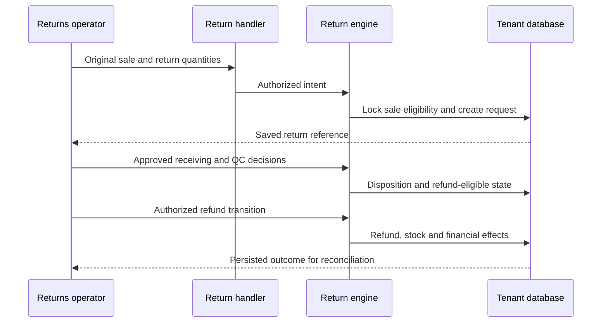
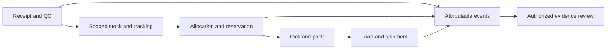

# Data boundaries and runtime views

Read [current architecture](current-architecture.md) first. These source views explain where to inspect a change; they do not approve mixed-owner production or regulated audit use.

## Ownership and storage

| Concern | Current source / owner | Review boundary |
|---|---|---|
| HTTP identity and route access | `internal/server/middleware.go`, route capabilities; security owner | Server-resolved tenant/identity and live credential state; never trust a client-supplied resolved header |
| Tenant schema | `db/db.go`, tenant lifecycle; platform owner | Public platform records and tenant schema privileges differ; transaction-local search path is not all authorization |
| Generic documents | `engines/doctype.go`, `documents.data`; module/data owners | Configured form validation and lifecycle; economic commands may require dedicated handlers |
| Dedicated ledgers and commands | Inventory, finance, POS, returns engines; process owners | Atomic writes, locking, command replay and final reconciliation |
| Integration and asynchronous work | `engines/jobrunner.go`, `engines/outbox.go`; integration/operations owners | Saved job/outbox state, external delivery, retries and uncertain outcomes |
| Audit and operational logs | `engines/logs.go`; security/operations owners | Evidence purpose, sensitive fields, retention and export; Stage 47.7 gaps remain |

The [dictionary](../data/generated/dictionary.md) inventories actual metadata and physical keys. JSON Link fields are not automatically SQL foreign keys. Entity/location/stock-owner constraints must be checked alongside tenant isolation. Backups can include multiple tenants and require distinct access and recovery controls.

## One owner per business truth

Stage 135.6, read from source on 2026-10-25 (functions under `engines/` unless named otherwise). Each truth has one authoritative record and the commands that should be its only writers. Everything else reads it or keeps a finer breakdown that must add up to it. No new ledger is proposed, and no existing table is reworked.

| Truth | Authoritative record | Commands that write it | Kept beside it (must reconcile) |
|---|---|---|---|
| Tenant, user, role, scope | `public.tenants` → `tenant_<x>` schema (`db.GetTenantSchema`); `users`, `roles`, `role_permissions` per schema | Tenant lifecycle; Settings → Users / Roles | `routeCapabilities` + `checkRouteCapability` (`internal/server`, run by `apiMiddleware`); `ResolveSessionScope` / `ScopeForDoctype` (`scope_policy.go`) |
| Item, variant, UOM | `Item` documents (variants are Items: `family`, `parent_product_code`, `variant_option_values`); `ProductFamily`, `ItemAttribute`; `UOMConversion` | Generic document save with `ValidateItemVariantUniqueness` / `PrepareItemVariantCode` (`pim.go`); `ConvertUOMQty` (`uom.go`) | No separate variant table exists; PIM enrichment writes the same Item |
| Physical quantity per item and location | `inventory_availability` (sku, location_code): on_hand, available, reserved, blocked, hold_qty, qc_hold, damaged, in_transit, inward, rtv, with_party | `PostInventoryLedgerWithVoucherTx` (`inventory.go`; locks rows in SKU order, refuses going below available − blocked − hold_qty, and for a till sale also less reserved) | `StockLedgerEntry` documents (movement history); `stock_location_balance`; `bin_stock` (see below) |
| Custody and condition | `hold_qty` + `Hold` documents (`placeHoldTx`); `Batch`, `SerialNumber`; `warehouse_owner` (one owner per warehouse) | `wms_holds.go`, `EnsureBatch`, `RegisterSerial`, `AssignWarehouseOwner` | `bin_stock_batch`, `bin_stock_owner` ≤ `bin_stock` |
| Customer commitment | `SalesOrder` / `SalesOrderLine` documents; `inventory_reservation` (+ `reserved` on availability) | `CreateSalesOrder` → `ResolveAllocationPlan` → `CreateReservation`; `ReleaseOrderToFulfillment` (FulfillmentTask); dispatch in `TransitionTaskStatus` | `bin_allocation` (a pick task's bin / lot / owner hold against `bin_stock`, not a second reservation) |
| Posted money and period | `gl_postings`; `accounting_periods` | `PostDoubleEntryTx` (`finance.go`): balance check, `rejectIfCurrentPeriodClosed`, idempotency key, insert | Subledgers feed it: POS, sales invoice (AR), vendor invoice / GRN post (AP), GRN costing, payroll, cycle count; `item_cost` is a moving average per item, not per location |
| External action and its acknowledgment | Intent: `async_jobs` (`EnqueueJob`), `integration_event_outbox` (`PublishEvent`, in the caller's transaction), `inbound_webhook_receipts`. Acknowledgment: courier `provider_awb`, IRP `irn` / `ack_no` / `signed_qr`, e-way bill `ewb_no` | `AllocateCourierAWB`, `irpAcknowledge`, `ewbGenerated`; channel sync runs (`recordChannelSyncRun`) | `integration_event_log`: real acknowledgments from Unicommerce and CleverTap; the generic outbox processor's "Success" rows are simulated and are not a provider acknowledgment |

### Stock: one quantity, three breakdowns and a reservation

An event changes the quantity once, in `inventory_availability`. The other tables say where inside the location the units are, or who they are promised to.

- **Inside a store**, `stock_location_balance` (sku, store, stock_location) holds the client's own locations (Alteration, Display, Inward). `MoveStock` → `applyBucketDeltaTx` changes the balance and `available` / `blocked` in one transaction. A receipt lands in the store's default location in the posting's transaction (`applyReceiptDefaultTx`).
- **Inside a warehouse**, `bin_stock` (bin, sku, condition) breaks the location into bins. Putaway (`PutawayToBin`) and bin-to-bin moves (`MoveBinStock`) change bins only, not the location's quantity. A pick scan takes units out of their bin (`ConsumeTaskBinStockTx`). Dispatch then lowers on_hand / available once, together with any bin units not scanned. Receipts, POS, transfers, adjustments and counts do not touch bins. `BinStockReconciliation` (report `bin-stock-reconciliation`) compares the two.
- **Promised, not moved**: `CreateReservation` adds a row and raises `reserved` in one transaction; available-to-sell is `computeATS` (available − reserved − safety − blocked − buffer − held). Dispatch lowers `reserved` and deletes the row in the same transaction as the stock decrement, so a shipped unit leaves the books once. Releases go through `releaseLineReservationAtLocation`, the order-change path or the sweeper, each of which deletes the row and lowers `reserved` together.
- **History**: `StockBookVsLedger` (`stock_book_ledger.go`) compares the book with the `StockLedgerEntry` movements.

### Gaps found on 2026-10-25

Fixed in Stage 135.6, with `TestStage135ReservationReleasedExactlyOnce`:

- Cancelling an order lowered `reserved` but left its reservation row. The sweeper then released the row again and ate another order's reservation (`CancelOrder` now calls `releaseLineReservationAtLocation`).
- A POS card authorization's holds were deleted without lowering `reserved`, so those units stayed reserved for good (`releasePOSReservations` now deletes and lowers in one statement).

Closed in Stage 135.16-135.20 (2026-10-27):

- Every writer that changes on_hand writes its `StockLedgerEntry` in the same transaction. Dispatch now goes through `PostInventoryLedgerWithVoucherTx` (it floored on_hand at zero), the challan write-off writes its row (it wrote none), and a stale cycle count is refused instead of floored. Holds, `MoveStock` and challan out / back move units between buckets without changing on_hand, so they need no ledger row (`StockMove` is MoveStock's record).
- Stock Book vs Ledger also compares `stock_location_balance` with `blocked`. Returnable challans and transfers now floor at available − blocked − hold_qty.
- A till sale's floor also subtracts `reserved` (user decision: a store sale respects online reservations at its location).
- Production issue and finish post under the order's row lock with a ledger key per posting. `PostDoubleEntryTx` takes an advisory lock on the posting key, so one key posts once. `ApplyReturnQC` re-checks its status under the request's row lock.

Still open (135.21): about 15 other posting paths read their document's status outside the posting transaction. The GL cannot double, but their stock, valuation or balances can.

## Return lifecycle

Inspect `engines/returns_atomic.go`, `engines/returns.go` and the Stage 47.4 HTTP tests. Original economics and cumulative return limits matter independently of current product price. Provider settlement requires its own reconciliation.

## Warehouse and audit boundaries

The flow is an operational view, not a claim that every step forms one transaction. Validate each command and the stock/owner/lot/serial identity across handoffs. Stage 47.5 selected and implemented one owner per warehouse; the `mixed_unsupported` opt-in does not provide allocation isolation or supported mixed-owner use. Evidence review must consider failed/replayed commands and ordering; the diagram does not imply immutable or legally sufficient audit storage.

## Job execution and recovery

Requests enqueue durable work where the job/outbox framework is used; in-process workers claim and execute it, record results and retry according to the registered handler. The application and PostgreSQL remain the deployment units. An extension or new handler needs the same cancellation, scoping, delivery-mode and reconciliation review. See [job/outbox operations](../operations/service-operations.md#job-and-outbox-recovery) and [decision register](decisions/decision-register.md).
