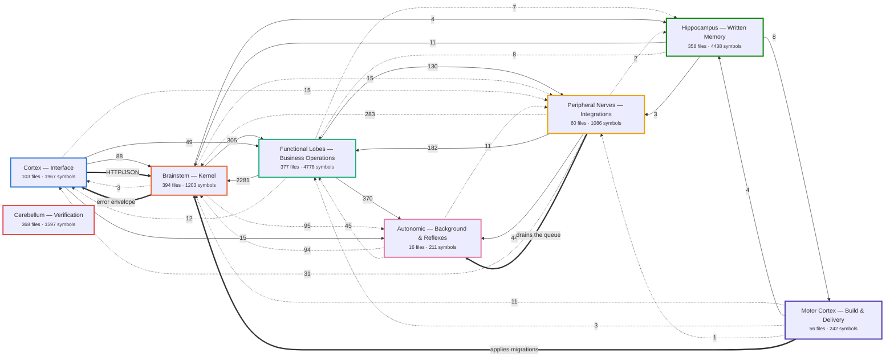
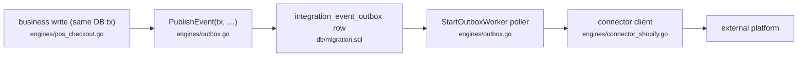
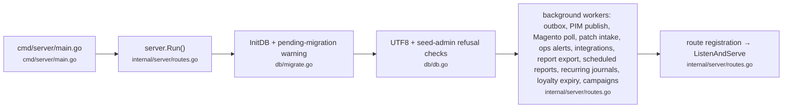

# Custom ERP — Project Brain

<!-- GENERATED FILE - do not edit by hand. Edit docs/brain/brain.map.json instead. -->
> **Generated.** Which regions exist comes from [`brain.map.json`](brain.map.json); which files exist comes
> from the working tree; what calls what comes from `graphify-out/graph.json`. Edit the map, never this
> file, then run `pwsh docs/brain/update-brain.ps1`. How to do that is in [README.md](README.md).

Every part of this system, grouped into brain regions, wired by the call graph graphify actually extracted from the source.

| | |
|---|---|
| Graph built from commit | `d5d7668c` |
| Brain redrawn | source graph d5d7668c |
| Regions / lobes | 38 / 8 |
| Files in the working tree | 1732 (1270 of them parsed into the graph) |
| Files claimed by a region | **100.0%** |
| Symbols in the graph | 16548 |
| Cross-region relationships | 6583 extracted (95% inferred) + 8 declared by hand |

**Interactive version: [brain.html](brain.html)** — open it in a browser and click any region.

## How to read this

- A **lobe** is a layer of the system; a **region** is one area of responsibility inside it. Which files belong to which region is decided entirely by the `match` patterns in `brain.map.json`.
- A **thin arrow** is a real relationship graphify extracted from the source — a call, a type reference, a method, an embed — aggregated up to the region level. The number on it is how many such relationships cross that boundary, which is a measure of coupling, not of importance.
- A **thick `==>` arrow** is *declared by hand* in `brain.map.json`. These are the connections a call-graph extractor structurally cannot see: the browser talking to the server over HTTP, a script driving the binary, a connector reaching a third-party API. They are drawn differently on purpose — they are asserted, not measured.
- A **solid arrow** contains at least one relationship graphify parsed straight out of the source (`EXTRACTED`). A **dotted arrow** is one where *every* underlying relationship is `INFERRED` — graphify's heuristic guess. Dotted is the common case here, and that is a property of the extractor, not a defect in the code: it resolves calls within a file exactly and calls across files by name, and 95% of cross-region relationships are cross-file by definition. So: the shape of this map is reliable, any *single* dotted edge is a lead to confirm with grep before you rely on it, and a solid arrow is one graphify actually saw.
- `contains` edges are excluded everywhere: a file containing its own functions says nothing about how areas of the system relate.
- The test suite is a region but is deliberately left out of every wiring diagram and every count. Tests reach into everything, so drawing them would flatten the real structure into noise.

## 1. The whole brain, at lobe level

8 lobes. If you read one diagram, read this one.

| Lobe | What it is | Regions | Files | Symbols | Wiring inside the lobe |
|---|---|---:|---:|---:|---:|
| **Cortex — Interface** | What the user sees and touches. Every business intent enters here. | 4 | 103 | 1967 | 199 |
| **Brainstem — Kernel** | Involuntary and non-negotiable. Every single request passes through here, whatever it is asking for. | 9 | 394 | 1203 | 600 |
| **Functional Lobes — Business Operations** | The specialised areas. Each one owns a domain and can be licensed on its own. | 16 | 377 | 4778 | 1410 |
| **Peripheral Nerves — Integrations** | Contact with the outside world: storefronts, payment terminals, marketing clouds, third-party extensions. | 3 | 60 | 1086 | 7 |
| **Autonomic — Background & Reflexes** | Runs without anyone asking it to: outbox drain, pollers, alerting, scheduled sweeps. | 2 | 16 | 211 | 26 |
| **Hippocampus — Written Memory** | What this project knows about itself: the backlog, the ledger, the guides, the handover note. | 2 | 358 | 4438 | 211 |
| **Motor Cortex — Build & Delivery** | How the system actually moves: build, migrate, promote, back up, restore. | 1 | 56 | 242 | 0 |
| **Cerebellum — Verification** | Balance and correction. Kept out of the wiring diagrams on purpose — tests touch everything, so drawing them would grey out every real edge. | 1 | 368 | 1597 | 0 |

## 2. Region map

Every region, grouped by lobe, with the connections of weight **12 or more**. The full set is in [brain.html](brain.html) and in §5 below.

```mermaid
flowchart LR
  subgraph n_g_cortex ["Cortex — Interface"]
    direction TB
    n_ui_shell["SPA Shell<br/><small>69 files · 1721 symbols</small>"]
    n_ui_offline["Offline Store & Device I/O<br/><small>2 files · 15 symbols</small>"]
    n_store_app["Store App (PWA)<br/><small>22 files · 231 symbols</small>"]
    n_industry_profiles["Industry Profiles<br/><small>10 files · 0 symbols</small>"]
  end
  subgraph n_g_brainstem ["Brainstem — Kernel"]
    direction TB
    n_http_edge["HTTP Edge & Middleware<br/><small>9 files · 83 symbols</small>"]
    n_api_errors["Error & Message Catalog<br/><small>3 files · 18 symbols</small>"]
    n_doc_kernel["Document Kernel<br/><small>27 files · 294 symbols</small>"]
    n_identity["Identity, RBAC & MFA<br/><small>28 files · 267 symbols</small>"]
    n_tenancy["Tenancy, Packaging & Settings<br/><small>25 files · 241 symbols</small>"]
    n_approval["Approval Engine (maker-checker)<br/><small>4 files · 34 symbols</small>"]
    n_persistence["Persistence & Migrations<br/><small>280 files · 36 symbols</small>"]
    n_mixed_handlers["Cross-module API Handlers<br/><small>2 files · 65 symbols</small>"]
    n_security_program["Security Baseline & Attack Surface<br/><small>16 files · 165 symbols</small>"]
  end
  subgraph n_g_business ["Functional Lobes — Business Operations"]
    direction TB
    n_finance["Finance & General Ledger<br/><small>37 files · 391 symbols</small>"]
    n_tax["Tax & Statutory<br/><small>11 files · 187 symbols</small>"]
    n_procurement["Procurement & Vendors<br/><small>25 files · 430 symbols</small>"]
    n_inventory["Inventory & Planning<br/><small>31 files · 415 symbols</small>"]
    n_wms["Warehouse Management (WMS)<br/><small>49 files · 531 symbols</small>"]
    n_oms["Orders & Fulfillment (OMS)<br/><small>25 files · 280 symbols</small>"]
    n_pos["Point of Sale<br/><small>29 files · 315 symbols</small>"]
    n_pim["Product Information (PIM)<br/><small>44 files · 506 symbols</small>"]
    n_crm["CRM & Loyalty<br/><small>43 files · 615 symbols</small>"]
    n_hr["HR & Payroll<br/><small>9 files · 54 symbols</small>"]
    n_manufacturing["Manufacturing & MRP<br/><small>5 files · 63 symbols</small>"]
    n_assets["Fixed Assets, Service & Quality Management<br/><small>12 files · 146 symbols</small>"]
    n_expenses["Expense Management<br/><small>5 files · 54 symbols</small>"]
    n_reports["Reporting Engine<br/><small>40 files · 552 symbols</small>"]
    n_logistics["Shipping & Logistics<br/><small>5 files · 73 symbols</small>"]
    n_data_io["Bulk Data I/O<br/><small>7 files · 166 symbols</small>"]
  end
  subgraph n_g_peripheral ["Peripheral Nerves — Integrations"]
    direction TB
    n_connectors["Channel Connectors<br/><small>21 files · 368 symbols</small>"]
    n_printing["Device Printing (QZ Tray)<br/><small>25 files · 531 symbols</small>"]
    n_extensions["Extension Platform<br/><small>14 files · 187 symbols</small>"]
  end
  subgraph n_g_autonomic ["Autonomic — Background & Reflexes"]
    direction TB
    n_outbox["Event Outbox & Async Job Runner<br/><small>6 files · 55 symbols</small>"]
    n_observability["Logging, Alerting & Notifications<br/><small>10 files · 156 symbols</small>"]
  end
  subgraph n_g_memory ["Hippocampus — Written Memory"]
    direction TB
    n_docs_memory["Project Documentation<br/><small>351 files · 4317 symbols</small>"]
    n_brain["The Brain Map (this)<br/><small>7 files · 121 symbols</small>"]
  end
  subgraph n_g_motor ["Motor Cortex — Build & Delivery"]
    direction TB
    n_ops_tooling["Build, Deploy & Operate<br/><small>56 files · 242 symbols</small>"]
  end
  n_brain -->|210| n_docs_memory
  n_ui_shell -.->|189| n_ui_offline
  n_wms -.->|170| n_persistence
  n_wms -.->|114| n_api_errors
  n_procurement -.->|112| n_doc_kernel
  n_finance -.->|109| n_persistence
  n_pim -.->|104| n_persistence
  n_mixed_handlers -.->|92| n_api_errors
  n_inventory -.->|85| n_persistence
  n_pos -.->|85| n_finance
  n_crm -.->|83| n_doc_kernel
  n_doc_kernel -.->|78| n_persistence
  n_inventory -.->|73| n_api_errors
  n_wms -.->|72| n_observability
  n_oms -.->|69| n_persistence
  n_pim -.->|67| n_api_errors
  n_pos -.->|67| n_persistence
  n_identity -.->|65| n_api_errors
  n_procurement -->|62| n_tax
  n_reports -.->|61| n_persistence
  n_oms -.->|59| n_api_errors
  n_procurement -.->|59| n_persistence
  n_connectors -.->|57| n_api_errors
  n_procurement -.->|57| n_wms
  n_identity -.->|53| n_persistence
  n_procurement -.->|53| n_api_errors
  n_connectors -.->|51| n_persistence
  n_inventory -->|47| n_procurement
  n_observability -.->|46| n_api_errors
  n_oms -.->|45| n_doc_kernel
  n_crm -.->|44| n_tenancy
  n_printing -->|44| n_procurement
  n_finance -.->|43| n_api_errors
  n_procurement -->|42| n_finance
  n_pim -.->|40| n_doc_kernel
  n_wms -.->|40| n_doc_kernel
  n_crm -.->|39| n_procurement
  n_finance -.->|39| n_observability
  n_inventory -.->|39| n_pim
  n_crm -.->|38| n_persistence
  n_identity -.->|38| n_observability
  n_inventory -.->|37| n_doc_kernel
  n_inventory -->|37| n_wms
  n_reports -->|37| n_procurement
  n_procurement -->|36| n_data_io
  n_tenancy -.->|36| n_persistence
  n_assets -.->|35| n_api_errors
  n_assets -.->|35| n_persistence
  n_oms -.->|35| n_observability
  n_doc_kernel -.->|34| n_api_errors
  n_oms -->|33| n_wms
  n_pos -.->|33| n_doc_kernel
  n_wms -->|32| n_inventory
  n_wms -.->|32| n_reports
  n_inventory -.->|31| n_observability
  n_mixed_handlers -->|31| n_pim
  n_mixed_handlers -.->|31| n_pos
  n_pos -.->|31| n_api_errors
  n_tenancy -.->|31| n_api_errors
  n_data_io -->|30| n_doc_kernel
  n_procurement -.->|30| n_observability
  n_pos -->|29| n_inventory
  n_printing -.->|29| n_ui_offline
  n_reports -.->|29| n_api_errors
  n_extensions -.->|28| n_persistence
  n_pos -->|27| n_tax
  n_assets -.->|26| n_procurement
  n_crm -.->|26| n_api_errors
  n_finance -.->|26| n_doc_kernel
  n_oms -->|26| n_inventory
  n_identity -.->|25| n_tenancy
  n_pim -.->|25| n_observability
  n_store_app -.->|25| n_persistence
  n_assets -.->|23| n_finance
  n_crm -.->|23| n_observability
  n_doc_kernel -.->|23| n_procurement
  n_reports -->|23| n_identity
  n_store_app -.->|23| n_api_errors
  n_manufacturing -.->|22| n_api_errors
  n_pos -.->|22| n_observability
  n_printing -.->|22| n_doc_kernel
  n_crm -.->|21| n_tax
  n_doc_kernel -.->|21| n_identity
  n_doc_kernel -.->|21| n_wms
  n_finance -.->|21| n_wms
  n_reports -.->|21| n_finance
  n_tax -.->|21| n_persistence
  n_connectors -.->|20| n_tenancy
  n_finance -.->|20| n_pim
  n_finance -->|20| n_reports
  n_procurement -.->|20| n_inventory
  n_connectors -.->|19| n_identity
  n_inventory -.->|19| n_finance
  n_observability -->|19| n_outbox
  n_pim -.->|19| n_procurement
  n_pos -.->|19| n_crm
  n_store_app -->|19| n_identity
  n_wms -->|19| n_procurement
  n_connectors -->|18| n_procurement
  n_inventory -.->|18| n_identity
  n_observability -.->|18| n_persistence
  n_printing -->|18| n_pim
  n_printing -.->|18| n_tax
  n_connectors -.->|17| n_observability
  n_connectors -->|17| n_oms
  n_data_io -->|17| n_printing
  n_doc_kernel -->|17| n_inventory
  n_doc_kernel -.->|17| n_tax
  n_expenses -.->|17| n_api_errors
  n_extensions -.->|17| n_api_errors
  n_hr -.->|17| n_persistence
  n_pim -->|17| n_connectors
  n_printing -.->|17| n_persistence
  n_reports -.->|17| n_tenancy
  n_store_app -.->|17| n_procurement
  n_crm -->|16| n_approval
  n_hr -.->|16| n_api_errors
  n_manufacturing -.->|16| n_persistence
  n_crm -->|15| n_reports
  n_data_io -.->|15| n_api_errors
  n_hr -->|15| n_identity
  n_inventory -->|15| n_pos
  n_inventory -.->|15| n_tenancy
  n_pos -->|15| n_oms
  n_procurement -.->|15| n_pim
  n_assets -.->|14| n_doc_kernel
  n_connectors -->|14| n_outbox
  n_data_io -->|14| n_identity
  n_doc_kernel -.->|14| n_pim
  n_finance -->|14| n_procurement
  n_oms -->|14| n_pos
  n_approval -.->|13| n_persistence
  n_crm -->|13| n_finance
  n_http_edge -.->|13| n_api_errors
  n_http_edge -.->|13| n_tenancy
  n_oms -.->|13| n_finance
  n_printing -.->|13| n_api_errors
  n_printing -.->|13| n_wms
  n_doc_kernel -.->|12| n_tenancy
  n_oms -.->|12| n_procurement
  n_oms -->|12| n_tax
  n_pim -->|12| n_data_io
  n_procurement -.->|12| n_tenancy
  n_tax -.->|12| n_api_errors
  n_tax -.->|12| n_procurement
  n_wms -->|12| n_oms
  n_ui_shell ==>|HTTP/JSON| n_http_edge
  n_api_errors ==>|error envelope| n_ui_shell
  n_ui_offline ==>|queued replay| n_http_edge
  n_industry_profiles ==>|loaded at runtime| n_doc_kernel
  n_connectors ==>|drains the queue| n_outbox
  n_ops_tooling ==>|applies migrations| n_persistence
  n_ops_tooling ==>|builds & restarts| n_http_edge
  n_brain ==>|keeps in sync| n_docs_memory
  classDef n_cortex stroke:#2a78d6,stroke-width:2px;
  class n_ui_shell,n_ui_offline,n_store_app,n_industry_profiles n_cortex;
  classDef n_brainstem stroke:#eb6834,stroke-width:2px;
  class n_http_edge,n_api_errors,n_doc_kernel,n_identity,n_tenancy,n_approval,n_persistence,n_mixed_handlers,n_security_program n_brainstem;
  classDef n_business stroke:#1baf7a,stroke-width:2px;
  class n_finance,n_tax,n_procurement,n_inventory,n_wms,n_oms,n_pos,n_pim,n_crm,n_hr,n_manufacturing,n_assets,n_expenses,n_reports,n_logistics,n_data_io n_business;
  classDef n_peripheral stroke:#eda100,stroke-width:2px;
  class n_connectors,n_printing,n_extensions n_peripheral;
  classDef n_autonomic stroke:#e87ba4,stroke-width:2px;
  class n_outbox,n_observability n_autonomic;
  classDef n_memory stroke:#008300,stroke-width:2px;
  class n_docs_memory,n_brain n_memory;
  classDef n_motor stroke:#4a3aa7,stroke-width:2px;
  class n_ops_tooling n_motor;
```

### 2b. The same map with the universal hubs removed

**Error & Message Catalog**, **Persistence & Migrations**, **Logging, Alerting & Notifications** are reached from nearly every region — which is the point of them, but it means they dominate the diagram above and hide everything else. Take them out and what is left is how the business areas actually relate to each other.

```mermaid
flowchart LR
  subgraph n_g_cortex ["Cortex — Interface"]
    direction TB
    n_ui_shell["SPA Shell<br/><small>69 files · 1721 symbols</small>"]
    n_ui_offline["Offline Store & Device I/O<br/><small>2 files · 15 symbols</small>"]
    n_store_app["Store App (PWA)<br/><small>22 files · 231 symbols</small>"]
    n_industry_profiles["Industry Profiles<br/><small>10 files · 0 symbols</small>"]
  end
  subgraph n_g_brainstem ["Brainstem — Kernel"]
    direction TB
    n_http_edge["HTTP Edge & Middleware<br/><small>9 files · 83 symbols</small>"]
    n_doc_kernel["Document Kernel<br/><small>27 files · 294 symbols</small>"]
    n_identity["Identity, RBAC & MFA<br/><small>28 files · 267 symbols</small>"]
    n_tenancy["Tenancy, Packaging & Settings<br/><small>25 files · 241 symbols</small>"]
    n_approval["Approval Engine (maker-checker)<br/><small>4 files · 34 symbols</small>"]
    n_mixed_handlers["Cross-module API Handlers<br/><small>2 files · 65 symbols</small>"]
    n_security_program["Security Baseline & Attack Surface<br/><small>16 files · 165 symbols</small>"]
  end
  subgraph n_g_business ["Functional Lobes — Business Operations"]
    direction TB
    n_finance["Finance & General Ledger<br/><small>37 files · 391 symbols</small>"]
    n_tax["Tax & Statutory<br/><small>11 files · 187 symbols</small>"]
    n_procurement["Procurement & Vendors<br/><small>25 files · 430 symbols</small>"]
    n_inventory["Inventory & Planning<br/><small>31 files · 415 symbols</small>"]
    n_wms["Warehouse Management (WMS)<br/><small>49 files · 531 symbols</small>"]
    n_oms["Orders & Fulfillment (OMS)<br/><small>25 files · 280 symbols</small>"]
    n_pos["Point of Sale<br/><small>29 files · 315 symbols</small>"]
    n_pim["Product Information (PIM)<br/><small>44 files · 506 symbols</small>"]
    n_crm["CRM & Loyalty<br/><small>43 files · 615 symbols</small>"]
    n_hr["HR & Payroll<br/><small>9 files · 54 symbols</small>"]
    n_manufacturing["Manufacturing & MRP<br/><small>5 files · 63 symbols</small>"]
    n_assets["Fixed Assets, Service & Quality Management<br/><small>12 files · 146 symbols</small>"]
    n_expenses["Expense Management<br/><small>5 files · 54 symbols</small>"]
    n_reports["Reporting Engine<br/><small>40 files · 552 symbols</small>"]
    n_logistics["Shipping & Logistics<br/><small>5 files · 73 symbols</small>"]
    n_data_io["Bulk Data I/O<br/><small>7 files · 166 symbols</small>"]
  end
  subgraph n_g_peripheral ["Peripheral Nerves — Integrations"]
    direction TB
    n_connectors["Channel Connectors<br/><small>21 files · 368 symbols</small>"]
    n_printing["Device Printing (QZ Tray)<br/><small>25 files · 531 symbols</small>"]
    n_extensions["Extension Platform<br/><small>14 files · 187 symbols</small>"]
  end
  subgraph n_g_autonomic ["Autonomic — Background & Reflexes"]
    direction TB
    n_outbox["Event Outbox & Async Job Runner<br/><small>6 files · 55 symbols</small>"]
  end
  subgraph n_g_memory ["Hippocampus — Written Memory"]
    direction TB
    n_docs_memory["Project Documentation<br/><small>351 files · 4317 symbols</small>"]
    n_brain["The Brain Map (this)<br/><small>7 files · 121 symbols</small>"]
  end
  subgraph n_g_motor ["Motor Cortex — Build & Delivery"]
    direction TB
    n_ops_tooling["Build, Deploy & Operate<br/><small>56 files · 242 symbols</small>"]
  end
  n_brain -->|210| n_docs_memory
  n_ui_shell -.->|189| n_ui_offline
  n_procurement -.->|112| n_doc_kernel
  n_pos -.->|85| n_finance
  n_crm -.->|83| n_doc_kernel
  n_procurement -->|62| n_tax
  n_procurement -.->|57| n_wms
  n_inventory -->|47| n_procurement
  n_oms -.->|45| n_doc_kernel
  n_crm -.->|44| n_tenancy
  n_printing -->|44| n_procurement
  n_procurement -->|42| n_finance
  n_pim -.->|40| n_doc_kernel
  n_wms -.->|40| n_doc_kernel
  n_crm -.->|39| n_procurement
  n_inventory -.->|39| n_pim
  n_inventory -.->|37| n_doc_kernel
  n_inventory -->|37| n_wms
  n_reports -->|37| n_procurement
  n_procurement -->|36| n_data_io
  n_oms -->|33| n_wms
  n_pos -.->|33| n_doc_kernel
  n_wms -->|32| n_inventory
  n_wms -.->|32| n_reports
  n_mixed_handlers -->|31| n_pim
  n_mixed_handlers -.->|31| n_pos
  n_data_io -->|30| n_doc_kernel
  n_pos -->|29| n_inventory
  n_printing -.->|29| n_ui_offline
  n_pos -->|27| n_tax
  n_assets -.->|26| n_procurement
  n_finance -.->|26| n_doc_kernel
  n_oms -->|26| n_inventory
  n_identity -.->|25| n_tenancy
  n_assets -.->|23| n_finance
  n_doc_kernel -.->|23| n_procurement
  n_reports -->|23| n_identity
  n_printing -.->|22| n_doc_kernel
  n_crm -.->|21| n_tax
  n_doc_kernel -.->|21| n_identity
  n_doc_kernel -.->|21| n_wms
  n_finance -.->|21| n_wms
  n_reports -.->|21| n_finance
  n_connectors -.->|20| n_tenancy
  n_finance -.->|20| n_pim
  n_finance -->|20| n_reports
  n_procurement -.->|20| n_inventory
  n_connectors -.->|19| n_identity
  n_inventory -.->|19| n_finance
  n_pim -.->|19| n_procurement
  n_pos -.->|19| n_crm
  n_store_app -->|19| n_identity
  n_wms -->|19| n_procurement
  n_connectors -->|18| n_procurement
  n_inventory -.->|18| n_identity
  n_printing -->|18| n_pim
  n_printing -.->|18| n_tax
  n_connectors -->|17| n_oms
  n_data_io -->|17| n_printing
  n_doc_kernel -->|17| n_inventory
  n_doc_kernel -.->|17| n_tax
  n_pim -->|17| n_connectors
  n_reports -.->|17| n_tenancy
  n_store_app -.->|17| n_procurement
  n_crm -->|16| n_approval
  n_crm -->|15| n_reports
  n_hr -->|15| n_identity
  n_inventory -->|15| n_pos
  n_inventory -.->|15| n_tenancy
  n_pos -->|15| n_oms
  n_procurement -.->|15| n_pim
  n_assets -.->|14| n_doc_kernel
  n_connectors -->|14| n_outbox
  n_data_io -->|14| n_identity
  n_doc_kernel -.->|14| n_pim
  n_finance -->|14| n_procurement
  n_oms -->|14| n_pos
  n_crm -->|13| n_finance
  n_http_edge -.->|13| n_tenancy
  n_oms -.->|13| n_finance
  n_printing -.->|13| n_wms
  n_doc_kernel -.->|12| n_tenancy
  n_oms -.->|12| n_procurement
  n_oms -->|12| n_tax
  n_pim -->|12| n_data_io
  n_procurement -.->|12| n_tenancy
  n_tax -.->|12| n_procurement
  n_wms -->|12| n_oms
  n_crm -.->|11| n_extensions
  n_crm -.->|11| n_wms
  n_mixed_handlers -.->|11| n_approval
  n_pim -.->|11| n_inventory
  n_reports -.->|11| n_doc_kernel
  n_reports -.->|11| n_inventory
  n_store_app -->|11| n_wms
  n_tenancy -->|11| n_doc_kernel
  n_ui_shell -.->|11| n_printing
  n_data_io -->|10| n_tenancy
  n_store_app -.->|10| n_tenancy
  n_tax -->|10| n_doc_kernel
  n_approval -.->|9| n_finance
  n_crm -.->|9| n_printing
  n_finance -->|9| n_tax
  n_logistics -.->|9| n_connectors
  n_mixed_handlers -.->|9| n_finance
  n_oms -->|9| n_reports
  n_oms -.->|9| n_tenancy
  n_pim -.->|9| n_tenancy
  n_procurement -.->|9| n_printing
  n_reports -.->|9| n_outbox
  n_store_app -.->|9| n_inventory
  n_tax -.->|9| n_finance
  n_connectors -.->|8| n_http_edge
  n_data_io -.->|8| n_pim
  n_http_edge -.->|8| n_identity
  n_manufacturing -.->|8| n_inventory
  n_manufacturing -.->|8| n_wms
  n_mixed_handlers -.->|8| n_identity
  n_mixed_handlers -.->|8| n_inventory
  n_reports -.->|8| n_ui_offline
  n_store_app -->|8| n_doc_kernel
  n_tenancy -.->|8| n_identity
  n_wms -.->|8| n_finance
  n_assets -.->|7| n_inventory
  n_connectors -.->|7| n_doc_kernel
  n_connectors -.->|7| n_extensions
  n_connectors -.->|7| n_pim
  n_connectors -.->|7| n_tax
  n_crm -.->|7| n_inventory
  n_extensions -.->|7| n_identity
  n_hr -.->|7| n_finance
  n_http_edge -.->|7| n_finance
  n_http_edge -.->|7| n_pim
  n_identity -.->|7| n_expenses
  n_inventory -.->|7| n_approval
  n_inventory -.->|7| n_oms
  n_logistics -.->|7| n_oms
  n_pim -.->|7| n_outbox
  n_pos -.->|7| n_wms
  n_reports -.->|7| n_printing
  n_store_app -.->|7| n_ui_offline
  n_wms -.->|7| n_tenancy
  n_assets -.->|6| n_wms
  n_crm -.->|6| n_assets
  n_data_io -->|6| n_inventory
  n_doc_kernel -.->|6| n_finance
  n_doc_kernel -.->|6| n_pos
  n_extensions -.->|6| n_http_edge
  n_hr -.->|6| n_wms
  n_inventory -.->|6| n_tax
  n_mixed_handlers -->|6| n_data_io
  n_pim -.->|6| n_expenses
  n_wms -.->|6| n_assets
  n_assets -->|5| n_outbox
  n_connectors -.->|5| n_crm
  n_crm -.->|5| n_outbox
  n_finance -.->|5| n_outbox
  n_finance -.->|5| n_tenancy
  n_http_edge -.->|5| n_connectors
  n_http_edge -.->|5| n_outbox
  n_http_edge -.->|5| n_reports
  n_identity -.->|5| n_pim
  n_inventory -.->|5| n_reports
  n_logistics -.->|5| n_doc_kernel
  n_logistics -.->|5| n_finance
  n_oms -.->|5| n_connectors
  n_oms -.->|5| n_crm
  n_pim -.->|5| n_extensions
  n_pim -.->|5| n_printing
  n_pos -.->|5| n_pim
  n_reports -.->|5| n_crm
  n_reports -.->|5| n_extensions
  n_reports -.->|5| n_tax
  n_security_program -.->|5| n_identity
  n_store_app -.->|5| n_finance
  n_store_app -->|5| n_outbox
  n_tax -.->|5| n_connectors
  n_tax -->|5| n_printing
  n_tenancy -.->|5| n_pim
  n_approval -.->|4| n_identity
  n_approval -.->|4| n_pim
  n_assets -.->|4| n_pim
  n_brain -->|4| n_ops_tooling
  n_connectors -.->|4| n_pos
  n_crm -.->|4| n_connectors
  n_crm -->|4| n_identity
  n_doc_kernel -.->|4| n_approval
  n_doc_kernel -.->|4| n_http_edge
  n_docs_memory -.->|4| n_inventory
  n_docs_memory -->|4| n_ops_tooling
  n_docs_memory -->|4| n_security_program
  n_expenses -->|4| n_identity
  n_extensions -.->|4| n_tenancy
  n_finance -.->|4| n_approval
  n_finance -.->|4| n_extensions
  n_identity -->|4| n_doc_kernel
  n_identity -.->|4| n_hr
  n_mixed_handlers -.->|4| n_connectors
  n_mixed_handlers -.->|4| n_reports
  n_oms -.->|4| n_logistics
  n_oms -->|4| n_outbox
  n_ops_tooling -->|4| n_docs_memory
  n_pim -.->|4| n_finance
  n_pim -.->|4| n_identity
  n_pim -.->|4| n_mixed_handlers
  n_pim -.->|4| n_reports
  n_pos -.->|4| n_approval
  n_pos -.->|4| n_identity
  n_pos -.->|4| n_procurement
  n_printing -.->|4| n_finance
  n_printing -.->|4| n_inventory
  n_printing -.->|4| n_pos
  n_procurement -.->|4| n_approval
  n_procurement -->|4| n_oms
  n_reports -.->|4| n_pos
  n_security_program -->|4| n_docs_memory
  n_tax -.->|4| n_wms
  n_approval -.->|3| n_crm
  n_approval -.->|3| n_inventory
  n_approval -.->|3| n_tenancy
  n_connectors -.->|3| n_wms
  n_crm -.->|3| n_oms
  n_doc_kernel -.->|3| n_crm
  n_doc_kernel -.->|3| n_hr
  n_expenses -.->|3| n_doc_kernel
  n_extensions -.->|3| n_expenses
  n_extensions -.->|3| n_outbox
  n_finance -.->|3| n_assets
  n_finance -.->|3| n_crm
  n_hr -.->|3| n_doc_kernel
  n_http_edge -.->|3| n_crm
  n_http_edge -.->|3| n_extensions
  n_http_edge -.->|3| n_security_program
  n_identity -.->|3| n_outbox
  n_inventory -.->|3| n_manufacturing
  n_inventory -.->|3| n_outbox
  n_manufacturing -.->|3| n_tenancy
  n_mixed_handlers -.->|3| n_expenses
  n_mixed_handlers -.->|3| n_procurement
  n_ops_tooling -.->|3| n_identity
  n_ops_tooling -.->|3| n_reports
  n_outbox -.->|3| n_tenancy
  n_pim -.->|3| n_oms
  n_pim -.->|3| n_wms
  n_pos -.->|3| n_reports
  n_pos -.->|3| n_tenancy
  n_printing -.->|3| n_tenancy
  n_reports -.->|3| n_pim
  n_reports -.->|3| n_wms
  n_store_app -.->|3| n_printing
  n_tax -.->|3| n_approval
  n_tax -.->|3| n_inventory
  n_tax -.->|3| n_tenancy
  n_tenancy -.->|3| n_expenses
  n_tenancy -.->|3| n_http_edge
  n_tenancy -->|3| n_procurement
  n_ui_shell -.->|3| n_store_app
  n_wms -.->|3| n_pim
  n_ui_shell ==>|HTTP/JSON| n_http_edge
  n_ui_offline ==>|queued replay| n_http_edge
  n_industry_profiles ==>|loaded at runtime| n_doc_kernel
  n_connectors ==>|drains the queue| n_outbox
  n_ops_tooling ==>|builds & restarts| n_http_edge
  n_brain ==>|keeps in sync| n_docs_memory
  classDef n_cortex stroke:#2a78d6,stroke-width:2px;
  class n_ui_shell,n_ui_offline,n_store_app,n_industry_profiles n_cortex;
  classDef n_brainstem stroke:#eb6834,stroke-width:2px;
  class n_http_edge,n_doc_kernel,n_identity,n_tenancy,n_approval,n_mixed_handlers,n_security_program n_brainstem;
  classDef n_business stroke:#1baf7a,stroke-width:2px;
  class n_finance,n_tax,n_procurement,n_inventory,n_wms,n_oms,n_pos,n_pim,n_crm,n_hr,n_manufacturing,n_assets,n_expenses,n_reports,n_logistics,n_data_io n_business;
  classDef n_peripheral stroke:#eda100,stroke-width:2px;
  class n_connectors,n_printing,n_extensions n_peripheral;
  classDef n_autonomic stroke:#e87ba4,stroke-width:2px;
  class n_outbox n_autonomic;
  classDef n_memory stroke:#008300,stroke-width:2px;
  class n_docs_memory,n_brain n_memory;
  classDef n_motor stroke:#4a3aa7,stroke-width:2px;
  class n_ops_tooling n_motor;
```

*Showing every non-hub connection of weight 3 or more (258 of them).*

### 2c. Declared connections

These are asserted in `brain.map.json`, not measured. Each one is a boundary a call-graph extractor cannot cross.

| From | To | Boundary | Why it has to be declared |
|---|---|---|---|
| SPA Shell | HTTP Edge & Middleware | HTTP/JSON | The SPA is JavaScript and the server is Go. apiFetch() calls the route table over the network; no extractor can link the two. |
| Error & Message Catalog | SPA Shell | error envelope | showApiError() renders the exact code/message the catalog returns. Contract enforced by convention on both sides, invisible to either language's AST. |
| Offline Store & Device I/O | HTTP Edge & Middleware | queued replay | Offline POS writes queue into IndexedDB and are replayed against the same endpoints when the network returns. |
| Industry Profiles | Document Kernel | loaded at runtime | SwitchIndustryProfile reads a JSON profile off disk by path; the profiles are data, not code, so nothing links to them statically. |
| Channel Connectors | Event Outbox & Async Job Runner | drains the queue | The outbox worker dispatches by event name through a registry rather than by direct call, so the edge is a table lookup, not a call site. |
| Build, Deploy & Operate | Persistence & Migrations | applies migrations | promote.ps1 and deploy/migrate.sh run the migration files; PowerShell and .sql are both outside the Go call graph. |
| Build, Deploy & Operate | HTTP Edge & Middleware | builds & restarts | manage.ps1/promote.ps1 build the binary and control its lifecycle from outside the process entirely. |
| The Brain Map (this) | Project Documentation | keeps in sync | The brain is regenerated alongside the big 3 docs; the relationship is a convention in CLAUDE.md, not a code dependency. |

## 3. Signal pathways

The routes a signal actually takes through the brain. These are described by hand in `brain.map.json` (`pathways`) because ordering is intent — a call graph can tell you that A reaches B, not that it must happen third.

### Request signal path

What happens to one API call, in order. Everything downstream of apiMiddleware trusts the Resolved-* headers it sets and nothing the client claimed.

```mermaid
flowchart LR
  n_request0["Browser: apiFetch()<br/><small>public/app.js</small>"]
  n_request1["Route table<br/><small>internal/server/routes.go</small>"]
  n_request0 --> n_request1
  n_request2["apiMiddleware: CORS → 2MB cap → rate limit → panic recovery<br/><small>internal/server/middleware.go</small>"]
  n_request1 --> n_request2
  n_request3["JWT verify → tenant resolve → Resolved-Tenant-ID / Resolved-User-ID headers<br/><small>internal/server/middleware.go</small>"]
  n_request2 --> n_request3
  n_request4["handler<br/><small>internal/server/handlers_*.go</small>"]
  n_request3 --> n_request4
  n_request5["engine<br/><small>engines/*.go</small>"]
  n_request4 --> n_request5
  n_request6["GetTenantSchema + SetSearchPath<br/><small>db/db.go</small>"]
  n_request5 --> n_request6
  n_request7["PostgreSQL tenant schema<br/><small>db/migration.sql</small>"]
  n_request6 --> n_request7
  n_request8["writeAPIError / JSON envelope<br/><small>internal/server/apierror.go</small>"]
  n_request7 --> n_request8
  n_request9["showApiError()<br/><small>public/app.js</small>"]
  n_request8 --> n_request9
```

### Outbound integration path

No user-facing transaction ever makes a synchronous outbound HTTP call. This is why a down Shopify cannot hang a checkout.

### Maker-checker path

Any approval-gated document follows this. Editing an already-approved document resets it to pending rather than silently keeping the approval.

### Boot & reflex startup

What comes up when the binary starts, before it ever serves a request. One cancellable context is threaded into every worker so SIGTERM lets them finish a tick and exit.

## 4. Region index

| Region | Lobe | Files | Symbols | Busiest connection |
|---|---|---:|---:|---|
| [SPA Shell](#spa-shell) | Cortex — Interface | 69 | 1721 | → Offline Store & Device I/O (189) |
| [Offline Store & Device I/O](#offline-store--device-io) | Cortex — Interface | 2 | 15 | ← SPA Shell (189) |
| [Store App (PWA)](#store-app-pwa) | Cortex — Interface | 22 | 231 | → Persistence & Migrations (25) |
| [Industry Profiles](#industry-profiles) | Cortex — Interface | 10 | 0 | — |
| [HTTP Edge & Middleware](#http-edge--middleware) | Brainstem — Kernel | 9 | 83 | → Error & Message Catalog (13) |
| [Error & Message Catalog](#error--message-catalog) | Brainstem — Kernel | 3 | 18 | ← Warehouse Management (WMS) (114) |
| [Document Kernel](#document-kernel) | Brainstem — Kernel | 27 | 294 | ← Procurement & Vendors (112) |
| [Identity, RBAC & MFA](#identity-rbac--mfa) | Brainstem — Kernel | 28 | 267 | → Error & Message Catalog (65) |
| [Tenancy, Packaging & Settings](#tenancy-packaging--settings) | Brainstem — Kernel | 25 | 241 | ← CRM & Loyalty (44) |
| [Approval Engine (maker-checker)](#approval-engine-maker-checker) | Brainstem — Kernel | 4 | 34 | ← CRM & Loyalty (16) |
| [Persistence & Migrations](#persistence--migrations) | Brainstem — Kernel | 280 | 36 | ← Warehouse Management (WMS) (170) |
| [Cross-module API Handlers](#cross-module-api-handlers) | Brainstem — Kernel | 2 | 65 | → Error & Message Catalog (92) |
| [Finance & General Ledger](#finance--general-ledger) | Functional Lobes — Business Operations | 37 | 391 | → Persistence & Migrations (109) |
| [Tax & Statutory](#tax--statutory) | Functional Lobes — Business Operations | 11 | 187 | ← Procurement & Vendors (62) |
| [Procurement & Vendors](#procurement--vendors) | Functional Lobes — Business Operations | 25 | 430 | → Document Kernel (112) |
| [Inventory & Planning](#inventory--planning) | Functional Lobes — Business Operations | 31 | 415 | → Persistence & Migrations (85) |
| [Warehouse Management (WMS)](#warehouse-management-wms) | Functional Lobes — Business Operations | 49 | 531 | → Persistence & Migrations (170) |
| [Orders & Fulfillment (OMS)](#orders--fulfillment-oms) | Functional Lobes — Business Operations | 25 | 280 | → Persistence & Migrations (69) |
| [Point of Sale](#point-of-sale) | Functional Lobes — Business Operations | 29 | 315 | → Finance & General Ledger (85) |
| [Product Information (PIM)](#product-information-pim) | Functional Lobes — Business Operations | 44 | 506 | → Persistence & Migrations (104) |
| [CRM & Loyalty](#crm--loyalty) | Functional Lobes — Business Operations | 43 | 615 | → Document Kernel (83) |
| [HR & Payroll](#hr--payroll) | Functional Lobes — Business Operations | 9 | 54 | → Persistence & Migrations (17) |
| [Manufacturing & MRP](#manufacturing--mrp) | Functional Lobes — Business Operations | 5 | 63 | → Error & Message Catalog (22) |
| [Fixed Assets, Service & Quality Management](#fixed-assets-service--quality-management) | Functional Lobes — Business Operations | 12 | 146 | → Error & Message Catalog (35) |
| [Expense Management](#expense-management) | Functional Lobes — Business Operations | 5 | 54 | → Error & Message Catalog (17) |
| [Reporting Engine](#reporting-engine) | Functional Lobes — Business Operations | 40 | 552 | → Persistence & Migrations (61) |
| [Shipping & Logistics](#shipping--logistics) | Functional Lobes — Business Operations | 5 | 73 | → Persistence & Migrations (11) |
| [Bulk Data I/O](#bulk-data-io) | Functional Lobes — Business Operations | 7 | 166 | ← Procurement & Vendors (36) |
| [Channel Connectors](#channel-connectors) | Peripheral Nerves — Integrations | 21 | 368 | → Error & Message Catalog (57) |
| [Device Printing (QZ Tray)](#device-printing-qz-tray) | Peripheral Nerves — Integrations | 25 | 531 | → Procurement & Vendors (44) |
| [Extension Platform](#extension-platform) | Peripheral Nerves — Integrations | 14 | 187 | → Persistence & Migrations (28) |
| [Event Outbox & Async Job Runner](#event-outbox--async-job-runner) | Autonomic — Background & Reflexes | 6 | 55 | ← Logging, Alerting & Notifications (19) |
| [Logging, Alerting & Notifications](#logging-alerting--notifications) | Autonomic — Background & Reflexes | 10 | 156 | ← Warehouse Management (WMS) (72) |
| [Project Documentation](#project-documentation) | Hippocampus — Written Memory | 351 | 4317 | ← The Brain Map (this) (210) |
| [The Brain Map (this)](#the-brain-map-this) | Hippocampus — Written Memory | 7 | 121 | → Project Documentation (210) |
| [Build, Deploy & Operate](#build-deploy--operate) | Motor Cortex — Build & Delivery | 56 | 242 | → Persistence & Migrations (5) |
| [Security Baseline & Attack Surface](#security-baseline--attack-surface) | Brainstem — Kernel | 16 | 165 | → Persistence & Migrations (9) |
| [Test Suite](#test-suite) | Cerebellum — Verification | 368 | 1597 | — |

## 5. Region detail

### Cortex — Interface

*What the user sees and touches. Every business intent enters here.*

#### SPA Shell

The whole frontend: one hand-written vanilla-JS single-page app, no framework and no build step. Owns routing (renderView), every screen's markup, the two dialog systems, and the shared apiFetch/showApiError error path.

**Most connected symbols**

- `apiFetch()` — [public/app.js](../../public/app.js#L911) · degree 29
- `init()` — [public/app.js](../../public/app.js#L3478) · degree 22
- `renderPick()` — [public/view-oms-steps.js](../../public/view-oms-steps.js#L255) · degree 21
- `renderView()` — [public/app.js](../../public/app.js#L5936) · degree 21
- `ErpTypeahead` — [public/components/erp-typeahead.js](../../public/components/erp-typeahead.js#L65) · degree 20
- `renderPack()` — [public/view-oms-steps.js](../../public/view-oms-steps.js#L401) · degree 19

**Wired to**

- → **Offline Store & Device I/O** — 189 relationships, 189 inferred
- → **Device Printing (QZ Tray)** — 11 relationships, 11 inferred
- → **Store App (PWA)** — 3 relationships, 3 inferred
- → **CRM & Loyalty** — 1 relationship, 1 inferred
- → **HTTP Edge & Middleware** — declared: HTTP/JSON
- ← **Device Printing (QZ Tray)** — 2 relationships, 2 inferred
- ← **Document Kernel** — 1 relationship, 1 inferred
- ← **Error & Message Catalog** — declared: error envelope

69 files

- [public/app.js](../../public/app.js)
- [public/brand-logo-dark.png](../../public/brand-logo-dark.png)
- [public/brand-logo.png](../../public/brand-logo.png)
- [public/brand-mark.png](../../public/brand-mark.png)
- [public/components/erp-typeahead.js](../../public/components/erp-typeahead.js)
- [public/favicon-16.png](../../public/favicon-16.png)
- [public/favicon.png](../../public/favicon.png)
- [public/favicon.svg](../../public/favicon.svg)
- [public/index.html](../../public/index.html)
- [public/store.css](../../public/store.css)
- [public/styles.css](../../public/styles.css)
- [public/theme-boot.js](../../public/theme-boot.js)
- [public/txn-screen.css](../../public/txn-screen.css)
- [public/txn-screen.js](../../public/txn-screen.js)
- [public/view-admin.js](../../public/view-admin.js)
- [public/view-api-access.js](../../public/view-api-access.js)
- [public/view-assets.js](../../public/view-assets.js)
- [public/view-attribute-library.js](../../public/view-attribute-library.js)
- [public/view-bulk-purchase.js](../../public/view-bulk-purchase.js)
- [public/view-consumption.js](../../public/view-consumption.js)
- [public/view-control-panel.js](../../public/view-control-panel.js)
- [public/view-crm-messaging.js](../../public/view-crm-messaging.js)
- [public/view-crm-sales.js](../../public/view-crm-sales.js)
- [public/view-crm-service.js](../../public/view-crm-service.js)
- [public/view-crm.js](../../public/view-crm.js)
- [public/view-dashboards.js](../../public/view-dashboards.js)
- [public/view-document-links.js](../../public/view-document-links.js)
- [public/view-documents.js](../../public/view-documents.js)
- [public/view-einvoice.js](../../public/view-einvoice.js)
- [public/view-expenses.js](../../public/view-expenses.js)
- [public/view-finance.js](../../public/view-finance.js)
- [public/view-handoff.js](../../public/view-handoff.js)
- [public/view-help.js](../../public/view-help.js)
- [public/view-hr.js](../../public/view-hr.js)
- [public/view-images.js](../../public/view-images.js)
- [public/view-import-jobs.js](../../public/view-import-jobs.js)
- [public/view-inbox.js](../../public/view-inbox.js)
- [public/view-inventory-erp.js](../../public/view-inventory-erp.js)
- [public/view-item-form.js](../../public/view-item-form.js)
- [public/view-journal.js](../../public/view-journal.js)
- [public/view-loyalty.js](../../public/view-loyalty.js)
- [public/view-manufacturing.js](../../public/view-manufacturing.js)
- [public/view-master-recode.js](../../public/view-master-recode.js)
- [public/view-oms-steps.js](../../public/view-oms-steps.js)
- [public/view-oms.js](../../public/view-oms.js)
- [public/view-pickers.js](../../public/view-pickers.js)
- [public/view-pim.js](../../public/view-pim.js)
- [public/view-planning.js](../../public/view-planning.js)
- [public/view-pos-customer.js](../../public/view-pos-customer.js)
- [public/view-pos-extras.js](../../public/view-pos-extras.js)
- [public/view-pos.js](../../public/view-pos.js)
- [public/view-printing.js](../../public/view-printing.js)
- [public/view-procurement.js](../../public/view-procurement.js)
- [public/view-quality.js](../../public/view-quality.js)
- [public/view-reports.js](../../public/view-reports.js)
- [public/view-reprint.js](../../public/view-reprint.js)
- [public/view-returns.js](../../public/view-returns.js)
- [public/view-rf-traceability.js](../../public/view-rf-traceability.js)
- [public/view-rfq.js](../../public/view-rfq.js)
- [public/view-roles.js](../../public/view-roles.js)
- [public/view-service-desk.js](../../public/view-service-desk.js)
- [public/view-setup-workbook.js](../../public/view-setup-workbook.js)
- [public/view-shopify.js](../../public/view-shopify.js)
- [public/view-stock-locations.js](../../public/view-stock-locations.js)
- [public/view-store.js](../../public/view-store.js)
- [public/view-transfers.js](../../public/view-transfers.js)
- [public/view-users.js](../../public/view-users.js)
- [public/view-warehouse.js](../../public/view-warehouse.js)
- [public/view-wms-labour.js](../../public/view-wms-labour.js)

#### Offline Store & Device I/O

Browser-side IndexedDB queue that lets POS keep selling when the network drops, plus on-device barcode/QR rendering.

**Most connected symbols**

- `r()` — [public/qrcode.min.js](../../public/qrcode.min.js#L1) · degree 44
- `k()` — [public/qrcode.min.js](../../public/qrcode.min.js#L1) · degree 41
- `b()` — [public/qrcode.min.js](../../public/qrcode.min.js#L1) · degree 26
- `a()` — [public/qrcode.min.js](../../public/qrcode.min.js#L1) · degree 25
- `s()` — [public/qrcode.min.js](../../public/qrcode.min.js#L1) · degree 24
- `i()` — [public/qrcode.min.js](../../public/qrcode.min.js#L1) · degree 22

**Wired to**

- → **HTTP Edge & Middleware** — declared: queued replay
- ← **SPA Shell** — 189 relationships, 189 inferred
- ← **Device Printing (QZ Tray)** — 29 relationships, 29 inferred
- ← **Reporting Engine** — 8 relationships, 8 inferred
- ← **Store App (PWA)** — 7 relationships, 7 inferred
- ← **Procurement & Vendors** — 2 relationships, 2 inferred

2 files

- [public/db.js](../../public/db.js)
- [public/qrcode.min.js](../../public/qrcode.min.js)

#### Store App (PWA)

Installable phone app for store staff at /store/ (Stage 102): ERP sign-in or a PIN on a registered store phone, working store, approvals, scan-an-item, Today, receive / count / labels by scanning, basket to the till, order from another store, push alerts (Web Push, VAPID), and the CRM tiles Serve a customer and My tasks (Stage 101).

**Most connected symbols**

- `api()` — [public/store/store.js](../../public/store/store.js#L110) · degree 21
- `storeAppJSON()` — [internal/server/handlers_store_app_more.go](../../internal/server/handlers_store_app_more.go#L24) · degree 18
- `StoreAppReceiveDocument()` — [engines/store_app_stock.go](../../engines/store_app_stock.go#L247) · degree 15
- `storeAppCaller()` — [internal/server/handlers_store_app_more.go](../../internal/server/handlers_store_app_more.go#L19) · degree 15
- `StoreAppCreateOrder()` — [engines/store_app_floor.go](../../engines/store_app_floor.go#L59) · degree 14
- `StoreAppLookup()` — [engines/store_app.go](../../engines/store_app.go#L59) · degree 14

**Wired to**

- → **Persistence & Migrations** — 25 relationships, 25 inferred
- → **Error & Message Catalog** — 23 relationships, 23 inferred
- → **Identity, RBAC & MFA** — 19 relationships, 17 inferred
- → **Procurement & Vendors** — 17 relationships, 17 inferred
- → **Warehouse Management (WMS)** — 11 relationships, 10 inferred
- → **Logging, Alerting & Notifications** — 10 relationships, 10 inferred
- → **Tenancy, Packaging & Settings** — 10 relationships, 10 inferred
- → **Inventory & Planning** — 9 relationships, 9 inferred
- ← **SPA Shell** — 3 relationships, 3 inferred
- ← **HTTP Edge & Middleware** — 2 relationships, 2 inferred
- ← **CRM & Loyalty** — 1 relationship, 1 inferred
- ← **Expense Management** — 1 relationship, 1 inferred

22 files

- [engines/store_app.go](../../engines/store_app.go)
- [engines/store_app_devices.go](../../engines/store_app_devices.go)
- [engines/store_app_floor.go](../../engines/store_app_floor.go)
- [engines/store_app_stock.go](../../engines/store_app_stock.go)
- [engines/store_app_today.go](../../engines/store_app_today.go)
- [engines/web_push.go](../../engines/web_push.go)
- [internal/server/handlers_store_app.go](../../internal/server/handlers_store_app.go)
- [internal/server/handlers_store_app_more.go](../../internal/server/handlers_store_app_more.go)
- [public/store/apple-touch-icon.png](../../public/store/apple-touch-icon.png)
- [public/store/icon-192.png](../../public/store/icon-192.png)
- [public/store/icon-512.png](../../public/store/icon-512.png)
- [public/store/icon-maskable-512.png](../../public/store/icon-maskable-512.png)
- [public/store/icon.svg](../../public/store/icon.svg)
- [public/store/index.html](../../public/store/index.html)
- [public/store/manifest.json](../../public/store/manifest.json)
- [public/store/store-crm.js](../../public/store/store-crm.js)
- [public/store/store-floor.js](../../public/store/store-floor.js)
- [public/store/store-stock.js](../../public/store/store-stock.js)
- [public/store/store-today.js](../../public/store/store-today.js)
- [public/store/store.css](../../public/store/store.css)
- [public/store/store.js](../../public/store/store.js)
- [public/store/sw.js](../../public/store/sw.js)

#### Industry Profiles

Per-vertical master-data and field packs (jewellery, pharma, food & bev, auto, …) loaded by SwitchIndustryProfile to reshape the same kernel into a different industry.

**Wired to**

- → **Document Kernel** — declared: loaded at runtime

10 files

- [public/profiles/agriculture.json](../../public/profiles/agriculture.json)
- [public/profiles/auto.json](../../public/profiles/auto.json)
- [public/profiles/clothing.json](../../public/profiles/clothing.json)
- [public/profiles/construction.json](../../public/profiles/construction.json)
- [public/profiles/food_bev.json](../../public/profiles/food_bev.json)
- [public/profiles/jewelry.json](../../public/profiles/jewelry.json)
- [public/profiles/medical.json](../../public/profiles/medical.json)
- [public/profiles/metal.json](../../public/profiles/metal.json)
- [public/profiles/pharma.json](../../public/profiles/pharma.json)
- [public/profiles/semiconductor.json](../../public/profiles/semiconductor.json)

### Brainstem — Kernel

*Involuntary and non-negotiable. Every single request passes through here, whatever it is asking for.*

#### HTTP Edge & Middleware

The one door in. apiMiddleware does CORS allowlist, route-aware request envelope limits and deadlines, per-category rate limiting, panic recovery, JWT verification and tenant resolution, then publishes Resolved-* headers every handler downstream reads. routes.go is the full route table and the background-worker startup list. tenant_host.go maps <slug>.<TENANT_BASE_DOMAIN> to a tenant and gates Caddy's on-demand certificate issuance.

**Most connected symbols**

- `apiMiddleware()` — [internal/server/middleware.go](../../internal/server/middleware.go#L842) · degree 75
- `Run()` — [internal/server/routes.go](../../internal/server/routes.go#L23) · degree 47
- `registerRoutes()` — [internal/server/routes.go](../../internal/server/routes.go#L252) · degree 14
- `enforceRequestEnvelope()` — [internal/server/request_envelope.go](../../internal/server/request_envelope.go#L178) · degree 12
- `.close()` — [internal/server/middleware_compress.go](../../internal/server/middleware_compress.go#L137) · degree 11
- `currentAppVersion()` — [internal/server/middleware.go](../../internal/server/middleware.go#L51) · degree 9

**Wired to**

- → **Error & Message Catalog** — 13 relationships, 13 inferred
- → **Tenancy, Packaging & Settings** — 13 relationships, 13 inferred
- → **Persistence & Migrations** — 10 relationships, 10 inferred
- → **Logging, Alerting & Notifications** — 9 relationships, 9 inferred
- → **Identity, RBAC & MFA** — 8 relationships, 8 inferred
- → **Finance & General Ledger** — 7 relationships, 7 inferred
- → **Product Information (PIM)** — 7 relationships, 7 inferred
- → **Channel Connectors** — 5 relationships, 5 inferred
- ← **Channel Connectors** — 8 relationships, 8 inferred
- ← **Extension Platform** — 6 relationships, 6 inferred
- ← **Document Kernel** — 4 relationships, 4 inferred
- ← **Logging, Alerting & Notifications** — 3 relationships, 3 inferred
- ← **Tenancy, Packaging & Settings** — 3 relationships, 3 inferred
- ← **Identity, RBAC & MFA** — 2 relationships, 2 inferred
- ← **Procurement & Vendors** — 2 relationships, 2 inferred
- ← **Project Documentation** — 1 relationship, 1 inferred

9 files

- [cmd/server/main.go](../../cmd/server/main.go)
- [internal/server/VERSION](../../internal/server/VERSION)
- [internal/server/handlers_csp.go](../../internal/server/handlers_csp.go)
- [internal/server/method_not_allowed.go](../../internal/server/method_not_allowed.go)
- [internal/server/middleware.go](../../internal/server/middleware.go)
- [internal/server/middleware_compress.go](../../internal/server/middleware_compress.go)
- [internal/server/request_envelope.go](../../internal/server/request_envelope.go)
- [internal/server/routes.go](../../internal/server/routes.go)
- [internal/server/tenant_host.go](../../internal/server/tenant_host.go)

#### Error & Message Catalog

The 300+ code standard message catalog and the writeAPIError/writeAPIErrorGeneric envelope every handler returns through. Single choke point for what a user is actually told when something fails.

**Most connected symbols**

- `writeAPIErrorGeneric()` — [internal/server/apierror.go](../../internal/server/apierror.go#L325) · degree 642
- `writeEngineError()` — [internal/server/apierror.go](../../internal/server/apierror.go#L222) · degree 307
- `writeAPIError()` — [internal/server/apierror.go](../../internal/server/apierror.go#L157) · degree 75
- `writeAPIErrorDetail()` — [internal/server/apierror.go](../../internal/server/apierror.go#L171) · degree 25
- `logForEntry()` — [internal/server/apierror.go](../../internal/server/apierror.go#L125) · degree 11
- `writeResponse()` — [internal/server/apierror.go](../../internal/server/apierror.go#L147) · degree 7

**Wired to**

- → **Logging, Alerting & Notifications** — 2 relationships, 2 inferred
- → **Reporting Engine** — 1 relationship, 1 inferred
- → **SPA Shell** — declared: error envelope
- ← **Warehouse Management (WMS)** — 114 relationships, 114 inferred
- ← **Cross-module API Handlers** — 92 relationships, 92 inferred
- ← **Inventory & Planning** — 73 relationships, 73 inferred
- ← **Product Information (PIM)** — 67 relationships, 67 inferred
- ← **Identity, RBAC & MFA** — 65 relationships, 65 inferred
- ← **Orders & Fulfillment (OMS)** — 59 relationships, 59 inferred
- ← **Channel Connectors** — 57 relationships, 57 inferred
- ← **Procurement & Vendors** — 53 relationships, 53 inferred

3 files

- [internal/server/apierror.go](../../internal/server/apierror.go)
- [internal/server/error_catalog_extensions.go](../../internal/server/error_catalog_extensions.go)
- [internal/server/error_catalog_generated.go](../../internal/server/error_catalog_generated.go)

#### Document Kernel

The metadata-driven Record Type engine — one generic documents table per tenant plus a doctype_meta/doctype_fields registry. ValidateDocument is the shared validation choke point; document numbering, edit windows and status transitions hang off the same spine.

**Most connected symbols**

- `strField()` — [engines/master_data_validation.go](../../engines/master_data_validation.go#L327) · degree 264
- `NewDocID()` — [engines/docid.go](../../engines/docid.go#L93) · degree 122
- `handleGenericDoc()` — [internal/server/handlers_core_doc_engine.go](../../internal/server/handlers_core_doc_engine.go#L80) · degree 87
- `checkPermission()` — [internal/server/handlers_core_doc_engine.go](../../internal/server/handlers_core_doc_engine.go#L1425) · degree 48
- `ValidateMasterDataRules()` — [engines/master_data_validation.go](../../engines/master_data_validation.go#L32) · degree 41
- `GenerateSequence()` — [engines/numbering.go](../../engines/numbering.go#L96) · degree 38

**Wired to**

- → **Persistence & Migrations** — 78 relationships, 78 inferred
- → **Error & Message Catalog** — 34 relationships, 34 inferred
- → **Procurement & Vendors** — 23 relationships, 23 inferred
- → **Identity, RBAC & MFA** — 21 relationships, 21 inferred
- → **Warehouse Management (WMS)** — 21 relationships, 21 inferred
- → **Inventory & Planning** — 17 relationships, 16 inferred
- → **Tax & Statutory** — 17 relationships, 17 inferred
- → **Product Information (PIM)** — 14 relationships, 14 inferred
- ← **Procurement & Vendors** — 112 relationships, 112 inferred
- ← **CRM & Loyalty** — 83 relationships, 83 inferred
- ← **Orders & Fulfillment (OMS)** — 45 relationships, 45 inferred
- ← **Product Information (PIM)** — 40 relationships, 40 inferred
- ← **Warehouse Management (WMS)** — 40 relationships, 40 inferred
- ← **Inventory & Planning** — 37 relationships, 37 inferred
- ← **Point of Sale** — 33 relationships, 33 inferred
- ← **Bulk Data I/O** — 30 relationships, 26 inferred

27 files

- [engines/docid.go](../../engines/docid.go)
- [engines/doctype.go](../../engines/doctype.go)
- [engines/document_edit_window.go](../../engines/document_edit_window.go)
- [engines/document_mirror_fields.go](../../engines/document_mirror_fields.go)
- [engines/document_numbering.go](../../engines/document_numbering.go)
- [engines/document_regions.go](../../engines/document_regions.go)
- [engines/field_formats.go](../../engines/field_formats.go)
- [engines/hsn_catalog.go](../../engines/hsn_catalog.go)
- [engines/hsn_master.json](../../engines/hsn_master.json)
- [engines/hsn_suggest.go](../../engines/hsn_suggest.go)
- [engines/location_code_change.go](../../engines/location_code_change.go)
- [engines/master_codes.go](../../engines/master_codes.go)
- [engines/master_data_validation.go](../../engines/master_data_validation.go)
- [engines/master_recode.go](../../engines/master_recode.go)
- [engines/number_series.go](../../engines/number_series.go)
- [engines/numbering.go](../../engines/numbering.go)
- [engines/phone.go](../../engines/phone.go)
- [engines/reason_codes.go](../../engines/reason_codes.go)
- [engines/reason_reports.go](../../engines/reason_reports.go)
- [engines/search_identity.go](../../engines/search_identity.go)
- [engines/status_transition.go](../../engines/status_transition.go)
- [engines/transactional_validation.go](../../engines/transactional_validation.go)
- [internal/server/handlers_core_doc_engine.go](../../internal/server/handlers_core_doc_engine.go)
- [internal/server/handlers_field_formats.go](../../internal/server/handlers_field_formats.go)
- [internal/server/handlers_hsn.go](../../internal/server/handlers_hsn.go)
- [internal/server/handlers_reason_codes.go](../../internal/server/handlers_reason_codes.go)
- [public/reason-picker.js](../../public/reason-picker.js)

#### Identity, RBAC & MFA

Login, JWT issue/verify, per-role permissions, TOTP MFA for privileged roles, MFA recovery codes and authenticator re-enrollment, account lockout, password reset, field-level permissions, and (Stage 47.1) the deny-by-default authorization layer: the route-capability registry, the sensitive-field policy, scope semantics, role templates, the SoD conflict catalog and the reviewed/reversible tenant grant migration.

**Most connected symbols**

- `HasFullAccess()` — [engines/roles.go](../../engines/roles.go#L49) · degree 69
- `requireHRAdmin()` — [internal/server/handlers_admin_identity.go](../../internal/server/handlers_admin_identity.go#L44) · degree 55
- `SignToken()` — [engines/auth.go](../../engines/auth.go#L235) · degree 40
- `IsSuperAdmin()` — [engines/roles.go](../../engines/roles.go#L65) · degree 26
- `handleLogin()` — [internal/server/handlers_auth.go](../../internal/server/handlers_auth.go#L20) · degree 22
- `ResetLiveUserStateCache()` — [engines/auth_livestate.go](../../engines/auth_livestate.go#L222) · degree 20

**Wired to**

- → **Error & Message Catalog** — 65 relationships, 65 inferred
- → **Persistence & Migrations** — 53 relationships, 53 inferred
- → **Logging, Alerting & Notifications** — 38 relationships, 38 inferred
- → **Tenancy, Packaging & Settings** — 25 relationships, 25 inferred
- → **Expense Management** — 7 relationships, 7 inferred
- → **Product Information (PIM)** — 5 relationships, 5 inferred
- → **Document Kernel** — 4 relationships, 3 inferred
- → **HR & Payroll** — 4 relationships, 4 inferred
- ← **Reporting Engine** — 23 relationships, 18 inferred
- ← **Document Kernel** — 21 relationships, 21 inferred
- ← **Channel Connectors** — 19 relationships, 19 inferred
- ← **Store App (PWA)** — 19 relationships, 17 inferred
- ← **Inventory & Planning** — 18 relationships, 18 inferred
- ← **HR & Payroll** — 15 relationships, 13 inferred
- ← **Bulk Data I/O** — 14 relationships, 13 inferred
- ← **HTTP Edge & Middleware** — 8 relationships, 8 inferred

28 files

- [engines/admin_password_reset.go](../../engines/admin_password_reset.go)
- [engines/auth.go](../../engines/auth.go)
- [engines/auth_livestate.go](../../engines/auth_livestate.go)
- [engines/common_passwords.txt](../../engines/common_passwords.txt)
- [engines/creator_owned.go](../../engines/creator_owned.go)
- [engines/field_permissions.go](../../engines/field_permissions.go)
- [engines/mfa.go](../../engines/mfa.go)
- [engines/mfa_recovery.go](../../engines/mfa_recovery.go)
- [engines/mfa_trusted_devices.go](../../engines/mfa_trusted_devices.go)
- [engines/password_policy.go](../../engines/password_policy.go)
- [engines/password_reset.go](../../engines/password_reset.go)
- [engines/role_template_migration.go](../../engines/role_template_migration.go)
- [engines/role_templates.go](../../engines/role_templates.go)
- [engines/roles.go](../../engines/roles.go)
- [engines/scope_policy.go](../../engines/scope_policy.go)
- [engines/sensitive_fields.go](../../engines/sensitive_fields.go)
- [engines/sod_catalog.go](../../engines/sod_catalog.go)
- [engines/store_access.go](../../engines/store_access.go)
- [engines/store_view.go](../../engines/store_view.go)
- [internal/server/document_read_rule.go](../../internal/server/document_read_rule.go)
- [internal/server/handlers_access_governance.go](../../internal/server/handlers_access_governance.go)
- [internal/server/handlers_admin_identity.go](../../internal/server/handlers_admin_identity.go)
- [internal/server/handlers_auth.go](../../internal/server/handlers_auth.go)
- [internal/server/handlers_mfa_devices.go](../../internal/server/handlers_mfa_devices.go)
- [internal/server/handlers_mfa_recovery.go](../../internal/server/handlers_mfa_recovery.go)
- [internal/server/handlers_profile.go](../../internal/server/handlers_profile.go)
- [internal/server/handlers_store_access.go](../../internal/server/handlers_store_access.go)
- [internal/server/route_capabilities.go](../../internal/server/route_capabilities.go)

#### Tenancy, Packaging & Settings

Schema-per-tenant provisioning, the sellable product packages (PIM/WMS/OMS/HR/…) and their module entitlements, tenant limits, the settings registry, per-tenant UI label overrides, and the setup-readiness/localization reads the UI uses to tell a user what is not configured yet. Stage 38.7 adds self-service sandbox tenants on top of the same ProvisionTenantSchema baseline: is_sandbox/sandbox_expires_at flag a tenant for auto-expiry (checked at login and on every live session re-check) and for external side effects being turned off (Stage 38.4's webhook delivery checks it), plus a reset (truncate business data, keep login/config) and delete path guarded so neither can ever touch a non-sandbox tenant. Stage 49.1.5 makes the whole lifecycle governed: tenant_lifecycle.go holds the state machine (active ⇄ suspended, → deprovision_requested → purged), the one-time provisioning credential's expiry and rotation record, the append-only evidence trail in public.tenant_lifecycle_events, the four purge preconditions (deprovisioned first, no legal hold, retention elapsed, backup reference) and the post-purge residue proof; suspension is enforced through the tenant gate in auth_livestate.go so it reaches sessions already in flight, and cmd/tenantctl is the operator surface — deliberately a CLI rather than a route, so no role inside the product can reach DROP SCHEMA. Stage 65.6 puts pause/resume and a per-client free trial (tenant_trial.go, public.tenants.trial_ends_at) on the operator's Control Panel; a trial that has ended is refused by the same tenant gate, compared on every read.

**Most connected symbols**

- `ProvisionTenantSchema()` — [engines/saas.go](../../engines/saas.go#L64) · degree 117
- `GetSettingInt()` — [engines/settings_registry.go](../../engines/settings_registry.go#L157) · degree 62
- `SetSetting()` — [engines/settings_registry.go](../../engines/settings_registry.go#L266) · degree 38
- `requirePlatformOperator()` — [internal/server/handlers_platform_console.go](../../internal/server/handlers_platform_console.go#L16) · degree 26
- `GetSettingString()` — [engines/settings_registry.go](../../engines/settings_registry.go#L152) · degree 24
- `GetTenantLifecycle()` — [engines/tenant_lifecycle.go](../../engines/tenant_lifecycle.go#L175) · degree 18

**Wired to**

- → **Persistence & Migrations** — 36 relationships, 36 inferred
- → **Error & Message Catalog** — 31 relationships, 31 inferred
- → **Document Kernel** — 11 relationships, 7 inferred
- → **Identity, RBAC & MFA** — 8 relationships, 8 inferred
- → **Logging, Alerting & Notifications** — 8 relationships, 8 inferred
- → **Product Information (PIM)** — 5 relationships, 5 inferred
- → **Expense Management** — 3 relationships, 3 inferred
- → **HTTP Edge & Middleware** — 3 relationships, 3 inferred
- ← **CRM & Loyalty** — 44 relationships, 44 inferred
- ← **Identity, RBAC & MFA** — 25 relationships, 25 inferred
- ← **Channel Connectors** — 20 relationships, 20 inferred
- ← **Reporting Engine** — 17 relationships, 17 inferred
- ← **Inventory & Planning** — 15 relationships, 15 inferred
- ← **HTTP Edge & Middleware** — 13 relationships, 13 inferred
- ← **Document Kernel** — 12 relationships, 12 inferred
- ← **Procurement & Vendors** — 12 relationships, 12 inferred

25 files

- [cmd/releasever/main.go](../../cmd/releasever/main.go)
- [cmd/tenantctl/main.go](../../cmd/tenantctl/main.go)
- [engines/labels.go](../../engines/labels.go)
- [engines/modules.go](../../engines/modules.go)
- [engines/platform_console.go](../../engines/platform_console.go)
- [engines/platform_control_panel.go](../../engines/platform_control_panel.go)
- [engines/platform_support.go](../../engines/platform_support.go)
- [engines/release_versions.go](../../engines/release_versions.go)
- [engines/saas.go](../../engines/saas.go)
- [engines/sandbox.go](../../engines/sandbox.go)
- [engines/settings_definitions.go](../../engines/settings_definitions.go)
- [engines/settings_registry.go](../../engines/settings_registry.go)
- [engines/setup_advisor.go](../../engines/setup_advisor.go)
- [engines/setup_path.go](../../engines/setup_path.go)
- [engines/tenant_lifecycle.go](../../engines/tenant_lifecycle.go)
- [engines/tenant_limits.go](../../engines/tenant_limits.go)
- [engines/tenant_reset.go](../../engines/tenant_reset.go)
- [engines/tenant_trial.go](../../engines/tenant_trial.go)
- [internal/server/handlers_control_panel.go](../../internal/server/handlers_control_panel.go)
- [internal/server/handlers_platform_console.go](../../internal/server/handlers_platform_console.go)
- [internal/server/handlers_platform_support.go](../../internal/server/handlers_platform_support.go)
- [internal/server/handlers_sandbox.go](../../internal/server/handlers_sandbox.go)
- [internal/server/handlers_settings.go](../../internal/server/handlers_settings.go)
- [internal/server/handlers_setup_advisor.go](../../internal/server/handlers_setup_advisor.go)
- [internal/server/handlers_setup_path.go](../../internal/server/handlers_setup_path.go)

#### Approval Engine (maker-checker)

Amount-banded approval rules, submit → decide → log, bulk decisions, and reset-to-pending when an approved document is edited. Every approval-gated flow in the system routes through this one engine rather than rolling its own.

**Most connected symbols**

- `DecideApproval()` — [engines/approval.go](../../engines/approval.go#L336) · degree 47
- `SubmitForApproval()` — [engines/approval.go](../../engines/approval.go#L252) · degree 34
- `ListTaskInbox()` — [engines/task_inbox.go](../../engines/task_inbox.go#L58) · degree 18
- `RequiredApproverRoleForAmount()` — [engines/approval.go](../../engines/approval.go#L158) · degree 11
- `IsApprovalGated()` — [engines/approval.go](../../engines/approval.go#L194) · degree 9
- `fetchDocument()` — [engines/approval.go](../../engines/approval.go#L204) · degree 9

**Wired to**

- → **Persistence & Migrations** — 13 relationships, 13 inferred
- → **Finance & General Ledger** — 9 relationships, 9 inferred
- → **Identity, RBAC & MFA** — 4 relationships, 4 inferred
- → **Product Information (PIM)** — 4 relationships, 4 inferred
- → **CRM & Loyalty** — 3 relationships, 3 inferred
- → **Inventory & Planning** — 3 relationships, 3 inferred
- → **Logging, Alerting & Notifications** — 3 relationships, 3 inferred
- → **Tenancy, Packaging & Settings** — 3 relationships, 3 inferred
- ← **CRM & Loyalty** — 16 relationships, 14 inferred
- ← **Cross-module API Handlers** — 11 relationships, 11 inferred
- ← **Inventory & Planning** — 7 relationships, 7 inferred
- ← **Document Kernel** — 4 relationships, 4 inferred
- ← **Finance & General Ledger** — 4 relationships, 4 inferred
- ← **Point of Sale** — 4 relationships, 4 inferred
- ← **Procurement & Vendors** — 4 relationships, 4 inferred
- ← **Tax & Statutory** — 3 relationships, 3 inferred

4 files

- [engines/approval.go](../../engines/approval.go)
- [engines/approval_hooks.go](../../engines/approval_hooks.go)
- [engines/task_inbox.go](../../engines/task_inbox.go)
- [internal/server/handlers_task_inbox.go](../../internal/server/handlers_task_inbox.go)

#### Persistence & Migrations

The Postgres connection, GetTenantSchema/SetSearchPath (the tenant boundary, enforced at the SQL layer), the migration runner, and every incremental migration file.

**Most connected symbols**

- `GetTenantSchema()` — [db/db.go](../../db/db.go#L134) · degree 1401
- `InitDB()` — [db/db.go](../../db/db.go#L49) · degree 457
- `SetSearchPath()` — [db/db.go](../../db/db.go#L152) · degree 84
- `SyncTenantSchemaTx()` — [db/tenant_schema_sync.go](../../db/tenant_schema_sync.go#L172) · degree 14
- `ConnStringFromEnv()` — [db/db.go](../../db/db.go#L32) · degree 7
- `ApplyPendingMigrations()` — [db/migrate.go](../../db/migrate.go#L54) · degree 6

**Wired to**

- ← **Warehouse Management (WMS)** — 170 relationships, 170 inferred
- ← **Finance & General Ledger** — 109 relationships, 109 inferred
- ← **Product Information (PIM)** — 104 relationships, 104 inferred
- ← **Inventory & Planning** — 85 relationships, 85 inferred
- ← **Document Kernel** — 78 relationships, 78 inferred
- ← **Orders & Fulfillment (OMS)** — 69 relationships, 69 inferred
- ← **Point of Sale** — 67 relationships, 67 inferred
- ← **Reporting Engine** — 61 relationships, 61 inferred

280 files

- [db/db.go](../../db/db.go)
- [db/migrate.go](../../db/migrate.go)
- [db/migration.sql](../../db/migration.sql)
- [db/migrations_phase3.sql](../../db/migrations_phase3.sql)
- [db/migrations_stage101_crm_platform.sql](../../db/migrations_stage101_crm_platform.sql)
- [db/migrations_stage102_store_app.sql](../../db/migrations_stage102_store_app.sql)
- [db/migrations_stage106_4_stock_default_rows.sql](../../db/migrations_stage106_4_stock_default_rows.sql)
- [db/migrations_stage106_6_store_view.sql](../../db/migrations_stage106_6_store_view.sql)
- [db/migrations_stage107_stock_location_physical.sql](../../db/migrations_stage107_stock_location_physical.sql)
- [db/migrations_stage108_location_level_types.sql](../../db/migrations_stage108_location_level_types.sql)
- [db/migrations_stage113_1_product_type_sticker_template.sql](../../db/migrations_stage113_1_product_type_sticker_template.sql)
- [db/migrations_stage114_6_mrp_rules.sql](../../db/migrations_stage114_6_mrp_rules.sql)
- [db/migrations_stage115_1_series_year_position.sql](../../db/migrations_stage115_1_series_year_position.sql)
- [db/migrations_stage125_2_platform_support_user.sql](../../db/migrations_stage125_2_platform_support_user.sql)
- [db/migrations_stage125_4_clients_admin_role.sql](../../db/migrations_stage125_4_clients_admin_role.sql)
- [db/migrations_stage125_8_mfa_trusted_devices.sql](../../db/migrations_stage125_8_mfa_trusted_devices.sql)
- [db/migrations_stage127_3_other_documents_print_kind.sql](../../db/migrations_stage127_3_other_documents_print_kind.sql)
- [db/migrations_stage127_4_print_profiles.sql](../../db/migrations_stage127_4_print_profiles.sql)
- [db/migrations_stage127_6_document_print_history.sql](../../db/migrations_stage127_6_document_print_history.sql)
- [db/migrations_stage14a_modules.sql](../../db/migrations_stage14a_modules.sql)
- [db/migrations_stage14b_versioning.sql](../../db/migrations_stage14b_versioning.sql)
- [db/migrations_stage14c_pipeline.sql](../../db/migrations_stage14c_pipeline.sql)
- [db/migrations_stage14d_patchintake.sql](../../db/migrations_stage14d_patchintake.sql)
- [db/migrations_stage14e_extensions.sql](../../db/migrations_stage14e_extensions.sql)
- [db/migrations_stage14f_security.sql](../../db/migrations_stage14f_security.sql)
- [db/migrations_stage16_field_permissions.sql](../../db/migrations_stage16_field_permissions.sql)
- [db/migrations_stage17_soft_delete.sql](../../db/migrations_stage17_soft_delete.sql)
- [db/migrations_stage17c_accounting_periods.sql](../../db/migrations_stage17c_accounting_periods.sql)
- [db/migrations_stage17d_gst_accounts.sql](../../db/migrations_stage17d_gst_accounts.sql)
- [db/migrations_stage17e_transfer_orders.sql](../../db/migrations_stage17e_transfer_orders.sql)
- [db/migrations_stage17f_purchase_requisition.sql](../../db/migrations_stage17f_purchase_requisition.sql)
- [db/migrations_stage17g_vendor_invoice.sql](../../db/migrations_stage17g_vendor_invoice.sql)
- [db/migrations_stage17h_location_masters.sql](../../db/migrations_stage17h_location_masters.sql)
- [db/migrations_stage18_core_module_fix.sql](../../db/migrations_stage18_core_module_fix.sql)
- [db/migrations_stage20_13_offline_pos_sync.sql](../../db/migrations_stage20_13_offline_pos_sync.sql)
- [db/migrations_stage20a_pos_maturity.sql](../../db/migrations_stage20a_pos_maturity.sql)
- [db/migrations_stage20b_wms_maturity.sql](../../db/migrations_stage20b_wms_maturity.sql)
- [db/migrations_stage20c_finance_maturity.sql](../../db/migrations_stage20c_finance_maturity.sql)
- [db/migrations_stage20d_reports_engine.sql](../../db/migrations_stage20d_reports_engine.sql)
- [db/migrations_stage21_user_profile.sql](../../db/migrations_stage21_user_profile.sql)
- [db/migrations_stage24_addendum_data_integrity.sql](../../db/migrations_stage24_addendum_data_integrity.sql)
- [db/migrations_stage24_addendum_offline_heartbeat.sql](../../db/migrations_stage24_addendum_offline_heartbeat.sql)
- [db/migrations_stage24_security.sql](../../db/migrations_stage24_security.sql)
- [db/migrations_stage24b_deferred_hardening.sql](../../db/migrations_stage24b_deferred_hardening.sql)
- [db/migrations_stage25_ops_status.sql](../../db/migrations_stage25_ops_status.sql)
- [db/migrations_stage26_10_1_stock_ledger.sql](../../db/migrations_stage26_10_1_stock_ledger.sql)
- [db/migrations_stage26_10_4_scheduled_reports.sql](../../db/migrations_stage26_10_4_scheduled_reports.sql)
- [db/migrations_stage26_10_7_report_perf.sql](../../db/migrations_stage26_10_7_report_perf.sql)
- [db/migrations_stage26_12_10_notifications.sql](../../db/migrations_stage26_12_10_notifications.sql)
- [db/migrations_stage26_12_1_order_engine.sql](../../db/migrations_stage26_12_1_order_engine.sql)
- [db/migrations_stage26_12_2_allocation_sourcing.sql](../../db/migrations_stage26_12_2_allocation_sourcing.sql)
- [db/migrations_stage26_12_3_pick_pack.sql](../../db/migrations_stage26_12_3_pick_pack.sql)
- [db/migrations_stage26_12_4_shipment_manifest.sql](../../db/migrations_stage26_12_4_shipment_manifest.sql)
- [db/migrations_stage26_12_5_returns_rto_qc_refund.sql](../../db/migrations_stage26_12_5_returns_rto_qc_refund.sql)
- [db/migrations_stage26_12_foundation.sql](../../db/migrations_stage26_12_foundation.sql)
- [db/migrations_stage26_4_10_supplier_portal.sql](../../db/migrations_stage26_4_10_supplier_portal.sql)
- [db/migrations_stage26_4_11_content_assist.sql](../../db/migrations_stage26_4_11_content_assist.sql)
- [db/migrations_stage26_4_pim_maturity.sql](../../db/migrations_stage26_4_pim_maturity.sql)
- [db/migrations_stage26_5_16_robotics.sql](../../db/migrations_stage26_5_16_robotics.sql)
- [db/migrations_stage26_5_wms_enterprise.sql](../../db/migrations_stage26_5_wms_enterprise.sql)
- [db/migrations_stage26_5_wms_p2.sql](../../db/migrations_stage26_5_wms_p2.sql)
- [db/migrations_stage26_6_11_item_tax_treatment.sql](../../db/migrations_stage26_6_11_item_tax_treatment.sql)
- [db/migrations_stage26_6_5_payment_file.sql](../../db/migrations_stage26_6_5_payment_file.sql)
- [db/migrations_stage26_6_6_backdated_posting.sql](../../db/migrations_stage26_6_6_backdated_posting.sql)
- [db/migrations_stage26_6_8_cost_center_postings.sql](../../db/migrations_stage26_6_8_cost_center_postings.sql)
- [db/migrations_stage26_6_finance_tax_close.sql](../../db/migrations_stage26_6_finance_tax_close.sql)
- [db/migrations_stage26_7_4_campaign.sql](../../db/migrations_stage26_7_4_campaign.sql)
- [db/migrations_stage26_7_4b_clevertap_tables_catchup.sql](../../db/migrations_stage26_7_4b_clevertap_tables_catchup.sql)
- [db/migrations_stage26_7_5_fraud_otp.sql](../../db/migrations_stage26_7_5_fraud_otp.sql)
- [db/migrations_stage26_7_9_crm_analytics.sql](../../db/migrations_stage26_7_9_crm_analytics.sql)
- [db/migrations_stage26_7_crm_loyalty.sql](../../db/migrations_stage26_7_crm_loyalty.sql)
- [db/migrations_stage26_8_hr_payroll.sql](../../db/migrations_stage26_8_hr_payroll.sql)
- [db/migrations_stage26_8_hr_process.sql](../../db/migrations_stage26_8_hr_process.sql)
- [db/migrations_stage26_9_10_scheduling_subcontract.sql](../../db/migrations_stage26_9_10_scheduling_subcontract.sql)
- [db/migrations_stage26_9_manufacturing_mrp.sql](../../db/migrations_stage26_9_manufacturing_mrp.sql)
- [db/migrations_stage27_product_packaging.sql](../../db/migrations_stage27_product_packaging.sql)
- [db/migrations_stage28_report_column_profiles.sql](../../db/migrations_stage28_report_column_profiles.sql)
- [db/migrations_stage28_system_settings.sql](../../db/migrations_stage28_system_settings.sql)
- [db/migrations_stage28_user_theme.sql](../../db/migrations_stage28_user_theme.sql)
- [db/migrations_stage29_8_5_reversible_terminal_statuses.sql](../../db/migrations_stage29_8_5_reversible_terminal_statuses.sql)
- [db/migrations_stage29_8_status_transition_map.sql](../../db/migrations_stage29_8_status_transition_map.sql)
- [db/migrations_stage29_gl_postings_reporting_index.sql](../../db/migrations_stage29_gl_postings_reporting_index.sql)
- [db/migrations_stage29_purchase_requisition_catalog.sql](../../db/migrations_stage29_purchase_requisition_catalog.sql)
- [db/migrations_stage30_1_2_item_tax_mandatory.sql](../../db/migrations_stage30_1_2_item_tax_mandatory.sql)
- [db/migrations_stage30_2_1_grn_location.sql](../../db/migrations_stage30_2_1_grn_location.sql)
- [db/migrations_stage30_2_2_integration_tables_catchup.sql](../../db/migrations_stage30_2_2_integration_tables_catchup.sql)
- [db/migrations_stage30_2_5_loyalty_redemption_account.sql](../../db/migrations_stage30_2_5_loyalty_redemption_account.sql)
- [db/migrations_stage30_5_3_json_line_editors.sql](../../db/migrations_stage30_5_3_json_line_editors.sql)
- [db/migrations_stage30_5_4_setup_menu_advanced.sql](../../db/migrations_stage30_5_4_setup_menu_advanced.sql)
- [db/migrations_stage30_5_5_retire_stores.sql](../../db/migrations_stage30_5_5_retire_stores.sql)
- [db/migrations_stage30_5_6_po_duplicate_field_labels.sql](../../db/migrations_stage30_5_6_po_duplicate_field_labels.sql)
- [db/migrations_stage30_6_auto_document_numbering.sql](../../db/migrations_stage30_6_auto_document_numbering.sql)
- [db/migrations_stage30_7_pos_offers.sql](../../db/migrations_stage30_7_pos_offers.sql)
- [db/migrations_stage31_1_qz_print.sql](../../db/migrations_stage31_1_qz_print.sql)
- [db/migrations_stage32_5_mfa_recovery_codes.sql](../../db/migrations_stage32_5_mfa_recovery_codes.sql)
- [db/migrations_stage34_1_competitor_price.sql](../../db/migrations_stage34_1_competitor_price.sql)
- [db/migrations_stage34_3_undercut_alert.sql](../../db/migrations_stage34_3_undercut_alert.sql)
- [db/migrations_stage35_2_oms_console.sql](../../db/migrations_stage35_2_oms_console.sql)
- [db/migrations_stage35_3_7_reservation_attribution.sql](../../db/migrations_stage35_3_7_reservation_attribution.sql)
- [db/migrations_stage35_4_shipping_package.sql](../../db/migrations_stage35_4_shipping_package.sql)
- [db/migrations_stage35_5_courier_integration.sql](../../db/migrations_stage35_5_courier_integration.sql)
- [db/migrations_stage35_6_channel_breadth.sql](../../db/migrations_stage35_6_channel_breadth.sql)
- [db/migrations_stage35_7_bundles_kits.sql](../../db/migrations_stage35_7_bundles_kits.sql)
- [db/migrations_stage35_8_settlement_reconciliation.sql](../../db/migrations_stage35_8_settlement_reconciliation.sql)
- [db/migrations_stage36_1_product_groups.sql](../../db/migrations_stage36_1_product_groups.sql)
- [db/migrations_stage36_2_pim_tasks.sql](../../db/migrations_stage36_2_pim_tasks.sql)
- [db/migrations_stage36_3_import_depth.sql](../../db/migrations_stage36_3_import_depth.sql)
- [db/migrations_stage36_4_export_syndication.sql](../../db/migrations_stage36_4_export_syndication.sql)
- [db/migrations_stage36_5_transform_rules.sql](../../db/migrations_stage36_5_transform_rules.sql)
- [db/migrations_stage36_6_dam_depth.sql](../../db/migrations_stage36_6_dam_depth.sql)
- [db/migrations_stage36_7_enrichment_quality.sql](../../db/migrations_stage36_7_enrichment_quality.sql)
- [db/migrations_stage37_10_planning_depth.sql](../../db/migrations_stage37_10_planning_depth.sql)
- [db/migrations_stage37_11_dashboards.sql](../../db/migrations_stage37_11_dashboards.sql)
- [db/migrations_stage37_1_2_multicurrency_documents.sql](../../db/migrations_stage37_1_2_multicurrency_documents.sql)
- [db/migrations_stage37_1_currency_foundation.sql](../../db/migrations_stage37_1_currency_foundation.sql)
- [db/migrations_stage37_1_fx_revaluation.sql](../../db/migrations_stage37_1_fx_revaluation.sql)
- [db/migrations_stage37_2_multi_entity_intercompany.sql](../../db/migrations_stage37_2_multi_entity_intercompany.sql)
- [db/migrations_stage37_3_costing_valuation.sql](../../db/migrations_stage37_3_costing_valuation.sql)
- [db/migrations_stage37_4_budgeting_credit_dunning.sql](../../db/migrations_stage37_4_budgeting_credit_dunning.sql)
- [db/migrations_stage37_6_deferred_prepaid_recurring_pricelist.sql](../../db/migrations_stage37_6_deferred_prepaid_recurring_pricelist.sql)
- [db/migrations_stage37_7_projects_job_costing.sql](../../db/migrations_stage37_7_projects_job_costing.sql)
- [db/migrations_stage37_8_service_management.sql](../../db/migrations_stage37_8_service_management.sql)
- [db/migrations_stage37_9_quality_maintenance.sql](../../db/migrations_stage37_9_quality_maintenance.sql)
- [db/migrations_stage38_2_api_credentials.sql](../../db/migrations_stage38_2_api_credentials.sql)
- [db/migrations_stage38_2_oauth_client_credentials.sql](../../db/migrations_stage38_2_oauth_client_credentials.sql)
- [db/migrations_stage38_3_5_9_public_api_spine.sql](../../db/migrations_stage38_3_5_9_public_api_spine.sql)
- [db/migrations_stage38_4_webhook_subscriptions.sql](../../db/migrations_stage38_4_webhook_subscriptions.sql)
- [db/migrations_stage38_6_async_job_runner.sql](../../db/migrations_stage38_6_async_job_runner.sql)
- [db/migrations_stage38_7_sandbox_tenants.sql](../../db/migrations_stage38_7_sandbox_tenants.sql)
- [db/migrations_stage39_9_help_feedback.sql](../../db/migrations_stage39_9_help_feedback.sql)
- [db/migrations_stage40_10_qz_po_print.sql](../../db/migrations_stage40_10_qz_po_print.sql)
- [db/migrations_stage40_1_po_line_items.sql](../../db/migrations_stage40_1_po_line_items.sql)
- [db/migrations_stage40_3_super_admin_role.sql](../../db/migrations_stage40_3_super_admin_role.sql)
- [db/migrations_stage41_country_phone_setup.sql](../../db/migrations_stage41_country_phone_setup.sql)
- [db/migrations_stage42_1_10_uom.sql](../../db/migrations_stage42_1_10_uom.sql)
- [db/migrations_stage42_1_7_lottable.sql](../../db/migrations_stage42_1_7_lottable.sql)
- [db/migrations_stage42_1_8_serial.sql](../../db/migrations_stage42_1_8_serial.sql)
- [db/migrations_stage42_1_traceability.sql](../../db/migrations_stage42_1_traceability.sql)
- [db/migrations_stage42_2_1_warehouse_task.sql](../../db/migrations_stage42_2_1_warehouse_task.sql)
- [db/migrations_stage42_2_4_task_dispatch_strategy.sql](../../db/migrations_stage42_2_4_task_dispatch_strategy.sql)
- [db/migrations_stage42_2_5_zone.sql](../../db/migrations_stage42_2_5_zone.sql)
- [db/migrations_stage42_2_6_bin_capacity.sql](../../db/migrations_stage42_2_6_bin_capacity.sql)
- [db/migrations_stage42_2_7_putaway_strategy.sql](../../db/migrations_stage42_2_7_putaway_strategy.sql)
- [db/migrations_stage42_2_8_allocation_strategy.sql](../../db/migrations_stage42_2_8_allocation_strategy.sql)
- [db/migrations_stage42_2_9_exception_codes.sql](../../db/migrations_stage42_2_9_exception_codes.sql)
- [db/migrations_stage42_3_1_dockdoor.sql](../../db/migrations_stage42_3_1_dockdoor.sql)
- [db/migrations_stage42_3_2_appointment.sql](../../db/migrations_stage42_3_2_appointment.sql)
- [db/migrations_stage42_3_4_yard.sql](../../db/migrations_stage42_3_4_yard.sql)
- [db/migrations_stage42_3_5_holdcode.sql](../../db/migrations_stage42_3_5_holdcode.sql)
- [db/migrations_stage42_3_6_receipt_validation_rule.sql](../../db/migrations_stage42_3_6_receipt_validation_rule.sql)
- [db/migrations_stage42_3_7_catch_weight.sql](../../db/migrations_stage42_3_7_catch_weight.sql)
- [db/migrations_stage42_3_8_crossdock_plan.sql](../../db/migrations_stage42_3_8_crossdock_plan.sql)
- [db/migrations_stage42_3_9_compliance_fields.sql](../../db/migrations_stage42_3_9_compliance_fields.sql)
- [db/migrations_stage42_4_10_preship.sql](../../db/migrations_stage42_4_10_preship.sql)
- [db/migrations_stage42_4_11_vas.sql](../../db/migrations_stage42_4_11_vas.sql)
- [db/migrations_stage42_4_1_wave.sql](../../db/migrations_stage42_4_1_wave.sql)
- [db/migrations_stage42_4_3_sortation.sql](../../db/migrations_stage42_4_3_sortation.sql)
- [db/migrations_stage42_4_4_cartonization_v2.sql](../../db/migrations_stage42_4_4_cartonization_v2.sql)
- [db/migrations_stage42_4_5_packstation.sql](../../db/migrations_stage42_4_5_packstation.sql)
- [db/migrations_stage42_4_6_packing_validation.sql](../../db/migrations_stage42_4_6_packing_validation.sql)
- [db/migrations_stage42_4_8_loading.sql](../../db/migrations_stage42_4_8_loading.sql)
- [db/migrations_stage42_5_5_owner_segregation.sql](../../db/migrations_stage42_5_5_owner_segregation.sql)
- [db/migrations_stage42_5_inventory_control_depth.sql](../../db/migrations_stage42_5_inventory_control_depth.sql)
- [db/migrations_stage42_6_labour_billing_depth.sql](../../db/migrations_stage42_6_labour_billing_depth.sql)
- [db/migrations_stage44_tenant_host_slug.sql](../../db/migrations_stage44_tenant_host_slug.sql)
- [db/migrations_stage45_money_paise.sql](../../db/migrations_stage45_money_paise.sql)
- [db/migrations_stage47_1_role_templates.sql](../../db/migrations_stage47_1_role_templates.sql)
- [db/migrations_stage47_2_server_authoritative_pricing.sql](../../db/migrations_stage47_2_server_authoritative_pricing.sql)
- [db/migrations_stage47_3_atomic_checkout.sql](../../db/migrations_stage47_3_atomic_checkout.sql)
- [db/migrations_stage47_5_single_owner_guard.sql](../../db/migrations_stage47_5_single_owner_guard.sql)
- [db/migrations_stage47_6_rf_shell.sql](../../db/migrations_stage47_6_rf_shell.sql)
- [db/migrations_stage47_7_6_audit_archive.sql](../../db/migrations_stage47_7_6_audit_archive.sql)
- [db/migrations_stage47_7_audit_evidence.sql](../../db/migrations_stage47_7_audit_evidence.sql)
- [db/migrations_stage49_1_5_tenant_lifecycle.sql](../../db/migrations_stage49_1_5_tenant_lifecycle.sql)
- [db/migrations_stage49_2_2_password_hardening.sql](../../db/migrations_stage49_2_2_password_hardening.sql)
- [db/migrations_stage49_2_4_admin_password_reset.sql](../../db/migrations_stage49_2_4_admin_password_reset.sql)
- [db/migrations_stage49_6_privacy_rights.sql](../../db/migrations_stage49_6_privacy_rights.sql)
- [db/migrations_stage49_7_5_migration_checksums.sql](../../db/migrations_stage49_7_5_migration_checksums.sql)
- [db/migrations_stage49_7_5b_checksum_renormalize.sql](../../db/migrations_stage49_7_5b_checksum_renormalize.sql)
- [db/migrations_stage50_14_document_recency_index.sql](../../db/migrations_stage50_14_document_recency_index.sql)
- [db/migrations_stage50_15_correlation_trace.sql](../../db/migrations_stage50_15_correlation_trace.sql)
- [db/migrations_stage51_3_industry_lock.sql](../../db/migrations_stage51_3_industry_lock.sql)
- [db/migrations_stage51_4_vendor_item_numbering.sql](../../db/migrations_stage51_4_vendor_item_numbering.sql)
- [db/migrations_stage51_5_design_numbering.sql](../../db/migrations_stage51_5_design_numbering.sql)
- [db/migrations_stage52_9_sticker_print_batch.sql](../../db/migrations_stage52_9_sticker_print_batch.sql)
- [db/migrations_stage52_sticker_templates.sql](../../db/migrations_stage52_sticker_templates.sql)
- [db/migrations_stage53_18_location_sellable_all_tenants.sql](../../db/migrations_stage53_18_location_sellable_all_tenants.sql)
- [db/migrations_stage53_1_location_sellable.sql](../../db/migrations_stage53_1_location_sellable.sql)
- [db/migrations_stage55_0f_bundle_component_columns.sql](../../db/migrations_stage55_0f_bundle_component_columns.sql)
- [db/migrations_stage55_11_import_owner_resume.sql](../../db/migrations_stage55_11_import_owner_resume.sql)
- [db/migrations_stage55_13_quality_maintenance.sql](../../db/migrations_stage55_13_quality_maintenance.sql)
- [db/migrations_stage55_17a_marketing_consent.sql](../../db/migrations_stage55_17a_marketing_consent.sql)
- [db/migrations_stage55_19_sticker_print_request_key.sql](../../db/migrations_stage55_19_sticker_print_request_key.sql)
- [db/migrations_stage56_9_backup_runs.sql](../../db/migrations_stage56_9_backup_runs.sql)
- [db/migrations_stage57_15_purchase_return.sql](../../db/migrations_stage57_15_purchase_return.sql)
- [db/migrations_stage57_8_fixed_asset_items.sql](../../db/migrations_stage57_8_fixed_asset_items.sql)
- [db/migrations_stage57_cashier_location_read.sql](../../db/migrations_stage57_cashier_location_read.sql)
- [db/migrations_stage57_credit_note_customer_link.sql](../../db/migrations_stage57_credit_note_customer_link.sql)
- [db/migrations_stage57_offer_group_targeting.sql](../../db/migrations_stage57_offer_group_targeting.sql)
- [db/migrations_stage57_offer_scope_value_label.sql](../../db/migrations_stage57_offer_scope_value_label.sql)
- [db/migrations_stage57_qa_round.sql](../../db/migrations_stage57_qa_round.sql)
- [db/migrations_stage59_1_bin_allocation.sql](../../db/migrations_stage59_1_bin_allocation.sql)
- [db/migrations_stage59_2_order_owner.sql](../../db/migrations_stage59_2_order_owner.sql)
- [db/migrations_stage59_4_owner_movements.sql](../../db/migrations_stage59_4_owner_movements.sql)
- [db/migrations_stage60_1_number_series.sql](../../db/migrations_stage60_1_number_series.sql)
- [db/migrations_stage60_2_store_identity.sql](../../db/migrations_stage60_2_store_identity.sql)
- [db/migrations_stage60_3_item_types.sql](../../db/migrations_stage60_3_item_types.sql)
- [db/migrations_stage60_5_name_labels.sql](../../db/migrations_stage60_5_name_labels.sql)
- [db/migrations_stage61_1_grn_batch.sql](../../db/migrations_stage61_1_grn_batch.sql)
- [db/migrations_stage61_6_grn_batch_rules.sql](../../db/migrations_stage61_6_grn_batch_rules.sql)
- [db/migrations_stage62_1_po_design_grn_pricing.sql](../../db/migrations_stage62_1_po_design_grn_pricing.sql)
- [db/migrations_stage63_1_print_templates.sql](../../db/migrations_stage63_1_print_templates.sql)
- [db/migrations_stage65_3_item_names.sql](../../db/migrations_stage65_3_item_names.sql)
- [db/migrations_stage65_6_client_trial.sql](../../db/migrations_stage65_6_client_trial.sql)
- [db/migrations_stage67_2_idle_timeout_12h.sql](../../db/migrations_stage67_2_idle_timeout_12h.sql)
- [db/migrations_stage70_1_sticker_template_rules.sql](../../db/migrations_stage70_1_sticker_template_rules.sql)
- [db/migrations_stage71_1_print_formats.sql](../../db/migrations_stage71_1_print_formats.sql)
- [db/migrations_stage72_1_item_policy.sql](../../db/migrations_stage72_1_item_policy.sql)
- [db/migrations_stage72_3_backflush_rules.sql](../../db/migrations_stage72_3_backflush_rules.sql)
- [db/migrations_stage72_6_consumption_entry.sql](../../db/migrations_stage72_6_consumption_entry.sql)
- [db/migrations_stage72_8_stored_value.sql](../../db/migrations_stage72_8_stored_value.sql)
- [db/migrations_stage73_1_10_period_close_tasks.sql](../../db/migrations_stage73_1_10_period_close_tasks.sql)
- [db/migrations_stage73_1_4_redemption_controls.sql](../../db/migrations_stage73_1_4_redemption_controls.sql)
- [db/migrations_stage73_1_7_transfer_lifecycle.sql](../../db/migrations_stage73_1_7_transfer_lifecycle.sql)
- [db/migrations_stage73_1_9_gl_posting_attribution.sql](../../db/migrations_stage73_1_9_gl_posting_attribution.sql)
- [db/migrations_stage73_2_10_voucher_till.sql](../../db/migrations_stage73_2_10_voucher_till.sql)
- [db/migrations_stage73_2_11_loyalty_admin.sql](../../db/migrations_stage73_2_11_loyalty_admin.sql)
- [db/migrations_stage73_2_13_notification_delivery.sql](../../db/migrations_stage73_2_13_notification_delivery.sql)
- [db/migrations_stage73_2_16_bank_reconciliation_exceptions.sql](../../db/migrations_stage73_2_16_bank_reconciliation_exceptions.sql)
- [db/migrations_stage73_2_18_supply_proposals.sql](../../db/migrations_stage73_2_18_supply_proposals.sql)
- [db/migrations_stage73_2_1_rfq_lines_invitations.sql](../../db/migrations_stage73_2_1_rfq_lines_invitations.sql)
- [db/migrations_stage73_2_2_comparable_quotes.sql](../../db/migrations_stage73_2_2_comparable_quotes.sql)
- [db/migrations_stage73_2_3_award_to_po.sql](../../db/migrations_stage73_2_3_award_to_po.sql)
- [db/migrations_stage73_2_5_held_bills.sql](../../db/migrations_stage73_2_5_held_bills.sql)
- [db/migrations_stage73_2_6_exchange_credit.sql](../../db/migrations_stage73_2_6_exchange_credit.sql)
- [db/migrations_stage73_2_7_till_cash_movements.sql](../../db/migrations_stage73_2_7_till_cash_movements.sql)
- [db/migrations_stage73_2_8_sale_edit_history.sql](../../db/migrations_stage73_2_8_sale_edit_history.sql)
- [db/migrations_stage73_2_9_customer_reference.sql](../../db/migrations_stage73_2_9_customer_reference.sql)
- [db/migrations_stage73_55_15_expense_receipt_reference.sql](../../db/migrations_stage73_55_15_expense_receipt_reference.sql)
- [db/migrations_stage73_55_15b_attachments.sql](../../db/migrations_stage73_55_15b_attachments.sql)
- [db/migrations_stage73_55_16_asset_depreciation.sql](../../db/migrations_stage73_55_16_asset_depreciation.sql)
- [db/migrations_stage74_1_1_reason_codes.sql](../../db/migrations_stage74_1_1_reason_codes.sql)
- [db/migrations_stage74_1_1b_reason_code_module.sql](../../db/migrations_stage74_1_1b_reason_code_module.sql)
- [db/migrations_stage74_1_3_posting_profiles.sql](../../db/migrations_stage74_1_3_posting_profiles.sql)
- [db/migrations_stage74_2_3_adjustment_loss_class.sql](../../db/migrations_stage74_2_3_adjustment_loss_class.sql)
- [db/migrations_stage75_1_offsite_backup.sql](../../db/migrations_stage75_1_offsite_backup.sql)
- [db/migrations_stage75_2_einvoice.sql](../../db/migrations_stage75_2_einvoice.sql)
- [db/migrations_stage76_11_engine_document_series.sql](../../db/migrations_stage76_11_engine_document_series.sql)
- [db/migrations_stage76_12_planned_document_series.sql](../../db/migrations_stage76_12_planned_document_series.sql)
- [db/migrations_stage76_2_states_and_address_lines.sql](../../db/migrations_stage76_2_states_and_address_lines.sql)
- [db/migrations_stage76_5_master_code_confirmed.sql](../../db/migrations_stage76_5_master_code_confirmed.sql)
- [db/migrations_stage76_9_tax_document_series.sql](../../db/migrations_stage76_9_tax_document_series.sql)
- [db/migrations_stage80_1_item_form_labels.sql](../../db/migrations_stage80_1_item_form_labels.sql)
- [db/migrations_stage81_1_attribute_library.sql](../../db/migrations_stage81_1_attribute_library.sql)
- [db/migrations_stage84_line_table_columns.sql](../../db/migrations_stage84_line_table_columns.sql)
- [db/migrations_stage85_1_store_access.sql](../../db/migrations_stage85_1_store_access.sql)
- [db/migrations_stage85_2_stock_locations.sql](../../db/migrations_stage85_2_stock_locations.sql)
- [db/migrations_stage85_3_customer_details.sql](../../db/migrations_stage85_3_customer_details.sql)
- [db/migrations_stage85_4_customer_advance.sql](../../db/migrations_stage85_4_customer_advance.sql)
- [db/migrations_stage85_5_pos_tenders_salesmen.sql](../../db/migrations_stage85_5_pos_tenders_salesmen.sql)
- [db/migrations_stage86_2_series_year_format.sql](../../db/migrations_stage86_2_series_year_format.sql)
- [db/migrations_stage86_3_item_attributes_core.sql](../../db/migrations_stage86_3_item_attributes_core.sql)
- [db/migrations_stage88_2_oms_step_access.sql](../../db/migrations_stage88_2_oms_step_access.sql)
- [db/migrations_stage88_3_oms_bill.sql](../../db/migrations_stage88_3_oms_bill.sql)
- [db/migrations_stage88_3_pending_gate.sql](../../db/migrations_stage88_3_pending_gate.sql)
- [db/migrations_stage88_5_inventory_adjustment.sql](../../db/migrations_stage88_5_inventory_adjustment.sql)
- [db/migrations_stage88_5_mrp_change.sql](../../db/migrations_stage88_5_mrp_change.sql)
- [db/migrations_stage89_1_item_master.sql](../../db/migrations_stage89_1_item_master.sql)
- [db/migrations_stage89_2_item_treatment_correction.sql](../../db/migrations_stage89_2_item_treatment_correction.sql)
- [db/migrations_stage93_location_cost_center.sql](../../db/migrations_stage93_location_cost_center.sql)
- [db/migrations_stage94_15_round_off_account.sql](../../db/migrations_stage94_15_round_off_account.sql)
- [db/migrations_stage94_2_category_mrp_markup.sql](../../db/migrations_stage94_2_category_mrp_markup.sql)
- [db/migrations_stage94_grn_steps.sql](../../db/migrations_stage94_grn_steps.sql)
- [db/migrations_stage98_1_print_transactions.sql](../../db/migrations_stage98_1_print_transactions.sql)
- [db/migrations_stage98_3_store_email.sql](../../db/migrations_stage98_3_store_email.sql)
- [db/migrations_stage98_4_printer_choice.sql](../../db/migrations_stage98_4_printer_choice.sql)
- [db/migrations_stage99_shopify_links.sql](../../db/migrations_stage99_shopify_links.sql)
- [db/migrations_stores_master_fields.sql](../../db/migrations_stores_master_fields.sql)
- [db/migrations_stores_retire_again.sql](../../db/migrations_stores_retire_again.sql)
- [db/tenant_schema_sync.go](../../db/tenant_schema_sync.go)

#### Cross-module API Handlers

Two historical grab-bag handler files whose contents span several modules (bulk import, availability/checkout, POS sessions, trial balance, approvals, GST, the four core reports, RFQ quotes, stickers, payroll export, the PIM workbench). Kept visible as its own region rather than force-filed under one module, because that is genuinely what they are.

**Most connected symbols**

- `handleCheckout()` — [internal/server/handlers_pim_pos_finance.go](../../internal/server/handlers_pim_pos_finance.go#L356) · degree 44
- `handleDecideApproval()` — [internal/server/handlers_pim_pos_finance.go](../../internal/server/handlers_pim_pos_finance.go#L1683) · degree 12
- `handleBulkImport()` — [internal/server/handlers_pim_pos_finance.go](../../internal/server/handlers_pim_pos_finance.go#L24) · degree 9
- `handlePrintStickers()` — [internal/server/handlers_procurement_pim2.go](../../internal/server/handlers_procurement_pim2.go#L82) · degree 9
- `handleSubmitApproval()` — [internal/server/handlers_pim_pos_finance.go](../../internal/server/handlers_pim_pos_finance.go#L1630) · degree 9
- `handleAccountingPeriods()` — [internal/server/handlers_pim_pos_finance.go](../../internal/server/handlers_pim_pos_finance.go#L1564) · degree 8

**Wired to**

- → **Error & Message Catalog** — 92 relationships, 92 inferred
- → **Product Information (PIM)** — 31 relationships, 30 inferred
- → **Point of Sale** — 31 relationships, 31 inferred
- → **Approval Engine (maker-checker)** — 11 relationships, 11 inferred
- → **Logging, Alerting & Notifications** — 10 relationships, 10 inferred
- → **Finance & General Ledger** — 9 relationships, 9 inferred
- → **Identity, RBAC & MFA** — 8 relationships, 8 inferred
- → **Inventory & Planning** — 8 relationships, 8 inferred
- ← **Product Information (PIM)** — 4 relationships, 4 inferred
- ← **Device Printing (QZ Tray)** — 2 relationships, 2 inferred

2 files

- [internal/server/handlers_pim_pos_finance.go](../../internal/server/handlers_pim_pos_finance.go)
- [internal/server/handlers_procurement_pim2.go](../../internal/server/handlers_procurement_pim2.go)

#### Security Baseline & Attack Surface

Stage 49's security program spine. security_baseline.go is the fail-fast startup validator (findings SB-001..SB-022) called from Run() next to the 20.6 UTF-8 and 24.27 seed-admin gates: it logs every configuration finding at every ENV and refuses to start on a blocking one when ENV=production, and its findings never echo the value they complain about. internal/securityscan derives the attack-surface inventory (49.1.1) and the no-bypass scan (49.1.4) from source rather than from a runtime registry, so it is imported only by its own tests and by cmd/surfacescan and adds nothing to the production binary; docs/security/attack_surface.json is the approved profile the 49.1.6 drift gate compares against. static_fileserver.go wraps the static root so a directory with no index.html 404s instead of returning a generated file listing, and (49.1.7) refuses any HTTP method but GET/HEAD so the file server itself can't be the one route in the app that answers TRACE/PUT/DELETE. cmd/edgecheck is the 49.1.7 outside-in verification tool - read-only HTTP/TCP probes run from a real external network against a deployed instance, reusable for every future release rather than a one-off manual pass.

**Most connected symbols**

- `Surface` — [internal/securityscan/surface.go](../../internal/securityscan/surface.go#L47) · degree 27
- `configurationFindings()` — [engines/security_baseline.go](../../engines/security_baseline.go#L114) · degree 19
- `ScanSurface()` — [internal/securityscan/surface.go](../../internal/securityscan/surface.go#L169) · degree 14
- `status` — [cmd/edgecheck/main.go](../../cmd/edgecheck/main.go#L41) · degree 12
- `BaselineFinding` — [engines/security_baseline.go](../../engines/security_baseline.go#L60) · degree 11
- `DescribeDrift()` — [internal/securityscan/drift.go](../../internal/securityscan/drift.go#L36) · degree 9

**Wired to**

- → **Persistence & Migrations** — 9 relationships, 9 inferred
- → **Logging, Alerting & Notifications** — 6 relationships, 6 inferred
- → **Error & Message Catalog** — 5 relationships, 5 inferred
- → **Identity, RBAC & MFA** — 5 relationships, 5 inferred
- → **Project Documentation** — 4 relationships, all extracted
- → **CRM & Loyalty** — 2 relationships, 2 inferred
- → **Expense Management** — 2 relationships, 2 inferred
- → **Event Outbox & Async Job Runner** — 2 relationships, 2 inferred
- ← **Project Documentation** — 4 relationships, all extracted
- ← **HTTP Edge & Middleware** — 3 relationships, 3 inferred
- ← **Channel Connectors** — 2 relationships, 2 inferred
- ← **Store App (PWA)** — 2 relationships, 2 inferred
- ← **The Brain Map (this)** — 1 relationship, all extracted
- ← **Document Kernel** — 1 relationship, 1 inferred
- ← **Identity, RBAC & MFA** — 1 relationship, 1 inferred
- ← **Logging, Alerting & Notifications** — 1 relationship, 1 inferred

16 files

- [SECURITY.md](../../SECURITY.md)
- [cmd/edgecheck/main.go](../../cmd/edgecheck/main.go)
- [cmd/releasemanifest/main.go](../../cmd/releasemanifest/main.go)
- [cmd/surfacescan/main.go](../../cmd/surfacescan/main.go)
- [engines/data_classification.go](../../engines/data_classification.go)
- [engines/privacy_rights.go](../../engines/privacy_rights.go)
- [engines/secret_keyring.go](../../engines/secret_keyring.go)
- [engines/security_baseline.go](../../engines/security_baseline.go)
- [engines/telemetry_redaction.go](../../engines/telemetry_redaction.go)
- [internal/securityscan/bypass.go](../../internal/securityscan/bypass.go)
- [internal/securityscan/drift.go](../../internal/securityscan/drift.go)
- [internal/securityscan/surface.go](../../internal/securityscan/surface.go)
- [internal/server/handlers_privacy_rights.go](../../internal/server/handlers_privacy_rights.go)
- [internal/server/static_fileserver.go](../../internal/server/static_fileserver.go)
- [internal/supplychain/ledger.go](../../internal/supplychain/ledger.go)
- [internal/supplychain/manifest.go](../../internal/supplychain/manifest.go)

### Functional Lobes — Business Operations

*The specialised areas. Each one owns a domain and can be licensed on its own.*

#### Finance & General Ledger

Balanced double-entry posting (PostDoubleEntry), chart of accounts, journal vouchers and recurring templates, accounting-period close, cost centres, bank reconciliation, payment proposals and payment files, sales/vendor invoices, debit and credit notes, the multi-currency stack (effective-dated rates, dual-currency postings, realised FX at settlement, period-end revaluation and presentation-currency reporting), multi-entity/intercompany (entity-scoped posting, mirrored intercompany legs, reconciliation and consolidation with eliminations), costing/valuation (moving-average item cost, landed cost allocation, real GRN/COGS GL posting), budgeting/credit/dunning (budget-vs-actual variance, customer credit limits, overdue-invoice dunning, cash-flow forecasting), deferred revenue/prepaid amortisation/recurring billing/price-list versioning, and projects/job costing (a 5th whole-posting dimension + project P&L).

**Most connected symbols**

- `PaiseToRupees()` — [engines/finance.go](../../engines/finance.go#L23) · degree 126
- `RupeesToPaise()` — [engines/finance.go](../../engines/finance.go#L19) · degree 69
- `PostDoubleEntry()` — [engines/finance.go](../../engines/finance.go#L107) · degree 44
- `PostDoubleEntryTx()` — [engines/finance.go](../../engines/finance.go#L133) · degree 43
- `parityNumber()` — [engines/currency.go](../../engines/currency.go#L30) · degree 33
- `PayVendorInvoiceAmount()` — [engines/partial_settlement.go](../../engines/partial_settlement.go#L519) · degree 31

**Wired to**

- → **Persistence & Migrations** — 109 relationships, 109 inferred
- → **Error & Message Catalog** — 43 relationships, 43 inferred
- → **Logging, Alerting & Notifications** — 39 relationships, 39 inferred
- → **Document Kernel** — 26 relationships, 26 inferred
- → **Warehouse Management (WMS)** — 21 relationships, 21 inferred
- → **Product Information (PIM)** — 20 relationships, 20 inferred
- → **Reporting Engine** — 20 relationships, 19 inferred
- → **Procurement & Vendors** — 14 relationships, 13 inferred
- ← **Point of Sale** — 85 relationships, 85 inferred
- ← **Procurement & Vendors** — 42 relationships, 40 inferred
- ← **Fixed Assets, Service & Quality Management** — 23 relationships, 23 inferred
- ← **Reporting Engine** — 21 relationships, 21 inferred
- ← **Inventory & Planning** — 19 relationships, 19 inferred
- ← **CRM & Loyalty** — 13 relationships, 12 inferred
- ← **Orders & Fulfillment (OMS)** — 13 relationships, 13 inferred
- ← **Approval Engine (maker-checker)** — 9 relationships, 9 inferred

37 files

- [engines/accounting_periods.go](../../engines/accounting_periods.go)
- [engines/bank_reconciliation.go](../../engines/bank_reconciliation.go)
- [engines/bank_reconciliation_workbench.go](../../engines/bank_reconciliation_workbench.go)
- [engines/budgeting.go](../../engines/budgeting.go)
- [engines/costing.go](../../engines/costing.go)
- [engines/currency.go](../../engines/currency.go)
- [engines/currency_documents.go](../../engines/currency_documents.go)
- [engines/currency_fx.go](../../engines/currency_fx.go)
- [engines/currency_reports.go](../../engines/currency_reports.go)
- [engines/customer_reference_report.go](../../engines/customer_reference_report.go)
- [engines/deferred_prepaid.go](../../engines/deferred_prepaid.go)
- [engines/finance.go](../../engines/finance.go)
- [engines/finance_reports_stage26.go](../../engines/finance_reports_stage26.go)
- [engines/gl_attribution_reports.go](../../engines/gl_attribution_reports.go)
- [engines/gl_cost_center.go](../../engines/gl_cost_center.go)
- [engines/intercompany.go](../../engines/intercompany.go)
- [engines/journal_voucher.go](../../engines/journal_voucher.go)
- [engines/location_cost_center.go](../../engines/location_cost_center.go)
- [engines/notes.go](../../engines/notes.go)
- [engines/order_invoice.go](../../engines/order_invoice.go)
- [engines/partial_settlement.go](../../engines/partial_settlement.go)
- [engines/payment_file.go](../../engines/payment_file.go)
- [engines/payment_proposal.go](../../engines/payment_proposal.go)
- [engines/period_close.go](../../engines/period_close.go)
- [engines/posted_amounts.go](../../engines/posted_amounts.go)
- [engines/posting_actor.go](../../engines/posting_actor.go)
- [engines/posting_profiles.go](../../engines/posting_profiles.go)
- [engines/project.go](../../engines/project.go)
- [engines/sales_invoice.go](../../engines/sales_invoice.go)
- [engines/vendor_invoice.go](../../engines/vendor_invoice.go)
- [engines/voucher.go](../../engines/voucher.go)
- [internal/server/handlers_costing.go](../../internal/server/handlers_costing.go)
- [internal/server/handlers_currency_fx.go](../../internal/server/handlers_currency_fx.go)
- [internal/server/handlers_finance_close.go](../../internal/server/handlers_finance_close.go)
- [internal/server/handlers_finance_maturity.go](../../internal/server/handlers_finance_maturity.go)
- [internal/server/handlers_finance_stage26.go](../../internal/server/handlers_finance_stage26.go)
- [internal/server/handlers_intercompany.go](../../internal/server/handlers_intercompany.go)

#### Tax & Statutory

GST computation and enforcement (CGST/SGST/IGST, place-of-supply), TDS, and e-invoice (IRN) readiness - GSTIN rules, the canonical e-invoice JSON, the IRP queue and its test provider (Stage 75.2). Called from PO creation, checkout and invoicing rather than living inside any one of them.

**Most connected symbols**

- `round2()` — [engines/gst.go](../../engines/gst.go#L15) · degree 116
- `BuildCanonicalTaxDocument()` — [engines/einvoice.go](../../engines/einvoice.go#L562) · degree 21
- `IRPRecord` — [engines/einvoice_worker.go](../../engines/einvoice_worker.go#L29) · degree 21
- `GSTBreakdown` — [engines/gst.go](../../engines/gst.go#L186) · degree 15
- `IRPEnvironment()` — [engines/einvoice.go](../../engines/einvoice.go#L57) · degree 15
- `SaveIRPProfile()` — [engines/einvoice.go](../../engines/einvoice.go#L177) · degree 15

**Wired to**

- → **Persistence & Migrations** — 21 relationships, 21 inferred
- → **Error & Message Catalog** — 12 relationships, 12 inferred
- → **Procurement & Vendors** — 12 relationships, 12 inferred
- → **Document Kernel** — 10 relationships, 8 inferred
- → **Logging, Alerting & Notifications** — 10 relationships, 10 inferred
- → **Finance & General Ledger** — 9 relationships, 9 inferred
- → **Channel Connectors** — 5 relationships, 5 inferred
- → **Device Printing (QZ Tray)** — 5 relationships, 4 inferred
- ← **Procurement & Vendors** — 62 relationships, 58 inferred
- ← **Point of Sale** — 27 relationships, 24 inferred
- ← **CRM & Loyalty** — 21 relationships, 21 inferred
- ← **Device Printing (QZ Tray)** — 18 relationships, 18 inferred
- ← **Document Kernel** — 17 relationships, 17 inferred
- ← **Orders & Fulfillment (OMS)** — 12 relationships, 9 inferred
- ← **Finance & General Ledger** — 9 relationships, 5 inferred
- ← **Channel Connectors** — 7 relationships, 7 inferred

11 files

- [engines/amount_words.go](../../engines/amount_words.go)
- [engines/einvoice.go](../../engines/einvoice.go)
- [engines/einvoice_controls.go](../../engines/einvoice_controls.go)
- [engines/einvoice_provider.go](../../engines/einvoice_provider.go)
- [engines/einvoice_worker.go](../../engines/einvoice_worker.go)
- [engines/gst.go](../../engines/gst.go)
- [engines/gst_place_of_supply.go](../../engines/gst_place_of_supply.go)
- [engines/regions.go](../../engines/regions.go)
- [engines/tax_ids.go](../../engines/tax_ids.go)
- [engines/tds.go](../../engines/tds.go)
- [internal/server/handlers_einvoice.go](../../internal/server/handlers_einvoice.go)

#### Procurement & Vendors

Purchase Requisition → RFQ and vendor-quote comparison → Purchase Order → GRN → three-way-matched Vendor Invoice → payment, with the requisition catalog and sourcing rules. Also Purchase Return (Stage 57.15): return to vendor against the original GRN, stock out and an automatic Debit Note. Goods receipt in steps (Stage 94): receive, verify, price check into child GRNs, MRP per batch and posting per child, the invoice-vs-GRN note, the auto vendor bill, optional payment, correct after posting, and the grn_line / grn_line_change reports. Bulk Purchase Upload (Stage 129): vendors, designs, POs and the goods receipts of their bills from one Excel file.

**Most connected symbols**

- `firstNonEmpty()` — [engines/purchase_order.go](../../engines/purchase_order.go#L386) · degree 166
- `fetchDocData()` — [engines/purchase_order.go](../../engines/purchase_order.go#L272) · degree 102
- `GetGRNStepView()` — [engines/grn_steps.go](../../engines/grn_steps.go#L1427) · degree 49
- `bpRun` — [internal/server/bulk_purchase.go](../../internal/server/bulk_purchase.go#L465) · degree 34
- `rfqAllowed()` — [internal/server/handlers_rfq.go](../../internal/server/handlers_rfq.go#L13) · degree 32
- `PostGRNChildStep()` — [engines/grn_steps_post.go](../../engines/grn_steps_post.go#L39) · degree 29

**Wired to**

- → **Document Kernel** — 112 relationships, 112 inferred
- → **Tax & Statutory** — 62 relationships, 58 inferred
- → **Persistence & Migrations** — 59 relationships, 59 inferred
- → **Warehouse Management (WMS)** — 57 relationships, 57 inferred
- → **Error & Message Catalog** — 53 relationships, 53 inferred
- → **Finance & General Ledger** — 42 relationships, 40 inferred
- → **Bulk Data I/O** — 36 relationships, 35 inferred
- → **Logging, Alerting & Notifications** — 30 relationships, 30 inferred
- ← **Inventory & Planning** — 47 relationships, 46 inferred
- ← **Device Printing (QZ Tray)** — 44 relationships, 42 inferred
- ← **CRM & Loyalty** — 39 relationships, 39 inferred
- ← **Reporting Engine** — 37 relationships, 36 inferred
- ← **Fixed Assets, Service & Quality Management** — 26 relationships, 26 inferred
- ← **Document Kernel** — 23 relationships, 23 inferred
- ← **Product Information (PIM)** — 19 relationships, 19 inferred
- ← **Warehouse Management (WMS)** — 19 relationships, 18 inferred

25 files

- [engines/grn_pricing.go](../../engines/grn_pricing.go)
- [engines/grn_steps.go](../../engines/grn_steps.go)
- [engines/grn_steps_post.go](../../engines/grn_steps_post.go)
- [engines/grn_steps_reports.go](../../engines/grn_steps_reports.go)
- [engines/item_names.go](../../engines/item_names.go)
- [engines/mrp_rules.go](../../engines/mrp_rules.go)
- [engines/po_auto_cancel.go](../../engines/po_auto_cancel.go)
- [engines/po_design.go](../../engines/po_design.go)
- [engines/po_receipt_policy.go](../../engines/po_receipt_policy.go)
- [engines/procurement.go](../../engines/procurement.go)
- [engines/purchase_order.go](../../engines/purchase_order.go)
- [engines/purchase_requisition_catalog.go](../../engines/purchase_requisition_catalog.go)
- [engines/purchase_return.go](../../engines/purchase_return.go)
- [engines/rfq.go](../../engines/rfq.go)
- [engines/rfq_sourcing.go](../../engines/rfq_sourcing.go)
- [engines/sourcing.go](../../engines/sourcing.go)
- [internal/server/bulk_purchase.go](../../internal/server/bulk_purchase.go)
- [internal/server/bulk_purchase_template.xlsx](../../internal/server/bulk_purchase_template.xlsx)
- [internal/server/handlers_grn_steps.go](../../internal/server/handlers_grn_steps.go)
- [internal/server/handlers_po_design.go](../../internal/server/handlers_po_design.go)
- [internal/server/handlers_po_policy.go](../../internal/server/handlers_po_policy.go)
- [internal/server/handlers_purchase_order.go](../../internal/server/handlers_purchase_order.go)
- [internal/server/handlers_purchase_return.go](../../internal/server/handlers_purchase_return.go)
- [internal/server/handlers_rfq.go](../../internal/server/handlers_rfq.go)
- [public/grn-steps.js](../../public/grn-steps.js)

#### Inventory & Planning

Stock ledger and Available-to-Sell read model (Available − Reserved − Safety Stock − Channel Holds), item lookup by SKU/barcode, location masters, transfer orders, the replenishment/velocity/demand-forecast engines, and planning depth (trend-weighted forecasting, per-item reorder-point config, demand/supply pegging, and a report wired onto the existing production capacity scheduler). The item master asked once (Stage 89): org item defaults, kinds of item, where each field is asked (Item / PO / GRN), attributes mapped to the type, and the admin's treatment correction after stock moves. Stage 88.5: the Inventory module's dashboard, its ledger page, the stock adjustment (InventoryAdjustment, stock + GL) and the MRP Change.

**Most connected symbols**

- `ResolveItemBySKU()` — [engines/item_lookup.go](../../engines/item_lookup.go#L47) · degree 42
- `.add()` — [engines/transfer_lifecycle.go](../../engines/transfer_lifecycle.go#L652) · degree 33
- `ReceiveTransferOrderLines()` — [engines/transfer_lifecycle.go](../../engines/transfer_lifecycle.go#L352) · degree 30
- `PostInventoryLedger()` — [engines/inventory.go](../../engines/inventory.go#L184) · degree 27
- `buildTreatmentPlans()` — [engines/item_treatment_correction.go](../../engines/item_treatment_correction.go#L287) · degree 27
- `ReturnTransferToSource()` — [engines/transfer_lifecycle.go](../../engines/transfer_lifecycle.go#L727) · degree 24

**Wired to**

- → **Persistence & Migrations** — 85 relationships, 85 inferred
- → **Error & Message Catalog** — 73 relationships, 73 inferred
- → **Procurement & Vendors** — 47 relationships, 46 inferred
- → **Product Information (PIM)** — 39 relationships, 39 inferred
- → **Document Kernel** — 37 relationships, 37 inferred
- → **Warehouse Management (WMS)** — 37 relationships, 36 inferred
- → **Logging, Alerting & Notifications** — 31 relationships, 31 inferred
- → **Finance & General Ledger** — 19 relationships, 19 inferred
- ← **Warehouse Management (WMS)** — 32 relationships, 30 inferred
- ← **Point of Sale** — 29 relationships, 22 inferred
- ← **Orders & Fulfillment (OMS)** — 26 relationships, 25 inferred
- ← **Procurement & Vendors** — 20 relationships, 20 inferred
- ← **Document Kernel** — 17 relationships, 16 inferred
- ← **Product Information (PIM)** — 11 relationships, 11 inferred
- ← **Reporting Engine** — 11 relationships, 11 inferred
- ← **Store App (PWA)** — 9 relationships, 9 inferred

31 files

- [engines/backflush_rules.go](../../engines/backflush_rules.go)
- [engines/consumption_entry.go](../../engines/consumption_entry.go)
- [engines/grn_item_values.go](../../engines/grn_item_values.go)
- [engines/inventory.go](../../engines/inventory.go)
- [engines/inventory_documents.go](../../engines/inventory_documents.go)
- [engines/item_attribute_map.go](../../engines/item_attribute_map.go)
- [engines/item_exceptions.go](../../engines/item_exceptions.go)
- [engines/item_lookup.go](../../engines/item_lookup.go)
- [engines/item_master_reports.go](../../engines/item_master_reports.go)
- [engines/item_policy.go](../../engines/item_policy.go)
- [engines/item_setup.go](../../engines/item_setup.go)
- [engines/item_treatment_correction.go](../../engines/item_treatment_correction.go)
- [engines/item_types.go](../../engines/item_types.go)
- [engines/line_upload.go](../../engines/line_upload.go)
- [engines/location_identity.go](../../engines/location_identity.go)
- [engines/location_masters.go](../../engines/location_masters.go)
- [engines/optimization.go](../../engines/optimization.go)
- [engines/planning.go](../../engines/planning.go)
- [engines/reservation_sweeper.go](../../engines/reservation_sweeper.go)
- [engines/stock_book_ledger.go](../../engines/stock_book_ledger.go)
- [engines/stock_location_txn_defaults.go](../../engines/stock_location_txn_defaults.go)
- [engines/stock_locations.go](../../engines/stock_locations.go)
- [engines/supply_proposals.go](../../engines/supply_proposals.go)
- [engines/transfer_lifecycle.go](../../engines/transfer_lifecycle.go)
- [engines/transfer_orders.go](../../engines/transfer_orders.go)
- [internal/server/handlers_inventory_erp.go](../../internal/server/handlers_inventory_erp.go)
- [internal/server/handlers_item_master.go](../../internal/server/handlers_item_master.go)
- [internal/server/handlers_item_setup.go](../../internal/server/handlers_item_setup.go)
- [internal/server/handlers_stock_locations.go](../../internal/server/handlers_stock_locations.go)
- [internal/server/handlers_supply_proposals.go](../../internal/server/handlers_supply_proposals.go)
- [internal/server/handlers_transfers.go](../../internal/server/handlers_transfers.go)

#### Warehouse Management (WMS)

Receiving, put-away, slotting, picking, pack counts, 3PL billing, productivity tracking and robotics hooks — the enterprise warehouse tier on top of plain inventory. Stage 42.1 adds the traceability foundation: per-item batch/serial tracking flags and shelf-life rules, the Batch master, a bin_stock_batch sub-ledger that breaks bin stock down by lot the same way bin_stock breaks down inventory_availability, batch capture at receipt, FEFO allocation behind one AllocateFromStock choke point both pick-list generators call, the expiry and hold gates that filter it, and recall traceability as reports read off the batch-stamped stock ledger. 42.1.8 adds the serial half (42.D3: batch and serial, not batch-only) — the SerialNumber register, one document per physical unit rather than a further bin_stock breakdown, capture at receipt/putaway/allocate/ship/return/scrap through one TransitionSerialStatus choke point, a reserved_for check that makes 'verify at pack' a real order-identity check, and the same stock-ledger-as-history pattern for serial-inquiry/serial-movement-history. 42.1.7 adds outbound lottable validation (the LottableConstraint master + ValidateLotForCustomer). 42.1.10 adds UOM conversion (the UOM/UOMConversion masters + the ConvertUOMQty choke point, wired into cartonization/pick-UoM-display/3PL billing units). 42.1.11 adds a hand-rolled Code 128 encoder + SVG renderer, closing the browser-print fallback's plain-text 'barcode' gap (the QZ Tray silent-print path already had a real one via ZPL's native ^BC command). Phase 42.2 (the task spine) adds the WarehouseTask doctype - one object every floor action emits into - with TransitionWarehouseTaskStatus as its lifecycle choke point, and retrofits PutawayToBin/ExecuteBinReplenishment/CrossDockPutaway/PostCycleCountAdjustment/ScanPickItem to additively log a Completed task via LogCompletedWarehouseTask.

**Most connected symbols**

- `numFromInterface()` — [engines/wms.go](../../engines/wms.go#L831) · degree 221
- `PostGRNReceiptPart()` — [engines/wms_receiving.go](../../engines/wms_receiving.go#L50) · degree 21
- `PostCycleCountAdjustment()` — [engines/wms.go](../../engines/wms.go#L710) · degree 19
- `PutawayToBin()` — [engines/wms.go](../../engines/wms.go#L27) · degree 19
- `MoveBinStock()` — [engines/wms_bin_move.go](../../engines/wms_bin_move.go#L47) · degree 18
- `stockQuerier` — [engines/wms_bin_allocation.go](../../engines/wms_bin_allocation.go#L42) · degree 18

**Wired to**

- → **Persistence & Migrations** — 170 relationships, 170 inferred
- → **Error & Message Catalog** — 114 relationships, 114 inferred
- → **Logging, Alerting & Notifications** — 72 relationships, 72 inferred
- → **Document Kernel** — 40 relationships, 40 inferred
- → **Inventory & Planning** — 32 relationships, 30 inferred
- → **Reporting Engine** — 32 relationships, 32 inferred
- → **Procurement & Vendors** — 19 relationships, 18 inferred
- → **Orders & Fulfillment (OMS)** — 12 relationships, 10 inferred
- ← **Procurement & Vendors** — 57 relationships, 57 inferred
- ← **Inventory & Planning** — 37 relationships, 36 inferred
- ← **Orders & Fulfillment (OMS)** — 33 relationships, 32 inferred
- ← **Document Kernel** — 21 relationships, 21 inferred
- ← **Finance & General Ledger** — 21 relationships, 21 inferred
- ← **Device Printing (QZ Tray)** — 13 relationships, 13 inferred
- ← **CRM & Loyalty** — 11 relationships, 11 inferred
- ← **Store App (PWA)** — 11 relationships, 10 inferred

49 files

- [engines/code128.go](../../engines/code128.go)
- [engines/serial_reports.go](../../engines/serial_reports.go)
- [engines/serial_tracking.go](../../engines/serial_tracking.go)
- [engines/traceability.go](../../engines/traceability.go)
- [engines/traceability_reports.go](../../engines/traceability_reports.go)
- [engines/uom.go](../../engines/uom.go)
- [engines/warehouse_cockpit.go](../../engines/warehouse_cockpit.go)
- [engines/warehouse_task.go](../../engines/warehouse_task.go)
- [engines/wms.go](../../engines/wms.go)
- [engines/wms_3pl_billing.go](../../engines/wms_3pl_billing.go)
- [engines/wms_bin_allocation.go](../../engines/wms_bin_allocation.go)
- [engines/wms_bin_move.go](../../engines/wms_bin_move.go)
- [engines/wms_cartonization_v2.go](../../engines/wms_cartonization_v2.go)
- [engines/wms_deconsolidation.go](../../engines/wms_deconsolidation.go)
- [engines/wms_facility.go](../../engines/wms_facility.go)
- [engines/wms_holds.go](../../engines/wms_holds.go)
- [engines/wms_inbound_work.go](../../engines/wms_inbound_work.go)
- [engines/wms_labour_billing.go](../../engines/wms_labour_billing.go)
- [engines/wms_labour_explain.go](../../engines/wms_labour_explain.go)
- [engines/wms_loading.go](../../engines/wms_loading.go)
- [engines/wms_outbound_work.go](../../engines/wms_outbound_work.go)
- [engines/wms_owner_isolation.go](../../engines/wms_owner_isolation.go)
- [engines/wms_owner_stock.go](../../engines/wms_owner_stock.go)
- [engines/wms_pack_count.go](../../engines/wms_pack_count.go)
- [engines/wms_pack_station.go](../../engines/wms_pack_station.go)
- [engines/wms_physical_inventory.go](../../engines/wms_physical_inventory.go)
- [engines/wms_picking.go](../../engines/wms_picking.go)
- [engines/wms_preship.go](../../engines/wms_preship.go)
- [engines/wms_productivity.go](../../engines/wms_productivity.go)
- [engines/wms_putaway_directed.go](../../engines/wms_putaway_directed.go)
- [engines/wms_putaway_ext.go](../../engines/wms_putaway_ext.go)
- [engines/wms_receiving.go](../../engines/wms_receiving.go)
- [engines/wms_robotics.go](../../engines/wms_robotics.go)
- [engines/wms_single_owner.go](../../engines/wms_single_owner.go)
- [engines/wms_slotting.go](../../engines/wms_slotting.go)
- [engines/wms_sortation.go](../../engines/wms_sortation.go)
- [engines/wms_vas.go](../../engines/wms_vas.go)
- [engines/wms_wave.go](../../engines/wms_wave.go)
- [internal/server/handlers_inbound_work.go](../../internal/server/handlers_inbound_work.go)
- [internal/server/handlers_outbound_work.go](../../internal/server/handlers_outbound_work.go)
- [internal/server/handlers_owner_isolation.go](../../internal/server/handlers_owner_isolation.go)
- [internal/server/handlers_traceability.go](../../internal/server/handlers_traceability.go)
- [internal/server/handlers_warehouse_task.go](../../internal/server/handlers_warehouse_task.go)
- [internal/server/handlers_wms.go](../../internal/server/handlers_wms.go)
- [internal/server/handlers_wms_enterprise.go](../../internal/server/handlers_wms_enterprise.go)
- [internal/server/handlers_wms_inventory_depth.go](../../internal/server/handlers_wms_inventory_depth.go)
- [internal/server/handlers_wms_labour_billing.go](../../internal/server/handlers_wms_labour_billing.go)
- [internal/server/handlers_wms_outbound.go](../../internal/server/handlers_wms_outbound.go)
- [internal/server/handlers_wms_p2.go](../../internal/server/handlers_wms_p2.go)

#### Orders & Fulfillment (OMS)

The order lifecycle: capture, allocation and sourcing, reservation, store/warehouse pick-pack, shipment, and Return Anywhere with RTO/QC/refund. Stage 35 adds the OMS Console (the faceted cross-channel queue, one-call order detail, report-backed tiles, bulk actions and global search), the order-mutation surface (item-level hold, edit, switch facility, priority, split), the outbound document chain, courier/channel integrations, and bundle/kit fulfillment with virtual-SKU availability and atomic stocked-kit assembly. Stage 88: one page per step (Pending Orders, Pick, Pack, Ship, Settlements, OMS settings), the Pending gate with the answer pushed to the channel, and the two bills - the OMS bill at Pack, the posted ERP bill at manifest handover.

**Most connected symbols**

- `.insert()` — [engines/shipping_package.go](../../engines/shipping_package.go#L175) · degree 61
- `ProcessRefundRequest()` — [engines/returns.go](../../engines/returns.go#L931) · degree 32
- `CreateSalesOrder()` — [engines/orders.go](../../engines/orders.go#L200) · degree 25
- `ApplyReturnQC()` — [engines/returns.go](../../engines/returns.go#L576) · degree 23
- `TransitionTaskStatus()` — [engines/fulfillment.go](../../engines/fulfillment.go#L268) · degree 23
- `requireActiveReasonCode()` — [engines/orders.go](../../engines/orders.go#L813) · degree 21

**Wired to**

- → **Persistence & Migrations** — 69 relationships, 69 inferred
- → **Error & Message Catalog** — 59 relationships, 59 inferred
- → **Document Kernel** — 45 relationships, 45 inferred
- → **Logging, Alerting & Notifications** — 35 relationships, 35 inferred
- → **Warehouse Management (WMS)** — 33 relationships, 32 inferred
- → **Inventory & Planning** — 26 relationships, 25 inferred
- → **Point of Sale** — 14 relationships, 13 inferred
- → **Finance & General Ledger** — 13 relationships, 13 inferred
- ← **Channel Connectors** — 17 relationships, 15 inferred
- ← **Point of Sale** — 15 relationships, 11 inferred
- ← **Warehouse Management (WMS)** — 12 relationships, 10 inferred
- ← **Inventory & Planning** — 7 relationships, 7 inferred
- ← **Shipping & Logistics** — 7 relationships, 7 inferred
- ← **Procurement & Vendors** — 4 relationships, 1 inferred
- ← **CRM & Loyalty** — 3 relationships, 3 inferred
- ← **Product Information (PIM)** — 3 relationships, 3 inferred

25 files

- [engines/bundles.go](../../engines/bundles.go)
- [engines/cancellation_credit_note.go](../../engines/cancellation_credit_note.go)
- [engines/fulfillment.go](../../engines/fulfillment.go)
- [engines/fulfillment_pickpack.go](../../engines/fulfillment_pickpack.go)
- [engines/gate_pass.go](../../engines/gate_pass.go)
- [engines/oms_bill.go](../../engines/oms_bill.go)
- [engines/oms_console.go](../../engines/oms_console.go)
- [engines/oms_exception_queues.go](../../engines/oms_exception_queues.go)
- [engines/oms_pending_gate.go](../../engines/oms_pending_gate.go)
- [engines/oms_reports.go](../../engines/oms_reports.go)
- [engines/order_changes.go](../../engines/order_changes.go)
- [engines/order_mutations.go](../../engines/order_mutations.go)
- [engines/orders.go](../../engines/orders.go)
- [engines/pack_invoice.go](../../engines/pack_invoice.go)
- [engines/returns.go](../../engines/returns.go)
- [engines/settlement_reconciliation.go](../../engines/settlement_reconciliation.go)
- [engines/shipping_package.go](../../engines/shipping_package.go)
- [internal/server/handlers_bundles.go](../../internal/server/handlers_bundles.go)
- [internal/server/handlers_oms_console.go](../../internal/server/handlers_oms_console.go)
- [internal/server/handlers_order_mutations.go](../../internal/server/handlers_order_mutations.go)
- [internal/server/handlers_orders.go](../../internal/server/handlers_orders.go)
- [internal/server/handlers_returns.go](../../internal/server/handlers_returns.go)
- [internal/server/handlers_settlement_reconciliation.go](../../internal/server/handlers_settlement_reconciliation.go)
- [internal/server/handlers_shipping_package.go](../../internal/server/handlers_shipping_package.go)
- [public/oms.css](../../public/oms.css)

#### Point of Sale

Cart → offer evaluation → GST → tender → GL posting → loyalty accrual, plus cash-drawer sessions, offline heartbeat and session close.

**Most connected symbols**

- `finalizePOSCheckoutTx()` — [engines/pos_checkout.go](../../engines/pos_checkout.go#L162) · degree 42
- `ResolvePOSQuote()` — [engines/pos_quote.go](../../engines/pos_quote.go#L271) · degree 39
- `EvaluatePOSOffers()` — [engines/pos_offers.go](../../engines/pos_offers.go#L145) · degree 22
- `TakeCustomerAdvance()` — [engines/customer_advance.go](../../engines/customer_advance.go#L124) · degree 19
- `IssueStoredValue()` — [engines/stored_value.go](../../engines/stored_value.go#L442) · degree 18
- `QuoteResult` — [engines/pos_quote.go](../../engines/pos_quote.go#L191) · degree 16

**Wired to**

- → **Finance & General Ledger** — 85 relationships, 85 inferred
- → **Persistence & Migrations** — 67 relationships, 67 inferred
- → **Document Kernel** — 33 relationships, 33 inferred
- → **Error & Message Catalog** — 31 relationships, 31 inferred
- → **Inventory & Planning** — 29 relationships, 22 inferred
- → **Tax & Statutory** — 27 relationships, 24 inferred
- → **Logging, Alerting & Notifications** — 22 relationships, 22 inferred
- → **CRM & Loyalty** — 19 relationships, 19 inferred
- ← **Cross-module API Handlers** — 31 relationships, 31 inferred
- ← **Inventory & Planning** — 15 relationships, 14 inferred
- ← **Orders & Fulfillment (OMS)** — 14 relationships, 13 inferred
- ← **Document Kernel** — 6 relationships, 6 inferred
- ← **Channel Connectors** — 4 relationships, 4 inferred
- ← **Device Printing (QZ Tray)** — 4 relationships, 4 inferred
- ← **Reporting Engine** — 4 relationships, 4 inferred
- ← **CRM & Loyalty** — 2 relationships, 2 inferred

29 files

- [engines/command_idempotency.go](../../engines/command_idempotency.go)
- [engines/command_spine.go](../../engines/command_spine.go)
- [engines/customer_advance.go](../../engines/customer_advance.go)
- [engines/field_semantics.go](../../engines/field_semantics.go)
- [engines/pos_batch_mrp.go](../../engines/pos_batch_mrp.go)
- [engines/pos_bill_number.go](../../engines/pos_bill_number.go)
- [engines/pos_cash_movements.go](../../engines/pos_cash_movements.go)
- [engines/pos_checkout.go](../../engines/pos_checkout.go)
- [engines/pos_customer_context.go](../../engines/pos_customer_context.go)
- [engines/pos_customers.go](../../engines/pos_customers.go)
- [engines/pos_exchange.go](../../engines/pos_exchange.go)
- [engines/pos_held_bills.go](../../engines/pos_held_bills.go)
- [engines/pos_item_policy.go](../../engines/pos_item_policy.go)
- [engines/pos_offers.go](../../engines/pos_offers.go)
- [engines/pos_payment.go](../../engines/pos_payment.go)
- [engines/pos_quote.go](../../engines/pos_quote.go)
- [engines/pos_sale_reconciliation.go](../../engines/pos_sale_reconciliation.go)
- [engines/pos_session.go](../../engines/pos_session.go)
- [engines/pos_tender_master.go](../../engines/pos_tender_master.go)
- [engines/pos_tenders.go](../../engines/pos_tenders.go)
- [engines/returns_atomic.go](../../engines/returns_atomic.go)
- [engines/sale_allocation.go](../../engines/sale_allocation.go)
- [engines/sale_edit_history.go](../../engines/sale_edit_history.go)
- [engines/stored_value.go](../../engines/stored_value.go)
- [internal/server/handlers_pos_cash.go](../../internal/server/handlers_pos_cash.go)
- [internal/server/handlers_pos_customers.go](../../internal/server/handlers_pos_customers.go)
- [internal/server/handlers_pos_held.go](../../internal/server/handlers_pos_held.go)
- [internal/server/handlers_pos_loyalty.go](../../internal/server/handlers_pos_loyalty.go)
- [internal/server/handlers_pos_offers.go](../../internal/server/handlers_pos_offers.go)

#### Product Information (PIM)

Family/attribute framework, taxonomy, approval-gated content with versions and rollback, completeness scoring, media library, bulk edit and CSV round-trip, channel publish queue, and barcode/label printing. Stage 36.2 adds the task & workflow engine: assignable tasks with a terminal-state machine and an append-only comment thread, reusable task templates instantiated against a product group, and declarative table-driven workflow definitions whose runs advance on task completion against a closed condition vocabulary. Stage 36.5 adds declarative value-transform rules (a closed function vocabulary, applied by both the channel-publish and import paths); Stage 36.3 adds import depth on top of it: column-mapping templates, a scheduled directory scan, an inbound webhook, and variant-parent-aware preview. Stage 95 adds Design and Combination ID images (the PO's Images page, file-name matching) and each client's own S3-compatible image drive (hand-written SigV4) that every product image is read from and written to.

**Most connected symbols**

- `pimString()` — [engines/pim_tasks.go](../../engines/pim_tasks.go#L232) · degree 83
- `.delete()` — [engines/image_drive.go](../../engines/image_drive.go#L474) · degree 64
- `pimTaskGuard()` — [internal/server/handlers_pim_tasks.go](../../internal/server/handlers_pim_tasks.go#L31) · degree 25
- `pimRequireMethod()` — [internal/server/handlers_pim_tasks.go](../../internal/server/handlers_pim_tasks.go#L47) · degree 22
- `BulkUpdateDocuments()` — [engines/pim_bulk.go](../../engines/pim_bulk.go#L37) · degree 16
- `ResolvePIMProductGroup()` — [engines/pim_product_groups.go](../../engines/pim_product_groups.go#L219) · degree 16

**Wired to**

- → **Persistence & Migrations** — 104 relationships, 104 inferred
- → **Error & Message Catalog** — 67 relationships, 67 inferred
- → **Document Kernel** — 40 relationships, 40 inferred
- → **Logging, Alerting & Notifications** — 25 relationships, 25 inferred
- → **Procurement & Vendors** — 19 relationships, 19 inferred
- → **Channel Connectors** — 17 relationships, 13 inferred
- → **Bulk Data I/O** — 12 relationships, 10 inferred
- → **Inventory & Planning** — 11 relationships, 11 inferred
- ← **Inventory & Planning** — 39 relationships, 39 inferred
- ← **Cross-module API Handlers** — 31 relationships, 30 inferred
- ← **Finance & General Ledger** — 20 relationships, 20 inferred
- ← **Device Printing (QZ Tray)** — 18 relationships, 14 inferred
- ← **Procurement & Vendors** — 15 relationships, 15 inferred
- ← **Document Kernel** — 14 relationships, 14 inferred
- ← **Bulk Data I/O** — 8 relationships, 8 inferred
- ← **Channel Connectors** — 7 relationships, 7 inferred

44 files

- [cmd/genattrlib/main.go](../../cmd/genattrlib/main.go)
- [engines/attribute_library.go](../../engines/attribute_library.go)
- [engines/attribute_library.json](../../engines/attribute_library.json)
- [engines/attribute_library_apply.go](../../engines/attribute_library_apply.go)
- [engines/barcode_policy.go](../../engines/barcode_policy.go)
- [engines/image_drive.go](../../engines/image_drive.go)
- [engines/owner_images.go](../../engines/owner_images.go)
- [engines/pim.go](../../engines/pim.go)
- [engines/pim_barcode.go](../../engines/pim_barcode.go)
- [engines/pim_bulk.go](../../engines/pim_bulk.go)
- [engines/pim_catalog.go](../../engines/pim_catalog.go)
- [engines/pim_content_assist.go](../../engines/pim_content_assist.go)
- [engines/pim_content_versions.go](../../engines/pim_content_versions.go)
- [engines/pim_dam.go](../../engines/pim_dam.go)
- [engines/pim_export_schedule.go](../../engines/pim_export_schedule.go)
- [engines/pim_export_template.go](../../engines/pim_export_template.go)
- [engines/pim_import_schedule.go](../../engines/pim_import_schedule.go)
- [engines/pim_import_template.go](../../engines/pim_import_template.go)
- [engines/pim_media.go](../../engines/pim_media.go)
- [engines/pim_product_group_report.go](../../engines/pim_product_group_report.go)
- [engines/pim_product_groups.go](../../engines/pim_product_groups.go)
- [engines/pim_publish.go](../../engines/pim_publish.go)
- [engines/pim_related.go](../../engines/pim_related.go)
- [engines/pim_reports.go](../../engines/pim_reports.go)
- [engines/pim_supplier_portal.go](../../engines/pim_supplier_portal.go)
- [engines/pim_task_reports.go](../../engines/pim_task_reports.go)
- [engines/pim_tasks.go](../../engines/pim_tasks.go)
- [engines/pim_taxonomy.go](../../engines/pim_taxonomy.go)
- [engines/pim_transform.go](../../engines/pim_transform.go)
- [engines/pim_translation.go](../../engines/pim_translation.go)
- [engines/pim_workflow.go](../../engines/pim_workflow.go)
- [engines/s3_sigv4.go](../../engines/s3_sigv4.go)
- [engines/sticker_document_source.go](../../engines/sticker_document_source.go)
- [engines/stickers.go](../../engines/stickers.go)
- [internal/server/handlers_images.go](../../internal/server/handlers_images.go)
- [internal/server/handlers_pim_dam.go](../../internal/server/handlers_pim_dam.go)
- [internal/server/handlers_pim_export.go](../../internal/server/handlers_pim_export.go)
- [internal/server/handlers_pim_groups.go](../../internal/server/handlers_pim_groups.go)
- [internal/server/handlers_pim_import_template.go](../../internal/server/handlers_pim_import_template.go)
- [internal/server/handlers_pim_quality.go](../../internal/server/handlers_pim_quality.go)
- [internal/server/handlers_pim_tasks.go](../../internal/server/handlers_pim_tasks.go)
- [internal/server/handlers_pim_transform.go](../../internal/server/handlers_pim_transform.go)
- [public/pim-catalog-share.html](../../public/pim-catalog-share.html)
- [public/view-images.css](../../public/view-images.css)

#### CRM & Loyalty

Append-only loyalty points ledger with tiering, expiry and pending points, redemption security controls, and the Stage 101 CRM platform: one customer page and timeline, consent ledger and preference page, segments and lifecycle, the send gate every message passes, templates and senders (email, DLT SMS, WhatsApp Cloud), campaigns, journeys, feedback, tickets, WhatsApp inbox, voucher holds, referrals, clienteling, and the business-buyer pipeline; customer analytics and CRM reports.

**Most connected symbols**

- `crmSchema()` — [engines/crm_core.go](../../engines/crm_core.go#L420) · degree 118
- `crmErr()` — [engines/crm_core.go](../../engines/crm_core.go#L72) · degree 68
- `crmNotFound()` — [engines/crm_core.go](../../engines/crm_core.go#L76) · degree 44
- `crmMethod()` — [internal/server/handlers_crm_platform.go](../../internal/server/handlers_crm_platform.go#L65) · degree 34
- `crmOK()` — [internal/server/handlers_crm_platform.go](../../internal/server/handlers_crm_platform.go#L37) · degree 33
- `crmFail()` — [internal/server/handlers_crm_platform.go](../../internal/server/handlers_crm_platform.go#L42) · degree 32

**Wired to**

- → **Document Kernel** — 83 relationships, 83 inferred
- → **Tenancy, Packaging & Settings** — 44 relationships, 44 inferred
- → **Procurement & Vendors** — 39 relationships, 39 inferred
- → **Persistence & Migrations** — 38 relationships, 38 inferred
- → **Error & Message Catalog** — 26 relationships, 26 inferred
- → **Logging, Alerting & Notifications** — 23 relationships, 23 inferred
- → **Tax & Statutory** — 21 relationships, 21 inferred
- → **Approval Engine (maker-checker)** — 16 relationships, 14 inferred
- ← **Point of Sale** — 19 relationships, 19 inferred
- ← **Channel Connectors** — 5 relationships, 5 inferred
- ← **Orders & Fulfillment (OMS)** — 5 relationships, 5 inferred
- ← **Reporting Engine** — 5 relationships, 5 inferred
- ← **Approval Engine (maker-checker)** — 3 relationships, 3 inferred
- ← **Document Kernel** — 3 relationships, 3 inferred
- ← **Finance & General Ledger** — 3 relationships, 3 inferred
- ← **HTTP Edge & Middleware** — 3 relationships, 3 inferred

43 files

- [engines/campaign.go](../../engines/campaign.go)
- [engines/crm_analytics.go](../../engines/crm_analytics.go)
- [engines/crm_campaigns.go](../../engines/crm_campaigns.go)
- [engines/crm_clienteling.go](../../engines/crm_clienteling.go)
- [engines/crm_consent.go](../../engines/crm_consent.go)
- [engines/crm_core.go](../../engines/crm_core.go)
- [engines/crm_customer.go](../../engines/crm_customer.go)
- [engines/crm_datasets.go](../../engines/crm_datasets.go)
- [engines/crm_events.go](../../engines/crm_events.go)
- [engines/crm_feedback.go](../../engines/crm_feedback.go)
- [engines/crm_inbox.go](../../engines/crm_inbox.go)
- [engines/crm_journeys.go](../../engines/crm_journeys.go)
- [engines/crm_journeys_ready.go](../../engines/crm_journeys_ready.go)
- [engines/crm_lifecycle.go](../../engines/crm_lifecycle.go)
- [engines/crm_loyalty_depth.go](../../engines/crm_loyalty_depth.go)
- [engines/crm_merge.go](../../engines/crm_merge.go)
- [engines/crm_pipeline.go](../../engines/crm_pipeline.go)
- [engines/crm_providers.go](../../engines/crm_providers.go)
- [engines/crm_reports.go](../../engines/crm_reports.go)
- [engines/crm_reports_stage26.go](../../engines/crm_reports_stage26.go)
- [engines/crm_segments.go](../../engines/crm_segments.go)
- [engines/crm_send_gate.go](../../engines/crm_send_gate.go)
- [engines/crm_templates.go](../../engines/crm_templates.go)
- [engines/crm_tickets.go](../../engines/crm_tickets.go)
- [engines/crm_timeline.go](../../engines/crm_timeline.go)
- [engines/crm_worklist.go](../../engines/crm_worklist.go)
- [engines/loyalty.go](../../engines/loyalty.go)
- [engines/loyalty_admin.go](../../engines/loyalty_admin.go)
- [engines/loyalty_overview.go](../../engines/loyalty_overview.go)
- [engines/loyalty_redemption_security.go](../../engines/loyalty_redemption_security.go)
- [engines/loyalty_returns.go](../../engines/loyalty_returns.go)
- [engines/loyalty_tiering.go](../../engines/loyalty_tiering.go)
- [engines/marketing_consent.go](../../engines/marketing_consent.go)
- [internal/server/handlers_crm_analytics.go](../../internal/server/handlers_crm_analytics.go)
- [internal/server/handlers_crm_platform.go](../../internal/server/handlers_crm_platform.go)
- [internal/server/handlers_crm_stage26.go](../../internal/server/handlers_crm_stage26.go)
- [internal/server/handlers_loyalty_admin.go](../../internal/server/handlers_loyalty_admin.go)
- [public/crm.css](../../public/crm.css)
- [public/f/f.js](../../public/f/f.js)
- [public/f/index.html](../../public/f/index.html)
- [public/p/index.html](../../public/p/index.html)
- [public/p/p.css](../../public/p/p.css)
- [public/p/p.js](../../public/p/p.js)

#### HR & Payroll

Employee records, attendance and leave, payroll runs and export, and the employee↔user access link.

**Most connected symbols**

- `SetOnboardingStep()` — [engines/hr_journeys.go](../../engines/hr_journeys.go#L84) · degree 12
- `PostPayslipToGL()` — [engines/hr_payroll.go](../../engines/hr_payroll.go#L166) · degree 10
- `GetPayrollReconciliation()` — [engines/payroll_reconciliation.go](../../engines/payroll_reconciliation.go#L91) · degree 9
- `GetGrievanceAccess()` — [engines/hr_journeys.go](../../engines/hr_journeys.go#L200) · degree 8
- `RunPayroll()` — [engines/hr_payroll.go](../../engines/hr_payroll.go#L96) · degree 8
- `scopePendingApprovals()` — [internal/server/handlers_hr_journeys.go](../../internal/server/handlers_hr_journeys.go#L59) · degree 8

**Wired to**

- → **Persistence & Migrations** — 17 relationships, 17 inferred
- → **Error & Message Catalog** — 16 relationships, 16 inferred
- → **Identity, RBAC & MFA** — 15 relationships, 13 inferred
- → **Finance & General Ledger** — 7 relationships, 7 inferred
- → **Warehouse Management (WMS)** — 6 relationships, 6 inferred
- → **Logging, Alerting & Notifications** — 4 relationships, 4 inferred
- → **Document Kernel** — 3 relationships, 3 inferred
- → **Product Information (PIM)** — 2 relationships, 2 inferred
- ← **Identity, RBAC & MFA** — 4 relationships, 4 inferred
- ← **Document Kernel** — 3 relationships, 3 inferred
- ← **Cross-module API Handlers** — 2 relationships, 2 inferred
- ← **Fixed Assets, Service & Quality Management** — 1 relationship, 1 inferred
- ← **Expense Management** — 1 relationship, 1 inferred

9 files

- [engines/hr.go](../../engines/hr.go)
- [engines/hr_journeys.go](../../engines/hr_journeys.go)
- [engines/hr_leave_balance.go](../../engines/hr_leave_balance.go)
- [engines/hr_payroll.go](../../engines/hr_payroll.go)
- [engines/payroll_reconciliation.go](../../engines/payroll_reconciliation.go)
- [engines/person_department.go](../../engines/person_department.go)
- [internal/server/handlers_hr_journeys.go](../../internal/server/handlers_hr_journeys.go)
- [internal/server/handlers_hr_payroll_stage26.go](../../internal/server/handlers_hr_payroll_stage26.go)
- [internal/server/handlers_hr_usability.go](../../internal/server/handlers_hr_usability.go)

#### Manufacturing & MRP

BOM, production orders (issue → receive), MRP netting, and production scheduling / subcontracting.

**Most connected symbols**

- `finishProductionQty()` — [engines/manufacturing_mrp.go](../../engines/manufacturing_mrp.go#L361) · degree 13
- `fetchProductionOrder()` — [engines/manufacturing.go](../../engines/manufacturing.go#L26) · degree 11
- `ProductionMaterialPlan()` — [engines/manufacturing_mrp.go](../../engines/manufacturing_mrp.go#L740) · degree 10
- `IssueProductionMaterial()` — [engines/manufacturing.go](../../engines/manufacturing.go#L91) · degree 9
- `ConfirmOperation()` — [engines/manufacturing_mrp.go](../../engines/manufacturing_mrp.go#L290) · degree 8
- `GetProductionSchedule()` — [engines/manufacturing_scheduling.go](../../engines/manufacturing_scheduling.go#L82) · degree 8

**Wired to**

- → **Error & Message Catalog** — 22 relationships, 22 inferred
- → **Persistence & Migrations** — 16 relationships, 16 inferred
- → **Inventory & Planning** — 8 relationships, 8 inferred
- → **Warehouse Management (WMS)** — 8 relationships, 8 inferred
- → **Logging, Alerting & Notifications** — 6 relationships, 6 inferred
- → **Tenancy, Packaging & Settings** — 3 relationships, 3 inferred
- → **Document Kernel** — 1 relationship, 1 inferred
- → **Reporting Engine** — 1 relationship, 1 inferred
- ← **Inventory & Planning** — 3 relationships, 3 inferred
- ← **Logging, Alerting & Notifications** — 2 relationships, 2 inferred
- ← **Warehouse Management (WMS)** — 2 relationships, 2 inferred
- ← **Fixed Assets, Service & Quality Management** — 1 relationship, 1 inferred

5 files

- [engines/manufacturing.go](../../engines/manufacturing.go)
- [engines/manufacturing_mrp.go](../../engines/manufacturing_mrp.go)
- [engines/manufacturing_scheduling.go](../../engines/manufacturing_scheduling.go)
- [internal/server/handlers_manufacturing_stage26.go](../../internal/server/handlers_manufacturing_stage26.go)
- [internal/server/handlers_material_plan.go](../../internal/server/handlers_material_plan.go)

#### Fixed Assets, Service & Quality Management

Capitalize → straight-line depreciate → transfer → dispose, with the asset register and its GL postings; service tickets (Draft→Assigned→InProgress→Resolved→Closed) and AMC service contracts with visit-entitlement tracking against those assets; and quality/maintenance - inspection plans, certificates of analysis (with batch quarantine on rejection), non-conformance/CAPA, and preventive maintenance schedules against those same assets.

**Most connected symbols**

- `PreviewAssetDisposal()` — [engines/asset_depreciation.go](../../engines/asset_depreciation.go#L488) · degree 18
- `DisposeAssetWithProceeds()` — [engines/asset_depreciation.go](../../engines/asset_depreciation.go#L557) · degree 15
- `RecordQualityInspection()` — [engines/quality_inspection.go](../../engines/quality_inspection.go#L114) · degree 14
- `GetAssetLifecycle()` — [engines/asset_lifecycle.go](../../engines/asset_lifecycle.go#L58) · degree 13
- `DisposeQualityInspection()` — [engines/quality_inspection.go](../../engines/quality_inspection.go#L252) · degree 12
- `createAssetsFromReceipt()` — [engines/asset_items.go](../../engines/asset_items.go#L82) · degree 12

**Wired to**

- → **Error & Message Catalog** — 35 relationships, 35 inferred
- → **Persistence & Migrations** — 35 relationships, 35 inferred
- → **Procurement & Vendors** — 26 relationships, 26 inferred
- → **Finance & General Ledger** — 23 relationships, 23 inferred
- → **Document Kernel** — 14 relationships, 14 inferred
- → **Logging, Alerting & Notifications** — 9 relationships, 9 inferred
- → **Inventory & Planning** — 7 relationships, 7 inferred
- → **Warehouse Management (WMS)** — 6 relationships, 6 inferred
- ← **CRM & Loyalty** — 6 relationships, 6 inferred
- ← **Warehouse Management (WMS)** — 6 relationships, 6 inferred
- ← **Logging, Alerting & Notifications** — 4 relationships, 4 inferred
- ← **Finance & General Ledger** — 3 relationships, 3 inferred
- ← **HTTP Edge & Middleware** — 2 relationships, 2 inferred
- ← **Orders & Fulfillment (OMS)** — 2 relationships, 2 inferred
- ← **HR & Payroll** — 1 relationship, 1 inferred
- ← **Point of Sale** — 1 relationship, 1 inferred

12 files

- [engines/asset_depreciation.go](../../engines/asset_depreciation.go)
- [engines/asset_items.go](../../engines/asset_items.go)
- [engines/asset_lifecycle.go](../../engines/asset_lifecycle.go)
- [engines/assets.go](../../engines/assets.go)
- [engines/quality_inspection.go](../../engines/quality_inspection.go)
- [engines/quality_maintenance.go](../../engines/quality_maintenance.go)
- [engines/service_desk.go](../../engines/service_desk.go)
- [engines/service_management.go](../../engines/service_management.go)
- [internal/server/handlers_asset_depreciation.go](../../internal/server/handlers_asset_depreciation.go)
- [internal/server/handlers_quality_maintenance.go](../../internal/server/handlers_quality_maintenance.go)
- [internal/server/handlers_service_desk.go](../../internal/server/handlers_service_desk.go)
- [internal/server/handlers_service_management.go](../../internal/server/handlers_service_management.go)

#### Expense Management

Claim → verify → pay, reusing the approval engine and posting to the GL at payment; receipts are kept in the generic document-attachment store (sniffed types, size/count limits, readable by whoever can read the claim).

**Most connected symbols**

- `.Read()` — [engines/media_store.go](../../engines/media_store.go#L95) · degree 39
- `authorizeAttachmentParent()` — [internal/server/handlers_attachments.go](../../internal/server/handlers_attachments.go#L93) · degree 14
- `AddAttachment()` — [engines/attachments.go](../../engines/attachments.go#L198) · degree 13
- `newDocumentReadRule()` — [internal/server/handlers_attachments.go](../../internal/server/handlers_attachments.go#L44) · degree 13
- `handleListAttachments()` — [internal/server/handlers_attachments.go](../../internal/server/handlers_attachments.go#L137) · degree 9
- `DocumentAttachment` — [engines/attachments.go](../../engines/attachments.go#L77) · degree 8

**Wired to**

- → **Error & Message Catalog** — 17 relationships, 17 inferred
- → **Persistence & Migrations** — 9 relationships, 9 inferred
- → **Identity, RBAC & MFA** — 4 relationships, 3 inferred
- → **Document Kernel** — 3 relationships, 3 inferred
- → **Logging, Alerting & Notifications** — 3 relationships, 3 inferred
- → **Finance & General Ledger** — 2 relationships, 2 inferred
- → **Tenancy, Packaging & Settings** — 2 relationships, 2 inferred
- → **HR & Payroll** — 1 relationship, 1 inferred
- ← **Identity, RBAC & MFA** — 7 relationships, 7 inferred
- ← **Logging, Alerting & Notifications** — 6 relationships, 6 inferred
- ← **Product Information (PIM)** — 6 relationships, 6 inferred
- ← **Extension Platform** — 3 relationships, 3 inferred
- ← **Cross-module API Handlers** — 3 relationships, 3 inferred
- ← **Tenancy, Packaging & Settings** — 3 relationships, 3 inferred
- ← **CRM & Loyalty** — 2 relationships, 2 inferred
- ← **Document Kernel** — 2 relationships, 2 inferred

5 files

- [engines/attachments.go](../../engines/attachments.go)
- [engines/expense.go](../../engines/expense.go)
- [engines/media_store.go](../../engines/media_store.go)
- [internal/server/handlers_attachments.go](../../internal/server/handlers_attachments.go)
- [public/attachments-panel.js](../../public/attachments-panel.js)

#### Reporting Engine

The ReportDefinition/RegisterReport framework, the report registry and column profiles, background exports, and scheduled report delivery. Any new report plugs in here rather than getting its own endpoint. Also holds market intelligence (Stage 34): competitor price observations, the price-gap report and the undercut alert worker, which live here because the report is the whole point of the data. Stage 37.11 adds role dashboards on top: DashboardLayout (savable/role-shared tile sets over the same report catalog) and DashboardDigest (the ScheduledReport pattern applied to a whole layout).

**Most connected symbols**

- `dbQuery()` — [engines/report_catalog.go](../../engines/report_catalog.go#L82) · degree 72
- `RegisterReport()` — [engines/report_registry.go](../../engines/report_registry.go#L84) · degree 54
- `catStr()` — [engines/report_catalog_common.go](../../engines/report_catalog_common.go#L14) · degree 52
- `catNum()` — [engines/report_catalog.go](../../engines/report_catalog.go#L648) · degree 39
- `structsToRows()` — [engines/report_registry.go](../../engines/report_registry.go#L393) · degree 24
- `catLineList()` — [engines/report_catalog.go](../../engines/report_catalog.go#L302) · degree 23

**Wired to**

- → **Persistence & Migrations** — 61 relationships, 61 inferred
- → **Procurement & Vendors** — 37 relationships, 36 inferred
- → **Error & Message Catalog** — 29 relationships, 29 inferred
- → **Identity, RBAC & MFA** — 23 relationships, 18 inferred
- → **Finance & General Ledger** — 21 relationships, 21 inferred
- → **Tenancy, Packaging & Settings** — 17 relationships, 17 inferred
- → **Document Kernel** — 11 relationships, 11 inferred
- → **Inventory & Planning** — 11 relationships, 11 inferred
- ← **Warehouse Management (WMS)** — 32 relationships, 32 inferred
- ← **Finance & General Ledger** — 20 relationships, 19 inferred
- ← **CRM & Loyalty** — 15 relationships, 14 inferred
- ← **Orders & Fulfillment (OMS)** — 9 relationships, 8 inferred
- ← **HTTP Edge & Middleware** — 5 relationships, 5 inferred
- ← **Inventory & Planning** — 5 relationships, 5 inferred
- ← **Cross-module API Handlers** — 4 relationships, 4 inferred
- ← **Product Information (PIM)** — 4 relationships, 4 inferred

40 files

- [cmd/gencatalog/main.go](../../cmd/gencatalog/main.go)
- [engines/control_totals.go](../../engines/control_totals.go)
- [engines/dashboard.go](../../engines/dashboard.go)
- [engines/dashboard_custom.go](../../engines/dashboard_custom.go)
- [engines/dashboard_datasets.go](../../engines/dashboard_datasets.go)
- [engines/dashboard_digest_html.go](../../engines/dashboard_digest_html.go)
- [engines/market_intelligence.go](../../engines/market_intelligence.go)
- [engines/payables_subledger.go](../../engines/payables_subledger.go)
- [engines/report_catalog.go](../../engines/report_catalog.go)
- [engines/report_catalog_accounting.go](../../engines/report_catalog_accounting.go)
- [engines/report_catalog_common.go](../../engines/report_catalog_common.go)
- [engines/report_catalog_controls.go](../../engines/report_catalog_controls.go)
- [engines/report_catalog_coverage.go](../../engines/report_catalog_coverage.go)
- [engines/report_catalog_expense_hr.go](../../engines/report_catalog_expense_hr.go)
- [engines/report_catalog_inventory.go](../../engines/report_catalog_inventory.go)
- [engines/report_catalog_mfg_wms.go](../../engines/report_catalog_mfg_wms.go)
- [engines/report_catalog_mis_admin.go](../../engines/report_catalog_mis_admin.go)
- [engines/report_catalog_oms_pim_crm.go](../../engines/report_catalog_oms_pim_crm.go)
- [engines/report_catalog_procurement.go](../../engines/report_catalog_procurement.go)
- [engines/report_catalog_sales.go](../../engines/report_catalog_sales.go)
- [engines/report_catalog_spec_generated.go](../../engines/report_catalog_spec_generated.go)
- [engines/report_catalog_transfer_gst.go](../../engines/report_catalog_transfer_gst.go)
- [engines/report_definitions.go](../../engines/report_definitions.go)
- [engines/report_definitions_stage85.go](../../engines/report_definitions_stage85.go)
- [engines/report_export.go](../../engines/report_export.go)
- [engines/report_jobs.go](../../engines/report_jobs.go)
- [engines/report_questions.go](../../engines/report_questions.go)
- [engines/report_register_builder.go](../../engines/report_register_builder.go)
- [engines/report_registry.go](../../engines/report_registry.go)
- [engines/report_schedule_view.go](../../engines/report_schedule_view.go)
- [engines/report_store_scope.go](../../engines/report_store_scope.go)
- [engines/reports.go](../../engines/reports.go)
- [engines/reports_stage26_10.go](../../engines/reports_stage26_10.go)
- [engines/scheduled_reports.go](../../engines/scheduled_reports.go)
- [internal/server/handlers_dashboard.go](../../internal/server/handlers_dashboard.go)
- [internal/server/handlers_dashboards_custom.go](../../internal/server/handlers_dashboards_custom.go)
- [internal/server/handlers_report_engine.go](../../internal/server/handlers_report_engine.go)
- [internal/server/handlers_report_schedules.go](../../internal/server/handlers_report_schedules.go)
- [public/charts.js](../../public/charts.js)
- [public/dashboards.css](../../public/dashboards.css)

#### Shipping & Logistics

Courier serviceability, logistics booking, provider adapters and encrypted credentials, real AWB/pickup/cancellation calls, rate shopping, PDF/Code128 shipping labels, signed tracking webhooks, manifests, handover, and NDR/RTO handling.

**Most connected symbols**

- `CreateLogisticsBooking()` — [engines/marketplace.go](../../engines/marketplace.go#L103) · degree 15
- `HandoverManifest()` — [engines/marketplace.go](../../engines/marketplace.go#L399) · degree 13
- `fetchLogisticsBooking()` — [engines/marketplace.go](../../engines/marketplace.go#L201) · degree 13
- `AllocateCourierAWB()` — [engines/courier.go](../../engines/courier.go#L141) · degree 11
- `GenerateManifest()` — [engines/marketplace.go](../../engines/marketplace.go#L287) · degree 9
- `IngestCourierTrackingWebhook()` — [engines/courier.go](../../engines/courier.go#L342) · degree 9

**Wired to**

- → **Persistence & Migrations** — 11 relationships, 11 inferred
- → **Error & Message Catalog** — 9 relationships, 9 inferred
- → **Channel Connectors** — 9 relationships, 9 inferred
- → **Logging, Alerting & Notifications** — 7 relationships, 7 inferred
- → **Orders & Fulfillment (OMS)** — 7 relationships, 7 inferred
- → **Document Kernel** — 5 relationships, 5 inferred
- → **Finance & General Ledger** — 5 relationships, 5 inferred
- → **Identity, RBAC & MFA** — 1 relationship, 1 inferred
- ← **Logging, Alerting & Notifications** — 10 relationships, 10 inferred
- ← **Orders & Fulfillment (OMS)** — 4 relationships, 4 inferred
- ← **Device Printing (QZ Tray)** — 1 relationship, 1 inferred

5 files

- [engines/courier.go](../../engines/courier.go)
- [engines/courier_adapters.go](../../engines/courier_adapters.go)
- [engines/marketplace.go](../../engines/marketplace.go)
- [engines/shipping_label_pdf.go](../../engines/shipping_label_pdf.go)
- [internal/server/handlers_courier.go](../../internal/server/handlers_courier.go)

#### Bulk Data I/O

BulkImportCSV — the shared CSV import path (validation, error rows, formula-injection sanitisation) every line-item upload in the system is expected to reuse — plus resuming a job from its kept failed rows (Stage 55.11), and the Setup Workbook (Stage 128): a whole organisation's setup from one Excel file, previewed, then applied row by row through each screen's own handler.

**Most connected symbols**

- `swNorm()` — [internal/server/setup_workbook.go](../../internal/server/setup_workbook.go#L98) · degree 30
- `swRun` — [internal/server/setup_workbook.go](../../internal/server/setup_workbook.go#L443) · degree 26
- `importBatch()` — [engines/import.go](../../engines/import.go#L470) · degree 23
- `.planDoc()` — [internal/server/setup_workbook.go](../../internal/server/setup_workbook.go#L722) · degree 20
- `.planUsers()` — [internal/server/setup_workbook.go](../../internal/server/setup_workbook.go#L1883) · degree 20
- `.planApproval()` — [internal/server/setup_workbook.go](../../internal/server/setup_workbook.go#L2086) · degree 19

**Wired to**

- → **Document Kernel** — 30 relationships, 26 inferred
- → **Device Printing (QZ Tray)** — 17 relationships, 1 inferred
- → **Error & Message Catalog** — 15 relationships, 15 inferred
- → **Identity, RBAC & MFA** — 14 relationships, 13 inferred
- → **Persistence & Migrations** — 11 relationships, 11 inferred
- → **Tenancy, Packaging & Settings** — 10 relationships, 8 inferred
- → **Product Information (PIM)** — 8 relationships, 8 inferred
- → **Inventory & Planning** — 6 relationships, 5 inferred
- ← **Procurement & Vendors** — 36 relationships, 35 inferred
- ← **Product Information (PIM)** — 12 relationships, 10 inferred
- ← **Cross-module API Handlers** — 6 relationships, 5 inferred
- ← **CRM & Loyalty** — 2 relationships, 1 inferred
- ← **Finance & General Ledger** — 1 relationship, 1 inferred

7 files

- [engines/import.go](../../engines/import.go)
- [engines/import_resume.go](../../engines/import_resume.go)
- [engines/setup_workbook.go](../../engines/setup_workbook.go)
- [engines/xlsx_reader.go](../../engines/xlsx_reader.go)
- [internal/server/handlers_import_resume.go](../../internal/server/handlers_import_resume.go)
- [internal/server/setup_workbook.go](../../internal/server/setup_workbook.go)
- [internal/server/setup_workbook_build.go](../../internal/server/setup_workbook_build.go)

### Peripheral Nerves — Integrations

*Contact with the outside world: storefronts, payment terminals, marketing clouds, third-party extensions.*

#### Channel Connectors

Channel connector SDK and operations: public-contract Amazon, Flipkart and WooCommerce adapters; negotiated-path Indian marketplace and quick-commerce adapters; existing Shopify / BigCommerce / Magento clients; encrypted credentials, order/ATS/status sync, SKU exceptions, health, inbound webhook verification, plus Unicommerce, Pine Labs and CleverTap integrations.

**Most connected symbols**

- `ImportChannelSalesOrder()` — [engines/channel_orders.go](../../engines/channel_orders.go#L87) · degree 21
- `LoadShopifyChannel()` — [engines/shopify_sync.go](../../engines/shopify_sync.go#L75) · degree 21
- `ImportShopifyOrder()` — [engines/shopify_sync.go](../../engines/shopify_sync.go#L852) · degree 20
- `doConnectorRequest()` — [engines/connector_http.go](../../engines/connector_http.go#L26) · degree 20
- `connectorJSONRequest()` — [engines/connector_sdk.go](../../engines/connector_sdk.go#L143) · degree 19
- `shopifySDKConnector` — [engines/connector_shopify_sdk.go](../../engines/connector_shopify_sdk.go#L27) · degree 19

**Wired to**

- → **Error & Message Catalog** — 57 relationships, 57 inferred
- → **Persistence & Migrations** — 51 relationships, 51 inferred
- → **Tenancy, Packaging & Settings** — 20 relationships, 20 inferred
- → **Identity, RBAC & MFA** — 19 relationships, 19 inferred
- → **Procurement & Vendors** — 18 relationships, 17 inferred
- → **Logging, Alerting & Notifications** — 17 relationships, 17 inferred
- → **Orders & Fulfillment (OMS)** — 17 relationships, 15 inferred
- → **Event Outbox & Async Job Runner** — 14 relationships, 13 inferred
- ← **Product Information (PIM)** — 17 relationships, 13 inferred
- ← **Shipping & Logistics** — 9 relationships, 9 inferred
- ← **Logging, Alerting & Notifications** — 6 relationships, 6 inferred
- ← **HTTP Edge & Middleware** — 5 relationships, 5 inferred
- ← **Orders & Fulfillment (OMS)** — 5 relationships, 5 inferred
- ← **Tax & Statutory** — 5 relationships, 5 inferred
- ← **CRM & Loyalty** — 4 relationships, 4 inferred
- ← **Cross-module API Handlers** — 4 relationships, 4 inferred

21 files

- [engines/channel_credentials.go](../../engines/channel_credentials.go)
- [engines/channel_orders.go](../../engines/channel_orders.go)
- [engines/channel_sync.go](../../engines/channel_sync.go)
- [engines/clevertap.go](../../engines/clevertap.go)
- [engines/connector.go](../../engines/connector.go)
- [engines/connector_amazon_flipkart.go](../../engines/connector_amazon_flipkart.go)
- [engines/connector_bigcommerce.go](../../engines/connector_bigcommerce.go)
- [engines/connector_http.go](../../engines/connector_http.go)
- [engines/connector_magento.go](../../engines/connector_magento.go)
- [engines/connector_partner_channels.go](../../engines/connector_partner_channels.go)
- [engines/connector_sdk.go](../../engines/connector_sdk.go)
- [engines/connector_shopify.go](../../engines/connector_shopify.go)
- [engines/connector_shopify_sdk.go](../../engines/connector_shopify_sdk.go)
- [engines/connector_zz_legacy_sdk.go](../../engines/connector_zz_legacy_sdk.go)
- [engines/pinelabs.go](../../engines/pinelabs.go)
- [engines/shopify_sync.go](../../engines/shopify_sync.go)
- [engines/unicommerce.go](../../engines/unicommerce.go)
- [engines/webhook_verify.go](../../engines/webhook_verify.go)
- [internal/server/handlers_channel_connectors.go](../../internal/server/handlers_channel_connectors.go)
- [internal/server/handlers_integrations_admin.go](../../internal/server/handlers_integrations_admin.go)
- [internal/server/handlers_shopify.go](../../internal/server/handlers_shopify.go)

#### Device Printing (QZ Tray)

Silent one-click printing to named OS printers via a QZ Tray bridge on each packing PC. RSA request signing (the tray verifies SHA512withRSA over a SHA-256 hex string), the Printer Master's OS-name/role/language mapping, ZPL/TSPL/ESC-POS command generation, and byte-for-byte pass-through of marketplace-issued label PDFs. Also the Sticker Studio (Stage 58): the browser-side sticker engine that renders every label at printer DPI into TSPL/ZPL bitmaps or the print dialog, and the full-screen label designer. Stage 63: designed transaction prints (PO, Vendor PO, GRN, transfers, debit/credit notes) - the trade-docs page renderer and print window, and the Print Template Studio. Stage 98: every print's lines as CSV / Excel, the print as a PDF made in the browser, the PDF emailed to the other party, and each computer's own printer per kind of print (chosen once, kept on the server). Stage 88.4: one Templates page, module by module.

**Most connected symbols**

- `BuildPrintDocument()` — [engines/print_documents.go](../../engines/print_documents.go#L458) · degree 47
- `refresh()` — [public/sticker-studio.js](../../public/sticker-studio.js#L507) · degree 26
- `mount()` — [public/sticker-studio.js](../../public/sticker-studio.js#L315) · degree 25
- `printTransactionDocument()` — [public/trade-docs.js](../../public/trade-docs.js#L762) · degree 21
- `bindInspector()` — [public/sticker-studio.js](../../public/sticker-studio.js#L1041) · degree 19
- `buildGenericPrint()` — [engines/print_generic.go](../../engines/print_generic.go#L70) · degree 19

**Wired to**

- → **Procurement & Vendors** — 44 relationships, 42 inferred
- → **Offline Store & Device I/O** — 29 relationships, 29 inferred
- → **Document Kernel** — 22 relationships, 22 inferred
- → **Product Information (PIM)** — 18 relationships, 14 inferred
- → **Tax & Statutory** — 18 relationships, 18 inferred
- → **Persistence & Migrations** — 17 relationships, 17 inferred
- → **Error & Message Catalog** — 13 relationships, 13 inferred
- → **Warehouse Management (WMS)** — 13 relationships, 13 inferred
- ← **Bulk Data I/O** — 17 relationships, 1 inferred
- ← **SPA Shell** — 11 relationships, 11 inferred
- ← **CRM & Loyalty** — 9 relationships, 9 inferred
- ← **Procurement & Vendors** — 9 relationships, 9 inferred
- ← **Reporting Engine** — 7 relationships, 7 inferred
- ← **Product Information (PIM)** — 5 relationships, 5 inferred
- ← **Tax & Statutory** — 5 relationships, 4 inferred
- ← **Store App (PWA)** — 3 relationships, 3 inferred

25 files

- [cmd/qzcert/main.go](../../cmd/qzcert/main.go)
- [engines/document_mail.go](../../engines/document_mail.go)
- [engines/print_documents.go](../../engines/print_documents.go)
- [engines/print_export.go](../../engines/print_export.go)
- [engines/print_generic.go](../../engines/print_generic.go)
- [engines/print_history.go](../../engines/print_history.go)
- [engines/print_profiles.go](../../engines/print_profiles.go)
- [engines/print_shapes.go](../../engines/print_shapes.go)
- [engines/print_templates.go](../../engines/print_templates.go)
- [engines/printer_choice.go](../../engines/printer_choice.go)
- [engines/qz_payload.go](../../engines/qz_payload.go)
- [engines/qz_print.go](../../engines/qz_print.go)
- [engines/xlsx_writer.go](../../engines/xlsx_writer.go)
- [internal/server/handlers_print_history.go](../../internal/server/handlers_print_history.go)
- [internal/server/handlers_qz_print.go](../../internal/server/handlers_qz_print.go)
- [public/print-pdf.js](../../public/print-pdf.js)
- [public/print-routing.js](../../public/print-routing.js)
- [public/print-template-studio.js](../../public/print-template-studio.js)
- [public/qz-print.js](../../public/qz-print.js)
- [public/sticker-engine.js](../../public/sticker-engine.js)
- [public/sticker-studio.css](../../public/sticker-studio.css)
- [public/sticker-studio.js](../../public/sticker-studio.js)
- [public/templates-page.js](../../public/templates-page.js)
- [public/trade-docs.css](../../public/trade-docs.css)
- [public/trade-docs.js](../../public/trade-docs.js)

#### Extension Platform

Scoped external identities: read-only extension tokens plus durable digest-only public API credentials, the patch/bug intake worker (which never mutates tenant state by construction), and the standalone third-party SDK contract.

**Most connected symbols**

- `tenantIDForSchema()` — [engines/patchintake.go](../../engines/patchintake.go#L160) · degree 32
- `publicAPIMiddleware()` — [internal/server/middleware_public_api.go](../../internal/server/middleware_public_api.go#L101) · degree 25
- `InvokeBeforeSaveHooks()` — [engines/extensions.go](../../engines/extensions.go#L353) · degree 12
- `APICredential` — [engines/public_api_credentials.go](../../engines/public_api_credentials.go#L36) · degree 10
- `AdmitPublicAPIRequest()` — [engines/public_api_runtime.go](../../engines/public_api_runtime.go#L242) · degree 10
- `ExchangeClientCredentials()` — [engines/oauth_client_credentials.go](../../engines/oauth_client_credentials.go#L106) · degree 9

**Wired to**

- → **Persistence & Migrations** — 28 relationships, 28 inferred
- → **Error & Message Catalog** — 17 relationships, 17 inferred
- → **Identity, RBAC & MFA** — 7 relationships, 7 inferred
- → **Logging, Alerting & Notifications** — 7 relationships, 7 inferred
- → **HTTP Edge & Middleware** — 6 relationships, 6 inferred
- → **Tenancy, Packaging & Settings** — 4 relationships, 4 inferred
- → **Expense Management** — 3 relationships, 3 inferred
- → **Event Outbox & Async Job Runner** — 3 relationships, 3 inferred
- ← **CRM & Loyalty** — 11 relationships, 11 inferred
- ← **Channel Connectors** — 7 relationships, 7 inferred
- ← **Product Information (PIM)** — 5 relationships, 5 inferred
- ← **Reporting Engine** — 5 relationships, 5 inferred
- ← **Finance & General Ledger** — 4 relationships, 4 inferred
- ← **Logging, Alerting & Notifications** — 4 relationships, 4 inferred
- ← **HTTP Edge & Middleware** — 3 relationships, 3 inferred
- ← **Document Kernel** — 2 relationships, 2 inferred

14 files

- [engines/extensions.go](../../engines/extensions.go)
- [engines/oauth_client_credentials.go](../../engines/oauth_client_credentials.go)
- [engines/patchintake.go](../../engines/patchintake.go)
- [engines/public_api_credentials.go](../../engines/public_api_credentials.go)
- [engines/public_api_runtime.go](../../engines/public_api_runtime.go)
- [engines/public_api_v1.go](../../engines/public_api_v1.go)
- [extension-sdk/README.md](../../extension-sdk/README.md)
- [extension-sdk/hook-payload.schema.json](../../extension-sdk/hook-payload.schema.json)
- [internal/server/handlers_oauth_token.go](../../internal/server/handlers_oauth_token.go)
- [internal/server/handlers_public_api_admin.go](../../internal/server/handlers_public_api_admin.go)
- [internal/server/handlers_public_api_v1.go](../../internal/server/handlers_public_api_v1.go)
- [internal/server/middleware_public_api.go](../../internal/server/middleware_public_api.go)
- [internal/server/openapi_public_v1.go](../../internal/server/openapi_public_v1.go)
- [internal/server/routes_public_api_v1.go](../../internal/server/routes_public_api_v1.go)

### Autonomic — Background & Reflexes

*Runs without anyone asking it to: outbox drain, pollers, alerting, scheduled sweeps.*

#### Event Outbox & Async Job Runner

The reason a slow third party can never hang a checkout: business writes publish an event into integration_event_outbox inside the same DB transaction, and a background poller drains it afterwards. Retry and integration logs live here too. Stage 38.6 adds a general-purpose async job runner (SELECT...FOR UPDATE SKIP LOCKED claiming, lease/heartbeat, retry/backoff, DeadLettered DLQ, a visibility screen) that any future job type registers a handler with; Stage 38.4's HMAC-signed webhook subscriptions are its first real consumer, fanning out from a committed outbox event to one webhook_delivery job per matching subscription.

**Most connected symbols**

- `listTenantSchemas()` — [engines/outbox.go](../../engines/outbox.go#L71) · degree 42
- `ExternalSideEffectsEnabled()` — [engines/environment.go](../../engines/environment.go#L26) · degree 20
- `PublishEvent()` — [engines/outbox.go](../../engines/outbox.go#L17) · degree 14
- `Job` — [engines/jobrunner.go](../../engines/jobrunner.go#L41) · degree 11
- `RegisterJobHandler()` — [engines/jobrunner.go](../../engines/jobrunner.go#L74) · degree 11
- `EnqueueJob()` — [engines/jobrunner.go](../../engines/jobrunner.go#L96) · degree 10

**Wired to**

- → **Logging, Alerting & Notifications** — 7 relationships, 7 inferred
- → **Persistence & Migrations** — 7 relationships, 7 inferred
- → **Error & Message Catalog** — 4 relationships, 4 inferred
- → **Tenancy, Packaging & Settings** — 3 relationships, 3 inferred
- → **Reporting Engine** — 2 relationships, 2 inferred
- → **Document Kernel** — 1 relationship, 1 inferred
- → **Extension Platform** — 1 relationship, 1 inferred
- → **Finance & General Ledger** — 1 relationship, 1 inferred
- ← **Logging, Alerting & Notifications** — 19 relationships, 15 inferred
- ← **Channel Connectors** — 14 relationships, 13 inferred
- ← **Reporting Engine** — 9 relationships, 9 inferred
- ← **Product Information (PIM)** — 7 relationships, 7 inferred
- ← **Fixed Assets, Service & Quality Management** — 5 relationships, 4 inferred
- ← **CRM & Loyalty** — 5 relationships, 5 inferred
- ← **Finance & General Ledger** — 5 relationships, 5 inferred
- ← **HTTP Edge & Middleware** — 5 relationships, 5 inferred

6 files

- [engines/environment.go](../../engines/environment.go)
- [engines/jobrunner.go](../../engines/jobrunner.go)
- [engines/outbox.go](../../engines/outbox.go)
- [engines/webhook.go](../../engines/webhook.go)
- [internal/server/handlers_environment.go](../../internal/server/handlers_environment.go)
- [internal/server/handlers_jobrunner.go](../../internal/server/handlers_jobrunner.go)

#### Logging, Alerting & Notifications

Audit log, system error log (a PANIC alerts immediately), the ops alert monitor that watches error rates and async-job queue depth per tenant schema, the request-to-outbox-to-job correlation id, the liveness and readiness probes, user/ops notifications, the ops status surface, and the concurrency scale simulator.

**Most connected symbols**

- `LogAuditEvent()` — [engines/logs.go](../../engines/logs.go#L58) · degree 304
- `LogSystemError()` — [engines/logs.go](../../engines/logs.go#L196) · degree 109
- `DispatchNotification()` — [engines/notifications.go](../../engines/notifications.go#L76) · degree 24
- `SendOpsAlert()` — [engines/alerting.go](../../engines/alerting.go#L40) · degree 20
- `RunAuditArchive()` — [engines/audit_archive.go](../../engines/audit_archive.go#L558) · degree 18
- `VerifyAuditEvidence()` — [engines/audit_evidence.go](../../engines/audit_evidence.go#L190) · degree 18

**Wired to**

- → **Error & Message Catalog** — 46 relationships, 46 inferred
- → **Event Outbox & Async Job Runner** — 19 relationships, 15 inferred
- → **Persistence & Migrations** — 18 relationships, 18 inferred
- → **Shipping & Logistics** — 10 relationships, 10 inferred
- → **Inventory & Planning** — 7 relationships, 7 inferred
- → **Channel Connectors** — 6 relationships, 6 inferred
- → **Expense Management** — 6 relationships, 6 inferred
- → **Fixed Assets, Service & Quality Management** — 4 relationships, 4 inferred
- ← **Warehouse Management (WMS)** — 72 relationships, 72 inferred
- ← **Finance & General Ledger** — 39 relationships, 39 inferred
- ← **Identity, RBAC & MFA** — 38 relationships, 38 inferred
- ← **Orders & Fulfillment (OMS)** — 35 relationships, 35 inferred
- ← **Inventory & Planning** — 31 relationships, 31 inferred
- ← **Procurement & Vendors** — 30 relationships, 30 inferred
- ← **Product Information (PIM)** — 25 relationships, 25 inferred
- ← **CRM & Loyalty** — 23 relationships, 23 inferred

10 files

- [engines/alerting.go](../../engines/alerting.go)
- [engines/audit_archive.go](../../engines/audit_archive.go)
- [engines/audit_evidence.go](../../engines/audit_evidence.go)
- [engines/correlation.go](../../engines/correlation.go)
- [engines/logs.go](../../engines/logs.go)
- [engines/notifications.go](../../engines/notifications.go)
- [engines/scale.go](../../engines/scale.go)
- [internal/server/handlers_operations.go](../../internal/server/handlers_operations.go)
- [internal/server/handlers_ops_status.go](../../internal/server/handlers_ops_status.go)
- [internal/server/handlers_readiness.go](../../internal/server/handlers_readiness.go)

### Hippocampus — Written Memory

*What this project knows about itself: the backlog, the ledger, the guides, the handover note.*

#### Project Documentation

The big 3 (micro_checklist / project_ledger / ai_handover) plus the guides, SOPs, in-app help, architecture notes, runbooks and the archive of dated and superseded material. docs/README.md is the front door. This is where the project stores what it knows about itself between sessions.

**Most connected symbols**

- `Build()` — [internal/kb/build.go](../../internal/kb/build.go#L237) · degree 29
- `inspect()` — [cmd/doclint/main.go](../../cmd/doclint/main.go#L175) · degree 24
- `Index` — [internal/kb/build.go](../../internal/kb/build.go#L79) · degree 23
- `DriftGuards()` — [internal/kb/drift.go](../../internal/kb/drift.go#L88) · degree 22
- `RenderMarkdown()` — [internal/kb/markdown.go](../../internal/kb/markdown.go#L27) · degree 18
- `validateCapabilities()` — [cmd/doclint/capabilities.go](../../cmd/doclint/capabilities.go#L117) · degree 14

**Wired to**

- → **Error & Message Catalog** — 4 relationships, 4 inferred
- → **Inventory & Planning** — 4 relationships, 4 inferred
- → **Build, Deploy & Operate** — 4 relationships, all extracted
- → **Security Baseline & Attack Surface** — 4 relationships, all extracted
- → **Extension Platform** — 2 relationships, all extracted
- → **Reporting Engine** — 2 relationships, 2 inferred
- → **The Brain Map (this)** — 1 relationship, all extracted
- → **Expense Management** — 1 relationship, 1 inferred
- ← **The Brain Map (this)** — 210 relationships, 1 inferred
- ← **Build, Deploy & Operate** — 4 relationships, 3 inferred
- ← **Security Baseline & Attack Surface** — 4 relationships, all extracted
- ← **Bulk Data I/O** — 2 relationships, 2 inferred
- ← **Device Printing (QZ Tray)** — 2 relationships, 2 inferred
- ← **Procurement & Vendors** — 2 relationships, 2 inferred
- ← **Fixed Assets, Service & Quality Management** — 1 relationship, 1 inferred
- ← **Product Information (PIM)** — 1 relationship, 1 inferred

351 files

- [README.md](../../README.md)
- [cmd/doclint/capabilities.go](../../cmd/doclint/capabilities.go)
- [cmd/doclint/external.go](../../cmd/doclint/external.go)
- [cmd/doclint/main.go](../../cmd/doclint/main.go)
- [cmd/genkb/main.go](../../cmd/genkb/main.go)
- [docs/README.md](../../docs/README.md)
- [docs/ai_handover.md](../../docs/ai_handover.md)
- [docs/api/compatibility-policy.md](../../docs/api/compatibility-policy.md)
- [docs/api/generated/public-v1.json](../../docs/api/generated/public-v1.json)
- [docs/api/message-catalog.md](../../docs/api/message-catalog.md)
- [docs/api/overview.md](../../docs/api/overview.md)
- [docs/api/public-api-v1.md](../../docs/api/public-api-v1.md)
- [docs/architecture/current-architecture.md](../../docs/architecture/current-architecture.md)
- [docs/architecture/data-and-runtime-views.md](../../docs/architecture/data-and-runtime-views.md)
- [docs/architecture/decisions/2026-09-07-existing-topology.md](../../docs/architecture/decisions/2026-09-07-existing-topology.md)
- [docs/architecture/decisions/adr-template.md](../../docs/architecture/decisions/adr-template.md)
- [docs/architecture/decisions/decision-register.md](../../docs/architecture/decisions/decision-register.md)
- [docs/architecture/industry-profiles.md](../../docs/architecture/industry-profiles.md)
- [docs/archive/audits/documentation-architecture-plan-2026-09-01.md](../../docs/archive/audits/documentation-architecture-plan-2026-09-01.md)
- [docs/archive/audits/durability-audit-2026-07-31.md](../../docs/archive/audits/durability-audit-2026-07-31.md)
- [docs/archive/audits/erp-audit-2026-09-16-summary.json](../../docs/archive/audits/erp-audit-2026-09-16-summary.json)
- [docs/archive/audits/erp-deep-persona-audit-2026-09-01.md](../../docs/archive/audits/erp-deep-persona-audit-2026-09-01.md)
- [docs/archive/audits/erp-functional-audit-2026-10-05.md](../../docs/archive/audits/erp-functional-audit-2026-10-05.md)
- [docs/archive/audits/erp-independent-audit-2026-09-16.md](../../docs/archive/audits/erp-independent-audit-2026-09-16.md)
- [docs/archive/audits/erp-loopholes-analysis.md](../../docs/archive/audits/erp-loopholes-analysis.md)
- [docs/archive/audits/erp-usability-observations-2026-10-04.json](../../docs/archive/audits/erp-usability-observations-2026-10-04.json)
- [docs/archive/audits/erp-usability-screen-register-2026-10-04.md](../../docs/archive/audits/erp-usability-screen-register-2026-10-04.md)
- [docs/archive/audits/lightweight-smoothness-plan-2026-09-01.md](../../docs/archive/audits/lightweight-smoothness-plan-2026-09-01.md)
- [docs/archive/audits/qc-exhaustive-report.md](../../docs/archive/audits/qc-exhaustive-report.md)
- [docs/archive/audits/release-budget-evidence-2026-10-04.md](../../docs/archive/audits/release-budget-evidence-2026-10-04.md)
- [docs/archive/audits/release-budget-report-2026-10-04.json](../../docs/archive/audits/release-budget-report-2026-10-04.json)
- [docs/archive/audits/stage47-endpoint-mutation-map-2026-09-03.md](../../docs/archive/audits/stage47-endpoint-mutation-map-2026-09-03.md)
- [docs/archive/audits/stage48-baseline-2026-09-09.json](../../docs/archive/audits/stage48-baseline-2026-09-09.json)
- [docs/archive/audits/stage48-capture-2026-09-09.json](../../docs/archive/audits/stage48-capture-2026-09-09.json)
- [docs/archive/audits/stage48-external-links-2026-09-09.json](../../docs/archive/audits/stage48-external-links-2026-09-09.json)
- [docs/archive/audits/stage48-verification-2026-09-09.md](../../docs/archive/audits/stage48-verification-2026-09-09.md)
- [docs/archive/audits/stage48-verification-2026-09-10.md](../../docs/archive/audits/stage48-verification-2026-09-10.md)
- [docs/archive/audits/stage55-shared-correctness-2026-10-04.json](../../docs/archive/audits/stage55-shared-correctness-2026-10-04.json)
- [docs/archive/audits/ux-manual-audit.md](../../docs/archive/audits/ux-manual-audit.md)
- [docs/archive/handovers/ai-handover-2026-09-09.md](../../docs/archive/handovers/ai-handover-2026-09-09.md)
- [docs/archive/handovers/ai-handover-2026-10-03.txt](../../docs/archive/handovers/ai-handover-2026-10-03.txt)
- [docs/archive/legacy/architecture-evaluation.md](../../docs/archive/legacy/architecture-evaluation.md)
- [docs/archive/legacy/brd.md](../../docs/archive/legacy/brd.md)
- [docs/archive/legacy/erp-blueprint.md](../../docs/archive/legacy/erp-blueprint.md)
- [docs/archive/legacy/erp-maturity-master-plan.md](../../docs/archive/legacy/erp-maturity-master-plan.md)
- [docs/archive/legacy/framework-architecture.md](../../docs/archive/legacy/framework-architecture.md)
- [docs/archive/legacy/hardening-roadmap.md](../../docs/archive/legacy/hardening-roadmap.md)
- [docs/archive/legacy/implementation-plan.md](../../docs/archive/legacy/implementation-plan.md)
- [docs/archive/legacy/migration-and-retention-register.md](../../docs/archive/legacy/migration-and-retention-register.md)
- [docs/archive/legacy/modules-overview.md](../../docs/archive/legacy/modules-overview.md)
- [docs/archive/legacy/parity-master-plan.md](../../docs/archive/legacy/parity-master-plan.md)
- [docs/archive/legacy/pdf-blueprint-gap-analysis.md](../../docs/archive/legacy/pdf-blueprint-gap-analysis.md)
- [docs/archive/legacy/permission-matrix.md](../../docs/archive/legacy/permission-matrix.md)
- [docs/archive/legacy/pos-architecture.md](../../docs/archive/legacy/pos-architecture.md)
- [docs/archive/legacy/prd.md](../../docs/archive/legacy/prd.md)
- [docs/archive/legacy/wms-parity-plan.md](../../docs/archive/legacy/wms-parity-plan.md)
- [docs/archive/micro_checklist_closed_stages.md](../../docs/archive/micro_checklist_closed_stages.md)
- [docs/archive/project_ledger_sections_4_62.md](../../docs/archive/project_ledger_sections_4_62.md)
- [docs/archive/readme.md](../../docs/archive/readme.md)
- [docs/data/business-definitions.json](../../docs/data/business-definitions.json)
- [docs/data/data-handbook.md](../../docs/data/data-handbook.md)
- [docs/data/generated/dictionary.json](../../docs/data/generated/dictionary.json)
- [docs/data/generated/dictionary.md](../../docs/data/generated/dictionary.md)
- [docs/data/registry-snapshot.json](../../docs/data/registry-snapshot.json)
- [docs/engineering/contributing.md](../../docs/engineering/contributing.md)
- [docs/engineering/developer-setup.md](../../docs/engineering/developer-setup.md)
- [docs/engineering/extension-hooks-checklist.md](../../docs/engineering/extension-hooks-checklist.md)
- [docs/engineering/github-security-checklist.md](../../docs/engineering/github-security-checklist.md)
- [docs/generated/brain-manifest.json](../../docs/generated/brain-manifest.json)
- [docs/generated/capability-catalog.md](../../docs/generated/capability-catalog.md)
- [docs/generated/governance-manifest.json](../../docs/generated/governance-manifest.json)
- [docs/generated/guides-manifest.json](../../docs/generated/guides-manifest.json)
- [docs/generated/kb-manifest.json](../../docs/generated/kb-manifest.json)
- [docs/generated/manuals-manifest.json](../../docs/generated/manuals-manifest.json)
- [docs/generated/requirements-traceability.md](../../docs/generated/requirements-traceability.md)
- [docs/governance/authority-matrix.md](../../docs/governance/authority-matrix.md)
- [docs/governance/document-register.json](../../docs/governance/document-register.json)
- [docs/governance/documentation-standard.md](../../docs/governance/documentation-standard.md)
- [docs/governance/generation.json](../../docs/governance/generation.json)
- [docs/governance/health-and-walkthroughs.md](../../docs/governance/health-and-walkthroughs.md)
- [docs/governance/manual-selection.json](../../docs/governance/manual-selection.json)
- [docs/governance/register-policy.json](../../docs/governance/register-policy.json)
- [docs/governance/release-acceptance.md](../../docs/governance/release-acceptance.md)
- [docs/governance/screenshot-capture.md](../../docs/governance/screenshot-capture.md)
- [docs/guides/ADMIN_GUIDE.md](../../docs/guides/ADMIN_GUIDE.md)
- [docs/guides/ADMIN_SOP.md](../../docs/guides/ADMIN_SOP.md)
- [docs/guides/ERROR_CODES.md](../../docs/guides/ERROR_CODES.md)
- [docs/guides/QZ_PRINTING_SETUP.md](../../docs/guides/QZ_PRINTING_SETUP.md)
- [docs/guides/REPORT_CATALOG.md](../../docs/guides/REPORT_CATALOG.md)
- [docs/guides/UAT_CHECKLIST.md](../../docs/guides/UAT_CHECKLIST.md)
- [docs/guides/USER_GUIDE.md](../../docs/guides/USER_GUIDE.md)
- [docs/guides/USER_SOP.md](../../docs/guides/USER_SOP.md)
- [docs/guides/capture-screenshots.js](../../docs/guides/capture-screenshots.js)
- [docs/guides/capture-screenshots.test.cjs](../../docs/guides/capture-screenshots.test.cjs)
- [docs/guides/img/MANIFEST.md](../../docs/guides/img/MANIFEST.md)
- [docs/guides/img/approvals.png](../../docs/guides/img/approvals.png)
- [docs/guides/img/configuration.png](../../docs/guides/img/configuration.png)
- [docs/guides/img/goods-receipt.png](../../docs/guides/img/goods-receipt.png)
- [docs/guides/img/inventory.png](../../docs/guides/img/inventory.png)
- [docs/guides/img/json-line-editor.png](../../docs/guides/img/json-line-editor.png)
- [docs/guides/img/pos-billing.png](../../docs/guides/img/pos-billing.png)
- [docs/guides/img/purchase-order.png](../../docs/guides/img/purchase-order.png)
- [docs/guides/img/record-list.png](../../docs/guides/img/record-list.png)
- [docs/guides/img/reports.png](../../docs/guides/img/reports.png)
- [docs/guides/img/roles.png](../../docs/guides/img/roles.png)
- [docs/guides/img/setup-menu.png](../../docs/guides/img/setup-menu.png)
- [docs/guides/img/sidebar.png](../../docs/guides/img/sidebar.png)
- [docs/guides/img/trial-balance.png](../../docs/guides/img/trial-balance.png)
- [docs/guides/po-setup-guide.md](../../docs/guides/po-setup-guide.md)
- [docs/guides/update-guides.ps1](../../docs/guides/update-guides.ps1)
- [docs/implementation/delivery-workbook.md](../../docs/implementation/delivery-workbook.md)
- [docs/implementation/onboarding-workbook.md](../../docs/implementation/onboarding-workbook.md)
- [docs/implementation/operating-procedure-template.md](../../docs/implementation/operating-procedure-template.md)
- [docs/kb/admin-operations/backup-and-restore.md](../../docs/kb/admin-operations/backup-and-restore.md)
- [docs/kb/admin-operations/incident-response.md](../../docs/kb/admin-operations/incident-response.md)
- [docs/kb/getting-started/finding-your-way-around.md](../../docs/kb/getting-started/finding-your-way-around.md)
- [docs/kb/getting-started/first-login.md](../../docs/kb/getting-started/first-login.md)
- [docs/kb/getting-started/first-order.md](../../docs/kb/getting-started/first-order.md)
- [docs/kb/getting-started/open-a-shop-and-make-your-first-sale.md](../../docs/kb/getting-started/open-a-shop-and-make-your-first-sale.md)
- [docs/kb/getting-started/using-task-help.md](../../docs/kb/getting-started/using-task-help.md)
- [docs/kb/getting-started/what-is-this-system.md](../../docs/kb/getting-started/what-is-this-system.md)
- [docs/kb/module-handbooks/appointment-calendar.md](../../docs/kb/module-handbooks/appointment-calendar.md)
- [docs/kb/module-handbooks/assets.md](../../docs/kb/module-handbooks/assets.md)
- [docs/kb/module-handbooks/channel-connectors.md](../../docs/kb/module-handbooks/channel-connectors.md)
- [docs/kb/module-handbooks/courier-integrations.md](../../docs/kb/module-handbooks/courier-integrations.md)
- [docs/kb/module-handbooks/crm-loyalty.md](../../docs/kb/module-handbooks/crm-loyalty.md)
- [docs/kb/module-handbooks/custom-dashboards.md](../../docs/kb/module-handbooks/custom-dashboards.md)
- [docs/kb/module-handbooks/expenses.md](../../docs/kb/module-handbooks/expenses.md)
- [docs/kb/module-handbooks/finance-tax.md](../../docs/kb/module-handbooks/finance-tax.md)
- [docs/kb/module-handbooks/hr-payroll.md](../../docs/kb/module-handbooks/hr-payroll.md)
- [docs/kb/module-handbooks/inventory-wms-operations.md](../../docs/kb/module-handbooks/inventory-wms-operations.md)
- [docs/kb/module-handbooks/loading-dock.md](../../docs/kb/module-handbooks/loading-dock.md)
- [docs/kb/module-handbooks/manufacturing-mrp.md](../../docs/kb/module-handbooks/manufacturing-mrp.md)
- [docs/kb/module-handbooks/oms-order-management.md](../../docs/kb/module-handbooks/oms-order-management.md)
- [docs/kb/module-handbooks/pim-product-groups.md](../../docs/kb/module-handbooks/pim-product-groups.md)
- [docs/kb/module-handbooks/pim-pxm.md](../../docs/kb/module-handbooks/pim-pxm.md)
- [docs/kb/module-handbooks/place-hold.md](../../docs/kb/module-handbooks/place-hold.md)
- [docs/kb/module-handbooks/platform-control-panel.md](../../docs/kb/module-handbooks/platform-control-panel.md)
- [docs/kb/module-handbooks/pos-operations.md](../../docs/kb/module-handbooks/pos-operations.md)
- [docs/kb/module-handbooks/printing-stickers-and-documents.md](../../docs/kb/module-handbooks/printing-stickers-and-documents.md)
- [docs/kb/module-handbooks/procurement.md](../../docs/kb/module-handbooks/procurement.md)
- [docs/kb/module-handbooks/returns-and-refunds.md](../../docs/kb/module-handbooks/returns-and-refunds.md)
- [docs/kb/module-handbooks/rf-lot-and-serial.md](../../docs/kb/module-handbooks/rf-lot-and-serial.md)
- [docs/kb/module-handbooks/security-approvals.md](../../docs/kb/module-handbooks/security-approvals.md)
- [docs/kb/module-handbooks/shopify.md](../../docs/kb/module-handbooks/shopify.md)
- [docs/kb/module-handbooks/sortation.md](../../docs/kb/module-handbooks/sortation.md)
- [docs/kb/module-handbooks/traceability-batch-serial.md](../../docs/kb/module-handbooks/traceability-batch-serial.md)
- [docs/kb/module-handbooks/wms-start-here.md](../../docs/kb/module-handbooks/wms-start-here.md)
- [docs/kb/module-handbooks/yard-board.md](../../docs/kb/module-handbooks/yard-board.md)
- [docs/kb/reference/abbreviations.md](../../docs/kb/reference/abbreviations.md)
- [docs/kb/reference/country-phone-rules.md](../../docs/kb/reference/country-phone-rules.md)
- [docs/kb/reference/faq.md](../../docs/kb/reference/faq.md)
- [docs/kb/reference/glossary.md](../../docs/kb/reference/glossary.md)
- [docs/kb/reference/public-api-authentication.md](../../docs/kb/reference/public-api-authentication.md)
- [docs/kb/reference/public-api-idempotency.md](../../docs/kb/reference/public-api-idempotency.md)
- [docs/kb/reference/release-notes-2.md](../../docs/kb/reference/release-notes-2.md)
- [docs/kb/reference/release-notes.md](../../docs/kb/reference/release-notes.md)
- [docs/kb/reference/report-catalog-2.md](../../docs/kb/reference/report-catalog-2.md)
- [docs/kb/reference/report-catalog-3.md](../../docs/kb/reference/report-catalog-3.md)
- [docs/kb/reference/report-catalog.md](../../docs/kb/reference/report-catalog.md)
- [docs/kb/role-journeys/journey-admin.md](../../docs/kb/role-journeys/journey-admin.md)
- [docs/kb/role-journeys/journey-cashier.md](../../docs/kb/role-journeys/journey-cashier.md)
- [docs/kb/role-journeys/journey-category-manager.md](../../docs/kb/role-journeys/journey-category-manager.md)
- [docs/kb/role-journeys/journey-finance.md](../../docs/kb/role-journeys/journey-finance.md)
- [docs/kb/role-journeys/journey-store-manager.md](../../docs/kb/role-journeys/journey-store-manager.md)
- [docs/kb/role-journeys/journey-warehouse-operator.md](../../docs/kb/role-journeys/journey-warehouse-operator.md)
- [docs/kb/role-journeys/role-journeys-overview.md](../../docs/kb/role-journeys/role-journeys-overview.md)
- [docs/kb/troubleshooting/error-code-reference-2.md](../../docs/kb/troubleshooting/error-code-reference-2.md)
- [docs/kb/troubleshooting/error-code-reference.md](../../docs/kb/troubleshooting/error-code-reference.md)
- [docs/kb/troubleshooting/error-codes.md](../../docs/kb/troubleshooting/error-codes.md)
- [docs/kb/troubleshooting/troubleshooting-index.md](../../docs/kb/troubleshooting/troubleshooting-index.md)
- [docs/kb/update-kb.ps1](../../docs/kb/update-kb.ps1)
- [docs/legal/document-register.md](../../docs/legal/document-register.md)
- [docs/legal/privacy-applicability.md](../../docs/legal/privacy-applicability.md)
- [docs/legal/templates/developer-agreement.md](../../docs/legal/templates/developer-agreement.md)
- [docs/micro_checklist.md](../../docs/micro_checklist.md)
- [docs/operations/backup_restore.md](../../docs/operations/backup_restore.md)
- [docs/operations/connector_live_verification.md](../../docs/operations/connector_live_verification.md)
- [docs/operations/go_live_decisions.md](../../docs/operations/go_live_decisions.md)
- [docs/operations/hypercare_plan.md](../../docs/operations/hypercare_plan.md)
- [docs/operations/incident_runbook.md](../../docs/operations/incident_runbook.md)
- [docs/operations/pentest_scope.md](../../docs/operations/pentest_scope.md)
- [docs/operations/restore_drill_log.md](../../docs/operations/restore_drill_log.md)
- [docs/operations/service-operations.md](../../docs/operations/service-operations.md)
- [docs/operations/uat_run_sheet.md](../../docs/operations/uat_run_sheet.md)
- [docs/product/bld-002-test-configuration-inventory.md](../../docs/product/bld-002-test-configuration-inventory.md)
- [docs/product/bulk-purchase-upload-plan-2026-10-22.md](../../docs/product/bulk-purchase-upload-plan-2026-10-22.md)
- [docs/product/capability-register.json](../../docs/product/capability-register.json)
- [docs/product/crm-platform-plan-2026-10-19.md](../../docs/product/crm-platform-plan-2026-10-19.md)
- [docs/product/einvoice-iris-irp-plan-2026-10-17.md](../../docs/product/einvoice-iris-irp-plan-2026-10-17.md)
- [docs/product/erp-build-checklist.md](../../docs/product/erp-build-checklist.md)
- [docs/product/erp-functional-verification-plan-2026-10-04.md](../../docs/product/erp-functional-verification-plan-2026-10-04.md)
- [docs/product/erp-maturity-roadmap-2026-09-16.md](../../docs/product/erp-maturity-roadmap-2026-09-16.md)
- [docs/product/erp-module-usability-plan-2026-10-04.md](../../docs/product/erp-module-usability-plan-2026-10-04.md)
- [docs/product/erp-user-qa-2026-10-04.md](../../docs/product/erp-user-qa-2026-10-04.md)
- [docs/product/grn-receive-verify-mrp-plan-2026-10-18.md](../../docs/product/grn-receive-verify-mrp-plan-2026-10-18.md)
- [docs/product/hosting-media-reports-gst-plan-2026-10-17.md](../../docs/product/hosting-media-reports-gst-plan-2026-10-17.md)
- [docs/product/navigation-simplification-plan-2026-10-18.md](../../docs/product/navigation-simplification-plan-2026-10-18.md)
- [docs/product/pos-store-billing-plan-2026-10-18.md](../../docs/product/pos-store-billing-plan-2026-10-18.md)
- [docs/product/releases/0.1.0-development.md](../../docs/product/releases/0.1.0-development.md)
- [docs/product/report-catalog-coverage.md](../../docs/product/report-catalog-coverage.md)
- [docs/product/research/market-intelligence.md](../../docs/product/research/market-intelligence.md)
- [docs/product/research/oms-benchmark.md](../../docs/product/research/oms-benchmark.md)
- [docs/product/research/wms-benchmark.md](../../docs/product/research/wms-benchmark.md)
- [docs/product/roadmap.md](../../docs/product/roadmap.md)
- [docs/product/setup-workbook-plan-2026-10-21.md](../../docs/product/setup-workbook-plan-2026-10-21.md)
- [docs/product/vision.md](../../docs/product/vision.md)
- [docs/project_ledger.md](../../docs/project_ledger.md)
- [docs/qa/audit-browser.cjs](../../docs/qa/audit-browser.cjs)
- [docs/qa/audit-deploy-mock.py](../../docs/qa/audit-deploy-mock.py)
- [docs/qa/audit-http.py](../../docs/qa/audit-http.py)
- [docs/qa/audit-restore.py](../../docs/qa/audit-restore.py)
- [docs/qa/audit-ui-tasks.cjs](../../docs/qa/audit-ui-tasks.cjs)
- [docs/qa/bld041-lazy-view-audit.cjs](../../docs/qa/bld041-lazy-view-audit.cjs)
- [docs/qa/browser-xss-action-boundary.cjs](../../docs/qa/browser-xss-action-boundary.cjs)
- [docs/qa/browser-xss-boundary.cjs](../../docs/qa/browser-xss-boundary.cjs)
- [docs/qa/control-and-device-matrix.md](../../docs/qa/control-and-device-matrix.md)
- [docs/qa/erp-audit-reproduction.md](../../docs/qa/erp-audit-reproduction.md)
- [docs/qa/erp-maturity-checklist.md](../../docs/qa/erp-maturity-checklist.md)
- [docs/qa/module-manifest-ui.cjs](../../docs/qa/module-manifest-ui.cjs)
- [docs/qa/run-maturity-audit.py](../../docs/qa/run-maturity-audit.py)
- [docs/qa/run-maturity-suites.py](../../docs/qa/run-maturity-suites.py)
- [docs/qa/stage55-shared-correctness.cjs](../../docs/qa/stage55-shared-correctness.cjs)
- [docs/qa/summarize-maturity-audit.py](../../docs/qa/summarize-maturity-audit.py)
- [docs/qa/verification-strategy.md](../../docs/qa/verification-strategy.md)
- [docs/requirements/business-requirements.md](../../docs/requirements/business-requirements.md)
- [docs/requirements/control-requirements.md](../../docs/requirements/control-requirements.md)
- [docs/requirements/modules/crm.md](../../docs/requirements/modules/crm.md)
- [docs/requirements/modules/finance.md](../../docs/requirements/modules/finance.md)
- [docs/requirements/modules/hr.md](../../docs/requirements/modules/hr.md)
- [docs/requirements/modules/inventory.md](../../docs/requirements/modules/inventory.md)
- [docs/requirements/modules/knowledge.md](../../docs/requirements/modules/knowledge.md)
- [docs/requirements/modules/manufacturing.md](../../docs/requirements/modules/manufacturing.md)
- [docs/requirements/modules/oms.md](../../docs/requirements/modules/oms.md)
- [docs/requirements/modules/pim.md](../../docs/requirements/modules/pim.md)
- [docs/requirements/modules/platform.md](../../docs/requirements/modules/platform.md)
- [docs/requirements/modules/pos.md](../../docs/requirements/modules/pos.md)
- [docs/requirements/modules/procurement.md](../../docs/requirements/modules/procurement.md)
- [docs/requirements/modules/returns.md](../../docs/requirements/modules/returns.md)
- [docs/requirements/modules/service.md](../../docs/requirements/modules/service.md)
- [docs/requirements/modules/wms.md](../../docs/requirements/modules/wms.md)
- [docs/requirements/nonfunctional-requirements.md](../../docs/requirements/nonfunctional-requirements.md)
- [docs/requirements/personas-and-processes.md](../../docs/requirements/personas-and-processes.md)
- [docs/requirements/product-requirements.md](../../docs/requirements/product-requirements.md)
- [docs/security/README.md](../../docs/security/README.md)
- [docs/security/access-control-policy.md](../../docs/security/access-control-policy.md)
- [docs/security/assurance-evidence-handling.md](../../docs/security/assurance-evidence-handling.md)
- [docs/security/attack_surface.json](../../docs/security/attack_surface.json)
- [docs/security/audit-and-logging-policy.md](../../docs/security/audit-and-logging-policy.md)
- [docs/security/browser-boundary-inventory.md](../../docs/security/browser-boundary-inventory.md)
- [docs/security/browser-boundary-sink-classification.json](../../docs/security/browser-boundary-sink-classification.json)
- [docs/security/customer-security-pack.md](../../docs/security/customer-security-pack.md)
- [docs/security/dependency-inventory.md](../../docs/security/dependency-inventory.md)
- [docs/security/dependency-ledger.json](../../docs/security/dependency-ledger.json)
- [docs/security/human-operations-and-social-engineering.md](../../docs/security/human-operations-and-social-engineering.md)
- [docs/security/outside_in_verification_2026-09-08.md](../../docs/security/outside_in_verification_2026-09-08.md)
- [docs/security/risk_register.md](../../docs/security/risk_register.md)
- [docs/security/secure-development-lifecycle.md](../../docs/security/secure-development-lifecycle.md)
- [docs/security/third-party-risk-register.md](../../docs/security/third-party-risk-register.md)
- [docs/security/threat_model.md](../../docs/security/threat_model.md)
- [docs/security/verification-standards-matrix.md](../../docs/security/verification-standards-matrix.md)
- [docs/security/vulnerability-disclosure-lifecycle.md](../../docs/security/vulnerability-disclosure-lifecycle.md)
- [docs/sop-video/coverage.md](../../docs/sop-video/coverage.md)
- [docs/sop-video/index.html](../../docs/sop-video/index.html)
- [docs/sop-video/project.json](../../docs/sop-video/project.json)
- [docs/sop-video/readme.md](../../docs/sop-video/readme.md)
- [docs/sop-video/scripts.md](../../docs/sop-video/scripts.md)
- [docs/sop-video/tools/assemble.cjs](../../docs/sop-video/tools/assemble.cjs)
- [docs/sop-video/tools/record.cjs](../../docs/sop-video/tools/record.cjs)
- [docs/sop-video/tools/scene-helpers.cjs](../../docs/sop-video/tools/scene-helpers.cjs)
- [docs/sop-video/tools/scenes-modules.cjs](../../docs/sop-video/tools/scenes-modules.cjs)
- [docs/sop-video/tools/scenes.cjs](../../docs/sop-video/tools/scenes.cjs)
- [docs/sop-video/tools/serve.cjs](../../docs/sop-video/tools/serve.cjs)
- [docs/sop-video/tools/validate.cjs](../../docs/sop-video/tools/validate.cjs)
- [docs/sop-video/tools/video.test.cjs](../../docs/sop-video/tools/video.test.cjs)
- [docs/specs/reports/catalog_columns.tsv](../../docs/specs/reports/catalog_columns.tsv)
- [docs/specs/reports/catalog_reports.tsv](../../docs/specs/reports/catalog_reports.tsv)
- [docs/test-docs-safety.ps1](../../docs/test-docs-safety.ps1)
- [docs/update-docs.ps1](../../docs/update-docs.ps1)
- [docs/user/manuals.md](../../docs/user/manuals.md)
- [docs/user/tenant-admin-manual.html](../../docs/user/tenant-admin-manual.html)
- [docs/user/user-manual.html](../../docs/user/user-manual.html)
- [engines/help_feedback.go](../../engines/help_feedback.go)
- [engines/help_feedback_report.go](../../engines/help_feedback_report.go)
- [internal/docgen/files.go](../../internal/docgen/files.go)
- [internal/kb/build.go](../../internal/kb/build.go)
- [internal/kb/content.go](../../internal/kb/content.go)
- [internal/kb/content/articles/abbreviations.html](../../internal/kb/content/articles/abbreviations.html)
- [internal/kb/content/articles/appointment-calendar.html](../../internal/kb/content/articles/appointment-calendar.html)
- [internal/kb/content/articles/assets.html](../../internal/kb/content/articles/assets.html)
- [internal/kb/content/articles/backup-and-restore.html](../../internal/kb/content/articles/backup-and-restore.html)
- [internal/kb/content/articles/channel-connectors.html](../../internal/kb/content/articles/channel-connectors.html)
- [internal/kb/content/articles/country-phone-rules.html](../../internal/kb/content/articles/country-phone-rules.html)
- [internal/kb/content/articles/courier-integrations.html](../../internal/kb/content/articles/courier-integrations.html)
- [internal/kb/content/articles/crm-loyalty.html](../../internal/kb/content/articles/crm-loyalty.html)
- [internal/kb/content/articles/custom-dashboards.html](../../internal/kb/content/articles/custom-dashboards.html)
- [internal/kb/content/articles/error-code-reference-2.html](../../internal/kb/content/articles/error-code-reference-2.html)
- [internal/kb/content/articles/error-code-reference.html](../../internal/kb/content/articles/error-code-reference.html)
- [internal/kb/content/articles/error-codes.html](../../internal/kb/content/articles/error-codes.html)
- [internal/kb/content/articles/expenses.html](../../internal/kb/content/articles/expenses.html)
- [internal/kb/content/articles/faq.html](../../internal/kb/content/articles/faq.html)
- [internal/kb/content/articles/finance-tax.html](../../internal/kb/content/articles/finance-tax.html)
- [internal/kb/content/articles/finding-your-way-around.html](../../internal/kb/content/articles/finding-your-way-around.html)
- [internal/kb/content/articles/first-login.html](../../internal/kb/content/articles/first-login.html)
- [internal/kb/content/articles/first-order.html](../../internal/kb/content/articles/first-order.html)
- [internal/kb/content/articles/glossary.html](../../internal/kb/content/articles/glossary.html)
- [internal/kb/content/articles/hr-payroll.html](../../internal/kb/content/articles/hr-payroll.html)
- [internal/kb/content/articles/incident-response.html](../../internal/kb/content/articles/incident-response.html)
- [internal/kb/content/articles/inventory-wms-operations.html](../../internal/kb/content/articles/inventory-wms-operations.html)
- [internal/kb/content/articles/journey-admin.html](../../internal/kb/content/articles/journey-admin.html)
- [internal/kb/content/articles/journey-cashier.html](../../internal/kb/content/articles/journey-cashier.html)
- [internal/kb/content/articles/journey-category-manager.html](../../internal/kb/content/articles/journey-category-manager.html)
- [internal/kb/content/articles/journey-finance.html](../../internal/kb/content/articles/journey-finance.html)
- [internal/kb/content/articles/journey-store-manager.html](../../internal/kb/content/articles/journey-store-manager.html)
- [internal/kb/content/articles/journey-warehouse-operator.html](../../internal/kb/content/articles/journey-warehouse-operator.html)
- [internal/kb/content/articles/loading-dock.html](../../internal/kb/content/articles/loading-dock.html)
- [internal/kb/content/articles/manufacturing-mrp.html](../../internal/kb/content/articles/manufacturing-mrp.html)
- [internal/kb/content/articles/oms-order-management.html](../../internal/kb/content/articles/oms-order-management.html)
- [internal/kb/content/articles/open-a-shop-and-make-your-first-sale.html](../../internal/kb/content/articles/open-a-shop-and-make-your-first-sale.html)
- [internal/kb/content/articles/pim-product-groups.html](../../internal/kb/content/articles/pim-product-groups.html)
- [internal/kb/content/articles/pim-pxm.html](../../internal/kb/content/articles/pim-pxm.html)
- [internal/kb/content/articles/place-hold.html](../../internal/kb/content/articles/place-hold.html)
- [internal/kb/content/articles/platform-control-panel.html](../../internal/kb/content/articles/platform-control-panel.html)
- [internal/kb/content/articles/pos-operations.html](../../internal/kb/content/articles/pos-operations.html)
- [internal/kb/content/articles/printing-stickers-and-documents.html](../../internal/kb/content/articles/printing-stickers-and-documents.html)
- [internal/kb/content/articles/procurement.html](../../internal/kb/content/articles/procurement.html)
- [internal/kb/content/articles/public-api-authentication.html](../../internal/kb/content/articles/public-api-authentication.html)
- [internal/kb/content/articles/public-api-idempotency.html](../../internal/kb/content/articles/public-api-idempotency.html)
- [internal/kb/content/articles/release-notes-2.html](../../internal/kb/content/articles/release-notes-2.html)
- [internal/kb/content/articles/release-notes.html](../../internal/kb/content/articles/release-notes.html)
- [internal/kb/content/articles/report-catalog-2.html](../../internal/kb/content/articles/report-catalog-2.html)
- [internal/kb/content/articles/report-catalog-3.html](../../internal/kb/content/articles/report-catalog-3.html)
- [internal/kb/content/articles/report-catalog.html](../../internal/kb/content/articles/report-catalog.html)
- [internal/kb/content/articles/returns-and-refunds.html](../../internal/kb/content/articles/returns-and-refunds.html)
- [internal/kb/content/articles/rf-lot-and-serial.html](../../internal/kb/content/articles/rf-lot-and-serial.html)
- [internal/kb/content/articles/role-journeys-overview.html](../../internal/kb/content/articles/role-journeys-overview.html)
- [internal/kb/content/articles/security-approvals.html](../../internal/kb/content/articles/security-approvals.html)
- [internal/kb/content/articles/shopify.html](../../internal/kb/content/articles/shopify.html)
- [internal/kb/content/articles/sortation.html](../../internal/kb/content/articles/sortation.html)
- [internal/kb/content/articles/traceability-batch-serial.html](../../internal/kb/content/articles/traceability-batch-serial.html)
- [internal/kb/content/articles/troubleshooting-index.html](../../internal/kb/content/articles/troubleshooting-index.html)
- [internal/kb/content/articles/using-task-help.html](../../internal/kb/content/articles/using-task-help.html)
- [internal/kb/content/articles/what-is-this-system.html](../../internal/kb/content/articles/what-is-this-system.html)
- [internal/kb/content/articles/wms-start-here.html](../../internal/kb/content/articles/wms-start-here.html)
- [internal/kb/content/articles/yard-board.html](../../internal/kb/content/articles/yard-board.html)
- [internal/kb/content/index.json](../../internal/kb/content/index.json)
- [internal/kb/content/search.json](../../internal/kb/content/search.json)
- [internal/kb/drift.go](../../internal/kb/drift.go)
- [internal/kb/manuals.go](../../internal/kb/manuals.go)
- [internal/kb/markdown.go](../../internal/kb/markdown.go)
- [internal/server/handlers_help.go](../../internal/server/handlers_help.go)

#### The Brain Map (this)

The map you are reading and the generator that draws it. brain.map.json is the only hand-edited part; BRAIN.md and brain.html are output. Filed as its own region so the brain contains a description of itself, and so a change to the generator shows up in the diagram like any other change.

**Most connected symbols**

- `mdCtx` — [cmd/brainmap/main.go](../../cmd/brainmap/main.go#L748) · degree 10
- `brainData` — [cmd/brainmap/main.go](../../cmd/brainmap/main.go#L166) · degree 9
- `main()` — [cmd/brainmap/main.go](../../cmd/brainmap/main.go#L279) · degree 9
- `renderMarkdown()` — [cmd/brainmap/main.go](../../cmd/brainmap/main.go#L769) · degree 9
- `brainMap` — [cmd/brainmap/main.go](../../cmd/brainmap/main.go#L48) · degree 8
- `build()` — [cmd/brainmap/main.go](../../cmd/brainmap/main.go#L529) · degree 8

**Wired to**

- → **Project Documentation** — 210 relationships, 1 inferred
- → **Build, Deploy & Operate** — 4 relationships, all extracted
- → **Extension Platform** — 1 relationship, all extracted
- → **Security Baseline & Attack Surface** — 1 relationship, all extracted
- → **Project Documentation** — declared: keeps in sync
- ← **Project Documentation** — 1 relationship, all extracted

7 files

- [cmd/brainmap/brain.tmpl.html](../../cmd/brainmap/brain.tmpl.html)
- [cmd/brainmap/main.go](../../cmd/brainmap/main.go)
- [docs/brain/BRAIN.md](../../docs/brain/BRAIN.md)
- [docs/brain/README.md](../../docs/brain/README.md)
- [docs/brain/brain.html](../../docs/brain/brain.html)
- [docs/brain/brain.map.json](../../docs/brain/brain.map.json)
- [docs/brain/update-brain.ps1](../../docs/brain/update-brain.ps1)

### Motor Cortex — Build & Delivery

*How the system actually moves: build, migrate, promote, back up, restore.*

#### Build, Deploy & Operate

manage.ps1 (start/stop/backup/restore/drill), promote.ps1 (worktree → build → migrate → restart, with a red-build gate and rollback), the deploy scripts, CI, and one-shot maintenance commands.

**Most connected symbols**

- `Invoke-Action()` — [manage.ps1](../../manage.ps1#L614) · degree 13
- `referenceFiles()` — [cmd/gendocs/main.go](../../cmd/gendocs/main.go#L128) · degree 11
- `Test-PortOpen()` — [manage.ps1](../../manage.ps1#L107) · degree 10
- `build_purchase_sheet()` — [scripts/gen_bulk_purchase_template.py](../../scripts/gen_bulk_purchase_template.py#L365) · degree 9
- `dictionaryFiles()` — [cmd/gendocs/dictionary.go](../../cmd/gendocs/dictionary.go#L149) · degree 9
- `kbErrorCodeReference()` — [cmd/gendocs/kbdocs.go](../../cmd/gendocs/kbdocs.go#L72) · degree 9

**Wired to**

- → **Persistence & Migrations** — 5 relationships, 5 inferred
- → **Project Documentation** — 4 relationships, 3 inferred
- → **Identity, RBAC & MFA** — 3 relationships, 3 inferred
- → **Reporting Engine** — 3 relationships, 3 inferred
- → **Error & Message Catalog** — 2 relationships, 2 inferred
- → **Document Kernel** — 1 relationship, 1 inferred
- → **Extension Platform** — 1 relationship, 1 inferred
- → **Persistence & Migrations** — declared: applies migrations
- ← **The Brain Map (this)** — 4 relationships, all extracted
- ← **Project Documentation** — 4 relationships, all extracted

56 files

- [.dockerignore](../../.dockerignore)
- [.gitattributes](../../.gitattributes)
- [.github/CODEOWNERS](../../.github/CODEOWNERS)
- [.github/pull_request_template.md](../../.github/pull_request_template.md)
- [.github/workflows/ci.yml](../../.github/workflows/ci.yml)
- [.github/workflows/documentation-health.yml](../../.github/workflows/documentation-health.yml)
- [.gitignore](../../.gitignore)
- [Dockerfile](../../Dockerfile)
- [cmd/gendocs/dictionary.go](../../cmd/gendocs/dictionary.go)
- [cmd/gendocs/kbdocs.go](../../cmd/gendocs/kbdocs.go)
- [cmd/gendocs/main.go](../../cmd/gendocs/main.go)
- [cmd/gendocs/release_notes.go](../../cmd/gendocs/release_notes.go)
- [cmd/minttoken/main.go](../../cmd/minttoken/main.go)
- [cmd/releasebudget/main.go](../../cmd/releasebudget/main.go)
- [cmd/reset_mfa/main.go](../../cmd/reset_mfa/main.go)
- [cmd/snapshot_tenant_config/main.go](../../cmd/snapshot_tenant_config/main.go)
- [deploy/Caddyfile](../../deploy/Caddyfile)
- [deploy/Caddyfile.holding](../../deploy/Caddyfile.holding)
- [deploy/README.md](../../deploy/README.md)
- [deploy/backup.sh](../../deploy/backup.sh)
- [deploy/deploy.ps1](../../deploy/deploy.ps1)
- [deploy/enable_tls.sh](../../deploy/enable_tls.sh)
- [deploy/erp.env.example](../../deploy/erp.env.example)
- [deploy/erp.service](../../deploy/erp.service)
- [deploy/install_backup_cron.sh](../../deploy/install_backup_cron.sh)
- [deploy/install_cleanup_cron.sh](../../deploy/install_cleanup_cron.sh)
- [deploy/install_service_unit.sh](../../deploy/install_service_unit.sh)
- [deploy/migrate.sh](../../deploy/migrate.sh)
- [deploy/postgres_harden.sql](../../deploy/postgres_harden.sql)
- [deploy/remote_deploy.sh](../../deploy/remote_deploy.sh)
- [deploy/restore_drill.sh](../../deploy/restore_drill.sh)
- [deploy/server_cleanup.sh](../../deploy/server_cleanup.sh)
- [docker-compose.yml](../../docker-compose.yml)
- [environments.json](../../environments.json)
- [go.mod](../../go.mod)
- [go.sum](../../go.sum)
- [manage.ps1](../../manage.ps1)
- [package.json](../../package.json)
- [promote.ps1](../../promote.ps1)
- [release/Cleanup.cmd](../../release/Cleanup.cmd)
- [release/Deploy.cmd](../../release/Deploy.cmd)
- [release/README.md](../../release/README.md)
- [release/Release.cmd](../../release/Release.cmd)
- [release/config.json](../../release/config.json)
- [release/scripts/Invoke-Cleanup.ps1](../../release/scripts/Invoke-Cleanup.ps1)
- [release/scripts/Invoke-Deploy.ps1](../../release/scripts/Invoke-Deploy.ps1)
- [release/scripts/Invoke-Release.ps1](../../release/scripts/Invoke-Release.ps1)
- [release/scripts/ReleaseCommon.ps1](../../release/scripts/ReleaseCommon.ps1)
- [scripts/archive/README.md](../../scripts/archive/README.md)
- [scripts/archive/diff.txt](../../scripts/archive/diff.txt)
- [scripts/archive/patch.js](../../scripts/archive/patch.js)
- [scripts/archive/wrap_tables.js](../../scripts/archive/wrap_tables.js)
- [scripts/audit_master_id_code_drift.sql](../../scripts/audit_master_id_code_drift.sql)
- [scripts/gen_bulk_purchase_template.py](../../scripts/gen_bulk_purchase_template.py)
- [scripts/gen_error_catalog.py](../../scripts/gen_error_catalog.py)
- [scripts/verify_connector_live.ps1](../../scripts/verify_connector_live.ps1)

### Cerebellum — Verification

*Balance and correction. Kept out of the wiring diagrams on purpose — tests touch everything, so drawing them would grey out every real edge.*

#### Test Suite

Every *_test.go in the tree plus the shared test-DB fixture. Deliberately excluded from the wiring diagrams (diagram: false) — tests call into every region, so including them would drown out the real structure.

**Most connected symbols**

- `testConnStr()` — [engines/testdb_test.go](../../engines/testdb_test.go#L16) · degree 387
- `dropLifecycleTenant()` — [engines/tenant_lifecycle_test.go](../../engines/tenant_lifecycle_test.go#L24) · degree 100
- `uniqueLifecycleTenant()` — [engines/tenant_lifecycle_test.go](../../engines/tenant_lifecycle_test.go#L18) · degree 100
- `TestEngines()` — [engines/engines_test.go](../../engines/engines_test.go#L12) · degree 62
- `testConnStr()` — [internal/server/testdb_test.go](../../internal/server/testdb_test.go#L8) · degree 61
- `TestStage89ItemMasterAskedOnce()` — [engines/item_master_stage89_test.go](../../engines/item_master_stage89_test.go#L15) · degree 33

368 files

- [cmd/doclint/capabilities_test.go](../../cmd/doclint/capabilities_test.go)
- [cmd/doclint/external_test.go](../../cmd/doclint/external_test.go)
- [cmd/doclint/main_test.go](../../cmd/doclint/main_test.go)
- [cmd/gendocs/dictionary_test.go](../../cmd/gendocs/dictionary_test.go)
- [cmd/gendocs/main_test.go](../../cmd/gendocs/main_test.go)
- [cmd/gendocs/release_notes_test.go](../../cmd/gendocs/release_notes_test.go)
- [cmd/releasebudget/main_test.go](../../cmd/releasebudget/main_test.go)
- [db/migrate_checksum_test.go](../../db/migrate_checksum_test.go)
- [db/migrate_fuzz_test.go](../../db/migrate_fuzz_test.go)
- [db/migrate_test.go](../../db/migrate_test.go)
- [db/tenant_schema_sync_test.go](../../db/tenant_schema_sync_test.go)
- [engines/accounting_periods_test.go](../../engines/accounting_periods_test.go)
- [engines/alerting_test.go](../../engines/alerting_test.go)
- [engines/approval_self_approval_stage92_test.go](../../engines/approval_self_approval_stage92_test.go)
- [engines/approval_self_decision_stage84_test.go](../../engines/approval_self_decision_stage84_test.go)
- [engines/asset_items_test.go](../../engines/asset_items_test.go)
- [engines/attachments_stage74_1_6_test.go](../../engines/attachments_stage74_1_6_test.go)
- [engines/attribute_library_test.go](../../engines/attribute_library_test.go)
- [engines/audit_archive_test.go](../../engines/audit_archive_test.go)
- [engines/audit_evidence_test.go](../../engines/audit_evidence_test.go)
- [engines/auth_claim_injection_test.go](../../engines/auth_claim_injection_test.go)
- [engines/backdated_posting_test.go](../../engines/backdated_posting_test.go)
- [engines/background_error_log_test.go](../../engines/background_error_log_test.go)
- [engines/backup_freshness_test.go](../../engines/backup_freshness_test.go)
- [engines/backup_offsite_stage75_test.go](../../engines/backup_offsite_stage75_test.go)
- [engines/barcode_policy_test.go](../../engines/barcode_policy_test.go)
- [engines/bld017_economic_properties_test.go](../../engines/bld017_economic_properties_test.go)
- [engines/bld020_period_boundary_test.go](../../engines/bld020_period_boundary_test.go)
- [engines/bld031_provider_extension_contract_test.go](../../engines/bld031_provider_extension_contract_test.go)
- [engines/bld046_bounded_jobs_test.go](../../engines/bld046_bounded_jobs_test.go)
- [engines/bld046_request_cancellation_test.go](../../engines/bld046_request_cancellation_test.go)
- [engines/bld052_correlation_trace_test.go](../../engines/bld052_correlation_trace_test.go)
- [engines/bld052_incident_drill_test.go](../../engines/bld052_incident_drill_test.go)
- [engines/budgeting_test.go](../../engines/budgeting_test.go)
- [engines/bundles_stage35_test.go](../../engines/bundles_stage35_test.go)
- [engines/campaign_test.go](../../engines/campaign_test.go)
- [engines/channel_credentials_rotation_test.go](../../engines/channel_credentials_rotation_test.go)
- [engines/channel_intake_stage35_test.go](../../engines/channel_intake_stage35_test.go)
- [engines/channel_orders_test.go](../../engines/channel_orders_test.go)
- [engines/channel_stage35_6_test.go](../../engines/channel_stage35_6_test.go)
- [engines/code128_test.go](../../engines/code128_test.go)
- [engines/command_spine_test.go](../../engines/command_spine_test.go)
- [engines/connector_platforms_test.go](../../engines/connector_platforms_test.go)
- [engines/connector_replay_test.go](../../engines/connector_replay_test.go)
- [engines/connector_shopify_sdk_test.go](../../engines/connector_shopify_sdk_test.go)
- [engines/connector_test.go](../../engines/connector_test.go)
- [engines/costing_test.go](../../engines/costing_test.go)
- [engines/courier_stage35_test.go](../../engines/courier_stage35_test.go)
- [engines/credit_note_gst_stage73d10_test.go](../../engines/credit_note_gst_stage73d10_test.go)
- [engines/crm_analytics_test.go](../../engines/crm_analytics_test.go)
- [engines/currency_documents_test.go](../../engines/currency_documents_test.go)
- [engines/currency_fx_test.go](../../engines/currency_fx_test.go)
- [engines/customer_advance_test.go](../../engines/customer_advance_test.go)
- [engines/cycle_count_recount_test.go](../../engines/cycle_count_recount_test.go)
- [engines/dashboard_custom_test.go](../../engines/dashboard_custom_test.go)
- [engines/dashboard_datasets_test.go](../../engines/dashboard_datasets_test.go)
- [engines/dashboard_test.go](../../engines/dashboard_test.go)
- [engines/data_classification_test.go](../../engines/data_classification_test.go)
- [engines/deferred_prepaid_test.go](../../engines/deferred_prepaid_test.go)
- [engines/docid_test.go](../../engines/docid_test.go)
- [engines/document_edit_window_test.go](../../engines/document_edit_window_test.go)
- [engines/document_mail_test.go](../../engines/document_mail_test.go)
- [engines/document_numbering_store_stage76_test.go](../../engines/document_numbering_store_stage76_test.go)
- [engines/document_numbering_test.go](../../engines/document_numbering_test.go)
- [engines/einvoice_stage75_2_test.go](../../engines/einvoice_stage75_2_test.go)
- [engines/engine_document_numbers_stage76_11_test.go](../../engines/engine_document_numbers_stage76_11_test.go)
- [engines/engines_test.go](../../engines/engines_test.go)
- [engines/environment_test.go](../../engines/environment_test.go)
- [engines/extensions_test.go](../../engines/extensions_test.go)
- [engines/field_formats_test.go](../../engines/field_formats_test.go)
- [engines/field_semantics_test.go](../../engines/field_semantics_test.go)
- [engines/finance_statement_builder_test.go](../../engines/finance_statement_builder_test.go)
- [engines/finance_tax_stage73d_test.go](../../engines/finance_tax_stage73d_test.go)
- [engines/gl_cost_center_test.go](../../engines/gl_cost_center_test.go)
- [engines/grn_invoice_check_test.go](../../engines/grn_invoice_check_test.go)
- [engines/grn_location_test.go](../../engines/grn_location_test.go)
- [engines/grn_pricing_test.go](../../engines/grn_pricing_test.go)
- [engines/grn_steps_stage94_test.go](../../engines/grn_steps_stage94_test.go)
- [engines/gst_test.go](../../engines/gst_test.go)
- [engines/hr_ui_step7_test.go](../../engines/hr_ui_step7_test.go)
- [engines/hsn_suggest_test.go](../../engines/hsn_suggest_test.go)
- [engines/image_drive_stage95_test.go](../../engines/image_drive_stage95_test.go)
- [engines/import_master_invariant_test.go](../../engines/import_master_invariant_test.go)
- [engines/import_perf_test.go](../../engines/import_perf_test.go)
- [engines/import_resume_test.go](../../engines/import_resume_test.go)
- [engines/import_sanitize_test.go](../../engines/import_sanitize_test.go)
- [engines/industry_lock_test.go](../../engines/industry_lock_test.go)
- [engines/intercompany_test.go](../../engines/intercompany_test.go)
- [engines/inventory_wms_step6_test.go](../../engines/inventory_wms_step6_test.go)
- [engines/item_lookup_test.go](../../engines/item_lookup_test.go)
- [engines/item_master_stage89_test.go](../../engines/item_master_stage89_test.go)
- [engines/item_names_test.go](../../engines/item_names_test.go)
- [engines/item_policy_test.go](../../engines/item_policy_test.go)
- [engines/item_types_test.go](../../engines/item_types_test.go)
- [engines/jobrunner_test.go](../../engines/jobrunner_test.go)
- [engines/journal_voucher_test.go](../../engines/journal_voucher_test.go)
- [engines/location_code_change_test.go](../../engines/location_code_change_test.go)
- [engines/location_cost_center_test.go](../../engines/location_cost_center_test.go)
- [engines/location_identity_test.go](../../engines/location_identity_test.go)
- [engines/location_masters_test.go](../../engines/location_masters_test.go)
- [engines/logs_test.go](../../engines/logs_test.go)
- [engines/loyalty_redemption_deferral_test.go](../../engines/loyalty_redemption_deferral_test.go)
- [engines/loyalty_redemption_security_test.go](../../engines/loyalty_redemption_security_test.go)
- [engines/loyalty_tiering_test.go](../../engines/loyalty_tiering_test.go)
- [engines/manufacturing_material_plan_test.go](../../engines/manufacturing_material_plan_test.go)
- [engines/manufacturing_scheduling_test.go](../../engines/manufacturing_scheduling_test.go)
- [engines/market_intelligence_test.go](../../engines/market_intelligence_test.go)
- [engines/master_data_validation_test.go](../../engines/master_data_validation_test.go)
- [engines/master_recode_stage76_6_test.go](../../engines/master_recode_stage76_6_test.go)
- [engines/media_store_stage75_4_test.go](../../engines/media_store_stage75_4_test.go)
- [engines/module_manifest_test.go](../../engines/module_manifest_test.go)
- [engines/modules_test.go](../../engines/modules_test.go)
- [engines/mrp_rules_test.go](../../engines/mrp_rules_test.go)
- [engines/notification_delivery_test.go](../../engines/notification_delivery_test.go)
- [engines/number_field_validation_test.go](../../engines/number_field_validation_test.go)
- [engines/number_series_country_stage76_test.go](../../engines/number_series_country_stage76_test.go)
- [engines/number_series_deleted_store_stage115_test.go](../../engines/number_series_deleted_store_stage115_test.go)
- [engines/number_series_slash_stage121_test.go](../../engines/number_series_slash_stage121_test.go)
- [engines/number_series_stage126_test.go](../../engines/number_series_stage126_test.go)
- [engines/number_series_test.go](../../engines/number_series_test.go)
- [engines/numbering_race_stage74_test.go](../../engines/numbering_race_stage74_test.go)
- [engines/oauth_client_credentials_test.go](../../engines/oauth_client_credentials_test.go)
- [engines/oms_console_stage35_test.go](../../engines/oms_console_stage35_test.go)
- [engines/order_changes_test.go](../../engines/order_changes_test.go)
- [engines/order_dispatch_closure_test.go](../../engines/order_dispatch_closure_test.go)
- [engines/order_release_test.go](../../engines/order_release_test.go)
- [engines/order_ship_e2e_test.go](../../engines/order_ship_e2e_test.go)
- [engines/parity_foundations_test.go](../../engines/parity_foundations_test.go)
- [engines/password_policy_test.go](../../engines/password_policy_test.go)
- [engines/password_reset_redaction_test.go](../../engines/password_reset_redaction_test.go)
- [engines/password_reset_test.go](../../engines/password_reset_test.go)
- [engines/payment_file_test.go](../../engines/payment_file_test.go)
- [engines/phone_fuzz_test.go](../../engines/phone_fuzz_test.go)
- [engines/phone_test.go](../../engines/phone_test.go)
- [engines/pim_barcode_fuzz_test.go](../../engines/pim_barcode_fuzz_test.go)
- [engines/pim_barcode_grn_test.go](../../engines/pim_barcode_grn_test.go)
- [engines/pim_barcode_test.go](../../engines/pim_barcode_test.go)
- [engines/pim_bulk_test.go](../../engines/pim_bulk_test.go)
- [engines/pim_content_assist_test.go](../../engines/pim_content_assist_test.go)
- [engines/pim_dam_test.go](../../engines/pim_dam_test.go)
- [engines/pim_export_test.go](../../engines/pim_export_test.go)
- [engines/pim_family_readiness_test.go](../../engines/pim_family_readiness_test.go)
- [engines/pim_import_test.go](../../engines/pim_import_test.go)
- [engines/pim_publish_images_test.go](../../engines/pim_publish_images_test.go)
- [engines/pim_related_test.go](../../engines/pim_related_test.go)
- [engines/pim_reports_test.go](../../engines/pim_reports_test.go)
- [engines/pim_tasks_test.go](../../engines/pim_tasks_test.go)
- [engines/pim_transform_test.go](../../engines/pim_transform_test.go)
- [engines/pim_translation_test.go](../../engines/pim_translation_test.go)
- [engines/pim_variant_code_test.go](../../engines/pim_variant_code_test.go)
- [engines/planning_test.go](../../engines/planning_test.go)
- [engines/platform_console_test.go](../../engines/platform_console_test.go)
- [engines/po_attribute_columns_stage87_test.go](../../engines/po_attribute_columns_stage87_test.go)
- [engines/po_partial_receipt_test.go](../../engines/po_partial_receipt_test.go)
- [engines/po_receipt_policy_test.go](../../engines/po_receipt_policy_test.go)
- [engines/pos_bill_number_test.go](../../engines/pos_bill_number_test.go)
- [engines/pos_customers_test.go](../../engines/pos_customers_test.go)
- [engines/pos_manual_discount_test.go](../../engines/pos_manual_discount_test.go)
- [engines/pos_offers_test.go](../../engines/pos_offers_test.go)
- [engines/pos_sellable_location_stage53_test.go](../../engines/pos_sellable_location_stage53_test.go)
- [engines/pos_tax_invoice_test.go](../../engines/pos_tax_invoice_test.go)
- [engines/pos_tender_master_test.go](../../engines/pos_tender_master_test.go)
- [engines/posting_profiles_test.go](../../engines/posting_profiles_test.go)
- [engines/print_export_test.go](../../engines/print_export_test.go)
- [engines/print_formats_stage71_test.go](../../engines/print_formats_stage71_test.go)
- [engines/print_generic_test.go](../../engines/print_generic_test.go)
- [engines/print_history_test.go](../../engines/print_history_test.go)
- [engines/print_profiles_test.go](../../engines/print_profiles_test.go)
- [engines/privacy_rights_test.go](../../engines/privacy_rights_test.go)
- [engines/procurement_day_limits_test.go](../../engines/procurement_day_limits_test.go)
- [engines/procurement_test.go](../../engines/procurement_test.go)
- [engines/project_test.go](../../engines/project_test.go)
- [engines/public_api_credentials_test.go](../../engines/public_api_credentials_test.go)
- [engines/public_api_runtime_test.go](../../engines/public_api_runtime_test.go)
- [engines/purchase_order_pricing_test.go](../../engines/purchase_order_pricing_test.go)
- [engines/purchase_order_test.go](../../engines/purchase_order_test.go)
- [engines/purchase_requisition_catalog_test.go](../../engines/purchase_requisition_catalog_test.go)
- [engines/purchase_return_itc_test.go](../../engines/purchase_return_itc_test.go)
- [engines/purchase_return_test.go](../../engines/purchase_return_test.go)
- [engines/quality_inspection_test.go](../../engines/quality_inspection_test.go)
- [engines/quality_maintenance_test.go](../../engines/quality_maintenance_test.go)
- [engines/qz_po_print_test.go](../../engines/qz_po_print_test.go)
- [engines/qz_print_test.go](../../engines/qz_print_test.go)
- [engines/qz_receipt_invoice_test.go](../../engines/qz_receipt_invoice_test.go)
- [engines/reason_codes_stage74_test.go](../../engines/reason_codes_stage74_test.go)
- [engines/release_versions_test.go](../../engines/release_versions_test.go)
- [engines/report_catalog_stage75_3_test.go](../../engines/report_catalog_stage75_3_test.go)
- [engines/report_catalog_wave_a_test.go](../../engines/report_catalog_wave_a_test.go)
- [engines/report_catalog_wave_b_test.go](../../engines/report_catalog_wave_b_test.go)
- [engines/report_catalog_wave_c_test.go](../../engines/report_catalog_wave_c_test.go)
- [engines/report_register_stage75_3_test.go](../../engines/report_register_stage75_3_test.go)
- [engines/report_store_scope_stage75_3_test.go](../../engines/report_store_scope_stage75_3_test.go)
- [engines/reports_current_stock_stage55_test.go](../../engines/reports_current_stock_stage55_test.go)
- [engines/reports_stage26_10_test.go](../../engines/reports_stage26_10_test.go)
- [engines/reservation_sweeper_test.go](../../engines/reservation_sweeper_test.go)
- [engines/reversible_terminal_status_test.go](../../engines/reversible_terminal_status_test.go)
- [engines/rfq_sourcing_test.go](../../engines/rfq_sourcing_test.go)
- [engines/role_templates_test.go](../../engines/role_templates_test.go)
- [engines/s3_sigv4_test.go](../../engines/s3_sigv4_test.go)
- [engines/saas_test.go](../../engines/saas_test.go)
- [engines/sandbox_side_effects_test.go](../../engines/sandbox_side_effects_test.go)
- [engines/sandbox_test.go](../../engines/sandbox_test.go)
- [engines/schedule_claim_stage73d18_test.go](../../engines/schedule_claim_stage73d18_test.go)
- [engines/scope_policy_test.go](../../engines/scope_policy_test.go)
- [engines/secret_keyring_test.go](../../engines/secret_keyring_test.go)
- [engines/security_baseline_test.go](../../engines/security_baseline_test.go)
- [engines/sensitive_fields_test.go](../../engines/sensitive_fields_test.go)
- [engines/service_desk_test.go](../../engines/service_desk_test.go)
- [engines/service_management_test.go](../../engines/service_management_test.go)
- [engines/settings_registry_test.go](../../engines/settings_registry_test.go)
- [engines/setup_guide_stage91_3_test.go](../../engines/setup_guide_stage91_3_test.go)
- [engines/setup_path_test.go](../../engines/setup_path_test.go)
- [engines/shipping_package_test.go](../../engines/shipping_package_test.go)
- [engines/shopify_sync_test.go](../../engines/shopify_sync_test.go)
- [engines/stage101_crm_test.go](../../engines/stage101_crm_test.go)
- [engines/stage106_4_stock_defaults_test.go](../../engines/stage106_4_stock_defaults_test.go)
- [engines/stage106_5_stock_from_to_test.go](../../engines/stage106_5_stock_from_to_test.go)
- [engines/stage107_stock_location_physical_test.go](../../engines/stage107_stock_location_physical_test.go)
- [engines/stage125_admin_role_test.go](../../engines/stage125_admin_role_test.go)
- [engines/stage29_8_test.go](../../engines/stage29_8_test.go)
- [engines/stage30_5_ux_test.go](../../engines/stage30_5_ux_test.go)
- [engines/stage35_8_9_test.go](../../engines/stage35_8_9_test.go)
- [engines/stage47_a03_checkout_retry_redteam_test.go](../../engines/stage47_a03_checkout_retry_redteam_test.go)
- [engines/stage47_a04_return_replay_redteam_test.go](../../engines/stage47_a04_return_replay_redteam_test.go)
- [engines/stage47_a05_owner_allocation_redteam_test.go](../../engines/stage47_a05_owner_allocation_redteam_test.go)
- [engines/stage47_a06_phone_field_redteam_test.go](../../engines/stage47_a06_phone_field_redteam_test.go)
- [engines/stage55_17_loyalty_overview_test.go](../../engines/stage55_17_loyalty_overview_test.go)
- [engines/stage55_17a_consent_test.go](../../engines/stage55_17a_consent_test.go)
- [engines/stage55_5a_second_person_test.go](../../engines/stage55_5a_second_person_test.go)
- [engines/stage73_asset_depreciation_test.go](../../engines/stage73_asset_depreciation_test.go)
- [engines/stage73_attachments_test.go](../../engines/stage73_attachments_test.go)
- [engines/stage73_control_totals_test.go](../../engines/stage73_control_totals_test.go)
- [engines/stage73_customer_reference_test.go](../../engines/stage73_customer_reference_test.go)
- [engines/stage73_gl_attribution_test.go](../../engines/stage73_gl_attribution_test.go)
- [engines/stage73_hr_journeys_test.go](../../engines/stage73_hr_journeys_test.go)
- [engines/stage73_loyalty_admin_test.go](../../engines/stage73_loyalty_admin_test.go)
- [engines/stage73_partial_settlement_test.go](../../engines/stage73_partial_settlement_test.go)
- [engines/stage73_payroll_reconciliation_test.go](../../engines/stage73_payroll_reconciliation_test.go)
- [engines/stage73_period_close_bank_test.go](../../engines/stage73_period_close_bank_test.go)
- [engines/stage73_pos_allocation_test.go](../../engines/stage73_pos_allocation_test.go)
- [engines/stage73_report_schedules_test.go](../../engines/stage73_report_schedules_test.go)
- [engines/stage73_sale_edit_history_test.go](../../engines/stage73_sale_edit_history_test.go)
- [engines/stage73_till_cash_test.go](../../engines/stage73_till_cash_test.go)
- [engines/stage73_usability_test.go](../../engines/stage73_usability_test.go)
- [engines/stage74_2_3_adjustment_test.go](../../engines/stage74_2_3_adjustment_test.go)
- [engines/stage76_regions_codes_test.go](../../engines/stage76_regions_codes_test.go)
- [engines/stage88_inventory_test.go](../../engines/stage88_inventory_test.go)
- [engines/stage88_oms_test.go](../../engines/stage88_oms_test.go)
- [engines/stage94_15_rounding_test.go](../../engines/stage94_15_rounding_test.go)
- [engines/sticker_document_source_test.go](../../engines/sticker_document_source_test.go)
- [engines/sticker_print_retry_test.go](../../engines/sticker_print_retry_test.go)
- [engines/stickers_test.go](../../engines/stickers_test.go)
- [engines/stock_controls_556_test.go](../../engines/stock_controls_556_test.go)
- [engines/stock_locations_test.go](../../engines/stock_locations_test.go)
- [engines/store_access_test.go](../../engines/store_access_test.go)
- [engines/store_app_stage102_test.go](../../engines/store_app_stage102_test.go)
- [engines/store_app_test.go](../../engines/store_app_test.go)
- [engines/store_view_test.go](../../engines/store_view_test.go)
- [engines/stored_value_test.go](../../engines/stored_value_test.go)
- [engines/supply_proposals_test.go](../../engines/supply_proposals_test.go)
- [engines/system_faults_stage104_test.go](../../engines/system_faults_stage104_test.go)
- [engines/task_inbox_test.go](../../engines/task_inbox_test.go)
- [engines/tax_document_numbers_stage76_test.go](../../engines/tax_document_numbers_stage76_test.go)
- [engines/telemetry_redaction_test.go](../../engines/telemetry_redaction_test.go)
- [engines/tenant_lifecycle_test.go](../../engines/tenant_lifecycle_test.go)
- [engines/tenant_limits_test.go](../../engines/tenant_limits_test.go)
- [engines/tenant_reset_stage91_test.go](../../engines/tenant_reset_stage91_test.go)
- [engines/tenant_trial_test.go](../../engines/tenant_trial_test.go)
- [engines/testdb_test.go](../../engines/testdb_test.go)
- [engines/traceability_test.go](../../engines/traceability_test.go)
- [engines/transfer_lifecycle_test.go](../../engines/transfer_lifecycle_test.go)
- [engines/transfer_orders_test.go](../../engines/transfer_orders_test.go)
- [engines/trial_balance_as_of_test.go](../../engines/trial_balance_as_of_test.go)
- [engines/uom_test.go](../../engines/uom_test.go)
- [engines/vendor_invoice_test.go](../../engines/vendor_invoice_test.go)
- [engines/voucher_test.go](../../engines/voucher_test.go)
- [engines/warehouse_task_test.go](../../engines/warehouse_task_test.go)
- [engines/web_push_test.go](../../engines/web_push_test.go)
- [engines/webhook_test.go](../../engines/webhook_test.go)
- [engines/wms_bin_allocation_test.go](../../engines/wms_bin_allocation_test.go)
- [engines/wms_bin_move_test.go](../../engines/wms_bin_move_test.go)
- [engines/wms_enterprise_test.go](../../engines/wms_enterprise_test.go)
- [engines/wms_inbound_work_test.go](../../engines/wms_inbound_work_test.go)
- [engines/wms_outbound_work_test.go](../../engines/wms_outbound_work_test.go)
- [engines/wms_owner_isolation_test.go](../../engines/wms_owner_isolation_test.go)
- [engines/wms_p2_test.go](../../engines/wms_p2_test.go)
- [engines/wms_single_owner_test.go](../../engines/wms_single_owner_test.go)
- [engines/wms_stage42_3_test.go](../../engines/wms_stage42_3_test.go)
- [engines/wms_stage42_4_test.go](../../engines/wms_stage42_4_test.go)
- [engines/wms_stage42_5_test.go](../../engines/wms_stage42_5_test.go)
- [engines/wms_stage42_6_test.go](../../engines/wms_stage42_6_test.go)
- [engines/wms_task_spine_p2_test.go](../../engines/wms_task_spine_p2_test.go)
- [engines/xlsx_reader_test.go](../../engines/xlsx_reader_test.go)
- [internal/docgen/files_test.go](../../internal/docgen/files_test.go)
- [internal/kb/build_test.go](../../internal/kb/build_test.go)
- [internal/kb/catalog_extensions_test.go](../../internal/kb/catalog_extensions_test.go)
- [internal/kb/drift_test.go](../../internal/kb/drift_test.go)
- [internal/kb/links_test.go](../../internal/kb/links_test.go)
- [internal/kb/manuals_test.go](../../internal/kb/manuals_test.go)
- [internal/kb/markdown_test.go](../../internal/kb/markdown_test.go)
- [internal/securityscan/bypass_test.go](../../internal/securityscan/bypass_test.go)
- [internal/securityscan/surface_test.go](../../internal/securityscan/surface_test.go)
- [internal/server/apierror_test.go](../../internal/server/apierror_test.go)
- [internal/server/approval_log_scope_stage73d6_test.go](../../internal/server/approval_log_scope_stage73d6_test.go)
- [internal/server/authorization_contract_test.go](../../internal/server/authorization_contract_test.go)
- [internal/server/bld020_boundary_matrix_test.go](../../internal/server/bld020_boundary_matrix_test.go)
- [internal/server/bld031_shopify_webhook_contract_test.go](../../internal/server/bld031_shopify_webhook_contract_test.go)
- [internal/server/bld033_home_recent_sort_test.go](../../internal/server/bld033_home_recent_sort_test.go)
- [internal/server/bulk_purchase_test.go](../../internal/server/bulk_purchase_test.go)
- [internal/server/client_ip_test.go](../../internal/server/client_ip_test.go)
- [internal/server/control_panel_stage65_6_test.go](../../internal/server/control_panel_stage65_6_test.go)
- [internal/server/control_panel_stage65_test.go](../../internal/server/control_panel_stage65_test.go)
- [internal/server/doc_upsert_guard_test.go](../../internal/server/doc_upsert_guard_test.go)
- [internal/server/document_numbering_api_test.go](../../internal/server/document_numbering_api_test.go)
- [internal/server/document_read_rule_stage73d20_test.go](../../internal/server/document_read_rule_stage73d20_test.go)
- [internal/server/error_catalog_extensions_test.go](../../internal/server/error_catalog_extensions_test.go)
- [internal/server/frontend_accessibility_test.go](../../internal/server/frontend_accessibility_test.go)
- [internal/server/generic_save_merge_stage73d8_test.go](../../internal/server/generic_save_merge_stage73d8_test.go)
- [internal/server/handlers_courier_test.go](../../internal/server/handlers_courier_test.go)
- [internal/server/handlers_csp_test.go](../../internal/server/handlers_csp_test.go)
- [internal/server/industry_lock_test.go](../../internal/server/industry_lock_test.go)
- [internal/server/method_not_allowed_stage73c8_test.go](../../internal/server/method_not_allowed_stage73c8_test.go)
- [internal/server/mfa_recovery_test.go](../../internal/server/mfa_recovery_test.go)
- [internal/server/module_manifest_test.go](../../internal/server/module_manifest_test.go)
- [internal/server/oauth_token_test.go](../../internal/server/oauth_token_test.go)
- [internal/server/package_selection_stage50_test.go](../../internal/server/package_selection_stage50_test.go)
- [internal/server/pim_dashboard_test.go](../../internal/server/pim_dashboard_test.go)
- [internal/server/platform_lockdown_test.go](../../internal/server/platform_lockdown_test.go)
- [internal/server/po_delete_stage65_test.go](../../internal/server/po_delete_stage65_test.go)
- [internal/server/po_preview_addresses_stage65_test.go](../../internal/server/po_preview_addresses_stage65_test.go)
- [internal/server/pos_atomic_checkout_stage47_3_test.go](../../internal/server/pos_atomic_checkout_stage47_3_test.go)
- [internal/server/pos_pricing_stage47_2_test.go](../../internal/server/pos_pricing_stage47_2_test.go)
- [internal/server/printer_choice_stage98_test.go](../../internal/server/printer_choice_stage98_test.go)
- [internal/server/purchase_requisition_catalog_test.go](../../internal/server/purchase_requisition_catalog_test.go)
- [internal/server/rate_limit_bounds_test.go](../../internal/server/rate_limit_bounds_test.go)
- [internal/server/ratelimit_csp_test.go](../../internal/server/ratelimit_csp_test.go)
- [internal/server/report_schedule_owner_stage73d9_test.go](../../internal/server/report_schedule_owner_stage73d9_test.go)
- [internal/server/request_envelope_test.go](../../internal/server/request_envelope_test.go)
- [internal/server/returns_stage47_4_test.go](../../internal/server/returns_stage47_4_test.go)
- [internal/server/route_capabilities_test.go](../../internal/server/route_capabilities_test.go)
- [internal/server/search_identity_stage127_test.go](../../internal/server/search_identity_stage127_test.go)
- [internal/server/self_scope_write_stage73d7_test.go](../../internal/server/self_scope_write_stage73d7_test.go)
- [internal/server/server_test.go](../../internal/server/server_test.go)
- [internal/server/setup_workbook_test.go](../../internal/server/setup_workbook_test.go)
- [internal/server/soft_delete_test.go](../../internal/server/soft_delete_test.go)
- [internal/server/stage125_8_remember_device_test.go](../../internal/server/stage125_8_remember_device_test.go)
- [internal/server/stage125_platform_support_test.go](../../internal/server/stage125_platform_support_test.go)
- [internal/server/stage29_8_test.go](../../internal/server/stage29_8_test.go)
- [internal/server/stage47_a01_authz_redteam_test.go](../../internal/server/stage47_a01_authz_redteam_test.go)
- [internal/server/stage47_a02_price_tamper_redteam_test.go](../../internal/server/stage47_a02_price_tamper_redteam_test.go)
- [internal/server/stage47_redteam_helpers_shared_test.go](../../internal/server/stage47_redteam_helpers_shared_test.go)
- [internal/server/stage47_redteam_helpers_test.go](../../internal/server/stage47_redteam_helpers_test.go)
- [internal/server/stage49_2_2_session_revocation_test.go](../../internal/server/stage49_2_2_session_revocation_test.go)
- [internal/server/stage49_2_4_admin_password_reset_test.go](../../internal/server/stage49_2_4_admin_password_reset_test.go)
- [internal/server/stage55_5_checkout_retry_test.go](../../internal/server/stage55_5_checkout_retry_test.go)
- [internal/server/stage55_shared_ui_test.go](../../internal/server/stage55_shared_ui_test.go)
- [internal/server/stage73_attachments_test.go](../../internal/server/stage73_attachments_test.go)
- [internal/server/stage73_hr_journeys_test.go](../../internal/server/stage73_hr_journeys_test.go)
- [internal/server/static_fileserver_test.go](../../internal/server/static_fileserver_test.go)
- [internal/server/store_app_stage102_test.go](../../internal/server/store_app_stage102_test.go)
- [internal/server/store_app_test.go](../../internal/server/store_app_test.go)
- [internal/server/supplier_portal_test.go](../../internal/server/supplier_portal_test.go)
- [internal/server/system_faults_stage104_test.go](../../internal/server/system_faults_stage104_test.go)
- [internal/server/tenant_host_test.go](../../internal/server/tenant_host_test.go)
- [internal/server/testdb_test.go](../../internal/server/testdb_test.go)
- [internal/server/version_release_test.go](../../internal/server/version_release_test.go)
- [internal/supplychain/ledger_test.go](../../internal/supplychain/ledger_test.go)
- [internal/supplychain/manifest_test.go](../../internal/supplychain/manifest_test.go)

## 6. What the brain does not know yet

Nothing — every one of the 1732 files in the working tree is claimed by a region (100.0% coverage). When that stops being true, the unclaimed files get listed here and `update-brain.ps1 -Check` fails, which is the signal to add a `match` pattern (or a whole new region) to `brain.map.json`.

Two other things the brain is honest about not seeing:

- **1270 of 1732 files are parsed into the call graph.** The rest — `.sql` migrations, JSON industry profiles, PowerShell, CI config, Markdown — are filed into regions by path, but contribute no symbols or edges, because graphify has no extractor for them. A region can therefore be substantial and still show few symbols.
- **1026 graph nodes are external type references** (`sql.Tx`, `context.Context` and friends) with no source file of their own. They belong to no region by design.

