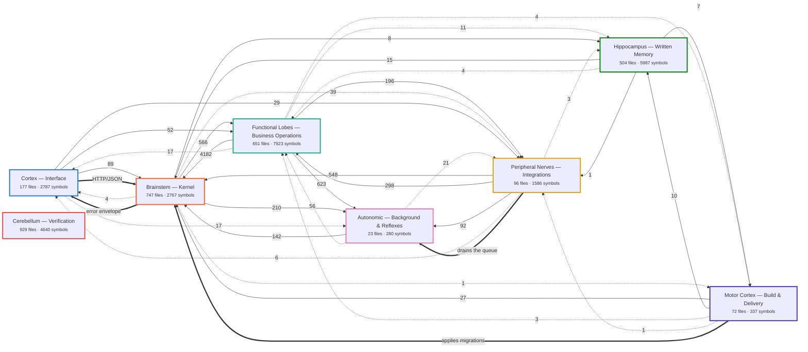
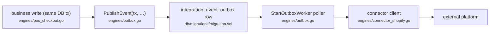
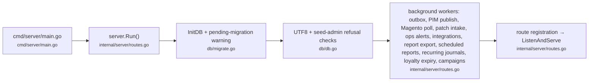

# Custom ERP — Project Brain

<!-- GENERATED FILE - do not edit by hand. Edit docs/brain/brain.map.json instead. -->
> **Generated.** Which regions exist comes from [`brain.map.json`](brain.map.json); which files exist comes
> from the working tree; what calls what comes from `graphify-out/graph.json`. Edit the map, never this
> file, then run `pwsh docs/brain/update-brain.ps1`. How to do that is in [README.md](README.md).

Every part of this system, grouped into brain regions, wired by the call graph graphify actually extracted from the source.

| | |
|---|---|
| Graph built from commit | `a859b1d0` |
| Brain redrawn | source graph a859b1d0 |
| Regions / lobes | 38 / 8 |
| Files in the working tree | 3199 (2440 of them parsed into the graph) |
| Files claimed by a region | **100.0%** |
| Symbols in the graph | 28529 |
| Cross-region relationships | 11728 extracted (97% inferred) + 8 declared by hand |

**Interactive version: [brain.html](brain.html)** — open it in a browser and click any region.

## How to read this

- A **lobe** is a layer of the system; a **region** is one area of responsibility inside it. Which files belong to which region is decided entirely by the `match` patterns in `brain.map.json`.
- A **thin arrow** is a real relationship graphify extracted from the source — a call, a type reference, a method, an embed — aggregated up to the region level. The number on it is how many such relationships cross that boundary, which is a measure of coupling, not of importance.
- A **thick `==>` arrow** is *declared by hand* in `brain.map.json`. These are the connections a call-graph extractor structurally cannot see: the browser talking to the server over HTTP, a script driving the binary, a connector reaching a third-party API. They are drawn differently on purpose — they are asserted, not measured.
- A **solid arrow** contains at least one relationship graphify parsed straight out of the source (`EXTRACTED`). A **dotted arrow** is one where *every* underlying relationship is `INFERRED` — graphify's heuristic guess. Dotted is the common case here, and that is a property of the extractor, not a defect in the code: it resolves calls within a file exactly and calls across files by name, and 97% of cross-region relationships are cross-file by definition. So: the shape of this map is reliable, any *single* dotted edge is a lead to confirm with grep before you rely on it, and a solid arrow is one graphify actually saw.
- `contains` edges are excluded everywhere: a file containing its own functions says nothing about how areas of the system relate.
- The test suite is a region but is deliberately left out of every wiring diagram and every count. Tests reach into everything, so drawing them would flatten the real structure into noise.

## 1. The whole brain, at lobe level

8 lobes. If you read one diagram, read this one.

| Lobe | What it is | Regions | Files | Symbols | Wiring inside the lobe |
|---|---|---:|---:|---:|---:|
| **Cortex — Interface** | What the user sees and touches. Every business intent enters here. | 4 | 177 | 2787 | 6 |
| **Brainstem — Kernel** | Involuntary and non-negotiable. Every single request passes through here, whatever it is asking for. | 9 | 747 | 2767 | 1077 |
| **Functional Lobes — Business Operations** | The specialised areas. Each one owns a domain and can be licensed on its own. | 16 | 651 | 7923 | 3192 |
| **Peripheral Nerves — Integrations** | Contact with the outside world: storefronts, payment terminals, marketing clouds, third-party extensions. | 3 | 96 | 1586 | 8 |
| **Autonomic — Background & Reflexes** | Runs without anyone asking it to: outbox drain, pollers, alerting, scheduled sweeps. | 2 | 23 | 280 | 32 |
| **Hippocampus — Written Memory** | What this project knows about itself: the backlog, the ledger, the guides, the handover note. | 2 | 504 | 5987 | 131 |
| **Motor Cortex — Build & Delivery** | How the system actually moves: build, migrate, promote, back up, restore. | 1 | 72 | 337 | 0 |
| **Cerebellum — Verification** | Balance and correction. Kept out of the wiring diagrams on purpose — tests touch everything, so drawing them would grey out every real edge. | 1 | 929 | 4640 | 0 |

## 2. Region map

Every region, grouped by lobe, with the connections of weight **12 or more**. The full set is in [brain.html](brain.html) and in §5 below.

```mermaid
flowchart LR
  subgraph n_g_cortex ["Cortex — Interface"]
    direction TB
    n_ui_shell["SPA Shell<br/><small>142 files · 2543 symbols</small>"]
    n_ui_offline["Offline Store & Device I/O<br/><small>1 file · 2 symbols</small>"]
    n_store_app["Store App (PWA)<br/><small>24 files · 242 symbols</small>"]
    n_industry_profiles["Industry Profiles<br/><small>10 files · 0 symbols</small>"]
  end
  subgraph n_g_brainstem ["Brainstem — Kernel"]
    direction TB
    n_http_edge["HTTP Edge & Middleware<br/><small>12 files · 107 symbols</small>"]
    n_api_errors["Error & Message Catalog<br/><small>7 files · 33 symbols</small>"]
    n_doc_kernel["Document Kernel<br/><small>35 files · 386 symbols</small>"]
    n_identity["Identity, RBAC & MFA<br/><small>49 files · 488 symbols</small>"]
    n_tenancy["Tenancy, Packaging & Settings<br/><small>92 files · 1058 symbols</small>"]
    n_approval["Approval Engine (maker-checker)<br/><small>8 files · 63 symbols</small>"]
    n_persistence["Persistence & Migrations<br/><small>484 files · 42 symbols</small>"]
    n_mixed_handlers["Cross-module API Handlers<br/><small>3 files · 83 symbols</small>"]
    n_security_program["Security Baseline & Attack Surface<br/><small>57 files · 507 symbols</small>"]
  end
  subgraph n_g_business ["Functional Lobes — Business Operations"]
    direction TB
    n_finance["Finance & General Ledger<br/><small>79 files · 993 symbols</small>"]
    n_tax["Tax & Statutory<br/><small>23 files · 371 symbols</small>"]
    n_procurement["Procurement & Vendors<br/><small>57 files · 879 symbols</small>"]
    n_inventory["Inventory & Planning<br/><small>52 files · 666 symbols</small>"]
    n_wms["Warehouse Management (WMS)<br/><small>64 files · 669 symbols</small>"]
    n_oms["Orders & Fulfillment (OMS)<br/><small>50 files · 504 symbols</small>"]
    n_pos["Point of Sale<br/><small>44 files · 483 symbols</small>"]
    n_pim["Product Information (PIM)<br/><small>83 files · 888 symbols</small>"]
    n_crm["CRM & Loyalty<br/><small>58 files · 713 symbols</small>"]
    n_hr["HR & Payroll<br/><small>21 files · 160 symbols</small>"]
    n_manufacturing["Manufacturing & MRP<br/><small>8 files · 126 symbols</small>"]
    n_assets["Fixed Assets, Service & Quality Management<br/><small>30 files · 305 symbols</small>"]
    n_expenses["Expense Management<br/><small>10 files · 85 symbols</small>"]
    n_reports["Reporting Engine<br/><small>44 files · 613 symbols</small>"]
    n_logistics["Shipping & Logistics<br/><small>7 files · 117 symbols</small>"]
    n_data_io["Bulk Data I/O<br/><small>21 files · 351 symbols</small>"]
  end
  subgraph n_g_peripheral ["Peripheral Nerves — Integrations"]
    direction TB
    n_connectors["Channel Connectors<br/><small>30 files · 478 symbols</small>"]
    n_printing["Device Printing (QZ Tray)<br/><small>32 files · 652 symbols</small>"]
    n_extensions["Extension Platform<br/><small>34 files · 456 symbols</small>"]
  end
  subgraph n_g_autonomic ["Autonomic — Background & Reflexes"]
    direction TB
    n_outbox["Event Outbox & Async Job Runner<br/><small>10 files · 101 symbols</small>"]
    n_observability["Logging, Alerting & Notifications<br/><small>13 files · 179 symbols</small>"]
  end
  subgraph n_g_memory ["Hippocampus — Written Memory"]
    direction TB
    n_docs_memory["Project Documentation<br/><small>497 files · 5867 symbols</small>"]
    n_brain["The Brain Map (this)<br/><small>7 files · 120 symbols</small>"]
  end
  subgraph n_g_motor ["Motor Cortex — Build & Delivery"]
    direction TB
    n_ops_tooling["Build, Deploy & Operate<br/><small>72 files · 337 symbols</small>"]
  end
  n_procurement -->|254| n_doc_kernel
  n_wms -.->|206| n_persistence
  n_finance -.->|174| n_persistence
  n_pim -.->|170| n_persistence
  n_finance -.->|150| n_doc_kernel
  n_pos -->|132| n_finance
  n_wms -.->|131| n_api_errors
  n_brain -->|129| n_docs_memory
  n_procurement -->|127| n_finance
  n_finance -->|125| n_procurement
  n_inventory -.->|124| n_persistence
  n_procurement -.->|124| n_persistence
  n_procurement -.->|123| n_wms
  n_inventory -.->|109| n_api_errors
  n_mixed_handlers -.->|107| n_api_errors
  n_inventory -.->|106| n_doc_kernel
  n_pim -.->|106| n_api_errors
  n_oms -.->|103| n_doc_kernel
  n_inventory -->|102| n_procurement
  n_procurement -.->|100| n_api_errors
  n_pim -.->|99| n_doc_kernel
  n_oms -.->|98| n_persistence
  n_crm -.->|97| n_doc_kernel
  n_procurement -->|97| n_tax
  n_finance -.->|96| n_api_errors
  n_pos -.->|95| n_persistence
  n_oms -.->|94| n_api_errors
  n_finance -.->|91| n_wms
  n_doc_kernel -.->|89| n_persistence
  n_identity -.->|87| n_api_errors
  n_identity -.->|85| n_persistence
  n_wms -.->|80| n_observability
  n_extensions -.->|75| n_api_errors
  n_finance -.->|75| n_observability
  n_printing -->|75| n_procurement
  n_connectors -.->|74| n_api_errors
  n_procurement -.->|72| n_observability
  n_inventory -.->|70| n_finance
  n_inventory -->|70| n_wms
  n_reports -.->|67| n_persistence
  n_assets -->|66| n_finance
  n_extensions -.->|66| n_persistence
  n_tenancy -.->|65| n_persistence
  n_crm -.->|64| n_tenancy
  n_connectors -.->|61| n_persistence
  n_procurement -.->|61| n_inventory
  n_identity -.->|60| n_observability
  n_wms -.->|59| n_doc_kernel
  n_assets -.->|58| n_procurement
  n_procurement -.->|57| n_tenancy
  n_assets -.->|56| n_persistence
  n_doc_kernel -.->|56| n_procurement
  n_oms -->|56| n_finance
  n_security_program -->|54| n_observability
  n_wms -->|54| n_inventory
  n_assets -.->|53| n_api_errors
  n_oms -->|53| n_inventory
  n_data_io -->|52| n_doc_kernel
  n_tenancy -.->|52| n_api_errors
  n_assets -.->|51| n_doc_kernel
  n_crm -.->|51| n_persistence
  n_observability -.->|51| n_api_errors
  n_oms -.->|51| n_procurement
  n_security_program -.->|51| n_persistence
  n_inventory -->|49| n_tenancy
  n_inventory -.->|48| n_observability
  n_pos -.->|48| n_doc_kernel
  n_finance -.->|47| n_inventory
  n_oms -.->|46| n_observability
  n_oms -->|46| n_wms
  n_pim -->|46| n_tenancy
  n_mixed_handlers -->|45| n_pos
  n_pim -.->|45| n_observability
  n_printing -.->|45| n_doc_kernel
  n_crm -.->|44| n_procurement
  n_inventory -.->|44| n_pim
  n_tax -->|44| n_procurement
  n_doc_kernel -.->|43| n_api_errors
  n_finance -.->|43| n_pim
  n_procurement -->|43| n_data_io
  n_reports -->|43| n_procurement
  n_security_program -.->|43| n_api_errors
  n_hr -.->|42| n_persistence
  n_procurement -.->|42| n_pim
  n_tax -.->|42| n_persistence
  n_identity -.->|41| n_tenancy
  n_pos -->|41| n_tax
  n_reports -.->|41| n_finance
  n_tax -->|39| n_doc_kernel
  n_tax -.->|39| n_finance
  n_oms -.->|38| n_tenancy
  n_pos -.->|38| n_api_errors
  n_pim -.->|37| n_procurement
  n_assets -.->|36| n_wms
  n_finance -.->|36| n_data_io
  n_pos -->|36| n_inventory
  n_security_program -->|36| n_identity
  n_mixed_handlers -->|35| n_pim
  n_security_program -.->|34| n_tenancy
  n_wms -.->|34| n_reports
  n_data_io -.->|33| n_api_errors
  n_data_io -.->|33| n_persistence
  n_extensions -.->|33| n_identity
  n_finance -->|32| n_tax
  n_printing -.->|32| n_tax
  n_tax -.->|32| n_api_errors
  n_finance -->|31| n_reports
  n_hr -.->|31| n_identity
  n_printing -.->|31| n_persistence
  n_wms -->|31| n_procurement
  n_connectors -.->|30| n_tenancy
  n_crm -.->|30| n_api_errors
  n_hr -.->|30| n_api_errors
  n_hr -.->|30| n_doc_kernel
  n_reports -.->|30| n_api_errors
  n_doc_kernel -.->|29| n_wms
  n_identity -.->|29| n_security_program
  n_manufacturing -.->|29| n_api_errors
  n_oms -->|29| n_tax
  n_pim -->|29| n_data_io
  n_connectors -.->|28| n_identity
  n_finance -->|28| n_oms
  n_inventory -.->|28| n_tax
  n_crm -->|27| n_finance
  n_doc_kernel -.->|27| n_identity
  n_doc_kernel -.->|27| n_pim
  n_manufacturing -->|27| n_inventory
  n_pos -.->|27| n_crm
  n_pos -.->|27| n_observability
  n_manufacturing -.->|26| n_finance
  n_manufacturing -.->|26| n_persistence
  n_pim -.->|26| n_outbox
  n_assets -->|25| n_tenancy
  n_crm -.->|25| n_observability
  n_data_io -->|25| n_identity
  n_doc_kernel -->|25| n_inventory
  n_store_app -.->|25| n_persistence
  n_connectors -.->|24| n_observability
  n_finance -->|24| n_tenancy
  n_inventory -.->|24| n_approval
  n_manufacturing -->|24| n_procurement
  n_pim -.->|24| n_inventory
  n_printing -.->|24| n_wms
  n_procurement -.->|24| n_approval
  n_store_app -.->|24| n_api_errors
  n_tenancy -.->|24| n_identity
  n_connectors -->|23| n_outbox
  n_doc_kernel -.->|23| n_tenancy
  n_extensions -.->|23| n_observability
  n_inventory -->|23| n_oms
  n_inventory -.->|23| n_pos
  n_pim -->|23| n_connectors
  n_procurement -->|23| n_oms
  n_tenancy -->|23| n_doc_kernel
  n_assets -.->|22| n_inventory
  n_crm -->|22| n_pos
  n_finance -->|22| n_pos
  n_inventory -.->|22| n_identity
  n_observability -.->|22| n_outbox
  n_pos -.->|22| n_oms
  n_reports -->|22| n_tenancy
  n_connectors -->|21| n_procurement
  n_crm -.->|21| n_tax
  n_extensions -.->|21| n_tenancy
  n_hr -.->|21| n_wms
  n_oms -->|21| n_pos
  n_pim -.->|21| n_finance
  n_reports -.->|21| n_identity
  n_assets -.->|20| n_observability
  n_doc_kernel -.->|20| n_finance
  n_doc_kernel -.->|20| n_tax
  n_http_edge -.->|20| n_tenancy
  n_observability -.->|20| n_persistence
  n_outbox -.->|20| n_tenancy
  n_pos -->|20| n_tenancy
  n_procurement -.->|20| n_printing
  n_data_io -->|19| n_tenancy
  n_expenses -.->|19| n_api_errors
  n_tax -.->|19| n_observability
  n_tax -->|19| n_printing
  n_tenancy -.->|19| n_observability
  n_connectors -->|18| n_oms
  n_crm -.->|18| n_wms
  n_doc_kernel -.->|18| n_observability
  n_expenses -.->|18| n_persistence
  n_http_edge -.->|18| n_identity
  n_printing -->|18| n_pim
  n_store_app -.->|18| n_identity
  n_approval -.->|17| n_persistence
  n_crm -->|17| n_approval
  n_oms -.->|17| n_pim
  n_pim -.->|17| n_identity
  n_printing -.->|17| n_api_errors
  n_store_app -.->|17| n_procurement
  n_tax -.->|17| n_tenancy
  n_extensions -.->|16| n_outbox
  n_procurement -.->|16| n_reports
  n_tenancy -.->|16| n_finance
  n_assets -->|15| n_outbox
  n_crm -.->|15| n_reports
  n_finance -.->|15| n_approval
  n_http_edge -.->|15| n_api_errors
  n_http_edge -.->|15| n_security_program
  n_inventory -->|15| n_reports
  n_logistics -.->|15| n_observability
  n_logistics -.->|15| n_persistence
  n_manufacturing -.->|15| n_wms
  n_wms -.->|15| n_tenancy
  n_approval -->|14| n_tenancy
  n_assets -.->|14| n_store_app
  n_data_io -->|14| n_printing
  n_finance -.->|14| n_outbox
  n_hr -.->|14| n_tenancy
  n_manufacturing -.->|14| n_doc_kernel
  n_ops_tooling -->|14| n_identity
  n_reports -.->|14| n_outbox
  n_wms -.->|14| n_oms
  n_crm -.->|13| n_extensions
  n_expenses -.->|13| n_doc_kernel
  n_extensions -->|13| n_reports
  n_logistics -.->|13| n_api_errors
  n_mixed_handlers -.->|13| n_identity
  n_pos -.->|13| n_wms
  n_security_program -.->|13| n_outbox
  n_tenancy -.->|13| n_tax
  n_ui_shell -->|13| n_extensions
  n_wms -.->|13| n_finance
  n_data_io -.->|12| n_pim
  n_hr -.->|12| n_finance
  n_logistics -.->|12| n_connectors
  n_manufacturing -.->|12| n_observability
  n_printing -.->|12| n_finance
  n_printing -.->|12| n_tenancy
  n_reports -.->|12| n_doc_kernel
  n_ui_shell -.->|12| n_printing
  n_ui_shell ==>|HTTP/JSON| n_http_edge
  n_api_errors ==>|error envelope| n_ui_shell
  n_ui_offline ==>|queued replay| n_http_edge
  n_industry_profiles ==>|loaded at runtime| n_doc_kernel
  n_connectors ==>|drains the queue| n_outbox
  n_ops_tooling ==>|applies migrations| n_persistence
  n_ops_tooling ==>|builds & restarts| n_http_edge
  n_brain ==>|keeps in sync| n_docs_memory
  classDef n_cortex stroke:#2a78d6,stroke-width:2px;
  class n_ui_shell,n_ui_offline,n_store_app,n_industry_profiles n_cortex;
  classDef n_brainstem stroke:#eb6834,stroke-width:2px;
  class n_http_edge,n_api_errors,n_doc_kernel,n_identity,n_tenancy,n_approval,n_persistence,n_mixed_handlers,n_security_program n_brainstem;
  classDef n_business stroke:#1baf7a,stroke-width:2px;
  class n_finance,n_tax,n_procurement,n_inventory,n_wms,n_oms,n_pos,n_pim,n_crm,n_hr,n_manufacturing,n_assets,n_expenses,n_reports,n_logistics,n_data_io n_business;
  classDef n_peripheral stroke:#eda100,stroke-width:2px;
  class n_connectors,n_printing,n_extensions n_peripheral;
  classDef n_autonomic stroke:#e87ba4,stroke-width:2px;
  class n_outbox,n_observability n_autonomic;
  classDef n_memory stroke:#008300,stroke-width:2px;
  class n_docs_memory,n_brain n_memory;
  classDef n_motor stroke:#4a3aa7,stroke-width:2px;
  class n_ops_tooling n_motor;
```

### 2b. The same map with the universal hubs removed

**Error & Message Catalog**, **Persistence & Migrations**, **Logging, Alerting & Notifications** are reached from nearly every region — which is the point of them, but it means they dominate the diagram above and hide everything else. Take them out and what is left is how the business areas actually relate to each other.

```mermaid
flowchart LR
  subgraph n_g_cortex ["Cortex — Interface"]
    direction TB
    n_ui_shell["SPA Shell<br/><small>142 files · 2543 symbols</small>"]
    n_ui_offline["Offline Store & Device I/O<br/><small>1 file · 2 symbols</small>"]
    n_store_app["Store App (PWA)<br/><small>24 files · 242 symbols</small>"]
    n_industry_profiles["Industry Profiles<br/><small>10 files · 0 symbols</small>"]
  end
  subgraph n_g_brainstem ["Brainstem — Kernel"]
    direction TB
    n_http_edge["HTTP Edge & Middleware<br/><small>12 files · 107 symbols</small>"]
    n_doc_kernel["Document Kernel<br/><small>35 files · 386 symbols</small>"]
    n_identity["Identity, RBAC & MFA<br/><small>49 files · 488 symbols</small>"]
    n_tenancy["Tenancy, Packaging & Settings<br/><small>92 files · 1058 symbols</small>"]
    n_approval["Approval Engine (maker-checker)<br/><small>8 files · 63 symbols</small>"]
    n_mixed_handlers["Cross-module API Handlers<br/><small>3 files · 83 symbols</small>"]
    n_security_program["Security Baseline & Attack Surface<br/><small>57 files · 507 symbols</small>"]
  end
  subgraph n_g_business ["Functional Lobes — Business Operations"]
    direction TB
    n_finance["Finance & General Ledger<br/><small>79 files · 993 symbols</small>"]
    n_tax["Tax & Statutory<br/><small>23 files · 371 symbols</small>"]
    n_procurement["Procurement & Vendors<br/><small>57 files · 879 symbols</small>"]
    n_inventory["Inventory & Planning<br/><small>52 files · 666 symbols</small>"]
    n_wms["Warehouse Management (WMS)<br/><small>64 files · 669 symbols</small>"]
    n_oms["Orders & Fulfillment (OMS)<br/><small>50 files · 504 symbols</small>"]
    n_pos["Point of Sale<br/><small>44 files · 483 symbols</small>"]
    n_pim["Product Information (PIM)<br/><small>83 files · 888 symbols</small>"]
    n_crm["CRM & Loyalty<br/><small>58 files · 713 symbols</small>"]
    n_hr["HR & Payroll<br/><small>21 files · 160 symbols</small>"]
    n_manufacturing["Manufacturing & MRP<br/><small>8 files · 126 symbols</small>"]
    n_assets["Fixed Assets, Service & Quality Management<br/><small>30 files · 305 symbols</small>"]
    n_expenses["Expense Management<br/><small>10 files · 85 symbols</small>"]
    n_reports["Reporting Engine<br/><small>44 files · 613 symbols</small>"]
    n_logistics["Shipping & Logistics<br/><small>7 files · 117 symbols</small>"]
    n_data_io["Bulk Data I/O<br/><small>21 files · 351 symbols</small>"]
  end
  subgraph n_g_peripheral ["Peripheral Nerves — Integrations"]
    direction TB
    n_connectors["Channel Connectors<br/><small>30 files · 478 symbols</small>"]
    n_printing["Device Printing (QZ Tray)<br/><small>32 files · 652 symbols</small>"]
    n_extensions["Extension Platform<br/><small>34 files · 456 symbols</small>"]
  end
  subgraph n_g_autonomic ["Autonomic — Background & Reflexes"]
    direction TB
    n_outbox["Event Outbox & Async Job Runner<br/><small>10 files · 101 symbols</small>"]
  end
  subgraph n_g_memory ["Hippocampus — Written Memory"]
    direction TB
    n_docs_memory["Project Documentation<br/><small>497 files · 5867 symbols</small>"]
    n_brain["The Brain Map (this)<br/><small>7 files · 120 symbols</small>"]
  end
  subgraph n_g_motor ["Motor Cortex — Build & Delivery"]
    direction TB
    n_ops_tooling["Build, Deploy & Operate<br/><small>72 files · 337 symbols</small>"]
  end
  n_procurement -->|254| n_doc_kernel
  n_finance -.->|150| n_doc_kernel
  n_pos -->|132| n_finance
  n_brain -->|129| n_docs_memory
  n_procurement -->|127| n_finance
  n_finance -->|125| n_procurement
  n_procurement -.->|123| n_wms
  n_inventory -.->|106| n_doc_kernel
  n_oms -.->|103| n_doc_kernel
  n_inventory -->|102| n_procurement
  n_pim -.->|99| n_doc_kernel
  n_crm -.->|97| n_doc_kernel
  n_procurement -->|97| n_tax
  n_finance -.->|91| n_wms
  n_printing -->|75| n_procurement
  n_inventory -.->|70| n_finance
  n_inventory -->|70| n_wms
  n_assets -->|66| n_finance
  n_crm -.->|64| n_tenancy
  n_procurement -.->|61| n_inventory
  n_wms -.->|59| n_doc_kernel
  n_assets -.->|58| n_procurement
  n_procurement -.->|57| n_tenancy
  n_doc_kernel -.->|56| n_procurement
  n_oms -->|56| n_finance
  n_wms -->|54| n_inventory
  n_oms -->|53| n_inventory
  n_data_io -->|52| n_doc_kernel
  n_assets -.->|51| n_doc_kernel
  n_oms -.->|51| n_procurement
  n_inventory -->|49| n_tenancy
  n_pos -.->|48| n_doc_kernel
  n_finance -.->|47| n_inventory
  n_oms -->|46| n_wms
  n_pim -->|46| n_tenancy
  n_mixed_handlers -->|45| n_pos
  n_printing -.->|45| n_doc_kernel
  n_crm -.->|44| n_procurement
  n_inventory -.->|44| n_pim
  n_tax -->|44| n_procurement
  n_finance -.->|43| n_pim
  n_procurement -->|43| n_data_io
  n_reports -->|43| n_procurement
  n_procurement -.->|42| n_pim
  n_identity -.->|41| n_tenancy
  n_pos -->|41| n_tax
  n_reports -.->|41| n_finance
  n_tax -->|39| n_doc_kernel
  n_tax -.->|39| n_finance
  n_oms -.->|38| n_tenancy
  n_pim -.->|37| n_procurement
  n_assets -.->|36| n_wms
  n_finance -.->|36| n_data_io
  n_pos -->|36| n_inventory
  n_security_program -->|36| n_identity
  n_mixed_handlers -->|35| n_pim
  n_security_program -.->|34| n_tenancy
  n_wms -.->|34| n_reports
  n_extensions -.->|33| n_identity
  n_finance -->|32| n_tax
  n_printing -.->|32| n_tax
  n_finance -->|31| n_reports
  n_hr -.->|31| n_identity
  n_wms -->|31| n_procurement
  n_connectors -.->|30| n_tenancy
  n_hr -.->|30| n_doc_kernel
  n_doc_kernel -.->|29| n_wms
  n_identity -.->|29| n_security_program
  n_oms -->|29| n_tax
  n_pim -->|29| n_data_io
  n_connectors -.->|28| n_identity
  n_finance -->|28| n_oms
  n_inventory -.->|28| n_tax
  n_crm -->|27| n_finance
  n_doc_kernel -.->|27| n_identity
  n_doc_kernel -.->|27| n_pim
  n_manufacturing -->|27| n_inventory
  n_pos -.->|27| n_crm
  n_manufacturing -.->|26| n_finance
  n_pim -.->|26| n_outbox
  n_assets -->|25| n_tenancy
  n_data_io -->|25| n_identity
  n_doc_kernel -->|25| n_inventory
  n_finance -->|24| n_tenancy
  n_inventory -.->|24| n_approval
  n_manufacturing -->|24| n_procurement
  n_pim -.->|24| n_inventory
  n_printing -.->|24| n_wms
  n_procurement -.->|24| n_approval
  n_tenancy -.->|24| n_identity
  n_connectors -->|23| n_outbox
  n_doc_kernel -.->|23| n_tenancy
  n_inventory -->|23| n_oms
  n_inventory -.->|23| n_pos
  n_pim -->|23| n_connectors
  n_procurement -->|23| n_oms
  n_tenancy -->|23| n_doc_kernel
  n_assets -.->|22| n_inventory
  n_crm -->|22| n_pos
  n_finance -->|22| n_pos
  n_inventory -.->|22| n_identity
  n_pos -.->|22| n_oms
  n_reports -->|22| n_tenancy
  n_connectors -->|21| n_procurement
  n_crm -.->|21| n_tax
  n_extensions -.->|21| n_tenancy
  n_hr -.->|21| n_wms
  n_oms -->|21| n_pos
  n_pim -.->|21| n_finance
  n_reports -.->|21| n_identity
  n_doc_kernel -.->|20| n_finance
  n_doc_kernel -.->|20| n_tax
  n_http_edge -.->|20| n_tenancy
  n_outbox -.->|20| n_tenancy
  n_pos -->|20| n_tenancy
  n_procurement -.->|20| n_printing
  n_data_io -->|19| n_tenancy
  n_tax -->|19| n_printing
  n_connectors -->|18| n_oms
  n_crm -.->|18| n_wms
  n_http_edge -.->|18| n_identity
  n_printing -->|18| n_pim
  n_store_app -.->|18| n_identity
  n_crm -->|17| n_approval
  n_oms -.->|17| n_pim
  n_pim -.->|17| n_identity
  n_store_app -.->|17| n_procurement
  n_tax -.->|17| n_tenancy
  n_extensions -.->|16| n_outbox
  n_procurement -.->|16| n_reports
  n_tenancy -.->|16| n_finance
  n_assets -->|15| n_outbox
  n_crm -.->|15| n_reports
  n_finance -.->|15| n_approval
  n_http_edge -.->|15| n_security_program
  n_inventory -->|15| n_reports
  n_manufacturing -.->|15| n_wms
  n_wms -.->|15| n_tenancy
  n_approval -->|14| n_tenancy
  n_assets -.->|14| n_store_app
  n_data_io -->|14| n_printing
  n_finance -.->|14| n_outbox
  n_hr -.->|14| n_tenancy
  n_manufacturing -.->|14| n_doc_kernel
  n_ops_tooling -->|14| n_identity
  n_reports -.->|14| n_outbox
  n_wms -.->|14| n_oms
  n_crm -.->|13| n_extensions
  n_expenses -.->|13| n_doc_kernel
  n_extensions -->|13| n_reports
  n_mixed_handlers -.->|13| n_identity
  n_pos -.->|13| n_wms
  n_security_program -.->|13| n_outbox
  n_tenancy -.->|13| n_tax
  n_ui_shell -->|13| n_extensions
  n_wms -.->|13| n_finance
  n_data_io -.->|12| n_pim
  n_hr -.->|12| n_finance
  n_logistics -.->|12| n_connectors
  n_printing -.->|12| n_finance
  n_printing -.->|12| n_tenancy
  n_reports -.->|12| n_doc_kernel
  n_ui_shell -.->|12| n_printing
  n_approval -.->|11| n_procurement
  n_crm -.->|11| n_printing
  n_doc_kernel -.->|11| n_pos
  n_expenses -.->|11| n_tenancy
  n_extensions -.->|11| n_http_edge
  n_finance -.->|11| n_assets
  n_hr -.->|11| n_tax
  n_manufacturing -.->|11| n_tenancy
  n_mixed_handlers -.->|11| n_approval
  n_oms -->|11| n_crm
  n_procurement -.->|11| n_identity
  n_store_app -.->|11| n_tenancy
  n_store_app -->|11| n_wms
  n_tax -.->|11| n_wms
  n_tenancy -.->|11| n_pim
  n_tenancy -->|11| n_security_program
  n_approval -.->|10| n_finance
  n_connectors -.->|10| n_pim
  n_connectors -.->|10| n_security_program
  n_doc_kernel -.->|10| n_approval
  n_expenses -.->|10| n_finance
  n_http_edge -.->|10| n_extensions
  n_mixed_handlers -.->|10| n_finance
  n_mixed_handlers -.->|10| n_inventory
  n_oms -.->|10| n_reports
  n_ops_tooling -->|10| n_docs_memory
  n_pim -.->|10| n_reports
  n_procurement -.->|10| n_assets
  n_reports -.->|10| n_inventory
  n_reports -.->|10| n_tax
  n_crm -.->|9| n_outbox
  n_data_io -.->|9| n_procurement
  n_doc_kernel -.->|9| n_hr
  n_http_edge -.->|9| n_finance
  n_http_edge -.->|9| n_pim
  n_inventory -.->|9| n_outbox
  n_manufacturing -.->|9| n_tax
  n_mixed_handlers -->|9| n_data_io
  n_pim -.->|9| n_printing
  n_store_app -.->|9| n_inventory
  n_tenancy -->|9| n_procurement
  n_assets -.->|8| n_reports
  n_connectors -.->|8| n_doc_kernel
  n_connectors -.->|8| n_extensions
  n_connectors -.->|8| n_http_edge
  n_connectors -.->|8| n_tax
  n_data_io -->|8| n_approval
  n_data_io -->|8| n_inventory
  n_doc_kernel -.->|8| n_assets
  n_docs_memory -->|8| n_security_program
  n_expenses -.->|8| n_wms
  n_http_edge -.->|8| n_outbox
  n_oms -.->|8| n_identity
  n_oms -.->|8| n_logistics
  n_outbox -.->|8| n_extensions
  n_pim -.->|8| n_approval
  n_pos -.->|8| n_pim
  n_pos -.->|8| n_procurement
  n_store_app -->|8| n_doc_kernel
  n_store_app -.->|8| n_finance
  n_approval -.->|7| n_pim
  n_crm -.->|7| n_inventory
  n_expenses -.->|7| n_procurement
  n_extensions -->|7| n_doc_kernel
  n_finance -.->|7| n_connectors
  n_identity -->|7| n_doc_kernel
  n_identity -->|7| n_hr
  n_identity -.->|7| n_pim
  n_logistics -.->|7| n_oms
  n_mixed_handlers -.->|7| n_reports
  n_pim -.->|7| n_expenses
  n_pim -.->|7| n_oms
  n_pos -.->|7| n_identity
  n_printing -.->|7| n_pos
  n_procurement -.->|7| n_outbox
  n_reports -.->|7| n_printing
  n_tenancy -.->|7| n_expenses
  n_wms -.->|7| n_assets
  n_assets -.->|6| n_identity
  n_crm -.->|6| n_assets
  n_crm -.->|6| n_connectors
  n_crm -.->|6| n_oms
  n_doc_kernel -.->|6| n_crm
  n_doc_kernel -.->|6| n_expenses
  n_extensions -.->|6| n_finance
  n_finance -.->|6| n_crm
  n_finance -.->|6| n_extensions
  n_finance -.->|6| n_identity
  n_logistics -.->|6| n_finance
  n_oms -.->|6| n_outbox
  n_outbox -.->|6| n_security_program
  n_pim -.->|6| n_http_edge
  n_pim -.->|6| n_wms
  n_pos -.->|6| n_reports
  n_printing -.->|6| n_oms
  n_printing -.->|6| n_ui_shell
  n_reports -.->|6| n_crm
  n_store_app -.->|6| n_outbox
  n_tax -.->|6| n_inventory
  n_tenancy -.->|6| n_http_edge
  n_tenancy -.->|6| n_oms
  n_tenancy -->|6| n_pos
  n_assets -.->|5| n_pim
  n_connectors -.->|5| n_crm
  n_connectors -.->|5| n_logistics
  n_data_io -.->|5| n_security_program
  n_doc_kernel -.->|5| n_oms
  n_docs_memory -->|5| n_ops_tooling
  n_extensions -.->|5| n_inventory
  n_extensions -.->|5| n_pim
  n_finance -.->|5| n_security_program
  n_hr -.->|5| n_pim
  n_http_edge -.->|5| n_assets
  n_http_edge -.->|5| n_connectors
  n_http_edge -.->|5| n_reports
  n_identity -.->|5| n_approval
  n_identity -.->|5| n_http_edge
  n_identity -.->|5| n_outbox
  n_identity -.->|5| n_pos
  n_inventory -.->|5| n_printing
  n_logistics -.->|5| n_doc_kernel
  n_mixed_handlers -.->|5| n_http_edge
  n_mixed_handlers -.->|5| n_security_program
  n_oms -.->|5| n_connectors
  n_pim -.->|5| n_extensions
  n_pim -.->|5| n_pos
  n_pim -.->|5| n_security_program
  n_procurement -.->|5| n_http_edge
  n_reports -.->|5| n_extensions
  n_reports -.->|5| n_pim
  n_reports -.->|5| n_pos
  n_reports -.->|5| n_security_program
  n_tax -.->|5| n_connectors
  n_tenancy -.->|5| n_connectors
  n_tenancy -.->|5| n_inventory
  n_tenancy -.->|5| n_outbox
  n_wms -.->|5| n_pim
  n_approval -.->|4| n_crm
  n_approval -.->|4| n_identity
  n_connectors -.->|4| n_pos
  n_crm -.->|4| n_pim
  n_data_io -.->|4| n_finance
  n_doc_kernel -.->|4| n_http_edge
  n_expenses -->|4| n_identity
  n_extensions -.->|4| n_security_program
  n_hr -.->|4| n_reports
  n_pim -.->|4| n_mixed_handlers
  n_pos -.->|4| n_approval
  n_pos -->|4| n_data_io
  n_printing -.->|4| n_inventory
  n_printing -.->|4| n_manufacturing
  n_reports -.->|4| n_wms
  n_security_program -.->|4| n_data_io
  n_security_program -.->|4| n_pim
  n_tax -.->|4| n_approval
  n_tax -.->|4| n_pim
  n_tax -.->|4| n_reports
  n_wms -.->|4| n_identity
  n_approval -.->|3| n_inventory
  n_approval -.->|3| n_reports
  n_assets -.->|3| n_extensions
  n_connectors -.->|3| n_wms
  n_crm -.->|3| n_identity
  n_data_io -.->|3| n_docs_memory
  n_data_io -.->|3| n_tax
  n_doc_kernel -.->|3| n_extensions
  n_doc_kernel -.->|3| n_reports
  n_doc_kernel -.->|3| n_security_program
  n_expenses -.->|3| n_reports
  n_hr -.->|3| n_pos
  n_http_edge -.->|3| n_crm
  n_http_edge -.->|3| n_inventory
  n_http_edge -.->|3| n_oms
  n_identity -.->|3| n_extensions
  n_inventory -.->|3| n_manufacturing
  n_logistics -.->|3| n_security_program
  n_manufacturing -->|3| n_data_io
  n_mixed_handlers -.->|3| n_doc_kernel
  n_mixed_handlers -.->|3| n_expenses
  n_mixed_handlers -.->|3| n_procurement
  n_oms -.->|3| n_data_io
  n_oms -.->|3| n_printing
  n_ops_tooling -.->|3| n_reports
  n_ops_tooling -.->|3| n_security_program
  n_outbox -.->|3| n_finance
  n_outbox -.->|3| n_reports
  n_pim -.->|3| n_ops_tooling
  n_pos -->|3| n_security_program
  n_printing -.->|3| n_approval
  n_procurement -.->|3| n_crm
  n_procurement -.->|3| n_docs_memory
  n_procurement -.->|3| n_pos
  n_security_program -.->|3| n_connectors
  n_security_program -.->|3| n_doc_kernel
  n_security_program -.->|3| n_reports
  n_store_app -.->|3| n_printing
  n_store_app -.->|3| n_ui_shell
  n_tax -.->|3| n_extensions
  n_tax -.->|3| n_identity
  n_tax -.->|3| n_oms
  n_tenancy -.->|3| n_approval
  n_tenancy -.->|3| n_data_io
  n_tenancy -.->|3| n_docs_memory
  n_tenancy -.->|3| n_reports
  n_tenancy -.->|3| n_wms
  n_ui_shell -.->|3| n_store_app
  n_wms -.->|3| n_outbox
  n_ui_shell ==>|HTTP/JSON| n_http_edge
  n_ui_offline ==>|queued replay| n_http_edge
  n_industry_profiles ==>|loaded at runtime| n_doc_kernel
  n_connectors ==>|drains the queue| n_outbox
  n_ops_tooling ==>|builds & restarts| n_http_edge
  n_brain ==>|keeps in sync| n_docs_memory
  classDef n_cortex stroke:#2a78d6,stroke-width:2px;
  class n_ui_shell,n_ui_offline,n_store_app,n_industry_profiles n_cortex;
  classDef n_brainstem stroke:#eb6834,stroke-width:2px;
  class n_http_edge,n_doc_kernel,n_identity,n_tenancy,n_approval,n_mixed_handlers,n_security_program n_brainstem;
  classDef n_business stroke:#1baf7a,stroke-width:2px;
  class n_finance,n_tax,n_procurement,n_inventory,n_wms,n_oms,n_pos,n_pim,n_crm,n_hr,n_manufacturing,n_assets,n_expenses,n_reports,n_logistics,n_data_io n_business;
  classDef n_peripheral stroke:#eda100,stroke-width:2px;
  class n_connectors,n_printing,n_extensions n_peripheral;
  classDef n_autonomic stroke:#e87ba4,stroke-width:2px;
  class n_outbox n_autonomic;
  classDef n_memory stroke:#008300,stroke-width:2px;
  class n_docs_memory,n_brain n_memory;
  classDef n_motor stroke:#4a3aa7,stroke-width:2px;
  class n_ops_tooling n_motor;
```

*Showing every non-hub connection of weight 3 or more (370 of them).*

### 2c. Declared connections

These are asserted in `brain.map.json`, not measured. Each one is a boundary a call-graph extractor cannot cross.

| From | To | Boundary | Why it has to be declared |
|---|---|---|---|
| SPA Shell | HTTP Edge & Middleware | HTTP/JSON | The SPA is JavaScript and the server is Go. apiFetch() calls the route table over the network; no extractor can link the two. |
| Error & Message Catalog | SPA Shell | error envelope | showApiError() renders the exact code/message the catalog returns. Contract enforced by convention on both sides, invisible to either language's AST. |
| Offline Store & Device I/O | HTTP Edge & Middleware | queued replay | Offline POS writes queue into IndexedDB and are replayed against the same endpoints when the network returns. |
| Industry Profiles | Document Kernel | loaded at runtime | SwitchIndustryProfile reads a JSON profile off disk by path; the profiles are data, not code, so nothing links to them statically. |
| Channel Connectors | Event Outbox & Async Job Runner | drains the queue | The outbox worker dispatches by event name through a registry rather than by direct call, so the edge is a table lookup, not a call site. |
| Build, Deploy & Operate | Persistence & Migrations | applies migrations | promote.ps1 and deploy/migrate.sh run the migration files; PowerShell and .sql are both outside the Go call graph. |
| Build, Deploy & Operate | HTTP Edge & Middleware | builds & restarts | manage.ps1/promote.ps1 build the binary and control its lifecycle from outside the process entirely. |
| The Brain Map (this) | Project Documentation | keeps in sync | The brain is regenerated alongside the big 3 docs; the relationship is a convention in CLAUDE.md, not a code dependency. |

## 3. Signal pathways

The routes a signal actually takes through the brain. These are described by hand in `brain.map.json` (`pathways`) because ordering is intent — a call graph can tell you that A reaches B, not that it must happen third.

### Request signal path

What happens to one API call, in order. Everything downstream of apiMiddleware trusts the Resolved-* headers it sets and nothing the client claimed.

```mermaid
flowchart LR
  n_request0["Browser: apiFetch()<br/><small>public/app.js</small>"]
  n_request1["Route table<br/><small>internal/server/routes.go</small>"]
  n_request0 --> n_request1
  n_request2["apiMiddleware: CORS → 2MB cap → rate limit → panic recovery<br/><small>internal/server/middleware.go</small>"]
  n_request1 --> n_request2
  n_request3["JWT verify → tenant resolve → Resolved-Tenant-ID / Resolved-User-ID headers<br/><small>internal/server/middleware.go</small>"]
  n_request2 --> n_request3
  n_request4["handler<br/><small>internal/server/handlers_*.go</small>"]
  n_request3 --> n_request4
  n_request5["engine<br/><small>engines/*.go</small>"]
  n_request4 --> n_request5
  n_request6["GetTenantSchema + SetSearchPath<br/><small>db/db.go</small>"]
  n_request5 --> n_request6
  n_request7["PostgreSQL tenant schema<br/><small>db/migrations/migration.sql</small>"]
  n_request6 --> n_request7
  n_request8["writeAPIError / JSON envelope<br/><small>internal/server/apierror.go</small>"]
  n_request7 --> n_request8
  n_request9["showApiError()<br/><small>public/app.js</small>"]
  n_request8 --> n_request9
```

### Outbound integration path

No user-facing transaction ever makes a synchronous outbound HTTP call. This is why a down Shopify cannot hang a checkout.

### Maker-checker path

Any approval-gated document follows this. Editing an already-approved document resets it to pending rather than silently keeping the approval.

### Boot & reflex startup

What comes up when the binary starts, before it ever serves a request. One cancellable context is threaded into every worker so SIGTERM lets them finish a tick and exit.

## 4. Region index

| Region | Lobe | Files | Symbols | Busiest connection |
|---|---|---:|---:|---|
| [SPA Shell](#spa-shell) | Cortex — Interface | 142 | 2543 | → Extension Platform (13) |
| [Offline Store & Device I/O](#offline-store--device-io) | Cortex — Interface | 1 | 2 | — |
| [Store App (PWA)](#store-app-pwa) | Cortex — Interface | 24 | 242 | → Persistence & Migrations (25) |
| [Industry Profiles](#industry-profiles) | Cortex — Interface | 10 | 0 | — |
| [HTTP Edge & Middleware](#http-edge--middleware) | Brainstem — Kernel | 12 | 107 | → Tenancy, Packaging & Settings (20) |
| [Error & Message Catalog](#error--message-catalog) | Brainstem — Kernel | 7 | 33 | ← Warehouse Management (WMS) (131) |
| [Document Kernel](#document-kernel) | Brainstem — Kernel | 35 | 386 | ← Procurement & Vendors (254) |
| [Identity, RBAC & MFA](#identity-rbac--mfa) | Brainstem — Kernel | 49 | 488 | → Error & Message Catalog (87) |
| [Tenancy, Packaging & Settings](#tenancy-packaging--settings) | Brainstem — Kernel | 92 | 1058 | → Persistence & Migrations (65) |
| [Approval Engine (maker-checker)](#approval-engine-maker-checker) | Brainstem — Kernel | 8 | 63 | ← Inventory & Planning (24) |
| [Persistence & Migrations](#persistence--migrations) | Brainstem — Kernel | 484 | 42 | ← Warehouse Management (WMS) (206) |
| [Cross-module API Handlers](#cross-module-api-handlers) | Brainstem — Kernel | 3 | 83 | → Error & Message Catalog (107) |
| [Finance & General Ledger](#finance--general-ledger) | Functional Lobes — Business Operations | 79 | 993 | → Persistence & Migrations (174) |
| [Tax & Statutory](#tax--statutory) | Functional Lobes — Business Operations | 23 | 371 | ← Procurement & Vendors (97) |
| [Procurement & Vendors](#procurement--vendors) | Functional Lobes — Business Operations | 57 | 879 | → Document Kernel (254) |
| [Inventory & Planning](#inventory--planning) | Functional Lobes — Business Operations | 52 | 666 | → Persistence & Migrations (124) |
| [Warehouse Management (WMS)](#warehouse-management-wms) | Functional Lobes — Business Operations | 64 | 669 | → Persistence & Migrations (206) |
| [Orders & Fulfillment (OMS)](#orders--fulfillment-oms) | Functional Lobes — Business Operations | 50 | 504 | → Document Kernel (103) |
| [Point of Sale](#point-of-sale) | Functional Lobes — Business Operations | 44 | 483 | → Finance & General Ledger (132) |
| [Product Information (PIM)](#product-information-pim) | Functional Lobes — Business Operations | 83 | 888 | → Persistence & Migrations (170) |
| [CRM & Loyalty](#crm--loyalty) | Functional Lobes — Business Operations | 58 | 713 | → Document Kernel (97) |
| [HR & Payroll](#hr--payroll) | Functional Lobes — Business Operations | 21 | 160 | → Persistence & Migrations (42) |
| [Manufacturing & MRP](#manufacturing--mrp) | Functional Lobes — Business Operations | 8 | 126 | → Error & Message Catalog (29) |
| [Fixed Assets, Service & Quality Management](#fixed-assets-service--quality-management) | Functional Lobes — Business Operations | 30 | 305 | → Finance & General Ledger (66) |
| [Expense Management](#expense-management) | Functional Lobes — Business Operations | 10 | 85 | → Error & Message Catalog (19) |
| [Reporting Engine](#reporting-engine) | Functional Lobes — Business Operations | 44 | 613 | → Persistence & Migrations (67) |
| [Shipping & Logistics](#shipping--logistics) | Functional Lobes — Business Operations | 7 | 117 | → Logging, Alerting & Notifications (15) |
| [Bulk Data I/O](#bulk-data-io) | Functional Lobes — Business Operations | 21 | 351 | → Document Kernel (52) |
| [Channel Connectors](#channel-connectors) | Peripheral Nerves — Integrations | 30 | 478 | → Error & Message Catalog (74) |
| [Device Printing (QZ Tray)](#device-printing-qz-tray) | Peripheral Nerves — Integrations | 32 | 652 | → Procurement & Vendors (75) |
| [Extension Platform](#extension-platform) | Peripheral Nerves — Integrations | 34 | 456 | → Error & Message Catalog (75) |
| [Event Outbox & Async Job Runner](#event-outbox--async-job-runner) | Autonomic — Background & Reflexes | 10 | 101 | ← Product Information (PIM) (26) |
| [Logging, Alerting & Notifications](#logging-alerting--notifications) | Autonomic — Background & Reflexes | 13 | 179 | ← Warehouse Management (WMS) (80) |
| [Project Documentation](#project-documentation) | Hippocampus — Written Memory | 497 | 5867 | ← The Brain Map (this) (129) |
| [The Brain Map (this)](#the-brain-map-this) | Hippocampus — Written Memory | 7 | 120 | → Project Documentation (129) |
| [Build, Deploy & Operate](#build-deploy--operate) | Motor Cortex — Build & Delivery | 72 | 337 | → Identity, RBAC & MFA (14) |
| [Security Baseline & Attack Surface](#security-baseline--attack-surface) | Brainstem — Kernel | 57 | 507 | → Logging, Alerting & Notifications (54) |
| [Test Suite](#test-suite) | Cerebellum — Verification | 929 | 4640 | — |

## 5. Region detail

### Cortex — Interface

*What the user sees and touches. Every business intent enters here.*

#### SPA Shell

The whole frontend: one hand-written vanilla-JS single-page app, no framework and no build step. Owns routing (renderView), every screen's markup, the two dialog systems, and the shared apiFetch/showApiError error path.

**Most connected symbols**

- `renderPOComposer()` — [public/view-procurement.js](../../public/view-procurement.js#L836) · degree 25
- `apiFetch()` — [public/app.js](../../public/app.js#L1113) · degree 23
- `renderShip()` — [public/view-oms-steps.js](../../public/view-oms-steps.js#L812) · degree 23
- `init()` — [public/app.js](../../public/app.js#L3827) · degree 22
- `renderPick()` — [public/view-oms-steps.js](../../public/view-oms-steps.js#L409) · degree 22
- `renderView()` — [public/app.js](../../public/app.js#L6228) · degree 22

**Wired to**

- → **Extension Platform** — 13 relationships, all extracted
- → **Device Printing (QZ Tray)** — 12 relationships, 12 inferred
- → **Store App (PWA)** — 3 relationships, 3 inferred
- → **CRM & Loyalty** — 1 relationship, 1 inferred
- → **HTTP Edge & Middleware** — declared: HTTP/JSON
- ← **Device Printing (QZ Tray)** — 6 relationships, 6 inferred
- ← **Store App (PWA)** — 3 relationships, 3 inferred
- ← **Document Kernel** — 1 relationship, 1 inferred
- ← **Error & Message Catalog** — declared: error envelope

142 files

- [public/app.js](../../public/app.js)
- [public/brand-logo-dark.png](../../public/brand-logo-dark.png)
- [public/brand-logo.png](../../public/brand-logo.png)
- [public/brand-mark.png](../../public/brand-mark.png)
- [public/components/erp-typeahead.js](../../public/components/erp-typeahead.js)
- [public/config.css](../../public/config.css)
- [public/favicon-16.png](../../public/favicon-16.png)
- [public/favicon.png](../../public/favicon.png)
- [public/favicon.svg](../../public/favicon.svg)
- [public/index.html](../../public/index.html)
- [public/inventory.css](../../public/inventory.css)
- [public/kb.css](../../public/kb.css)
- [public/rf.css](../../public/rf.css)
- [public/shell-identity.js](../../public/shell-identity.js)
- [public/shell-nav.js](../../public/shell-nav.js)
- [public/shell-steady.css](../../public/shell-steady.css)
- [public/shell-steady.js](../../public/shell-steady.js)
- [public/shortcut-codes.json](../../public/shortcut-codes.json)
- [public/shortcuts.css](../../public/shortcuts.css)
- [public/shortcuts.js](../../public/shortcuts.js)
- [public/store.css](../../public/store.css)
- [public/styles.css](../../public/styles.css)
- [public/theme-boot.js](../../public/theme-boot.js)
- [public/txn-screen.css](../../public/txn-screen.css)
- [public/txn-screen.js](../../public/txn-screen.js)
- [public/view-admin.js](../../public/view-admin.js)
- [public/view-ai-access.js](../../public/view-ai-access.js)
- [public/view-ai-drafts.js](../../public/view-ai-drafts.js)
- [public/view-api-access-detail.js](../../public/view-api-access-detail.js)
- [public/view-api-access-grid.js](../../public/view-api-access-grid.js)
- [public/view-api-access.js](../../public/view-api-access.js)
- [public/view-asset-extras.js](../../public/view-asset-extras.js)
- [public/view-assets.js](../../public/view-assets.js)
- [public/view-attribute-library.js](../../public/view-attribute-library.js)
- [public/view-b2b-pricing.js](../../public/view-b2b-pricing.js)
- [public/view-bank-files.js](../../public/view-bank-files.js)
- [public/view-bin-tools.js](../../public/view-bin-tools.js)
- [public/view-branding.js](../../public/view-branding.js)
- [public/view-bulk-purchase.js](../../public/view-bulk-purchase.js)
- [public/view-bulk-sales.js](../../public/view-bulk-sales.js)
- [public/view-channel-listings.js](../../public/view-channel-listings.js)
- [public/view-consumption.js](../../public/view-consumption.js)
- [public/view-control-panel.js](../../public/view-control-panel.js)
- [public/view-crm-messaging.js](../../public/view-crm-messaging.js)
- [public/view-crm-sales.js](../../public/view-crm-sales.js)
- [public/view-crm-service.js](../../public/view-crm-service.js)
- [public/view-crm.js](../../public/view-crm.js)
- [public/view-custom-orders.js](../../public/view-custom-orders.js)
- [public/view-dashboards.js](../../public/view-dashboards.js)
- [public/view-data-governance.js](../../public/view-data-governance.js)
- [public/view-data-healer.js](../../public/view-data-healer.js)
- [public/view-data-quality.js](../../public/view-data-quality.js)
- [public/view-document-links.js](../../public/view-document-links.js)
- [public/view-documents.js](../../public/view-documents.js)
- [public/view-einvoice.js](../../public/view-einvoice.js)
- [public/view-ewaybill.js](../../public/view-ewaybill.js)
- [public/view-expense-bill.js](../../public/view-expense-bill.js)
- [public/view-expenses.js](../../public/view-expenses.js)
- [public/view-finance-coa.js](../../public/view-finance-coa.js)
- [public/view-finance.js](../../public/view-finance.js)
- [public/view-gate-entry.js](../../public/view-gate-entry.js)
- [public/view-golive.js](../../public/view-golive.js)
- [public/view-gstr-files.js](../../public/view-gstr-files.js)
- [public/view-gstr1-lock.js](../../public/view-gstr1-lock.js)
- [public/view-handoff.js](../../public/view-handoff.js)
- [public/view-help.js](../../public/view-help.js)
- [public/view-hr-pay-extras.js](../../public/view-hr-pay-extras.js)
- [public/view-hr-people.js](../../public/view-hr-people.js)
- [public/view-hr.js](../../public/view-hr.js)
- [public/view-images.js](../../public/view-images.js)
- [public/view-import-jobs.js](../../public/view-import-jobs.js)
- [public/view-import-modal.js](../../public/view-import-modal.js)
- [public/view-import-staging.js](../../public/view-import-staging.js)
- [public/view-inbox.js](../../public/view-inbox.js)
- [public/view-inline.css](../../public/view-inline.css)
- [public/view-integration-credentials.js](../../public/view-integration-credentials.js)
- [public/view-inventory-erp.js](../../public/view-inventory-erp.js)
- [public/view-item-form.js](../../public/view-item-form.js)
- [public/view-jobwork.js](../../public/view-jobwork.js)
- [public/view-journal-tools.js](../../public/view-journal-tools.js)
- [public/view-journal.js](../../public/view-journal.js)
- [public/view-loyalty.js](../../public/view-loyalty.js)
- [public/view-manufacturing-confirmations.js](../../public/view-manufacturing-confirmations.js)
- [public/view-manufacturing.js](../../public/view-manufacturing.js)
- [public/view-market-harvest.js](../../public/view-market-harvest.js)
- [public/view-master-recode.js](../../public/view-master-recode.js)
- [public/view-offline-sales.js](../../public/view-offline-sales.js)
- [public/view-oms-freight.js](../../public/view-oms-freight.js)
- [public/view-oms-steps.js](../../public/view-oms-steps.js)
- [public/view-oms.js](../../public/view-oms.js)
- [public/view-pickers.js](../../public/view-pickers.js)
- [public/view-piece-correction.js](../../public/view-piece-correction.js)
- [public/view-piece-hold.js](../../public/view-piece-hold.js)
- [public/view-pim-category-rules.js](../../public/view-pim-category-rules.js)
- [public/view-pim-data.js](../../public/view-pim-data.js)
- [public/view-pim-extras.js](../../public/view-pim-extras.js)
- [public/view-pim-range.js](../../public/view-pim-range.js)
- [public/view-pim-stewardship.js](../../public/view-pim-stewardship.js)
- [public/view-pim.js](../../public/view-pim.js)
- [public/view-planning.js](../../public/view-planning.js)
- [public/view-pos-customer.js](../../public/view-pos-customer.js)
- [public/view-pos-extras.js](../../public/view-pos-extras.js)
- [public/view-pos.js](../../public/view-pos.js)
- [public/view-printing.js](../../public/view-printing.js)
- [public/view-privacy-requests.js](../../public/view-privacy-requests.js)
- [public/view-procurement.js](../../public/view-procurement.js)
- [public/view-product-sheet.js](../../public/view-product-sheet.js)
- [public/view-profile.js](../../public/view-profile.js)
- [public/view-purchase-contracts.js](../../public/view-purchase-contracts.js)
- [public/view-purchase-trust.js](../../public/view-purchase-trust.js)
- [public/view-quality-scar.js](../../public/view-quality-scar.js)
- [public/view-quality.js](../../public/view-quality.js)
- [public/view-receipt.js](../../public/view-receipt.js)
- [public/view-reports.js](../../public/view-reports.js)
- [public/view-reprint.js](../../public/view-reprint.js)
- [public/view-returns.js](../../public/view-returns.js)
- [public/view-rf-traceability.js](../../public/view-rf-traceability.js)
- [public/view-rfq.js](../../public/view-rfq.js)
- [public/view-roles.js](../../public/view-roles.js)
- [public/view-sales-history.js](../../public/view-sales-history.js)
- [public/view-sales-invoice.js](../../public/view-sales-invoice.js)
- [public/view-security-notify.js](../../public/view-security-notify.js)
- [public/view-security.js](../../public/view-security.js)
- [public/view-service-desk.js](../../public/view-service-desk.js)
- [public/view-service-entry.js](../../public/view-service-entry.js)
- [public/view-set-off.js](../../public/view-set-off.js)
- [public/view-setup-workbook.js](../../public/view-setup-workbook.js)
- [public/view-shopify.js](../../public/view-shopify.js)
- [public/view-stock-age.js](../../public/view-stock-age.js)
- [public/view-stock-locations.js](../../public/view-stock-locations.js)
- [public/view-store.js](../../public/view-store.js)
- [public/view-subscription.js](../../public/view-subscription.js)
- [public/view-supplier-portal.js](../../public/view-supplier-portal.js)
- [public/view-transfer-allocation.js](../../public/view-transfer-allocation.js)
- [public/view-transfers.js](../../public/view-transfers.js)
- [public/view-users.js](../../public/view-users.js)
- [public/view-vendor-advance.js](../../public/view-vendor-advance.js)
- [public/view-vendor-link.js](../../public/view-vendor-link.js)
- [public/view-vendor-onboarding.js](../../public/view-vendor-onboarding.js)
- [public/view-warehouse.js](../../public/view-warehouse.js)
- [public/view-wholesale.js](../../public/view-wholesale.js)
- [public/view-wms-labour.js](../../public/view-wms-labour.js)

#### Offline Store & Device I/O

Browser-side IndexedDB queue that lets POS keep selling when the network drops, plus on-device barcode/QR rendering.

**Most connected symbols**

- `INITIAL_ERP_DATA` — [public/db.js](../../public/db.js#L3) · degree 0

**Wired to**

- → **HTTP Edge & Middleware** — declared: queued replay

1 file

- [public/db.js](../../public/db.js)

#### Store App (PWA)

Installable phone app for store staff at /store/ (Stage 102): ERP sign-in or a PIN on a registered store phone, working store, approvals, scan-an-item, Today, receive / count / labels by scanning, basket to the till, order from another store, push alerts (Web Push, VAPID), and the CRM tiles Serve a customer and My tasks (Stage 101).

**Most connected symbols**

- `storeAppJSON()` — [internal/server/handlers_store_app_more.go](../../internal/server/handlers_store_app_more.go#L24) · degree 22
- `api()` — [public/store/store.js](../../public/store/store.js#L110) · degree 21
- `storeAppCaller()` — [internal/server/handlers_store_app_more.go](../../internal/server/handlers_store_app_more.go#L19) · degree 19
- `StoreAppReceiveDocument()` — [engines/store_app_stock.go](../../engines/store_app_stock.go#L247) · degree 15
- `StoreAppCreateOrder()` — [engines/store_app_floor.go](../../engines/store_app_floor.go#L59) · degree 14
- `StoreAppLookup()` — [engines/store_app.go](../../engines/store_app.go#L61) · degree 14

**Wired to**

- → **Persistence & Migrations** — 25 relationships, 25 inferred
- → **Error & Message Catalog** — 24 relationships, 24 inferred
- → **Identity, RBAC & MFA** — 18 relationships, 18 inferred
- → **Procurement & Vendors** — 17 relationships, 17 inferred
- → **Logging, Alerting & Notifications** — 11 relationships, 11 inferred
- → **Tenancy, Packaging & Settings** — 11 relationships, 11 inferred
- → **Warehouse Management (WMS)** — 11 relationships, 10 inferred
- → **Inventory & Planning** — 9 relationships, 9 inferred
- ← **Fixed Assets, Service & Quality Management** — 14 relationships, 14 inferred
- ← **SPA Shell** — 3 relationships, 3 inferred
- ← **HTTP Edge & Middleware** — 2 relationships, 2 inferred
- ← **CRM & Loyalty** — 1 relationship, 1 inferred
- ← **Expense Management** — 1 relationship, 1 inferred
- ← **Identity, RBAC & MFA** — 1 relationship, 1 inferred
- ← **Inventory & Planning** — 1 relationship, 1 inferred

24 files

- [engines/store_app.go](../../engines/store_app.go)
- [engines/store_app_devices.go](../../engines/store_app_devices.go)
- [engines/store_app_floor.go](../../engines/store_app_floor.go)
- [engines/store_app_stock.go](../../engines/store_app_stock.go)
- [engines/store_app_today.go](../../engines/store_app_today.go)
- [engines/web_push.go](../../engines/web_push.go)
- [internal/server/handlers_store_app.go](../../internal/server/handlers_store_app.go)
- [internal/server/handlers_store_app_more.go](../../internal/server/handlers_store_app_more.go)
- [public/store/apple-touch-icon.png](../../public/store/apple-touch-icon.png)
- [public/store/icon-192.png](../../public/store/icon-192.png)
- [public/store/icon-512.png](../../public/store/icon-512.png)
- [public/store/icon-maskable-512.png](../../public/store/icon-maskable-512.png)
- [public/store/icon.svg](../../public/store/icon.svg)
- [public/store/index.html](../../public/store/index.html)
- [public/store/manifest.json](../../public/store/manifest.json)
- [public/store/store-crm.js](../../public/store/store-crm.js)
- [public/store/store-earnings.js](../../public/store/store-earnings.js)
- [public/store/store-floor.js](../../public/store/store-floor.js)
- [public/store/store-inspect.js](../../public/store/store-inspect.js)
- [public/store/store-stock.js](../../public/store/store-stock.js)
- [public/store/store-today.js](../../public/store/store-today.js)
- [public/store/store.css](../../public/store/store.css)
- [public/store/store.js](../../public/store/store.js)
- [public/store/sw.js](../../public/store/sw.js)

#### Industry Profiles

Per-vertical master-data and field packs (jewellery, pharma, food & bev, auto, …) loaded by SwitchIndustryProfile to reshape the same kernel into a different industry.

**Wired to**

- → **Document Kernel** — declared: loaded at runtime

10 files

- [public/profiles/agriculture.json](../../public/profiles/agriculture.json)
- [public/profiles/auto.json](../../public/profiles/auto.json)
- [public/profiles/clothing.json](../../public/profiles/clothing.json)
- [public/profiles/construction.json](../../public/profiles/construction.json)
- [public/profiles/food_bev.json](../../public/profiles/food_bev.json)
- [public/profiles/jewelry.json](../../public/profiles/jewelry.json)
- [public/profiles/medical.json](../../public/profiles/medical.json)
- [public/profiles/metal.json](../../public/profiles/metal.json)
- [public/profiles/pharma.json](../../public/profiles/pharma.json)
- [public/profiles/semiconductor.json](../../public/profiles/semiconductor.json)

### Brainstem — Kernel

*Involuntary and non-negotiable. Every single request passes through here, whatever it is asking for.*

#### HTTP Edge & Middleware

The one door in. apiMiddleware does CORS allowlist, route-aware request envelope limits and deadlines, per-category rate limiting, panic recovery, JWT verification and tenant resolution, then publishes Resolved-* headers every handler downstream reads. routes.go is the full route table and the background-worker startup list. tenant_host.go maps <slug>.<TENANT_BASE_DOMAIN> to a tenant and gates Caddy's on-demand certificate issuance.

**Most connected symbols**

- `apiMiddleware()` — [internal/server/middleware.go](../../internal/server/middleware.go#L1118) · degree 179
- `Run()` — [internal/server/routes.go](../../internal/server/routes.go#L23) · degree 67
- `.close()` — [internal/server/middleware_compress.go](../../internal/server/middleware_compress.go#L137) · degree 34
- `registerRoutes()` — [internal/server/routes.go](../../internal/server/routes.go#L298) · degree 25
- `attachmentDisposition()` — [internal/server/attachment_disposition.go](../../internal/server/attachment_disposition.go#L10) · degree 23
- `moduleGate()` — [internal/server/middleware.go](../../internal/server/middleware.go#L946) · degree 12

**Wired to**

- → **Tenancy, Packaging & Settings** — 20 relationships, 20 inferred
- → **Identity, RBAC & MFA** — 18 relationships, 18 inferred
- → **Error & Message Catalog** — 15 relationships, 15 inferred
- → **Security Baseline & Attack Surface** — 15 relationships, 15 inferred
- → **Logging, Alerting & Notifications** — 11 relationships, 11 inferred
- → **Extension Platform** — 10 relationships, 10 inferred
- → **Persistence & Migrations** — 10 relationships, 10 inferred
- → **Finance & General Ledger** — 9 relationships, 9 inferred
- ← **Extension Platform** — 11 relationships, 11 inferred
- ← **Channel Connectors** — 8 relationships, 8 inferred
- ← **Product Information (PIM)** — 6 relationships, 6 inferred
- ← **Tenancy, Packaging & Settings** — 6 relationships, 6 inferred
- ← **Identity, RBAC & MFA** — 5 relationships, 5 inferred
- ← **Cross-module API Handlers** — 5 relationships, 5 inferred
- ← **Procurement & Vendors** — 5 relationships, 5 inferred
- ← **Document Kernel** — 4 relationships, 4 inferred

12 files

- [cmd/server/main.go](../../cmd/server/main.go)
- [internal/server/VERSION](../../internal/server/VERSION)
- [internal/server/attachment_disposition.go](../../internal/server/attachment_disposition.go)
- [internal/server/cors_boundary.go](../../internal/server/cors_boundary.go)
- [internal/server/handlers_csp.go](../../internal/server/handlers_csp.go)
- [internal/server/method_not_allowed.go](../../internal/server/method_not_allowed.go)
- [internal/server/middleware.go](../../internal/server/middleware.go)
- [internal/server/middleware_compress.go](../../internal/server/middleware_compress.go)
- [internal/server/request_envelope.go](../../internal/server/request_envelope.go)
- [internal/server/routes.go](../../internal/server/routes.go)
- [internal/server/server_limits.go](../../internal/server/server_limits.go)
- [internal/server/tenant_host.go](../../internal/server/tenant_host.go)

#### Error & Message Catalog

The 300+ code standard message catalog and the writeAPIError/writeAPIErrorGeneric envelope every handler returns through. Single choke point for what a user is actually told when something fails.

**Most connected symbols**

- `writeAPIErrorGeneric()` — [internal/server/apierror.go](../../internal/server/apierror.go#L421) · degree 834
- `writeEngineError()` — [internal/server/apierror.go](../../internal/server/apierror.go#L311) · degree 552
- `writeAPIError()` — [internal/server/apierror.go](../../internal/server/apierror.go#L242) · degree 136
- `writeAPIErrorDetail()` — [internal/server/apierror.go](../../internal/server/apierror.go#L256) · degree 52
- `logForEntry()` — [internal/server/apierror.go](../../internal/server/apierror.go#L197) · degree 11
- `writeResponse()` — [internal/server/apierror.go](../../internal/server/apierror.go#L222) · degree 10

**Wired to**

- → **Project Documentation** — 3 relationships, 3 inferred
- → **Logging, Alerting & Notifications** — 2 relationships, 2 inferred
- → **Device Printing (QZ Tray)** — 2 relationships, 2 inferred
- → **Persistence & Migrations** — 1 relationship, 1 inferred
- → **Reporting Engine** — 1 relationship, 1 inferred
- → **SPA Shell** — declared: error envelope
- ← **Warehouse Management (WMS)** — 131 relationships, 131 inferred
- ← **Inventory & Planning** — 109 relationships, 109 inferred
- ← **Cross-module API Handlers** — 107 relationships, 107 inferred
- ← **Product Information (PIM)** — 106 relationships, 106 inferred
- ← **Procurement & Vendors** — 100 relationships, 100 inferred
- ← **Finance & General Ledger** — 96 relationships, 96 inferred
- ← **Orders & Fulfillment (OMS)** — 94 relationships, 94 inferred
- ← **Identity, RBAC & MFA** — 87 relationships, 87 inferred

7 files

- [engines/duplicate_key_refusal.go](../../engines/duplicate_key_refusal.go)
- [internal/server/apierror.go](../../internal/server/apierror.go)
- [internal/server/error_catalog_extensions.go](../../internal/server/error_catalog_extensions.go)
- [internal/server/error_catalog_generated.go](../../internal/server/error_catalog_generated.go)
- [internal/server/error_catalog_wording.go](../../internal/server/error_catalog_wording.go)
- [internal/server/error_help_target.go](../../internal/server/error_help_target.go)
- [internal/server/refusal_hint.go](../../internal/server/refusal_hint.go)

#### Document Kernel

The metadata-driven Record Type engine — one generic documents table per tenant plus a doctype_meta/doctype_fields registry. ValidateDocument is the shared validation choke point; document numbering, edit windows and status transitions hang off the same spine.

**Most connected symbols**

- `strField()` — [engines/master_data_validation.go](../../engines/master_data_validation.go#L338) · degree 804
- `NewDocID()` — [engines/docid.go](../../engines/docid.go#L93) · degree 176
- `handleGenericDocInner()` — [internal/server/handlers_core_doc_engine.go](../../internal/server/handlers_core_doc_engine.go#L86) · degree 133
- `ValidateTransactionalRules()` — [engines/transactional_validation.go](../../engines/transactional_validation.go#L21) · degree 85
- `checkPermission()` — [internal/server/handlers_core_doc_engine.go](../../internal/server/handlers_core_doc_engine.go#L1908) · degree 81
- `GetDocTypeMeta()` — [engines/doctype.go](../../engines/doctype.go#L75) · degree 56

**Wired to**

- → **Persistence & Migrations** — 89 relationships, 89 inferred
- → **Procurement & Vendors** — 56 relationships, 56 inferred
- → **Error & Message Catalog** — 43 relationships, 43 inferred
- → **Warehouse Management (WMS)** — 29 relationships, 29 inferred
- → **Identity, RBAC & MFA** — 27 relationships, 27 inferred
- → **Product Information (PIM)** — 27 relationships, 27 inferred
- → **Inventory & Planning** — 25 relationships, 23 inferred
- → **Tenancy, Packaging & Settings** — 23 relationships, 23 inferred
- ← **Procurement & Vendors** — 254 relationships, 253 inferred
- ← **Finance & General Ledger** — 150 relationships, 150 inferred
- ← **Inventory & Planning** — 106 relationships, 106 inferred
- ← **Orders & Fulfillment (OMS)** — 103 relationships, 103 inferred
- ← **Product Information (PIM)** — 99 relationships, 99 inferred
- ← **CRM & Loyalty** — 97 relationships, 97 inferred
- ← **Warehouse Management (WMS)** — 59 relationships, 59 inferred
- ← **Bulk Data I/O** — 52 relationships, 50 inferred

35 files

- [engines/docid.go](../../engines/docid.go)
- [engines/doctype.go](../../engines/doctype.go)
- [engines/document_edit_window.go](../../engines/document_edit_window.go)
- [engines/document_mirror_fields.go](../../engines/document_mirror_fields.go)
- [engines/document_numbering.go](../../engines/document_numbering.go)
- [engines/document_regions.go](../../engines/document_regions.go)
- [engines/field_formats.go](../../engines/field_formats.go)
- [engines/hsn_catalog.go](../../engines/hsn_catalog.go)
- [engines/hsn_master.json](../../engines/hsn_master.json)
- [engines/hsn_suggest.go](../../engines/hsn_suggest.go)
- [engines/locale_dates.go](../../engines/locale_dates.go)
- [engines/location_code_change.go](../../engines/location_code_change.go)
- [engines/locked_record.go](../../engines/locked_record.go)
- [engines/master_codes.go](../../engines/master_codes.go)
- [engines/master_data_validation.go](../../engines/master_data_validation.go)
- [engines/master_duplicates.go](../../engines/master_duplicates.go)
- [engines/master_merge.go](../../engines/master_merge.go)
- [engines/master_recode.go](../../engines/master_recode.go)
- [engines/number_series.go](../../engines/number_series.go)
- [engines/numbering.go](../../engines/numbering.go)
- [engines/phone.go](../../engines/phone.go)
- [engines/reason_codes.go](../../engines/reason_codes.go)
- [engines/reason_reports.go](../../engines/reason_reports.go)
- [engines/reason_severity_hold.go](../../engines/reason_severity_hold.go)
- [engines/search_identity.go](../../engines/search_identity.go)
- [engines/status_transition.go](../../engines/status_transition.go)
- [engines/transactional_validation.go](../../engines/transactional_validation.go)
- [internal/server/handlers_core_doc_engine.go](../../internal/server/handlers_core_doc_engine.go)
- [internal/server/handlers_core_list_search.go](../../internal/server/handlers_core_list_search.go)
- [internal/server/handlers_doc_find.go](../../internal/server/handlers_doc_find.go)
- [internal/server/handlers_field_formats.go](../../internal/server/handlers_field_formats.go)
- [internal/server/handlers_hsn.go](../../internal/server/handlers_hsn.go)
- [internal/server/handlers_master_merge.go](../../internal/server/handlers_master_merge.go)
- [internal/server/handlers_reason_codes.go](../../internal/server/handlers_reason_codes.go)
- [public/reason-picker.js](../../public/reason-picker.js)

#### Identity, RBAC & MFA

Login, JWT issue/verify, per-role permissions, TOTP MFA for privileged roles, MFA recovery codes and authenticator re-enrollment, account lockout, password reset, field-level permissions, and (Stage 47.1) the deny-by-default authorization layer: the route-capability registry, the sensitive-field policy, scope semantics, role templates, the SoD conflict catalog and the reviewed/reversible tenant grant migration. 162.15 adds server-side sessions (user_sessions): a real sign-out and an optional server idle limit. 49.2.3 adds passkeys (WebAuthn registration and sign-in, webauthn.go, handlers_passkeys.go, passkey-client.js).

**Most connected symbols**

- `HasFullAccess()` — [engines/roles.go](../../engines/roles.go#L64) · degree 124
- `SignToken()` — [engines/auth.go](../../engines/auth.go#L235) · degree 107
- `requireHRAdmin()` — [internal/server/handlers_admin_identity.go](../../internal/server/handlers_admin_identity.go#L44) · degree 72
- `ResetLiveUserStateCache()` — [engines/auth_livestate.go](../../engines/auth_livestate.go#L222) · degree 51
- `handleLogin()` — [internal/server/handlers_auth.go](../../internal/server/handlers_auth.go#L20) · degree 34
- `IsSuperAdmin()` — [engines/roles.go](../../engines/roles.go#L87) · degree 33

**Wired to**

- → **Error & Message Catalog** — 87 relationships, 87 inferred
- → **Persistence & Migrations** — 85 relationships, 85 inferred
- → **Logging, Alerting & Notifications** — 60 relationships, 60 inferred
- → **Tenancy, Packaging & Settings** — 41 relationships, 41 inferred
- → **Security Baseline & Attack Surface** — 29 relationships, 29 inferred
- → **Document Kernel** — 7 relationships, 6 inferred
- → **HR & Payroll** — 7 relationships, 6 inferred
- → **Product Information (PIM)** — 7 relationships, 7 inferred
- ← **Security Baseline & Attack Surface** — 36 relationships, 34 inferred
- ← **Extension Platform** — 33 relationships, 33 inferred
- ← **HR & Payroll** — 31 relationships, 31 inferred
- ← **Channel Connectors** — 28 relationships, 28 inferred
- ← **Document Kernel** — 27 relationships, 27 inferred
- ← **Bulk Data I/O** — 25 relationships, 23 inferred
- ← **Tenancy, Packaging & Settings** — 24 relationships, 24 inferred
- ← **Inventory & Planning** — 22 relationships, 22 inferred

49 files

- [engines/admin_password_reset.go](../../engines/admin_password_reset.go)
- [engines/auth.go](../../engines/auth.go)
- [engines/auth_livestate.go](../../engines/auth_livestate.go)
- [engines/auth_sessions.go](../../engines/auth_sessions.go)
- [engines/common_passwords.txt](../../engines/common_passwords.txt)
- [engines/creator_owned.go](../../engines/creator_owned.go)
- [engines/field_permissions.go](../../engines/field_permissions.go)
- [engines/identity_access_change.go](../../engines/identity_access_change.go)
- [engines/identity_access_review.go](../../engines/identity_access_review.go)
- [engines/identity_leaver.go](../../engines/identity_leaver.go)
- [engines/identity_lifecycle.go](../../engines/identity_lifecycle.go)
- [engines/mfa.go](../../engines/mfa.go)
- [engines/mfa_recovery.go](../../engines/mfa_recovery.go)
- [engines/mfa_tiers.go](../../engines/mfa_tiers.go)
- [engines/mfa_trusted_devices.go](../../engines/mfa_trusted_devices.go)
- [engines/password_policy.go](../../engines/password_policy.go)
- [engines/password_reset.go](../../engines/password_reset.go)
- [engines/personal_data_register.go](../../engines/personal_data_register.go)
- [engines/privilege_risk.go](../../engines/privilege_risk.go)
- [engines/role_grant_change.go](../../engines/role_grant_change.go)
- [engines/role_landing.go](../../engines/role_landing.go)
- [engines/role_template_migration.go](../../engines/role_template_migration.go)
- [engines/role_templates.go](../../engines/role_templates.go)
- [engines/roles.go](../../engines/roles.go)
- [engines/scope_policy.go](../../engines/scope_policy.go)
- [engines/sensitive_fields.go](../../engines/sensitive_fields.go)
- [engines/sod_catalog.go](../../engines/sod_catalog.go)
- [engines/store_access.go](../../engines/store_access.go)
- [engines/store_access_change.go](../../engines/store_access_change.go)
- [engines/store_view.go](../../engines/store_view.go)
- [engines/webauthn.go](../../engines/webauthn.go)
- [engines/webauthn_store.go](../../engines/webauthn_store.go)
- [internal/server/command_catalog.go](../../internal/server/command_catalog.go)
- [internal/server/command_keys.go](../../internal/server/command_keys.go)
- [internal/server/document_read_rule.go](../../internal/server/document_read_rule.go)
- [internal/server/handlers_access_governance.go](../../internal/server/handlers_access_governance.go)
- [internal/server/handlers_admin_identity.go](../../internal/server/handlers_admin_identity.go)
- [internal/server/handlers_auth.go](../../internal/server/handlers_auth.go)
- [internal/server/handlers_auth_sessions.go](../../internal/server/handlers_auth_sessions.go)
- [internal/server/handlers_mfa_devices.go](../../internal/server/handlers_mfa_devices.go)
- [internal/server/handlers_mfa_recovery.go](../../internal/server/handlers_mfa_recovery.go)
- [internal/server/handlers_passkeys.go](../../internal/server/handlers_passkeys.go)
- [internal/server/handlers_profile.go](../../internal/server/handlers_profile.go)
- [internal/server/handlers_store_access.go](../../internal/server/handlers_store_access.go)
- [internal/server/idempotency_audit.go](../../internal/server/idempotency_audit.go)
- [internal/server/page_inventory.go](../../internal/server/page_inventory.go)
- [internal/server/policy_version.go](../../internal/server/policy_version.go)
- [internal/server/route_capabilities.go](../../internal/server/route_capabilities.go)
- [public/passkey-client.js](../../public/passkey-client.js)

#### Tenancy, Packaging & Settings

Schema-per-tenant provisioning, the sellable product packages (PIM/WMS/OMS/HR/…) and their module entitlements, tenant limits, the settings registry, per-tenant UI label overrides, and the setup-readiness/localization reads the UI uses to tell a user what is not configured yet. Stage 38.7 adds self-service sandbox tenants on top of the same ProvisionTenantSchema baseline: is_sandbox/sandbox_expires_at flag a tenant for auto-expiry (checked at login and on every live session re-check) and for external side effects being turned off (Stage 38.4's webhook delivery checks it), plus a reset (truncate business data, keep login/config) and delete path guarded so neither can ever touch a non-sandbox tenant. Stage 49.1.5 makes the whole lifecycle governed: tenant_lifecycle.go holds the state machine (active ⇄ suspended, → deprovision_requested → purged), the one-time provisioning credential's expiry and rotation record, the append-only evidence trail in public.tenant_lifecycle_events, the four purge preconditions (deprovisioned first, no legal hold, retention elapsed, backup reference) and the post-purge residue proof; suspension is enforced through the tenant gate in auth_livestate.go so it reaches sessions already in flight, and cmd/tenantctl is the operator surface — deliberately a CLI rather than a route, so no role inside the product can reach DROP SCHEMA. Stage 65.6 puts pause/resume and a per-client free trial (tenant_trial.go, public.tenants.trial_ends_at) on the operator's Control Panel; a trial that has ended is refused by the same tenant gate, compared on every read. 50.12 adds the paid side: package change with preview and a downgrade that keeps data (saas_package_transition.go), Razorpay subscriptions behind a small adapter with a signed webhook (saas_subscription.go, handlers_saas_billing.go), metering and quotas (saas_metering.go), GST tax invoices for the subscription (saas_invoice_gst.go), and tenantctl's portable client copy (tenant_portable_export.go).

**Most connected symbols**

- `ProvisionTenantSchema()` — [engines/saas.go](../../engines/saas.go#L64) · degree 223
- `SetSetting()` — [engines/settings_registry.go](../../engines/settings_registry.go#L278) · degree 214
- `GetSettingBool()` — [engines/settings_registry.go](../../engines/settings_registry.go#L201) · degree 116
- `GetSettingInt()` — [engines/settings_registry.go](../../engines/settings_registry.go#L157) · degree 116
- `RegisterSetting()` — [engines/settings_registry.go](../../engines/settings_registry.go#L77) · degree 71
- `GetSettingString()` — [engines/settings_registry.go](../../engines/settings_registry.go#L152) · degree 56

**Wired to**

- → **Persistence & Migrations** — 65 relationships, 65 inferred
- → **Error & Message Catalog** — 52 relationships, 52 inferred
- → **Identity, RBAC & MFA** — 24 relationships, 24 inferred
- → **Document Kernel** — 23 relationships, 20 inferred
- → **Logging, Alerting & Notifications** — 19 relationships, 19 inferred
- → **Finance & General Ledger** — 16 relationships, 16 inferred
- → **Tax & Statutory** — 13 relationships, 13 inferred
- → **Product Information (PIM)** — 11 relationships, 11 inferred
- ← **CRM & Loyalty** — 64 relationships, 64 inferred
- ← **Procurement & Vendors** — 57 relationships, 57 inferred
- ← **Inventory & Planning** — 49 relationships, 46 inferred
- ← **Product Information (PIM)** — 46 relationships, 45 inferred
- ← **Identity, RBAC & MFA** — 41 relationships, 41 inferred
- ← **Orders & Fulfillment (OMS)** — 38 relationships, 38 inferred
- ← **Security Baseline & Attack Surface** — 34 relationships, 34 inferred
- ← **Channel Connectors** — 30 relationships, 30 inferred

92 files

- [cmd/epicledger/main.go](../../cmd/epicledger/main.go)
- [cmd/installcheck/checks.go](../../cmd/installcheck/checks.go)
- [cmd/installcheck/disk_unix.go](../../cmd/installcheck/disk_unix.go)
- [cmd/installcheck/disk_windows.go](../../cmd/installcheck/disk_windows.go)
- [cmd/installcheck/main.go](../../cmd/installcheck/main.go)
- [cmd/installcheck/mem_linux.go](../../cmd/installcheck/mem_linux.go)
- [cmd/installcheck/mem_other.go](../../cmd/installcheck/mem_other.go)
- [cmd/installcheck/mem_windows.go](../../cmd/installcheck/mem_windows.go)
- [cmd/installcheck/ntp.go](../../cmd/installcheck/ntp.go)
- [cmd/installcheck/secrets.go](../../cmd/installcheck/secrets.go)
- [cmd/journeylab/client.go](../../cmd/journeylab/client.go)
- [cmd/journeylab/cluster.go](../../cmd/journeylab/cluster.go)
- [cmd/journeylab/dbstats.go](../../cmd/journeylab/dbstats.go)
- [cmd/journeylab/evidence.go](../../cmd/journeylab/evidence.go)
- [cmd/journeylab/gate_evidence.go](../../cmd/journeylab/gate_evidence.go)
- [cmd/journeylab/guard.go](../../cmd/journeylab/guard.go)
- [cmd/journeylab/incident.go](../../cmd/journeylab/incident.go)
- [cmd/journeylab/journey_command_replay.go](../../cmd/journeylab/journey_command_replay.go)
- [cmd/journeylab/journeys.go](../../cmd/journeylab/journeys.go)
- [cmd/journeylab/main.go](../../cmd/journeylab/main.go)
- [cmd/journeylab/metrics.go](../../cmd/journeylab/metrics.go)
- [cmd/journeylab/procstats_other.go](../../cmd/journeylab/procstats_other.go)
- [cmd/journeylab/procstats_windows.go](../../cmd/journeylab/procstats_windows.go)
- [cmd/journeylab/recon.go](../../cmd/journeylab/recon.go)
- [cmd/journeylab/runner.go](../../cmd/journeylab/runner.go)
- [cmd/journeylab/setup.go](../../cmd/journeylab/setup.go)
- [cmd/journeylab/soak.go](../../cmd/journeylab/soak.go)
- [cmd/journeylab/soak_disturb.go](../../cmd/journeylab/soak_disturb.go)
- [cmd/releasegate/main.go](../../cmd/releasegate/main.go)
- [cmd/releasesign/main.go](../../cmd/releasesign/main.go)
- [cmd/releasever/main.go](../../cmd/releasever/main.go)
- [cmd/synthtenant/main.go](../../cmd/synthtenant/main.go)
- [cmd/tenantctl/main.go](../../cmd/tenantctl/main.go)
- [cmd/upgradegate/main.go](../../cmd/upgradegate/main.go)
- [engines/branding.go](../../engines/branding.go)
- [engines/capability_maturity.go](../../engines/capability_maturity.go)
- [engines/client_removal_approval.go](../../engines/client_removal_approval.go)
- [engines/golive.go](../../engines/golive.go)
- [engines/golive_graph.go](../../engines/golive_graph.go)
- [engines/golive_import_totals.go](../../engines/golive_import_totals.go)
- [engines/golive_scope.go](../../engines/golive_scope.go)
- [engines/labels.go](../../engines/labels.go)
- [engines/modules.go](../../engines/modules.go)
- [engines/platform_console.go](../../engines/platform_console.go)
- [engines/platform_control_panel.go](../../engines/platform_control_panel.go)
- [engines/platform_support.go](../../engines/platform_support.go)
- [engines/query_baseline.go](../../engines/query_baseline.go)
- [engines/query_explain.go](../../engines/query_explain.go)
- [engines/query_fingerprints.go](../../engines/query_fingerprints.go)
- [engines/release_versions.go](../../engines/release_versions.go)
- [engines/saas.go](../../engines/saas.go)
- [engines/saas_invoice_gst.go](../../engines/saas_invoice_gst.go)
- [engines/saas_metering.go](../../engines/saas_metering.go)
- [engines/saas_package_transition.go](../../engines/saas_package_transition.go)
- [engines/saas_subscription.go](../../engines/saas_subscription.go)
- [engines/sandbox.go](../../engines/sandbox.go)
- [engines/sandbox_effects.go](../../engines/sandbox_effects.go)
- [engines/sandbox_reset.go](../../engines/sandbox_reset.go)
- [engines/settings_definitions.go](../../engines/settings_definitions.go)
- [engines/settings_registry.go](../../engines/settings_registry.go)
- [engines/setup_advisor.go](../../engines/setup_advisor.go)
- [engines/setup_finance_checks.go](../../engines/setup_finance_checks.go)
- [engines/setup_path.go](../../engines/setup_path.go)
- [engines/setup_readiness.go](../../engines/setup_readiness.go)
- [engines/setup_step_history.go](../../engines/setup_step_history.go)
- [engines/storage_safety.go](../../engines/storage_safety.go)
- [engines/storage_safety_unix.go](../../engines/storage_safety_unix.go)
- [engines/storage_safety_windows.go](../../engines/storage_safety_windows.go)
- [engines/synthetic_tenant.go](../../engines/synthetic_tenant.go)
- [engines/synthetic_tenant_bulk.go](../../engines/synthetic_tenant_bulk.go)
- [engines/synthetic_tenant_flows.go](../../engines/synthetic_tenant_flows.go)
- [engines/synthetic_tenant_footprint.go](../../engines/synthetic_tenant_footprint.go)
- [engines/tenant_lifecycle.go](../../engines/tenant_lifecycle.go)
- [engines/tenant_limits.go](../../engines/tenant_limits.go)
- [engines/tenant_portable_export.go](../../engines/tenant_portable_export.go)
- [engines/tenant_reset.go](../../engines/tenant_reset.go)
- [engines/tenant_trial.go](../../engines/tenant_trial.go)
- [internal/releasegate/collect.go](../../internal/releasegate/collect.go)
- [internal/releasegate/evidence_write.go](../../internal/releasegate/evidence_write.go)
- [internal/releasegate/gate.go](../../internal/releasegate/gate.go)
- [internal/releasegate/record.go](../../internal/releasegate/record.go)
- [internal/releasever/releasever.go](../../internal/releasever/releasever.go)
- [internal/server/handlers_branding.go](../../internal/server/handlers_branding.go)
- [internal/server/handlers_control_panel.go](../../internal/server/handlers_control_panel.go)
- [internal/server/handlers_golive.go](../../internal/server/handlers_golive.go)
- [internal/server/handlers_platform_console.go](../../internal/server/handlers_platform_console.go)
- [internal/server/handlers_platform_support.go](../../internal/server/handlers_platform_support.go)
- [internal/server/handlers_saas_billing.go](../../internal/server/handlers_saas_billing.go)
- [internal/server/handlers_sandbox.go](../../internal/server/handlers_sandbox.go)
- [internal/server/handlers_settings.go](../../internal/server/handlers_settings.go)
- [internal/server/handlers_setup_advisor.go](../../internal/server/handlers_setup_advisor.go)
- [internal/server/handlers_setup_path.go](../../internal/server/handlers_setup_path.go)

#### Approval Engine (maker-checker)

Amount-banded approval rules, submit → decide → log, bulk decisions, and reset-to-pending when an approved document is edited. Every approval-gated flow in the system routes through this one engine rather than rolling its own.

**Most connected symbols**

- `DecideApproval()` — [engines/approval.go](../../engines/approval.go#L436) · degree 113
- `SubmitForApproval()` — [engines/approval.go](../../engines/approval.go#L278) · degree 89
- `ListTaskInbox()` — [engines/task_inbox.go](../../engines/task_inbox.go#L62) · degree 27
- `RegisterApprovalDecisionHook()` — [engines/approval_hooks.go](../../engines/approval_hooks.go#L21) · degree 24
- `fetchDocument()` — [engines/approval.go](../../engines/approval.go#L205) · degree 20
- `IsApprovalGated()` — [engines/approval.go](../../engines/approval.go#L195) · degree 18

**Wired to**

- → **Persistence & Migrations** — 17 relationships, 17 inferred
- → **Tenancy, Packaging & Settings** — 14 relationships, 13 inferred
- → **Procurement & Vendors** — 11 relationships, 11 inferred
- → **Finance & General Ledger** — 10 relationships, 10 inferred
- → **Product Information (PIM)** — 7 relationships, 7 inferred
- → **CRM & Loyalty** — 4 relationships, 4 inferred
- → **Identity, RBAC & MFA** — 4 relationships, 4 inferred
- → **Logging, Alerting & Notifications** — 4 relationships, 4 inferred
- ← **Inventory & Planning** — 24 relationships, 24 inferred
- ← **Procurement & Vendors** — 24 relationships, 24 inferred
- ← **CRM & Loyalty** — 17 relationships, 16 inferred
- ← **Finance & General Ledger** — 15 relationships, 15 inferred
- ← **Cross-module API Handlers** — 11 relationships, 11 inferred
- ← **Document Kernel** — 10 relationships, 10 inferred
- ← **Bulk Data I/O** — 8 relationships, 7 inferred
- ← **Product Information (PIM)** — 8 relationships, 8 inferred

8 files

- [engines/approval.go](../../engines/approval.go)
- [engines/approval_hooks.go](../../engines/approval_hooks.go)
- [engines/approval_own_decisions.go](../../engines/approval_own_decisions.go)
- [engines/approval_reminders.go](../../engines/approval_reminders.go)
- [engines/approval_threshold_split.go](../../engines/approval_threshold_split.go)
- [engines/task_inbox.go](../../engines/task_inbox.go)
- [engines/task_inbox_batch.go](../../engines/task_inbox_batch.go)
- [internal/server/handlers_task_inbox.go](../../internal/server/handlers_task_inbox.go)

#### Persistence & Migrations

The Postgres connection, GetTenantSchema/SetSearchPath (the tenant boundary, enforced at the SQL layer), the migration runner, and every incremental migration file.

**Most connected symbols**

- `GetTenantSchema()` — [db/db.go](../../db/db.go#L143) · degree 2178
- `InitDB()` — [db/db.go](../../db/db.go#L50) · degree 921
- `SetSearchPath()` — [db/db.go](../../db/db.go#L161) · degree 108
- `SyncTenantSchemaTx()` — [db/tenant_schema_sync.go](../../db/tenant_schema_sync.go#L194) · degree 15
- `ConnStringFromEnv()` — [db/db.go](../../db/db.go#L33) · degree 7
- `ApplyPendingMigrations()` — [db/migrate.go](../../db/migrate.go#L72) · degree 6

**Wired to**

- ← **Warehouse Management (WMS)** — 206 relationships, 206 inferred
- ← **Finance & General Ledger** — 174 relationships, 174 inferred
- ← **Product Information (PIM)** — 170 relationships, 170 inferred
- ← **Inventory & Planning** — 124 relationships, 124 inferred
- ← **Procurement & Vendors** — 124 relationships, 124 inferred
- ← **Orders & Fulfillment (OMS)** — 98 relationships, 98 inferred
- ← **Point of Sale** — 95 relationships, 95 inferred
- ← **Document Kernel** — 89 relationships, 89 inferred

484 files

- [db/db.go](../../db/db.go)
- [db/migrate.go](../../db/migrate.go)
- [db/migrations/migration.sql](../../db/migrations/migration.sql)
- [db/migrations/migrations_phase3.sql](../../db/migrations/migrations_phase3.sql)
- [db/migrations/migrations_stage101_crm_platform.sql](../../db/migrations/migrations_stage101_crm_platform.sql)
- [db/migrations/migrations_stage102_store_app.sql](../../db/migrations/migrations_stage102_store_app.sql)
- [db/migrations/migrations_stage106_4_stock_default_rows.sql](../../db/migrations/migrations_stage106_4_stock_default_rows.sql)
- [db/migrations/migrations_stage106_6_store_view.sql](../../db/migrations/migrations_stage106_6_store_view.sql)
- [db/migrations/migrations_stage107_stock_location_physical.sql](../../db/migrations/migrations_stage107_stock_location_physical.sql)
- [db/migrations/migrations_stage108_location_level_types.sql](../../db/migrations/migrations_stage108_location_level_types.sql)
- [db/migrations/migrations_stage113_1_product_type_sticker_template.sql](../../db/migrations/migrations_stage113_1_product_type_sticker_template.sql)
- [db/migrations/migrations_stage114_6_mrp_rules.sql](../../db/migrations/migrations_stage114_6_mrp_rules.sql)
- [db/migrations/migrations_stage115_1_series_year_position.sql](../../db/migrations/migrations_stage115_1_series_year_position.sql)
- [db/migrations/migrations_stage125_2_platform_support_user.sql](../../db/migrations/migrations_stage125_2_platform_support_user.sql)
- [db/migrations/migrations_stage125_4_clients_admin_role.sql](../../db/migrations/migrations_stage125_4_clients_admin_role.sql)
- [db/migrations/migrations_stage125_8_mfa_trusted_devices.sql](../../db/migrations/migrations_stage125_8_mfa_trusted_devices.sql)
- [db/migrations/migrations_stage127_3_other_documents_print_kind.sql](../../db/migrations/migrations_stage127_3_other_documents_print_kind.sql)
- [db/migrations/migrations_stage127_4_print_profiles.sql](../../db/migrations/migrations_stage127_4_print_profiles.sql)
- [db/migrations/migrations_stage127_6_document_print_history.sql](../../db/migrations/migrations_stage127_6_document_print_history.sql)
- [db/migrations/migrations_stage130_10_po_expected_delivery.sql](../../db/migrations/migrations_stage130_10_po_expected_delivery.sql)
- [db/migrations/migrations_stage130_13_wave_pick_confirmations.sql](../../db/migrations/migrations_stage130_13_wave_pick_confirmations.sql)
- [db/migrations/migrations_stage130_15_material_issue.sql](../../db/migrations/migrations_stage130_15_material_issue.sql)
- [db/migrations/migrations_stage130_16_1_print_issue.sql](../../db/migrations/migrations_stage130_16_1_print_issue.sql)
- [db/migrations/migrations_stage130_16_2_po_terms_grn_logistics.sql](../../db/migrations/migrations_stage130_16_2_po_terms_grn_logistics.sql)
- [db/migrations/migrations_stage130_16_3_delivery_challan.sql](../../db/migrations/migrations_stage130_16_3_delivery_challan.sql)
- [db/migrations/migrations_stage130_16_3_strict_posting_transitions.sql](../../db/migrations/migrations_stage130_16_3_strict_posting_transitions.sql)
- [db/migrations/migrations_stage130_16_4_job_work.sql](../../db/migrations/migrations_stage130_16_4_job_work.sql)
- [db/migrations/migrations_stage130_16_4_strict_money_stock_transitions.sql](../../db/migrations/migrations_stage130_16_4_strict_money_stock_transitions.sql)
- [db/migrations/migrations_stage130_16_5_print_profiles_rest.sql](../../db/migrations/migrations_stage130_16_5_print_profiles_rest.sql)
- [db/migrations/migrations_stage130_16_6_ewaybill.sql](../../db/migrations/migrations_stage130_16_6_ewaybill.sql)
- [db/migrations/migrations_stage130_16_7_reconciliation_results.sql](../../db/migrations/migrations_stage130_16_7_reconciliation_results.sql)
- [db/migrations/migrations_stage130_1_grn_lines_length.sql](../../db/migrations/migrations_stage130_1_grn_lines_length.sql)
- [db/migrations/migrations_stage130_6_short_document_series.sql](../../db/migrations/migrations_stage130_6_short_document_series.sql)
- [db/migrations/migrations_stage130_8_gift_card_numbers_sealed.sql](../../db/migrations/migrations_stage130_8_gift_card_numbers_sealed.sql)
- [db/migrations/migrations_stage130_9_audit_editor_reason.sql](../../db/migrations/migrations_stage130_9_audit_editor_reason.sql)
- [db/migrations/migrations_stage130_9_item_tax_change.sql](../../db/migrations/migrations_stage130_9_item_tax_change.sql)
- [db/migrations/migrations_stage130_9_negative_stock_product_type.sql](../../db/migrations/migrations_stage130_9_negative_stock_product_type.sql)
- [db/migrations/migrations_stage130_9_store_item_rules.sql](../../db/migrations/migrations_stage130_9_store_item_rules.sql)
- [db/migrations/migrations_stage132_19_business_day.sql](../../db/migrations/migrations_stage132_19_business_day.sql)
- [db/migrations/migrations_stage134_1_reprint_mrp_code.sql](../../db/migrations/migrations_stage134_1_reprint_mrp_code.sql)
- [db/migrations/migrations_stage134_3_inbound_webhook_receipts.sql](../../db/migrations/migrations_stage134_3_inbound_webhook_receipts.sql)
- [db/migrations/migrations_stage135_23_stock_location_backfill.sql](../../db/migrations/migrations_stage135_23_stock_location_backfill.sql)
- [db/migrations/migrations_stage137_1_printer_preset.sql](../../db/migrations/migrations_stage137_1_printer_preset.sql)
- [db/migrations/migrations_stage139_user_shortcuts.sql](../../db/migrations/migrations_stage139_user_shortcuts.sql)
- [db/migrations/migrations_stage140_12_guide_enhancement.sql](../../db/migrations/migrations_stage140_12_guide_enhancement.sql)
- [db/migrations/migrations_stage140_13_state_sweep_indexes_49_18_2.sql](../../db/migrations/migrations_stage140_13_state_sweep_indexes_49_18_2.sql)
- [db/migrations/migrations_stage140_13_strict_transitions_49_5_3c.sql](../../db/migrations/migrations_stage140_13_strict_transitions_49_5_3c.sql)
- [db/migrations/migrations_stage140_14_3_store_manager_grn.sql](../../db/migrations/migrations_stage140_14_3_store_manager_grn.sql)
- [db/migrations/migrations_stage146_100_strict_transitions_49_5_3e.sql](../../db/migrations/migrations_stage146_100_strict_transitions_49_5_3e.sql)
- [db/migrations/migrations_stage146_1_4_reorder_position.sql](../../db/migrations/migrations_stage146_1_4_reorder_position.sql)
- [db/migrations/migrations_stage146_2_3_no_points_items.sql](../../db/migrations/migrations_stage146_2_3_no_points_items.sql)
- [db/migrations/migrations_stage146_2_6_points_transfer.sql](../../db/migrations/migrations_stage146_2_6_points_transfer.sql)
- [db/migrations/migrations_stage146_2_7_occasion_online_points.sql](../../db/migrations/migrations_stage146_2_7_occasion_online_points.sql)
- [db/migrations/migrations_stage146_2_loyalty_scheme.sql](../../db/migrations/migrations_stage146_2_loyalty_scheme.sql)
- [db/migrations/migrations_stage146_3_7_14_15_putaway.sql](../../db/migrations/migrations_stage146_3_7_14_15_putaway.sql)
- [db/migrations/migrations_stage146_3_8_gate_entry.sql](../../db/migrations/migrations_stage146_3_8_gate_entry.sql)
- [db/migrations/migrations_stage146_3_bin_rules.sql](../../db/migrations/migrations_stage146_3_bin_rules.sql)
- [db/migrations/migrations_stage146_3_piece_codes_work_queue.sql](../../db/migrations/migrations_stage146_3_piece_codes_work_queue.sql)
- [db/migrations/migrations_stage146_3_transfer_policy.sql](../../db/migrations/migrations_stage146_3_transfer_policy.sql)
- [db/migrations/migrations_stage146_4_1_marketplace_invoice_no.sql](../../db/migrations/migrations_stage146_4_1_marketplace_invoice_no.sql)
- [db/migrations/migrations_stage146_4_1_unicommerce_platform.sql](../../db/migrations/migrations_stage146_4_1_unicommerce_platform.sql)
- [db/migrations/migrations_stage146_4_5_channel_listings.sql](../../db/migrations/migrations_stage146_4_5_channel_listings.sql)
- [db/migrations/migrations_stage146_4_6_purchasing.sql](../../db/migrations/migrations_stage146_4_6_purchasing.sql)
- [db/migrations/migrations_stage146_4_ship_limits.sql](../../db/migrations/migrations_stage146_4_ship_limits.sql)
- [db/migrations/migrations_stage146_5_11_attribute_types.sql](../../db/migrations/migrations_stage146_5_11_attribute_types.sql)
- [db/migrations/migrations_stage146_5_12_product_relations.sql](../../db/migrations/migrations_stage146_5_12_product_relations.sql)
- [db/migrations/migrations_stage146_5_13_pim_small_slices.sql](../../db/migrations/migrations_stage146_5_13_pim_small_slices.sql)
- [db/migrations/migrations_stage146_5_1_shopify_images_hash.sql](../../db/migrations/migrations_stage146_5_1_shopify_images_hash.sql)
- [db/migrations/migrations_stage146_5_2_channel_templates.sql](../../db/migrations/migrations_stage146_5_2_channel_templates.sql)
- [db/migrations/migrations_stage146_5_3_pim_value_maps.sql](../../db/migrations/migrations_stage146_5_3_pim_value_maps.sql)
- [db/migrations/migrations_stage146_5_6_pim_feeds.sql](../../db/migrations/migrations_stage146_5_6_pim_feeds.sql)
- [db/migrations/migrations_stage146_5_7_10_conditions_checklist.sql](../../db/migrations/migrations_stage146_5_7_10_conditions_checklist.sql)
- [db/migrations/migrations_stage146_99_strict_transitions_49_5_3d.sql](../../db/migrations/migrations_stage146_99_strict_transitions_49_5_3d.sql)
- [db/migrations/migrations_stage148_100_strict_transitions_49_5_3g.sql](../../db/migrations/migrations_stage148_100_strict_transitions_49_5_3g.sql)
- [db/migrations/migrations_stage148_101_strict_transitions_49_5_3h.sql](../../db/migrations/migrations_stage148_101_strict_transitions_49_5_3h.sql)
- [db/migrations/migrations_stage148_11_po_line_tolerance.sql](../../db/migrations/migrations_stage148_11_po_line_tolerance.sql)
- [db/migrations/migrations_stage148_12_purchase_rate_history.sql](../../db/migrations/migrations_stage148_12_purchase_rate_history.sql)
- [db/migrations/migrations_stage148_14_requisition_lines.sql](../../db/migrations/migrations_stage148_14_requisition_lines.sql)
- [db/migrations/migrations_stage148_15_vendor_advance.sql](../../db/migrations/migrations_stage148_15_vendor_advance.sql)
- [db/migrations/migrations_stage148_16_memo_stock.sql](../../db/migrations/migrations_stage148_16_memo_stock.sql)
- [db/migrations/migrations_stage148_17_vendor_rebates.sql](../../db/migrations/migrations_stage148_17_vendor_rebates.sql)
- [db/migrations/migrations_stage148_18_vendor_po_link.sql](../../db/migrations/migrations_stage148_18_vendor_po_link.sql)
- [db/migrations/migrations_stage148_19_42_expense_bill_itc.sql](../../db/migrations/migrations_stage148_19_42_expense_bill_itc.sql)
- [db/migrations/migrations_stage148_1_moving_cost.sql](../../db/migrations/migrations_stage148_1_moving_cost.sql)
- [db/migrations/migrations_stage148_20_21_journal_dimensions_templates.sql](../../db/migrations/migrations_stage148_20_21_journal_dimensions_templates.sql)
- [db/migrations/migrations_stage148_22_23_25_setoff_gstr1_lock.sql](../../db/migrations/migrations_stage148_22_23_25_setoff_gstr1_lock.sql)
- [db/migrations/migrations_stage148_26_29_b2b_pricing_quote_expiry.sql](../../db/migrations/migrations_stage148_26_29_b2b_pricing_quote_expiry.sql)
- [db/migrations/migrations_stage148_28_return_dispositions.sql](../../db/migrations/migrations_stage148_28_return_dispositions.sql)
- [db/migrations/migrations_stage148_30_sales_incentives.sql](../../db/migrations/migrations_stage148_30_sales_incentives.sql)
- [db/migrations/migrations_stage148_31_32_wholesale.sql](../../db/migrations/migrations_stage148_31_32_wholesale.sql)
- [db/migrations/migrations_stage148_33_inspection_by_rule.sql](../../db/migrations/migrations_stage148_33_inspection_by_rule.sql)
- [db/migrations/migrations_stage148_35_pack_units.sql](../../db/migrations/migrations_stage148_35_pack_units.sql)
- [db/migrations/migrations_stage148_36_custom_orders.sql](../../db/migrations/migrations_stage148_36_custom_orders.sql)
- [db/migrations/migrations_stage148_37_ai_access.sql](../../db/migrations/migrations_stage148_37_ai_access.sql)
- [db/migrations/migrations_stage148_38_39_goods_before_po_po_rules.sql](../../db/migrations/migrations_stage148_38_39_goods_before_po_po_rules.sql)
- [db/migrations/migrations_stage148_3_credit_control.sql](../../db/migrations/migrations_stage148_3_credit_control.sql)
- [db/migrations/migrations_stage148_40_piece_attributes.sql](../../db/migrations/migrations_stage148_40_piece_attributes.sql)
- [db/migrations/migrations_stage148_43_brand_restrictions.sql](../../db/migrations/migrations_stage148_43_brand_restrictions.sql)
- [db/migrations/migrations_stage148_47_po_rule_role_check.sql](../../db/migrations/migrations_stage148_47_po_rule_role_check.sql)
- [db/migrations/migrations_stage148_4_5_accounts_by_group.sql](../../db/migrations/migrations_stage148_4_5_accounts_by_group.sql)
- [db/migrations/migrations_stage148_4b_party_control_accounts.sql](../../db/migrations/migrations_stage148_4b_party_control_accounts.sql)
- [db/migrations/migrations_stage148_6_vendor_price_agreements.sql](../../db/migrations/migrations_stage148_6_vendor_price_agreements.sql)
- [db/migrations/migrations_stage148_8_charge_codes.sql](../../db/migrations/migrations_stage148_8_charge_codes.sql)
- [db/migrations/migrations_stage148_98_api_credential_purpose.sql](../../db/migrations/migrations_stage148_98_api_credential_purpose.sql)
- [db/migrations/migrations_stage148_99_strict_transitions_49_5_3f.sql](../../db/migrations/migrations_stage148_99_strict_transitions_49_5_3f.sql)
- [db/migrations/migrations_stage148_9_10_vendor_master.sql](../../db/migrations/migrations_stage148_9_10_vendor_master.sql)
- [db/migrations/migrations_stage14a_modules.sql](../../db/migrations/migrations_stage14a_modules.sql)
- [db/migrations/migrations_stage14b_versioning.sql](../../db/migrations/migrations_stage14b_versioning.sql)
- [db/migrations/migrations_stage14c_pipeline.sql](../../db/migrations/migrations_stage14c_pipeline.sql)
- [db/migrations/migrations_stage14d_patchintake.sql](../../db/migrations/migrations_stage14d_patchintake.sql)
- [db/migrations/migrations_stage14e_extensions.sql](../../db/migrations/migrations_stage14e_extensions.sql)
- [db/migrations/migrations_stage14f_security.sql](../../db/migrations/migrations_stage14f_security.sql)
- [db/migrations/migrations_stage154_5_printer_skew.sql](../../db/migrations/migrations_stage154_5_printer_skew.sql)
- [db/migrations/migrations_stage162_15_user_sessions.sql](../../db/migrations/migrations_stage162_15_user_sessions.sql)
- [db/migrations/migrations_stage164_1_stock_ledger_key_index.sql](../../db/migrations/migrations_stage164_1_stock_ledger_key_index.sql)
- [db/migrations/migrations_stage165_1_privacy_approver_favourites.sql](../../db/migrations/migrations_stage165_1_privacy_approver_favourites.sql)
- [db/migrations/migrations_stage166_1_loyalty_tier_spend_indexes.sql](../../db/migrations/migrations_stage166_1_loyalty_tier_spend_indexes.sql)
- [db/migrations/migrations_stage168_10_scheduled_item_changes.sql](../../db/migrations/migrations_stage168_10_scheduled_item_changes.sql)
- [db/migrations/migrations_stage168_12_category_attribute_rules.sql](../../db/migrations/migrations_stage168_12_category_attribute_rules.sql)
- [db/migrations/migrations_stage168_15_regulated_attribute_values.sql](../../db/migrations/migrations_stage168_15_regulated_attribute_values.sql)
- [db/migrations/migrations_stage168_1_purchase_contract.sql](../../db/migrations/migrations_stage168_1_purchase_contract.sql)
- [db/migrations/migrations_stage168_2_service_po_entry_sheet.sql](../../db/migrations/migrations_stage168_2_service_po_entry_sheet.sql)
- [db/migrations/migrations_stage168_3_vendor_onboarding.sql](../../db/migrations/migrations_stage168_3_vendor_onboarding.sql)
- [db/migrations/migrations_stage168_5_item_lifecycle.sql](../../db/migrations/migrations_stage168_5_item_lifecycle.sql)
- [db/migrations/migrations_stage168_6_assortment.sql](../../db/migrations/migrations_stage168_6_assortment.sql)
- [db/migrations/migrations_stage168_7_markdown_plan.sql](../../db/migrations/migrations_stage168_7_markdown_plan.sql)
- [db/migrations/migrations_stage168_9_item_merge.sql](../../db/migrations/migrations_stage168_9_item_merge.sql)
- [db/migrations/migrations_stage169_1_item_skip_cycle_count.sql](../../db/migrations/migrations_stage169_1_item_skip_cycle_count.sql)
- [db/migrations/migrations_stage169_2_carrier_claims_freight_invoices.sql](../../db/migrations/migrations_stage169_2_carrier_claims_freight_invoices.sql)
- [db/migrations/migrations_stage16_field_permissions.sql](../../db/migrations/migrations_stage16_field_permissions.sql)
- [db/migrations/migrations_stage170_10_production_costing.sql](../../db/migrations/migrations_stage170_10_production_costing.sql)
- [db/migrations/migrations_stage170_14_lot_genealogy.sql](../../db/migrations/migrations_stage170_14_lot_genealogy.sql)
- [db/migrations/migrations_stage170_15_aql_sampling.sql](../../db/migrations/migrations_stage170_15_aql_sampling.sql)
- [db/migrations/migrations_stage170_16_supplier_scar.sql](../../db/migrations/migrations_stage170_16_supplier_scar.sql)
- [db/migrations/migrations_stage170_17_hr_positions.sql](../../db/migrations/migrations_stage170_17_hr_positions.sql)
- [db/migrations/migrations_stage170_18_hr_recruitment.sql](../../db/migrations/migrations_stage170_18_hr_recruitment.sql)
- [db/migrations/migrations_stage170_1_gl_source_line.sql](../../db/migrations/migrations_stage170_1_gl_source_line.sql)
- [db/migrations/migrations_stage170_20_disciplinary_case.sql](../../db/migrations/migrations_stage170_20_disciplinary_case.sql)
- [db/migrations/migrations_stage170_21_training_expiry.sql](../../db/migrations/migrations_stage170_21_training_expiry.sql)
- [db/migrations/migrations_stage170_22_appraisal_calibration.sql](../../db/migrations/migrations_stage170_22_appraisal_calibration.sql)
- [db/migrations/migrations_stage170_23_salary_tax_lwf.sql](../../db/migrations/migrations_stage170_23_salary_tax_lwf.sql)
- [db/migrations/migrations_stage170_24_benefits.sql](../../db/migrations/migrations_stage170_24_benefits.sql)
- [db/migrations/migrations_stage170_25_salary_revision.sql](../../db/migrations/migrations_stage170_25_salary_revision.sql)
- [db/migrations/migrations_stage170_28_holiday_calendar.sql](../../db/migrations/migrations_stage170_28_holiday_calendar.sql)
- [db/migrations/migrations_stage170_29_expense_limits.sql](../../db/migrations/migrations_stage170_29_expense_limits.sql)
- [db/migrations/migrations_stage170_2_bank_match_parts.sql](../../db/migrations/migrations_stage170_2_bank_match_parts.sql)
- [db/migrations/migrations_stage170_30_employee_advances.sql](../../db/migrations/migrations_stage170_30_employee_advances.sql)
- [db/migrations/migrations_stage170_31_timesheets.sql](../../db/migrations/migrations_stage170_31_timesheets.sql)
- [db/migrations/migrations_stage170_32_project_milestones_budget.sql](../../db/migrations/migrations_stage170_32_project_milestones_budget.sql)
- [db/migrations/migrations_stage170_33_project_revenue_recognition.sql](../../db/migrations/migrations_stage170_33_project_revenue_recognition.sql)
- [db/migrations/migrations_stage170_34_service_sla.sql](../../db/migrations/migrations_stage170_34_service_sla.sql)
- [db/migrations/migrations_stage170_35_gstr1_filed_rows.sql](../../db/migrations/migrations_stage170_35_gstr1_filed_rows.sql)
- [db/migrations/migrations_stage170_36_gstr2b_reconcile.sql](../../db/migrations/migrations_stage170_36_gstr2b_reconcile.sql)
- [db/migrations/migrations_stage170_37_export_lut.sql](../../db/migrations/migrations_stage170_37_export_lut.sql)
- [db/migrations/migrations_stage170_38_retention_policies.sql](../../db/migrations/migrations_stage170_38_retention_policies.sql)
- [db/migrations/migrations_stage170_41_data_quality_issues.sql](../../db/migrations/migrations_stage170_41_data_quality_issues.sql)
- [db/migrations/migrations_stage170_4_payment_bank_response.sql](../../db/migrations/migrations_stage170_4_payment_bank_response.sql)
- [db/migrations/migrations_stage170_5_leases.sql](../../db/migrations/migrations_stage170_5_leases.sql)
- [db/migrations/migrations_stage170_5_rou_accumulated_depreciation.sql](../../db/migrations/migrations_stage170_5_rou_accumulated_depreciation.sql)
- [db/migrations/migrations_stage170_6_capital_work_in_progress.sql](../../db/migrations/migrations_stage170_6_capital_work_in_progress.sql)
- [db/migrations/migrations_stage170_7_asset_adjustment.sql](../../db/migrations/migrations_stage170_7_asset_adjustment.sql)
- [db/migrations/migrations_stage170_7_retained_earnings.sql](../../db/migrations/migrations_stage170_7_retained_earnings.sql)
- [db/migrations/migrations_stage170_8_maintenance_order_cost.sql](../../db/migrations/migrations_stage170_8_maintenance_order_cost.sql)
- [db/migrations/migrations_stage170_9_meter_maintenance.sql](../../db/migrations/migrations_stage170_9_meter_maintenance.sql)
- [db/migrations/migrations_stage176_2_travel_requests.sql](../../db/migrations/migrations_stage176_2_travel_requests.sql)
- [db/migrations/migrations_stage176_3_corporate_cards.sql](../../db/migrations/migrations_stage176_3_corporate_cards.sql)
- [db/migrations/migrations_stage176_4_service_visits.sql](../../db/migrations/migrations_stage176_4_service_visits.sql)
- [db/migrations/migrations_stage176_5_service_articles.sql](../../db/migrations/migrations_stage176_5_service_articles.sql)
- [db/migrations/migrations_stage176_6_instrument_calibration.sql](../../db/migrations/migrations_stage176_6_instrument_calibration.sql)
- [db/migrations/migrations_stage178_1_bootstrap_accounts.sql](../../db/migrations/migrations_stage178_1_bootstrap_accounts.sql)
- [db/migrations/migrations_stage178_2_service_ticket_series.sql](../../db/migrations/migrations_stage178_2_service_ticket_series.sql)
- [db/migrations/migrations_stage17_soft_delete.sql](../../db/migrations/migrations_stage17_soft_delete.sql)
- [db/migrations/migrations_stage17c_accounting_periods.sql](../../db/migrations/migrations_stage17c_accounting_periods.sql)
- [db/migrations/migrations_stage17d_gst_accounts.sql](../../db/migrations/migrations_stage17d_gst_accounts.sql)
- [db/migrations/migrations_stage17e_transfer_orders.sql](../../db/migrations/migrations_stage17e_transfer_orders.sql)
- [db/migrations/migrations_stage17f_purchase_requisition.sql](../../db/migrations/migrations_stage17f_purchase_requisition.sql)
- [db/migrations/migrations_stage17g_vendor_invoice.sql](../../db/migrations/migrations_stage17g_vendor_invoice.sql)
- [db/migrations/migrations_stage17h_location_masters.sql](../../db/migrations/migrations_stage17h_location_masters.sql)
- [db/migrations/migrations_stage185_1_upi_tender_qr.sql](../../db/migrations/migrations_stage185_1_upi_tender_qr.sql)
- [db/migrations/migrations_stage185_2_upi_statement_rows.sql](../../db/migrations/migrations_stage185_2_upi_statement_rows.sql)
- [db/migrations/migrations_stage18_core_module_fix.sql](../../db/migrations/migrations_stage18_core_module_fix.sql)
- [db/migrations/migrations_stage201_1_item_alias.sql](../../db/migrations/migrations_stage201_1_item_alias.sql)
- [db/migrations/migrations_stage205_15_api_key_docs_and_alerts.sql](../../db/migrations/migrations_stage205_15_api_key_docs_and_alerts.sql)
- [db/migrations/migrations_stage205_4_api_key_owner.sql](../../db/migrations/migrations_stage205_4_api_key_owner.sql)
- [db/migrations/migrations_stage206_3_system_error_resolve.sql](../../db/migrations/migrations_stage206_3_system_error_resolve.sql)
- [db/migrations/migrations_stage207_1_data_heals.sql](../../db/migrations/migrations_stage207_1_data_heals.sql)
- [db/migrations/migrations_stage20_13_offline_pos_sync.sql](../../db/migrations/migrations_stage20_13_offline_pos_sync.sql)
- [db/migrations/migrations_stage20a_pos_maturity.sql](../../db/migrations/migrations_stage20a_pos_maturity.sql)
- [db/migrations/migrations_stage20b_wms_maturity.sql](../../db/migrations/migrations_stage20b_wms_maturity.sql)
- [db/migrations/migrations_stage20c_finance_maturity.sql](../../db/migrations/migrations_stage20c_finance_maturity.sql)
- [db/migrations/migrations_stage20d_reports_engine.sql](../../db/migrations/migrations_stage20d_reports_engine.sql)
- [db/migrations/migrations_stage213_2_print_profile_party_user.sql](../../db/migrations/migrations_stage213_2_print_profile_party_user.sql)
- [db/migrations/migrations_stage213_5_print_profile_extra_prints.sql](../../db/migrations/migrations_stage213_5_print_profile_extra_prints.sql)
- [db/migrations/migrations_stage215_7_offer_types.sql](../../db/migrations/migrations_stage215_7_offer_types.sql)
- [db/migrations/migrations_stage21_user_profile.sql](../../db/migrations/migrations_stage21_user_profile.sql)
- [db/migrations/migrations_stage24_addendum_data_integrity.sql](../../db/migrations/migrations_stage24_addendum_data_integrity.sql)
- [db/migrations/migrations_stage24_addendum_offline_heartbeat.sql](../../db/migrations/migrations_stage24_addendum_offline_heartbeat.sql)
- [db/migrations/migrations_stage24_security.sql](../../db/migrations/migrations_stage24_security.sql)
- [db/migrations/migrations_stage24b_deferred_hardening.sql](../../db/migrations/migrations_stage24b_deferred_hardening.sql)
- [db/migrations/migrations_stage25_ops_status.sql](../../db/migrations/migrations_stage25_ops_status.sql)
- [db/migrations/migrations_stage26_10_1_stock_ledger.sql](../../db/migrations/migrations_stage26_10_1_stock_ledger.sql)
- [db/migrations/migrations_stage26_10_4_scheduled_reports.sql](../../db/migrations/migrations_stage26_10_4_scheduled_reports.sql)
- [db/migrations/migrations_stage26_10_7_report_perf.sql](../../db/migrations/migrations_stage26_10_7_report_perf.sql)
- [db/migrations/migrations_stage26_12_10_notifications.sql](../../db/migrations/migrations_stage26_12_10_notifications.sql)
- [db/migrations/migrations_stage26_12_1_order_engine.sql](../../db/migrations/migrations_stage26_12_1_order_engine.sql)
- [db/migrations/migrations_stage26_12_2_allocation_sourcing.sql](../../db/migrations/migrations_stage26_12_2_allocation_sourcing.sql)
- [db/migrations/migrations_stage26_12_3_pick_pack.sql](../../db/migrations/migrations_stage26_12_3_pick_pack.sql)
- [db/migrations/migrations_stage26_12_4_shipment_manifest.sql](../../db/migrations/migrations_stage26_12_4_shipment_manifest.sql)
- [db/migrations/migrations_stage26_12_5_returns_rto_qc_refund.sql](../../db/migrations/migrations_stage26_12_5_returns_rto_qc_refund.sql)
- [db/migrations/migrations_stage26_12_foundation.sql](../../db/migrations/migrations_stage26_12_foundation.sql)
- [db/migrations/migrations_stage26_4_10_supplier_portal.sql](../../db/migrations/migrations_stage26_4_10_supplier_portal.sql)
- [db/migrations/migrations_stage26_4_11_content_assist.sql](../../db/migrations/migrations_stage26_4_11_content_assist.sql)
- [db/migrations/migrations_stage26_4_pim_maturity.sql](../../db/migrations/migrations_stage26_4_pim_maturity.sql)
- [db/migrations/migrations_stage26_5_16_robotics.sql](../../db/migrations/migrations_stage26_5_16_robotics.sql)
- [db/migrations/migrations_stage26_5_wms_enterprise.sql](../../db/migrations/migrations_stage26_5_wms_enterprise.sql)
- [db/migrations/migrations_stage26_5_wms_p2.sql](../../db/migrations/migrations_stage26_5_wms_p2.sql)
- [db/migrations/migrations_stage26_6_11_item_tax_treatment.sql](../../db/migrations/migrations_stage26_6_11_item_tax_treatment.sql)
- [db/migrations/migrations_stage26_6_5_payment_file.sql](../../db/migrations/migrations_stage26_6_5_payment_file.sql)
- [db/migrations/migrations_stage26_6_6_backdated_posting.sql](../../db/migrations/migrations_stage26_6_6_backdated_posting.sql)
- [db/migrations/migrations_stage26_6_8_cost_center_postings.sql](../../db/migrations/migrations_stage26_6_8_cost_center_postings.sql)
- [db/migrations/migrations_stage26_6_finance_tax_close.sql](../../db/migrations/migrations_stage26_6_finance_tax_close.sql)
- [db/migrations/migrations_stage26_7_4_campaign.sql](../../db/migrations/migrations_stage26_7_4_campaign.sql)
- [db/migrations/migrations_stage26_7_4b_clevertap_tables_catchup.sql](../../db/migrations/migrations_stage26_7_4b_clevertap_tables_catchup.sql)
- [db/migrations/migrations_stage26_7_5_fraud_otp.sql](../../db/migrations/migrations_stage26_7_5_fraud_otp.sql)
- [db/migrations/migrations_stage26_7_9_crm_analytics.sql](../../db/migrations/migrations_stage26_7_9_crm_analytics.sql)
- [db/migrations/migrations_stage26_7_crm_loyalty.sql](../../db/migrations/migrations_stage26_7_crm_loyalty.sql)
- [db/migrations/migrations_stage26_8_hr_payroll.sql](../../db/migrations/migrations_stage26_8_hr_payroll.sql)
- [db/migrations/migrations_stage26_8_hr_process.sql](../../db/migrations/migrations_stage26_8_hr_process.sql)
- [db/migrations/migrations_stage26_9_10_scheduling_subcontract.sql](../../db/migrations/migrations_stage26_9_10_scheduling_subcontract.sql)
- [db/migrations/migrations_stage26_9_manufacturing_mrp.sql](../../db/migrations/migrations_stage26_9_manufacturing_mrp.sql)
- [db/migrations/migrations_stage27_product_packaging.sql](../../db/migrations/migrations_stage27_product_packaging.sql)
- [db/migrations/migrations_stage28_report_column_profiles.sql](../../db/migrations/migrations_stage28_report_column_profiles.sql)
- [db/migrations/migrations_stage28_system_settings.sql](../../db/migrations/migrations_stage28_system_settings.sql)
- [db/migrations/migrations_stage28_user_theme.sql](../../db/migrations/migrations_stage28_user_theme.sql)
- [db/migrations/migrations_stage29_8_5_reversible_terminal_statuses.sql](../../db/migrations/migrations_stage29_8_5_reversible_terminal_statuses.sql)
- [db/migrations/migrations_stage29_8_status_transition_map.sql](../../db/migrations/migrations_stage29_8_status_transition_map.sql)
- [db/migrations/migrations_stage29_gl_postings_reporting_index.sql](../../db/migrations/migrations_stage29_gl_postings_reporting_index.sql)
- [db/migrations/migrations_stage29_purchase_requisition_catalog.sql](../../db/migrations/migrations_stage29_purchase_requisition_catalog.sql)
- [db/migrations/migrations_stage30_1_2_item_tax_mandatory.sql](../../db/migrations/migrations_stage30_1_2_item_tax_mandatory.sql)
- [db/migrations/migrations_stage30_2_1_grn_location.sql](../../db/migrations/migrations_stage30_2_1_grn_location.sql)
- [db/migrations/migrations_stage30_2_2_integration_tables_catchup.sql](../../db/migrations/migrations_stage30_2_2_integration_tables_catchup.sql)
- [db/migrations/migrations_stage30_2_5_loyalty_redemption_account.sql](../../db/migrations/migrations_stage30_2_5_loyalty_redemption_account.sql)
- [db/migrations/migrations_stage30_5_3_json_line_editors.sql](../../db/migrations/migrations_stage30_5_3_json_line_editors.sql)
- [db/migrations/migrations_stage30_5_4_setup_menu_advanced.sql](../../db/migrations/migrations_stage30_5_4_setup_menu_advanced.sql)
- [db/migrations/migrations_stage30_5_5_retire_stores.sql](../../db/migrations/migrations_stage30_5_5_retire_stores.sql)
- [db/migrations/migrations_stage30_5_6_po_duplicate_field_labels.sql](../../db/migrations/migrations_stage30_5_6_po_duplicate_field_labels.sql)
- [db/migrations/migrations_stage30_6_auto_document_numbering.sql](../../db/migrations/migrations_stage30_6_auto_document_numbering.sql)
- [db/migrations/migrations_stage30_7_pos_offers.sql](../../db/migrations/migrations_stage30_7_pos_offers.sql)
- [db/migrations/migrations_stage31_1_qz_print.sql](../../db/migrations/migrations_stage31_1_qz_print.sql)
- [db/migrations/migrations_stage32_5_mfa_recovery_codes.sql](../../db/migrations/migrations_stage32_5_mfa_recovery_codes.sql)
- [db/migrations/migrations_stage34_1_competitor_price.sql](../../db/migrations/migrations_stage34_1_competitor_price.sql)
- [db/migrations/migrations_stage34_3_undercut_alert.sql](../../db/migrations/migrations_stage34_3_undercut_alert.sql)
- [db/migrations/migrations_stage34_4_myntra_harvest_fields.sql](../../db/migrations/migrations_stage34_4_myntra_harvest_fields.sql)
- [db/migrations/migrations_stage35_2_oms_console.sql](../../db/migrations/migrations_stage35_2_oms_console.sql)
- [db/migrations/migrations_stage35_3_7_reservation_attribution.sql](../../db/migrations/migrations_stage35_3_7_reservation_attribution.sql)
- [db/migrations/migrations_stage35_4_shipping_package.sql](../../db/migrations/migrations_stage35_4_shipping_package.sql)
- [db/migrations/migrations_stage35_5_courier_integration.sql](../../db/migrations/migrations_stage35_5_courier_integration.sql)
- [db/migrations/migrations_stage35_6_channel_breadth.sql](../../db/migrations/migrations_stage35_6_channel_breadth.sql)
- [db/migrations/migrations_stage35_7_bundles_kits.sql](../../db/migrations/migrations_stage35_7_bundles_kits.sql)
- [db/migrations/migrations_stage35_8_settlement_reconciliation.sql](../../db/migrations/migrations_stage35_8_settlement_reconciliation.sql)
- [db/migrations/migrations_stage36_1_product_groups.sql](../../db/migrations/migrations_stage36_1_product_groups.sql)
- [db/migrations/migrations_stage36_2_pim_tasks.sql](../../db/migrations/migrations_stage36_2_pim_tasks.sql)
- [db/migrations/migrations_stage36_3_import_depth.sql](../../db/migrations/migrations_stage36_3_import_depth.sql)
- [db/migrations/migrations_stage36_4_export_syndication.sql](../../db/migrations/migrations_stage36_4_export_syndication.sql)
- [db/migrations/migrations_stage36_5_transform_rules.sql](../../db/migrations/migrations_stage36_5_transform_rules.sql)
- [db/migrations/migrations_stage36_6_dam_depth.sql](../../db/migrations/migrations_stage36_6_dam_depth.sql)
- [db/migrations/migrations_stage36_7_enrichment_quality.sql](../../db/migrations/migrations_stage36_7_enrichment_quality.sql)
- [db/migrations/migrations_stage37_10_planning_depth.sql](../../db/migrations/migrations_stage37_10_planning_depth.sql)
- [db/migrations/migrations_stage37_11_dashboards.sql](../../db/migrations/migrations_stage37_11_dashboards.sql)
- [db/migrations/migrations_stage37_1_2_multicurrency_documents.sql](../../db/migrations/migrations_stage37_1_2_multicurrency_documents.sql)
- [db/migrations/migrations_stage37_1_currency_foundation.sql](../../db/migrations/migrations_stage37_1_currency_foundation.sql)
- [db/migrations/migrations_stage37_1_fx_revaluation.sql](../../db/migrations/migrations_stage37_1_fx_revaluation.sql)
- [db/migrations/migrations_stage37_2_multi_entity_intercompany.sql](../../db/migrations/migrations_stage37_2_multi_entity_intercompany.sql)
- [db/migrations/migrations_stage37_3_costing_valuation.sql](../../db/migrations/migrations_stage37_3_costing_valuation.sql)
- [db/migrations/migrations_stage37_4_budgeting_credit_dunning.sql](../../db/migrations/migrations_stage37_4_budgeting_credit_dunning.sql)
- [db/migrations/migrations_stage37_6_deferred_prepaid_recurring_pricelist.sql](../../db/migrations/migrations_stage37_6_deferred_prepaid_recurring_pricelist.sql)
- [db/migrations/migrations_stage37_7_projects_job_costing.sql](../../db/migrations/migrations_stage37_7_projects_job_costing.sql)
- [db/migrations/migrations_stage37_8_service_management.sql](../../db/migrations/migrations_stage37_8_service_management.sql)
- [db/migrations/migrations_stage37_9_quality_maintenance.sql](../../db/migrations/migrations_stage37_9_quality_maintenance.sql)
- [db/migrations/migrations_stage38_2_api_credentials.sql](../../db/migrations/migrations_stage38_2_api_credentials.sql)
- [db/migrations/migrations_stage38_2_oauth_client_credentials.sql](../../db/migrations/migrations_stage38_2_oauth_client_credentials.sql)
- [db/migrations/migrations_stage38_3_5_9_public_api_spine.sql](../../db/migrations/migrations_stage38_3_5_9_public_api_spine.sql)
- [db/migrations/migrations_stage38_4_webhook_subscriptions.sql](../../db/migrations/migrations_stage38_4_webhook_subscriptions.sql)
- [db/migrations/migrations_stage38_6_async_job_runner.sql](../../db/migrations/migrations_stage38_6_async_job_runner.sql)
- [db/migrations/migrations_stage38_7_sandbox_tenants.sql](../../db/migrations/migrations_stage38_7_sandbox_tenants.sql)
- [db/migrations/migrations_stage39_9_help_feedback.sql](../../db/migrations/migrations_stage39_9_help_feedback.sql)
- [db/migrations/migrations_stage40_10_qz_po_print.sql](../../db/migrations/migrations_stage40_10_qz_po_print.sql)
- [db/migrations/migrations_stage40_1_po_line_items.sql](../../db/migrations/migrations_stage40_1_po_line_items.sql)
- [db/migrations/migrations_stage40_3_super_admin_role.sql](../../db/migrations/migrations_stage40_3_super_admin_role.sql)
- [db/migrations/migrations_stage41_country_phone_setup.sql](../../db/migrations/migrations_stage41_country_phone_setup.sql)
- [db/migrations/migrations_stage42_1_10_uom.sql](../../db/migrations/migrations_stage42_1_10_uom.sql)
- [db/migrations/migrations_stage42_1_7_lottable.sql](../../db/migrations/migrations_stage42_1_7_lottable.sql)
- [db/migrations/migrations_stage42_1_8_serial.sql](../../db/migrations/migrations_stage42_1_8_serial.sql)
- [db/migrations/migrations_stage42_1_traceability.sql](../../db/migrations/migrations_stage42_1_traceability.sql)
- [db/migrations/migrations_stage42_2_1_warehouse_task.sql](../../db/migrations/migrations_stage42_2_1_warehouse_task.sql)
- [db/migrations/migrations_stage42_2_4_task_dispatch_strategy.sql](../../db/migrations/migrations_stage42_2_4_task_dispatch_strategy.sql)
- [db/migrations/migrations_stage42_2_5_zone.sql](../../db/migrations/migrations_stage42_2_5_zone.sql)
- [db/migrations/migrations_stage42_2_6_bin_capacity.sql](../../db/migrations/migrations_stage42_2_6_bin_capacity.sql)
- [db/migrations/migrations_stage42_2_7_putaway_strategy.sql](../../db/migrations/migrations_stage42_2_7_putaway_strategy.sql)
- [db/migrations/migrations_stage42_2_8_allocation_strategy.sql](../../db/migrations/migrations_stage42_2_8_allocation_strategy.sql)
- [db/migrations/migrations_stage42_2_9_exception_codes.sql](../../db/migrations/migrations_stage42_2_9_exception_codes.sql)
- [db/migrations/migrations_stage42_3_1_dockdoor.sql](../../db/migrations/migrations_stage42_3_1_dockdoor.sql)
- [db/migrations/migrations_stage42_3_2_appointment.sql](../../db/migrations/migrations_stage42_3_2_appointment.sql)
- [db/migrations/migrations_stage42_3_4_yard.sql](../../db/migrations/migrations_stage42_3_4_yard.sql)
- [db/migrations/migrations_stage42_3_5_holdcode.sql](../../db/migrations/migrations_stage42_3_5_holdcode.sql)
- [db/migrations/migrations_stage42_3_6_receipt_validation_rule.sql](../../db/migrations/migrations_stage42_3_6_receipt_validation_rule.sql)
- [db/migrations/migrations_stage42_3_7_catch_weight.sql](../../db/migrations/migrations_stage42_3_7_catch_weight.sql)
- [db/migrations/migrations_stage42_3_8_crossdock_plan.sql](../../db/migrations/migrations_stage42_3_8_crossdock_plan.sql)
- [db/migrations/migrations_stage42_3_9_compliance_fields.sql](../../db/migrations/migrations_stage42_3_9_compliance_fields.sql)
- [db/migrations/migrations_stage42_4_10_preship.sql](../../db/migrations/migrations_stage42_4_10_preship.sql)
- [db/migrations/migrations_stage42_4_11_vas.sql](../../db/migrations/migrations_stage42_4_11_vas.sql)
- [db/migrations/migrations_stage42_4_1_wave.sql](../../db/migrations/migrations_stage42_4_1_wave.sql)
- [db/migrations/migrations_stage42_4_3_sortation.sql](../../db/migrations/migrations_stage42_4_3_sortation.sql)
- [db/migrations/migrations_stage42_4_4_cartonization_v2.sql](../../db/migrations/migrations_stage42_4_4_cartonization_v2.sql)
- [db/migrations/migrations_stage42_4_5_packstation.sql](../../db/migrations/migrations_stage42_4_5_packstation.sql)
- [db/migrations/migrations_stage42_4_6_packing_validation.sql](../../db/migrations/migrations_stage42_4_6_packing_validation.sql)
- [db/migrations/migrations_stage42_4_8_loading.sql](../../db/migrations/migrations_stage42_4_8_loading.sql)
- [db/migrations/migrations_stage42_5_5_owner_segregation.sql](../../db/migrations/migrations_stage42_5_5_owner_segregation.sql)
- [db/migrations/migrations_stage42_5_inventory_control_depth.sql](../../db/migrations/migrations_stage42_5_inventory_control_depth.sql)
- [db/migrations/migrations_stage42_6_labour_billing_depth.sql](../../db/migrations/migrations_stage42_6_labour_billing_depth.sql)
- [db/migrations/migrations_stage44_tenant_host_slug.sql](../../db/migrations/migrations_stage44_tenant_host_slug.sql)
- [db/migrations/migrations_stage45_money_paise.sql](../../db/migrations/migrations_stage45_money_paise.sql)
- [db/migrations/migrations_stage47_10_master_search_trgm.sql](../../db/migrations/migrations_stage47_10_master_search_trgm.sql)
- [db/migrations/migrations_stage47_11_7_hook_api_version.sql](../../db/migrations/migrations_stage47_11_7_hook_api_version.sql)
- [db/migrations/migrations_stage47_11_8a_courier_booking_guard.sql](../../db/migrations/migrations_stage47_11_8a_courier_booking_guard.sql)
- [db/migrations/migrations_stage47_12_4_setup_step_history.sql](../../db/migrations/migrations_stage47_12_4_setup_step_history.sql)
- [db/migrations/migrations_stage47_12_6_sandbox_rehearsal.sql](../../db/migrations/migrations_stage47_12_6_sandbox_rehearsal.sql)
- [db/migrations/migrations_stage47_12_golive.sql](../../db/migrations/migrations_stage47_12_golive.sql)
- [db/migrations/migrations_stage47_13_1_import_staging.sql](../../db/migrations/migrations_stage47_13_1_import_staging.sql)
- [db/migrations/migrations_stage47_13_4_stewardship.sql](../../db/migrations/migrations_stage47_13_4_stewardship.sql)
- [db/migrations/migrations_stage47_13_4b_attribute_value_market.sql](../../db/migrations/migrations_stage47_13_4b_attribute_value_market.sql)
- [db/migrations/migrations_stage47_13_5_master_merge.sql](../../db/migrations/migrations_stage47_13_5_master_merge.sql)
- [db/migrations/migrations_stage47_13_5b_master_merge_approval.sql](../../db/migrations/migrations_stage47_13_5b_master_merge_approval.sql)
- [db/migrations/migrations_stage47_13_6_declaration_packs.sql](../../db/migrations/migrations_stage47_13_6_declaration_packs.sql)
- [db/migrations/migrations_stage47_14_5_role_landing.sql](../../db/migrations/migrations_stage47_14_5_role_landing.sql)
- [db/migrations/migrations_stage47_16_3_sign_in_address.sql](../../db/migrations/migrations_stage47_16_3_sign_in_address.sql)
- [db/migrations/migrations_stage47_16_4a_edit_log_every_client.sql](../../db/migrations/migrations_stage47_16_4a_edit_log_every_client.sql)
- [db/migrations/migrations_stage47_16_4b_gl_postings_guard.sql](../../db/migrations/migrations_stage47_16_4b_gl_postings_guard.sql)
- [db/migrations/migrations_stage47_16_4c_audit_retention_floor.sql](../../db/migrations/migrations_stage47_16_4c_audit_retention_floor.sql)
- [db/migrations/migrations_stage47_1_role_templates.sql](../../db/migrations/migrations_stage47_1_role_templates.sql)
- [db/migrations/migrations_stage47_2_server_authoritative_pricing.sql](../../db/migrations/migrations_stage47_2_server_authoritative_pricing.sql)
- [db/migrations/migrations_stage47_3_atomic_checkout.sql](../../db/migrations/migrations_stage47_3_atomic_checkout.sql)
- [db/migrations/migrations_stage47_5_single_owner_guard.sql](../../db/migrations/migrations_stage47_5_single_owner_guard.sql)
- [db/migrations/migrations_stage47_6_rf_shell.sql](../../db/migrations/migrations_stage47_6_rf_shell.sql)
- [db/migrations/migrations_stage47_7_6_audit_archive.sql](../../db/migrations/migrations_stage47_7_6_audit_archive.sql)
- [db/migrations/migrations_stage47_7_audit_evidence.sql](../../db/migrations/migrations_stage47_7_audit_evidence.sql)
- [db/migrations/migrations_stage49_10_6b_client_data_removal.sql](../../db/migrations/migrations_stage49_10_6b_client_data_removal.sql)
- [db/migrations/migrations_stage49_11_2_audit_source_device.sql](../../db/migrations/migrations_stage49_11_2_audit_source_device.sql)
- [db/migrations/migrations_stage49_11_6_12_5_security_export_notify.sql](../../db/migrations/migrations_stage49_11_6_12_5_security_export_notify.sql)
- [db/migrations/migrations_stage49_11_6b_export_backfill.sql](../../db/migrations/migrations_stage49_11_6b_export_backfill.sql)
- [db/migrations/migrations_stage49_11_7_privileged_sessions.sql](../../db/migrations/migrations_stage49_11_7_privileged_sessions.sql)
- [db/migrations/migrations_stage49_1_5_tenant_lifecycle.sql](../../db/migrations/migrations_stage49_1_5_tenant_lifecycle.sql)
- [db/migrations/migrations_stage49_2_1_identity_lifecycle.sql](../../db/migrations/migrations_stage49_2_1_identity_lifecycle.sql)
- [db/migrations/migrations_stage49_2_1b_access_review.sql](../../db/migrations/migrations_stage49_2_1b_access_review.sql)
- [db/migrations/migrations_stage49_2_1c_access_change_request.sql](../../db/migrations/migrations_stage49_2_1c_access_change_request.sql)
- [db/migrations/migrations_stage49_2_1d_access_change_request_every_client.sql](../../db/migrations/migrations_stage49_2_1d_access_change_request_every_client.sql)
- [db/migrations/migrations_stage49_2_2_password_hardening.sql](../../db/migrations/migrations_stage49_2_2_password_hardening.sql)
- [db/migrations/migrations_stage49_2_3_passkeys.sql](../../db/migrations/migrations_stage49_2_3_passkeys.sql)
- [db/migrations/migrations_stage49_2_4_admin_password_reset.sql](../../db/migrations/migrations_stage49_2_4_admin_password_reset.sql)
- [db/migrations/migrations_stage49_3_6_role_grant_changes.sql](../../db/migrations/migrations_stage49_3_6_role_grant_changes.sql)
- [db/migrations/migrations_stage49_3_6b_store_access_changes.sql](../../db/migrations/migrations_stage49_3_6b_store_access_changes.sql)
- [db/migrations/migrations_stage49_5_3_strict_transitions_approval_wms_service.sql](../../db/migrations/migrations_stage49_5_3_strict_transitions_approval_wms_service.sql)
- [db/migrations/migrations_stage49_5_5_reconciliation_exceptions.sql](../../db/migrations/migrations_stage49_5_5_reconciliation_exceptions.sql)
- [db/migrations/migrations_stage49_5_6a_offline_sale_validation.sql](../../db/migrations/migrations_stage49_5_6a_offline_sale_validation.sql)
- [db/migrations/migrations_stage49_6_8_privacy_correction_values.sql](../../db/migrations/migrations_stage49_6_8_privacy_correction_values.sql)
- [db/migrations/migrations_stage49_6_privacy_rights.sql](../../db/migrations/migrations_stage49_6_privacy_rights.sql)
- [db/migrations/migrations_stage49_7_5_migration_checksums.sql](../../db/migrations/migrations_stage49_7_5_migration_checksums.sql)
- [db/migrations/migrations_stage49_7_5b_checksum_renormalize.sql](../../db/migrations/migrations_stage49_7_5b_checksum_renormalize.sql)
- [db/migrations/migrations_stage49_8_5_channel_credential_active.sql](../../db/migrations/migrations_stage49_8_5_channel_credential_active.sql)
- [db/migrations/migrations_stage49_8_5_credential_metadata.sql](../../db/migrations/migrations_stage49_8_5_credential_metadata.sql)
- [db/migrations/migrations_stage49_8_6_job_actor.sql](../../db/migrations/migrations_stage49_8_6_job_actor.sql)
- [db/migrations/migrations_stage50_12_saas_subscriptions.sql](../../db/migrations/migrations_stage50_12_saas_subscriptions.sql)
- [db/migrations/migrations_stage50_12_saas_tax_invoice.sql](../../db/migrations/migrations_stage50_12_saas_tax_invoice.sql)
- [db/migrations/migrations_stage50_14_document_recency_index.sql](../../db/migrations/migrations_stage50_14_document_recency_index.sql)
- [db/migrations/migrations_stage50_15_bld053_audit_sig_key.sql](../../db/migrations/migrations_stage50_15_bld053_audit_sig_key.sql)
- [db/migrations/migrations_stage50_15_correlation_trace.sql](../../db/migrations/migrations_stage50_15_correlation_trace.sql)
- [db/migrations/migrations_stage51_3_industry_lock.sql](../../db/migrations/migrations_stage51_3_industry_lock.sql)
- [db/migrations/migrations_stage51_4_vendor_item_numbering.sql](../../db/migrations/migrations_stage51_4_vendor_item_numbering.sql)
- [db/migrations/migrations_stage51_5_design_numbering.sql](../../db/migrations/migrations_stage51_5_design_numbering.sql)
- [db/migrations/migrations_stage52_9_sticker_print_batch.sql](../../db/migrations/migrations_stage52_9_sticker_print_batch.sql)
- [db/migrations/migrations_stage52_sticker_templates.sql](../../db/migrations/migrations_stage52_sticker_templates.sql)
- [db/migrations/migrations_stage53_18_location_sellable_all_tenants.sql](../../db/migrations/migrations_stage53_18_location_sellable_all_tenants.sql)
- [db/migrations/migrations_stage53_1_location_sellable.sql](../../db/migrations/migrations_stage53_1_location_sellable.sql)
- [db/migrations/migrations_stage55_0f_bundle_component_columns.sql](../../db/migrations/migrations_stage55_0f_bundle_component_columns.sql)
- [db/migrations/migrations_stage55_11_import_owner_resume.sql](../../db/migrations/migrations_stage55_11_import_owner_resume.sql)
- [db/migrations/migrations_stage55_11_media_rule_exception.sql](../../db/migrations/migrations_stage55_11_media_rule_exception.sql)
- [db/migrations/migrations_stage55_13_quality_maintenance.sql](../../db/migrations/migrations_stage55_13_quality_maintenance.sql)
- [db/migrations/migrations_stage55_17a_marketing_consent.sql](../../db/migrations/migrations_stage55_17a_marketing_consent.sql)
- [db/migrations/migrations_stage55_19_sticker_print_request_key.sql](../../db/migrations/migrations_stage55_19_sticker_print_request_key.sql)
- [db/migrations/migrations_stage56_9_backup_runs.sql](../../db/migrations/migrations_stage56_9_backup_runs.sql)
- [db/migrations/migrations_stage57_15_purchase_return.sql](../../db/migrations/migrations_stage57_15_purchase_return.sql)
- [db/migrations/migrations_stage57_8_fixed_asset_items.sql](../../db/migrations/migrations_stage57_8_fixed_asset_items.sql)
- [db/migrations/migrations_stage57_cashier_location_read.sql](../../db/migrations/migrations_stage57_cashier_location_read.sql)
- [db/migrations/migrations_stage57_credit_note_customer_link.sql](../../db/migrations/migrations_stage57_credit_note_customer_link.sql)
- [db/migrations/migrations_stage57_offer_group_targeting.sql](../../db/migrations/migrations_stage57_offer_group_targeting.sql)
- [db/migrations/migrations_stage57_offer_scope_value_label.sql](../../db/migrations/migrations_stage57_offer_scope_value_label.sql)
- [db/migrations/migrations_stage57_qa_round.sql](../../db/migrations/migrations_stage57_qa_round.sql)
- [db/migrations/migrations_stage59_1_bin_allocation.sql](../../db/migrations/migrations_stage59_1_bin_allocation.sql)
- [db/migrations/migrations_stage59_2_order_owner.sql](../../db/migrations/migrations_stage59_2_order_owner.sql)
- [db/migrations/migrations_stage59_4_owner_movements.sql](../../db/migrations/migrations_stage59_4_owner_movements.sql)
- [db/migrations/migrations_stage60_1_number_series.sql](../../db/migrations/migrations_stage60_1_number_series.sql)
- [db/migrations/migrations_stage60_2_store_identity.sql](../../db/migrations/migrations_stage60_2_store_identity.sql)
- [db/migrations/migrations_stage60_3_item_types.sql](../../db/migrations/migrations_stage60_3_item_types.sql)
- [db/migrations/migrations_stage60_5_name_labels.sql](../../db/migrations/migrations_stage60_5_name_labels.sql)
- [db/migrations/migrations_stage61_1_grn_batch.sql](../../db/migrations/migrations_stage61_1_grn_batch.sql)
- [db/migrations/migrations_stage61_6_grn_batch_rules.sql](../../db/migrations/migrations_stage61_6_grn_batch_rules.sql)
- [db/migrations/migrations_stage62_1_po_design_grn_pricing.sql](../../db/migrations/migrations_stage62_1_po_design_grn_pricing.sql)
- [db/migrations/migrations_stage63_1_print_templates.sql](../../db/migrations/migrations_stage63_1_print_templates.sql)
- [db/migrations/migrations_stage65_3_item_names.sql](../../db/migrations/migrations_stage65_3_item_names.sql)
- [db/migrations/migrations_stage65_6_client_trial.sql](../../db/migrations/migrations_stage65_6_client_trial.sql)
- [db/migrations/migrations_stage67_2_idle_timeout_12h.sql](../../db/migrations/migrations_stage67_2_idle_timeout_12h.sql)
- [db/migrations/migrations_stage70_1_sticker_template_rules.sql](../../db/migrations/migrations_stage70_1_sticker_template_rules.sql)
- [db/migrations/migrations_stage71_1_print_formats.sql](../../db/migrations/migrations_stage71_1_print_formats.sql)
- [db/migrations/migrations_stage72_1_item_policy.sql](../../db/migrations/migrations_stage72_1_item_policy.sql)
- [db/migrations/migrations_stage72_3_backflush_rules.sql](../../db/migrations/migrations_stage72_3_backflush_rules.sql)
- [db/migrations/migrations_stage72_6_consumption_entry.sql](../../db/migrations/migrations_stage72_6_consumption_entry.sql)
- [db/migrations/migrations_stage72_8_stored_value.sql](../../db/migrations/migrations_stage72_8_stored_value.sql)
- [db/migrations/migrations_stage72_8_stored_value_purge_47_16_4g.sql](../../db/migrations/migrations_stage72_8_stored_value_purge_47_16_4g.sql)
- [db/migrations/migrations_stage73_1_10_period_close_tasks.sql](../../db/migrations/migrations_stage73_1_10_period_close_tasks.sql)
- [db/migrations/migrations_stage73_1_4_redemption_controls.sql](../../db/migrations/migrations_stage73_1_4_redemption_controls.sql)
- [db/migrations/migrations_stage73_1_7_transfer_lifecycle.sql](../../db/migrations/migrations_stage73_1_7_transfer_lifecycle.sql)
- [db/migrations/migrations_stage73_1_9_gl_posting_attribution.sql](../../db/migrations/migrations_stage73_1_9_gl_posting_attribution.sql)
- [db/migrations/migrations_stage73_2_10_voucher_till.sql](../../db/migrations/migrations_stage73_2_10_voucher_till.sql)
- [db/migrations/migrations_stage73_2_11_loyalty_admin.sql](../../db/migrations/migrations_stage73_2_11_loyalty_admin.sql)
- [db/migrations/migrations_stage73_2_13_notification_delivery.sql](../../db/migrations/migrations_stage73_2_13_notification_delivery.sql)
- [db/migrations/migrations_stage73_2_16_bank_reconciliation_exceptions.sql](../../db/migrations/migrations_stage73_2_16_bank_reconciliation_exceptions.sql)
- [db/migrations/migrations_stage73_2_18_supply_proposals.sql](../../db/migrations/migrations_stage73_2_18_supply_proposals.sql)
- [db/migrations/migrations_stage73_2_1_rfq_lines_invitations.sql](../../db/migrations/migrations_stage73_2_1_rfq_lines_invitations.sql)
- [db/migrations/migrations_stage73_2_2_comparable_quotes.sql](../../db/migrations/migrations_stage73_2_2_comparable_quotes.sql)
- [db/migrations/migrations_stage73_2_3_award_to_po.sql](../../db/migrations/migrations_stage73_2_3_award_to_po.sql)
- [db/migrations/migrations_stage73_2_5_held_bills.sql](../../db/migrations/migrations_stage73_2_5_held_bills.sql)
- [db/migrations/migrations_stage73_2_6_exchange_credit.sql](../../db/migrations/migrations_stage73_2_6_exchange_credit.sql)
- [db/migrations/migrations_stage73_2_7_till_cash_movements.sql](../../db/migrations/migrations_stage73_2_7_till_cash_movements.sql)
- [db/migrations/migrations_stage73_2_8_sale_edit_history.sql](../../db/migrations/migrations_stage73_2_8_sale_edit_history.sql)
- [db/migrations/migrations_stage73_2_9_customer_reference.sql](../../db/migrations/migrations_stage73_2_9_customer_reference.sql)
- [db/migrations/migrations_stage73_55_15_expense_receipt_reference.sql](../../db/migrations/migrations_stage73_55_15_expense_receipt_reference.sql)
- [db/migrations/migrations_stage73_55_15b_attachments.sql](../../db/migrations/migrations_stage73_55_15b_attachments.sql)
- [db/migrations/migrations_stage73_55_16_asset_depreciation.sql](../../db/migrations/migrations_stage73_55_16_asset_depreciation.sql)
- [db/migrations/migrations_stage74_0_1_job_worker_received_on.sql](../../db/migrations/migrations_stage74_0_1_job_worker_received_on.sql)
- [db/migrations/migrations_stage74_1_1_reason_codes.sql](../../db/migrations/migrations_stage74_1_1_reason_codes.sql)
- [db/migrations/migrations_stage74_1_1b_reason_code_module.sql](../../db/migrations/migrations_stage74_1_1b_reason_code_module.sql)
- [db/migrations/migrations_stage74_1_1c_reason_code_governance.sql](../../db/migrations/migrations_stage74_1_1c_reason_code_governance.sql)
- [db/migrations/migrations_stage74_1_1d_transfer_loss_hold.sql](../../db/migrations/migrations_stage74_1_1d_transfer_loss_hold.sql)
- [db/migrations/migrations_stage74_1_3_posting_profiles.sql](../../db/migrations/migrations_stage74_1_3_posting_profiles.sql)
- [db/migrations/migrations_stage74_2_3_adjustment_loss_class.sql](../../db/migrations/migrations_stage74_2_3_adjustment_loss_class.sql)
- [db/migrations/migrations_stage75_1_offsite_backup.sql](../../db/migrations/migrations_stage75_1_offsite_backup.sql)
- [db/migrations/migrations_stage75_2_einvoice.sql](../../db/migrations/migrations_stage75_2_einvoice.sql)
- [db/migrations/migrations_stage75_2_irp_evidence_47_16_4f.sql](../../db/migrations/migrations_stage75_2_irp_evidence_47_16_4f.sql)
- [db/migrations/migrations_stage76_10_pos_till_series.sql](../../db/migrations/migrations_stage76_10_pos_till_series.sql)
- [db/migrations/migrations_stage76_11_engine_document_series.sql](../../db/migrations/migrations_stage76_11_engine_document_series.sql)
- [db/migrations/migrations_stage76_12_planned_document_series.sql](../../db/migrations/migrations_stage76_12_planned_document_series.sql)
- [db/migrations/migrations_stage76_2_states_and_address_lines.sql](../../db/migrations/migrations_stage76_2_states_and_address_lines.sql)
- [db/migrations/migrations_stage76_5_master_code_confirmed.sql](../../db/migrations/migrations_stage76_5_master_code_confirmed.sql)
- [db/migrations/migrations_stage76_9_tax_document_series.sql](../../db/migrations/migrations_stage76_9_tax_document_series.sql)
- [db/migrations/migrations_stage80_1_item_form_labels.sql](../../db/migrations/migrations_stage80_1_item_form_labels.sql)
- [db/migrations/migrations_stage81_1_attribute_library.sql](../../db/migrations/migrations_stage81_1_attribute_library.sql)
- [db/migrations/migrations_stage84_line_table_columns.sql](../../db/migrations/migrations_stage84_line_table_columns.sql)
- [db/migrations/migrations_stage85_1_store_access.sql](../../db/migrations/migrations_stage85_1_store_access.sql)
- [db/migrations/migrations_stage85_2_stock_locations.sql](../../db/migrations/migrations_stage85_2_stock_locations.sql)
- [db/migrations/migrations_stage85_3_customer_details.sql](../../db/migrations/migrations_stage85_3_customer_details.sql)
- [db/migrations/migrations_stage85_4_customer_advance.sql](../../db/migrations/migrations_stage85_4_customer_advance.sql)
- [db/migrations/migrations_stage85_5_pos_tenders_salesmen.sql](../../db/migrations/migrations_stage85_5_pos_tenders_salesmen.sql)
- [db/migrations/migrations_stage86_2_series_year_format.sql](../../db/migrations/migrations_stage86_2_series_year_format.sql)
- [db/migrations/migrations_stage86_3_item_attributes_core.sql](../../db/migrations/migrations_stage86_3_item_attributes_core.sql)
- [db/migrations/migrations_stage88_2_oms_step_access.sql](../../db/migrations/migrations_stage88_2_oms_step_access.sql)
- [db/migrations/migrations_stage88_3_oms_bill.sql](../../db/migrations/migrations_stage88_3_oms_bill.sql)
- [db/migrations/migrations_stage88_3_pending_gate.sql](../../db/migrations/migrations_stage88_3_pending_gate.sql)
- [db/migrations/migrations_stage88_5_inventory_adjustment.sql](../../db/migrations/migrations_stage88_5_inventory_adjustment.sql)
- [db/migrations/migrations_stage88_5_mrp_change.sql](../../db/migrations/migrations_stage88_5_mrp_change.sql)
- [db/migrations/migrations_stage89_1_item_master.sql](../../db/migrations/migrations_stage89_1_item_master.sql)
- [db/migrations/migrations_stage89_2_item_treatment_correction.sql](../../db/migrations/migrations_stage89_2_item_treatment_correction.sql)
- [db/migrations/migrations_stage90_6_release_notes.sql](../../db/migrations/migrations_stage90_6_release_notes.sql)
- [db/migrations/migrations_stage93_location_cost_center.sql](../../db/migrations/migrations_stage93_location_cost_center.sql)
- [db/migrations/migrations_stage94_15_round_off_account.sql](../../db/migrations/migrations_stage94_15_round_off_account.sql)
- [db/migrations/migrations_stage94_2_category_mrp_markup.sql](../../db/migrations/migrations_stage94_2_category_mrp_markup.sql)
- [db/migrations/migrations_stage94_grn_steps.sql](../../db/migrations/migrations_stage94_grn_steps.sql)
- [db/migrations/migrations_stage98_1_print_transactions.sql](../../db/migrations/migrations_stage98_1_print_transactions.sql)
- [db/migrations/migrations_stage98_3_store_email.sql](../../db/migrations/migrations_stage98_3_store_email.sql)
- [db/migrations/migrations_stage98_4_printer_choice.sql](../../db/migrations/migrations_stage98_4_printer_choice.sql)
- [db/migrations/migrations_stage99_shopify_links.sql](../../db/migrations/migrations_stage99_shopify_links.sql)
- [db/migrations/migrations_stores_master_fields.sql](../../db/migrations/migrations_stores_master_fields.sql)
- [db/migrations/migrations_stores_retire_again.sql](../../db/migrations/migrations_stores_retire_again.sql)
- [db/statement_timeout.go](../../db/statement_timeout.go)
- [db/tenant_schema_sync.go](../../db/tenant_schema_sync.go)

#### Cross-module API Handlers

Two historical grab-bag handler files whose contents span several modules (bulk import, availability/checkout, POS sessions, trial balance, approvals, GST, the four core reports, RFQ quotes, stickers, payroll export, the PIM workbench). Kept visible as its own region rather than force-filed under one module, because that is genuinely what they are.

**Most connected symbols**

- `handleCheckout()` — [internal/server/handlers_pim_pos_finance.go](../../internal/server/handlers_pim_pos_finance.go#L405) · degree 50
- `handleDecideApproval()` — [internal/server/handlers_pim_pos_finance.go](../../internal/server/handlers_pim_pos_finance.go#L1874) · degree 14
- `holdOfflineSale()` — [internal/server/handlers_pos_offline_sales.go](../../internal/server/handlers_pos_offline_sales.go#L49) · degree 13
- `handleBulkImport()` — [internal/server/handlers_pim_pos_finance.go](../../internal/server/handlers_pim_pos_finance.go#L24) · degree 11
- `handleSubmitApproval()` — [internal/server/handlers_pim_pos_finance.go](../../internal/server/handlers_pim_pos_finance.go#L1820) · degree 11
- `handleBigCommerceWebhook()` — [internal/server/handlers_pim_pos_finance.go](../../internal/server/handlers_pim_pos_finance.go#L235) · degree 10

**Wired to**

- → **Error & Message Catalog** — 107 relationships, 107 inferred
- → **Point of Sale** — 45 relationships, 43 inferred
- → **Product Information (PIM)** — 35 relationships, 34 inferred
- → **Identity, RBAC & MFA** — 13 relationships, 13 inferred
- → **Approval Engine (maker-checker)** — 11 relationships, 11 inferred
- → **Logging, Alerting & Notifications** — 11 relationships, 11 inferred
- → **Finance & General Ledger** — 10 relationships, 10 inferred
- → **Inventory & Planning** — 10 relationships, 10 inferred
- ← **Product Information (PIM)** — 4 relationships, 4 inferred
- ← **Bulk Data I/O** — 2 relationships, 2 inferred
- ← **Extension Platform** — 2 relationships, 2 inferred
- ← **Device Printing (QZ Tray)** — 2 relationships, 2 inferred

3 files

- [internal/server/handlers_pim_pos_finance.go](../../internal/server/handlers_pim_pos_finance.go)
- [internal/server/handlers_pos_offline_sales.go](../../internal/server/handlers_pos_offline_sales.go)
- [internal/server/handlers_procurement_pim2.go](../../internal/server/handlers_procurement_pim2.go)

#### Security Baseline & Attack Surface

Stage 49's security program spine. security_baseline.go is the fail-fast startup validator (findings SB-001..SB-022) called from Run() next to the 20.6 UTF-8 and 24.27 seed-admin gates: it logs every configuration finding at every ENV and refuses to start on a blocking one when ENV=production, and its findings never echo the value they complain about. internal/securityscan derives the attack-surface inventory (49.1.1) and the no-bypass scan (49.1.4) from source rather than from a runtime registry, so it is imported only by its own tests and by cmd/surfacescan and adds nothing to the production binary; docs/security/attack_surface.json is the approved profile the 49.1.6 drift gate compares against. static_fileserver.go wraps the static root so a directory with no index.html 404s instead of returning a generated file listing, and (49.1.7) refuses any HTTP method but GET/HEAD so the file server itself can't be the one route in the app that answers TRACE/PUT/DELETE. cmd/edgecheck is the 49.1.7 outside-in verification tool - read-only HTTP/TCP probes run from a real external network against a deployed instance, reusable for every future release rather than a one-off manual pass. Stage 49.11-49.13: security_detection.go runs twelve detection rules over the audit log every 5 minutes (SECURITY_ALERT rows, urgent ones paged); security_posture.go is Activity Log -> Security (posture, trace by correlation id, the signed forensic evidence pack); security_emergency.go the emergency controls (sign out everywhere, export freeze); restore_verify.go the -verify-restore check; cmd/securityimpact the release gate G6b.

**Most connected symbols**

- `GetSecurityPosture()` — [engines/security_posture.go](../../engines/security_posture.go#L177) · degree 24
- `RunSecurityExport()` — [engines/security_export.go](../../engines/security_export.go#L224) · degree 24
- `SaveSecurityExport()` — [engines/security_export.go](../../engines/security_export.go#L115) · degree 20
- `configurationFindings()` — [engines/security_baseline.go](../../engines/security_baseline.go#L107) · degree 18
- `Surface` — [internal/securityscan/surface.go](../../internal/securityscan/surface.go#L47) · degree 17
- `utcStamp()` — [engines/security_detection.go](../../engines/security_detection.go#L204) · degree 17

**Wired to**

- → **Logging, Alerting & Notifications** — 54 relationships, 53 inferred
- → **Persistence & Migrations** — 51 relationships, 51 inferred
- → **Error & Message Catalog** — 43 relationships, 43 inferred
- → **Identity, RBAC & MFA** — 36 relationships, 34 inferred
- → **Tenancy, Packaging & Settings** — 34 relationships, 34 inferred
- → **Event Outbox & Async Job Runner** — 13 relationships, 13 inferred
- → **Bulk Data I/O** — 4 relationships, 4 inferred
- → **Product Information (PIM)** — 4 relationships, 4 inferred
- ← **Identity, RBAC & MFA** — 29 relationships, 29 inferred
- ← **HTTP Edge & Middleware** — 15 relationships, 15 inferred
- ← **Tenancy, Packaging & Settings** — 11 relationships, 10 inferred
- ← **Channel Connectors** — 10 relationships, 10 inferred
- ← **Project Documentation** — 8 relationships, 4 inferred
- ← **Logging, Alerting & Notifications** — 8 relationships, 6 inferred
- ← **Event Outbox & Async Job Runner** — 6 relationships, 6 inferred
- ← **Bulk Data I/O** — 5 relationships, 5 inferred

57 files

- [SECURITY.md](../../SECURITY.md)
- [cmd/edgecheck/main.go](../../cmd/edgecheck/main.go)
- [cmd/releasemanifest/main.go](../../cmd/releasemanifest/main.go)
- [cmd/secretscan/main.go](../../cmd/secretscan/main.go)
- [cmd/securityimpact/main.go](../../cmd/securityimpact/main.go)
- [cmd/stateforecast/main.go](../../cmd/stateforecast/main.go)
- [cmd/surfacescan/main.go](../../cmd/surfacescan/main.go)
- [engines/bounded_state.go](../../engines/bounded_state.go)
- [engines/cert_expiry.go](../../engines/cert_expiry.go)
- [engines/data_classification.go](../../engines/data_classification.go)
- [engines/data_retention.go](../../engines/data_retention.go)
- [engines/inbound_webhook.go](../../engines/inbound_webhook.go)
- [engines/notification_clock.go](../../engines/notification_clock.go)
- [engines/notification_decisions.go](../../engines/notification_decisions.go)
- [engines/outbound_guard.go](../../engines/outbound_guard.go)
- [engines/privacy_rights.go](../../engines/privacy_rights.go)
- [engines/privacy_rights_staff_vendor.go](../../engines/privacy_rights_staff_vendor.go)
- [engines/privacy_rights_sweep.go](../../engines/privacy_rights_sweep.go)
- [engines/privileged_sessions.go](../../engines/privileged_sessions.go)
- [engines/request_source.go](../../engines/request_source.go)
- [engines/restore_verify.go](../../engines/restore_verify.go)
- [engines/secret_keyring.go](../../engines/secret_keyring.go)
- [engines/security_baseline.go](../../engines/security_baseline.go)
- [engines/security_detection.go](../../engines/security_detection.go)
- [engines/security_detection_abuse.go](../../engines/security_detection_abuse.go)
- [engines/security_detection_tuning.go](../../engines/security_detection_tuning.go)
- [engines/security_emergency.go](../../engines/security_emergency.go)
- [engines/security_events.go](../../engines/security_events.go)
- [engines/security_evidence_encryption.go](../../engines/security_evidence_encryption.go)
- [engines/security_export.go](../../engines/security_export.go)
- [engines/security_export_backfill.go](../../engines/security_export_backfill.go)
- [engines/security_log_retention.go](../../engines/security_log_retention.go)
- [engines/security_posture.go](../../engines/security_posture.go)
- [engines/security_test_alert.go](../../engines/security_test_alert.go)
- [engines/state_forecast.go](../../engines/state_forecast.go)
- [engines/telemetry_redaction.go](../../engines/telemetry_redaction.go)
- [engines/tenant_masked_copy.go](../../engines/tenant_masked_copy.go)
- [engines/threshold_splitting_report.go](../../engines/threshold_splitting_report.go)
- [engines/upload_policy.go](../../engines/upload_policy.go)
- [internal/securityscan/bypass.go](../../internal/securityscan/bypass.go)
- [internal/securityscan/drift.go](../../internal/securityscan/drift.go)
- [internal/securityscan/secrets.go](../../internal/securityscan/secrets.go)
- [internal/securityscan/secrets_history.go](../../internal/securityscan/secrets_history.go)
- [internal/securityscan/surface.go](../../internal/securityscan/surface.go)
- [internal/server/handlers_data_governance.go](../../internal/server/handlers_data_governance.go)
- [internal/server/handlers_privacy_rights.go](../../internal/server/handlers_privacy_rights.go)
- [internal/server/handlers_security_notify.go](../../internal/server/handlers_security_notify.go)
- [internal/server/handlers_security_ops.go](../../internal/server/handlers_security_ops.go)
- [internal/server/login_abuse.go](../../internal/server/login_abuse.go)
- [internal/server/security_automation_key.go](../../internal/server/security_automation_key.go)
- [internal/server/security_read_only.go](../../internal/server/security_read_only.go)
- [internal/server/static_fileserver.go](../../internal/server/static_fileserver.go)
- [internal/server/webhook_events.go](../../internal/server/webhook_events.go)
- [internal/supplychain/gate.go](../../internal/supplychain/gate.go)
- [internal/supplychain/ledger.go](../../internal/supplychain/ledger.go)
- [internal/supplychain/manifest.go](../../internal/supplychain/manifest.go)
- [internal/supplychain/vendored.go](../../internal/supplychain/vendored.go)

### Functional Lobes — Business Operations

*The specialised areas. Each one owns a domain and can be licensed on its own.*

#### Finance & General Ledger

Balanced double-entry posting (PostDoubleEntry), chart of accounts, journal vouchers and recurring templates, accounting-period close, cost centres, bank reconciliation, payment proposals and payment files, sales/vendor invoices, debit and credit notes, the multi-currency stack (effective-dated rates, dual-currency postings, realised FX at settlement, period-end revaluation and presentation-currency reporting), multi-entity/intercompany (entity-scoped posting, mirrored intercompany legs, reconciliation and consolidation with eliminations), costing/valuation (moving-average item cost, landed cost allocation, real GRN/COGS GL posting), budgeting/credit/dunning (budget-vs-actual variance, customer credit limits, overdue-invoice dunning, cash-flow forecasting), deferred revenue/prepaid amortisation/recurring billing/price-list versioning, and projects/job costing (a 5th whole-posting dimension + project P&L).

**Most connected symbols**

- `BusinessToday()` — [engines/business_day.go](../../engines/business_day.go#L34) · degree 230
- `PaiseToRupees()` — [engines/finance.go](../../engines/finance.go#L24) · degree 226
- `RupeesToPaise()` — [engines/finance.go](../../engines/finance.go#L20) · degree 163
- `PostDoubleEntryTx()` — [engines/finance.go](../../engines/finance.go#L169) · degree 113
- `PostSalesInvoice()` — [engines/sales_invoice.go](../../engines/sales_invoice.go#L26) · degree 57
- `parityNumber()` — [engines/currency.go](../../engines/currency.go#L30) · degree 40

**Wired to**

- → **Persistence & Migrations** — 174 relationships, 174 inferred
- → **Document Kernel** — 150 relationships, 150 inferred
- → **Procurement & Vendors** — 125 relationships, 118 inferred
- → **Error & Message Catalog** — 96 relationships, 96 inferred
- → **Warehouse Management (WMS)** — 91 relationships, 91 inferred
- → **Logging, Alerting & Notifications** — 75 relationships, 75 inferred
- → **Inventory & Planning** — 47 relationships, 47 inferred
- → **Product Information (PIM)** — 43 relationships, 43 inferred
- ← **Point of Sale** — 132 relationships, 130 inferred
- ← **Procurement & Vendors** — 127 relationships, 124 inferred
- ← **Inventory & Planning** — 70 relationships, 70 inferred
- ← **Fixed Assets, Service & Quality Management** — 66 relationships, 65 inferred
- ← **Orders & Fulfillment (OMS)** — 56 relationships, 54 inferred
- ← **Reporting Engine** — 41 relationships, 41 inferred
- ← **Tax & Statutory** — 39 relationships, 39 inferred
- ← **CRM & Loyalty** — 27 relationships, 26 inferred

79 files

- [engines/accounting_periods.go](../../engines/accounting_periods.go)
- [engines/acquirer_settlement.go](../../engines/acquirer_settlement.go)
- [engines/acquirer_upi_statements.go](../../engines/acquirer_upi_statements.go)
- [engines/bank_part_match.go](../../engines/bank_part_match.go)
- [engines/bank_reconciliation.go](../../engines/bank_reconciliation.go)
- [engines/bank_reconciliation_workbench.go](../../engines/bank_reconciliation_workbench.go)
- [engines/bank_statement_import.go](../../engines/bank_statement_import.go)
- [engines/budgeting.go](../../engines/budgeting.go)
- [engines/business_day.go](../../engines/business_day.go)
- [engines/charge_codes.go](../../engines/charge_codes.go)
- [engines/charge_entries.go](../../engines/charge_entries.go)
- [engines/costing.go](../../engines/costing.go)
- [engines/credit_control.go](../../engines/credit_control.go)
- [engines/currency.go](../../engines/currency.go)
- [engines/currency_documents.go](../../engines/currency_documents.go)
- [engines/currency_fx.go](../../engines/currency_fx.go)
- [engines/currency_reports.go](../../engines/currency_reports.go)
- [engines/customer_receipt.go](../../engines/customer_receipt.go)
- [engines/customer_reference_report.go](../../engines/customer_reference_report.go)
- [engines/deferred_prepaid.go](../../engines/deferred_prepaid.go)
- [engines/expense_bill.go](../../engines/expense_bill.go)
- [engines/finance.go](../../engines/finance.go)
- [engines/finance_cash_position.go](../../engines/finance_cash_position.go)
- [engines/finance_payment_links.go](../../engines/finance_payment_links.go)
- [engines/finance_reports.go](../../engines/finance_reports.go)
- [engines/free_text_line.go](../../engines/free_text_line.go)
- [engines/gl_account_changes.go](../../engines/gl_account_changes.go)
- [engines/gl_attribution_reports.go](../../engines/gl_attribution_reports.go)
- [engines/gl_cost_center.go](../../engines/gl_cost_center.go)
- [engines/gl_postings_guard.go](../../engines/gl_postings_guard.go)
- [engines/gl_source_line.go](../../engines/gl_source_line.go)
- [engines/intercompany.go](../../engines/intercompany.go)
- [engines/journal_dimensions.go](../../engines/journal_dimensions.go)
- [engines/journal_templates.go](../../engines/journal_templates.go)
- [engines/journal_voucher.go](../../engines/journal_voucher.go)
- [engines/location_cost_center.go](../../engines/location_cost_center.go)
- [engines/moving_cost.go](../../engines/moving_cost.go)
- [engines/moving_cost_output_pieces.go](../../engines/moving_cost_output_pieces.go)
- [engines/notes.go](../../engines/notes.go)
- [engines/order_invoice.go](../../engines/order_invoice.go)
- [engines/order_to_cash_reconciliation.go](../../engines/order_to_cash_reconciliation.go)
- [engines/partial_settlement.go](../../engines/partial_settlement.go)
- [engines/payment_bank_response.go](../../engines/payment_bank_response.go)
- [engines/payment_file.go](../../engines/payment_file.go)
- [engines/payment_proposal.go](../../engines/payment_proposal.go)
- [engines/period_close.go](../../engines/period_close.go)
- [engines/posted_amounts.go](../../engines/posted_amounts.go)
- [engines/posting_actor.go](../../engines/posting_actor.go)
- [engines/posting_groups.go](../../engines/posting_groups.go)
- [engines/posting_groups_returns.go](../../engines/posting_groups_returns.go)
- [engines/posting_profiles.go](../../engines/posting_profiles.go)
- [engines/project.go](../../engines/project.go)
- [engines/project_milestone_budget.go](../../engines/project_milestone_budget.go)
- [engines/project_revenue.go](../../engines/project_revenue.go)
- [engines/project_timesheet.go](../../engines/project_timesheet.go)
- [engines/receivables_ledger_reconciliation.go](../../engines/receivables_ledger_reconciliation.go)
- [engines/reports_day_registers.go](../../engines/reports_day_registers.go)
- [engines/sales_invoice.go](../../engines/sales_invoice.go)
- [engines/setoff.go](../../engines/setoff.go)
- [engines/vendor_advance.go](../../engines/vendor_advance.go)
- [engines/vendor_advance_labels_stage148_50.go](../../engines/vendor_advance_labels_stage148_50.go)
- [engines/vendor_invoice.go](../../engines/vendor_invoice.go)
- [engines/vendor_rebate.go](../../engines/vendor_rebate.go)
- [engines/voucher.go](../../engines/voucher.go)
- [internal/server/bulk_sales.go](../../internal/server/bulk_sales.go)
- [internal/server/handlers_costing.go](../../internal/server/handlers_costing.go)
- [internal/server/handlers_currency_fx.go](../../internal/server/handlers_currency_fx.go)
- [internal/server/handlers_customer_receipts.go](../../internal/server/handlers_customer_receipts.go)
- [internal/server/handlers_expense_bill.go](../../internal/server/handlers_expense_bill.go)
- [internal/server/handlers_finance.go](../../internal/server/handlers_finance.go)
- [internal/server/handlers_finance_bank_files.go](../../internal/server/handlers_finance_bank_files.go)
- [internal/server/handlers_finance_close.go](../../internal/server/handlers_finance_close.go)
- [internal/server/handlers_finance_maturity.go](../../internal/server/handlers_finance_maturity.go)
- [internal/server/handlers_finance_payment_links.go](../../internal/server/handlers_finance_payment_links.go)
- [internal/server/handlers_intercompany.go](../../internal/server/handlers_intercompany.go)
- [internal/server/handlers_pim_crm.go](../../internal/server/handlers_pim_crm.go)
- [internal/server/handlers_project_billing.go](../../internal/server/handlers_project_billing.go)
- [internal/server/handlers_vendor_advance.go](../../internal/server/handlers_vendor_advance.go)
- [public/view-finance-coa.css](../../public/view-finance-coa.css)

#### Tax & Statutory

GST computation and enforcement (CGST/SGST/IGST, place-of-supply), TDS, and e-invoice (IRN) readiness - GSTIN rules, the canonical e-invoice JSON, the IRP queue and its test provider (Stage 75.2). Called from PO creation, checkout and invoicing rather than living inside any one of them. Ask 170 added the GSTR-1 and GSTR-2B files and export under LUT.

**Most connected symbols**

- `round2()` — [engines/gst.go](../../engines/gst.go#L15) · degree 214
- `BuildCanonicalTaxDocument()` — [engines/einvoice.go](../../engines/einvoice.go#L617) · degree 25
- `truthy()` — [engines/gst_place_of_supply.go](../../engines/gst_place_of_supply.go#L272) · degree 25
- `IRPRecord` — [engines/einvoice_worker.go](../../engines/einvoice_worker.go#L29) · degree 21
- `PayVendorInvoiceWithTDS()` — [engines/tds.go](../../engines/tds.go#L46) · degree 21
- `GenerateEWB()` — [engines/ewaybill.go](../../engines/ewaybill.go#L497) · degree 19

**Wired to**

- → **Procurement & Vendors** — 44 relationships, 43 inferred
- → **Persistence & Migrations** — 42 relationships, 42 inferred
- → **Document Kernel** — 39 relationships, 37 inferred
- → **Finance & General Ledger** — 39 relationships, 39 inferred
- → **Error & Message Catalog** — 32 relationships, 32 inferred
- → **Logging, Alerting & Notifications** — 19 relationships, 19 inferred
- → **Device Printing (QZ Tray)** — 19 relationships, 14 inferred
- → **Tenancy, Packaging & Settings** — 17 relationships, 17 inferred
- ← **Procurement & Vendors** — 97 relationships, 93 inferred
- ← **Point of Sale** — 41 relationships, 38 inferred
- ← **Finance & General Ledger** — 32 relationships, 26 inferred
- ← **Device Printing (QZ Tray)** — 32 relationships, 32 inferred
- ← **Orders & Fulfillment (OMS)** — 29 relationships, 25 inferred
- ← **Inventory & Planning** — 28 relationships, 28 inferred
- ← **CRM & Loyalty** — 21 relationships, 21 inferred
- ← **Document Kernel** — 20 relationships, 20 inferred

23 files

- [engines/amount_words.go](../../engines/amount_words.go)
- [engines/einvoice.go](../../engines/einvoice.go)
- [engines/einvoice_controls.go](../../engines/einvoice_controls.go)
- [engines/einvoice_provider.go](../../engines/einvoice_provider.go)
- [engines/einvoice_worker.go](../../engines/einvoice_worker.go)
- [engines/ewaybill.go](../../engines/ewaybill.go)
- [engines/gst.go](../../engines/gst.go)
- [engines/gst_export_lut.go](../../engines/gst_export_lut.go)
- [engines/gst_place_of_supply.go](../../engines/gst_place_of_supply.go)
- [engines/gstr1_amendments.go](../../engines/gstr1_amendments.go)
- [engines/gstr1_json.go](../../engines/gstr1_json.go)
- [engines/gstr1_lock.go](../../engines/gstr1_lock.go)
- [engines/gstr1_till_sales.go](../../engines/gstr1_till_sales.go)
- [engines/gstr2b_reconcile.go](../../engines/gstr2b_reconcile.go)
- [engines/itc_bands_stage148_42.go](../../engines/itc_bands_stage148_42.go)
- [engines/regions.go](../../engines/regions.go)
- [engines/supply_state.go](../../engines/supply_state.go)
- [engines/tax_ids.go](../../engines/tax_ids.go)
- [engines/tds.go](../../engines/tds.go)
- [internal/server/handlers_einvoice.go](../../internal/server/handlers_einvoice.go)
- [internal/server/handlers_ewaybill.go](../../internal/server/handlers_ewaybill.go)
- [internal/server/handlers_gst_returns_files.go](../../internal/server/handlers_gst_returns_files.go)
- [internal/server/handlers_gstr1_setoff.go](../../internal/server/handlers_gstr1_setoff.go)

#### Procurement & Vendors

Purchase Requisition → RFQ and vendor-quote comparison → Purchase Order → GRN → three-way-matched Vendor Invoice → payment, with the requisition catalog and sourcing rules. Also Purchase Return (Stage 57.15): return to vendor against the original GRN, stock out and an automatic Debit Note. Goods receipt in steps (Stage 94): receive, verify, price check into child GRNs, MRP per batch and posting per child, the invoice-vs-GRN note, the auto vendor bill, optional payment, correct after posting, and the grn_line / grn_line_change reports. Bulk Purchase Upload (Stage 129): vendors, designs, POs and the goods receipts of their bills from one Excel file. Ask 168 adds rate and blanket contracts with release POs, service POs with service entry sheets, supplier onboarding with an approved vendor list, and the supplier portal (orders, ASNs, bills, payments).

**Most connected symbols**

- `firstNonEmpty()` — [engines/purchase_order.go](../../engines/purchase_order.go#L427) · degree 348
- `fetchDocData()` — [engines/purchase_order.go](../../engines/purchase_order.go#L313) · degree 249
- `GetGRNStepView()` — [engines/grn_steps.go](../../engines/grn_steps.go#L1552) · degree 61
- `requireDocPermission()` — [internal/server/handlers_po_design.go](../../internal/server/handlers_po_design.go#L18) · degree 53
- `PostPurchaseReturn()` — [engines/purchase_return.go](../../engines/purchase_return.go#L442) · degree 45
- `PostGRNChildStep()` — [engines/grn_steps_post.go](../../engines/grn_steps_post.go#L39) · degree 38

**Wired to**

- → **Document Kernel** — 254 relationships, 253 inferred
- → **Finance & General Ledger** — 127 relationships, 124 inferred
- → **Persistence & Migrations** — 124 relationships, 124 inferred
- → **Warehouse Management (WMS)** — 123 relationships, 123 inferred
- → **Error & Message Catalog** — 100 relationships, 100 inferred
- → **Tax & Statutory** — 97 relationships, 93 inferred
- → **Logging, Alerting & Notifications** — 72 relationships, 72 inferred
- → **Inventory & Planning** — 61 relationships, 61 inferred
- ← **Finance & General Ledger** — 125 relationships, 118 inferred
- ← **Inventory & Planning** — 102 relationships, 100 inferred
- ← **Device Printing (QZ Tray)** — 75 relationships, 73 inferred
- ← **Fixed Assets, Service & Quality Management** — 58 relationships, 58 inferred
- ← **Document Kernel** — 56 relationships, 56 inferred
- ← **Orders & Fulfillment (OMS)** — 51 relationships, 51 inferred
- ← **CRM & Loyalty** — 44 relationships, 44 inferred
- ← **Tax & Statutory** — 44 relationships, 43 inferred

57 files

- [engines/backorder_list.go](../../engines/backorder_list.go)
- [engines/day_limits.go](../../engines/day_limits.go)
- [engines/dropship_stage148_32.go](../../engines/dropship_stage148_32.go)
- [engines/expected_arrivals_stage148_34.go](../../engines/expected_arrivals_stage148_34.go)
- [engines/gate_entry.go](../../engines/gate_entry.go)
- [engines/goods_before_po_stage148_38.go](../../engines/goods_before_po_stage148_38.go)
- [engines/grn_inbox_stage148_49.go](../../engines/grn_inbox_stage148_49.go)
- [engines/grn_pricing.go](../../engines/grn_pricing.go)
- [engines/grn_steps.go](../../engines/grn_steps.go)
- [engines/grn_steps_post.go](../../engines/grn_steps_post.go)
- [engines/grn_steps_reports.go](../../engines/grn_steps_reports.go)
- [engines/item_names.go](../../engines/item_names.go)
- [engines/mrp_rules.go](../../engines/mrp_rules.go)
- [engines/pack_units_stage148_35.go](../../engines/pack_units_stage148_35.go)
- [engines/po_approval_rules_stage148_39.go](../../engines/po_approval_rules_stage148_39.go)
- [engines/po_auto_cancel.go](../../engines/po_auto_cancel.go)
- [engines/po_design.go](../../engines/po_design.go)
- [engines/po_design_agreement.go](../../engines/po_design_agreement.go)
- [engines/po_line_control.go](../../engines/po_line_control.go)
- [engines/po_receipt_policy.go](../../engines/po_receipt_policy.go)
- [engines/po_rule_roles_stage148_47.go](../../engines/po_rule_roles_stage148_47.go)
- [engines/po_terms.go](../../engines/po_terms.go)
- [engines/procurement.go](../../engines/procurement.go)
- [engines/purchase_contract.go](../../engines/purchase_contract.go)
- [engines/purchase_order.go](../../engines/purchase_order.go)
- [engines/purchase_rate.go](../../engines/purchase_rate.go)
- [engines/purchase_requisition_catalog.go](../../engines/purchase_requisition_catalog.go)
- [engines/purchase_return.go](../../engines/purchase_return.go)
- [engines/purchasing_conveniences.go](../../engines/purchasing_conveniences.go)
- [engines/requisition_lines.go](../../engines/requisition_lines.go)
- [engines/rfq.go](../../engines/rfq.go)
- [engines/rfq_sourcing.go](../../engines/rfq_sourcing.go)
- [engines/service_entry.go](../../engines/service_entry.go)
- [engines/ship_limits.go](../../engines/ship_limits.go)
- [engines/sourcing.go](../../engines/sourcing.go)
- [engines/supplier_portal_orders.go](../../engines/supplier_portal_orders.go)
- [engines/vendor_change.go](../../engines/vendor_change.go)
- [engines/vendor_master.go](../../engines/vendor_master.go)
- [engines/vendor_onboarding.go](../../engines/vendor_onboarding.go)
- [engines/vendor_po_link.go](../../engines/vendor_po_link.go)
- [engines/vendor_price_agreement.go](../../engines/vendor_price_agreement.go)
- [engines/vendor_scorecard.go](../../engines/vendor_scorecard.go)
- [internal/server/bulk_purchase.go](../../internal/server/bulk_purchase.go)
- [internal/server/bulk_purchase_template.xlsx](../../internal/server/bulk_purchase_template.xlsx)
- [internal/server/handlers_grn_steps.go](../../internal/server/handlers_grn_steps.go)
- [internal/server/handlers_po_design.go](../../internal/server/handlers_po_design.go)
- [internal/server/handlers_po_line_control.go](../../internal/server/handlers_po_line_control.go)
- [internal/server/handlers_po_policy.go](../../internal/server/handlers_po_policy.go)
- [internal/server/handlers_procurement_contracts.go](../../internal/server/handlers_procurement_contracts.go)
- [internal/server/handlers_purchase_order.go](../../internal/server/handlers_purchase_order.go)
- [internal/server/handlers_purchase_return.go](../../internal/server/handlers_purchase_return.go)
- [internal/server/handlers_purchase_trust.go](../../internal/server/handlers_purchase_trust.go)
- [internal/server/handlers_rfq.go](../../internal/server/handlers_rfq.go)
- [internal/server/handlers_supplier_portal.go](../../internal/server/handlers_supplier_portal.go)
- [internal/server/handlers_vendor_onboarding.go](../../internal/server/handlers_vendor_onboarding.go)
- [internal/server/handlers_vendor_po_link.go](../../internal/server/handlers_vendor_po_link.go)
- [public/grn-steps.js](../../public/grn-steps.js)

#### Inventory & Planning

Stock ledger and Available-to-Sell read model (Available − Reserved − Safety Stock − Channel Holds), item lookup by SKU/barcode, location masters, transfer orders, the replenishment/velocity/demand-forecast engines, and planning depth (trend-weighted forecasting, per-item reorder-point config, demand/supply pegging, and a report wired onto the existing production capacity scheduler). The item master asked once (Stage 89): org item defaults, kinds of item, where each field is asked (Item / PO / GRN), attributes mapped to the type, and the admin's treatment correction after stock moves. Stage 88.5: the Inventory module's dashboard, its ledger page, the stock adjustment (InventoryAdjustment, stock + GL) and the MRP Change. Stage 145: Stock on Hand by design (Design No, the short Item Name, attribute columns) at the top-bar store.

**Most connected symbols**

- `ResolveItemBySKU()` — [engines/item_lookup.go](../../engines/item_lookup.go#L48) · degree 83
- `PostInventoryLedger()` — [engines/inventory.go](../../engines/inventory.go#L158) · degree 64
- `ReceiveTransferOrderLines()` — [engines/transfer_lifecycle.go](../../engines/transfer_lifecycle.go#L363) · degree 45
- `insertStockLedgerEntry()` — [engines/inventory.go](../../engines/inventory.go#L56) · degree 37
- `PostInventoryLedgerWithVoucherTx()` — [engines/inventory.go](../../engines/inventory.go#L241) · degree 30
- `PostInventoryAdjustment()` — [engines/inventory_documents.go](../../engines/inventory_documents.go#L288) · degree 28

**Wired to**

- → **Persistence & Migrations** — 124 relationships, 124 inferred
- → **Error & Message Catalog** — 109 relationships, 109 inferred
- → **Document Kernel** — 106 relationships, 106 inferred
- → **Procurement & Vendors** — 102 relationships, 100 inferred
- → **Finance & General Ledger** — 70 relationships, 70 inferred
- → **Warehouse Management (WMS)** — 70 relationships, 68 inferred
- → **Tenancy, Packaging & Settings** — 49 relationships, 46 inferred
- → **Logging, Alerting & Notifications** — 48 relationships, 48 inferred
- ← **Procurement & Vendors** — 61 relationships, 61 inferred
- ← **Warehouse Management (WMS)** — 54 relationships, 48 inferred
- ← **Orders & Fulfillment (OMS)** — 53 relationships, 49 inferred
- ← **Finance & General Ledger** — 47 relationships, 47 inferred
- ← **Point of Sale** — 36 relationships, 30 inferred
- ← **Manufacturing & MRP** — 27 relationships, 24 inferred
- ← **Document Kernel** — 25 relationships, 23 inferred
- ← **Product Information (PIM)** — 24 relationships, 24 inferred

52 files

- [engines/availability_network.go](../../engines/availability_network.go)
- [engines/backflush_rules.go](../../engines/backflush_rules.go)
- [engines/consumption_entry.go](../../engines/consumption_entry.go)
- [engines/delivery_challan.go](../../engines/delivery_challan.go)
- [engines/grn_item_values.go](../../engines/grn_item_values.go)
- [engines/inventory.go](../../engines/inventory.go)
- [engines/inventory_adjustment_ext.go](../../engines/inventory_adjustment_ext.go)
- [engines/inventory_documents.go](../../engines/inventory_documents.go)
- [engines/inventory_ledger_snapshot.go](../../engines/inventory_ledger_snapshot.go)
- [engines/inventory_stock_view.go](../../engines/inventory_stock_view.go)
- [engines/item_alias.go](../../engines/item_alias.go)
- [engines/item_attribute_map.go](../../engines/item_attribute_map.go)
- [engines/item_exceptions.go](../../engines/item_exceptions.go)
- [engines/item_lookup.go](../../engines/item_lookup.go)
- [engines/item_master_reports.go](../../engines/item_master_reports.go)
- [engines/item_policy.go](../../engines/item_policy.go)
- [engines/item_release.go](../../engines/item_release.go)
- [engines/item_setup.go](../../engines/item_setup.go)
- [engines/item_tax_change.go](../../engines/item_tax_change.go)
- [engines/item_treatment_correction.go](../../engines/item_treatment_correction.go)
- [engines/item_types.go](../../engines/item_types.go)
- [engines/line_upload.go](../../engines/line_upload.go)
- [engines/location_identity.go](../../engines/location_identity.go)
- [engines/location_masters.go](../../engines/location_masters.go)
- [engines/material_issue.go](../../engines/material_issue.go)
- [engines/memo_stock.go](../../engines/memo_stock.go)
- [engines/negative_stock_policy.go](../../engines/negative_stock_policy.go)
- [engines/optimization.go](../../engines/optimization.go)
- [engines/piece_hold_stage148_41.go](../../engines/piece_hold_stage148_41.go)
- [engines/planning.go](../../engines/planning.go)
- [engines/reorder_position.go](../../engines/reorder_position.go)
- [engines/reservation_sweeper.go](../../engines/reservation_sweeper.go)
- [engines/stock_book_ledger.go](../../engines/stock_book_ledger.go)
- [engines/stock_ledger_idempotency.go](../../engines/stock_ledger_idempotency.go)
- [engines/stock_location_txn_defaults.go](../../engines/stock_location_txn_defaults.go)
- [engines/stock_locations.go](../../engines/stock_locations.go)
- [engines/store_item_rules.go](../../engines/store_item_rules.go)
- [engines/supply_proposals.go](../../engines/supply_proposals.go)
- [engines/transfer_allocation.go](../../engines/transfer_allocation.go)
- [engines/transfer_fill_policy.go](../../engines/transfer_fill_policy.go)
- [engines/transfer_lifecycle.go](../../engines/transfer_lifecycle.go)
- [engines/transfer_orders.go](../../engines/transfer_orders.go)
- [engines/transfer_reserve.go](../../engines/transfer_reserve.go)
- [engines/transfer_store_scope.go](../../engines/transfer_store_scope.go)
- [engines/transfer_waves.go](../../engines/transfer_waves.go)
- [internal/server/handlers_inventory_erp.go](../../internal/server/handlers_inventory_erp.go)
- [internal/server/handlers_item_master.go](../../internal/server/handlers_item_master.go)
- [internal/server/handlers_item_setup.go](../../internal/server/handlers_item_setup.go)
- [internal/server/handlers_piece_hold.go](../../internal/server/handlers_piece_hold.go)
- [internal/server/handlers_stock_locations.go](../../internal/server/handlers_stock_locations.go)
- [internal/server/handlers_supply_proposals.go](../../internal/server/handlers_supply_proposals.go)
- [internal/server/handlers_transfers.go](../../internal/server/handlers_transfers.go)

#### Warehouse Management (WMS)

Receiving, put-away, slotting, picking, pack counts, 3PL billing, productivity tracking and robotics hooks — the enterprise warehouse tier on top of plain inventory. Stage 42.1 adds the traceability foundation: per-item batch/serial tracking flags and shelf-life rules, the Batch master, a bin_stock_batch sub-ledger that breaks bin stock down by lot the same way bin_stock breaks down inventory_availability, batch capture at receipt, FEFO allocation behind one AllocateFromStock choke point both pick-list generators call, the expiry and hold gates that filter it, and recall traceability as reports read off the batch-stamped stock ledger. 42.1.8 adds the serial half (42.D3: batch and serial, not batch-only) — the SerialNumber register, one document per physical unit rather than a further bin_stock breakdown, capture at receipt/putaway/allocate/ship/return/scrap through one TransitionSerialStatus choke point, a reserved_for check that makes 'verify at pack' a real order-identity check, and the same stock-ledger-as-history pattern for serial-inquiry/serial-movement-history. 42.1.7 adds outbound lottable validation (the LottableConstraint master + ValidateLotForCustomer). 42.1.10 adds UOM conversion (the UOM/UOMConversion masters + the ConvertUOMQty choke point, wired into cartonization/pick-UoM-display/3PL billing units). 42.1.11 adds a hand-rolled Code 128 encoder + SVG renderer, closing the browser-print fallback's plain-text 'barcode' gap (the QZ Tray silent-print path already had a real one via ZPL's native ^BC command). Phase 42.2 (the task spine) adds the WarehouseTask doctype - one object every floor action emits into - with TransitionWarehouseTaskStatus as its lifecycle choke point, and retrofits PutawayToBin/ExecuteBinReplenishment/CrossDockPutaway/PostCycleCountAdjustment/ScanPickItem to additively log a Completed task via LogCompletedWarehouseTask.

**Most connected symbols**

- `numFromInterface()` — [engines/wms.go](../../engines/wms.go#L864) · degree 536
- `postGRNReceiptPartTx()` — [engines/wms_receiving.go](../../engines/wms_receiving.go#L119) · degree 30
- `PostGRNReceiptWithQC()` — [engines/wms_receiving.go](../../engines/wms_receiving.go#L41) · degree 28
- `PutawayToBin()` — [engines/wms.go](../../engines/wms.go#L27) · degree 26
- `PostCycleCountAdjustment()` — [engines/wms.go](../../engines/wms.go#L721) · degree 25
- `MoveBinStock()` — [engines/wms_bin_move.go](../../engines/wms_bin_move.go#L47) · degree 23

**Wired to**

- → **Persistence & Migrations** — 206 relationships, 206 inferred
- → **Error & Message Catalog** — 131 relationships, 131 inferred
- → **Logging, Alerting & Notifications** — 80 relationships, 80 inferred
- → **Document Kernel** — 59 relationships, 59 inferred
- → **Inventory & Planning** — 54 relationships, 48 inferred
- → **Reporting Engine** — 34 relationships, 34 inferred
- → **Procurement & Vendors** — 31 relationships, 30 inferred
- → **Tenancy, Packaging & Settings** — 15 relationships, 15 inferred
- ← **Procurement & Vendors** — 123 relationships, 123 inferred
- ← **Finance & General Ledger** — 91 relationships, 91 inferred
- ← **Inventory & Planning** — 70 relationships, 68 inferred
- ← **Orders & Fulfillment (OMS)** — 46 relationships, 45 inferred
- ← **Fixed Assets, Service & Quality Management** — 36 relationships, 36 inferred
- ← **Document Kernel** — 29 relationships, 29 inferred
- ← **Device Printing (QZ Tray)** — 24 relationships, 24 inferred
- ← **HR & Payroll** — 21 relationships, 21 inferred

64 files

- [engines/bin_generator.go](../../engines/bin_generator.go)
- [engines/code128.go](../../engines/code128.go)
- [engines/flow_block.go](../../engines/flow_block.go)
- [engines/piece_attribute_correction.go](../../engines/piece_attribute_correction.go)
- [engines/piece_codes.go](../../engines/piece_codes.go)
- [engines/putaway_rules.go](../../engines/putaway_rules.go)
- [engines/putaway_split.go](../../engines/putaway_split.go)
- [engines/serial_reports.go](../../engines/serial_reports.go)
- [engines/serial_tracking.go](../../engines/serial_tracking.go)
- [engines/short_pick_hold.go](../../engines/short_pick_hold.go)
- [engines/traceability.go](../../engines/traceability.go)
- [engines/traceability_reports.go](../../engines/traceability_reports.go)
- [engines/uom.go](../../engines/uom.go)
- [engines/warehouse_cockpit.go](../../engines/warehouse_cockpit.go)
- [engines/warehouse_task.go](../../engines/warehouse_task.go)
- [engines/warehouse_work_queue.go](../../engines/warehouse_work_queue.go)
- [engines/wms.go](../../engines/wms.go)
- [engines/wms_3pl_billing.go](../../engines/wms_3pl_billing.go)
- [engines/wms_bin_allocation.go](../../engines/wms_bin_allocation.go)
- [engines/wms_bin_move.go](../../engines/wms_bin_move.go)
- [engines/wms_bin_rules.go](../../engines/wms_bin_rules.go)
- [engines/wms_cartonization_v2.go](../../engines/wms_cartonization_v2.go)
- [engines/wms_deconsolidation.go](../../engines/wms_deconsolidation.go)
- [engines/wms_facility.go](../../engines/wms_facility.go)
- [engines/wms_gaps.go](../../engines/wms_gaps.go)
- [engines/wms_holds.go](../../engines/wms_holds.go)
- [engines/wms_inbound_work.go](../../engines/wms_inbound_work.go)
- [engines/wms_labour_billing.go](../../engines/wms_labour_billing.go)
- [engines/wms_labour_explain.go](../../engines/wms_labour_explain.go)
- [engines/wms_loading.go](../../engines/wms_loading.go)
- [engines/wms_outbound_work.go](../../engines/wms_outbound_work.go)
- [engines/wms_owner_isolation.go](../../engines/wms_owner_isolation.go)
- [engines/wms_owner_stock.go](../../engines/wms_owner_stock.go)
- [engines/wms_pack_count.go](../../engines/wms_pack_count.go)
- [engines/wms_pack_station.go](../../engines/wms_pack_station.go)
- [engines/wms_physical_inventory.go](../../engines/wms_physical_inventory.go)
- [engines/wms_picking.go](../../engines/wms_picking.go)
- [engines/wms_preship.go](../../engines/wms_preship.go)
- [engines/wms_productivity.go](../../engines/wms_productivity.go)
- [engines/wms_putaway_directed.go](../../engines/wms_putaway_directed.go)
- [engines/wms_putaway_ext.go](../../engines/wms_putaway_ext.go)
- [engines/wms_receiving.go](../../engines/wms_receiving.go)
- [engines/wms_robotics.go](../../engines/wms_robotics.go)
- [engines/wms_setup.go](../../engines/wms_setup.go)
- [engines/wms_single_owner.go](../../engines/wms_single_owner.go)
- [engines/wms_slotting.go](../../engines/wms_slotting.go)
- [engines/wms_sortation.go](../../engines/wms_sortation.go)
- [engines/wms_vas.go](../../engines/wms_vas.go)
- [engines/wms_wave.go](../../engines/wms_wave.go)
- [engines/work_queue_emitters.go](../../engines/work_queue_emitters.go)
- [internal/server/handlers_bin_generator.go](../../internal/server/handlers_bin_generator.go)
- [internal/server/handlers_inbound_work.go](../../internal/server/handlers_inbound_work.go)
- [internal/server/handlers_outbound_work.go](../../internal/server/handlers_outbound_work.go)
- [internal/server/handlers_owner_isolation.go](../../internal/server/handlers_owner_isolation.go)
- [internal/server/handlers_piece_attributes.go](../../internal/server/handlers_piece_attributes.go)
- [internal/server/handlers_traceability.go](../../internal/server/handlers_traceability.go)
- [internal/server/handlers_warehouse_task.go](../../internal/server/handlers_warehouse_task.go)
- [internal/server/handlers_wms.go](../../internal/server/handlers_wms.go)
- [internal/server/handlers_wms_enterprise.go](../../internal/server/handlers_wms_enterprise.go)
- [internal/server/handlers_wms_inventory_depth.go](../../internal/server/handlers_wms_inventory_depth.go)
- [internal/server/handlers_wms_labour_billing.go](../../internal/server/handlers_wms_labour_billing.go)
- [internal/server/handlers_wms_outbound.go](../../internal/server/handlers_wms_outbound.go)
- [internal/server/handlers_wms_p2.go](../../internal/server/handlers_wms_p2.go)
- [internal/server/handlers_work_queue.go](../../internal/server/handlers_work_queue.go)

#### Orders & Fulfillment (OMS)

The order lifecycle: capture, allocation and sourcing, reservation, store/warehouse pick-pack, shipment, and Return Anywhere with RTO/QC/refund. Stage 35 adds the OMS Console (the faceted cross-channel queue, one-call order detail, report-backed tiles, bulk actions and global search), the order-mutation surface (item-level hold, edit, switch facility, priority, split), the outbound document chain, courier/channel integrations, and bundle/kit fulfillment with virtual-SKU availability and atomic stocked-kit assembly. Stage 88: one page per step (Pending Orders, Pick, Pack, Ship, Settlements, OMS settings), the Pending gate with the answer pushed to the channel, and the two bills - the OMS bill at Pack, the posted ERP bill at manifest handover.

**Most connected symbols**

- `CreateSalesOrder()` — [engines/orders.go](../../engines/orders.go#L207) · degree 53
- `ProcessRefundRequest()` — [engines/returns.go](../../engines/returns.go#L1262) · degree 52
- `ApplyReturnQC()` — [engines/returns.go](../../engines/returns.go#L795) · degree 48
- `TransitionTaskStatus()` — [engines/fulfillment.go](../../engines/fulfillment.go#L274) · degree 37
- `ApproveReturnRequest()` — [engines/returns.go](../../engines/returns.go#L631) · degree 23
- `PreviewSummaryInvoices()` — [engines/summary_invoice_stage148_31.go](../../engines/summary_invoice_stage148_31.go#L189) · degree 23

**Wired to**

- → **Document Kernel** — 103 relationships, 103 inferred
- → **Persistence & Migrations** — 98 relationships, 98 inferred
- → **Error & Message Catalog** — 94 relationships, 94 inferred
- → **Finance & General Ledger** — 56 relationships, 54 inferred
- → **Inventory & Planning** — 53 relationships, 49 inferred
- → **Procurement & Vendors** — 51 relationships, 51 inferred
- → **Logging, Alerting & Notifications** — 46 relationships, 46 inferred
- → **Warehouse Management (WMS)** — 46 relationships, 45 inferred
- ← **Finance & General Ledger** — 28 relationships, 26 inferred
- ← **Inventory & Planning** — 23 relationships, 22 inferred
- ← **Procurement & Vendors** — 23 relationships, 22 inferred
- ← **Point of Sale** — 22 relationships, 22 inferred
- ← **Channel Connectors** — 18 relationships, 16 inferred
- ← **Warehouse Management (WMS)** — 14 relationships, 14 inferred
- ← **Shipping & Logistics** — 7 relationships, 7 inferred
- ← **Product Information (PIM)** — 7 relationships, 7 inferred

50 files

- [engines/b2b_pricing.go](../../engines/b2b_pricing.go)
- [engines/brand_restrictions_stage148_43.go](../../engines/brand_restrictions_stage148_43.go)
- [engines/bundles.go](../../engines/bundles.go)
- [engines/cancellation_credit_note.go](../../engines/cancellation_credit_note.go)
- [engines/custom_orders_stage148_36.go](../../engines/custom_orders_stage148_36.go)
- [engines/fulfillment.go](../../engines/fulfillment.go)
- [engines/fulfillment_pickpack.go](../../engines/fulfillment_pickpack.go)
- [engines/gate_pass.go](../../engines/gate_pass.go)
- [engines/gift_return_stage148_45.go](../../engines/gift_return_stage148_45.go)
- [engines/oms_backorder.go](../../engines/oms_backorder.go)
- [engines/oms_bill.go](../../engines/oms_bill.go)
- [engines/oms_bill_shipping_stage148_46.go](../../engines/oms_bill_shipping_stage148_46.go)
- [engines/oms_console.go](../../engines/oms_console.go)
- [engines/oms_exception_queues.go](../../engines/oms_exception_queues.go)
- [engines/oms_freight.go](../../engines/oms_freight.go)
- [engines/oms_payment_events.go](../../engines/oms_payment_events.go)
- [engines/oms_pending_gate.go](../../engines/oms_pending_gate.go)
- [engines/oms_reports.go](../../engines/oms_reports.go)
- [engines/oms_risk_hold.go](../../engines/oms_risk_hold.go)
- [engines/oms_substitution.go](../../engines/oms_substitution.go)
- [engines/order_changes.go](../../engines/order_changes.go)
- [engines/order_mutations.go](../../engines/order_mutations.go)
- [engines/orders.go](../../engines/orders.go)
- [engines/pack_invoice.go](../../engines/pack_invoice.go)
- [engines/promise_date.go](../../engines/promise_date.go)
- [engines/return_dispositions.go](../../engines/return_dispositions.go)
- [engines/return_routing.go](../../engines/return_routing.go)
- [engines/returns.go](../../engines/returns.go)
- [engines/returns_centralised.go](../../engines/returns_centralised.go)
- [engines/returns_ledger_backfill.go](../../engines/returns_ledger_backfill.go)
- [engines/settlement_reconciliation.go](../../engines/settlement_reconciliation.go)
- [engines/shipping_package.go](../../engines/shipping_package.go)
- [engines/summary_invoice_stage148_31.go](../../engines/summary_invoice_stage148_31.go)
- [engines/wholesale_reports_stage148_31_32.go](../../engines/wholesale_reports_stage148_31_32.go)
- [engines/wholesale_stage148_31_32.go](../../engines/wholesale_stage148_31_32.go)
- [internal/server/handlers_b2b_pricing.go](../../internal/server/handlers_b2b_pricing.go)
- [internal/server/handlers_bundles.go](../../internal/server/handlers_bundles.go)
- [internal/server/handlers_custom_orders.go](../../internal/server/handlers_custom_orders.go)
- [internal/server/handlers_oms_console.go](../../internal/server/handlers_oms_console.go)
- [internal/server/handlers_oms_freight.go](../../internal/server/handlers_oms_freight.go)
- [internal/server/handlers_order_backorders.go](../../internal/server/handlers_order_backorders.go)
- [internal/server/handlers_order_mutations.go](../../internal/server/handlers_order_mutations.go)
- [internal/server/handlers_order_payments.go](../../internal/server/handlers_order_payments.go)
- [internal/server/handlers_orders.go](../../internal/server/handlers_orders.go)
- [internal/server/handlers_promise.go](../../internal/server/handlers_promise.go)
- [internal/server/handlers_returns.go](../../internal/server/handlers_returns.go)
- [internal/server/handlers_settlement_reconciliation.go](../../internal/server/handlers_settlement_reconciliation.go)
- [internal/server/handlers_shipping_package.go](../../internal/server/handlers_shipping_package.go)
- [internal/server/handlers_wholesale_stage148_31_32.go](../../internal/server/handlers_wholesale_stage148_31_32.go)
- [public/oms.css](../../public/oms.css)

#### Point of Sale

Cart → offer evaluation → GST → tender → GL posting → loyalty accrual, plus cash-drawer sessions, offline heartbeat and session close.

**Most connected symbols**

- `ResolvePOSQuote()` — [engines/pos_quote.go](../../engines/pos_quote.go#L308) · degree 60
- `finalizePOSCheckoutTx()` — [engines/pos_checkout.go](../../engines/pos_checkout.go#L176) · degree 53
- `FinalizePOSCheckout()` — [engines/pos_checkout.go](../../engines/pos_checkout.go#L44) · degree 38
- `EvaluatePOSOffers()` — [engines/pos_offers.go](../../engines/pos_offers.go#L182) · degree 31
- `offerRule` — [engines/pos_offers.go](../../engines/pos_offers.go#L111) · degree 29
- `IssueStoredValue()` — [engines/stored_value.go](../../engines/stored_value.go#L463) · degree 21

**Wired to**

- → **Finance & General Ledger** — 132 relationships, 130 inferred
- → **Persistence & Migrations** — 95 relationships, 95 inferred
- → **Document Kernel** — 48 relationships, 48 inferred
- → **Tax & Statutory** — 41 relationships, 38 inferred
- → **Error & Message Catalog** — 38 relationships, 38 inferred
- → **Inventory & Planning** — 36 relationships, 30 inferred
- → **CRM & Loyalty** — 27 relationships, 27 inferred
- → **Logging, Alerting & Notifications** — 27 relationships, 27 inferred
- ← **Cross-module API Handlers** — 45 relationships, 43 inferred
- ← **Inventory & Planning** — 23 relationships, 23 inferred
- ← **CRM & Loyalty** — 22 relationships, 19 inferred
- ← **Finance & General Ledger** — 22 relationships, 20 inferred
- ← **Orders & Fulfillment (OMS)** — 21 relationships, 20 inferred
- ← **Document Kernel** — 11 relationships, 11 inferred
- ← **Device Printing (QZ Tray)** — 7 relationships, 7 inferred
- ← **Tenancy, Packaging & Settings** — 6 relationships, 4 inferred

44 files

- [engines/command_idempotency.go](../../engines/command_idempotency.go)
- [engines/command_outbox_reconciliation.go](../../engines/command_outbox_reconciliation.go)
- [engines/command_spine.go](../../engines/command_spine.go)
- [engines/customer_advance.go](../../engines/customer_advance.go)
- [engines/field_semantics.go](../../engines/field_semantics.go)
- [engines/pos_b2b.go](../../engines/pos_b2b.go)
- [engines/pos_batch_mrp.go](../../engines/pos_batch_mrp.go)
- [engines/pos_bill_cancel.go](../../engines/pos_bill_cancel.go)
- [engines/pos_bill_number.go](../../engines/pos_bill_number.go)
- [engines/pos_cash_movements.go](../../engines/pos_cash_movements.go)
- [engines/pos_checkout.go](../../engines/pos_checkout.go)
- [engines/pos_customer_context.go](../../engines/pos_customer_context.go)
- [engines/pos_customers.go](../../engines/pos_customers.go)
- [engines/pos_duplicate_tender.go](../../engines/pos_duplicate_tender.go)
- [engines/pos_exchange.go](../../engines/pos_exchange.go)
- [engines/pos_held_bills.go](../../engines/pos_held_bills.go)
- [engines/pos_item_policy.go](../../engines/pos_item_policy.go)
- [engines/pos_offer_lists.go](../../engines/pos_offer_lists.go)
- [engines/pos_offer_types.go](../../engines/pos_offer_types.go)
- [engines/pos_offers.go](../../engines/pos_offers.go)
- [engines/pos_offline_backdate.go](../../engines/pos_offline_backdate.go)
- [engines/pos_offline_sales.go](../../engines/pos_offline_sales.go)
- [engines/pos_payment.go](../../engines/pos_payment.go)
- [engines/pos_quote.go](../../engines/pos_quote.go)
- [engines/pos_sale_reconciliation.go](../../engines/pos_sale_reconciliation.go)
- [engines/pos_sales_history.go](../../engines/pos_sales_history.go)
- [engines/pos_session.go](../../engines/pos_session.go)
- [engines/pos_tender_master.go](../../engines/pos_tender_master.go)
- [engines/pos_tenders.go](../../engines/pos_tenders.go)
- [engines/pos_till_series.go](../../engines/pos_till_series.go)
- [engines/pos_upi_qr.go](../../engines/pos_upi_qr.go)
- [engines/returns_atomic.go](../../engines/returns_atomic.go)
- [engines/sale_allocation.go](../../engines/sale_allocation.go)
- [engines/sale_edit_history.go](../../engines/sale_edit_history.go)
- [engines/sales_incentives.go](../../engines/sales_incentives.go)
- [engines/sales_incentives_report.go](../../engines/sales_incentives_report.go)
- [engines/store_credit.go](../../engines/store_credit.go)
- [engines/stored_value.go](../../engines/stored_value.go)
- [engines/stored_value_crypto.go](../../engines/stored_value_crypto.go)
- [internal/server/handlers_pos_cash.go](../../internal/server/handlers_pos_cash.go)
- [internal/server/handlers_pos_customers.go](../../internal/server/handlers_pos_customers.go)
- [internal/server/handlers_pos_held.go](../../internal/server/handlers_pos_held.go)
- [internal/server/handlers_pos_loyalty.go](../../internal/server/handlers_pos_loyalty.go)
- [internal/server/handlers_pos_offers.go](../../internal/server/handlers_pos_offers.go)

#### Product Information (PIM)

Family/attribute framework, taxonomy, approval-gated content with versions and rollback, completeness scoring, media library, bulk edit and CSV round-trip, channel publish queue, and barcode/label printing. Stage 36.2 adds the task & workflow engine: assignable tasks with a terminal-state machine and an append-only comment thread, reusable task templates instantiated against a product group, and declarative table-driven workflow definitions whose runs advance on task completion against a closed condition vocabulary. Stage 36.5 adds declarative value-transform rules (a closed function vocabulary, applied by both the channel-publish and import paths); Stage 36.3 adds import depth on top of it: column-mapping templates, a scheduled directory scan, an inbound webhook, and variant-parent-aware preview. Stage 95 adds Design and Combination ID images (the PO's Images page, file-name matching) and each client's own S3-compatible image drive (hand-written SigV4) that every product image is read from and written to. Ask 168 adds category attribute rules, item merge, store range, markdowns, listing drift and the Myntra price harvester.

**Most connected symbols**

- `.delete()` — [engines/image_drive.go](../../engines/image_drive.go#L461) · degree 149
- `pimString()` — [engines/pim_tasks.go](../../engines/pim_tasks.go#L235) · degree 117
- `ImportProductSheet()` — [engines/product_sheet_import_stage146_5_4.go](../../engines/product_sheet_import_stage146_5_4.go#L103) · degree 37
- `.run()` — [engines/pim_market_harvest.go](../../engines/pim_market_harvest.go#L316) · degree 27
- `pimTaskGuard()` — [internal/server/handlers_pim_tasks.go](../../internal/server/handlers_pim_tasks.go#L31) · degree 25
- `RunPIMExport()` — [engines/pim_export_template.go](../../engines/pim_export_template.go#L293) · degree 24

**Wired to**

- → **Persistence & Migrations** — 170 relationships, 170 inferred
- → **Error & Message Catalog** — 106 relationships, 106 inferred
- → **Document Kernel** — 99 relationships, 99 inferred
- → **Tenancy, Packaging & Settings** — 46 relationships, 45 inferred
- → **Logging, Alerting & Notifications** — 45 relationships, 45 inferred
- → **Procurement & Vendors** — 37 relationships, 37 inferred
- → **Bulk Data I/O** — 29 relationships, 26 inferred
- → **Event Outbox & Async Job Runner** — 26 relationships, 26 inferred
- ← **Inventory & Planning** — 44 relationships, 44 inferred
- ← **Finance & General Ledger** — 43 relationships, 43 inferred
- ← **Procurement & Vendors** — 42 relationships, 42 inferred
- ← **Cross-module API Handlers** — 35 relationships, 34 inferred
- ← **Document Kernel** — 27 relationships, 27 inferred
- ← **Device Printing (QZ Tray)** — 18 relationships, 16 inferred
- ← **Orders & Fulfillment (OMS)** — 17 relationships, 17 inferred
- ← **Bulk Data I/O** — 12 relationships, 12 inferred

83 files

- [cmd/genattrlib/main.go](../../cmd/genattrlib/main.go)
- [engines/attribute_library.go](../../engines/attribute_library.go)
- [engines/attribute_library.json](../../engines/attribute_library.json)
- [engines/attribute_library_apply.go](../../engines/attribute_library_apply.go)
- [engines/attribute_library_rules.json](../../engines/attribute_library_rules.json)
- [engines/barcode_policy.go](../../engines/barcode_policy.go)
- [engines/image_drive.go](../../engines/image_drive.go)
- [engines/image_drive_copy.go](../../engines/image_drive_copy.go)
- [engines/owner_images.go](../../engines/owner_images.go)
- [engines/pim.go](../../engines/pim.go)
- [engines/pim_assortment.go](../../engines/pim_assortment.go)
- [engines/pim_attribute_governance.go](../../engines/pim_attribute_governance.go)
- [engines/pim_attribute_types.go](../../engines/pim_attribute_types.go)
- [engines/pim_barcode.go](../../engines/pim_barcode.go)
- [engines/pim_bulk.go](../../engines/pim_bulk.go)
- [engines/pim_catalog.go](../../engines/pim_catalog.go)
- [engines/pim_category_rules.go](../../engines/pim_category_rules.go)
- [engines/pim_channel_packs.go](../../engines/pim_channel_packs.go)
- [engines/pim_channel_template.go](../../engines/pim_channel_template.go)
- [engines/pim_content_assist.go](../../engines/pim_content_assist.go)
- [engines/pim_content_versions.go](../../engines/pim_content_versions.go)
- [engines/pim_dam.go](../../engines/pim_dam.go)
- [engines/pim_declaration_packs.go](../../engines/pim_declaration_packs.go)
- [engines/pim_declaration_packs.json](../../engines/pim_declaration_packs.json)
- [engines/pim_design_tags.go](../../engines/pim_design_tags.go)
- [engines/pim_design_values.go](../../engines/pim_design_values.go)
- [engines/pim_export_schedule.go](../../engines/pim_export_schedule.go)
- [engines/pim_export_template.go](../../engines/pim_export_template.go)
- [engines/pim_feed.go](../../engines/pim_feed.go)
- [engines/pim_group_conditions.go](../../engines/pim_group_conditions.go)
- [engines/pim_import_schedule.go](../../engines/pim_import_schedule.go)
- [engines/pim_import_template.go](../../engines/pim_import_template.go)
- [engines/pim_item_lifecycle.go](../../engines/pim_item_lifecycle.go)
- [engines/pim_item_merge.go](../../engines/pim_item_merge.go)
- [engines/pim_listing_drift.go](../../engines/pim_listing_drift.go)
- [engines/pim_markdown.go](../../engines/pim_markdown.go)
- [engines/pim_market_harvest.go](../../engines/pim_market_harvest.go)
- [engines/pim_market_harvest_parse.go](../../engines/pim_market_harvest_parse.go)
- [engines/pim_media.go](../../engines/pim_media.go)
- [engines/pim_media_channel_order.go](../../engines/pim_media_channel_order.go)
- [engines/pim_product_group_report.go](../../engines/pim_product_group_report.go)
- [engines/pim_product_groups.go](../../engines/pim_product_groups.go)
- [engines/pim_public_media.go](../../engines/pim_public_media.go)
- [engines/pim_publish.go](../../engines/pim_publish.go)
- [engines/pim_related.go](../../engines/pim_related.go)
- [engines/pim_reports.go](../../engines/pim_reports.go)
- [engines/pim_scheduled_item_changes.go](../../engines/pim_scheduled_item_changes.go)
- [engines/pim_slices.go](../../engines/pim_slices.go)
- [engines/pim_stewardship.go](../../engines/pim_stewardship.go)
- [engines/pim_supplier_portal.go](../../engines/pim_supplier_portal.go)
- [engines/pim_task_checklist.go](../../engines/pim_task_checklist.go)
- [engines/pim_task_reports.go](../../engines/pim_task_reports.go)
- [engines/pim_tasks.go](../../engines/pim_tasks.go)
- [engines/pim_taxonomy.go](../../engines/pim_taxonomy.go)
- [engines/pim_transform.go](../../engines/pim_transform.go)
- [engines/pim_translation.go](../../engines/pim_translation.go)
- [engines/pim_workflow.go](../../engines/pim_workflow.go)
- [engines/product_sheet_import_stage146_5_4.go](../../engines/product_sheet_import_stage146_5_4.go)
- [engines/s3_sigv4.go](../../engines/s3_sigv4.go)
- [engines/sticker_document_source.go](../../engines/sticker_document_source.go)
- [engines/stickers.go](../../engines/stickers.go)
- [internal/server/handlers_images.go](../../internal/server/handlers_images.go)
- [internal/server/handlers_pim_category_rules.go](../../internal/server/handlers_pim_category_rules.go)
- [internal/server/handlers_pim_dam.go](../../internal/server/handlers_pim_dam.go)
- [internal/server/handlers_pim_data.go](../../internal/server/handlers_pim_data.go)
- [internal/server/handlers_pim_export.go](../../internal/server/handlers_pim_export.go)
- [internal/server/handlers_pim_groups.go](../../internal/server/handlers_pim_groups.go)
- [internal/server/handlers_pim_import_template.go](../../internal/server/handlers_pim_import_template.go)
- [internal/server/handlers_pim_item_merge.go](../../internal/server/handlers_pim_item_merge.go)
- [internal/server/handlers_pim_market_harvest.go](../../internal/server/handlers_pim_market_harvest.go)
- [internal/server/handlers_pim_quality.go](../../internal/server/handlers_pim_quality.go)
- [internal/server/handlers_pim_range.go](../../internal/server/handlers_pim_range.go)
- [internal/server/handlers_pim_stewardship.go](../../internal/server/handlers_pim_stewardship.go)
- [internal/server/handlers_pim_tasks.go](../../internal/server/handlers_pim_tasks.go)
- [internal/server/handlers_pim_transform.go](../../internal/server/handlers_pim_transform.go)
- [internal/server/handlers_product_sheet.go](../../internal/server/handlers_product_sheet.go)
- [internal/server/handlers_public_media.go](../../internal/server/handlers_public_media.go)
- [public/pim-catalog-share.css](../../public/pim-catalog-share.css)
- [public/pim-catalog-share.html](../../public/pim-catalog-share.html)
- [public/pim-catalog-share.js](../../public/pim-catalog-share.js)
- [public/view-images.css](../../public/view-images.css)
- [public/view-market-harvest.css](../../public/view-market-harvest.css)
- [public/view-pim-data.css](../../public/view-pim-data.css)

#### CRM & Loyalty

Append-only loyalty points ledger with tiering, expiry and pending points, redemption security controls, and the Stage 101 CRM platform: one customer page and timeline, consent ledger and preference page, segments and lifecycle, the send gate every message passes, templates and senders (email, DLT SMS, WhatsApp Cloud), campaigns, journeys, feedback, tickets, WhatsApp inbox, voucher holds, referrals, clienteling, and the business-buyer pipeline; customer analytics and CRM reports.

**Most connected symbols**

- `crmSchema()` — [engines/crm_core.go](../../engines/crm_core.go#L423) · degree 120
- `crmErr()` — [engines/crm_core.go](../../engines/crm_core.go#L73) · degree 69
- `crmNotFound()` — [engines/crm_core.go](../../engines/crm_core.go#L77) · degree 44
- `crmMethod()` — [internal/server/handlers_crm_platform.go](../../internal/server/handlers_crm_platform.go#L65) · degree 32
- `crmOK()` — [internal/server/handlers_crm_platform.go](../../internal/server/handlers_crm_platform.go#L37) · degree 32
- `crmFail()` — [internal/server/handlers_crm_platform.go](../../internal/server/handlers_crm_platform.go#L42) · degree 30

**Wired to**

- → **Document Kernel** — 97 relationships, 97 inferred
- → **Tenancy, Packaging & Settings** — 64 relationships, 64 inferred
- → **Persistence & Migrations** — 51 relationships, 51 inferred
- → **Procurement & Vendors** — 44 relationships, 44 inferred
- → **Error & Message Catalog** — 30 relationships, 30 inferred
- → **Finance & General Ledger** — 27 relationships, 26 inferred
- → **Logging, Alerting & Notifications** — 25 relationships, 25 inferred
- → **Point of Sale** — 22 relationships, 19 inferred
- ← **Point of Sale** — 27 relationships, 27 inferred
- ← **Orders & Fulfillment (OMS)** — 11 relationships, 9 inferred
- ← **Document Kernel** — 6 relationships, 6 inferred
- ← **Finance & General Ledger** — 6 relationships, 6 inferred
- ← **Reporting Engine** — 6 relationships, 6 inferred
- ← **Channel Connectors** — 5 relationships, 5 inferred
- ← **Approval Engine (maker-checker)** — 4 relationships, 4 inferred
- ← **HTTP Edge & Middleware** — 3 relationships, 3 inferred

58 files

- [engines/campaign.go](../../engines/campaign.go)
- [engines/crm_analytics.go](../../engines/crm_analytics.go)
- [engines/crm_campaigns.go](../../engines/crm_campaigns.go)
- [engines/crm_clienteling.go](../../engines/crm_clienteling.go)
- [engines/crm_consent.go](../../engines/crm_consent.go)
- [engines/crm_core.go](../../engines/crm_core.go)
- [engines/crm_customer.go](../../engines/crm_customer.go)
- [engines/crm_customer_reports.go](../../engines/crm_customer_reports.go)
- [engines/crm_datasets.go](../../engines/crm_datasets.go)
- [engines/crm_events.go](../../engines/crm_events.go)
- [engines/crm_feedback.go](../../engines/crm_feedback.go)
- [engines/crm_inbox.go](../../engines/crm_inbox.go)
- [engines/crm_insights.go](../../engines/crm_insights.go)
- [engines/crm_journeys.go](../../engines/crm_journeys.go)
- [engines/crm_journeys_ready.go](../../engines/crm_journeys_ready.go)
- [engines/crm_lifecycle.go](../../engines/crm_lifecycle.go)
- [engines/crm_loyalty_depth.go](../../engines/crm_loyalty_depth.go)
- [engines/crm_merge.go](../../engines/crm_merge.go)
- [engines/crm_pipeline.go](../../engines/crm_pipeline.go)
- [engines/crm_providers.go](../../engines/crm_providers.go)
- [engines/crm_readiness.go](../../engines/crm_readiness.go)
- [engines/crm_reports.go](../../engines/crm_reports.go)
- [engines/crm_segments.go](../../engines/crm_segments.go)
- [engines/crm_send_gate.go](../../engines/crm_send_gate.go)
- [engines/crm_templates.go](../../engines/crm_templates.go)
- [engines/crm_tickets.go](../../engines/crm_tickets.go)
- [engines/crm_timeline.go](../../engines/crm_timeline.go)
- [engines/crm_worklist.go](../../engines/crm_worklist.go)
- [engines/loyalty.go](../../engines/loyalty.go)
- [engines/loyalty_admin.go](../../engines/loyalty_admin.go)
- [engines/loyalty_block.go](../../engines/loyalty_block.go)
- [engines/loyalty_bonus.go](../../engines/loyalty_bonus.go)
- [engines/loyalty_context.go](../../engines/loyalty_context.go)
- [engines/loyalty_earn.go](../../engines/loyalty_earn.go)
- [engines/loyalty_eligibility.go](../../engines/loyalty_eligibility.go)
- [engines/loyalty_occasion.go](../../engines/loyalty_occasion.go)
- [engines/loyalty_online.go](../../engines/loyalty_online.go)
- [engines/loyalty_overview.go](../../engines/loyalty_overview.go)
- [engines/loyalty_redemption_security.go](../../engines/loyalty_redemption_security.go)
- [engines/loyalty_returns.go](../../engines/loyalty_returns.go)
- [engines/loyalty_scheme.go](../../engines/loyalty_scheme.go)
- [engines/loyalty_tier_daily.go](../../engines/loyalty_tier_daily.go)
- [engines/loyalty_tiering.go](../../engines/loyalty_tiering.go)
- [engines/loyalty_transfer.go](../../engines/loyalty_transfer.go)
- [engines/marketing_consent.go](../../engines/marketing_consent.go)
- [engines/quote_expiry.go](../../engines/quote_expiry.go)
- [internal/server/handlers_crm.go](../../internal/server/handlers_crm.go)
- [internal/server/handlers_crm_analytics.go](../../internal/server/handlers_crm_analytics.go)
- [internal/server/handlers_crm_platform.go](../../internal/server/handlers_crm_platform.go)
- [internal/server/handlers_loyalty_admin.go](../../internal/server/handlers_loyalty_admin.go)
- [public/crm.css](../../public/crm.css)
- [public/f/f.js](../../public/f/f.js)
- [public/f/index.html](../../public/f/index.html)
- [public/p/index.html](../../public/p/index.html)
- [public/p/p.css](../../public/p/p.css)
- [public/p/p.js](../../public/p/p.js)
- [public/p/vendor.html](../../public/p/vendor.html)
- [public/p/vendor.js](../../public/p/vendor.js)

#### HR & Payroll

Employee records, attendance and leave, payroll runs and export, and the employee↔user access link. Ask 170 added positions, recruitment, exits, disciplinary cases, certificates, calibration, slab TDS / LWF / ECR / 24Q, benefits, salary revisions, holiday calendars and people analytics.

**Most connected symbols**

- `PostPayslipToGL()` — [engines/hr_payroll.go](../../engines/hr_payroll.go#L249) · degree 23
- `RunPayroll()` — [engines/hr_payroll.go](../../engines/hr_payroll.go#L103) · degree 22
- `handleCreateLoginFromOnboarding()` — [internal/server/handlers_hr_people.go](../../internal/server/handlers_hr_people.go#L56) · degree 19
- `CalculateSalaryComponentsFor()` — [engines/hr_payroll.go](../../engines/hr_payroll.go#L54) · degree 12
- `SetOnboardingStep()` — [engines/hr_journeys.go](../../engines/hr_journeys.go#L84) · degree 11
- `SyncEmployeeAccessLink()` — [engines/hr.go](../../engines/hr.go#L51) · degree 11

**Wired to**

- → **Persistence & Migrations** — 42 relationships, 42 inferred
- → **Identity, RBAC & MFA** — 31 relationships, 31 inferred
- → **Error & Message Catalog** — 30 relationships, 30 inferred
- → **Document Kernel** — 30 relationships, 30 inferred
- → **Warehouse Management (WMS)** — 21 relationships, 21 inferred
- → **Tenancy, Packaging & Settings** — 14 relationships, 14 inferred
- → **Finance & General Ledger** — 12 relationships, 12 inferred
- → **Tax & Statutory** — 11 relationships, 11 inferred
- ← **Document Kernel** — 9 relationships, 9 inferred
- ← **Identity, RBAC & MFA** — 7 relationships, 6 inferred
- ← **Cross-module API Handlers** — 2 relationships, 2 inferred
- ← **Approval Engine (maker-checker)** — 1 relationship, 1 inferred
- ← **Fixed Assets, Service & Quality Management** — 1 relationship, 1 inferred
- ← **Expense Management** — 1 relationship, 1 inferred
- ← **Procurement & Vendors** — 1 relationship, 1 inferred

21 files

- [engines/hr.go](../../engines/hr.go)
- [engines/hr_analytics.go](../../engines/hr_analytics.go)
- [engines/hr_appraisal_calibration.go](../../engines/hr_appraisal_calibration.go)
- [engines/hr_benefits.go](../../engines/hr_benefits.go)
- [engines/hr_certificates.go](../../engines/hr_certificates.go)
- [engines/hr_ecr.go](../../engines/hr_ecr.go)
- [engines/hr_holiday_calendar.go](../../engines/hr_holiday_calendar.go)
- [engines/hr_journeys.go](../../engines/hr_journeys.go)
- [engines/hr_leave_balance.go](../../engines/hr_leave_balance.go)
- [engines/hr_payroll.go](../../engines/hr_payroll.go)
- [engines/hr_people.go](../../engines/hr_people.go)
- [engines/hr_recruitment.go](../../engines/hr_recruitment.go)
- [engines/hr_salary_revision.go](../../engines/hr_salary_revision.go)
- [engines/hr_tax.go](../../engines/hr_tax.go)
- [engines/payroll_reconciliation.go](../../engines/payroll_reconciliation.go)
- [engines/person_department.go](../../engines/person_department.go)
- [internal/server/handlers_hr_journeys.go](../../internal/server/handlers_hr_journeys.go)
- [internal/server/handlers_hr_payroll.go](../../internal/server/handlers_hr_payroll.go)
- [internal/server/handlers_hr_people.go](../../internal/server/handlers_hr_people.go)
- [internal/server/handlers_hr_tax_calibration.go](../../internal/server/handlers_hr_tax_calibration.go)
- [internal/server/handlers_hr_usability.go](../../internal/server/handlers_hr_usability.go)

#### Manufacturing & MRP

BOM, production orders (issue → receive), MRP netting, and production scheduling / subcontracting.

**Most connected symbols**

- `ReceiveJobWork()` — [engines/job_work.go](../../engines/job_work.go#L335) · degree 39
- `SendJobWork()` — [engines/job_work.go](../../engines/job_work.go#L189) · degree 24
- `finishProductionQty()` — [engines/manufacturing_mrp.go](../../engines/manufacturing_mrp.go#L292) · degree 23
- `IssueProductionMaterial()` — [engines/manufacturing.go](../../engines/manufacturing.go#L166) · degree 19
- `PostJobWorkCharge()` — [engines/job_work.go](../../engines/job_work.go#L737) · degree 16
- `ReceiveFromSubcontractor()` — [engines/job_work.go](../../engines/job_work.go#L674) · degree 14

**Wired to**

- → **Error & Message Catalog** — 29 relationships, 29 inferred
- → **Inventory & Planning** — 27 relationships, 24 inferred
- → **Finance & General Ledger** — 26 relationships, 26 inferred
- → **Persistence & Migrations** — 26 relationships, 26 inferred
- → **Procurement & Vendors** — 24 relationships, 23 inferred
- → **Warehouse Management (WMS)** — 15 relationships, 15 inferred
- → **Document Kernel** — 14 relationships, 14 inferred
- → **Logging, Alerting & Notifications** — 12 relationships, 12 inferred
- ← **Device Printing (QZ Tray)** — 4 relationships, 4 inferred
- ← **Inventory & Planning** — 3 relationships, 3 inferred
- ← **Fixed Assets, Service & Quality Management** — 2 relationships, 2 inferred
- ← **Logging, Alerting & Notifications** — 2 relationships, 2 inferred
- ← **Tenancy, Packaging & Settings** — 2 relationships, 2 inferred
- ← **Warehouse Management (WMS)** — 2 relationships, 2 inferred
- ← **Bulk Data I/O** — 1 relationship, 1 inferred
- ← **Document Kernel** — 1 relationship, 1 inferred

8 files

- [engines/job_work.go](../../engines/job_work.go)
- [engines/manufacturing.go](../../engines/manufacturing.go)
- [engines/manufacturing_costing.go](../../engines/manufacturing_costing.go)
- [engines/manufacturing_mrp.go](../../engines/manufacturing_mrp.go)
- [engines/manufacturing_scheduling.go](../../engines/manufacturing_scheduling.go)
- [engines/production_bom_variance.go](../../engines/production_bom_variance.go)
- [internal/server/handlers_manufacturing.go](../../internal/server/handlers_manufacturing.go)
- [internal/server/handlers_material_plan.go](../../internal/server/handlers_material_plan.go)

#### Fixed Assets, Service & Quality Management

Capitalize → straight-line depreciate → transfer → dispose, with the asset register and its GL postings; service tickets (Draft→Assigned→InProgress→Resolved→Closed) and AMC service contracts with visit-entitlement tracking against those assets; and quality/maintenance - inspection plans, certificates of analysis (with batch quarantine on rejection), non-conformance/CAPA, and preventive maintenance schedules against those same assets. Ask 170 added leases, CWIP, impairment and revaluation, meters, maintenance cost, service SLAs, AQL sampling, lot genealogy and supplier SCARs.

**Most connected symbols**

- `AdjustAsset()` — [engines/asset_adjustment.go](../../engines/asset_adjustment.go#L74) · degree 23
- `DisposeAssetWithProceeds()` — [engines/asset_depreciation.go](../../engines/asset_depreciation.go#L621) · degree 23
- `PreviewAssetDisposal()` — [engines/asset_depreciation.go](../../engines/asset_depreciation.go#L548) · degree 23
- `RecordInspectionResult()` — [engines/inspection_rules_stage148_33.go](../../engines/inspection_rules_stage148_33.go#L432) · degree 22
- `ActivateLease()` — [engines/asset_lease.go](../../engines/asset_lease.go#L134) · degree 21
- `RecordQualityInspection()` — [engines/quality_inspection.go](../../engines/quality_inspection.go#L116) · degree 18

**Wired to**

- → **Finance & General Ledger** — 66 relationships, 65 inferred
- → **Procurement & Vendors** — 58 relationships, 58 inferred
- → **Persistence & Migrations** — 56 relationships, 56 inferred
- → **Error & Message Catalog** — 53 relationships, 53 inferred
- → **Document Kernel** — 51 relationships, 51 inferred
- → **Warehouse Management (WMS)** — 36 relationships, 36 inferred
- → **Tenancy, Packaging & Settings** — 25 relationships, 24 inferred
- → **Inventory & Planning** — 22 relationships, 22 inferred
- ← **Finance & General Ledger** — 11 relationships, 11 inferred
- ← **Procurement & Vendors** — 10 relationships, 10 inferred
- ← **Document Kernel** — 8 relationships, 8 inferred
- ← **Warehouse Management (WMS)** — 7 relationships, 7 inferred
- ← **CRM & Loyalty** — 6 relationships, 6 inferred
- ← **HTTP Edge & Middleware** — 5 relationships, 5 inferred
- ← **Logging, Alerting & Notifications** — 4 relationships, 4 inferred
- ← **Orders & Fulfillment (OMS)** — 2 relationships, 2 inferred

30 files

- [engines/asset_adjustment.go](../../engines/asset_adjustment.go)
- [engines/asset_cwip.go](../../engines/asset_cwip.go)
- [engines/asset_depreciation.go](../../engines/asset_depreciation.go)
- [engines/asset_items.go](../../engines/asset_items.go)
- [engines/asset_lease.go](../../engines/asset_lease.go)
- [engines/asset_lifecycle.go](../../engines/asset_lifecycle.go)
- [engines/asset_meter.go](../../engines/asset_meter.go)
- [engines/assets.go](../../engines/assets.go)
- [engines/inspection_dispose_stage148_33.go](../../engines/inspection_dispose_stage148_33.go)
- [engines/inspection_rules_stage148_33.go](../../engines/inspection_rules_stage148_33.go)
- [engines/maintenance_cost.go](../../engines/maintenance_cost.go)
- [engines/quality_aql_sampling.go](../../engines/quality_aql_sampling.go)
- [engines/quality_calibration.go](../../engines/quality_calibration.go)
- [engines/quality_inspection.go](../../engines/quality_inspection.go)
- [engines/quality_lot_genealogy.go](../../engines/quality_lot_genealogy.go)
- [engines/quality_maintenance.go](../../engines/quality_maintenance.go)
- [engines/quality_supplier_scar.go](../../engines/quality_supplier_scar.go)
- [engines/service_desk.go](../../engines/service_desk.go)
- [engines/service_field_visit.go](../../engines/service_field_visit.go)
- [engines/service_knowledge_base.go](../../engines/service_knowledge_base.go)
- [engines/service_management.go](../../engines/service_management.go)
- [engines/service_sla.go](../../engines/service_sla.go)
- [engines/stock_age_inspection.go](../../engines/stock_age_inspection.go)
- [internal/server/handlers_asset_depreciation.go](../../internal/server/handlers_asset_depreciation.go)
- [internal/server/handlers_asset_extras.go](../../internal/server/handlers_asset_extras.go)
- [internal/server/handlers_inspection_stage148_33.go](../../internal/server/handlers_inspection_stage148_33.go)
- [internal/server/handlers_quality_maintenance.go](../../internal/server/handlers_quality_maintenance.go)
- [internal/server/handlers_quality_scar.go](../../internal/server/handlers_quality_scar.go)
- [internal/server/handlers_service_desk.go](../../internal/server/handlers_service_desk.go)
- [internal/server/handlers_service_management.go](../../internal/server/handlers_service_management.go)

#### Expense Management

Claim → verify → pay, reusing the approval engine and posting to the GL at payment; receipts are kept in the generic document-attachment store (sniffed types, size/count limits, readable by whoever can read the claim).

**Most connected symbols**

- `.Remove()` — [engines/media_store.go](../../engines/media_store.go#L142) · degree 16
- `PayExpenseClaim()` — [engines/expense.go](../../engines/expense.go#L117) · degree 15
- `AddAttachment()` — [engines/attachments.go](../../engines/attachments.go#L204) · degree 14
- `authorizeAttachmentParent()` — [internal/server/handlers_attachments.go](../../internal/server/handlers_attachments.go#L93) · degree 13
- `validateCardStatementLineSave()` — [engines/expense_corporate_card.go](../../engines/expense_corporate_card.go#L75) · degree 13
- `newDocumentReadRule()` — [internal/server/handlers_attachments.go](../../internal/server/handlers_attachments.go#L44) · degree 11

**Wired to**

- → **Error & Message Catalog** — 19 relationships, 19 inferred
- → **Persistence & Migrations** — 18 relationships, 18 inferred
- → **Document Kernel** — 13 relationships, 13 inferred
- → **Tenancy, Packaging & Settings** — 11 relationships, 11 inferred
- → **Finance & General Ledger** — 10 relationships, 10 inferred
- → **Warehouse Management (WMS)** — 8 relationships, 8 inferred
- → **Procurement & Vendors** — 7 relationships, 7 inferred
- → **Identity, RBAC & MFA** — 4 relationships, 3 inferred
- ← **Product Information (PIM)** — 7 relationships, 7 inferred
- ← **Tenancy, Packaging & Settings** — 7 relationships, 7 inferred
- ← **Document Kernel** — 6 relationships, 6 inferred
- ← **Logging, Alerting & Notifications** — 4 relationships, 4 inferred
- ← **Cross-module API Handlers** — 3 relationships, 3 inferred
- ← **Bulk Data I/O** — 2 relationships, 2 inferred
- ← **Project Documentation** — 1 relationship, 1 inferred
- ← **Procurement & Vendors** — 1 relationship, 1 inferred

10 files

- [engines/attachments.go](../../engines/attachments.go)
- [engines/expense.go](../../engines/expense.go)
- [engines/expense_advance.go](../../engines/expense_advance.go)
- [engines/expense_corporate_card.go](../../engines/expense_corporate_card.go)
- [engines/expense_limits.go](../../engines/expense_limits.go)
- [engines/expense_travel_request.go](../../engines/expense_travel_request.go)
- [engines/media_store.go](../../engines/media_store.go)
- [internal/server/handlers_attachments.go](../../internal/server/handlers_attachments.go)
- [internal/server/handlers_expense_advance.go](../../internal/server/handlers_expense_advance.go)
- [public/attachments-panel.js](../../public/attachments-panel.js)

#### Reporting Engine

The ReportDefinition/RegisterReport framework, the report registry and column profiles, background exports, and scheduled report delivery. Any new report plugs in here rather than getting its own endpoint. Also holds market intelligence (Stage 34): competitor price observations, the price-gap report and the undercut alert worker, which live here because the report is the whole point of the data. Stage 37.11 adds role dashboards on top: DashboardLayout (savable/role-shared tile sets over the same report catalog) and DashboardDigest (the ScheduledReport pattern applied to a whole layout).

**Most connected symbols**

- `RegisterReport()` — [engines/report_registry.go](../../engines/report_registry.go#L206) · degree 102
- `dbQuery()` — [engines/report_catalog.go](../../engines/report_catalog.go#L82) · degree 72
- `catStr()` — [engines/report_catalog_common.go](../../engines/report_catalog_common.go#L14) · degree 54
- `catNum()` — [engines/report_catalog.go](../../engines/report_catalog.go#L675) · degree 42
- `RunReportContext()` — [engines/report_registry.go](../../engines/report_registry.go#L354) · degree 35
- `structsToRows()` — [engines/report_registry.go](../../engines/report_registry.go#L661) · degree 30

**Wired to**

- → **Persistence & Migrations** — 67 relationships, 67 inferred
- → **Procurement & Vendors** — 43 relationships, 42 inferred
- → **Finance & General Ledger** — 41 relationships, 41 inferred
- → **Error & Message Catalog** — 30 relationships, 30 inferred
- → **Tenancy, Packaging & Settings** — 22 relationships, 21 inferred
- → **Identity, RBAC & MFA** — 21 relationships, 21 inferred
- → **Event Outbox & Async Job Runner** — 14 relationships, 14 inferred
- → **Document Kernel** — 12 relationships, 12 inferred
- ← **Warehouse Management (WMS)** — 34 relationships, 34 inferred
- ← **Finance & General Ledger** — 31 relationships, 30 inferred
- ← **Procurement & Vendors** — 16 relationships, 16 inferred
- ← **CRM & Loyalty** — 15 relationships, 15 inferred
- ← **Inventory & Planning** — 15 relationships, 14 inferred
- ← **Extension Platform** — 13 relationships, 10 inferred
- ← **Orders & Fulfillment (OMS)** — 10 relationships, 10 inferred
- ← **Product Information (PIM)** — 10 relationships, 10 inferred

44 files

- [cmd/gencatalog/main.go](../../cmd/gencatalog/main.go)
- [engines/control_totals.go](../../engines/control_totals.go)
- [engines/dashboard.go](../../engines/dashboard.go)
- [engines/dashboard_custom.go](../../engines/dashboard_custom.go)
- [engines/dashboard_datasets.go](../../engines/dashboard_datasets.go)
- [engines/dashboard_digest_html.go](../../engines/dashboard_digest_html.go)
- [engines/dashboard_kpi_contract.go](../../engines/dashboard_kpi_contract.go)
- [engines/kpi_live_confidence.go](../../engines/kpi_live_confidence.go)
- [engines/market_intelligence.go](../../engines/market_intelligence.go)
- [engines/payables_subledger.go](../../engines/payables_subledger.go)
- [engines/report_catalog.go](../../engines/report_catalog.go)
- [engines/report_catalog_accounting.go](../../engines/report_catalog_accounting.go)
- [engines/report_catalog_common.go](../../engines/report_catalog_common.go)
- [engines/report_catalog_controls.go](../../engines/report_catalog_controls.go)
- [engines/report_catalog_coverage.go](../../engines/report_catalog_coverage.go)
- [engines/report_catalog_expense_hr.go](../../engines/report_catalog_expense_hr.go)
- [engines/report_catalog_inventory.go](../../engines/report_catalog_inventory.go)
- [engines/report_catalog_mfg_wms.go](../../engines/report_catalog_mfg_wms.go)
- [engines/report_catalog_mis_admin.go](../../engines/report_catalog_mis_admin.go)
- [engines/report_catalog_oms_pim_crm.go](../../engines/report_catalog_oms_pim_crm.go)
- [engines/report_catalog_procurement.go](../../engines/report_catalog_procurement.go)
- [engines/report_catalog_sales.go](../../engines/report_catalog_sales.go)
- [engines/report_catalog_spec_generated.go](../../engines/report_catalog_spec_generated.go)
- [engines/report_catalog_transfer_gst.go](../../engines/report_catalog_transfer_gst.go)
- [engines/report_definitions.go](../../engines/report_definitions.go)
- [engines/report_definitions_store.go](../../engines/report_definitions_store.go)
- [engines/report_export.go](../../engines/report_export.go)
- [engines/report_jobs.go](../../engines/report_jobs.go)
- [engines/report_kpi_contract.go](../../engines/report_kpi_contract.go)
- [engines/report_questions.go](../../engines/report_questions.go)
- [engines/report_register_builder.go](../../engines/report_register_builder.go)
- [engines/report_registry.go](../../engines/report_registry.go)
- [engines/report_schedule_view.go](../../engines/report_schedule_view.go)
- [engines/report_store_scope.go](../../engines/report_store_scope.go)
- [engines/reports.go](../../engines/reports.go)
- [engines/reports_operations.go](../../engines/reports_operations.go)
- [engines/scheduled_reports.go](../../engines/scheduled_reports.go)
- [engines/transaction_controls.go](../../engines/transaction_controls.go)
- [internal/server/handlers_dashboard.go](../../internal/server/handlers_dashboard.go)
- [internal/server/handlers_dashboards_custom.go](../../internal/server/handlers_dashboards_custom.go)
- [internal/server/handlers_report_engine.go](../../internal/server/handlers_report_engine.go)
- [internal/server/handlers_report_schedules.go](../../internal/server/handlers_report_schedules.go)
- [public/charts.js](../../public/charts.js)
- [public/dashboards.css](../../public/dashboards.css)

#### Shipping & Logistics

Courier serviceability, logistics booking, provider adapters and encrypted credentials, real AWB/pickup/cancellation calls, rate shopping, PDF/Code128 shipping labels, signed tracking webhooks, manifests, handover, and NDR/RTO handling.

**Most connected symbols**

- `AllocateCourierAWB()` — [engines/courier.go](../../engines/courier.go#L148) · degree 22
- `ScheduleCourierPickup()` — [engines/courier.go](../../engines/courier.go#L202) · degree 22
- `CreateLogisticsBooking()` — [engines/marketplace.go](../../engines/marketplace.go#L104) · degree 17
- `CancelCourierShipment()` — [engines/courier.go](../../engines/courier.go#L262) · degree 16
- `HandoverManifest()` — [engines/marketplace.go](../../engines/marketplace.go#L421) · degree 13
- `courierDataString()` — [engines/courier.go](../../engines/courier.go#L107) · degree 13

**Wired to**

- → **Logging, Alerting & Notifications** — 15 relationships, 15 inferred
- → **Persistence & Migrations** — 15 relationships, 15 inferred
- → **Error & Message Catalog** — 13 relationships, 13 inferred
- → **Channel Connectors** — 12 relationships, 12 inferred
- → **Orders & Fulfillment (OMS)** — 7 relationships, 7 inferred
- → **Finance & General Ledger** — 6 relationships, 6 inferred
- → **Document Kernel** — 5 relationships, 5 inferred
- → **Security Baseline & Attack Surface** — 3 relationships, 3 inferred
- ← **Logging, Alerting & Notifications** — 11 relationships, 11 inferred
- ← **Orders & Fulfillment (OMS)** — 8 relationships, 8 inferred
- ← **Channel Connectors** — 5 relationships, 5 inferred
- ← **Device Printing (QZ Tray)** — 1 relationship, 1 inferred

7 files

- [engines/courier.go](../../engines/courier.go)
- [engines/courier_adapters.go](../../engines/courier_adapters.go)
- [engines/courier_booking_guard.go](../../engines/courier_booking_guard.go)
- [engines/courier_step_guard.go](../../engines/courier_step_guard.go)
- [engines/marketplace.go](../../engines/marketplace.go)
- [engines/shipping_label_pdf.go](../../engines/shipping_label_pdf.go)
- [internal/server/handlers_courier.go](../../internal/server/handlers_courier.go)

#### Bulk Data I/O

BulkImportCSV — the shared CSV import path (validation, error rows, formula-injection sanitisation) every line-item upload in the system is expected to reuse — plus resuming a job from its kept failed rows (Stage 55.11), and the Setup Workbook (Stage 128): a whole organisation's setup from one Excel file, previewed, then applied row by row through each screen's own handler.

**Most connected symbols**

- `importBatch()` — [engines/import.go](../../engines/import.go#L804) · degree 40
- `swNorm()` — [internal/server/setup_workbook.go](../../internal/server/setup_workbook.go#L97) · degree 37
- `BulkImportCSV()` — [engines/import.go](../../engines/import.go#L136) · degree 33
- `ImportResult` — [engines/import.go](../../engines/import.go#L20) · degree 28
- `swRun` — [internal/server/setup_workbook.go](../../internal/server/setup_workbook.go#L442) · degree 26
- `ValidateImportBatch()` — [engines/import_staging.go](../../engines/import_staging.go#L608) · degree 23

**Wired to**

- → **Document Kernel** — 52 relationships, 50 inferred
- → **Error & Message Catalog** — 33 relationships, 33 inferred
- → **Persistence & Migrations** — 33 relationships, 33 inferred
- → **Identity, RBAC & MFA** — 25 relationships, 23 inferred
- → **Tenancy, Packaging & Settings** — 19 relationships, 17 inferred
- → **Device Printing (QZ Tray)** — 14 relationships, 4 inferred
- → **Product Information (PIM)** — 12 relationships, 12 inferred
- → **Logging, Alerting & Notifications** — 10 relationships, 10 inferred
- ← **Procurement & Vendors** — 43 relationships, 39 inferred
- ← **Finance & General Ledger** — 36 relationships, 36 inferred
- ← **Product Information (PIM)** — 29 relationships, 26 inferred
- ← **Cross-module API Handlers** — 9 relationships, 8 inferred
- ← **Point of Sale** — 4 relationships, 3 inferred
- ← **Security Baseline & Attack Surface** — 4 relationships, 4 inferred
- ← **Manufacturing & MRP** — 3 relationships, 1 inferred
- ← **Orders & Fulfillment (OMS)** — 3 relationships, 3 inferred

21 files

- [engines/csv_safe_export.go](../../engines/csv_safe_export.go)
- [engines/data_healer.go](../../engines/data_healer.go)
- [engines/data_healer_item_alias.go](../../engines/data_healer_item_alias.go)
- [engines/data_healer_rename.go](../../engines/data_healer_rename.go)
- [engines/data_quality_queue.go](../../engines/data_quality_queue.go)
- [engines/field_help.go](../../engines/field_help.go)
- [engines/import.go](../../engines/import.go)
- [engines/import_controls.go](../../engines/import_controls.go)
- [engines/import_declared_totals.go](../../engines/import_declared_totals.go)
- [engines/import_dictionary.go](../../engines/import_dictionary.go)
- [engines/import_file_retention.go](../../engines/import_file_retention.go)
- [engines/import_load_order.go](../../engines/import_load_order.go)
- [engines/import_resume.go](../../engines/import_resume.go)
- [engines/import_staging.go](../../engines/import_staging.go)
- [engines/setup_workbook.go](../../engines/setup_workbook.go)
- [engines/xlsx_reader.go](../../engines/xlsx_reader.go)
- [internal/server/handlers_data_healer.go](../../internal/server/handlers_data_healer.go)
- [internal/server/handlers_import_resume.go](../../internal/server/handlers_import_resume.go)
- [internal/server/handlers_import_staging.go](../../internal/server/handlers_import_staging.go)
- [internal/server/setup_workbook.go](../../internal/server/setup_workbook.go)
- [internal/server/setup_workbook_build.go](../../internal/server/setup_workbook_build.go)

### Peripheral Nerves — Integrations

*Contact with the outside world: storefronts, payment terminals, marketing clouds, third-party extensions.*

#### Channel Connectors

Channel connector SDK and operations: public-contract Amazon, Flipkart and WooCommerce adapters; negotiated-path Indian marketplace and quick-commerce adapters; existing Shopify / BigCommerce / Magento clients; encrypted credentials, order/ATS/status sync, SKU exceptions, health, inbound webhook verification, plus Unicommerce, Pine Labs and CleverTap integrations.

**Most connected symbols**

- `doConnectorRequest()` — [engines/connector_http.go](../../engines/connector_http.go#L30) · degree 35
- `connectorJSONRequest()` — [engines/connector_sdk.go](../../engines/connector_sdk.go#L146) · degree 24
- `LoadShopifyChannel()` — [engines/shopify_sync.go](../../engines/shopify_sync.go#L78) · degree 23
- `getChannelCredential()` — [engines/channel_credentials.go](../../engines/channel_credentials.go#L101) · degree 22
- `shopifySDKConnector` — [engines/connector_shopify_sdk.go](../../engines/connector_shopify_sdk.go#L27) · degree 22
- `ImportChannelSalesOrder()` — [engines/channel_orders.go](../../engines/channel_orders.go#L87) · degree 21

**Wired to**

- → **Error & Message Catalog** — 74 relationships, 74 inferred
- → **Persistence & Migrations** — 61 relationships, 61 inferred
- → **Tenancy, Packaging & Settings** — 30 relationships, 30 inferred
- → **Identity, RBAC & MFA** — 28 relationships, 28 inferred
- → **Logging, Alerting & Notifications** — 24 relationships, 24 inferred
- → **Event Outbox & Async Job Runner** — 23 relationships, 22 inferred
- → **Procurement & Vendors** — 21 relationships, 20 inferred
- → **Orders & Fulfillment (OMS)** — 18 relationships, 16 inferred
- ← **Product Information (PIM)** — 23 relationships, 19 inferred
- ← **Shipping & Logistics** — 12 relationships, 12 inferred
- ← **Finance & General Ledger** — 7 relationships, 7 inferred
- ← **CRM & Loyalty** — 6 relationships, 6 inferred
- ← **Logging, Alerting & Notifications** — 6 relationships, 6 inferred
- ← **HTTP Edge & Middleware** — 5 relationships, 5 inferred
- ← **Orders & Fulfillment (OMS)** — 5 relationships, 5 inferred
- ← **Tax & Statutory** — 5 relationships, 5 inferred

30 files

- [engines/channel_credentials.go](../../engines/channel_credentials.go)
- [engines/channel_listings.go](../../engines/channel_listings.go)
- [engines/channel_orders.go](../../engines/channel_orders.go)
- [engines/channel_sync.go](../../engines/channel_sync.go)
- [engines/clevertap.go](../../engines/clevertap.go)
- [engines/connector.go](../../engines/connector.go)
- [engines/connector_amazon_flipkart.go](../../engines/connector_amazon_flipkart.go)
- [engines/connector_bigcommerce.go](../../engines/connector_bigcommerce.go)
- [engines/connector_credential_list.go](../../engines/connector_credential_list.go)
- [engines/connector_disconnect.go](../../engines/connector_disconnect.go)
- [engines/connector_http.go](../../engines/connector_http.go)
- [engines/connector_magento.go](../../engines/connector_magento.go)
- [engines/connector_partner_channels.go](../../engines/connector_partner_channels.go)
- [engines/connector_sdk.go](../../engines/connector_sdk.go)
- [engines/connector_setup.go](../../engines/connector_setup.go)
- [engines/connector_shopify.go](../../engines/connector_shopify.go)
- [engines/connector_shopify_sdk.go](../../engines/connector_shopify_sdk.go)
- [engines/connector_unicommerce.go](../../engines/connector_unicommerce.go)
- [engines/connector_zz_legacy_sdk.go](../../engines/connector_zz_legacy_sdk.go)
- [engines/credential_meta.go](../../engines/credential_meta.go)
- [engines/pinelabs.go](../../engines/pinelabs.go)
- [engines/shopify_pim_content.go](../../engines/shopify_pim_content.go)
- [engines/shopify_relations.go](../../engines/shopify_relations.go)
- [engines/shopify_sync.go](../../engines/shopify_sync.go)
- [engines/unicommerce.go](../../engines/unicommerce.go)
- [engines/webhook_verify.go](../../engines/webhook_verify.go)
- [internal/server/handlers_channel_connectors.go](../../internal/server/handlers_channel_connectors.go)
- [internal/server/handlers_channel_listings.go](../../internal/server/handlers_channel_listings.go)
- [internal/server/handlers_integrations_admin.go](../../internal/server/handlers_integrations_admin.go)
- [internal/server/handlers_shopify.go](../../internal/server/handlers_shopify.go)

#### Device Printing (QZ Tray)

Silent one-click printing to named OS printers via a QZ Tray bridge on each packing PC. RSA request signing (the tray verifies SHA512withRSA over a SHA-256 hex string), the Printer Master's OS-name/role/language mapping, ZPL/TSPL/ESC-POS command generation, and byte-for-byte pass-through of marketplace-issued label PDFs. Also the Sticker Studio (Stage 58): the browser-side sticker engine that renders every label at printer DPI into TSPL/ZPL bitmaps or the print dialog, and the full-screen label designer. Stage 63: designed transaction prints (PO, Vendor PO, GRN, transfers, debit/credit notes) - the trade-docs page renderer and print window, and the Print Template Studio. Stage 98: every print's lines as CSV / Excel, the print as a PDF made in the browser, the PDF emailed to the other party, and each computer's own printer per kind of print (chosen once, kept on the server). Stage 88.4: one Templates page, module by module. Stage 137: each printer's sticker preset (the roll loaded wins over template rules; shift, darkness, speed; Test alignment, Calibrate roll), and the PrintBridge installer the ERP serves, with the printbridge: wake link.

**Most connected symbols**

- `BuildPrintDocumentAs()` — [engines/print_documents.go](../../engines/print_documents.go#L477) · degree 57
- `printTransactionDocument()` — [public/trade-docs.js](../../public/trade-docs.js#L933) · degree 29
- `refresh()` — [public/sticker-studio.js](../../public/sticker-studio.js#L517) · degree 26
- `mount()` — [public/sticker-studio.js](../../public/sticker-studio.js#L326) · degree 25
- `LoadPrintStore()` — [engines/print_documents.go](../../engines/print_documents.go#L164) · degree 20
- `BuildPrintDocument()` — [engines/print_documents.go](../../engines/print_documents.go#L471) · degree 19

**Wired to**

- → **Procurement & Vendors** — 75 relationships, 73 inferred
- → **Document Kernel** — 45 relationships, 45 inferred
- → **Tax & Statutory** — 32 relationships, 32 inferred
- → **Persistence & Migrations** — 31 relationships, 31 inferred
- → **Warehouse Management (WMS)** — 24 relationships, 24 inferred
- → **Product Information (PIM)** — 18 relationships, 16 inferred
- → **Error & Message Catalog** — 17 relationships, 17 inferred
- → **Finance & General Ledger** — 12 relationships, 12 inferred
- ← **Procurement & Vendors** — 20 relationships, 20 inferred
- ← **Tax & Statutory** — 19 relationships, 14 inferred
- ← **Bulk Data I/O** — 14 relationships, 4 inferred
- ← **SPA Shell** — 12 relationships, 12 inferred
- ← **CRM & Loyalty** — 11 relationships, 11 inferred
- ← **Product Information (PIM)** — 9 relationships, 9 inferred
- ← **Reporting Engine** — 7 relationships, 7 inferred
- ← **Inventory & Planning** — 5 relationships, 5 inferred

32 files

- [cmd/qzcert/main.go](../../cmd/qzcert/main.go)
- [engines/document_mail.go](../../engines/document_mail.go)
- [engines/print_documents.go](../../engines/print_documents.go)
- [engines/print_export.go](../../engines/print_export.go)
- [engines/print_generic.go](../../engines/print_generic.go)
- [engines/print_history.go](../../engines/print_history.go)
- [engines/print_issue.go](../../engines/print_issue.go)
- [engines/print_profiles.go](../../engines/print_profiles.go)
- [engines/print_profiles_rest.go](../../engines/print_profiles_rest.go)
- [engines/print_shapes.go](../../engines/print_shapes.go)
- [engines/print_shapes_more.go](../../engines/print_shapes_more.go)
- [engines/print_templates.go](../../engines/print_templates.go)
- [engines/printer_choice.go](../../engines/printer_choice.go)
- [engines/qz_payload.go](../../engines/qz_payload.go)
- [engines/qz_print.go](../../engines/qz_print.go)
- [engines/sticker_printer_preset.go](../../engines/sticker_printer_preset.go)
- [engines/xlsx_writer.go](../../engines/xlsx_writer.go)
- [internal/server/handlers_print_history.go](../../internal/server/handlers_print_history.go)
- [internal/server/handlers_qz_print.go](../../internal/server/handlers_qz_print.go)
- [public/downloads/printbridge-update.json](../../public/downloads/printbridge-update.json)
- [public/downloads/printbridge-version.txt](../../public/downloads/printbridge-version.txt)
- [public/print-pdf.js](../../public/print-pdf.js)
- [public/print-routing.js](../../public/print-routing.js)
- [public/print-template-studio.js](../../public/print-template-studio.js)
- [public/qz-print-flow.js](../../public/qz-print-flow.js)
- [public/qz-print.js](../../public/qz-print.js)
- [public/sticker-engine.js](../../public/sticker-engine.js)
- [public/sticker-studio.css](../../public/sticker-studio.css)
- [public/sticker-studio.js](../../public/sticker-studio.js)
- [public/templates-page.js](../../public/templates-page.js)
- [public/trade-docs.css](../../public/trade-docs.css)
- [public/trade-docs.js](../../public/trade-docs.js)

#### Extension Platform

Scoped external identities: read-only extension tokens plus durable digest-only public API credentials; module keys that act as their owner across records, actions, reports, per-key webhooks and a per-key OpenAPI 3.1 spec (ask 224, 205.x), with their screen, docs and developer-link pages; the patch/bug intake worker (which never mutates tenant state by construction), and the standalone third-party SDK contract.

**Most connected symbols**

- `tenantIDForSchema()` — [engines/patchintake.go](../../engines/patchintake.go#L163) · degree 49
- `publicAPIMiddleware()` — [internal/server/middleware_public_api.go](../../internal/server/middleware_public_api.go#L102) · degree 38
- `apiAccessActor()` — [internal/server/handlers_api_access.go](../../internal/server/handlers_api_access.go#L19) · degree 26
- `apiAccessOwnKey()` — [internal/server/handlers_api_access.go](../../internal/server/handlers_api_access.go#L33) · degree 24
- `apiAccessJSON()` — [internal/server/handlers_api_access.go](../../internal/server/handlers_api_access.go#L25) · degree 21
- `CreateAPIKey()` — [engines/api_access_keys.go](../../engines/api_access_keys.go#L750) · degree 20

**Wired to**

- → **Error & Message Catalog** — 75 relationships, 75 inferred
- → **Persistence & Migrations** — 66 relationships, 66 inferred
- → **Identity, RBAC & MFA** — 33 relationships, 33 inferred
- → **Logging, Alerting & Notifications** — 23 relationships, 23 inferred
- → **Tenancy, Packaging & Settings** — 21 relationships, 21 inferred
- → **Event Outbox & Async Job Runner** — 16 relationships, 16 inferred
- → **Reporting Engine** — 13 relationships, 10 inferred
- → **HTTP Edge & Middleware** — 11 relationships, 11 inferred
- ← **CRM & Loyalty** — 13 relationships, 13 inferred
- ← **SPA Shell** — 13 relationships, all extracted
- ← **HTTP Edge & Middleware** — 10 relationships, 10 inferred
- ← **Channel Connectors** — 8 relationships, 8 inferred
- ← **Event Outbox & Async Job Runner** — 8 relationships, 8 inferred
- ← **Finance & General Ledger** — 6 relationships, 6 inferred
- ← **Logging, Alerting & Notifications** — 5 relationships, 5 inferred
- ← **Product Information (PIM)** — 5 relationships, 5 inferred

34 files

- [engines/ai_access_stage148_37.go](../../engines/ai_access_stage148_37.go)
- [engines/api_access_doctypes.go](../../engines/api_access_doctypes.go)
- [engines/api_access_extras.go](../../engines/api_access_extras.go)
- [engines/api_access_keys.go](../../engines/api_access_keys.go)
- [engines/api_credential_policy.go](../../engines/api_credential_policy.go)
- [engines/extensions.go](../../engines/extensions.go)
- [engines/oauth_client_credentials.go](../../engines/oauth_client_credentials.go)
- [engines/patchintake.go](../../engines/patchintake.go)
- [engines/public_api_credentials.go](../../engines/public_api_credentials.go)
- [engines/public_api_runtime.go](../../engines/public_api_runtime.go)
- [engines/public_api_v1.go](../../engines/public_api_v1.go)
- [extension-sdk/README.md](../../extension-sdk/README.md)
- [extension-sdk/hook-payload.schema.json](../../extension-sdk/hook-payload.schema.json)
- [internal/server/handlers_ai_access.go](../../internal/server/handlers_ai_access.go)
- [internal/server/handlers_api_access.go](../../internal/server/handlers_api_access.go)
- [internal/server/handlers_api_access_docs.go](../../internal/server/handlers_api_access_docs.go)
- [internal/server/handlers_doc_events.go](../../internal/server/handlers_doc_events.go)
- [internal/server/handlers_oauth_token.go](../../internal/server/handlers_oauth_token.go)
- [internal/server/handlers_public_actions.go](../../internal/server/handlers_public_actions.go)
- [internal/server/handlers_public_api_admin.go](../../internal/server/handlers_public_api_admin.go)
- [internal/server/handlers_public_api_v1.go](../../internal/server/handlers_public_api_v1.go)
- [internal/server/handlers_public_records.go](../../internal/server/handlers_public_records.go)
- [internal/server/handlers_public_reports.go](../../internal/server/handlers_public_reports.go)
- [internal/server/middleware_public_api.go](../../internal/server/middleware_public_api.go)
- [internal/server/openapi_public_v1.go](../../internal/server/openapi_public_v1.go)
- [internal/server/openapi_public_v31.go](../../internal/server/openapi_public_v31.go)
- [internal/server/routes_public_api_v1.go](../../internal/server/routes_public_api_v1.go)
- [public/api-access.css](../../public/api-access.css)
- [public/api-claim.html](../../public/api-claim.html)
- [public/api-claim.js](../../public/api-claim.js)
- [public/api-docs-viewer.js](../../public/api-docs-viewer.js)
- [public/api-docs.html](../../public/api-docs.html)
- [public/api-docs.js](../../public/api-docs.js)
- [public/api-key-once.js](../../public/api-key-once.js)

### Autonomic — Background & Reflexes

*Runs without anyone asking it to: outbox drain, pollers, alerting, scheduled sweeps.*

#### Event Outbox & Async Job Runner

The reason a slow third party can never hang a checkout: business writes publish an event into integration_event_outbox inside the same DB transaction, and a background poller drains it afterwards. Retry and integration logs live here too. Stage 38.6 adds a general-purpose async job runner (SELECT...FOR UPDATE SKIP LOCKED claiming, lease/heartbeat, retry/backoff, DeadLettered DLQ, a visibility screen) that any future job type registers a handler with; Stage 38.4's HMAC-signed webhook subscriptions are its first real consumer, fanning out from a committed outbox event to one webhook_delivery job per matching subscription.

**Most connected symbols**

- `IsSchedulerLeader()` — [engines/scheduler_leader.go](../../engines/scheduler_leader.go#L42) · degree 55
- `listTenantSchemas()` — [engines/outbox.go](../../engines/outbox.go#L79) · degree 47
- `RegisterJobHandler()` — [engines/jobrunner.go](../../engines/jobrunner.go#L80) · degree 24
- `PublishEvent()` — [engines/outbox.go](../../engines/outbox.go#L17) · degree 19
- `EnqueueJob()` — [engines/jobrunner.go](../../engines/jobrunner.go#L181) · degree 17
- `deliverWebhook()` — [engines/webhook.go](../../engines/webhook.go#L184) · degree 17

**Wired to**

- → **Tenancy, Packaging & Settings** — 20 relationships, 20 inferred
- → **Logging, Alerting & Notifications** — 10 relationships, 10 inferred
- → **Persistence & Migrations** — 10 relationships, 10 inferred
- → **Extension Platform** — 8 relationships, 8 inferred
- → **Security Baseline & Attack Surface** — 6 relationships, 6 inferred
- → **Error & Message Catalog** — 4 relationships, 4 inferred
- → **Finance & General Ledger** — 3 relationships, 3 inferred
- → **Reporting Engine** — 3 relationships, 3 inferred
- ← **Product Information (PIM)** — 26 relationships, 26 inferred
- ← **Channel Connectors** — 23 relationships, 22 inferred
- ← **Logging, Alerting & Notifications** — 22 relationships, 22 inferred
- ← **Extension Platform** — 16 relationships, 16 inferred
- ← **Fixed Assets, Service & Quality Management** — 15 relationships, 14 inferred
- ← **Finance & General Ledger** — 14 relationships, 14 inferred
- ← **Reporting Engine** — 14 relationships, 14 inferred
- ← **Security Baseline & Attack Surface** — 13 relationships, 13 inferred

10 files

- [engines/environment.go](../../engines/environment.go)
- [engines/integration_log_retention.go](../../engines/integration_log_retention.go)
- [engines/jobrunner.go](../../engines/jobrunner.go)
- [engines/outbox.go](../../engines/outbox.go)
- [engines/outbox_email.go](../../engines/outbox_email.go)
- [engines/outside_calls.go](../../engines/outside_calls.go)
- [engines/scheduler_leader.go](../../engines/scheduler_leader.go)
- [engines/webhook.go](../../engines/webhook.go)
- [internal/server/handlers_environment.go](../../internal/server/handlers_environment.go)
- [internal/server/handlers_jobrunner.go](../../internal/server/handlers_jobrunner.go)

#### Logging, Alerting & Notifications

Audit log, system error log (a PANIC alerts immediately), the ops alert monitor that watches error rates and async-job queue depth per tenant schema, the request-to-outbox-to-job correlation id, the liveness and readiness probes, user/ops notifications, the ops status surface, and the concurrency scale simulator.

**Most connected symbols**

- `LogAuditEvent()` — [engines/logs.go](../../engines/logs.go#L64) · degree 499
- `LogSystemError()` — [engines/logs.go](../../engines/logs.go#L286) · degree 148
- `LogAuditEventCtx()` — [engines/logs.go](../../engines/logs.go#L73) · degree 59
- `DispatchNotification()` — [engines/notifications.go](../../engines/notifications.go#L76) · degree 35
- `redactAndBoundLogField()` — [engines/logs.go](../../engines/logs.go#L27) · degree 25
- `SendOpsAlert()` — [engines/alerting.go](../../engines/alerting.go#L40) · degree 24

**Wired to**

- → **Error & Message Catalog** — 51 relationships, 51 inferred
- → **Event Outbox & Async Job Runner** — 22 relationships, 22 inferred
- → **Persistence & Migrations** — 20 relationships, 20 inferred
- → **Shipping & Logistics** — 11 relationships, 11 inferred
- → **Inventory & Planning** — 10 relationships, 10 inferred
- → **Security Baseline & Attack Surface** — 8 relationships, 6 inferred
- → **Tenancy, Packaging & Settings** — 8 relationships, 8 inferred
- → **Channel Connectors** — 6 relationships, 6 inferred
- ← **Warehouse Management (WMS)** — 80 relationships, 80 inferred
- ← **Finance & General Ledger** — 75 relationships, 75 inferred
- ← **Procurement & Vendors** — 72 relationships, 72 inferred
- ← **Identity, RBAC & MFA** — 60 relationships, 60 inferred
- ← **Security Baseline & Attack Surface** — 54 relationships, 53 inferred
- ← **Inventory & Planning** — 48 relationships, 48 inferred
- ← **Orders & Fulfillment (OMS)** — 46 relationships, 46 inferred
- ← **Product Information (PIM)** — 45 relationships, 45 inferred

13 files

- [engines/alerting.go](../../engines/alerting.go)
- [engines/audit_archive.go](../../engines/audit_archive.go)
- [engines/audit_evidence.go](../../engines/audit_evidence.go)
- [engines/correlation.go](../../engines/correlation.go)
- [engines/document_edit_audit.go](../../engines/document_edit_audit.go)
- [engines/logs.go](../../engines/logs.go)
- [engines/notifications.go](../../engines/notifications.go)
- [engines/platform_system_faults.go](../../engines/platform_system_faults.go)
- [engines/scale.go](../../engines/scale.go)
- [internal/server/handlers_browser_errors.go](../../internal/server/handlers_browser_errors.go)
- [internal/server/handlers_operations.go](../../internal/server/handlers_operations.go)
- [internal/server/handlers_ops_status.go](../../internal/server/handlers_ops_status.go)
- [internal/server/handlers_readiness.go](../../internal/server/handlers_readiness.go)

### Hippocampus — Written Memory

*What this project knows about itself: the backlog, the ledger, the guides, the handover note.*

#### Project Documentation

The big 3 (micro_checklist / project_ledger / ai_handover) plus the guides, SOPs, in-app help, architecture notes, runbooks and the archive of dated and superseded material. docs/README.md is the front door. This is where the project stores what it knows about itself between sessions.

**Most connected symbols**

- `Index` — [internal/kb/build.go](../../internal/kb/build.go#L85) · degree 46
- `Build()` — [internal/kb/build.go](../../internal/kb/build.go#L293) · degree 33
- `inspect()` — [cmd/doclint/main.go](../../cmd/doclint/main.go#L175) · degree 25
- `RenderMarkdown()` — [internal/kb/markdown.go](../../internal/kb/markdown.go#L27) · degree 22
- `DriftGuards()` — [internal/kb/drift.go](../../internal/kb/drift.go#L88) · degree 20
- `validateCapabilities()` — [cmd/doclint/capabilities.go](../../cmd/doclint/capabilities.go#L232) · degree 15

**Wired to**

- → **Security Baseline & Attack Surface** — 8 relationships, 4 inferred
- → **Build, Deploy & Operate** — 5 relationships, 1 inferred
- → **Error & Message Catalog** — 4 relationships, 4 inferred
- → **The Brain Map (this)** — 2 relationships, all extracted
- → **Reporting Engine** — 2 relationships, 2 inferred
- → **Expense Management** — 1 relationship, 1 inferred
- → **HTTP Edge & Middleware** — 1 relationship, 1 inferred
- → **Persistence & Migrations** — 1 relationship, 1 inferred
- ← **The Brain Map (this)** — 129 relationships, 1 inferred
- ← **Build, Deploy & Operate** — 10 relationships, 9 inferred
- ← **Error & Message Catalog** — 3 relationships, 3 inferred
- ← **Bulk Data I/O** — 3 relationships, 3 inferred
- ← **Procurement & Vendors** — 3 relationships, 3 inferred
- ← **Tenancy, Packaging & Settings** — 3 relationships, 3 inferred
- ← **Product Information (PIM)** — 2 relationships, 2 inferred
- ← **Device Printing (QZ Tray)** — 2 relationships, 2 inferred

497 files

- [CONTRIBUTING.md](../../CONTRIBUTING.md)
- [README.md](../../README.md)
- [cmd/doclint/capabilities.go](../../cmd/doclint/capabilities.go)
- [cmd/doclint/external.go](../../cmd/doclint/external.go)
- [cmd/doclint/main.go](../../cmd/doclint/main.go)
- [cmd/genkb/main.go](../../cmd/genkb/main.go)
- [docs/README.md](../../docs/README.md)
- [docs/ai_handover.md](../../docs/ai_handover.md)
- [docs/api/compatibility-policy.md](../../docs/api/compatibility-policy.md)
- [docs/api/generated/public-v1.json](../../docs/api/generated/public-v1.json)
- [docs/api/message-catalog.md](../../docs/api/message-catalog.md)
- [docs/api/overview.md](../../docs/api/overview.md)
- [docs/api/public-api-v1.md](../../docs/api/public-api-v1.md)
- [docs/architecture/current-architecture.md](../../docs/architecture/current-architecture.md)
- [docs/architecture/data-and-runtime-views.md](../../docs/architecture/data-and-runtime-views.md)
- [docs/architecture/decisions/2026-09-07-existing-topology.md](../../docs/architecture/decisions/2026-09-07-existing-topology.md)
- [docs/architecture/decisions/adr-template.md](../../docs/architecture/decisions/adr-template.md)
- [docs/architecture/decisions/decision-register.md](../../docs/architecture/decisions/decision-register.md)
- [docs/architecture/industry-profiles.md](../../docs/architecture/industry-profiles.md)
- [docs/architecture/pos-proposed-design.md](../../docs/architecture/pos-proposed-design.md)
- [docs/archive/audits/documentation-architecture-plan-2026-09-01.md](../../docs/archive/audits/documentation-architecture-plan-2026-09-01.md)
- [docs/archive/audits/durability-audit-2026-07-31.md](../../docs/archive/audits/durability-audit-2026-07-31.md)
- [docs/archive/audits/erp-audit-2026-09-16-summary.json](../../docs/archive/audits/erp-audit-2026-09-16-summary.json)
- [docs/archive/audits/erp-deep-persona-audit-2026-09-01.md](../../docs/archive/audits/erp-deep-persona-audit-2026-09-01.md)
- [docs/archive/audits/erp-functional-audit-2026-10-05.md](../../docs/archive/audits/erp-functional-audit-2026-10-05.md)
- [docs/archive/audits/erp-independent-audit-2026-09-16.md](../../docs/archive/audits/erp-independent-audit-2026-09-16.md)
- [docs/archive/audits/erp-loopholes-analysis.md](../../docs/archive/audits/erp-loopholes-analysis.md)
- [docs/archive/audits/erp-usability-observations-2026-10-04.json](../../docs/archive/audits/erp-usability-observations-2026-10-04.json)
- [docs/archive/audits/erp-usability-screen-register-2026-10-04.md](../../docs/archive/audits/erp-usability-screen-register-2026-10-04.md)
- [docs/archive/audits/lightweight-smoothness-plan-2026-09-01.md](../../docs/archive/audits/lightweight-smoothness-plan-2026-09-01.md)
- [docs/archive/audits/qc-exhaustive-report.md](../../docs/archive/audits/qc-exhaustive-report.md)
- [docs/archive/audits/release-budget-evidence-2026-10-04.md](../../docs/archive/audits/release-budget-evidence-2026-10-04.md)
- [docs/archive/audits/release-budget-report-2026-10-04.json](../../docs/archive/audits/release-budget-report-2026-10-04.json)
- [docs/archive/audits/stage47-endpoint-mutation-map-2026-09-03.md](../../docs/archive/audits/stage47-endpoint-mutation-map-2026-09-03.md)
- [docs/archive/audits/stage48-baseline-2026-09-09.json](../../docs/archive/audits/stage48-baseline-2026-09-09.json)
- [docs/archive/audits/stage48-capture-2026-09-09.json](../../docs/archive/audits/stage48-capture-2026-09-09.json)
- [docs/archive/audits/stage48-external-links-2026-09-09.json](../../docs/archive/audits/stage48-external-links-2026-09-09.json)
- [docs/archive/audits/stage48-verification-2026-09-09.md](../../docs/archive/audits/stage48-verification-2026-09-09.md)
- [docs/archive/audits/stage48-verification-2026-09-10.md](../../docs/archive/audits/stage48-verification-2026-09-10.md)
- [docs/archive/audits/stage55-shared-correctness-2026-10-04.json](../../docs/archive/audits/stage55-shared-correctness-2026-10-04.json)
- [docs/archive/audits/ux-manual-audit.md](../../docs/archive/audits/ux-manual-audit.md)
- [docs/archive/handovers/ai-handover-2026-09-09.md](../../docs/archive/handovers/ai-handover-2026-09-09.md)
- [docs/archive/handovers/ai-handover-2026-10-03.txt](../../docs/archive/handovers/ai-handover-2026-10-03.txt)
- [docs/archive/handovers/ai-handover-2026-10-26.md](../../docs/archive/handovers/ai-handover-2026-10-26.md)
- [docs/archive/legacy/architecture-evaluation.md](../../docs/archive/legacy/architecture-evaluation.md)
- [docs/archive/legacy/brd.md](../../docs/archive/legacy/brd.md)
- [docs/archive/legacy/erp-blueprint.md](../../docs/archive/legacy/erp-blueprint.md)
- [docs/archive/legacy/erp-maturity-master-plan.md](../../docs/archive/legacy/erp-maturity-master-plan.md)
- [docs/archive/legacy/framework-architecture.md](../../docs/archive/legacy/framework-architecture.md)
- [docs/archive/legacy/hardening-roadmap.md](../../docs/archive/legacy/hardening-roadmap.md)
- [docs/archive/legacy/implementation-plan.md](../../docs/archive/legacy/implementation-plan.md)
- [docs/archive/legacy/migration-and-retention-register.md](../../docs/archive/legacy/migration-and-retention-register.md)
- [docs/archive/legacy/modules-overview.md](../../docs/archive/legacy/modules-overview.md)
- [docs/archive/legacy/parity-master-plan.md](../../docs/archive/legacy/parity-master-plan.md)
- [docs/archive/legacy/pdf-blueprint-gap-analysis.md](../../docs/archive/legacy/pdf-blueprint-gap-analysis.md)
- [docs/archive/legacy/permission-matrix.md](../../docs/archive/legacy/permission-matrix.md)
- [docs/archive/legacy/pos-architecture.md](../../docs/archive/legacy/pos-architecture.md)
- [docs/archive/legacy/prd.md](../../docs/archive/legacy/prd.md)
- [docs/archive/legacy/screenshots-2026-08-01/approvals.png](../../docs/archive/legacy/screenshots-2026-08-01/approvals.png)
- [docs/archive/legacy/screenshots-2026-08-01/record-list.png](../../docs/archive/legacy/screenshots-2026-08-01/record-list.png)
- [docs/archive/legacy/screenshots-2026-08-01/screenshot-manifest.md](../../docs/archive/legacy/screenshots-2026-08-01/screenshot-manifest.md)
- [docs/archive/legacy/screenshots-2026-08-01/trial-balance.png](../../docs/archive/legacy/screenshots-2026-08-01/trial-balance.png)
- [docs/archive/legacy/wms-parity-plan.md](../../docs/archive/legacy/wms-parity-plan.md)
- [docs/archive/micro_checklist_closed_stages.md](../../docs/archive/micro_checklist_closed_stages.md)
- [docs/archive/project_ledger_sections_4_62.md](../../docs/archive/project_ledger_sections_4_62.md)
- [docs/archive/readme.md](../../docs/archive/readme.md)
- [docs/archive/renamed-files-2026-11-11.md](../../docs/archive/renamed-files-2026-11-11.md)
- [docs/data/business-definitions.json](../../docs/data/business-definitions.json)
- [docs/data/data-handbook.md](../../docs/data/data-handbook.md)
- [docs/data/generated/dictionary.json](../../docs/data/generated/dictionary.json)
- [docs/data/generated/dictionary.md](../../docs/data/generated/dictionary.md)
- [docs/data/registry-snapshot.json](../../docs/data/registry-snapshot.json)
- [docs/engineering/developer-setup.md](../../docs/engineering/developer-setup.md)
- [docs/engineering/extension-hooks-checklist.md](../../docs/engineering/extension-hooks-checklist.md)
- [docs/engineering/github-security-checklist.md](../../docs/engineering/github-security-checklist.md)
- [docs/engineering/repository-restructure-2026-11-10.md](../../docs/engineering/repository-restructure-2026-11-10.md)
- [docs/generated/brain-manifest.json](../../docs/generated/brain-manifest.json)
- [docs/generated/capability-catalog.md](../../docs/generated/capability-catalog.md)
- [docs/generated/governance-manifest.json](../../docs/generated/governance-manifest.json)
- [docs/generated/guides-manifest.json](../../docs/generated/guides-manifest.json)
- [docs/generated/kb-manifest.json](../../docs/generated/kb-manifest.json)
- [docs/generated/manuals-manifest.json](../../docs/generated/manuals-manifest.json)
- [docs/generated/requirements-traceability.md](../../docs/generated/requirements-traceability.md)
- [docs/governance/authority-matrix.md](../../docs/governance/authority-matrix.md)
- [docs/governance/document-register.json](../../docs/governance/document-register.json)
- [docs/governance/documentation-standard.md](../../docs/governance/documentation-standard.md)
- [docs/governance/generation.json](../../docs/governance/generation.json)
- [docs/governance/health-and-walkthroughs.md](../../docs/governance/health-and-walkthroughs.md)
- [docs/governance/manual-selection.json](../../docs/governance/manual-selection.json)
- [docs/governance/register-policy.json](../../docs/governance/register-policy.json)
- [docs/governance/release-acceptance.md](../../docs/governance/release-acceptance.md)
- [docs/governance/screenshot-capture.md](../../docs/governance/screenshot-capture.md)
- [docs/guides/admin-guide-developer-and-glossary.md](../../docs/guides/admin-guide-developer-and-glossary.md)
- [docs/guides/admin-guide-finance-integrations-and-go-live.md](../../docs/guides/admin-guide-finance-integrations-and-go-live.md)
- [docs/guides/admin-guide-foundation-users-and-settings.md](../../docs/guides/admin-guide-foundation-users-and-settings.md)
- [docs/guides/admin-guide-items-printing-and-stock.md](../../docs/guides/admin-guide-items-printing-and-stock.md)
- [docs/guides/admin-guide-security-and-operations.md](../../docs/guides/admin-guide-security-and-operations.md)
- [docs/guides/admin-guide-settings-numbering-and-batches.md](../../docs/guides/admin-guide-settings-numbering-and-batches.md)
- [docs/guides/admin-guide.md](../../docs/guides/admin-guide.md)
- [docs/guides/admin-sop.md](../../docs/guides/admin-sop.md)
- [docs/guides/capture-screenshots.js](../../docs/guides/capture-screenshots.js)
- [docs/guides/capture-screenshots.test.cjs](../../docs/guides/capture-screenshots.test.cjs)
- [docs/guides/error-codes.md](../../docs/guides/error-codes.md)
- [docs/guides/img/configuration.png](../../docs/guides/img/configuration.png)
- [docs/guides/img/goods-receipt.png](../../docs/guides/img/goods-receipt.png)
- [docs/guides/img/inventory.png](../../docs/guides/img/inventory.png)
- [docs/guides/img/json-line-editor.png](../../docs/guides/img/json-line-editor.png)
- [docs/guides/img/pos-billing.png](../../docs/guides/img/pos-billing.png)
- [docs/guides/img/purchase-order.png](../../docs/guides/img/purchase-order.png)
- [docs/guides/img/reports.png](../../docs/guides/img/reports.png)
- [docs/guides/img/roles.png](../../docs/guides/img/roles.png)
- [docs/guides/img/setup-menu.png](../../docs/guides/img/setup-menu.png)
- [docs/guides/img/sidebar.png](../../docs/guides/img/sidebar.png)
- [docs/guides/po-setup-guide.md](../../docs/guides/po-setup-guide.md)
- [docs/guides/qz-printing-setup.md](../../docs/guides/qz-printing-setup.md)
- [docs/guides/report-catalog.md](../../docs/guides/report-catalog.md)
- [docs/guides/uat-checklist.md](../../docs/guides/uat-checklist.md)
- [docs/guides/update-guides.ps1](../../docs/guides/update-guides.ps1)
- [docs/guides/user-guide-finance-crm-and-approvals.md](../../docs/guides/user-guide-finance-crm-and-approvals.md)
- [docs/guides/user-guide-getting-started.md](../../docs/guides/user-guide-getting-started.md)
- [docs/guides/user-guide-labels-and-printing.md](../../docs/guides/user-guide-labels-and-printing.md)
- [docs/guides/user-guide-master-data.md](../../docs/guides/user-guide-master-data.md)
- [docs/guides/user-guide-purchase-orders.md](../../docs/guides/user-guide-purchase-orders.md)
- [docs/guides/user-guide-receiving-and-transfers.md](../../docs/guides/user-guide-receiving-and-transfers.md)
- [docs/guides/user-guide-reports-and-orders.md](../../docs/guides/user-guide-reports-and-orders.md)
- [docs/guides/user-guide-selling-and-stock.md](../../docs/guides/user-guide-selling-and-stock.md)
- [docs/guides/user-guide-store-app-and-help.md](../../docs/guides/user-guide-store-app-and-help.md)
- [docs/guides/user-guide.md](../../docs/guides/user-guide.md)
- [docs/guides/user-sop.md](../../docs/guides/user-sop.md)
- [docs/implementation/delivery-workbook.md](../../docs/implementation/delivery-workbook.md)
- [docs/implementation/onboarding-workbook.md](../../docs/implementation/onboarding-workbook.md)
- [docs/implementation/operating-procedure-template.md](../../docs/implementation/operating-procedure-template.md)
- [docs/kb/admin-operations/backup-and-restore.md](../../docs/kb/admin-operations/backup-and-restore.md)
- [docs/kb/admin-operations/data-healer.md](../../docs/kb/admin-operations/data-healer.md)
- [docs/kb/admin-operations/incident-response.md](../../docs/kb/admin-operations/incident-response.md)
- [docs/kb/admin-operations/subscription.md](../../docs/kb/admin-operations/subscription.md)
- [docs/kb/getting-started/finding-your-way-around.md](../../docs/kb/getting-started/finding-your-way-around.md)
- [docs/kb/getting-started/first-login.md](../../docs/kb/getting-started/first-login.md)
- [docs/kb/getting-started/first-order.md](../../docs/kb/getting-started/first-order.md)
- [docs/kb/getting-started/keyboard-shortcuts.md](../../docs/kb/getting-started/keyboard-shortcuts.md)
- [docs/kb/getting-started/open-a-shop-and-make-your-first-sale.md](../../docs/kb/getting-started/open-a-shop-and-make-your-first-sale.md)
- [docs/kb/getting-started/using-task-help.md](../../docs/kb/getting-started/using-task-help.md)
- [docs/kb/getting-started/what-is-this-system.md](../../docs/kb/getting-started/what-is-this-system.md)
- [docs/kb/img/contract-new.webp](../../docs/kb/img/contract-new.webp)
- [docs/kb/img/cycle-count.webp](../../docs/kb/img/cycle-count.webp)
- [docs/kb/img/expense-claim-new.webp](../../docs/kb/img/expense-claim-new.webp)
- [docs/kb/img/gate-entry-new.webp](../../docs/kb/img/gate-entry-new.webp)
- [docs/kb/img/grn-new.webp](../../docs/kb/img/grn-new.webp)
- [docs/kb/img/journal-voucher-new.webp](../../docs/kb/img/journal-voucher-new.webp)
- [docs/kb/img/loyalty.webp](../../docs/kb/img/loyalty.webp)
- [docs/kb/img/oms-order-new.webp](../../docs/kb/img/oms-order-new.webp)
- [docs/kb/img/po-composer.webp](../../docs/kb/img/po-composer.webp)
- [docs/kb/img/pos-sale.webp](../../docs/kb/img/pos-sale.webp)
- [docs/kb/img/prefix-config-new.webp](../../docs/kb/img/prefix-config-new.webp)
- [docs/kb/img/product-group-new.webp](../../docs/kb/img/product-group-new.webp)
- [docs/kb/img/production-order-new.webp](../../docs/kb/img/production-order-new.webp)
- [docs/kb/img/purchase-return-new.webp](../../docs/kb/img/purchase-return-new.webp)
- [docs/kb/img/requisition-new.webp](../../docs/kb/img/requisition-new.webp)
- [docs/kb/img/rfq-new.webp](../../docs/kb/img/rfq-new.webp)
- [docs/kb/img/service-entry-new.webp](../../docs/kb/img/service-entry-new.webp)
- [docs/kb/img/transfer-new.webp](../../docs/kb/img/transfer-new.webp)
- [docs/kb/img/vendor-invoice-new.webp](../../docs/kb/img/vendor-invoice-new.webp)
- [docs/kb/module-handbooks/appointment-calendar.md](../../docs/kb/module-handbooks/appointment-calendar.md)
- [docs/kb/module-handbooks/assets.md](../../docs/kb/module-handbooks/assets.md)
- [docs/kb/module-handbooks/channel-connectors.md](../../docs/kb/module-handbooks/channel-connectors.md)
- [docs/kb/module-handbooks/courier-integrations.md](../../docs/kb/module-handbooks/courier-integrations.md)
- [docs/kb/module-handbooks/crm-loyalty.md](../../docs/kb/module-handbooks/crm-loyalty.md)
- [docs/kb/module-handbooks/custom-dashboards.md](../../docs/kb/module-handbooks/custom-dashboards.md)
- [docs/kb/module-handbooks/expenses.md](../../docs/kb/module-handbooks/expenses.md)
- [docs/kb/module-handbooks/finance-tax.md](../../docs/kb/module-handbooks/finance-tax.md)
- [docs/kb/module-handbooks/hr-payroll.md](../../docs/kb/module-handbooks/hr-payroll.md)
- [docs/kb/module-handbooks/inventory-wms-operations.md](../../docs/kb/module-handbooks/inventory-wms-operations.md)
- [docs/kb/module-handbooks/loading-dock.md](../../docs/kb/module-handbooks/loading-dock.md)
- [docs/kb/module-handbooks/manufacturing-mrp.md](../../docs/kb/module-handbooks/manufacturing-mrp.md)
- [docs/kb/module-handbooks/oms-order-management.md](../../docs/kb/module-handbooks/oms-order-management.md)
- [docs/kb/module-handbooks/pim-product-groups.md](../../docs/kb/module-handbooks/pim-product-groups.md)
- [docs/kb/module-handbooks/pim-pxm.md](../../docs/kb/module-handbooks/pim-pxm.md)
- [docs/kb/module-handbooks/place-hold.md](../../docs/kb/module-handbooks/place-hold.md)
- [docs/kb/module-handbooks/platform-control-panel.md](../../docs/kb/module-handbooks/platform-control-panel.md)
- [docs/kb/module-handbooks/pos-operations.md](../../docs/kb/module-handbooks/pos-operations.md)
- [docs/kb/module-handbooks/printing-stickers-and-documents.md](../../docs/kb/module-handbooks/printing-stickers-and-documents.md)
- [docs/kb/module-handbooks/privacy-approvals.md](../../docs/kb/module-handbooks/privacy-approvals.md)
- [docs/kb/module-handbooks/procurement.md](../../docs/kb/module-handbooks/procurement.md)
- [docs/kb/module-handbooks/purchase-contracts-and-service-entries.md](../../docs/kb/module-handbooks/purchase-contracts-and-service-entries.md)
- [docs/kb/module-handbooks/returns-and-refunds.md](../../docs/kb/module-handbooks/returns-and-refunds.md)
- [docs/kb/module-handbooks/rf-lot-and-serial.md](../../docs/kb/module-handbooks/rf-lot-and-serial.md)
- [docs/kb/module-handbooks/security-approvals.md](../../docs/kb/module-handbooks/security-approvals.md)
- [docs/kb/module-handbooks/settings-and-configuration.md](../../docs/kb/module-handbooks/settings-and-configuration.md)
- [docs/kb/module-handbooks/shopify.md](../../docs/kb/module-handbooks/shopify.md)
- [docs/kb/module-handbooks/sortation.md](../../docs/kb/module-handbooks/sortation.md)
- [docs/kb/module-handbooks/supplier-portal.md](../../docs/kb/module-handbooks/supplier-portal.md)
- [docs/kb/module-handbooks/traceability-batch-serial.md](../../docs/kb/module-handbooks/traceability-batch-serial.md)
- [docs/kb/module-handbooks/wms-start-here.md](../../docs/kb/module-handbooks/wms-start-here.md)
- [docs/kb/module-handbooks/yard-board.md](../../docs/kb/module-handbooks/yard-board.md)
- [docs/kb/reference/abbreviations.md](../../docs/kb/reference/abbreviations.md)
- [docs/kb/reference/country-phone-rules.md](../../docs/kb/reference/country-phone-rules.md)
- [docs/kb/reference/faq.md](../../docs/kb/reference/faq.md)
- [docs/kb/reference/glossary.md](../../docs/kb/reference/glossary.md)
- [docs/kb/reference/public-api-actions-reports-webhooks.md](../../docs/kb/reference/public-api-actions-reports-webhooks.md)
- [docs/kb/reference/public-api-authentication.md](../../docs/kb/reference/public-api-authentication.md)
- [docs/kb/reference/public-api-idempotency.md](../../docs/kb/reference/public-api-idempotency.md)
- [docs/kb/reference/public-api-records.md](../../docs/kb/reference/public-api-records.md)
- [docs/kb/reference/release-notes-2.md](../../docs/kb/reference/release-notes-2.md)
- [docs/kb/reference/release-notes-3.md](../../docs/kb/reference/release-notes-3.md)
- [docs/kb/reference/release-notes.md](../../docs/kb/reference/release-notes.md)
- [docs/kb/reference/report-catalog-2.md](../../docs/kb/reference/report-catalog-2.md)
- [docs/kb/reference/report-catalog-3.md](../../docs/kb/reference/report-catalog-3.md)
- [docs/kb/reference/report-catalog-4.md](../../docs/kb/reference/report-catalog-4.md)
- [docs/kb/reference/report-catalog.md](../../docs/kb/reference/report-catalog.md)
- [docs/kb/role-journeys/journey-admin.md](../../docs/kb/role-journeys/journey-admin.md)
- [docs/kb/role-journeys/journey-cashier.md](../../docs/kb/role-journeys/journey-cashier.md)
- [docs/kb/role-journeys/journey-category-manager.md](../../docs/kb/role-journeys/journey-category-manager.md)
- [docs/kb/role-journeys/journey-finance.md](../../docs/kb/role-journeys/journey-finance.md)
- [docs/kb/role-journeys/journey-store-manager.md](../../docs/kb/role-journeys/journey-store-manager.md)
- [docs/kb/role-journeys/journey-warehouse-operator.md](../../docs/kb/role-journeys/journey-warehouse-operator.md)
- [docs/kb/role-journeys/role-journeys-overview.md](../../docs/kb/role-journeys/role-journeys-overview.md)
- [docs/kb/troubleshooting/error-code-reference-2.md](../../docs/kb/troubleshooting/error-code-reference-2.md)
- [docs/kb/troubleshooting/error-code-reference-3.md](../../docs/kb/troubleshooting/error-code-reference-3.md)
- [docs/kb/troubleshooting/error-code-reference-4.md](../../docs/kb/troubleshooting/error-code-reference-4.md)
- [docs/kb/troubleshooting/error-code-reference.md](../../docs/kb/troubleshooting/error-code-reference.md)
- [docs/kb/troubleshooting/error-codes.md](../../docs/kb/troubleshooting/error-codes.md)
- [docs/kb/troubleshooting/troubleshooting-index.md](../../docs/kb/troubleshooting/troubleshooting-index.md)
- [docs/kb/update-kb.ps1](../../docs/kb/update-kb.ps1)
- [docs/legal/document-register.md](../../docs/legal/document-register.md)
- [docs/legal/privacy-applicability.md](../../docs/legal/privacy-applicability.md)
- [docs/legal/templates/developer-agreement.md](../../docs/legal/templates/developer-agreement.md)
- [docs/micro_checklist.md](../../docs/micro_checklist.md)
- [docs/operations/backup-restore.md](../../docs/operations/backup-restore.md)
- [docs/operations/browser-performance-budgets.md](../../docs/operations/browser-performance-budgets.md)
- [docs/operations/ca-confirmation-pack.md](../../docs/operations/ca-confirmation-pack.md)
- [docs/operations/connector-live-verification.md](../../docs/operations/connector-live-verification.md)
- [docs/operations/go-live-decisions.md](../../docs/operations/go-live-decisions.md)
- [docs/operations/hypercare-plan.md](../../docs/operations/hypercare-plan.md)
- [docs/operations/incident-runbook.md](../../docs/operations/incident-runbook.md)
- [docs/operations/install-and-sandbox.md](../../docs/operations/install-and-sandbox.md)
- [docs/operations/journeylab.md](../../docs/operations/journeylab.md)
- [docs/operations/owner-checklist.md](../../docs/operations/owner-checklist.md)
- [docs/operations/pentest-scope.md](../../docs/operations/pentest-scope.md)
- [docs/operations/release-candidate-gate.md](../../docs/operations/release-candidate-gate.md)
- [docs/operations/restore-drill-log.md](../../docs/operations/restore-drill-log.md)
- [docs/operations/service-operations.md](../../docs/operations/service-operations.md)
- [docs/operations/storage-forecast.md](../../docs/operations/storage-forecast.md)
- [docs/operations/uat-run-sheet.md](../../docs/operations/uat-run-sheet.md)
- [docs/product/api-access-all-modules-plan-2026-11-15.md](../../docs/product/api-access-all-modules-plan-2026-11-15.md)
- [docs/product/bld-002-test-configuration-inventory.md](../../docs/product/bld-002-test-configuration-inventory.md)
- [docs/product/bulk-purchase-upload-plan-2026-10-22.md](../../docs/product/bulk-purchase-upload-plan-2026-10-22.md)
- [docs/product/capability-maturity.md](../../docs/product/capability-maturity.md)
- [docs/product/capability-register.json](../../docs/product/capability-register.json)
- [docs/product/crm-platform-plan-2026-10-19.md](../../docs/product/crm-platform-plan-2026-10-19.md)
- [docs/product/d365-fo-playlist-gap-plan-2026-10-31.md](../../docs/product/d365-fo-playlist-gap-plan-2026-10-31.md)
- [docs/product/einvoice-iris-irp-plan-2026-10-17.md](../../docs/product/einvoice-iris-irp-plan-2026-10-17.md)
- [docs/product/erp-build-checklist.md](../../docs/product/erp-build-checklist.md)
- [docs/product/erp-functional-verification-plan-2026-10-04.md](../../docs/product/erp-functional-verification-plan-2026-10-04.md)
- [docs/product/erp-maturity-roadmap-2026-09-16.md](../../docs/product/erp-maturity-roadmap-2026-09-16.md)
- [docs/product/erp-module-usability-plan-2026-10-04.md](../../docs/product/erp-module-usability-plan-2026-10-04.md)
- [docs/product/erp-user-qa-2026-10-04.md](../../docs/product/erp-user-qa-2026-10-04.md)
- [docs/product/grn-receive-verify-mrp-plan-2026-10-18.md](../../docs/product/grn-receive-verify-mrp-plan-2026-10-18.md)
- [docs/product/hosting-media-reports-gst-plan-2026-10-17.md](../../docs/product/hosting-media-reports-gst-plan-2026-10-17.md)
- [docs/product/navigation-simplification-plan-2026-10-18.md](../../docs/product/navigation-simplification-plan-2026-10-18.md)
- [docs/product/package-entitlements.md](../../docs/product/package-entitlements.md)
- [docs/product/pos-b2b-offers-online-bills-plan-2026-11-15.md](../../docs/product/pos-b2b-offers-online-bills-plan-2026-11-15.md)
- [docs/product/pos-store-billing-plan-2026-10-18.md](../../docs/product/pos-store-billing-plan-2026-10-18.md)
- [docs/product/recordings-gap-plan-2026-10-31.md](../../docs/product/recordings-gap-plan-2026-10-31.md)
- [docs/product/releases/0.1.0-development.md](../../docs/product/releases/0.1.0-development.md)
- [docs/product/report-catalog-coverage.md](../../docs/product/report-catalog-coverage.md)
- [docs/product/research/market-intelligence.md](../../docs/product/research/market-intelligence.md)
- [docs/product/research/oms-benchmark.md](../../docs/product/research/oms-benchmark.md)
- [docs/product/research/recordings/loyalty-d365.md](../../docs/product/research/recordings/loyalty-d365.md)
- [docs/product/research/recordings/pim-unbxd-saastify.md](../../docs/product/research/recordings/pim-unbxd-saastify.md)
- [docs/product/research/recordings/unicommerce.md](../../docs/product/research/recordings/unicommerce.md)
- [docs/product/research/recordings/wms-d365.md](../../docs/product/research/recordings/wms-d365.md)
- [docs/product/research/recordings/wms-infor-pwc.md](../../docs/product/research/recordings/wms-infor-pwc.md)
- [docs/product/research/wms-benchmark.md](../../docs/product/research/wms-benchmark.md)
- [docs/product/roadmap.md](../../docs/product/roadmap.md)
- [docs/product/setup-workbook-plan-2026-10-21.md](../../docs/product/setup-workbook-plan-2026-10-21.md)
- [docs/product/shortcuts-plan-2026-10-26.md](../../docs/product/shortcuts-plan-2026-10-26.md)
- [docs/product/submenus-not-tab-strips-plan-2026-11-03.md](../../docs/product/submenus-not-tab-strips-plan-2026-11-03.md)
- [docs/product/vision.md](../../docs/product/vision.md)
- [docs/product/wholeops-outsider-plan-2026-10-23.md](../../docs/product/wholeops-outsider-plan-2026-10-23.md)
- [docs/project_ledger.md](../../docs/project_ledger.md)
- [docs/qa/audit-browser.cjs](../../docs/qa/audit-browser.cjs)
- [docs/qa/audit-ui-tasks.cjs](../../docs/qa/audit-ui-tasks.cjs)
- [docs/qa/audit_deploy_mock.py](../../docs/qa/audit_deploy_mock.py)
- [docs/qa/audit_http.py](../../docs/qa/audit_http.py)
- [docs/qa/audit_restore.py](../../docs/qa/audit_restore.py)
- [docs/qa/big-table-rows.cjs](../../docs/qa/big-table-rows.cjs)
- [docs/qa/bld041-lazy-view-audit.cjs](../../docs/qa/bld041-lazy-view-audit.cjs)
- [docs/qa/bld041-print-paths.cjs](../../docs/qa/bld041-print-paths.cjs)
- [docs/qa/bld045-interaction-perf.cjs](../../docs/qa/bld045-interaction-perf.cjs)
- [docs/qa/browser-memory-growth.cjs](../../docs/qa/browser-memory-growth.cjs)
- [docs/qa/browser-xss-action-boundary.cjs](../../docs/qa/browser-xss-action-boundary.cjs)
- [docs/qa/browser-xss-boundary.cjs](../../docs/qa/browser-xss-boundary.cjs)
- [docs/qa/control-and-device-matrix.md](../../docs/qa/control-and-device-matrix.md)
- [docs/qa/epic-ledger-compare-2026-11-10.md](../../docs/qa/epic-ledger-compare-2026-11-10.md)
- [docs/qa/epic-ledger.json](../../docs/qa/epic-ledger.json)
- [docs/qa/erp-audit-reproduction.md](../../docs/qa/erp-audit-reproduction.md)
- [docs/qa/erp-maturity-checklist.md](../../docs/qa/erp-maturity-checklist.md)
- [docs/qa/generated/backlog-journey-map.md](../../docs/qa/generated/backlog-journey-map.md)
- [docs/qa/generated/page-inventory.md](../../docs/qa/generated/page-inventory.md)
- [docs/qa/generated/security-assurance-statement.md](../../docs/qa/generated/security-assurance-statement.md)
- [docs/qa/generated/security-scorecard.md](../../docs/qa/generated/security-scorecard.md)
- [docs/qa/guide-org-cycle-2026-10-27.md](../../docs/qa/guide-org-cycle-2026-10-27.md)
- [docs/qa/journeylab/journeys-20261110-174440.json](../../docs/qa/journeylab/journeys-20261110-174440.json)
- [docs/qa/journeylab/journeys-20261110-174440.md](../../docs/qa/journeylab/journeys-20261110-174440.md)
- [docs/qa/journeylab/journeys-inject-mismatch-red-20261110-174705.json](../../docs/qa/journeylab/journeys-inject-mismatch-red-20261110-174705.json)
- [docs/qa/journeylab/journeys-inject-mismatch-red-20261110-174705.md](../../docs/qa/journeylab/journeys-inject-mismatch-red-20261110-174705.md)
- [docs/qa/journeylab/soak-20261110-174358.json](../../docs/qa/journeylab/soak-20261110-174358.json)
- [docs/qa/journeylab/soak-20261110-174358.md](../../docs/qa/journeylab/soak-20261110-174358.md)
- [docs/qa/module-manifest-ui.cjs](../../docs/qa/module-manifest-ui.cjs)
- [docs/qa/perf-budget-gate.test.cjs](../../docs/qa/perf-budget-gate.test.cjs)
- [docs/qa/perf-budget.cjs](../../docs/qa/perf-budget.cjs)
- [docs/qa/perf-budgets.json](../../docs/qa/perf-budgets.json)
- [docs/qa/run_maturity_audit.py](../../docs/qa/run_maturity_audit.py)
- [docs/qa/run_maturity_suites.py](../../docs/qa/run_maturity_suites.py)
- [docs/qa/shared-correctness.cjs](../../docs/qa/shared-correctness.cjs)
- [docs/qa/state-contract.cjs](../../docs/qa/state-contract.cjs)
- [docs/qa/summarize_maturity_audit.py](../../docs/qa/summarize_maturity_audit.py)
- [docs/qa/verification-strategy.md](../../docs/qa/verification-strategy.md)
- [docs/qa/xss-sink-scan.cjs](../../docs/qa/xss-sink-scan.cjs)
- [docs/requirements/business-requirements.md](../../docs/requirements/business-requirements.md)
- [docs/requirements/control-requirements.md](../../docs/requirements/control-requirements.md)
- [docs/requirements/modules/crm.md](../../docs/requirements/modules/crm.md)
- [docs/requirements/modules/finance.md](../../docs/requirements/modules/finance.md)
- [docs/requirements/modules/hr.md](../../docs/requirements/modules/hr.md)
- [docs/requirements/modules/inventory.md](../../docs/requirements/modules/inventory.md)
- [docs/requirements/modules/knowledge.md](../../docs/requirements/modules/knowledge.md)
- [docs/requirements/modules/manufacturing.md](../../docs/requirements/modules/manufacturing.md)
- [docs/requirements/modules/oms.md](../../docs/requirements/modules/oms.md)
- [docs/requirements/modules/pim.md](../../docs/requirements/modules/pim.md)
- [docs/requirements/modules/platform.md](../../docs/requirements/modules/platform.md)
- [docs/requirements/modules/pos.md](../../docs/requirements/modules/pos.md)
- [docs/requirements/modules/procurement.md](../../docs/requirements/modules/procurement.md)
- [docs/requirements/modules/returns.md](../../docs/requirements/modules/returns.md)
- [docs/requirements/modules/service.md](../../docs/requirements/modules/service.md)
- [docs/requirements/modules/wms.md](../../docs/requirements/modules/wms.md)
- [docs/requirements/nonfunctional-requirements.md](../../docs/requirements/nonfunctional-requirements.md)
- [docs/requirements/personas-and-processes.md](../../docs/requirements/personas-and-processes.md)
- [docs/requirements/product-requirements.md](../../docs/requirements/product-requirements.md)
- [docs/security/README.md](../../docs/security/README.md)
- [docs/security/access-control-policy.md](../../docs/security/access-control-policy.md)
- [docs/security/adr-session-topology.md](../../docs/security/adr-session-topology.md)
- [docs/security/assessment-register.md](../../docs/security/assessment-register.md)
- [docs/security/assurance-evidence-handling.md](../../docs/security/assurance-evidence-handling.md)
- [docs/security/atomicity-failure-injection.md](../../docs/security/atomicity-failure-injection.md)
- [docs/security/attack_surface.json](../../docs/security/attack_surface.json)
- [docs/security/audit-and-logging-policy.md](../../docs/security/audit-and-logging-policy.md)
- [docs/security/browser-boundary-inventory.md](../../docs/security/browser-boundary-inventory.md)
- [docs/security/browser-boundary-sink-classification.json](../../docs/security/browser-boundary-sink-classification.json)
- [docs/security/cert-in-log-inventory.md](../../docs/security/cert-in-log-inventory.md)
- [docs/security/command-catalog.md](../../docs/security/command-catalog.md)
- [docs/security/compliance-control-matrix.json](../../docs/security/compliance-control-matrix.json)
- [docs/security/compliance-control-matrix.md](../../docs/security/compliance-control-matrix.md)
- [docs/security/customer-security-pack.md](../../docs/security/customer-security-pack.md)
- [docs/security/dependency-inventory.md](../../docs/security/dependency-inventory.md)
- [docs/security/dependency-ledger.json](../../docs/security/dependency-ledger.json)
- [docs/security/gst-companies-act-controls.md](../../docs/security/gst-companies-act-controls.md)
- [docs/security/human-operations-and-social-engineering.md](../../docs/security/human-operations-and-social-engineering.md)
- [docs/security/idempotency-audit.md](../../docs/security/idempotency-audit.md)
- [docs/security/input-validation.md](../../docs/security/input-validation.md)
- [docs/security/insider-scenarios.md](../../docs/security/insider-scenarios.md)
- [docs/security/mfa-assurance-tiers.md](../../docs/security/mfa-assurance-tiers.md)
- [docs/security/operating-cadence.md](../../docs/security/operating-cadence.md)
- [docs/security/outside-in-verification-2026-09-08.md](../../docs/security/outside-in-verification-2026-09-08.md)
- [docs/security/risk-register.md](../../docs/security/risk-register.md)
- [docs/security/row-level-security-review.md](../../docs/security/row-level-security-review.md)
- [docs/security/secure-development-lifecycle.md](../../docs/security/secure-development-lifecycle.md)
- [docs/security/security-lessons.md](../../docs/security/security-lessons.md)
- [docs/security/security-weight-budget.md](../../docs/security/security-weight-budget.md)
- [docs/security/third-party-risk-register.md](../../docs/security/third-party-risk-register.md)
- [docs/security/threat-model.md](../../docs/security/threat-model.md)
- [docs/security/verification-standards-matrix.md](../../docs/security/verification-standards-matrix.md)
- [docs/security/vulnerability-disclosure-lifecycle.md](../../docs/security/vulnerability-disclosure-lifecycle.md)
- [docs/sop-video/coverage.md](../../docs/sop-video/coverage.md)
- [docs/sop-video/index.html](../../docs/sop-video/index.html)
- [docs/sop-video/project.json](../../docs/sop-video/project.json)
- [docs/sop-video/readme.md](../../docs/sop-video/readme.md)
- [docs/sop-video/scripts.md](../../docs/sop-video/scripts.md)
- [docs/sop-video/tools/assemble.cjs](../../docs/sop-video/tools/assemble.cjs)
- [docs/sop-video/tools/record.cjs](../../docs/sop-video/tools/record.cjs)
- [docs/sop-video/tools/scene-helpers.cjs](../../docs/sop-video/tools/scene-helpers.cjs)
- [docs/sop-video/tools/scenes-modules.cjs](../../docs/sop-video/tools/scenes-modules.cjs)
- [docs/sop-video/tools/scenes.cjs](../../docs/sop-video/tools/scenes.cjs)
- [docs/sop-video/tools/serve.cjs](../../docs/sop-video/tools/serve.cjs)
- [docs/sop-video/tools/validate.cjs](../../docs/sop-video/tools/validate.cjs)
- [docs/sop-video/tools/video.test.cjs](../../docs/sop-video/tools/video.test.cjs)
- [docs/specs/reports/catalog_columns.tsv](../../docs/specs/reports/catalog_columns.tsv)
- [docs/specs/reports/catalog_reports.tsv](../../docs/specs/reports/catalog_reports.tsv)
- [docs/specs/reports/report_numbers.tsv](../../docs/specs/reports/report_numbers.tsv)
- [docs/test-docs-safety.ps1](../../docs/test-docs-safety.ps1)
- [docs/update-checklist-map.ps1](../../docs/update-checklist-map.ps1)
- [docs/update-docs.ps1](../../docs/update-docs.ps1)
- [docs/user/manuals.md](../../docs/user/manuals.md)
- [docs/user/tenant-admin-manual.html](../../docs/user/tenant-admin-manual.html)
- [docs/user/user-manual.html](../../docs/user/user-manual.html)
- [engines/help_feedback.go](../../engines/help_feedback.go)
- [engines/help_feedback_report.go](../../engines/help_feedback_report.go)
- [internal/docgen/files.go](../../internal/docgen/files.go)
- [internal/kb/build.go](../../internal/kb/build.go)
- [internal/kb/content.go](../../internal/kb/content.go)
- [internal/kb/content/articles/abbreviations.html](../../internal/kb/content/articles/abbreviations.html)
- [internal/kb/content/articles/appointment-calendar.html](../../internal/kb/content/articles/appointment-calendar.html)
- [internal/kb/content/articles/assets.html](../../internal/kb/content/articles/assets.html)
- [internal/kb/content/articles/backup-and-restore.html](../../internal/kb/content/articles/backup-and-restore.html)
- [internal/kb/content/articles/channel-connectors.html](../../internal/kb/content/articles/channel-connectors.html)
- [internal/kb/content/articles/country-phone-rules.html](../../internal/kb/content/articles/country-phone-rules.html)
- [internal/kb/content/articles/courier-integrations.html](../../internal/kb/content/articles/courier-integrations.html)
- [internal/kb/content/articles/crm-loyalty.html](../../internal/kb/content/articles/crm-loyalty.html)
- [internal/kb/content/articles/custom-dashboards.html](../../internal/kb/content/articles/custom-dashboards.html)
- [internal/kb/content/articles/data-healer.html](../../internal/kb/content/articles/data-healer.html)
- [internal/kb/content/articles/error-code-reference-2.html](../../internal/kb/content/articles/error-code-reference-2.html)
- [internal/kb/content/articles/error-code-reference-3.html](../../internal/kb/content/articles/error-code-reference-3.html)
- [internal/kb/content/articles/error-code-reference-4.html](../../internal/kb/content/articles/error-code-reference-4.html)
- [internal/kb/content/articles/error-code-reference.html](../../internal/kb/content/articles/error-code-reference.html)
- [internal/kb/content/articles/error-codes.html](../../internal/kb/content/articles/error-codes.html)
- [internal/kb/content/articles/expenses.html](../../internal/kb/content/articles/expenses.html)
- [internal/kb/content/articles/faq.html](../../internal/kb/content/articles/faq.html)
- [internal/kb/content/articles/finance-tax.html](../../internal/kb/content/articles/finance-tax.html)
- [internal/kb/content/articles/finding-your-way-around.html](../../internal/kb/content/articles/finding-your-way-around.html)
- [internal/kb/content/articles/first-login.html](../../internal/kb/content/articles/first-login.html)
- [internal/kb/content/articles/first-order.html](../../internal/kb/content/articles/first-order.html)
- [internal/kb/content/articles/glossary.html](../../internal/kb/content/articles/glossary.html)
- [internal/kb/content/articles/hr-payroll.html](../../internal/kb/content/articles/hr-payroll.html)
- [internal/kb/content/articles/incident-response.html](../../internal/kb/content/articles/incident-response.html)
- [internal/kb/content/articles/inventory-wms-operations.html](../../internal/kb/content/articles/inventory-wms-operations.html)
- [internal/kb/content/articles/journey-admin.html](../../internal/kb/content/articles/journey-admin.html)
- [internal/kb/content/articles/journey-cashier.html](../../internal/kb/content/articles/journey-cashier.html)
- [internal/kb/content/articles/journey-category-manager.html](../../internal/kb/content/articles/journey-category-manager.html)
- [internal/kb/content/articles/journey-finance.html](../../internal/kb/content/articles/journey-finance.html)
- [internal/kb/content/articles/journey-store-manager.html](../../internal/kb/content/articles/journey-store-manager.html)
- [internal/kb/content/articles/journey-warehouse-operator.html](../../internal/kb/content/articles/journey-warehouse-operator.html)
- [internal/kb/content/articles/keyboard-shortcuts.html](../../internal/kb/content/articles/keyboard-shortcuts.html)
- [internal/kb/content/articles/loading-dock.html](../../internal/kb/content/articles/loading-dock.html)
- [internal/kb/content/articles/manufacturing-mrp.html](../../internal/kb/content/articles/manufacturing-mrp.html)
- [internal/kb/content/articles/oms-order-management.html](../../internal/kb/content/articles/oms-order-management.html)
- [internal/kb/content/articles/open-a-shop-and-make-your-first-sale.html](../../internal/kb/content/articles/open-a-shop-and-make-your-first-sale.html)
- [internal/kb/content/articles/pim-product-groups.html](../../internal/kb/content/articles/pim-product-groups.html)
- [internal/kb/content/articles/pim-pxm.html](../../internal/kb/content/articles/pim-pxm.html)
- [internal/kb/content/articles/place-hold.html](../../internal/kb/content/articles/place-hold.html)
- [internal/kb/content/articles/platform-control-panel.html](../../internal/kb/content/articles/platform-control-panel.html)
- [internal/kb/content/articles/pos-operations.html](../../internal/kb/content/articles/pos-operations.html)
- [internal/kb/content/articles/printing-stickers-and-documents.html](../../internal/kb/content/articles/printing-stickers-and-documents.html)
- [internal/kb/content/articles/privacy-approvals.html](../../internal/kb/content/articles/privacy-approvals.html)
- [internal/kb/content/articles/procurement.html](../../internal/kb/content/articles/procurement.html)
- [internal/kb/content/articles/public-api-actions-reports-webhooks.html](../../internal/kb/content/articles/public-api-actions-reports-webhooks.html)
- [internal/kb/content/articles/public-api-authentication.html](../../internal/kb/content/articles/public-api-authentication.html)
- [internal/kb/content/articles/public-api-idempotency.html](../../internal/kb/content/articles/public-api-idempotency.html)
- [internal/kb/content/articles/public-api-records.html](../../internal/kb/content/articles/public-api-records.html)
- [internal/kb/content/articles/purchase-contracts-and-service-entries.html](../../internal/kb/content/articles/purchase-contracts-and-service-entries.html)
- [internal/kb/content/articles/release-notes-2.html](../../internal/kb/content/articles/release-notes-2.html)
- [internal/kb/content/articles/release-notes-3.html](../../internal/kb/content/articles/release-notes-3.html)
- [internal/kb/content/articles/release-notes.html](../../internal/kb/content/articles/release-notes.html)
- [internal/kb/content/articles/report-catalog-2.html](../../internal/kb/content/articles/report-catalog-2.html)
- [internal/kb/content/articles/report-catalog-3.html](../../internal/kb/content/articles/report-catalog-3.html)
- [internal/kb/content/articles/report-catalog-4.html](../../internal/kb/content/articles/report-catalog-4.html)
- [internal/kb/content/articles/report-catalog.html](../../internal/kb/content/articles/report-catalog.html)
- [internal/kb/content/articles/returns-and-refunds.html](../../internal/kb/content/articles/returns-and-refunds.html)
- [internal/kb/content/articles/rf-lot-and-serial.html](../../internal/kb/content/articles/rf-lot-and-serial.html)
- [internal/kb/content/articles/role-journeys-overview.html](../../internal/kb/content/articles/role-journeys-overview.html)
- [internal/kb/content/articles/security-approvals.html](../../internal/kb/content/articles/security-approvals.html)
- [internal/kb/content/articles/settings-and-configuration.html](../../internal/kb/content/articles/settings-and-configuration.html)
- [internal/kb/content/articles/shopify.html](../../internal/kb/content/articles/shopify.html)
- [internal/kb/content/articles/sortation.html](../../internal/kb/content/articles/sortation.html)
- [internal/kb/content/articles/subscription.html](../../internal/kb/content/articles/subscription.html)
- [internal/kb/content/articles/supplier-portal.html](../../internal/kb/content/articles/supplier-portal.html)
- [internal/kb/content/articles/traceability-batch-serial.html](../../internal/kb/content/articles/traceability-batch-serial.html)
- [internal/kb/content/articles/troubleshooting-index.html](../../internal/kb/content/articles/troubleshooting-index.html)
- [internal/kb/content/articles/using-task-help.html](../../internal/kb/content/articles/using-task-help.html)
- [internal/kb/content/articles/what-is-this-system.html](../../internal/kb/content/articles/what-is-this-system.html)
- [internal/kb/content/articles/wms-start-here.html](../../internal/kb/content/articles/wms-start-here.html)
- [internal/kb/content/articles/yard-board.html](../../internal/kb/content/articles/yard-board.html)
- [internal/kb/content/img/contract-new.webp](../../internal/kb/content/img/contract-new.webp)
- [internal/kb/content/img/cycle-count.webp](../../internal/kb/content/img/cycle-count.webp)
- [internal/kb/content/img/expense-claim-new.webp](../../internal/kb/content/img/expense-claim-new.webp)
- [internal/kb/content/img/gate-entry-new.webp](../../internal/kb/content/img/gate-entry-new.webp)
- [internal/kb/content/img/grn-new.webp](../../internal/kb/content/img/grn-new.webp)
- [internal/kb/content/img/journal-voucher-new.webp](../../internal/kb/content/img/journal-voucher-new.webp)
- [internal/kb/content/img/loyalty.webp](../../internal/kb/content/img/loyalty.webp)
- [internal/kb/content/img/oms-order-new.webp](../../internal/kb/content/img/oms-order-new.webp)
- [internal/kb/content/img/po-composer.webp](../../internal/kb/content/img/po-composer.webp)
- [internal/kb/content/img/pos-sale.webp](../../internal/kb/content/img/pos-sale.webp)
- [internal/kb/content/img/prefix-config-new.webp](../../internal/kb/content/img/prefix-config-new.webp)
- [internal/kb/content/img/product-group-new.webp](../../internal/kb/content/img/product-group-new.webp)
- [internal/kb/content/img/production-order-new.webp](../../internal/kb/content/img/production-order-new.webp)
- [internal/kb/content/img/purchase-return-new.webp](../../internal/kb/content/img/purchase-return-new.webp)
- [internal/kb/content/img/requisition-new.webp](../../internal/kb/content/img/requisition-new.webp)
- [internal/kb/content/img/rfq-new.webp](../../internal/kb/content/img/rfq-new.webp)
- [internal/kb/content/img/service-entry-new.webp](../../internal/kb/content/img/service-entry-new.webp)
- [internal/kb/content/img/transfer-new.webp](../../internal/kb/content/img/transfer-new.webp)
- [internal/kb/content/img/vendor-invoice-new.webp](../../internal/kb/content/img/vendor-invoice-new.webp)
- [internal/kb/content/index.json](../../internal/kb/content/index.json)
- [internal/kb/content/search.json](../../internal/kb/content/search.json)
- [internal/kb/drift.go](../../internal/kb/drift.go)
- [internal/kb/manuals.go](../../internal/kb/manuals.go)
- [internal/kb/markdown.go](../../internal/kb/markdown.go)
- [internal/repolayout/doc.go](../../internal/repolayout/doc.go)
- [internal/repolayout/testdata/legacy-names.txt](../../internal/repolayout/testdata/legacy-names.txt)
- [internal/server/handlers_help.go](../../internal/server/handlers_help.go)

#### The Brain Map (this)

The map you are reading and the generator that draws it. brain.map.json is the only hand-edited part; brain-map.md and brain.html are output. Filed as its own region so the brain contains a description of itself, and so a change to the generator shows up in the diagram like any other change.

**Most connected symbols**

- `mdCtx` — [cmd/brainmap/main.go](../../cmd/brainmap/main.go#L727) · degree 10
- `brainData` — [cmd/brainmap/main.go](../../cmd/brainmap/main.go#L167) · degree 9
- `main()` — [cmd/brainmap/main.go](../../cmd/brainmap/main.go#L280) · degree 9
- `renderMarkdown()` — [cmd/brainmap/main.go](../../cmd/brainmap/main.go#L748) · degree 9
- `brainMap` — [cmd/brainmap/main.go](../../cmd/brainmap/main.go#L49) · degree 8
- `build()` — [cmd/brainmap/main.go](../../cmd/brainmap/main.go#L508) · degree 8

**Wired to**

- → **Project Documentation** — 129 relationships, 1 inferred
- → **Build, Deploy & Operate** — 2 relationships, all extracted
- → **Extension Platform** — 1 relationship, all extracted
- → **Security Baseline & Attack Surface** — 1 relationship, all extracted
- → **Project Documentation** — declared: keeps in sync
- ← **Project Documentation** — 2 relationships, all extracted

7 files

- [cmd/brainmap/brain.tmpl.html](../../cmd/brainmap/brain.tmpl.html)
- [cmd/brainmap/main.go](../../cmd/brainmap/main.go)
- [docs/brain/README.md](../../docs/brain/README.md)
- [docs/brain/brain-map.md](../../docs/brain/brain-map.md)
- [docs/brain/brain.html](../../docs/brain/brain.html)
- [docs/brain/brain.map.json](../../docs/brain/brain.map.json)
- [docs/brain/update-brain.ps1](../../docs/brain/update-brain.ps1)

### Motor Cortex — Build & Delivery

*How the system actually moves: build, migrate, promote, back up, restore.*

#### Build, Deploy & Operate

manage.ps1 (start/stop/backup/restore/drill), promote.ps1 (worktree → build → migrate → restart, with a red-build gate and rollback), the deploy scripts, CI, and one-shot maintenance commands.

**Most connected symbols**

- `referenceFiles()` — [cmd/gendocs/main.go](../../cmd/gendocs/main.go#L128) · degree 17
- `Invoke-Action()` — [manage.ps1](../../manage.ps1#L614) · degree 13
- `pageInventoryFiles()` — [cmd/gendocs/pages.go](../../cmd/gendocs/pages.go#L41) · degree 13
- `scorecardFiles()` — [cmd/gendocs/scorecard.go](../../cmd/gendocs/scorecard.go#L36) · degree 12
- `.note()` — [cmd/gendocs/command_catalog.go](../../cmd/gendocs/command_catalog.go#L634) · degree 11
- `Test-PortOpen()` — [manage.ps1](../../manage.ps1#L107) · degree 10

**Wired to**

- → **Identity, RBAC & MFA** — 14 relationships, 9 inferred
- → **Project Documentation** — 10 relationships, 9 inferred
- → **Persistence & Migrations** — 5 relationships, 5 inferred
- → **Reporting Engine** — 3 relationships, 3 inferred
- → **Security Baseline & Attack Surface** — 3 relationships, 3 inferred
- → **Error & Message Catalog** — 2 relationships, 2 inferred
- → **Tenancy, Packaging & Settings** — 2 relationships, 2 inferred
- → **Document Kernel** — 1 relationship, 1 inferred
- ← **Project Documentation** — 5 relationships, 1 inferred
- ← **Product Information (PIM)** — 3 relationships, 3 inferred
- ← **The Brain Map (this)** — 2 relationships, all extracted
- ← **Point of Sale** — 1 relationship, 1 inferred
- ← **Tenancy, Packaging & Settings** — 1 relationship, 1 inferred

72 files

- [.dockerignore](../../.dockerignore)
- [.gitattributes](../../.gitattributes)
- [.github/CODEOWNERS](../../.github/CODEOWNERS)
- [.github/pull_request_template.md](../../.github/pull_request_template.md)
- [.github/workflows/ci.yml](../../.github/workflows/ci.yml)
- [.github/workflows/documentation-health.yml](../../.github/workflows/documentation-health.yml)
- [.github/workflows/release.yml](../../.github/workflows/release.yml)
- [.gitignore](../../.gitignore)
- [Dockerfile](../../Dockerfile)
- [cmd/gendocs/assurance.go](../../cmd/gendocs/assurance.go)
- [cmd/gendocs/capability_maturity.go](../../cmd/gendocs/capability_maturity.go)
- [cmd/gendocs/command_catalog.go](../../cmd/gendocs/command_catalog.go)
- [cmd/gendocs/dictionary.go](../../cmd/gendocs/dictionary.go)
- [cmd/gendocs/journeys.go](../../cmd/gendocs/journeys.go)
- [cmd/gendocs/kbdocs.go](../../cmd/gendocs/kbdocs.go)
- [cmd/gendocs/main.go](../../cmd/gendocs/main.go)
- [cmd/gendocs/pages.go](../../cmd/gendocs/pages.go)
- [cmd/gendocs/release_notes.go](../../cmd/gendocs/release_notes.go)
- [cmd/gendocs/scorecard.go](../../cmd/gendocs/scorecard.go)
- [cmd/gendocs/scorecard_drills.go](../../cmd/gendocs/scorecard_drills.go)
- [cmd/minttoken/main.go](../../cmd/minttoken/main.go)
- [cmd/releasebudget/main.go](../../cmd/releasebudget/main.go)
- [cmd/reset_mfa/main.go](../../cmd/reset_mfa/main.go)
- [cmd/snapshot_tenant_config/main.go](../../cmd/snapshot_tenant_config/main.go)
- [deploy/Caddyfile](../../deploy/Caddyfile)
- [deploy/Caddyfile.holding](../../deploy/Caddyfile.holding)
- [deploy/README.md](../../deploy/README.md)
- [deploy/backup.sh](../../deploy/backup.sh)
- [deploy/deploy.ps1](../../deploy/deploy.ps1)
- [deploy/enable_tls.sh](../../deploy/enable_tls.sh)
- [deploy/erp.env.example](../../deploy/erp.env.example)
- [deploy/erp.service](../../deploy/erp.service)
- [deploy/install_backup_cron.sh](../../deploy/install_backup_cron.sh)
- [deploy/install_cleanup_cron.sh](../../deploy/install_cleanup_cron.sh)
- [deploy/install_service_unit.sh](../../deploy/install_service_unit.sh)
- [deploy/migrate.sh](../../deploy/migrate.sh)
- [deploy/postgres_harden.sql](../../deploy/postgres_harden.sql)
- [deploy/remote_deploy.sh](../../deploy/remote_deploy.sh)
- [deploy/restore_drill.sh](../../deploy/restore_drill.sh)
- [deploy/restore_media.sh](../../deploy/restore_media.sh)
- [deploy/server_cleanup.sh](../../deploy/server_cleanup.sh)
- [docker-compose.yml](../../docker-compose.yml)
- [environments.json](../../environments.json)
- [go.mod](../../go.mod)
- [go.sum](../../go.sum)
- [manage.ps1](../../manage.ps1)
- [promote.ps1](../../promote.ps1)
- [railway.json](../../railway.json)
- [release/Cleanup.cmd](../../release/Cleanup.cmd)
- [release/Deploy.cmd](../../release/Deploy.cmd)
- [release/README.md](../../release/README.md)
- [release/Release.cmd](../../release/Release.cmd)
- [release/channel.txt](../../release/channel.txt)
- [release/config.json](../../release/config.json)
- [release/exceptions.json](../../release/exceptions.json)
- [release/gate-policy.json](../../release/gate-policy.json)
- [release/guard-tests.txt](../../release/guard-tests.txt)
- [release/scripts/Invoke-BrainRedraw.ps1](../../release/scripts/Invoke-BrainRedraw.ps1)
- [release/scripts/Invoke-Cleanup.ps1](../../release/scripts/Invoke-Cleanup.ps1)
- [release/scripts/Invoke-Deploy.ps1](../../release/scripts/Invoke-Deploy.ps1)
- [release/scripts/Invoke-GuardTests.ps1](../../release/scripts/Invoke-GuardTests.ps1)
- [release/scripts/Invoke-Release.ps1](../../release/scripts/Invoke-Release.ps1)
- [release/scripts/Invoke-TestShard.ps1](../../release/scripts/Invoke-TestShard.ps1)
- [release/scripts/ReleaseCommon.ps1](../../release/scripts/ReleaseCommon.ps1)
- [release/scripts/graphify_update.py](../../release/scripts/graphify_update.py)
- [release/security-floor.txt](../../release/security-floor.txt)
- [release/signing.pub](../../release/signing.pub)
- [release/test-times.json](../../release/test-times.json)
- [scripts/audit_master_id_code_drift.sql](../../scripts/audit_master_id_code_drift.sql)
- [scripts/gen_bulk_purchase_template.py](../../scripts/gen_bulk_purchase_template.py)
- [scripts/gen_error_catalog.py](../../scripts/gen_error_catalog.py)
- [scripts/verify-connector-live.ps1](../../scripts/verify-connector-live.ps1)

### Cerebellum — Verification

*Balance and correction. Kept out of the wiring diagrams on purpose — tests touch everything, so drawing them would grey out every real edge.*

#### Test Suite

Every *_test.go in the tree plus the shared test-DB fixture. Deliberately excluded from the wiring diagrams (diagram: false) — tests call into every region, so including them would drown out the real structure.

**Most connected symbols**

- `testConnStr()` — [engines/testdb_test.go](../../engines/testdb_test.go#L24) · degree 714
- `testConnStr()` — [internal/server/testdb_test.go](../../internal/server/testdb_test.go#L15) · degree 196
- `dropLifecycleTenant()` — [engines/tenant_lifecycle_test.go](../../engines/tenant_lifecycle_test.go#L24) · degree 195
- `uniqueLifecycleTenant()` — [engines/tenant_lifecycle_test.go](../../engines/tenant_lifecycle_test.go#L18) · degree 192
- `newMC1481()` — [engines/moving_cost_test.go](../../engines/moving_cost_test.go#L26) · degree 110
- `stage140Tenant()` — [engines/guide_enhancement_till_close_test.go](../../engines/guide_enhancement_till_close_test.go#L12) · degree 67

929 files

- [cmd/doclint/capabilities_test.go](../../cmd/doclint/capabilities_test.go)
- [cmd/doclint/external_test.go](../../cmd/doclint/external_test.go)
- [cmd/doclint/main_test.go](../../cmd/doclint/main_test.go)
- [cmd/epicledger/main_test.go](../../cmd/epicledger/main_test.go)
- [cmd/gendocs/assurance_test.go](../../cmd/gendocs/assurance_test.go)
- [cmd/gendocs/capability_maturity_test.go](../../cmd/gendocs/capability_maturity_test.go)
- [cmd/gendocs/command_catalog_test.go](../../cmd/gendocs/command_catalog_test.go)
- [cmd/gendocs/dictionary_test.go](../../cmd/gendocs/dictionary_test.go)
- [cmd/gendocs/finding_register_test.go](../../cmd/gendocs/finding_register_test.go)
- [cmd/gendocs/journeys_test.go](../../cmd/gendocs/journeys_test.go)
- [cmd/gendocs/main_test.go](../../cmd/gendocs/main_test.go)
- [cmd/gendocs/pages_test.go](../../cmd/gendocs/pages_test.go)
- [cmd/gendocs/release_notes_test.go](../../cmd/gendocs/release_notes_test.go)
- [cmd/gendocs/scorecard_test.go](../../cmd/gendocs/scorecard_test.go)
- [cmd/installcheck/installcheck_test.go](../../cmd/installcheck/installcheck_test.go)
- [cmd/journeylab/journeylab_test.go](../../cmd/journeylab/journeylab_test.go)
- [cmd/releasebudget/main_test.go](../../cmd/releasebudget/main_test.go)
- [cmd/releasesign/main_test.go](../../cmd/releasesign/main_test.go)
- [cmd/releasever/security_floor_test.go](../../cmd/releasever/security_floor_test.go)
- [cmd/securityimpact/main_test.go](../../cmd/securityimpact/main_test.go)
- [cmd/stateforecast/main_test.go](../../cmd/stateforecast/main_test.go)
- [cmd/upgradegate/main_test.go](../../cmd/upgradegate/main_test.go)
- [db/migrate_checksum_test.go](../../db/migrate_checksum_test.go)
- [db/migrate_fuzz_test.go](../../db/migrate_fuzz_test.go)
- [db/migrate_test.go](../../db/migrate_test.go)
- [db/tenant_schema_sync_test.go](../../db/tenant_schema_sync_test.go)
- [engines/abuse_tender_bank_test.go](../../engines/abuse_tender_bank_test.go)
- [engines/accounting_periods_test.go](../../engines/accounting_periods_test.go)
- [engines/acquirer_upi_statements_test.go](../../engines/acquirer_upi_statements_test.go)
- [engines/adjustment_test.go](../../engines/adjustment_test.go)
- [engines/admin_role_test.go](../../engines/admin_role_test.go)
- [engines/adversarial_currency_uom_test.go](../../engines/adversarial_currency_uom_test.go)
- [engines/adversarial_invariants_test.go](../../engines/adversarial_invariants_test.go)
- [engines/alerting_test.go](../../engines/alerting_test.go)
- [engines/api_access_e2e_test.go](../../engines/api_access_e2e_test.go)
- [engines/api_access_test.go](../../engines/api_access_test.go)
- [engines/api_access_wave2_test.go](../../engines/api_access_wave2_test.go)
- [engines/api_credential_policy_test.go](../../engines/api_credential_policy_test.go)
- [engines/approval_concurrency_test.go](../../engines/approval_concurrency_test.go)
- [engines/approval_own_decisions_test.go](../../engines/approval_own_decisions_test.go)
- [engines/approval_reminders_test.go](../../engines/approval_reminders_test.go)
- [engines/approval_self_approval_test.go](../../engines/approval_self_approval_test.go)
- [engines/approval_self_decision_test.go](../../engines/approval_self_decision_test.go)
- [engines/approval_sod_test.go](../../engines/approval_sod_test.go)
- [engines/approval_threshold_split_test.go](../../engines/approval_threshold_split_test.go)
- [engines/asset_adjustment_test.go](../../engines/asset_adjustment_test.go)
- [engines/asset_cwip_test.go](../../engines/asset_cwip_test.go)
- [engines/asset_depreciation_test.go](../../engines/asset_depreciation_test.go)
- [engines/asset_items_test.go](../../engines/asset_items_test.go)
- [engines/asset_lease_test.go](../../engines/asset_lease_test.go)
- [engines/asset_meter_test.go](../../engines/asset_meter_test.go)
- [engines/atomicity_commands_test.go](../../engines/atomicity_commands_test.go)
- [engines/atomicity_fi_harness_test.go](../../engines/atomicity_fi_harness_test.go)
- [engines/atomicity_ledger_test.go](../../engines/atomicity_ledger_test.go)
- [engines/attachments_grn_evidence_test.go](../../engines/attachments_grn_evidence_test.go)
- [engines/attachments_type_rules_test.go](../../engines/attachments_type_rules_test.go)
- [engines/attribute_library_test.go](../../engines/attribute_library_test.go)
- [engines/audit_archive_test.go](../../engines/audit_archive_test.go)
- [engines/audit_evidence_test.go](../../engines/audit_evidence_test.go)
- [engines/audit_key_custody_bld053_test.go](../../engines/audit_key_custody_bld053_test.go)
- [engines/audit_seal_legacy_test.go](../../engines/audit_seal_legacy_test.go)
- [engines/auth_claim_injection_test.go](../../engines/auth_claim_injection_test.go)
- [engines/auth_sessions_test.go](../../engines/auth_sessions_test.go)
- [engines/availability_network_test.go](../../engines/availability_network_test.go)
- [engines/b2b_pricing_test.go](../../engines/b2b_pricing_test.go)
- [engines/backdated_posting_test.go](../../engines/backdated_posting_test.go)
- [engines/background_error_log_test.go](../../engines/background_error_log_test.go)
- [engines/backorder_list_test.go](../../engines/backorder_list_test.go)
- [engines/backup_freshness_test.go](../../engines/backup_freshness_test.go)
- [engines/backup_offsite_test.go](../../engines/backup_offsite_test.go)
- [engines/bank_part_match_test.go](../../engines/bank_part_match_test.go)
- [engines/barcode_policy_test.go](../../engines/barcode_policy_test.go)
- [engines/bin_generator_test.go](../../engines/bin_generator_test.go)
- [engines/bld017_economic_properties_test.go](../../engines/bld017_economic_properties_test.go)
- [engines/bld020_period_boundary_test.go](../../engines/bld020_period_boundary_test.go)
- [engines/bld031_provider_extension_contract_test.go](../../engines/bld031_provider_extension_contract_test.go)
- [engines/bld046_bounded_jobs_test.go](../../engines/bld046_bounded_jobs_test.go)
- [engines/bld046_request_cancellation_test.go](../../engines/bld046_request_cancellation_test.go)
- [engines/bld052_correlation_trace_test.go](../../engines/bld052_correlation_trace_test.go)
- [engines/bld052_incident_drill_test.go](../../engines/bld052_incident_drill_test.go)
- [engines/bounded_state_payload_query_test.go](../../engines/bounded_state_payload_query_test.go)
- [engines/bounded_state_tables_test.go](../../engines/bounded_state_tables_test.go)
- [engines/brand_restrictions_stage148_43_test.go](../../engines/brand_restrictions_stage148_43_test.go)
- [engines/branding_test.go](../../engines/branding_test.go)
- [engines/budgeting_test.go](../../engines/budgeting_test.go)
- [engines/bundles_test.go](../../engines/bundles_test.go)
- [engines/business_day_guard_test.go](../../engines/business_day_guard_test.go)
- [engines/business_day_test.go](../../engines/business_day_test.go)
- [engines/campaign_test.go](../../engines/campaign_test.go)
- [engines/capability_maturity_test.go](../../engines/capability_maturity_test.go)
- [engines/channel_bigcommerce_redelivery_test.go](../../engines/channel_bigcommerce_redelivery_test.go)
- [engines/channel_credentials_rotation_test.go](../../engines/channel_credentials_rotation_test.go)
- [engines/channel_intake_test.go](../../engines/channel_intake_test.go)
- [engines/channel_listings_test.go](../../engines/channel_listings_test.go)
- [engines/channel_orders_test.go](../../engines/channel_orders_test.go)
- [engines/channel_shipping_test.go](../../engines/channel_shipping_test.go)
- [engines/channel_test.go](../../engines/channel_test.go)
- [engines/charge_codes_test.go](../../engines/charge_codes_test.go)
- [engines/client_removal_test.go](../../engines/client_removal_test.go)
- [engines/code128_test.go](../../engines/code128_test.go)
- [engines/command_key_commit_gap_test.go](../../engines/command_key_commit_gap_test.go)
- [engines/command_process_kill_test.go](../../engines/command_process_kill_test.go)
- [engines/command_spine_test.go](../../engines/command_spine_test.go)
- [engines/confused_deputy_test.go](../../engines/confused_deputy_test.go)
- [engines/connector_credential_list_test.go](../../engines/connector_credential_list_test.go)
- [engines/connector_credentials_test.go](../../engines/connector_credentials_test.go)
- [engines/connector_disconnect_test.go](../../engines/connector_disconnect_test.go)
- [engines/connector_platforms_test.go](../../engines/connector_platforms_test.go)
- [engines/connector_replay_test.go](../../engines/connector_replay_test.go)
- [engines/connector_shopify_sdk_test.go](../../engines/connector_shopify_sdk_test.go)
- [engines/connector_test.go](../../engines/connector_test.go)
- [engines/connector_unicommerce_test.go](../../engines/connector_unicommerce_test.go)
- [engines/consent_test.go](../../engines/consent_test.go)
- [engines/control_totals_test.go](../../engines/control_totals_test.go)
- [engines/costing_test.go](../../engines/costing_test.go)
- [engines/courier_idempotent_47118a_test.go](../../engines/courier_idempotent_47118a_test.go)
- [engines/courier_step_guard_47118b_test.go](../../engines/courier_step_guard_47118b_test.go)
- [engines/courier_test.go](../../engines/courier_test.go)
- [engines/credit_control_test.go](../../engines/credit_control_test.go)
- [engines/credit_note_gst_test.go](../../engines/credit_note_gst_test.go)
- [engines/crm_analytics_test.go](../../engines/crm_analytics_test.go)
- [engines/crm_test.go](../../engines/crm_test.go)
- [engines/csv_safety_test.go](../../engines/csv_safety_test.go)
- [engines/currency_documents_test.go](../../engines/currency_documents_test.go)
- [engines/currency_fx_test.go](../../engines/currency_fx_test.go)
- [engines/custom_orders_stage148_36_test.go](../../engines/custom_orders_stage148_36_test.go)
- [engines/customer_advance_test.go](../../engines/customer_advance_test.go)
- [engines/customer_reference_test.go](../../engines/customer_reference_test.go)
- [engines/cycle_count_recount_test.go](../../engines/cycle_count_recount_test.go)
- [engines/dashboard_custom_test.go](../../engines/dashboard_custom_test.go)
- [engines/dashboard_datasets_test.go](../../engines/dashboard_datasets_test.go)
- [engines/dashboard_kpi_confidence_test.go](../../engines/dashboard_kpi_confidence_test.go)
- [engines/dashboard_kpi_contract_test.go](../../engines/dashboard_kpi_contract_test.go)
- [engines/dashboard_test.go](../../engines/dashboard_test.go)
- [engines/data_classification_test.go](../../engines/data_classification_test.go)
- [engines/data_healer_rename_test.go](../../engines/data_healer_rename_test.go)
- [engines/data_healer_test.go](../../engines/data_healer_test.go)
- [engines/data_quality_queue_test.go](../../engines/data_quality_queue_test.go)
- [engines/data_retention_test.go](../../engines/data_retention_test.go)
- [engines/date_order_print_test.go](../../engines/date_order_print_test.go)
- [engines/deferred_prepaid_test.go](../../engines/deferred_prepaid_test.go)
- [engines/dependency_failure_test.go](../../engines/dependency_failure_test.go)
- [engines/docid_test.go](../../engines/docid_test.go)
- [engines/document_edit_window_test.go](../../engines/document_edit_window_test.go)
- [engines/document_mail_test.go](../../engines/document_mail_test.go)
- [engines/document_numbering_store_test.go](../../engines/document_numbering_store_test.go)
- [engines/document_numbering_test.go](../../engines/document_numbering_test.go)
- [engines/dropship_stage148_32_fix_test.go](../../engines/dropship_stage148_32_fix_test.go)
- [engines/dropship_stage148_32_test.go](../../engines/dropship_stage148_32_test.go)
- [engines/duplicate_checks_test.go](../../engines/duplicate_checks_test.go)
- [engines/duplicate_key_test.go](../../engines/duplicate_key_test.go)
- [engines/egress_crm_mail_4987_test.go](../../engines/egress_crm_mail_4987_test.go)
- [engines/einvoice_test.go](../../engines/einvoice_test.go)
- [engines/einvoice_till_test.go](../../engines/einvoice_till_test.go)
- [engines/engine_document_numbers_test.go](../../engines/engine_document_numbers_test.go)
- [engines/engines_test.go](../../engines/engines_test.go)
- [engines/environment_test.go](../../engines/environment_test.go)
- [engines/ewaybill_threshold_test.go](../../engines/ewaybill_threshold_test.go)
- [engines/expected_arrivals_stage148_34_test.go](../../engines/expected_arrivals_stage148_34_test.go)
- [engines/expense_bill_test.go](../../engines/expense_bill_test.go)
- [engines/expense_corporate_card_test.go](../../engines/expense_corporate_card_test.go)
- [engines/expense_project_service_test.go](../../engines/expense_project_service_test.go)
- [engines/expense_travel_request_test.go](../../engines/expense_travel_request_test.go)
- [engines/export_links_test.go](../../engines/export_links_test.go)
- [engines/extensions_test.go](../../engines/extensions_test.go)
- [engines/extensions_version_test.go](../../engines/extensions_version_test.go)
- [engines/failure_modes_test.go](../../engines/failure_modes_test.go)
- [engines/field_formats_test.go](../../engines/field_formats_test.go)
- [engines/field_semantics_test.go](../../engines/field_semantics_test.go)
- [engines/finance_cash_position_test.go](../../engines/finance_cash_position_test.go)
- [engines/finance_payment_links_test.go](../../engines/finance_payment_links_test.go)
- [engines/finance_period_close_reason_test.go](../../engines/finance_period_close_reason_test.go)
- [engines/finance_statement_builder_test.go](../../engines/finance_statement_builder_test.go)
- [engines/finance_tax_test.go](../../engines/finance_tax_test.go)
- [engines/flow_block_test.go](../../engines/flow_block_test.go)
- [engines/found_stage148_51_56_test.go](../../engines/found_stage148_51_56_test.go)
- [engines/free_text_line_test.go](../../engines/free_text_line_test.go)
- [engines/fuzz_test.go](../../engines/fuzz_test.go)
- [engines/gate_entry_test.go](../../engines/gate_entry_test.go)
- [engines/gift_return_stage148_45_test.go](../../engines/gift_return_stage148_45_test.go)
- [engines/gl_account_changes_test.go](../../engines/gl_account_changes_test.go)
- [engines/gl_attribution_test.go](../../engines/gl_attribution_test.go)
- [engines/gl_cost_center_test.go](../../engines/gl_cost_center_test.go)
- [engines/gl_source_line_test.go](../../engines/gl_source_line_test.go)
- [engines/golive_destinations_test.go](../../engines/golive_destinations_test.go)
- [engines/golive_import_totals_test.go](../../engines/golive_import_totals_test.go)
- [engines/golive_signoff_lock_test.go](../../engines/golive_signoff_lock_test.go)
- [engines/golive_test.go](../../engines/golive_test.go)
- [engines/goods_before_po_stage148_38_test.go](../../engines/goods_before_po_stage148_38_test.go)
- [engines/grn_inbox_stage148_49_test.go](../../engines/grn_inbox_stage148_49_test.go)
- [engines/grn_invoice_check_test.go](../../engines/grn_invoice_check_test.go)
- [engines/grn_location_test.go](../../engines/grn_location_test.go)
- [engines/grn_pricing_test.go](../../engines/grn_pricing_test.go)
- [engines/grn_rejected_notify_test.go](../../engines/grn_rejected_notify_test.go)
- [engines/grn_steps_rejected_stock_test.go](../../engines/grn_steps_rejected_stock_test.go)
- [engines/grn_steps_test.go](../../engines/grn_steps_test.go)
- [engines/gst_companies_act_controls_posted_document_test.go](../../engines/gst_companies_act_controls_posted_document_test.go)
- [engines/gst_companies_act_controls_scale_test.go](../../engines/gst_companies_act_controls_scale_test.go)
- [engines/gst_inclusive_grn_test.go](../../engines/gst_inclusive_grn_test.go)
- [engines/gst_returns_files_test.go](../../engines/gst_returns_files_test.go)
- [engines/gst_test.go](../../engines/gst_test.go)
- [engines/gstr1_b2cl_test.go](../../engines/gstr1_b2cl_test.go)
- [engines/gstr1_lock_test.go](../../engines/gstr1_lock_test.go)
- [engines/guide_enhancement_channel_pack_test.go](../../engines/guide_enhancement_channel_pack_test.go)
- [engines/guide_enhancement_till_close_test.go](../../engines/guide_enhancement_till_close_test.go)
- [engines/hr_journeys_test.go](../../engines/hr_journeys_test.go)
- [engines/hr_payroll_export_scope_test.go](../../engines/hr_payroll_export_scope_test.go)
- [engines/hr_payroll_test.go](../../engines/hr_payroll_test.go)
- [engines/hr_people_test.go](../../engines/hr_people_test.go)
- [engines/hr_tax_benefits_test.go](../../engines/hr_tax_benefits_test.go)
- [engines/hr_ui_step7_test.go](../../engines/hr_ui_step7_test.go)
- [engines/hsn_catalog_test.go](../../engines/hsn_catalog_test.go)
- [engines/hsn_suggest_test.go](../../engines/hsn_suggest_test.go)
- [engines/identity_access_review_test.go](../../engines/identity_access_review_test.go)
- [engines/identity_bootstrap_accounts_test.go](../../engines/identity_bootstrap_accounts_test.go)
- [engines/identity_leaver_test.go](../../engines/identity_leaver_test.go)
- [engines/identity_lifecycle_test.go](../../engines/identity_lifecycle_test.go)
- [engines/identity_sign_in_address_test.go](../../engines/identity_sign_in_address_test.go)
- [engines/image_drive_copy_test.go](../../engines/image_drive_copy_test.go)
- [engines/image_drive_test.go](../../engines/image_drive_test.go)
- [engines/import_controls_test.go](../../engines/import_controls_test.go)
- [engines/import_declared_totals_test.go](../../engines/import_declared_totals_test.go)
- [engines/import_dictionary_test.go](../../engines/import_dictionary_test.go)
- [engines/import_field_help_test.go](../../engines/import_field_help_test.go)
- [engines/import_file_retention_test.go](../../engines/import_file_retention_test.go)
- [engines/import_lineage_test.go](../../engines/import_lineage_test.go)
- [engines/import_load_order_test.go](../../engines/import_load_order_test.go)
- [engines/import_master_invariant_test.go](../../engines/import_master_invariant_test.go)
- [engines/import_perf_test.go](../../engines/import_perf_test.go)
- [engines/import_rbac_test.go](../../engines/import_rbac_test.go)
- [engines/import_reconcile_bld032_test.go](../../engines/import_reconcile_bld032_test.go)
- [engines/import_resume_test.go](../../engines/import_resume_test.go)
- [engines/import_sanitize_test.go](../../engines/import_sanitize_test.go)
- [engines/import_staging_test.go](../../engines/import_staging_test.go)
- [engines/import_update_merge_test.go](../../engines/import_update_merge_test.go)
- [engines/inbound_test.go](../../engines/inbound_test.go)
- [engines/industry_lock_test.go](../../engines/industry_lock_test.go)
- [engines/input_canonical_test.go](../../engines/input_canonical_test.go)
- [engines/input_confusable_test.go](../../engines/input_confusable_test.go)
- [engines/insider_findings_test.go](../../engines/insider_findings_test.go)
- [engines/inspection_rules_stage148_33_test.go](../../engines/inspection_rules_stage148_33_test.go)
- [engines/integration_abuse_test.go](../../engines/integration_abuse_test.go)
- [engines/integration_freeze_test.go](../../engines/integration_freeze_test.go)
- [engines/integration_log_retention_test.go](../../engines/integration_log_retention_test.go)
- [engines/intercompany_test.go](../../engines/intercompany_test.go)
- [engines/inventory_ledger_snapshot_test.go](../../engines/inventory_ledger_snapshot_test.go)
- [engines/inventory_stock_view_test.go](../../engines/inventory_stock_view_test.go)
- [engines/inventory_test.go](../../engines/inventory_test.go)
- [engines/inventory_wms_step6_test.go](../../engines/inventory_wms_step6_test.go)
- [engines/invoice_due_date_test.go](../../engines/invoice_due_date_test.go)
- [engines/itc_bands_stage148_42_test.go](../../engines/itc_bands_stage148_42_test.go)
- [engines/item_alias_test.go](../../engines/item_alias_test.go)
- [engines/item_lookup_test.go](../../engines/item_lookup_test.go)
- [engines/item_master_test.go](../../engines/item_master_test.go)
- [engines/item_names_test.go](../../engines/item_names_test.go)
- [engines/item_policy_test.go](../../engines/item_policy_test.go)
- [engines/item_types_test.go](../../engines/item_types_test.go)
- [engines/job_boundary_test.go](../../engines/job_boundary_test.go)
- [engines/job_done_email_test.go](../../engines/job_done_email_test.go)
- [engines/job_handler_context_test.go](../../engines/job_handler_context_test.go)
- [engines/job_secret_redaction_test.go](../../engines/job_secret_redaction_test.go)
- [engines/job_work_statutory_test.go](../../engines/job_work_statutory_test.go)
- [engines/jobrunner_replica_claim_test.go](../../engines/jobrunner_replica_claim_test.go)
- [engines/jobrunner_test.go](../../engines/jobrunner_test.go)
- [engines/journal_dimensions_test.go](../../engines/journal_dimensions_test.go)
- [engines/journal_templates_test.go](../../engines/journal_templates_test.go)
- [engines/journal_voucher_adversarial_test.go](../../engines/journal_voucher_adversarial_test.go)
- [engines/journal_voucher_paise_test.go](../../engines/journal_voucher_paise_test.go)
- [engines/journal_voucher_test.go](../../engines/journal_voucher_test.go)
- [engines/line_upload_test.go](../../engines/line_upload_test.go)
- [engines/locale_dates_test.go](../../engines/locale_dates_test.go)
- [engines/location_code_change_test.go](../../engines/location_code_change_test.go)
- [engines/location_cost_center_test.go](../../engines/location_cost_center_test.go)
- [engines/location_identity_test.go](../../engines/location_identity_test.go)
- [engines/location_masters_test.go](../../engines/location_masters_test.go)
- [engines/location_scope_test.go](../../engines/location_scope_test.go)
- [engines/logs_test.go](../../engines/logs_test.go)
- [engines/loyalty_admin_test.go](../../engines/loyalty_admin_test.go)
- [engines/loyalty_block_test.go](../../engines/loyalty_block_test.go)
- [engines/loyalty_bonus_test.go](../../engines/loyalty_bonus_test.go)
- [engines/loyalty_context_test.go](../../engines/loyalty_context_test.go)
- [engines/loyalty_occasion_test.go](../../engines/loyalty_occasion_test.go)
- [engines/loyalty_online_test.go](../../engines/loyalty_online_test.go)
- [engines/loyalty_overview_test.go](../../engines/loyalty_overview_test.go)
- [engines/loyalty_redeem_point_worth_test.go](../../engines/loyalty_redeem_point_worth_test.go)
- [engines/loyalty_redeem_test.go](../../engines/loyalty_redeem_test.go)
- [engines/loyalty_redemption_deferral_test.go](../../engines/loyalty_redemption_deferral_test.go)
- [engines/loyalty_redemption_security_test.go](../../engines/loyalty_redemption_security_test.go)
- [engines/loyalty_scheme_test.go](../../engines/loyalty_scheme_test.go)
- [engines/loyalty_tier_spend_test.go](../../engines/loyalty_tier_spend_test.go)
- [engines/loyalty_tier_test.go](../../engines/loyalty_tier_test.go)
- [engines/loyalty_tiering_test.go](../../engines/loyalty_tiering_test.go)
- [engines/loyalty_transfer_test.go](../../engines/loyalty_transfer_test.go)
- [engines/maintenance_cost_test.go](../../engines/maintenance_cost_test.go)
- [engines/manufacturing_costing_test.go](../../engines/manufacturing_costing_test.go)
- [engines/manufacturing_material_plan_test.go](../../engines/manufacturing_material_plan_test.go)
- [engines/manufacturing_scheduling_test.go](../../engines/manufacturing_scheduling_test.go)
- [engines/market_intelligence_test.go](../../engines/market_intelligence_test.go)
- [engines/master_data_validation_test.go](../../engines/master_data_validation_test.go)
- [engines/master_duplicates_test.go](../../engines/master_duplicates_test.go)
- [engines/master_merge_test.go](../../engines/master_merge_test.go)
- [engines/master_recode_combination_test.go](../../engines/master_recode_combination_test.go)
- [engines/master_recode_test.go](../../engines/master_recode_test.go)
- [engines/media_store_test.go](../../engines/media_store_test.go)
- [engines/memo_stock_gst_test.go](../../engines/memo_stock_gst_test.go)
- [engines/memo_stock_test.go](../../engines/memo_stock_test.go)
- [engines/mfa_skew_test.go](../../engines/mfa_skew_test.go)
- [engines/mfa_tiers_privilege_test.go](../../engines/mfa_tiers_privilege_test.go)
- [engines/module_manifest_test.go](../../engines/module_manifest_test.go)
- [engines/modules_test.go](../../engines/modules_test.go)
- [engines/moving_cost_bills_test.go](../../engines/moving_cost_bills_test.go)
- [engines/moving_cost_bundle_return_test.go](../../engines/moving_cost_bundle_return_test.go)
- [engines/moving_cost_pieces_test.go](../../engines/moving_cost_pieces_test.go)
- [engines/moving_cost_test.go](../../engines/moving_cost_test.go)
- [engines/mrp_rules_test.go](../../engines/mrp_rules_test.go)
- [engines/network_down_47118_test.go](../../engines/network_down_47118_test.go)
- [engines/notification_clock_test.go](../../engines/notification_clock_test.go)
- [engines/notification_delivery_test.go](../../engines/notification_delivery_test.go)
- [engines/number_field_validation_test.go](../../engines/number_field_validation_test.go)
- [engines/number_series_country_test.go](../../engines/number_series_country_test.go)
- [engines/number_series_deleted_store_test.go](../../engines/number_series_deleted_store_test.go)
- [engines/number_series_record_code_test.go](../../engines/number_series_record_code_test.go)
- [engines/number_series_slash_test.go](../../engines/number_series_slash_test.go)
- [engines/number_series_test.go](../../engines/number_series_test.go)
- [engines/numbering_race_test.go](../../engines/numbering_race_test.go)
- [engines/oauth_client_credentials_test.go](../../engines/oauth_client_credentials_test.go)
- [engines/oms_backorder_test.go](../../engines/oms_backorder_test.go)
- [engines/oms_bill_shipping_stage148_46_test.go](../../engines/oms_bill_shipping_stage148_46_test.go)
- [engines/oms_channel_return_test.go](../../engines/oms_channel_return_test.go)
- [engines/oms_console_test.go](../../engines/oms_console_test.go)
- [engines/oms_freight_test.go](../../engines/oms_freight_test.go)
- [engines/oms_order_phone_test.go](../../engines/oms_order_phone_test.go)
- [engines/oms_payment_events_test.go](../../engines/oms_payment_events_test.go)
- [engines/oms_pick_without_barcode_test.go](../../engines/oms_pick_without_barcode_test.go)
- [engines/oms_risk_hold_test.go](../../engines/oms_risk_hold_test.go)
- [engines/oms_substitution_test.go](../../engines/oms_substitution_test.go)
- [engines/oms_test.go](../../engines/oms_test.go)
- [engines/one_evidence_test.go](../../engines/one_evidence_test.go)
- [engines/order_changes_test.go](../../engines/order_changes_test.go)
- [engines/order_dispatch_closure_test.go](../../engines/order_dispatch_closure_test.go)
- [engines/order_release_test.go](../../engines/order_release_test.go)
- [engines/order_ship_e2e_test.go](../../engines/order_ship_e2e_test.go)
- [engines/order_to_cash_reconciliation_mismatches_test.go](../../engines/order_to_cash_reconciliation_mismatches_test.go)
- [engines/order_to_cash_reconciliation_outbox_test.go](../../engines/order_to_cash_reconciliation_outbox_test.go)
- [engines/order_to_cash_reconciliation_per_sku_test.go](../../engines/order_to_cash_reconciliation_per_sku_test.go)
- [engines/outbound_test.go](../../engines/outbound_test.go)
- [engines/outside_calls_test.go](../../engines/outside_calls_test.go)
- [engines/pack_units_stage148_35_test.go](../../engines/pack_units_stage148_35_test.go)
- [engines/package_reference_journeys_test.go](../../engines/package_reference_journeys_test.go)
- [engines/package_shipping_test.go](../../engines/package_shipping_test.go)
- [engines/packing_list_test.go](../../engines/packing_list_test.go)
- [engines/paise_test.go](../../engines/paise_test.go)
- [engines/parity_foundations_test.go](../../engines/parity_foundations_test.go)
- [engines/partial_settlement_test.go](../../engines/partial_settlement_test.go)
- [engines/password_policy_test.go](../../engines/password_policy_test.go)
- [engines/password_reset_redaction_test.go](../../engines/password_reset_redaction_test.go)
- [engines/password_reset_test.go](../../engines/password_reset_test.go)
- [engines/payment_file_test.go](../../engines/payment_file_test.go)
- [engines/payroll_reconciliation_test.go](../../engines/payroll_reconciliation_test.go)
- [engines/period_close_bank_test.go](../../engines/period_close_bank_test.go)
- [engines/personal_data_minimisation_test.go](../../engines/personal_data_minimisation_test.go)
- [engines/personal_data_order_email_test.go](../../engines/personal_data_order_email_test.go)
- [engines/personal_data_register_test.go](../../engines/personal_data_register_test.go)
- [engines/phone_fuzz_test.go](../../engines/phone_fuzz_test.go)
- [engines/phone_test.go](../../engines/phone_test.go)
- [engines/piece_attribute_correction_stage148_40_test.go](../../engines/piece_attribute_correction_stage148_40_test.go)
- [engines/piece_codes_test.go](../../engines/piece_codes_test.go)
- [engines/piece_hold_stage148_41_test.go](../../engines/piece_hold_stage148_41_test.go)
- [engines/pim_attribute_governance_test.go](../../engines/pim_attribute_governance_test.go)
- [engines/pim_attribute_types_test.go](../../engines/pim_attribute_types_test.go)
- [engines/pim_barcode_fuzz_test.go](../../engines/pim_barcode_fuzz_test.go)
- [engines/pim_barcode_grn_test.go](../../engines/pim_barcode_grn_test.go)
- [engines/pim_barcode_test.go](../../engines/pim_barcode_test.go)
- [engines/pim_bulk_test.go](../../engines/pim_bulk_test.go)
- [engines/pim_category_rules_test.go](../../engines/pim_category_rules_test.go)
- [engines/pim_channel_template_test.go](../../engines/pim_channel_template_test.go)
- [engines/pim_content_assist_test.go](../../engines/pim_content_assist_test.go)
- [engines/pim_dam_test.go](../../engines/pim_dam_test.go)
- [engines/pim_declaration_packs_test.go](../../engines/pim_declaration_packs_test.go)
- [engines/pim_design_tags_test.go](../../engines/pim_design_tags_test.go)
- [engines/pim_design_values_test.go](../../engines/pim_design_values_test.go)
- [engines/pim_export_test.go](../../engines/pim_export_test.go)
- [engines/pim_family_readiness_test.go](../../engines/pim_family_readiness_test.go)
- [engines/pim_feed_test.go](../../engines/pim_feed_test.go)
- [engines/pim_group_conditions_test.go](../../engines/pim_group_conditions_test.go)
- [engines/pim_import_test.go](../../engines/pim_import_test.go)
- [engines/pim_item_lifecycle_test.go](../../engines/pim_item_lifecycle_test.go)
- [engines/pim_item_merge_test.go](../../engines/pim_item_merge_test.go)
- [engines/pim_market_harvest_test.go](../../engines/pim_market_harvest_test.go)
- [engines/pim_media_exception_test.go](../../engines/pim_media_exception_test.go)
- [engines/pim_public_media_test.go](../../engines/pim_public_media_test.go)
- [engines/pim_publish_images_test.go](../../engines/pim_publish_images_test.go)
- [engines/pim_publish_shopify_test.go](../../engines/pim_publish_shopify_test.go)
- [engines/pim_range_test.go](../../engines/pim_range_test.go)
- [engines/pim_related_test.go](../../engines/pim_related_test.go)
- [engines/pim_relations_test.go](../../engines/pim_relations_test.go)
- [engines/pim_reports_test.go](../../engines/pim_reports_test.go)
- [engines/pim_scheduled_item_changes_test.go](../../engines/pim_scheduled_item_changes_test.go)
- [engines/pim_slices_test.go](../../engines/pim_slices_test.go)
- [engines/pim_stewardship_market_test.go](../../engines/pim_stewardship_market_test.go)
- [engines/pim_stewardship_test.go](../../engines/pim_stewardship_test.go)
- [engines/pim_task_checklist_test.go](../../engines/pim_task_checklist_test.go)
- [engines/pim_tasks_test.go](../../engines/pim_tasks_test.go)
- [engines/pim_transform_rules_test.go](../../engines/pim_transform_rules_test.go)
- [engines/pim_transform_steps_test.go](../../engines/pim_transform_steps_test.go)
- [engines/pim_transform_test.go](../../engines/pim_transform_test.go)
- [engines/pim_translation_test.go](../../engines/pim_translation_test.go)
- [engines/pim_variant_code_test.go](../../engines/pim_variant_code_test.go)
- [engines/pim_workbench_bulk_test.go](../../engines/pim_workbench_bulk_test.go)
- [engines/planning_test.go](../../engines/planning_test.go)
- [engines/platform_console_test.go](../../engines/platform_console_test.go)
- [engines/platform_new_client_rehearsal_test.go](../../engines/platform_new_client_rehearsal_test.go)
- [engines/platform_system_faults_test.go](../../engines/platform_system_faults_test.go)
- [engines/po_approval_reminder_test.go](../../engines/po_approval_reminder_test.go)
- [engines/po_approval_rules_stage148_39_test.go](../../engines/po_approval_rules_stage148_39_test.go)
- [engines/po_attribute_columns_test.go](../../engines/po_attribute_columns_test.go)
- [engines/po_design_agreement_test.go](../../engines/po_design_agreement_test.go)
- [engines/po_discounts_test.go](../../engines/po_discounts_test.go)
- [engines/po_line_control_test.go](../../engines/po_line_control_test.go)
- [engines/po_partial_receipt_test.go](../../engines/po_partial_receipt_test.go)
- [engines/po_receipt_policy_test.go](../../engines/po_receipt_policy_test.go)
- [engines/po_rule_roles_stage148_47_test.go](../../engines/po_rule_roles_stage148_47_test.go)
- [engines/po_stickers_test.go](../../engines/po_stickers_test.go)
- [engines/pos_allocation_test.go](../../engines/pos_allocation_test.go)
- [engines/pos_b2b_test.go](../../engines/pos_b2b_test.go)
- [engines/pos_bill_number_test.go](../../engines/pos_bill_number_test.go)
- [engines/pos_customers_test.go](../../engines/pos_customers_test.go)
- [engines/pos_manual_discount_test.go](../../engines/pos_manual_discount_test.go)
- [engines/pos_offer_lists_test.go](../../engines/pos_offer_lists_test.go)
- [engines/pos_offer_types_test.go](../../engines/pos_offer_types_test.go)
- [engines/pos_offers_test.go](../../engines/pos_offers_test.go)
- [engines/pos_offline_backdate_test.go](../../engines/pos_offline_backdate_test.go)
- [engines/pos_offline_sales_test.go](../../engines/pos_offline_sales_test.go)
- [engines/pos_sales_history_test.go](../../engines/pos_sales_history_test.go)
- [engines/pos_sellable_location_test.go](../../engines/pos_sellable_location_test.go)
- [engines/pos_tax_invoice_test.go](../../engines/pos_tax_invoice_test.go)
- [engines/pos_tender_concurrency_test.go](../../engines/pos_tender_concurrency_test.go)
- [engines/pos_tender_master_test.go](../../engines/pos_tender_master_test.go)
- [engines/pos_till_series_test.go](../../engines/pos_till_series_test.go)
- [engines/pos_upi_qr_test.go](../../engines/pos_upi_qr_test.go)
- [engines/posted_stays_posted_test.go](../../engines/posted_stays_posted_test.go)
- [engines/posting_groups_returns_test.go](../../engines/posting_groups_returns_test.go)
- [engines/posting_groups_test.go](../../engines/posting_groups_test.go)
- [engines/posting_locks_grn_test.go](../../engines/posting_locks_grn_test.go)
- [engines/posting_locks_payslip_test.go](../../engines/posting_locks_payslip_test.go)
- [engines/posting_profiles_test.go](../../engines/posting_profiles_test.go)
- [engines/print_export_test.go](../../engines/print_export_test.go)
- [engines/print_formats_test.go](../../engines/print_formats_test.go)
- [engines/print_generic_test.go](../../engines/print_generic_test.go)
- [engines/print_history_test.go](../../engines/print_history_test.go)
- [engines/print_profiles_test.go](../../engines/print_profiles_test.go)
- [engines/print_sales_return_bld041_test.go](../../engines/print_sales_return_bld041_test.go)
- [engines/privacy_rights_run_test.go](../../engines/privacy_rights_run_test.go)
- [engines/privacy_rights_staff_vendor_test.go](../../engines/privacy_rights_staff_vendor_test.go)
- [engines/privacy_rights_sweep_test.go](../../engines/privacy_rights_sweep_test.go)
- [engines/privacy_rights_test.go](../../engines/privacy_rights_test.go)
- [engines/privilege_baseline_test.go](../../engines/privilege_baseline_test.go)
- [engines/privilege_change_test.go](../../engines/privilege_change_test.go)
- [engines/privileged_sessions_test.go](../../engines/privileged_sessions_test.go)
- [engines/procurement_day_limits_test.go](../../engines/procurement_day_limits_test.go)
- [engines/procurement_test.go](../../engines/procurement_test.go)
- [engines/product_sheet_import_stage146_5_4_test.go](../../engines/product_sheet_import_stage146_5_4_test.go)
- [engines/production_bom_variance_test.go](../../engines/production_bom_variance_test.go)
- [engines/production_cost_test.go](../../engines/production_cost_test.go)
- [engines/project_test.go](../../engines/project_test.go)
- [engines/promise_date_test.go](../../engines/promise_date_test.go)
- [engines/provision_stock_locations_test.go](../../engines/provision_stock_locations_test.go)
- [engines/public_api_credentials_test.go](../../engines/public_api_credentials_test.go)
- [engines/public_api_runtime_test.go](../../engines/public_api_runtime_test.go)
- [engines/purchase_contract_test.go](../../engines/purchase_contract_test.go)
- [engines/purchase_order_pricing_test.go](../../engines/purchase_order_pricing_test.go)
- [engines/purchase_order_test.go](../../engines/purchase_order_test.go)
- [engines/purchase_rate_test.go](../../engines/purchase_rate_test.go)
- [engines/purchase_requisition_catalog_test.go](../../engines/purchase_requisition_catalog_test.go)
- [engines/purchase_return_itc_test.go](../../engines/purchase_return_itc_test.go)
- [engines/purchase_return_test.go](../../engines/purchase_return_test.go)
- [engines/putaway_rules_test.go](../../engines/putaway_rules_test.go)
- [engines/putaway_split_test.go](../../engines/putaway_split_test.go)
- [engines/quality_aql_sampling_test.go](../../engines/quality_aql_sampling_test.go)
- [engines/quality_calibration_test.go](../../engines/quality_calibration_test.go)
- [engines/quality_inspection_test.go](../../engines/quality_inspection_test.go)
- [engines/quality_lot_genealogy_test.go](../../engines/quality_lot_genealogy_test.go)
- [engines/quality_maintenance_test.go](../../engines/quality_maintenance_test.go)
- [engines/quality_supplier_scar_test.go](../../engines/quality_supplier_scar_test.go)
- [engines/query_baseline_test.go](../../engines/query_baseline_test.go)
- [engines/query_explain_test.go](../../engines/query_explain_test.go)
- [engines/query_fingerprints_test.go](../../engines/query_fingerprints_test.go)
- [engines/quote_expiry_test.go](../../engines/quote_expiry_test.go)
- [engines/qz_po_print_test.go](../../engines/qz_po_print_test.go)
- [engines/qz_print_test.go](../../engines/qz_print_test.go)
- [engines/qz_receipt_invoice_test.go](../../engines/qz_receipt_invoice_test.go)
- [engines/race_test.go](../../engines/race_test.go)
- [engines/reason_codes_governance_test.go](../../engines/reason_codes_governance_test.go)
- [engines/reason_codes_new_client_test.go](../../engines/reason_codes_new_client_test.go)
- [engines/reason_codes_test.go](../../engines/reason_codes_test.go)
- [engines/reason_severity_hold_test.go](../../engines/reason_severity_hold_test.go)
- [engines/receivables_ledger_reconciliation_test.go](../../engines/receivables_ledger_reconciliation_test.go)
- [engines/redteam_checkout_retry_test.go](../../engines/redteam_checkout_retry_test.go)
- [engines/redteam_owner_allocation_test.go](../../engines/redteam_owner_allocation_test.go)
- [engines/redteam_phone_field_test.go](../../engines/redteam_phone_field_test.go)
- [engines/redteam_return_replay_test.go](../../engines/redteam_return_replay_test.go)
- [engines/regions_codes_test.go](../../engines/regions_codes_test.go)
- [engines/release_versions_test.go](../../engines/release_versions_test.go)
- [engines/reorder_position_test.go](../../engines/reorder_position_test.go)
- [engines/report_catalog_test.go](../../engines/report_catalog_test.go)
- [engines/report_catalog_transfer_gst_test.go](../../engines/report_catalog_transfer_gst_test.go)
- [engines/report_catalog_wave_a_test.go](../../engines/report_catalog_wave_a_test.go)
- [engines/report_catalog_wave_b_test.go](../../engines/report_catalog_wave_b_test.go)
- [engines/report_catalog_wave_c_test.go](../../engines/report_catalog_wave_c_test.go)
- [engines/report_export_freeze_test.go](../../engines/report_export_freeze_test.go)
- [engines/report_export_test.go](../../engines/report_export_test.go)
- [engines/report_numbers_test.go](../../engines/report_numbers_test.go)
- [engines/report_paging_any_report_test.go](../../engines/report_paging_any_report_test.go)
- [engines/report_paging_ledger_test.go](../../engines/report_paging_ledger_test.go)
- [engines/report_register_test.go](../../engines/report_register_test.go)
- [engines/report_registry_runs_test.go](../../engines/report_registry_runs_test.go)
- [engines/report_runs_test.go](../../engines/report_runs_test.go)
- [engines/report_schedules_test.go](../../engines/report_schedules_test.go)
- [engines/report_store_scope_test.go](../../engines/report_store_scope_test.go)
- [engines/reports_current_stock_test.go](../../engines/reports_current_stock_test.go)
- [engines/reports_operations_test.go](../../engines/reports_operations_test.go)
- [engines/request_lookups_test.go](../../engines/request_lookups_test.go)
- [engines/requisition_lines_test.go](../../engines/requisition_lines_test.go)
- [engines/reservation_release_test.go](../../engines/reservation_release_test.go)
- [engines/reservation_sweeper_test.go](../../engines/reservation_sweeper_test.go)
- [engines/resource_exhaustion_disk_test.go](../../engines/resource_exhaustion_disk_test.go)
- [engines/retry_storm_49105_test.go](../../engines/retry_storm_49105_test.go)
- [engines/return_dispositions_test.go](../../engines/return_dispositions_test.go)
- [engines/return_routing_test.go](../../engines/return_routing_test.go)
- [engines/return_store_channel_test.go](../../engines/return_store_channel_test.go)
- [engines/returns_centralised_test.go](../../engines/returns_centralised_test.go)
- [engines/returns_ledger_backfill_test.go](../../engines/returns_ledger_backfill_test.go)
- [engines/returns_reverse_pickup_test.go](../../engines/returns_reverse_pickup_test.go)
- [engines/reversible_terminal_status_test.go](../../engines/reversible_terminal_status_test.go)
- [engines/review_fixes_test.go](../../engines/review_fixes_test.go)
- [engines/rfq_sourcing_test.go](../../engines/rfq_sourcing_test.go)
- [engines/role_landing_test.go](../../engines/role_landing_test.go)
- [engines/role_templates_test.go](../../engines/role_templates_test.go)
- [engines/rounding_test.go](../../engines/rounding_test.go)
- [engines/s3_sigv4_test.go](../../engines/s3_sigv4_test.go)
- [engines/saas_invoice_gst_test.go](../../engines/saas_invoice_gst_test.go)
- [engines/saas_subscription_test.go](../../engines/saas_subscription_test.go)
- [engines/saas_test.go](../../engines/saas_test.go)
- [engines/safe_overrides_test.go](../../engines/safe_overrides_test.go)
- [engines/sale_edit_history_test.go](../../engines/sale_edit_history_test.go)
- [engines/sales_incentives_test.go](../../engines/sales_incentives_test.go)
- [engines/sandbox_rehearsal_test.go](../../engines/sandbox_rehearsal_test.go)
- [engines/sandbox_side_effects_test.go](../../engines/sandbox_side_effects_test.go)
- [engines/sandbox_test.go](../../engines/sandbox_test.go)
- [engines/schedule_claim_test.go](../../engines/schedule_claim_test.go)
- [engines/scheduler_leader_test.go](../../engines/scheduler_leader_test.go)
- [engines/scope_policy_test.go](../../engines/scope_policy_test.go)
- [engines/second_person_test.go](../../engines/second_person_test.go)
- [engines/secret_keyring_test.go](../../engines/secret_keyring_test.go)
- [engines/security_baseline_test.go](../../engines/security_baseline_test.go)
- [engines/security_cost_guard_test.go](../../engines/security_cost_guard_test.go)
- [engines/security_cost_test.go](../../engines/security_cost_test.go)
- [engines/security_detection_abuse_test.go](../../engines/security_detection_abuse_test.go)
- [engines/security_detection_tuning_test.go](../../engines/security_detection_tuning_test.go)
- [engines/security_events_test.go](../../engines/security_events_test.go)
- [engines/security_evidence_encryption_test.go](../../engines/security_evidence_encryption_test.go)
- [engines/security_export_backfill_test.go](../../engines/security_export_backfill_test.go)
- [engines/security_export_test.go](../../engines/security_export_test.go)
- [engines/security_log_retention_test.go](../../engines/security_log_retention_test.go)
- [engines/security_rest_test.go](../../engines/security_rest_test.go)
- [engines/security_sign_in_friction_test.go](../../engines/security_sign_in_friction_test.go)
- [engines/security_test.go](../../engines/security_test.go)
- [engines/security_test_alert_test.go](../../engines/security_test_alert_test.go)
- [engines/sensitive_fields_digest_test.go](../../engines/sensitive_fields_digest_test.go)
- [engines/sensitive_fields_test.go](../../engines/sensitive_fields_test.go)
- [engines/serial_issue_gate_test.go](../../engines/serial_issue_gate_test.go)
- [engines/service_desk_test.go](../../engines/service_desk_test.go)
- [engines/service_entry_test.go](../../engines/service_entry_test.go)
- [engines/service_field_visit_test.go](../../engines/service_field_visit_test.go)
- [engines/service_knowledge_base_test.go](../../engines/service_knowledge_base_test.go)
- [engines/service_management_test.go](../../engines/service_management_test.go)
- [engines/service_ticket_series_test.go](../../engines/service_ticket_series_test.go)
- [engines/setoff_test.go](../../engines/setoff_test.go)
- [engines/settings_registry_test.go](../../engines/settings_registry_test.go)
- [engines/settlement_reconcile_test.go](../../engines/settlement_reconcile_test.go)
- [engines/setup_einvoice_turnover_counts_test.go](../../engines/setup_einvoice_turnover_counts_test.go)
- [engines/setup_einvoice_turnover_warning_test.go](../../engines/setup_einvoice_turnover_warning_test.go)
- [engines/setup_finance_cache_test.go](../../engines/setup_finance_cache_test.go)
- [engines/setup_guide_test.go](../../engines/setup_guide_test.go)
- [engines/setup_operator_test.go](../../engines/setup_operator_test.go)
- [engines/setup_path_test.go](../../engines/setup_path_test.go)
- [engines/setup_readiness_test.go](../../engines/setup_readiness_test.go)
- [engines/setup_step_history_test.go](../../engines/setup_step_history_test.go)
- [engines/shipping_package_test.go](../../engines/shipping_package_test.go)
- [engines/shopify_pim_content_test.go](../../engines/shopify_pim_content_test.go)
- [engines/shopify_relations_test.go](../../engines/shopify_relations_test.go)
- [engines/shopify_sync_test.go](../../engines/shopify_sync_test.go)
- [engines/short_pick_hold_test.go](../../engines/short_pick_hold_test.go)
- [engines/sourcing_limits_test.go](../../engines/sourcing_limits_test.go)
- [engines/state_forecast_test.go](../../engines/state_forecast_test.go)
- [engines/status_transition_approval_setoff_stewardship_import_test.go](../../engines/status_transition_approval_setoff_stewardship_import_test.go)
- [engines/status_transition_approval_wms_service_test.go](../../engines/status_transition_approval_wms_service_test.go)
- [engines/status_transition_fifth_is_strict_test.go](../../engines/status_transition_fifth_is_strict_test.go)
- [engines/status_transition_fourth_is_strict_test.go](../../engines/status_transition_fourth_is_strict_test.go)
- [engines/status_transition_map_test.go](../../engines/status_transition_map_test.go)
- [engines/status_transition_money_stock_doctypes_test.go](../../engines/status_transition_money_stock_doctypes_test.go)
- [engines/status_transition_posting_doctypes_test.go](../../engines/status_transition_posting_doctypes_test.go)
- [engines/status_transition_seventh_is_strict_test.go](../../engines/status_transition_seventh_is_strict_test.go)
- [engines/status_transition_sixth_is_strict_test.go](../../engines/status_transition_sixth_is_strict_test.go)
- [engines/status_transition_third_is_strict_test.go](../../engines/status_transition_third_is_strict_test.go)
- [engines/step_bill_pays_test.go](../../engines/step_bill_pays_test.go)
- [engines/sticker_document_source_test.go](../../engines/sticker_document_source_test.go)
- [engines/sticker_print_retry_test.go](../../engines/sticker_print_retry_test.go)
- [engines/sticker_printer_preset_test.go](../../engines/sticker_printer_preset_test.go)
- [engines/sticker_test.go](../../engines/sticker_test.go)
- [engines/stickers_test.go](../../engines/stickers_test.go)
- [engines/stock_age_inspection_test.go](../../engines/stock_age_inspection_test.go)
- [engines/stock_age_scope_test.go](../../engines/stock_age_scope_test.go)
- [engines/stock_controls_556_test.go](../../engines/stock_controls_556_test.go)
- [engines/stock_defaults_test.go](../../engines/stock_defaults_test.go)
- [engines/stock_from_to_test.go](../../engines/stock_from_to_test.go)
- [engines/stock_integrity_test.go](../../engines/stock_integrity_test.go)
- [engines/stock_ledger_idempotency_test.go](../../engines/stock_ledger_idempotency_test.go)
- [engines/stock_location_physical_test.go](../../engines/stock_location_physical_test.go)
- [engines/stock_locations_test.go](../../engines/stock_locations_test.go)
- [engines/storage_forecast_doc_test.go](../../engines/storage_forecast_doc_test.go)
- [engines/storage_safety_test.go](../../engines/storage_safety_test.go)
- [engines/store_access_test.go](../../engines/store_access_test.go)
- [engines/store_app_phone_pin_test.go](../../engines/store_app_phone_pin_test.go)
- [engines/store_app_test.go](../../engines/store_app_test.go)
- [engines/store_manager_grn_test.go](../../engines/store_manager_grn_test.go)
- [engines/store_view_test.go](../../engines/store_view_test.go)
- [engines/stored_value_reset_test.go](../../engines/stored_value_reset_test.go)
- [engines/stored_value_test.go](../../engines/stored_value_test.go)
- [engines/supplier_portal_orders_test.go](../../engines/supplier_portal_orders_test.go)
- [engines/supply_proposals_one_po_test.go](../../engines/supply_proposals_one_po_test.go)
- [engines/supply_proposals_test.go](../../engines/supply_proposals_test.go)
- [engines/supply_state_po_store_test.go](../../engines/supply_state_po_store_test.go)
- [engines/supply_state_vendor_required_test.go](../../engines/supply_state_vendor_required_test.go)
- [engines/synthetic_tenant_bulk_test.go](../../engines/synthetic_tenant_bulk_test.go)
- [engines/synthetic_tenant_flows_test.go](../../engines/synthetic_tenant_flows_test.go)
- [engines/synthetic_tenant_test.go](../../engines/synthetic_tenant_test.go)
- [engines/system_faults_test.go](../../engines/system_faults_test.go)
- [engines/task_inbox_batch_test.go](../../engines/task_inbox_batch_test.go)
- [engines/task_inbox_test.go](../../engines/task_inbox_test.go)
- [engines/tax_document_numbers_test.go](../../engines/tax_document_numbers_test.go)
- [engines/telemetry_redaction_test.go](../../engines/telemetry_redaction_test.go)
- [engines/tenant_background_test.go](../../engines/tenant_background_test.go)
- [engines/tenant_lifecycle_test.go](../../engines/tenant_lifecycle_test.go)
- [engines/tenant_lifecycle_walk_test.go](../../engines/tenant_lifecycle_walk_test.go)
- [engines/tenant_limits_test.go](../../engines/tenant_limits_test.go)
- [engines/tenant_masked_copy_test.go](../../engines/tenant_masked_copy_test.go)
- [engines/tenant_portable_export_test.go](../../engines/tenant_portable_export_test.go)
- [engines/tenant_reset_test.go](../../engines/tenant_reset_test.go)
- [engines/tenant_trial_test.go](../../engines/tenant_trial_test.go)
- [engines/tenant_workers_bld028_test.go](../../engines/tenant_workers_bld028_test.go)
- [engines/testdb_test.go](../../engines/testdb_test.go)
- [engines/till_cash_test.go](../../engines/till_cash_test.go)
- [engines/traceability_test.go](../../engines/traceability_test.go)
- [engines/transfer_allocation_test.go](../../engines/transfer_allocation_test.go)
- [engines/transfer_bins_test.go](../../engines/transfer_bins_test.go)
- [engines/transfer_fill_policy_test.go](../../engines/transfer_fill_policy_test.go)
- [engines/transfer_lifecycle_test.go](../../engines/transfer_lifecycle_test.go)
- [engines/transfer_orders_test.go](../../engines/transfer_orders_test.go)
- [engines/transfer_reason_required_test.go](../../engines/transfer_reason_required_test.go)
- [engines/transfer_reserve_test.go](../../engines/transfer_reserve_test.go)
- [engines/transfer_store_scope_test.go](../../engines/transfer_store_scope_test.go)
- [engines/transfer_waves_test.go](../../engines/transfer_waves_test.go)
- [engines/trial_balance_as_of_test.go](../../engines/trial_balance_as_of_test.go)
- [engines/uat_brd_cases_doc_test.go](../../engines/uat_brd_cases_doc_test.go)
- [engines/unicommerce_text_test.go](../../engines/unicommerce_text_test.go)
- [engines/uom_test.go](../../engines/uom_test.go)
- [engines/upload_test.go](../../engines/upload_test.go)
- [engines/usability_test.go](../../engines/usability_test.go)
- [engines/ux_test.go](../../engines/ux_test.go)
- [engines/vendor_advance_stage148_50_test.go](../../engines/vendor_advance_stage148_50_test.go)
- [engines/vendor_advance_test.go](../../engines/vendor_advance_test.go)
- [engines/vendor_agreement_alert_test.go](../../engines/vendor_agreement_alert_test.go)
- [engines/vendor_change_test.go](../../engines/vendor_change_test.go)
- [engines/vendor_invoice_before_po_test.go](../../engines/vendor_invoice_before_po_test.go)
- [engines/vendor_invoice_test.go](../../engines/vendor_invoice_test.go)
- [engines/vendor_master_test.go](../../engines/vendor_master_test.go)
- [engines/vendor_onboarding_test.go](../../engines/vendor_onboarding_test.go)
- [engines/vendor_po_link_test.go](../../engines/vendor_po_link_test.go)
- [engines/vendor_price_agreement_test.go](../../engines/vendor_price_agreement_test.go)
- [engines/vendor_rebate_test.go](../../engines/vendor_rebate_test.go)
- [engines/vendor_scorecard_test.go](../../engines/vendor_scorecard_test.go)
- [engines/voucher_test.go](../../engines/voucher_test.go)
- [engines/warehouse_task_test.go](../../engines/warehouse_task_test.go)
- [engines/warehouse_work_queue_test.go](../../engines/warehouse_work_queue_test.go)
- [engines/web_push_test.go](../../engines/web_push_test.go)
- [engines/webauthn_test.go](../../engines/webauthn_test.go)
- [engines/webhook_test.go](../../engines/webhook_test.go)
- [engines/wholesale_fixture_stage148_31_test.go](../../engines/wholesale_fixture_stage148_31_test.go)
- [engines/wholesale_stage148_31_fix_test.go](../../engines/wholesale_stage148_31_fix_test.go)
- [engines/wholesale_stage148_31_test.go](../../engines/wholesale_stage148_31_test.go)
- [engines/wms_appointment_scheduling_test.go](../../engines/wms_appointment_scheduling_test.go)
- [engines/wms_bin_allocation_test.go](../../engines/wms_bin_allocation_test.go)
- [engines/wms_bin_move_test.go](../../engines/wms_bin_move_test.go)
- [engines/wms_bin_rules_test.go](../../engines/wms_bin_rules_test.go)
- [engines/wms_cycle_count_skip_test.go](../../engines/wms_cycle_count_skip_test.go)
- [engines/wms_enterprise_test.go](../../engines/wms_enterprise_test.go)
- [engines/wms_inbound_work_test.go](../../engines/wms_inbound_work_test.go)
- [engines/wms_inventory_control_depth_test.go](../../engines/wms_inventory_control_depth_test.go)
- [engines/wms_labour_billing_depth_test.go](../../engines/wms_labour_billing_depth_test.go)
- [engines/wms_outbound_work_test.go](../../engines/wms_outbound_work_test.go)
- [engines/wms_owner_isolation_test.go](../../engines/wms_owner_isolation_test.go)
- [engines/wms_p2_test.go](../../engines/wms_p2_test.go)
- [engines/wms_single_owner_test.go](../../engines/wms_single_owner_test.go)
- [engines/wms_slotting_capacity_test.go](../../engines/wms_slotting_capacity_test.go)
- [engines/wms_task_spine_p2_test.go](../../engines/wms_task_spine_p2_test.go)
- [engines/wms_wave_lifecycle_transitions_test.go](../../engines/wms_wave_lifecycle_transitions_test.go)
- [engines/work_queue_emitters_left_test.go](../../engines/work_queue_emitters_left_test.go)
- [engines/worker_inventory_bld044_test.go](../../engines/worker_inventory_bld044_test.go)
- [engines/xlsx_reader_test.go](../../engines/xlsx_reader_test.go)
- [internal/docgen/files_test.go](../../internal/docgen/files_test.go)
- [internal/kb/accessibility_test.go](../../internal/kb/accessibility_test.go)
- [internal/kb/build_test.go](../../internal/kb/build_test.go)
- [internal/kb/catalog_extensions_test.go](../../internal/kb/catalog_extensions_test.go)
- [internal/kb/drift_test.go](../../internal/kb/drift_test.go)
- [internal/kb/guide_parity_test.go](../../internal/kb/guide_parity_test.go)
- [internal/kb/lessons_test.go](../../internal/kb/lessons_test.go)
- [internal/kb/links_test.go](../../internal/kb/links_test.go)
- [internal/kb/manual_images_test.go](../../internal/kb/manual_images_test.go)
- [internal/kb/manuals_test.go](../../internal/kb/manuals_test.go)
- [internal/kb/markdown_test.go](../../internal/kb/markdown_test.go)
- [internal/releasegate/gate_schedule_test.go](../../internal/releasegate/gate_schedule_test.go)
- [internal/releasegate/gate_test.go](../../internal/releasegate/gate_test.go)
- [internal/repolayout/layout_test.go](../../internal/repolayout/layout_test.go)
- [internal/securityscan/bypass_test.go](../../internal/securityscan/bypass_test.go)
- [internal/securityscan/compliance_matrix_test.go](../../internal/securityscan/compliance_matrix_test.go)
- [internal/securityscan/egress_test.go](../../internal/securityscan/egress_test.go)
- [internal/securityscan/secrets_history_test.go](../../internal/securityscan/secrets_history_test.go)
- [internal/securityscan/secrets_test.go](../../internal/securityscan/secrets_test.go)
- [internal/securityscan/surface_test.go](../../internal/securityscan/surface_test.go)
- [internal/server/action_only_status_test.go](../../internal/server/action_only_status_test.go)
- [internal/server/admin_password_reset_test.go](../../internal/server/admin_password_reset_test.go)
- [internal/server/admission_test.go](../../internal/server/admission_test.go)
- [internal/server/adversarial_replay_test.go](../../internal/server/adversarial_replay_test.go)
- [internal/server/ai_access_fixa_test.go](../../internal/server/ai_access_fixa_test.go)
- [internal/server/ai_access_stage148_37_test.go](../../internal/server/ai_access_stage148_37_test.go)
- [internal/server/api_access_e2e_test.go](../../internal/server/api_access_e2e_test.go)
- [internal/server/api_access_test.go](../../internal/server/api_access_test.go)
- [internal/server/api_access_wave2_test.go](../../internal/server/api_access_wave2_test.go)
- [internal/server/apierror_test.go](../../internal/server/apierror_test.go)
- [internal/server/approval_log_scope_test.go](../../internal/server/approval_log_scope_test.go)
- [internal/server/approval_log_stage148_44_test.go](../../internal/server/approval_log_stage148_44_test.go)
- [internal/server/atomicity_injection_checkout_test.go](../../internal/server/atomicity_injection_checkout_test.go)
- [internal/server/attachment_disposition_test.go](../../internal/server/attachment_disposition_test.go)
- [internal/server/attachments_test.go](../../internal/server/attachments_test.go)
- [internal/server/auth_logout_test.go](../../internal/server/auth_logout_test.go)
- [internal/server/auth_test.go](../../internal/server/auth_test.go)
- [internal/server/authorization_contract_doc_test.go](../../internal/server/authorization_contract_doc_test.go)
- [internal/server/authorization_contract_test.go](../../internal/server/authorization_contract_test.go)
- [internal/server/backup_failure_test.go](../../internal/server/backup_failure_test.go)
- [internal/server/bin_generator_test.go](../../internal/server/bin_generator_test.go)
- [internal/server/bld020_boundary_matrix_test.go](../../internal/server/bld020_boundary_matrix_test.go)
- [internal/server/bld029_noisy_neighbor_test.go](../../internal/server/bld029_noisy_neighbor_test.go)
- [internal/server/bld031_shopify_webhook_contract_test.go](../../internal/server/bld031_shopify_webhook_contract_test.go)
- [internal/server/bld033_home_recent_sort_test.go](../../internal/server/bld033_home_recent_sort_test.go)
- [internal/server/bulk_purchase_test.go](../../internal/server/bulk_purchase_test.go)
- [internal/server/bulk_sales_test.go](../../internal/server/bulk_sales_test.go)
- [internal/server/channel_listings_test.go](../../internal/server/channel_listings_test.go)
- [internal/server/charge_entries_test.go](../../internal/server/charge_entries_test.go)
- [internal/server/checkout_retry_test.go](../../internal/server/checkout_retry_test.go)
- [internal/server/client_ip_test.go](../../internal/server/client_ip_test.go)
- [internal/server/client_weight_test.go](../../internal/server/client_weight_test.go)
- [internal/server/command_keys_test.go](../../internal/server/command_keys_test.go)
- [internal/server/connector_credentials_screen_4985c_test.go](../../internal/server/connector_credentials_screen_4985c_test.go)
- [internal/server/content_boundary_test.go](../../internal/server/content_boundary_test.go)
- [internal/server/control_panel_operator_only_test.go](../../internal/server/control_panel_operator_only_test.go)
- [internal/server/control_panel_pause_resume_test.go](../../internal/server/control_panel_pause_resume_test.go)
- [internal/server/cors_boundary_test.go](../../internal/server/cors_boundary_test.go)
- [internal/server/courier_netdown_47118_test.go](../../internal/server/courier_netdown_47118_test.go)
- [internal/server/courier_resolve_47118a_test.go](../../internal/server/courier_resolve_47118a_test.go)
- [internal/server/courier_screen_47118bs_test.go](../../internal/server/courier_screen_47118bs_test.go)
- [internal/server/create_store_scope_test.go](../../internal/server/create_store_scope_test.go)
- [internal/server/credentials_test.go](../../internal/server/credentials_test.go)
- [internal/server/credit_note_nothing_test.go](../../internal/server/credit_note_nothing_test.go)
- [internal/server/custom_orders_stage148_36_test.go](../../internal/server/custom_orders_stage148_36_test.go)
- [internal/server/dast_test.go](../../internal/server/dast_test.go)
- [internal/server/dast_workflow_abuse_test.go](../../internal/server/dast_workflow_abuse_test.go)
- [internal/server/date_display_test.go](../../internal/server/date_display_test.go)
- [internal/server/date_order_test.go](../../internal/server/date_order_test.go)
- [internal/server/deactivated_user_test.go](../../internal/server/deactivated_user_test.go)
- [internal/server/disclosure_test.go](../../internal/server/disclosure_test.go)
- [internal/server/doc_find_test.go](../../internal/server/doc_find_test.go)
- [internal/server/doc_unsupported_method_test.go](../../internal/server/doc_unsupported_method_test.go)
- [internal/server/doc_upsert_guard_test.go](../../internal/server/doc_upsert_guard_test.go)
- [internal/server/document_numbering_api_test.go](../../internal/server/document_numbering_api_test.go)
- [internal/server/document_read_rule_test.go](../../internal/server/document_read_rule_test.go)
- [internal/server/duplicate_key_test.go](../../internal/server/duplicate_key_test.go)
- [internal/server/employee_own_records_test.go](../../internal/server/employee_own_records_test.go)
- [internal/server/error_catalog_coverage_test.go](../../internal/server/error_catalog_coverage_test.go)
- [internal/server/error_catalog_extensions_test.go](../../internal/server/error_catalog_extensions_test.go)
- [internal/server/error_wording_test.go](../../internal/server/error_wording_test.go)
- [internal/server/events_test.go](../../internal/server/events_test.go)
- [internal/server/expense_bill_test.go](../../internal/server/expense_bill_test.go)
- [internal/server/finance_journal_voucher_role_test.go](../../internal/server/finance_journal_voucher_role_test.go)
- [internal/server/frontend_accessibility_test.go](../../internal/server/frontend_accessibility_test.go)
- [internal/server/generated_authz_test.go](../../internal/server/generated_authz_test.go)
- [internal/server/generated_cases_test.go](../../internal/server/generated_cases_test.go)
- [internal/server/generic_save_merge_test.go](../../internal/server/generic_save_merge_test.go)
- [internal/server/goods_before_po_stage148_38_test.go](../../internal/server/goods_before_po_stage148_38_test.go)
- [internal/server/grn_create_over_existing_test.go](../../internal/server/grn_create_over_existing_test.go)
- [internal/server/gst_controls_generic_save_test.go](../../internal/server/gst_controls_generic_save_test.go)
- [internal/server/gst_controls_scale_test.go](../../internal/server/gst_controls_scale_test.go)
- [internal/server/guide_enhancement_test.go](../../internal/server/guide_enhancement_test.go)
- [internal/server/handlers_browser_errors_test.go](../../internal/server/handlers_browser_errors_test.go)
- [internal/server/handlers_core_list_search_test.go](../../internal/server/handlers_core_list_search_test.go)
- [internal/server/handlers_courier_test.go](../../internal/server/handlers_courier_test.go)
- [internal/server/handlers_csp_test.go](../../internal/server/handlers_csp_test.go)
- [internal/server/handlers_data_healer_test.go](../../internal/server/handlers_data_healer_test.go)
- [internal/server/handlers_environment_sandbox_test.go](../../internal/server/handlers_environment_sandbox_test.go)
- [internal/server/handlers_golive_test.go](../../internal/server/handlers_golive_test.go)
- [internal/server/handlers_import_staging_test.go](../../internal/server/handlers_import_staging_test.go)
- [internal/server/handlers_public_media_test.go](../../internal/server/handlers_public_media_test.go)
- [internal/server/handlers_saas_billing_test.go](../../internal/server/handlers_saas_billing_test.go)
- [internal/server/handlers_security_notify_test.go](../../internal/server/handlers_security_notify_test.go)
- [internal/server/headers_test.go](../../internal/server/headers_test.go)
- [internal/server/hr_journeys_test.go](../../internal/server/hr_journeys_test.go)
- [internal/server/idempotency_audit_test.go](../../internal/server/idempotency_audit_test.go)
- [internal/server/import_dictionary_test.go](../../internal/server/import_dictionary_test.go)
- [internal/server/industry_lock_test.go](../../internal/server/industry_lock_test.go)
- [internal/server/inline_style_ratchet_test.go](../../internal/server/inline_style_ratchet_test.go)
- [internal/server/input_boundary_test.go](../../internal/server/input_boundary_test.go)
- [internal/server/insider_test.go](../../internal/server/insider_test.go)
- [internal/server/inventory_material_issue_access_test.go](../../internal/server/inventory_material_issue_access_test.go)
- [internal/server/inventory_stock_test.go](../../internal/server/inventory_stock_test.go)
- [internal/server/location_scope_test.go](../../internal/server/location_scope_test.go)
- [internal/server/locked_record_test.go](../../internal/server/locked_record_test.go)
- [internal/server/login_abuse_test.go](../../internal/server/login_abuse_test.go)
- [internal/server/manufacturing_posting_access_test.go](../../internal/server/manufacturing_posting_access_test.go)
- [internal/server/method_not_allowed_test.go](../../internal/server/method_not_allowed_test.go)
- [internal/server/mfa_recovery_test.go](../../internal/server/mfa_recovery_test.go)
- [internal/server/mfa_tiers_test.go](../../internal/server/mfa_tiers_test.go)
- [internal/server/module_manifest_test.go](../../internal/server/module_manifest_test.go)
- [internal/server/moving_cost_bill_cancel_test.go](../../internal/server/moving_cost_bill_cancel_test.go)
- [internal/server/oauth_token_test.go](../../internal/server/oauth_token_test.go)
- [internal/server/oms_pick_queue_store_test.go](../../internal/server/oms_pick_queue_store_test.go)
- [internal/server/package_selection_test.go](../../internal/server/package_selection_test.go)
- [internal/server/page_inventory_test.go](../../internal/server/page_inventory_test.go)
- [internal/server/pim_dashboard_test.go](../../internal/server/pim_dashboard_test.go)
- [internal/server/pim_feed_export_test.go](../../internal/server/pim_feed_export_test.go)
- [internal/server/platform_lockdown_test.go](../../internal/server/platform_lockdown_test.go)
- [internal/server/platform_support_test.go](../../internal/server/platform_support_test.go)
- [internal/server/po_delete_test.go](../../internal/server/po_delete_test.go)
- [internal/server/po_design_agreement_test.go](../../internal/server/po_design_agreement_test.go)
- [internal/server/po_preview_addresses_test.go](../../internal/server/po_preview_addresses_test.go)
- [internal/server/po_store_entity_stage148_48_test.go](../../internal/server/po_store_entity_stage148_48_test.go)
- [internal/server/pool_exhaustion_49105_test.go](../../internal/server/pool_exhaustion_49105_test.go)
- [internal/server/pos_atomic_checkout_test.go](../../internal/server/pos_atomic_checkout_test.go)
- [internal/server/pos_offline_sales_held_test.go](../../internal/server/pos_offline_sales_held_test.go)
- [internal/server/pos_offline_sales_validated_test.go](../../internal/server/pos_offline_sales_validated_test.go)
- [internal/server/pos_pricing_test.go](../../internal/server/pos_pricing_test.go)
- [internal/server/pos_second_payment_test.go](../../internal/server/pos_second_payment_test.go)
- [internal/server/printer_choice_test.go](../../internal/server/printer_choice_test.go)
- [internal/server/privileged_sessions_test.go](../../internal/server/privileged_sessions_test.go)
- [internal/server/procurement_handler_gates_test.go](../../internal/server/procurement_handler_gates_test.go)
- [internal/server/product_sheet_fixa_test.go](../../internal/server/product_sheet_fixa_test.go)
- [internal/server/purchase_requisition_catalog_test.go](../../internal/server/purchase_requisition_catalog_test.go)
- [internal/server/purchase_trust_access_test.go](../../internal/server/purchase_trust_access_test.go)
- [internal/server/quality_stock_age_off_test.go](../../internal/server/quality_stock_age_off_test.go)
- [internal/server/rate_limit_bounds_test.go](../../internal/server/rate_limit_bounds_test.go)
- [internal/server/ratelimit_csp_test.go](../../internal/server/ratelimit_csp_test.go)
- [internal/server/ratelimit_test.go](../../internal/server/ratelimit_test.go)
- [internal/server/redteam_authz_test.go](../../internal/server/redteam_authz_test.go)
- [internal/server/redteam_helpers_shared_test.go](../../internal/server/redteam_helpers_shared_test.go)
- [internal/server/redteam_helpers_test.go](../../internal/server/redteam_helpers_test.go)
- [internal/server/redteam_price_tamper_test.go](../../internal/server/redteam_price_tamper_test.go)
- [internal/server/refusal_hint_test.go](../../internal/server/refusal_hint_test.go)
- [internal/server/regression_test.go](../../internal/server/regression_test.go)
- [internal/server/remember_device_test.go](../../internal/server/remember_device_test.go)
- [internal/server/report_contract_test.go](../../internal/server/report_contract_test.go)
- [internal/server/report_old_endpoints_store_cut_test.go](../../internal/server/report_old_endpoints_store_cut_test.go)
- [internal/server/report_paging_test.go](../../internal/server/report_paging_test.go)
- [internal/server/report_schedule_owner_test.go](../../internal/server/report_schedule_owner_test.go)
- [internal/server/request_envelope_test.go](../../internal/server/request_envelope_test.go)
- [internal/server/resource_exhaustion_49105_test.go](../../internal/server/resource_exhaustion_49105_test.go)
- [internal/server/returns_test.go](../../internal/server/returns_test.go)
- [internal/server/rf_probes_test.go](../../internal/server/rf_probes_test.go)
- [internal/server/role_change_test.go](../../internal/server/role_change_test.go)
- [internal/server/route_capabilities_test.go](../../internal/server/route_capabilities_test.go)
- [internal/server/safe_overrides_test.go](../../internal/server/safe_overrides_test.go)
- [internal/server/sales_incentives_test.go](../../internal/server/sales_incentives_test.go)
- [internal/server/screen_burst_test.go](../../internal/server/screen_burst_test.go)
- [internal/server/search_consistency_test.go](../../internal/server/search_consistency_test.go)
- [internal/server/search_identity_design_combination_test.go](../../internal/server/search_identity_design_combination_test.go)
- [internal/server/search_identity_scope_test.go](../../internal/server/search_identity_scope_test.go)
- [internal/server/security_automation_key_test.go](../../internal/server/security_automation_key_test.go)
- [internal/server/security_cost_test.go](../../internal/server/security_cost_test.go)
- [internal/server/security_ops_test.go](../../internal/server/security_ops_test.go)
- [internal/server/security_privacy_approver_test.go](../../internal/server/security_privacy_approver_test.go)
- [internal/server/security_read_only_test.go](../../internal/server/security_read_only_test.go)
- [internal/server/security_rest_test.go](../../internal/server/security_rest_test.go)
- [internal/server/self_scope_write_test.go](../../internal/server/self_scope_write_test.go)
- [internal/server/server_test.go](../../internal/server/server_test.go)
- [internal/server/session_revocation_test.go](../../internal/server/session_revocation_test.go)
- [internal/server/setup_operator_test.go](../../internal/server/setup_operator_test.go)
- [internal/server/setup_workbook_bank_change_test.go](../../internal/server/setup_workbook_bank_change_test.go)
- [internal/server/setup_workbook_test.go](../../internal/server/setup_workbook_test.go)
- [internal/server/shared_ui_test.go](../../internal/server/shared_ui_test.go)
- [internal/server/shell_ui_contract_test.go](../../internal/server/shell_ui_contract_test.go)
- [internal/server/shortcuts_test.go](../../internal/server/shortcuts_test.go)
- [internal/server/sign_in_address_test.go](../../internal/server/sign_in_address_test.go)
- [internal/server/sign_in_test.go](../../internal/server/sign_in_test.go)
- [internal/server/soft_delete_test.go](../../internal/server/soft_delete_test.go)
- [internal/server/static_fileserver_test.go](../../internal/server/static_fileserver_test.go)
- [internal/server/stewardship_door_test.go](../../internal/server/stewardship_door_test.go)
- [internal/server/store_app_pin_session_test.go](../../internal/server/store_app_pin_session_test.go)
- [internal/server/store_app_test.go](../../internal/server/store_app_test.go)
- [internal/server/supplier_portal_orders_test.go](../../internal/server/supplier_portal_orders_test.go)
- [internal/server/supplier_portal_test.go](../../internal/server/supplier_portal_test.go)
- [internal/server/supply_state_bom_variance_test.go](../../internal/server/supply_state_bom_variance_test.go)
- [internal/server/system_faults_test.go](../../internal/server/system_faults_test.go)
- [internal/server/tenant_harness_test.go](../../internal/server/tenant_harness_test.go)
- [internal/server/tenant_host_test.go](../../internal/server/tenant_host_test.go)
- [internal/server/tenant_matrix_test.go](../../internal/server/tenant_matrix_test.go)
- [internal/server/tenant_test.go](../../internal/server/tenant_test.go)
- [internal/server/testdb_test.go](../../internal/server/testdb_test.go)
- [internal/server/timing_test.go](../../internal/server/timing_test.go)
- [internal/server/unknown_client_test.go](../../internal/server/unknown_client_test.go)
- [internal/server/user_move_store_test.go](../../internal/server/user_move_store_test.go)
- [internal/server/user_shortcut_roles_test.go](../../internal/server/user_shortcut_roles_test.go)
- [internal/server/vendor_change_access_test.go](../../internal/server/vendor_change_access_test.go)
- [internal/server/vendor_money_docs_test.go](../../internal/server/vendor_money_docs_test.go)
- [internal/server/version_release_test.go](../../internal/server/version_release_test.go)
- [internal/server/webhook_redelivery_test.go](../../internal/server/webhook_redelivery_test.go)
- [internal/server/workbook_error_csv_test.go](../../internal/server/workbook_error_csv_test.go)
- [internal/supplychain/gate_test.go](../../internal/supplychain/gate_test.go)
- [internal/supplychain/ledger_test.go](../../internal/supplychain/ledger_test.go)
- [internal/supplychain/manifest_test.go](../../internal/supplychain/manifest_test.go)
- [internal/supplychain/vendored_test.go](../../internal/supplychain/vendored_test.go)
- [internal/testfault/testfault.go](../../internal/testfault/testfault.go)

## 6. What the brain does not know yet

Nothing — every one of the 3199 files in the working tree is claimed by a region (100.0% coverage). When that stops being true, the unclaimed files get listed here and `update-brain.ps1 -Check` fails, which is the signal to add a `match` pattern (or a whole new region) to `brain.map.json`.

Two other things the brain is honest about not seeing:

- **2440 of 3199 files are parsed into the call graph.** The rest — `.sql` migrations, JSON industry profiles, PowerShell, CI config, Markdown — are filed into regions by path, but contribute no symbols or edges, because graphify has no extractor for them. A region can therefore be substantial and still show few symbols.
- **2222 graph nodes are external type references** (`sql.Tx`, `context.Context` and friends) with no source file of their own. They belong to no region by design.

