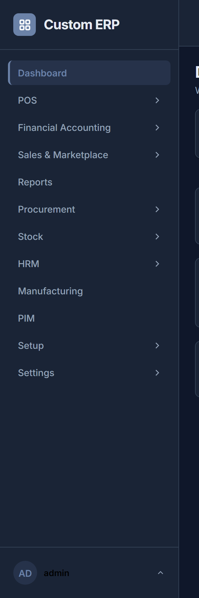
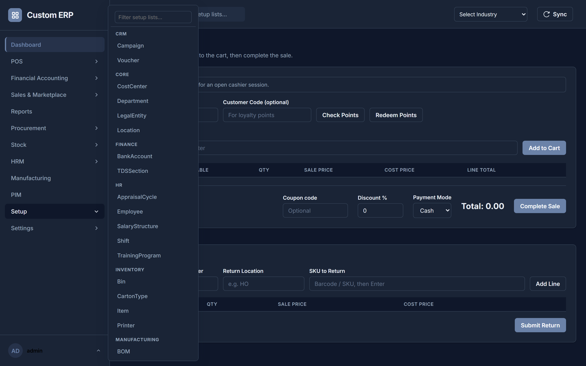
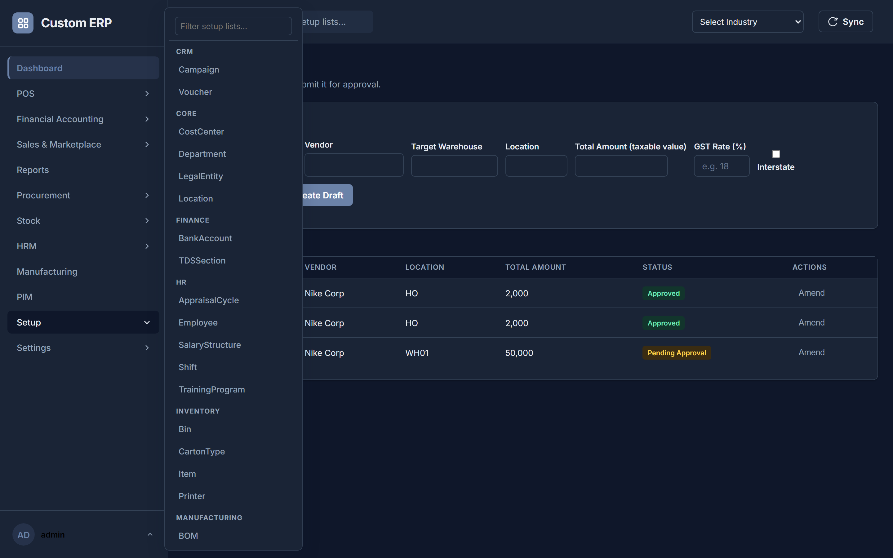
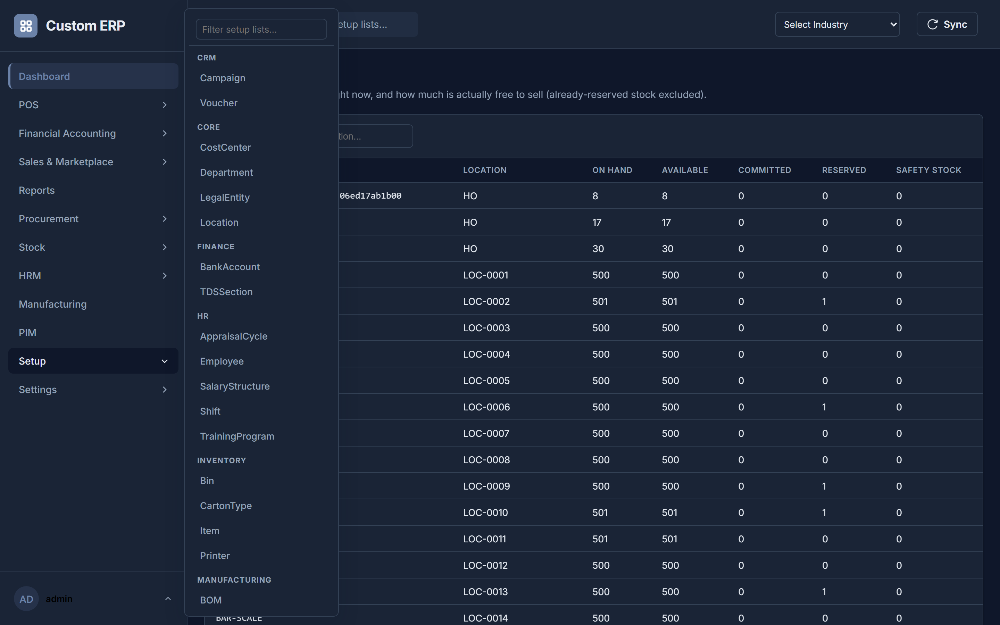
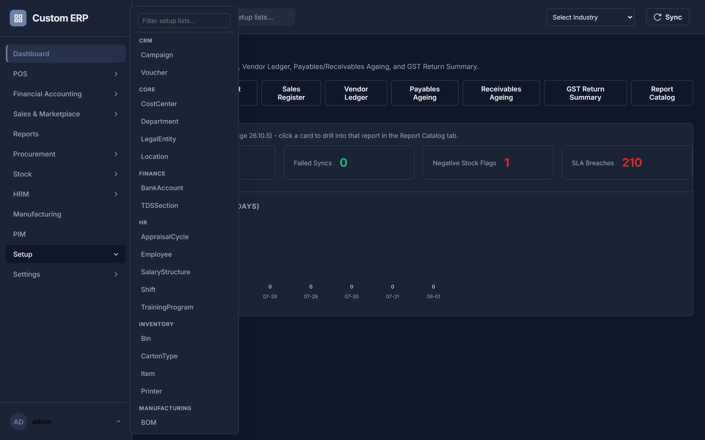

# User Guide

> **Applies to:** Stage 30.8 · **Last verified against the running app:** 2026-08-01
> Every step below was walked through against a live server on the date shown. If something here doesn't match what you see, the document is what's wrong — please report it.

**Welcome!** This guide explains how to use the ERP system. It's written in plain language for anyone using the system for the first time — no computer or accounting background needed. If a word might be unfamiliar, it's explained the first time it's used, and there's a glossary at the end.

*Need literal click-by-click steps for a screen not walked through in depth below? See **[USER_SOP.md](USER_SOP.md)** — the same plain-language style, one section per screen, covering every module.*

*Prefer to watch? The [editable process-video library](../sop-video/readme.md) currently has a
complete Purchase Requisition training chapter, including Department setup and a saved-number
check. Other video chapters are explicitly pending; use this written guide for those tasks.*

---

## How do I…?

Jump straight to the thing you're trying to do.

| I want to… | Go to |
|---|---|
| Log in for the first time | §2 |
| Watch a step-by-step Purchase Requisition example | [Process-video library](../sop-video/readme.md) |
| Find a screen I can't see in the menu | §3 |
| Open any screen, report or document fast (Ctrl+K, codes like `PO`, report numbers like `R1001`) | §3A |
| See every keyboard shortcut, or print a shortcut card | §3A (press **?** on any screen) |
| Copy a record or a purchase order instead of typing it again | §3A.6 |
| Approve, reject, submit, export or delete many rows at once | §3A.6 |
| **Ring up a sale** | §4 — read the prerequisites box first |
| Open or close the till for a shift | §4.0 |
| Find a product when I don't have its barcode | §4.1 step 1 |
| Attach a customer to a sale, or add one at the counter | §4.1 step 5 |
| Work out a customer's change from cash | §4.1 step 8 |
| Understand why the till froze after a sale, and start the next one | §4.1a |
| Apply a coupon, or understand why an offer didn't appear | §4.2 |
| Print a receipt, or make it print without a dialog | §4.3 |
| Change which shop this till sells from | §4.5 |
| Understand why my shop isn't in the till's Store list | §4.0 step 2 |
| Fix a screen showing old or wrong data (Refresh vs Reset) | §12.3 |
| Print barcode stickers for everything on a GRN or a transfer | §7A.1 |
| Make one product category's label look different | §7A.2, then §7A.5 |
| Change the standard label (copy it into my own template) | §7A.2 (**Duplicate** on the **Standard label** card) |
| Choose which template an item, item type or category prints with | §7A.5 |
| Print one GRN line on a different label layout, just this once | §7A.1 (the line's **Template** dropdown) |
| Design a jewellery tag with weight, size, MRP and a QR code | §7A.2 |
| Print 2 or 3 labels across a multi-up roll, or on an A4 sticker sheet | §7A.2 (*Label tab*) |
| Fix labels that print off-centre, too light, or upside down | §7A.2 (*Label tab → Printer tuning*, then **Test print**) |
| Re-print a single tag that fell off | §7A.3 |
| See who printed which labels, and when | §7A.4 |
| Scan a sticker and see which day it came in and how old it is | §6.3 (*Batch Lookup & Ageing*) |
| List stock older than 90 days, oldest first | §6.3 (*Batch Lookup & Ageing → Older than*) |
| See how much stock is 0-30, 31-60, 61-90, 91-180 or over 180 days old | §6.3 (*Stock Ageing by GRN batch*) |
| Make the batch number scannable on my own label design | §7A.2 (drag **Batch / Lot** onto a barcode) |
| Print a shipping label or a sales invoice, or make labels print with no dialog | **[QZ_PRINTING_SETUP.md](QZ_PRINTING_SETUP.md)** — "Day-to-day use" |
| Take a return | [USER_SOP §3.3](USER_SOP.md) |
| Check how much stock I have | §5 |
| **Order stock from a supplier** | §6 |
| Add items and prices to a purchase order | §6, step 3 |
| Print a purchase order and send it to the vendor | §6, step 7 |
| Create a new design and its colour / size combinations from the PO | §6.9 |
| Receive several POs of one vendor on one GRN | §6.10 |
| Record the vendor's invoice price when it differs from the PO (debit / credit note) | §6.10 |
| Send the vendor a PO in Excel with item pictures | §7B.1 |
| Print a GRN, transfer challan, debit or credit note | §7B.1 |
| Change how a PO / GRN / transfer / note prints (my own template) | §7B.2 |
| Use a different print layout for one vendor or one product range | §7B.2, step 6 |
| Understand inclusive vs exclusive GST, or why a PO says IGST | §6.2 |
| Record stock that has arrived | §6, step 9 |
| Complete a missing barcode when receiving stock | §6.4 — existing/imported Items are covered automatically |
| Understand where document numbers come from | §6.1 |
| Sell a gift or free-with-item product, or use backflush materials in production | §6.8 |
| Move stock between locations | §7 |
| Add a vendor, item, brand, location… | §8 |
| Correct a record I got wrong | §8 — use the row's **Edit** icon |
| Create a missing vendor/item mid-way through a document, then carry on | §8.1.1 |
| **Set up jewellery Designs and their SKUs (Combination IDs)** | §8d |
| Understand the extra jewellery fields on an Item | §8d.1 |
| **Record what competitors charge, and see where I sit against them** | §8a, then the Competitor Price Gap report in §9 |
| Run a report / find the right report | §9 and **[REPORT_CATALOG.md](REPORT_CATALOG.md)** |
| **Place a customer order by hand (phone / walk-in / replacement)** | §9A.1 |
| Check whether a marketplace or Unicommerce order reached the ERP | §9A.2 |
| Process an order through to shipment and invoice | §9A.3 and §9A.4 |
| Understand why a field says my GSTIN, email or phone number is wrong | §8e |
| Pick a state, fill an address, or see why a new record's code is V00001 | §8f |
| Approve or reject something | §10 |
| Approve or reject from my phone | §10A.4 |
| Scan an item on my phone for its price, stock at other stores or batch age | §10A.5 |
| Install the Store app on a phone | §10A.1 |
| Sign in on the store's shared phone with a PIN | §10A.2, §10A.14 |
| See today's sales for my store on my phone | §10A.7 |
| Check a delivery or a transfer by scanning it on my phone | §10A.8 |
| Count stock on my phone, even with no connection | §10A.9 |
| Print an item's labels from my phone | §10A.10 |
| Build a basket on my phone for the till | §10A.11 |
| Order a size from another store for home delivery | §10A.12 |
| Get an alert on my phone for a new approval or low stock | §10A.13 |
| Post an accrual, correction or opening balance (journal voucher) | §9B.1 |
| **Log a customer's service call and work it to closure** | §9C |
| Record a customer's maintenance contract (AMC) | §9C |
| **See everything about one customer, and record their consent** | §9D.1, §9D.2 |
| Build a segment of customers | §9D.3 |
| **Send a campaign, get it approved, and see what it brought in** | §9D.5 |
| Switch on birthday, welcome, win-back and other automatic messages | §9D.6 |
| Find out why a message was not sent | §9D.7 |
| Answer WhatsApp replies; work a complaint ticket | §9D.8, §9D.9 |
| Ask customers for feedback after a bill; record a referral | §9D.10 |
| Book a customer appointment; ask a store to keep an item | §9D.11 |
| Track business-buyer leads and deals to a Sales Order | §9D.12 |
| Serve a customer from my phone; see my tasks | §10A.15, §10A.16 |
| Move or dispose of a fixed asset | §6.7 step 5 |
| Change my own password or auto-logout | §11 |
| Find out which version I am on, to report a problem | §11.1 |
| **Understand an error message or code** | §12 and **[ERROR_CODES.md](ERROR_CODES.md)** |
| **Set the whole thing up from scratch and make my first sale** | §13 — the full worked example |
| Know what my role is allowed to do | **[PERMISSION_MATRIX.md](../archive/legacy/permission-matrix.md)** |

---

## 1. What is this system?

Think of this system as one big digital notebook that your whole business shares. Instead of writing sales in one notebook, stock in another, and money in a third — everything goes into the same place. That way, everyone (the cashier, the warehouse person, the accountant, the owner) is always looking at the same, up-to-date information.

## 2. Logging In

1. Open the app in your web browser. You'll see a **login screen**.
2. Type in your **username** and **password** (your manager or admin gives these to you).
3. Click **Login**.
4. **The first time you sign in** — and the first time after an administrator has reset your password — you are asked to **Set your own password**: type the password you were given, then your new one twice. Nothing else in the system opens until you have done this, so the password your administrator knows never stays in use. If you forget your password later, ask your administrator to reset it; you will be asked to choose a new one again.
5. Only administrator accounts (Admin and Super Admin) are asked for a **6-digit code** from an authenticator app on their phone. This is called **MFA** (Multi-Factor Authentication) — an extra lock on the door, on top of the password. Everyone else signs in with username and password only. On your own computer you can tick **Remember this device** to skip the code there for a while (see below).
6. If you type your password wrong too many times in a row, the system will temporarily lock your account to keep it safe. Wait a bit and try again, or ask an admin for help.

### If your role uses MFA: your recovery codes

The very first time you set up MFA, the app shows you **ten recovery codes** and asks you to tick a box confirming you have saved them. Take that seriously — **this is the only time they are ever shown.** The system stores only a scrambled fingerprint of each one, so nobody, including your administrator, can look them up for you later.

- **Save them somewhere that is not your phone.** A printed copy in a locked drawer, or your password manager. Saving them on the phone that holds your authenticator app defeats the point: if you lose the phone, you lose both.
- Use **Copy** or **Download** on that screen if it helps — Download saves a small text file.
- **Each code works once.** On the login screen, if you don't have your phone, click **"Lost your phone? Use a recovery code"** and type one in instead of the 6-digit code. Dashes, spaces and capitals don't matter.
- After you sign in with a recovery code, you'll see a message telling you how many you have left. **That message is a prompt to act, not just information** — see below.

### Remember this device (fewer codes on your own computer)

On the code screen, tick **Remember this device for 30 days** before you click **Verify**. For the next 30 days, signing in **on that browser** asks only for your username and password — no code. Your administrator sets the number of days (Configuration → Security → **Remember a device for**; 0 hides the tick box).

- **Tick it only on your own computer or phone.** Never on a shared counter PC, a cyber café or someone else's laptop: anyone who then knows your password could sign in as you there.
- **The password is always asked.** Remembering only skips the 6-digit code.
- **It stops by itself** when the days run out, when you change your password, when you set up a new authenticator, or when an administrator resets your two-factor setup.
- **To stop it yourself** — a lost laptop, a computer you no longer use: **My Profile → Two-Factor Recovery → Forget remembered devices**. Every browser you ticked asks for the code again at its next sign-in, this one included.

### Moving your authenticator to a new phone

Do this *before* you get rid of an old phone if you can, but it also works afterwards as long as you can still sign in (with a recovery code, if need be).

1. Sign in and open **My Profile** from the account menu.
2. In the **Two-Factor Recovery** panel, click **Set up a new authenticator device**.
3. Confirm your **password** (not a code — the whole point is that your old device may be gone).
4. Add the code shown to the authenticator app on your **new** phone, then enter the 6-digit code it displays.
5. Your old device stops working at that moment, and you are given a **fresh set of recovery codes** — save these too; the old set no longer works. Any browser you had ticked **Remember this device** on asks for the new code at its next sign-in.

Your old authenticator keeps working the whole time until step 4 succeeds, so it is safe to start this and change your mind.

The same panel shows **how many recovery codes you have left** and lets you generate a new set at any time (which immediately cancels the old set). If it says you have none, generate some now — with no codes and no phone, only an administrator can get you back in.

**If you have lost both your phone and your codes**, ask an administrator to reset your two-factor setup for you (ADMIN_GUIDE §Users & Roles). You'll be asked to set it up again from scratch at your next login.

Once you're in, you'll see a **sidebar** on the left. **It only shows what your role can actually use** — if a colleague has menu entries you don't, that's your role, not a fault. A whole module disappears if you have no access to anything inside it, and your business only sees the modules it has licensed. Within a screen, buttons you can't use aren't shown either: if you can view a list but not add to it, you'll see a small **"Read-only for your role"** label where the **New** button would be. Ask your administrator if you need more access.

## 3. Finding Your Way Around

The sidebar has **fifteen top-level entries**. Most are module groups: hover one and its screens slide out to the right (click it instead if you are on a touchscreen or using a keyboard). Some groups inside a module (WMS's **Inbound**, each **Setup** module, each **Reports** area, each **Settings** group) open a second menu beside them the same way. Two entries — **Home** and **Knowledge Center** — have no flyout and open straight away.

**Hide the menu for more room.** The **☰** button at the top left, beside the search box, hides the whole sidebar — like Gmail — so the screen you are working in gets the full width. Click it again to bring the menu back. Your browser remembers the choice, so the menu stays hidden (or shown) the next time you sign in. On a phone the same button opens the menu as a slide-out drawer instead. The Wholeops logo heads the sidebar; while the menu is hidden it moves beside **☰** (on a phone just the globe symbol shows there), so it is always on screen. The browser tab names the screen you are on, e.g. *Cost Center | Wholeops*. Your company's name, when your administrator has set it, shows beside the logo and in the tab (*Cost Center - Minn Jewels | Wholeops*). On a test or development copy of the system the sign-in card says so (*Development environment - not the live system*) and every tab title starts with **[Dev]**, so you never mistake it for the live one.

**Every transaction screen looks the same.** POS, Purchase Order, Goods Receipt, Purchase Return, Stock Transfer, Returns, Vendor and Sales Invoices, Debit / Credit Notes and Journal Vouchers are each **one fixed screen that does not scroll** — like a shop's billing screen. Top to bottom:

- **The bar** — the screen's name, a small chip with **who you are signed in as and your store**, the **totals and tax** of what you are entering, and the main button (**Create Draft**, **Save receipt**, **Complete Sale**…).
- **The header boxes** — vendor, addresses, invoice details and so on, packed close together.
- **The add-item row** — scan or search an item and add it.
- **The items** — the only part that scrolls. Its column headings stay in place while you scroll through a long list.

**Creating something and looking at what you've already made are two different pages** — the way Odoo, ERPNext and Zoho work. Every screen where you record something (Purchase Order, Goods Receipt, Purchase Return, Stock Transfer, Location Movement, Journal Vouchers, ASN, RFQ and its quotes, Expenses, Fixed Assets, Payment Proposals, Yard Board, Sticker Printing's Print tab, the manual order in OMS → Orders, Marketplace's settlements / bookings / manifests, Manufacturing's orders, and HR's Attendance, Leave, Payroll, Loans/Advances and My Requests):

- **opens on the list** — what has been saved, newest work and its status, with the count beside the screen's name;
- **+ New …** at the top right (for example **+ New Purchase Order**, **+ Mark Attendance**) opens the form as a page of its own, titled with a breadcrumb such as **Purchase Orders › New purchase order**;
- the breadcrumb's first word, or your browser's **Back** button, returns to the list. Anything you half-typed is kept: **+ New** (or **Forward**) brings it back, until you save it or leave the screen;
- **saving returns you to the list**, where the new record is now shown with its next steps (Submit, Approve, Post, Print…).

The POS till is the exception: it opens ready to sell, and its **Sale** / **Return** tabs switch in place.

| Sidebar entry | What lives inside |
|---|---|
| **Home** | Opens directly. This is where you land when you first sign in — see "Home, your landing screen" below. |
| **POS** | POS / Billing (§4) · POS Profiles · Offline Sync Review · Offline Queue Gaps · Offline Sales (§4.12) |
| **Financial Accounting** | Finance / GL · Approvals (§10) · Vendor Invoice · Payment Proposals · Bank Reconciliation · Debit / Credit Notes · Sales Invoice |
| **OMS** | Orders (§9A) · Pending Orders (§9A.8) · Pick (§9A.9) · Pack (§9A.10) · Ship (§9A.11) · Returns · Settlements (§9A.12). OMS's own configuration — channel connectors, SKU mapping, bundles and its lists — is **Setup → OMS → OMS settings** (§9A.13). |
| **CRM** | Customers · Loyalty · Campaigns · Vouchers · Service Tickets |
| **Reports** | **Dashboard** of live figures, then one entry per area — Sales, Procurement, Inventory, WMS, OMS, CRM, Finance, Manufacturing, PIM, HR and the rest. Point at an area and its reports open beside it (§9). **Schedules** is last. |
| **Procurement** | Purchase Requisitions · Purchase Order (§6) · ASN · **Goods Receipt** · **Purchase Return** (§6.5) · Vendors · RFQ / Quotes |
| **Inventory** | Dashboard (§5.3) · Stock on Hand (§5) · Inventory Ledger (§5.4) · Stock Movement (§7) · Stock Adjustment (§5.5) · MRP Change (§5.6) · Move Stock · Stock Locations · Sticker Printing (§7A) |
| **WMS** | Warehouse Cockpit, then three groups that each open beside it: **Inbound** (Appointment Calendar · Dock Doors · Yard Board · Trailers · RF Receiving · Putaway · Cross-Dock Plans) · **Storage & Control** (Bin · Bin Conditions · LPN / Cartons / Pallets · Bin Replenishment · Location Movement · Cycle Count · RF Lot & Serial · Holds · Place Hold · Hold Release Requests) · **Outbound** (Waves · Wave / Batch Picking · Mobile Picking · Sortation / Put-Wall · Loading) |
| **HRM** | HR · Fixed Assets (§6.7) · Expenses |
| **Manufacturing** | Production: Production Orders · Production Schedule · Job Work — Planning: MRP Suggestions · Supply Proposals — Quality: Quality Inspections · Certificates · Non-conformance — Maintenance: Maintenance Orders |
| **PIM** | Dashboard · Workbench · My Work · Media Library · Supplier Submissions · Catalogs · PIM Reports. PIM's setup lists (families, attributes, workflows, channel maps, import and export templates) are under **Setup → PIM**. |
| **Setup** | The module names; point at one and its reference lists open beside it (§8) |
| **Settings** | Admin-only, in four groups that each open beside it: **Users & Access** (Users · Roles · Approval Rules) · **Customize** (Configuration · Prefix Configs · Dynamic Labels · Database Schema Design · Extension Hooks) · **Monitoring** (Activity Log · System Status) · **Platform** (Control Panel · Tenant Entitlements · Tenant Usage · Data Console — platform operator) |

On a phone, a group such as **Inbound** opens under its own row instead of beside it.




**You only see what your role can use.** If a module or a screen isn't in your menu, your role doesn't have access to it — that's the system working, not something missing. Ask your administrator if you need it. **Home**, **Reports** and the **Knowledge Center** are there for everyone; if you approve documents, your queue is on **Home** ("waiting on you") even when you have no Finance menu.

**Back and Forward.** The browser's **Back** and **Forward** buttons move between the screens you opened, as on any website — Back from **Reports** returns to the screen you came from, it does not close the system. Moving to another page of a list, or searching it, does not add a step, so one Back press is one screen.

**Notices at the top.** A coloured strip across the top of the page carries a short notice (on a test copy of the system, for example, "SIMULATED ENVIRONMENT"). Click **×** at its right end to close it. It stays closed in that browser until a different notice appears.

**Names, not codes.** Wherever you pick or see a record — a department, a warehouse, a vendor — the screen shows its **name**. The system's own reference (for example `Department/HQ/2026/000001`) is still what gets stored; hover over the box or cell to see it, and the copy button next to a list value still copies it.

**Dates.** Click any date box to open a calendar: the arrows change month, clicking the month name lets you jump by month or year, **Today** fills in today and **Clear** empties the box. You can still type a date straight into the box. From the keyboard, **Alt+↓** opens the calendar, the arrow keys move a day or a week, **Page Up/Down** a month, **Enter** picks and **Esc** closes.

### Home, your landing screen

Home is where you land right after signing in (and the "Home" link at the top of the sidebar, or a click on the Wholeops logo, always takes you back there). It is built from your own role, not a generic list, so it stays short and relevant:

- **Your quick actions** — a grid of the screens where you record or process work (transactions only — lists such as Vendors or Customers are in their modules and in Setup), each one click away: **Point of Sale** for a cashier, **Purchase Orders** for buying, the **Warehouse Cockpit** for a floor operator, **Finance / GL** for an accountant, and so on. A screen you have no access to simply is not a tile — never a greyed-out one you can click and get refused.
- **What's waiting on you** — a count of approvals needing your sign-off, when Approvals is something you use.
- **Recent** — the records you most recently created or touched, for the one task type you use most, so you can jump straight back into something you were just working on.
- **Get started** — while your company is still setting things up, this names the first master record (a Vendor, an Item, a Location…) you need before the rest of the screen has anything to show, with a link straight to creating it.

From your second visit onward you land back on whichever screen you were last using instead of Home, so you can pick up where you left off — click **Home** in the sidebar any time you want to return to it on purpose. Refreshing the browser (F5) works the same way: you stay on the same screen, the menu stays scrolled where it was, and the page comes back at the same scroll position — also after you have read a Help article and moved on.

**The store you are working at is at the top right**, beside Refresh. Everything you do — a sale, a purchase order, a transfer — is done at that store, and the lists you see are its records. If you have been given more than one store, click it and pick another (type to find it in a long list); the screen reloads for that store. With a till session open you cannot switch until you close it. Which stores you can pick is set by an administrator (Users → Stores, Roles → Stores).

**All stores (administrators).** If you may see every store's records, the list starts with **All stores**, and that is where you start: the lists show every store's documents, and new documents are made at your own store. Pick a store and every transaction list - purchase orders, goods receipts, transfers (sent and received), returns, bills, stock moves - shows only that store's documents; the button then names the store. Pick **All stores** again to see everything. Picking your own store while on All stores narrows the lists without moving you. Setup lists (vendors, items, employees) always show everything, and finding a bill by mobile number for a return still searches every store (§4.7). Everyone else always sees the lists of the store they are working at.

> **If you are a supplier**, your account is deliberately narrow: you sign in to the same app as everyone else, but the only screen you can reach is **Supplier Submissions**, and within it you see only the submissions filed under your own company — never another supplier's. Fill in the product details you want to propose (the product, the language, a title, and whatever descriptions, tags or image URL you have), save it, then use **Submit for Approval**. A reviewer at the company approves or rejects it; a rejection always carries a written reason, which you can read on the submission itself. Approved text does **not** go live automatically — it becomes a draft that the company still reviews and publishes on its own schedule. If the app tells you your account is not linked to a vendor yet, that's a setup step your contact at the company needs to finish.

**Two search boxes, and they do different things:**

- The **box at the very top of the window** (**Ctrl+K**) opens things. Type "purch" and it offers Purchase Order, Purchase Requisitions and the purchase reports; pick one and it takes you there. It also takes a short code (`PO`), a report number (`R1001`) or a full document number (§3A). It does not filter the list you are on.
- The **box just above a table**, on a screen, filters *that table's records*. This is how you find a particular vendor, item or invoice.

At the top right of most list screens there are **New** and **Bulk Import** buttons, and each row has **Copy**, **Edit** and **Delete** icons and a tick box (§3A.6). Any of these that your role can't use simply won't be shown.

**When some rows of a Bulk Import fail**, the rows that were right are already saved — fix only the others:

1. On the import result, click **Fix and resume the failed rows** (the same job also opens from **My work**, and from **Setup → Import Job** by typing its job ID into the box above the list).
2. **Download failed rows**. Each row comes with its reason in the last column. Correct the values; keep the **original_row** column as it is.
3. Choose the corrected file and click **Check**. It reports what would happen and saves nothing; **Resume** only becomes clickable after a check.
4. Click **Resume**. Just those rows are imported. The job then shows how many are still to fix and how many were fixed since; repeat for any that still fail.

A row number that is not one of the job's open failed rows is refused, so a row cannot be imported twice.

**Checking an import's totals.** Under the counts, the preview and the import result show **Totals**: for each number column, what was accepted out of what the file held (for example *Qty 5 of 10*). If a total is short, the missing amount is in the failed rows. **Rerun: nothing new** means every accepted row updated a record that was already there, so the file had been imported before. The import job keeps these totals.

**Dates in a file are read day first** unless your admin has set another **Date order** (Admin Guide §B.3.0.2a). `03/02/2026`, `03-02-2026` and `3-Feb-2026` all mean 3 February 2026; `2026-02-03` works too. A date that only makes sense month first, such as `02/13/2026`, is refused with its row number. It is never swapped. Lists show dates as *03 Feb 2026*. With **month first**, `03/02/2026` is 2 March, `13/02/2026` is refused and lists show *Feb 03, 2026*; with **year first**, type `2026/02/03` and lists show *2026 Feb 03*. `2026-02-03` and a month written as a word (`3-Feb-2026`) work in every order.

---

## 3A. Keyboard Shortcuts and Quick Codes

Press **?** on any screen (when you are not typing in a box) to see every key and code, with **Report numbers** (every report's number), **Guide** (this section, in the Knowledge Center) and **Print** (a shortcut card to keep by the keyboard). On a Mac, use **⌘** wherever this section says **Ctrl**. Hover over a button to see its key.

### 3A.1 The search box: Ctrl+K

**Ctrl+K** (or **/**) puts you in the search box at the top of the window. Type, then press **Enter** to open the first result, or **↑ ↓** to choose another. **Esc** closes it.

| You type | What opens |
|---|---|
| A name, e.g. `purchase` | Matching screens, record lists and reports |
| A code, e.g. `PO` | That screen (§3A.3) |
| A code and `+`, e.g. `PO+` | A new record on that screen |
| A code and a number, e.g. `PO 42` | Document number 42 of that kind; if several stores have a 42, you pick one |
| A report number, e.g. `R1001` | That report (§3A.4) |
| A full document number, e.g. `PO/HO/26-27/00103` | That document, shown in its record list |
| Nothing (just Ctrl+K) | Your **Favourites**, your **My work** counts and your **Recent** screens |

A code, number or document opens only if your role can open it from the menu; one you cannot open says "No document … that you can open".

**Scan to open:** with the cursor outside any box, scan the barcode printed on a document. It opens as if you had typed its number.

### 3A.2 Keys

**Anywhere**

| Key | Does |
|---|---|
| Ctrl+K or / | Search box |
| ? | The list of keys and codes |
| Alt+N | New record on this screen |
| Esc | Close a dialog, menu or the search box |

**Lists**

| Key | Does |
|---|---|
| ↑ ↓ | Move between rows (the row you are on is highlighted) |
| Enter | Open the row |
| Space | Tick the row |

**Forms and New pages**

| Key | Does |
|---|---|
| Ctrl+S | Save |
| Ctrl+Enter | Save and submit (Submit, Post or Send for approval, where the screen has one) |
| Ctrl+P | Print the document |
| Enter | Next field. On New transaction pages only; at the last field it moves to Save, and one more Enter saves |
| Ctrl+D | Add a line (presses the screen's **Add line**, with what you typed) |
| Ctrl+Delete | Remove the line the cursor is on (a box or button in that line) |

**Kept for the browser and the till:** F1-F12, Ctrl+N, Ctrl+T, Ctrl+W and Alt+F / E / D do what your browser does with them. **POS / Billing** keeps its own keys (§4). In a picker or a notes box, Enter still picks or starts a new line.

### 3A.3 Codes

The same codes work for every company. A code shows only if your role has the screen.

| Area | Code | Opens |
|---|---|---|
| Go to | `HOME` | Home |
| Go to | `INB` | My work and approvals |
| Go to | `RPT` | Reports |
| Go to | `HELP` | Knowledge Center |
| Sales | `POS` | POS / Billing |
| Sales | `SO` | Sales Order |
| Sales | `SI` | Sales Invoice |
| Sales | `SR` | Sales Return |
| Sales | `CN` | Credit Note |
| Sales | `DN` | Debit Note |
| Sales | `EI` | E-Invoice (IRN) |
| Sales | `CUS` | Customers |
| Sales | `CRM` | CRM |
| Sales | `LOY` | Loyalty |
| Buying | `PRQ` | Purchase Requisition |
| Buying | `RFQ` | Request for Quotation |
| Buying | `PO` | Purchase Order |
| Buying | `ASN` | Advance Shipment Notice |
| Buying | `GRN` | Goods Receipt |
| Buying | `PR` | Purchase Return |
| Buying | `VI` | Vendor Invoice |
| Buying | `VEN` | Vendors |
| Stock | `SOH` | Stock on Hand |
| Stock | `SL` | Inventory Ledger |
| Stock | `TO` | Stock Movement (Transfer Order) |
| Stock | `SA` | Stock Adjustment |
| Stock | `MRP` | MRP Change |
| Stock | `MI` | Material Issue |
| Stock | `DC` | Delivery Challan |
| Stock | `MS` | Move Stock |
| Stock | `CC` | Cycle Count |
| Stock | `STK` | Sticker Printing |
| Stock | `ITM` | Items |
| Warehouse | `PUT` | Putaway |
| Warehouse | `PICK` | Pick |
| Warehouse | `PACK` | Pack |
| Warehouse | `SHIP` | Ship |
| Warehouse | `WAVE` | Wave / Batch Picking |
| Money | `GL` | Finance / GL |
| Money | `JV` | Journal Voucher |
| Money | `PAY` | Payment Proposal |
| Money | `BR` | Bank Reconciliation |
| Money | `EXP` | Expense Claim |
| Money | `FA` | Fixed Assets |
| Making | `PRO` | Production Order |
| Making | `JW` | Job Work |
| Making | `QI` | Quality Inspection |
| People | `HR` | HR |
| Admin | `USR` | Users |
| Admin | `ROLE` | Roles |
| Admin | `CFG` | Configuration |
| Admin | `NUM` | Number series (Prefix Configs) |

### 3A.4 Report numbers

Every report has a fixed number: **R**, then the area digit, then three digits. Sales Register is **R1001**. A number never changes and is never reused, and it is the same for every company, so you can tell anyone "run R3004".

| Numbers | Area |
|---|---|
| R1xxx | Sales & POS |
| R2xxx | Procurement & GRN |
| R3xxx | Inventory, Stock Transfer, External Movement, Inventory Loss & Audit |
| R4xxx | WMS |
| R5xxx | Accounting, Finance, GST & Compliance, Expenses, Assets |
| R6xxx | CRM, OMS, E-commerce & Integration, Service |
| R7xxx | PIM, Manufacturing |
| R8xxx | HR |
| R9xxx | MIS, Master Data & Audit, Admin |

The number shows beside the report's name in the **Reports** menu and the report picker, on the line above the results, and in the name of an exported file (`R1001-Sales-Register-2026-10-26.csv`). To look one up, press **?** and click **Report numbers**, or see the Knowledge Center's **Report catalog**, where every report's heading starts with its number.

### 3A.5 Favourites, recent and after a save

- **☆ beside a screen's title** adds it to your favourites (★); click again to remove it. Favourites come first when you press Ctrl+K, on any computer you sign in to.
- **Recent** (in the empty Ctrl+K box) is the last 10 screens, reports and documents you opened in this browser.
- **After you save**, a bar at the bottom of the screen offers **Print**, **New**, **Copy** and, once the document can move on (not while it is a draft or waiting for approval), the **next step**:

| After | Next step |
|---|---|
| Purchase Requisition | Request for Quotation |
| Request for Quotation | Purchase Order |
| Purchase Order (approved) | Goods Receipt against that PO |
| ASN | Goods Receipt |
| Goods Receipt | Vendor Invoice |
| Vendor Invoice | Payment Proposal |
| Sales Order | Pick, then Pack, then Ship |

The bar closes by itself after 15 seconds, or with **×**.

### 3A.6 Less typing

- **Copy a record:** the **Copy** icon on a record-list row, **Copy** on a Purchase Order in the PO list, or **Copy** in the after-save bar. You get a New form with the same details; the number, status and dates are not copied. Check it and save.
- **Your last choice comes back:** a drop-down for store, location, warehouse, counter, salesman, cost centre or payment mode starts on what you last picked on that screen, in this browser. It is highlighted so you can see it was filled for you; change it if needed.
- **Unsaved work is kept:** if the tab closes (or the computer restarts) while a New form has details in it, the form offers **Restore** or **Discard** next time. Only the form's own boxes are kept, not the rows of a line table.
- **The columns of a record list:** a list shows up to eight of the record's main columns - its code, name and status first, then the required fields - so it opens quickly. Line tables and long notes stay off the list. Open the record to see every field; the search box above the table still searches every field you may see.
- **Saved views:** on a record list, type a search in the box above the table, then pick **Save this search as a view…** in the views drop-down beside it. Pick the view later to run the same search; **Delete this view** removes it. Views are yours and follow you to any computer.
- **Ticked rows on a record list:** tick rows (or the box in the heading for the whole page; **Space** ticks the row you are on). A bar shows how many are ticked, with **Export** (a CSV of the ticked rows), **Submit for approval** (where the list has that action) and **Delete**. Submit and Delete do up to 40 rows a run; anything that cannot be done is named in the message.
- **Approvals:** on **My work → Approvals**, tick rows and click **Approve ticked** or **Reject ticked** (one reason for all). Each is decided exactly as if you had clicked its own button. A password reset is always decided on its own.

## 4. Making a Sale (POS / Billing)

This is the screen a cashier uses most.

> **Before your first sale — three things must already exist.** Skip any of them and the sale will be refused, with an error that only makes sense once you know this list.
>
> 1. **A store you are allowed to sell from.** Setup → Core → **Location**, with **Sellable = Yes**, and given to you (an administrator does that in **Users → Stores**, or on your role in **Roles → Stores**). The till always sells from the store shown at the **top of the screen** (§4.0). A location with **Sellable = No** — a back warehouse, a head office — cannot open a session or complete a sale.
> 2. **At least one Item, with its HSN Code and GST Rate filled in.** Setup → Inventory → **Item**. Both tax fields are required and the system will not let you save without them, because it cannot price a sale it can't tax. (If the item genuinely isn't taxed — produce, unbranded grain, exports — set its **Tax Treatment** instead of entering a 0 rate; see §9 Step 3.) Stock also has to exist: an Item on its own has a quantity of zero until a **Goods Receipt** brings some in (§6).
> 3. **An open cashier session at that store.** This is the one people miss. Checkout refuses with *"Cash opening is required before billing"* until a session is open. Opening one is step 3 below.

### 4.0 Open the till for the shift

1. Click **POS / Billing** (under the **POS** module).
2. **Check the store at the top right of the screen** (beside Refresh). It is the store you are working at, and the till sells from it. If you work at more than one store, click it and pick the shop from the list (type to find it). If you have only one, it is simply shown. The session line under the till's title bar names the store and says whether a session is open there.
   - **The shop you expect is not in the list?** Either you have not been given it (ask an administrator to add it in **Users → Stores**), or it is not a selling store (**Sellable = No** on its Location) — the session line then says *"… is not a selling store"*.
   - **Only sellable locations appear here.** If the shop you expect is missing, it is almost certainly set to **Sellable = No** on its Location record — ask an administrator to change it. This is deliberate: it is what stops a sale being rung up against a warehouse or head office by accident.
3. If the session line says *"No open session … open one before selling"*, click **Open Session**, type the **cash physically in the till right now**, and confirm. The bar changes to *"Session open at …"*.
4. **While your session is open you stay at that store.** Switching store at the top is refused with *"Your till session is still open at this store"* — close the session first. This stops a till drifting onto another shop's stock mid-shift.
5. At the end of the shift, click **Close Session** and enter the cash you counted. The system shows what it expected, what you counted, and the difference.
   - **If the count is off by more than the allowed amount** (₹50 unless your administrator changed it), the till says by how much and asks **why**. Type the reason. The session then waits for a **Store Manager** to accept it under **Approvals** — nothing more can be sold on it meanwhile. If the manager rejects it, the session opens again so you can recount and close once more.

**During the shift — cash in and out of the drawer.** Click **More… → Cash in / out**. The dialog shows what the drawer should hold right now (*Float + cash sales − cash refunds + paid in − paid out − safe drops = expected*). Choose:

- **Paid In** — cash brought into the till from the store's safe (more change, say).
- **Paid Out** — a small expense paid from the till (tea, a courier). It is booked as a till petty-cash expense.
- **Safe Drop** — cash taken out of the till to the safe, so the drawer does not build up.

Type the amount, pick a **reason**, and add a reference (the voucher or bag number). You cannot take out more than the drawer should hold. Every movement counts in the expected cash at close, so a drawer that had a ₹1,000 safe drop still balances. Cash refunds paid at this store are allowed for too.

**Switching staff with a PIN on a shared till (Stage 130.11).** A store manager registers the till once: **More… → Register this till for staff PINs**. Each person sets their PIN once (**More… → Set my PIN for this till** - their password, then a 4-8 digit PIN). From then on whoever steps up chooses **More… → Switch staff**, types their name and PIN, and the till is theirs - the bill on screen stays. A supervisor's price override works the same way: the supervisor switches in, makes the override under their own name, and the cashier switches back and takes the payment. No one shares a password. After a few idle minutes the till locks (*Till locked*) until someone enters their name and PIN; reloading the page does not get past the lock. An administrator signs in with their password, not a PIN.

**Handing the till to the next cashier.** The next cashier signs in on the same till, picks the store, and chooses **More… → Take over this till**. They count the cash and type it: that closes the outgoing cashier's session against their count (with the same reason-and-approval step if it is off) and opens theirs with that cash as the float. The two sessions name each other, so who handed over to whom is on record.

You open a session once per shift, not once per sale.



### 4.1 Ring it up

1. **Scan it, or search for it — same box.** Point the scanner at the barcode and it rings straight up — **no Enter key needed**: the till sees a scan as one fast burst and adds the line when it ends (this works in every scan box in the system: transfers, returns, receiving). Typing by hand is slower and is never submitted on its own. If you have no barcode, type any part of the **barcode, design no., SKU or product name** instead:
   - Only an exact **barcode** is added immediately with no list.
   - Anything else shows a list of the products that contain what you typed, underneath the box — it appears when you pause typing, or when you press Enter, even if only one product matches. Click one, or walk the list with the **↑ ↓** arrow keys and press **Enter**. **Esc** closes it.
   - If nothing matches you are told so plainly — *"No product matches …"* — rather than a blank line being added to the cart.
2. Repeat for every item the customer is buying. Scanning the same item twice adds 2, it does not create a second line.
   - **"Which MRP is on it?"** When an item is on your shelf at two MRPs - an older lot and a newer one at a new MRP - the line asks under the item's name, with one button per MRP. Tap the MRP printed on the piece in your hand; the line sells at it (and never above it). Until you tap, the line is priced at the lowest MRP. **change** beside the MRP asks again. A scan of a receipt-date barcode (stickers printed from a goods receipt) already knows its MRP and does not ask. One line takes one MRP - if the customer buys pieces from both lots, ring the second lot as a separate bill.
3. **Adjust quantities with the − and + buttons** on the line, or type straight into the quantity box for a larger number. Pressing **−** on a quantity of 1 removes the line.
4. **Read the Available column before you promise anything.** It shows the quantity you can actually sell at this store. Stock held in a location that does not sell is listed under it by the store's own names — *"Not sellable here: Damage 2 · Inward 3"* (the locations are set up under **Inventory → Stock Locations**, §5.1). That stock is physically in the shop but must not be sold. If you ask for more than can be sold, the row turns red and says *"Only N can be sold here"*. Clicking **Complete Sale** anyway names the item and how many are available (e.g. *"LAMP … available 0, requested 1"*). Click **Remove** on that line, or lower the quantity, and click **Complete Sale** again. Nothing was charged.
5. **Ask the customer's mobile number — on every bill.** Type it into **Customer mobile** and press **Enter**. One number is one customer:
   - **A number already on file** puts that customer on the bill. The line under the box reads *"Name · number"*, and *"GST bill (GSTIN)"* when they have a GSTIN.
   - **A new number** opens the customer form with the number filled in. Type the **name**; the same form asks everything else about the customer, in sections: **Contact** (mobile, name, email), **Address** (Line 1, Line 2, City, State, PIN), **Tax** (**GSTIN**, **PAN**), **Personal** (date of birth, anniversary, gender, sizes) and **Preferences** (preferred store, preferred salesman, tags). Only the mobile number and the name are required. A GSTIN fills the State itself and makes this a **GST (B2B) bill** (§4.1a). Click **Add to bill**. Tick the offer consents (SMS / WhatsApp) only if the customer agreed; both start unticked.
   - **The customer will not give a number?** Click **Walk-in**. The bill goes to the store's walk-in customer; nothing about them is printed and no points are earned.
   - **Forgot to ask?** **Complete Sale** asks for the number first (with **Walk-in** to skip), so no bill goes out without the question.
   - **With a customer on the bill, + New Customer becomes Edit Customer** — open it to add their address, PAN or GSTIN later.
   - You can still type a **name** instead of a number and pick from the list. If they are not on it, **+ Create "what you typed"** opens the same customer form with the name filled in — it still asks for the **mobile number**.
   - **Customer details** shows what the customer agreed to receive, alongside their points (below).
   - **Customer details** shows who you are serving: their points and what they are worth, their tier and what it gives (*Bronze — Birthday voucher*), how much more they need to spend for the next tier, their last few bills and returns, and any **vouchers issued to them that they can use today** (type the code into **Coupon code**). The phone number shows only its last four digits. **Redeem Points** spends points on this sale. Add the items first: the till then tells you the customer's balance, what one point is worth (set by your administrator — it is not always ₹1) and the most this bill can take, and you type how many to use. The amount comes off the **Total** at once (the bar shows *Loyalty: −270.00 (270 pt)*), and the points are only actually deducted once the sale completes.
   - **The customer may need to confirm.** If your shop asks customers to confirm redemptions, a one-time code is sent to the customer; type the code they read back into the box that appears. A wrong code redeems nothing — choose **Redeem Points** again to send a new one.
   - **A large redemption needs a manager.** Above the value your administrator set (₹500 as shipped), the till asks you to **choose a reason** and raises a request for a Store Manager. The info line names the request and says it is waiting under **Approvals**. Once the manager approves it there, complete the sale as normal; until then, **Complete Sale** refuses with *"needs a manager's approval"*. Each approval is for this one bill and this number of points — it cannot be reused on another bill.
   - **Points the customer has already spent elsewhere can make the balance negative** after a return (see §4.7). Such a customer cannot redeem until new purchases bring the balance back above zero.
6. **Any offers that apply appear on their own, in a panel under the items** — see §4.2. If the customer has a coupon, type it into the **Coupon code** box.
7. Check the **Total** at the top right of the screen. The bar beside it shows the discount and the tax split — **CGST · SGST**, or **IGST** — so you can read them out to the customer. The bill is paid to the **whole rupee**: when the lines come to paise, the bar shows a **Round off** (for example *Round off -0.40* on 970.40, so the Total is 970) and the receipt prints the same line. A later return pays back what the customer paid for those pieces.
8. **Choose how they're paying.** **Payment Mode** lists the tenders your store takes, by their own names (*Cash*, *HDFC Card*, *Paytm*...). If it is **Cash**, type what the customer handed you into **Cash tendered** and **Change due** appears beside the Total at the top before you commit to anything (or *"Short by …"* if it isn't enough). A tender that needs a reference (a card slip, a UPI reference / UTR) asks for it once at **Complete Sale**.
   - **Salesman.** If your store records who made the sale, a **Salesman** box sits beside the payment boxes with the store's default salesman chosen. Change it if someone else served the customer. Where the store makes it compulsory, the sale cannot complete without one.
   - **Discount.** Type a bill discount into **Discount** and choose **%** or **Rs**. It comes off the price straight away — the bar shows *Discount −99.90* and the Total drops; the tax is worked out on the discounted price. Above 5% (your administrator can change this) the till asks **why**; above your approval rules a manager must approve the sale, as before (§4.1a). To discount one line only, use **Override** on that line: type the new price, then choose why from the list (*Price match*, *Shop-soiled piece*, *Manager discretion*...) with an optional note.
   - **Paying from an advance.** If the customer has paid an advance (§4.9), **Use advance** appears beside the customer buttons with the amount. Click it and the bar shows *Advance: −300.00*; the Total is what is left to pay.
   - **Paying more than one way?** Click **More… → Split payment**. Type the fixed parts — say **Card 1,000** and **UPI 200** — and leave the rest blank. Whatever is left is paid by the **Payment Mode** you have selected; the bar shows *Split: Card 1000.00 + UPI 200.00; the rest by Payment Mode*. If the rest is cash, **Cash tendered** and **Change due** work on the cash part only. Parts that add up to more than the bill are refused. To go back to one payment mode, open **Split payment** again and clear the boxes. A split sale cannot be queued offline with a gift card, and a payment-terminal sale is never split.
9. Click **Complete Sale** (top right, next to the Total).

**Holding a bill.** A customer goes to fetch another size and the queue is waiting: click **More… → Hold this bill**, add a short note (their name, say) and confirm. The till clears for the next customer. When they come back, click **More… → Resume a held bill** on any till at the same store, pick the bill (shown with its note, items, total, who held it and when) and it comes back with its items, customer and coupon. Prices are checked again. Points, a split payment and gift cards are not kept on a held bill — add them again before **Complete Sale**. A bill keeps its number while it is held, so it can only ever be paid once; if two tills try to resume the same bill, the second is told it is no longer held. To drop a bill the customer will not come back for, choose it in the same list, pick **Discard it** and give a reason. Holding a bill does not set stock aside.

### 4.1a The sale is complete — the till freezes

This is deliberate and is the biggest change from how this screen used to work.

When the sale goes through, **the till stops and shows the finished bill**: the **bill number** (given by the server, per store, at most 16 characters — e.g. *BJAY2627000123*), the store, each line, any advance used, the total collected, the cash tendered and the change due. Everything below it is hidden, and **nothing can be scanned onto it**.
- **A GST (B2B) bill** — a customer with a GSTIN — also has **Print GST Invoice**: the tax invoice with your company and the buyer's GSTIN, the buyer's address, the place of supply (your store's state, since the goods are handed over at the counter), each line's HSN, and the tax summary HSN by HSN. A customer without a GSTIN gets the receipt as usual.

- The bill stays there as long as you need it — read the change back to the customer, answer a question about a line, print the receipt.
- When you are ready for the next customer, click **New Sale (Reset)**. The cart, customer, coupon, discount and tendered amount are all cleared for a clean start.
- **The store stays as it is.** You do not re-pick your shop between customers.

Why it works this way: before, the cart silently emptied behind a dialog and the screen looked exactly as it had a moment earlier — so the next customer's items could be scanned onto what you still believed was the previous sale. Now there is an unmistakable boundary between one bill and the next.

**Two other outcomes freeze the till the same way**, so you always know where you stand:

- **Waiting for manager approval.** A large discount does not complete the sale. The panel says so in orange and offers no receipt — the money has not been collected and **the goods must not be handed over**. The sale sits as **Pending Approval** until a manager decides it from the **Approvals** screen.
- **Queued offline.** If the connection is down, the sale is saved on the till and is sent automatically when the connection returns. The panel tells you so and warns you **not to ring it up again**. When it is sent, the till says *N offline sales sent for validation*: the sale is **not posted yet** — stock is not deducted and the bill is not made until a manager validates it on **POS → Offline Sales** (§4.12). **Scan every item** while offline: a line you picked from the search list or uploaded counts as *not scanned*, and a sale with such a line cannot be validated. An item with no barcode is scanned by its SKU (what its sticker prints).

### 4.2 Offers and coupons at the till

You do not apply offers by hand. Whatever your head office has set up in the ERP is worked out automatically as you build the cart, and shown in a panel just under the items — each offer by name, what it did ("10% off the bill", "buy 2 get 1 free — 1 free unit"), and how much it took off.

- **Automatic offers just appear.** Add the qualifying items and the offer shows up. Remove an item and it disappears again if the cart no longer qualifies. If an offer needs a minimum spend, it appears once the cart crosses it.
- **Coupon offers need the code.** Type it into the **Coupon code** box. Case doesn't matter, and you can enter more than one separated by a space or comma. If a code doesn't apply to this cart, the panel says so in plain words rather than silently ignoring it — check the spelling, and whether the cart actually meets the offer's conditions.
- **Issued vouchers go in the same box.** A voucher your company issued (a printed or emailed code — *WELCOME100*, a customer's birthday voucher) is typed into **Coupon code** like any coupon. It is applied after the offers, on what they left, and shows in the panel as *Voucher WELCOME100 — issued voucher −100.00*. One voucher per bill. If it cannot be used the panel says why — *used up*, *expired*, *restricted to a different customer*, *for Online use only*, *can be used from …*. A voucher restricted to a customer needs that customer on the sale first. It is used up only when the sale completes; if someone else used its last use in the meantime, **Complete Sale** says so — remove the code and the bill is priced again without it.
- **Some offers only apply to certain customers** (a loyalty tier, for instance). Look the customer up *before* expecting those to show — with no customer on the sale, a tier-restricted offer will not appear.
- **The final say is the server's, not this screen's.** The panel is a preview; the discount is recalculated for real when you take payment. In normal use the two agree. If they ever don't, the amount charged is the correct one.
- **The discount box is separate.** **Discount** (% or Rs) is the cashier's own bill discount — it comes off the price, needs a reason above the limit and a manager's approval above your approval rules. Offers are not manual discounts and don't need approval — they're the rules head office already signed off.

### 4.3 Printing the receipt

Click **Print Receipt** on the finished bill. You can click it more than once — a customer who said no and then changed their mind does not need the sale re-rung. **Preview** beside it shows the bill exactly as it will print (a bill already printed shows as the reprint it would be); **Print** there prints it, **Close** prints nothing.

The receipt is the sale's **tax invoice on 3-inch (80 mm) roll paper**: your brand and store header (address, phone, email), **Tax Invoice**, bill number with date and time, the customer, one row per item with its **barcode** and **HSN / design** under the name, quantity, rate (with the item discount under it), amount, then total quantity, item discount, taxable value, CGST / SGST (or IGST), round off and **NET AMOUNT**, how it was paid, the cashier, the **HSN-wise GST table**, your GSTIN, the amount in words and a thank-you line. The bill is as long as its lines need. To change anything on it — add your **logo**, website, CIN, terms and conditions, a social-media line, move or remove a piece — open any till sale's **Print**, pick **3-inch roll bill (built-in)**, click **Design templates**, change it and **Save** (§7B.2); the till then prints your version. A roll template of your own always wins over the built-in one.

If your till has a receipt printer set up for silent printing it goes straight there with no dialog (see below); otherwise your browser's normal print dialog opens. Nothing extra is needed to print — the button always works.

To get the one-click version, your administrator installs **QZ Tray** on the till PC ([QZ_PRINTING_SETUP.md](QZ_PRINTING_SETUP.md)). The first bill printed there goes to the till's receipt printer — chosen by itself when the PC has one, or asked once — and every bill after that prints there without asking (§7B.3). If QZ Tray isn't installed, the browser print dialog appears as before; nothing breaks and nothing is lost.

A few things worth knowing:

- **The receipt says which shop sold it.** The header carries your company's name and GSTIN, the shop's name and its address (address lines, city and PIN code from Setup → Location), the **bill number**, the date and time, and who was on the till. The customer is printed by **name and mobile number** — never a customer code, and nothing at all for a walk-in. A customer holding the receipt can tell which branch of a chain they bought from — and it stands up as a tax document.
- **The receipt shows what was actually collected.** Offers and loyalty points spent both appear as their own lines, so the printed total matches the cash in the drawer.
- **A sale waiting on manager approval will not print a receipt.** The money hasn't been collected yet. Once the manager approves it from the **Approvals** screen the sale completes and can be printed.
- **Reprinting later is safe.** The receipt is rebuilt from the recorded sale, not from whatever is on screen, so it always shows what was originally rung up.
- **What the receipt shows** (Stage 130.16): every way the bill was paid (*Paid: Cash 500.00 · UPI 700.00 · Points 10*), and - for cash - the cash given and the change handed back, the tax breakup and HSN per line, and your return policy at the foot (an administrator sets it: **Return policy on the till receipt**). A store whose print profile says *58 mm roll* gets the same receipt on narrow paper; long numbers wrap instead of being cut off.
- **If a 58mm till roll prints text too wide**, tell your administrator to set **Label Width (mm)** to `58` on that Printer record.

**If something goes wrong mid-sale** (a barcode doesn't scan, the system shows an error), read the message on screen — it tells you exactly what's wrong (e.g. "this item is already sold" or "not enough stock") rather than just "error."

**Units reserved for online orders are not sold at the till.** If an online order has reserved units at your store, the till sells only the rest, and the message says how many more are *reserved for orders*. The stock shown at the till already leaves them out. To sell one anyway, the order has to be moved to another location first (OMS).

### 4.4 If prices changed while you were ringing up

Occasionally the back office changes a price between the moment the cart was priced and the moment you press **Complete Sale**. The system never quietly charges either figure. It stops, shows you what changed and the new total, and asks you to confirm. Nothing is charged until you do.

### 4.5 Reset Terminal — starting the till again

**Reset Terminal** is in the session bar, next to the session buttons. It clears the cart, customer, coupon, discount and tender. Use it when a bill has gone wrong and you want to start it again.

1. Click **Reset Terminal**. It tells you how many cart lines will be thrown away and asks you to confirm. **The cart is not saved.**
2. The store does not change: it is the store at the top of the screen. To sell from another shop, close your session and switch store there (§4.0).
3. Your session stays open — a session is a cash-accountability record, and only **Close Session** ends it.

Day to day you will not need this button. Between customers, use **New Sale (Reset)** on the finished bill instead.

### 4.6 Packaging, free gifts, gift cards — and items the till won't sell

**The one rule:** if the exact thing you hand over matters, scan it. If it is ordinary packaging, the system takes care of it. If it is money (a gift card), it is issued and activated, never sold as a line.

**Boxes, bags and butter paper — don't scan them.** Your store's usual packaging is set up once (Admin Guide §B.3.8, *Backflush Rules*): earrings go in a Small Red Box, a necklace in a Large Red Box, every packed item gets one butter paper. As you ring up, the panel under the items shows **Uses (not on the bill): 2 × Small Red Box, 3 × Butter Paper…**. When the sale completes, those leave the store's stock automatically, recorded against the bill number. They never print on the customer's bill.

- **The customer gets a different box?** Click **Packaging** (next to **Add to Cart** — it only shows when something can be changed). Each line shows its usual packaging; pick the one actually used, or **None** where that is allowed. Some changes need a **Reason** — type it in the box beside the choice. Changed choices are marked with **\*** in the panel. Anything you leave alone keeps its usual packaging.
- **The store is out of a box or of butter paper?** The panel says *"Short of …: store has 2, this sale uses 3"*. Normally **the sale still goes ahead** — the shortfall is recorded for your manager under **Item Exceptions**, to be put right by counting or receiving stock. Only if your administrator set that packaging to *Block* will the till ask you to pick another option first.
- **Scanned a box by mistake?** The line comes straight off with *"… is not sold at the till … use Packaging to change it"*. Nothing else on the bill is affected.

**Free gifts (Gift With Purchase).** When the bill qualifies for a gift — say a Gift Plant with every necklace — the panel shows **Gift eligible: 1 × Gift Plant — scan it to hand it over**. Scan the gift you actually hand over: it rings up at **0.00** as *Free gift (offer)* and the prompt changes to *scanned*. A gift the bill has **not** earned — or more of it than earned — is refused and comes off, with the reason. A "free with item" accessory (a charger free with a phone) still works as before: it is free only alongside its main product.

**Gift cards.** Click **Gift Card** (with Customer details / Redeem Points) and choose what you are doing:

- **Pay this bill with a gift card.** Scan or type the card number; leave the amount blank to use as much as the card covers (or type a smaller amount). The bar shows **Gift card: −600.00 (**** 1701)** and the **Total** drops to what is still to collect — take the rest by Cash / Card / UPI as usual. The card is charged only when the sale completes; if the sale fails, the card keeps its balance. A gift card **needs a connection** — it cannot be used on a sale rung up offline. To take a card back off the bill before completing, use **Gift Card → Remove the gift cards from this bill**.
- **Issue / add value.** For a customer **buying** a gift card. Take their payment first, then scan the card, type the amount and choose how they paid. The card is funded at that moment and a separate **Gift Card Issue** receipt prints (card shown as **** 1701, amount, balance, valid until). It is not a line on any sale bill. A card that has already been issued cannot be issued again; whether value can be **added** to an issued card depends on its type.
- **Check balance.** Scan the card to see its status, balance and expiry.
- **Store managers also see:** **Block a card** (lost or misused — a reason is required), **Release a blocked card**, **Cancel an unused issue** (refund — allowed only while none of the balance has been used; refund the amount shown by the original payment mode), and **Register new cards** (load pre-printed card numbers, or have the system generate numbers to print — shown **once**, so print them straight away).

The finished bill and the receipt show each gift card as its own line (*Gift card **** 1701 −600.00*), so the amount collected matches the drawer.

**Items the till won't sell.** Some items are kept off the bill on purpose — packaging, internal supplies, fixed assets (laptops, the till itself). Scanning one removes the line and tells you why. A **service** (repair, installation) sells normally but shows **Not stocked** in the Available column, because there is no shelf stock to count.

### 4.7 Returns — what the customer gets back

A return pays back **what the customer actually paid for those items**, the way they paid it. It is never the price on the tag when the bill had an offer, and never cash for something paid with points or a gift card.

1. **Raise it at the till.** Open the **Return** tab on the POS screen and find the bill: scan or type the **bill number**, or type the customer's **mobile number** or name, and/or pick the **Bill date**, then click **Find Bill**. One match opens at once; several are listed to pick from. It looks at this store's bills; tick **All my stores** for a bill bought at another of your stores — the return is then taken here (the goods come back into this store's stock) and keeps the store that sold it. Each line shows what can still be returned and its price — the price after the bill's offer, e.g. a ₹1,000 shirt on a bill with 10% off shows **900.00**. **Return Location** is already filled with the till's store. Type the quantities coming back (or **Upload** a CSV of *Barcode, Qty* for a long bill) and click **Raise Return**.
2. **A manager takes it from there** on **OMS → Returns**: **Approve** (if your business has turned on second-person approval, someone other than the person who raised the return must approve it, and its refund), then **Book Pickup** if a courier collects the goods (PIN code, contact name and pickup address; leave **Courier** blank and it is picked by PIN code from your courier service areas; the courier's account must be set up first, and if it was not, click Book Pickup again once it is; if the courier did not answer, click Book Pickup again - it asks the courier first, so the pickup is never booked twice, and a courier that cannot be asked opens **Unconfirmed booking** to resolve it, as on **OMS → Ship**, §9A.11), then **Receive Goods** when the items are physically back, then **Inspect**. Inspect opens one form with each item by name. Choose its condition from the list: Sellable, Damaged and Repairable are refunded; Missing, Wrong Item and Rejected are not. Optionally, type an item code to exchange it instead. Until the inspection, **Refund Eligible** shows the expected amount, marked *expected*.
3. **Refund.** Click **Refund** on the return. For a till bill you are shown exactly where the money goes, for example *Card 333.33, Cash 410.00, UPI 66.66, 90 points back to the customer* — confirm to approve, and confirm again to pay. Reverse any card or UPI part on the terminal or payment app; cash comes out of the drawer. You are only asked *"How is the refund being paid?"* for a return with no till bill behind it (an online order).

What happens to the customer's points, automatically:

- **Points they spent on the returned items come back as points**, valid for at least 30 days (or longer, if their points had a later expiry when they bought).
- **Points the returned items earned are taken back**, in proportion to the money refunded. If the customer has already spent them, their balance goes negative and their next purchases pay it back; the cash refund is never reduced to cover them.
- **A gift-card share goes back onto the same card.** If that card has since been blocked, the refund stops with *"goes back to a gift card that is blocked"* — a manager releases the card (**Gift Card → Release a blocked card**) and processes the refund again.

**Exchanging at the till — swap, and pay only the difference.** The customer is at the counter with something to swap:

1. On an empty till (store picked, session open), click **More… → Exchange**, type the **original bill number** and choose how many of each item are coming back and their condition (**Sellable**, **Damaged** or **Repairable**). The items are received and inspected there and then — no trip to the Returns screen.
2. The till shows **Exchange credit: −900.00** in the bar: what the customer paid for those items (after the bill's offer; any points they used come back as points, and the points those items earned are taken back, as for any return).
3. Ring up what they take instead. The **Total** is what is left to pay after the credit — take it as usual (cash, card, UPI, a split). If the new items cost less, the bar says *(450.00 back to the customer)*, the Total reads **0.00**, and after **Complete Sale** the finished bill says **Exchange: give the customer 450.00 back from the till** — hand that over in cash. It is counted in the drawer's expected cash.
4. The new bill earns points on everything it was paid with, the credit included, so a straight swap leaves the customer's points where they were. An exchange needs a connection (it cannot be queued offline), and its credit can be used on one bill only.

Returning a line in pieces works out to the paisa: two identical shirts returned one at a time may refund 809.99 and then 810.01, and together they always give back exactly what was paid.

**Cancelling today's bill (store managers, Stage 130.9).** A bill rung up wrongly today can be cancelled outright: on the till's **Returns**, look up the bill and press **Cancel the whole bill** (shown to a Store Manager or administrator, for today's bills with nothing returned yet), and give the reason. Every item comes back into stock as sellable, the money goes back the way it was paid (cash, card, UPI, gift card), points earned on the bill are reversed and its tax is reversed - all through an ordinary return, which you can open on **Returns**. Pressing it again only shows the first cancellation. An older bill, or one already partly returned, is returned instead.

**Store credit instead of money back (Stage 130.12).** A refund goes back the way the bill was paid. If the customer *asks* for store credit instead, choose it when processing the refund on **Returns** (Cancel the "back the way it was paid" question, then confirm store credit; or type *Store Credit* where the refund method is asked). The amount goes onto the customer's store credit - no card, nothing to carry: it stays on their account, does not expire, cannot be given to someone else and is never paid out as cash. A walk-in bill (no customer) cannot be refunded to store credit (`SALESR-1310`). On their next bill, attach the customer and the **Use** button offers their store credit (with any advance): *Use store credit 1,000.00*. Above the limit your business sets, a store manager switches in to allow it (`POSOFF-1309`). The return also gets its own GST credit note number (CN...), naming the original bill.

**Free gifts on a return (Stage 130.9).** When everything paid for on a bill comes back, its free gift (a Gift With Purchase item) has to come back too - the return is refused until the gift is added (`SALESR-1307`). Keep part of the purchase and the customer keeps the gift. Your administrator can let customers keep gifts altogether.

**Items the till refuses (Stage 130.9).** *This item can't be sold yet* (`POSOFF-1303`) - a new item still waiting for its release approval. *This store does not sell this item* (`POSOFF-1304`) - the store's record lists it under *Items not sold here*. A made-to-order item whose Product Type allows negative stock sells even with none in stock; the shortfall is recorded for the store manager.

### 4.8 A customer's points — the Loyalty screen (store managers)

**CRM → Loyalty.** Four tabs:

- **Customer** — search the customer by name or phone. You see their balance, their tier and what it gives (*Silver · Free alterations*), and every entry in their points history in plain words — *Earned on a sale*, *Redeemed*, *Given back on a return*, *Taken back on a return*, *Credited / Debited by adjustment*, *Expired* — with the bill or document it came from and when earned points lapse. A negative balance is explained: a return took back points they had already spent, and new purchases pay it back.
  - **Adjust points** puts points on or takes them off by hand — a goodwill credit, a correction. Type the points (+ to credit, − to debit), pick a **reason** and add a note. It is a new entry in the history; nothing is ever edited. Up to the approval value (₹500 worth as shipped) it happens at once; above it the adjustment waits under **Approvals** for another manager. A debit can never take the balance below zero.
  - Under the balance you also see what the points are worth, the spend counted for tiers and how much more reaches the next tier, the customer's **last bills**, their **returns** (status and refund), and the **vouchers they can use** right now. These are the same figures the cashier sees under **Customer details** at the till.
- **Tiers** — each tier's **Spend from** threshold, **Earn multiplier**, **Benefits** (shown to the cashier at the till) and **Grace days**. A customer's tier follows what they actually spent, net of offers and refunds. When their spend drops below their tier, they keep it for its grace days before moving down. Edit a row and click **Save**; **Add a tier** for a new one.
- **Points movement** — for a period (blank = all time): opening balance, points earned, given back on returns, credited, redeemed, taken back on returns, debited, expired, and the closing balance, each with its value. If your company accounts for points as a liability, the last two lines compare the liability in the books with the points outstanding — they should agree.
- **Vouchers & campaigns** — every voucher in plain words: what it gives (*100 off the bill*, *10% off the bill*), who it is for, where it works (till, online or both), its dates, how often it has been used (*0 of 1*), whether it can be used **now** or why not (*expired on …*, *can be used from …*, *has reached its maximum uses*, *not active*), and the discount it has given on paid bills. Below that, every campaign: its trigger, what it is **Sent by**, the message as it will be sent, how many customers it **would pick today** (only those who agreed to that channel), how many matched but were **skipped for no consent**, how many it has been sent to, sales from them since, its cost and return. A campaign hands each message to CleverTap; whether the message reached the customer is tracked there, not here. **Add or edit vouchers** / **Add or edit campaigns** open their records.

### 4.9 Customer advances — the Advance tab

A customer pays now for something they take later — a custom order, an alteration, an item kept for them or not yet in stock. Take it on the **Advance** tab of the POS screen (an open session is needed, as for a sale):

1. Type the customer's **mobile number** and press **Enter** (a new number opens the customer form). An advance always belongs to a customer — not Walk-in.
2. Type the **Amount**, how it was **Paid by** (Cash / Card / UPI), what it is **For**, and when it is **Expected on**.
3. **Supply**: **Goods** for an advance against goods (no GST is charged on the advance itself), or **Services** for an advance against a service (GST is taken now, at the rate you enter, and given back when the advance is used on the bill). Your accountant decides which applies.
4. Click **Take Advance**. The advance gets its receipt voucher number (*CA…*); print the **advance receipt voucher** for the customer.

The list under it shows the customer's advances (or the store's open ones): taken, used, refunded, balance and status (**Open**, **Partially used**, **Fully used**, **Refunded**).

- **Using it.** When the customer comes back, put them on the bill (their mobile number) and click **Use advance** (§4.1 step 8). Only the customer who paid it can use it. It can pay part of the bill; what is left stays for next time.
- **Refunding it.** Click **Refund** on the advance, type how much (all that is left, unless you change it) and **why**. It goes back the way it was paid — cash from the drawer, a card or UPI reversed on the terminal or app — under its own refund voucher (*AVR…*), which you can print.
- **The drawer.** Cash advances taken and refunded count in the session's expected cash at close.

### 4.10 Large bills — address, PAN and the cash limit

The law asks for more on a large bill. The till asks first; the server refuses a bill that is still missing something.

- **₹50,000 or more to a buyer with no GSTIN** needs the buyer's **address** (Line 1, State, and City or PIN). The till opens the customer's form at the address.
- **Above ₹2,00,000** needs the buyer's **PAN**. If they have none, choose the **Form 97** option once they have signed the declaration.
- **₹2,00,000 or more in cash on one bill is refused.** Take part of it by card or UPI (**More… → Split payment**).
- A **Walk-in** bill cannot carry these — take the customer's mobile number.

These are India's rules. In another country your administrator sets that country's limits (§ Admin Guide, *POS settings*).

### 4.11 Many lines at once — Upload lines

For a long bill, click **More… → Upload lines (CSV)**. **Download template** gives a file with two columns, **Barcode** and **Qty**. Fill it in, pick it, and the till checks every code: it says how many lines are ready and lists any code that is not an item — those are not added. Click **Add lines** and they are rung up as if scanned. The same **Upload lines** is on the **Stock Transfer** form, and on the **Return** tab (it sets the quantities coming back for the bill you found).

### 4.12 Offline Sales — validating sales rung up offline (store managers)

A sale rung up while the till was offline is **held**, not posted, when it reaches the server. Nothing happens to stock, the books or the bill until a manager checks it here. Open **POS → Offline Sales** (store managers and administrators; a cashier does not see it).

1. The list opens on **Pending** sales — when each was received, when the till sold it, the cart number, store, cashier, total, **Lines matched** (*2/3* = two of three lines check out) and status. Change the box at the top right to see **Validated**, **Rejected** or **All**. You see the stores you work at.
2. Click a sale to open it. Each line shows the item, its **ERP barcode** (the item's barcode, its GTIN, its receipt-date barcodes — or its SKU when it has no barcode, since that is what its sticker prints), the code the till **Scanned**, and **Match**.
   - **Yes** — the line was scanned with one of that item's own barcodes.
   - **No** — the line was searched, typed or uploaded (*Not scanned*), or the scanned code is not that item's.
3. **Validate** — only when every line says **Yes** (otherwise the button is greyed out, and the server refuses it anyway). The sale posts exactly as a normal sale: stock is deducted (it may go below zero — the goods already left the shop), the GL, payment and bill are made, as the cashier's sale at its store and in the till session it was rung up in. The sale shows **Validated** with its **Bill** number. It is priced at today's price — the till could not check prices offline. It is **dated the day the till sold it**: its GL entries, stock movements and bill fall on that day in every report. If that day is in a **closed accounting period**, it is dated today instead (the audit log says so). The bill number comes from today's series.
4. **Reject** — asks why; the reason is required. The sale is never posted and shows **Rejected** with the reason. Use it when the goods and the scans cannot be reconciled with the cashier.

- **You cannot validate or reject a sale you rang up yourself** — another manager does it.
- Each decision can be made once: a second click, or a second manager at the same moment, is told the sale is already decided. Both are written to the audit log.
- A sale whose discount needs approval is sent on to **Approvals** when validated, as at the till; it is dated the day it is approved.
- Until it is validated, the cash for an offline sale is in the drawer as its own line: the X-report and the till close show *+ held offline sales* in the expected cash. Once validated it moves to cash sales; a rejected sale leaves the expected cash, so the drawer shows it over by that amount.
- **Items with no barcode:** their sticker prints the SKU, so scanning the SKU (or typing it exactly) at the till adds the item and counts as scanned.

## 5. Checking Stock

1. Click **Inventory** in the sidebar.
2. Use the search box to find an item by its code (SKU) or a location by its code - part of either is enough. The list shows 100 rows at a time, every store's matching rows searched on the server; **Previous** / **Next** under the table move through a longer list (*1-100 of 1,240*). Reports → Current Stock shows the first 200 rows and points here for the rest.
3. Read **On hand** for physical book stock and **Available to sell** for the
   quantity the system will let an order reserve. The latter subtracts
   reservations, safety stock, active holds, blocked/QC/damaged stock and
   channel buffer from base availability. Open **Breakdown** on a row to see
   the component amounts. A hold does not remove physical stock.
4. **Butter paper, tape, ribbon — Consumption Entry** (store managers). Things used up without a sale to hang them on are posted here. Click **Consumption Entry** at the top of the Inventory screen, choose the **Store** and the **Type**:
   - **Periodic count** — count what is left and type the **Counted closing qty**; the system posts *book stock − counted* as consumed (book 1,000, counted 250 → 750 consumed).
   - **Manual issue** — type the **Qty used**.
   Add each item (its book stock appears), type the quantities, add a **Count reference** (e.g. *Week 42 count*), and click **Post Consumption**, then confirm. The stock leaves the store and the cost goes to the item's expense account. A count higher than the book, or a quantity used larger than the stock, is refused — receive the difference on a GRN first. Services and other items that keep no stock can't be added.
5. Use that row's **Transfer**, **Count** or **Hold** link for the next task. **Movements** opens **Reports → Stock Ledger** on that item and location, already run: every movement in and out with its document and the running balance.
   **Hold** carries the item and location into Place Hold; choose a Hold Code,
   quantity and reason, then save. Before you save, the screen shows the item's
   on-hand, already-held and available-to-sell quantities there and what the
   hold leaves to sell (a hold never changes on-hand stock). The result links to the saved Hold record.
   Release is a separate Hold Release Request requiring approval. After placing
   the hold, choose **Request release of this hold**, enter the reason, save
   the Draft, then use its row's **Submit for Approval** action. A different
   Store Manager approves from **Approvals**; only then does available stock
   return. The request button itself never releases stock.

For a simple untracked item transfer, choose **Transfer** on the Inventory
row, select the From and To locations, add the item and quantity, and create
the Draft. Approval, **Dispatch** and **Receive** are separate steps (§7):
approval is by a second person unless the transfer is worth less than your
business's direct-approval limit; dispatch takes lots and serial numbers with
the goods; a receipt can be split over several deliveries and records damaged,
lost or extra units with a reason. The source on-hand decreases at dispatch,
the quantity is in transit until receipt, and only confirmed units enter
destination stock.

For an ad hoc blind count, choose **Count** on the Inventory row, then **Start
blind count for this item**. The item, location and new count-session reference
are filled for you. Enter only the quantity you physically counted and Save;
expected quantity and variance are not shown during entry. Return to **Cycle
Count**: the last session reference is already in **Reconcile Session**. A
zero-variance line posts there. **3. Session lines** then lists every line of
the session - item by name, status, what was counted, and (only after
reconcile) the book quantity and the difference. For a difference: choose its
**Reason** from the list (reason codes of type *Cycle Count Variance*), and
either leave it for approval (**Approvals** link) or click **Recount** to send it
for a blind recount. A recount line has a quantity box and **Save recount**
for the second counter. An approved line whose posting failed shows **Post**.
The server rejects a new count line that claims Posted or supplies an expected
quantity or variance by hand.

**Big differences are recounted first.** If your administrator has set a
recount trigger (a number of units, a percentage, or a value), a first count
that is off by at least that much is not sent for approval. **Reconcile
Session** lists it under *sent for recount*, with the reason ("off by 18 units
(trigger 5)") and a new recount line. Give that line to a different person:
in **3. Session lines** they enter their count on the recount row, without
seeing the first count or the books. Reconcile the session again: the recount's
difference goes for approval, with the first count shown beside it. A recount
line nobody has counted yet is reported as *not counted yet* - it is never
taken as a count of zero. Once a difference is approved it is posted to stock
exactly once, together with the line's Posted status; a second click or a
retry changes nothing. If so much stock has gone out since the count that the
approved difference would take it below zero, posting is refused: count it again.

**Finding old drift between the books and the movements.** **Reports → Inventory → Stock
Book vs Ledger (drift finder)** compares each item's on-hand at each location
with the total of its stock-ledger movements and lists where they differ, with
a hint (for example a transfer dispatched before 9 October 2026 that never left
the sending store's books). The same row checks that a store's own locations
(Alteration, Display, ...) add up to what is set aside for them: **In own
locations** must equal **Set aside (book)**. It changes nothing: settle each one with a count.
To see the movements themselves, run **Reports → Inventory → Stock Ledger** for the item
and location (each line names its voucher - GRN, transfer, sale, count).

The **Available to sell** figure is the same calculation the reservation
engine uses. The Current Stock report now shows that figure and its breakdown
too; the raw `available` database bucket alone is not free-to-sell stock.

### 5.1 Choosing a wave on Mobile Picking

Open **WMS → Outbound → Mobile Picking**, choose the **Location**, then pick the **Wave** from the list — it shows every released wave there with how many orders are still to pick. Nothing to type. The whole pick-to-load flow is in §7.4.

### 5.2 How a pick list holds stock in the bins

This only applies to locations that keep stock in **bins**. A store with no bins picks exactly as before.

- **Opening a pick list reserves the stock it shows.** The bins and quantities on a task's pick list are set aside for that task. Another task's pick list will not send a second picker to the same units. If there isn't enough free stock in the bins, the list shows the rest as **short**.
- **Opening the list again shows the same bins.** It shows what is still left to pick. Units you have already scanned drop off the list.
- **Each pick scan takes that unit out of its bin.** Dispatching a task takes out any units that were shipped without being scanned. Bin quantities therefore go down as goods leave, and on-hand stock at the location goes down at dispatch.
- **Short-picking or rejecting a task frees what it was holding**, so the next task can be sent to that stock.
- **Reserved stock stays put.** You can't move it to another bin (§7.1), or mark it Damaged or QC-Hold, while a task holds it. Short-pick or reject that task first, then move or mark the stock.

**Checking the bins against the books.** Open **Reports → WMS → Bin Stock Reconciliation**. For each item and location it shows on-hand stock, how much the bins hold, how much has been picked but not yet dispatched, and the **Difference**. "Bins over-state stock" means the bins claim more than the location holds. Before October 2026, shipped units were never taken out of bins, so older bins will show this. Settle it with a cycle count of those bins. The report only shows the gap; it changes nothing.

### 5.1 Stock locations inside a store — what sells and what doesn't

Inside every store the stock sits in **locations**: **Main** (the selling floor), **Inward** (received, not yet on sale), **In-Transit** (sent on a transfer), **QC Hold**, **Damage**, **On Hold** (held by a hold code), **Purchase Return** (set aside for the vendor), and any of your own — *Alteration*, *Display only*. This is part of the ERP, not the warehouse module: every client has it.

- **Inventory → Stock Locations** (administrators) — **Locations**: each one's name, whether it **sells**, which kind of store it applies to, and whether new stores get it. **Main** always sells; **QC Hold** and **Damage** sell only if you mark them **Sellable** (for example, to sell damaged stock as it is); Inward, In-Transit, On Hold and Purchase Return never sell. Your own locations hold stock away from sale. A location still holding stock cannot be switched off. **Stores**: which locations each store uses (a store you never saved uses every location marked for new stores). **Transactions**: where each transaction takes stock from and puts it — for example, **Goods Receipt → Inward** if goods are checked before they go on sale (the default is Main). Pick a location in a row's drop-down and click **Save**: **POS Sale From** (a location that sells — a sale takes it first, then Main and the other sellable ones), **Purchase Return From** (accepted goods going back to a vendor come out of it first, then Main; rejected / damaged lines leave their own location), **Transfer Out From** (dispatch takes it first, then Main), **Sales Return To** (where a return checked **Good** lands; Damaged and QC Hold results still go to Damage and QC Hold), **Transfer In To**, **Damage** and **Stock Move**. Two boxes are fixed and say so: Transfer Out **To** is always **In-Transit** (the goods are on the road until the other store receives them), and Goods Receipt / Sales Return have no From. A location that holds none of the item, or one the store does not use, never stops a transaction — the stock simply comes from Main.

  **From / To on each transaction (Stage 106.5).** The New page of a goods receipt, a transfer, a purchase return, the POS till and a return's Inspect step show the transaction's **From** and **To** beside the store at the top, as set here. A side is a drop-down when its row above may be changed and the store uses more than one location that fits (a POS sale's From lists only locations that sell); otherwise it is plain text (hover it to see why - In-Transit, say). Picking another location changes **that document only**: the next one starts at the setting again. A goods receipt follows its **Receiving Location**, a transfer its **From Warehouse**, a purchase return the GRN's store and a transfer's receipt the receiving store. Stock Move and Damage already ask for From and To on their own form.
- **Inventory → Move Stock** — move an item between two locations of your store: **+ New Move**, pick the item (its stock by location is shown), the quantity, **From** and **To**, and a reason; **Move Stock**. Stock promised to an order cannot be moved. Every move is listed with its number (*SM/…*).
- The till and the online channels sell only what is in a selling location. **Reports → Inventory → Stock by Location** shows every store's stock location by location, and what can be sold.
- The warehouse module uses the same locations: a bin's condition **Good / Damaged / QC-Hold / RTV** is the store's Main / Damage / QC Hold / Purchase Return.

### 5.3 Inventory Dashboard

**Inventory → Dashboard** is the stock picture on one page: **Units on hand**, **Stock value** (at the moving-average cost; shown only to roles that may see cost), how many items are **low or out of stock**, and **adjustments waiting approval**. Below: units and value **by store** (pick a store at the top right to see just that one), the **low or out of stock** items (free stock at or under its safety stock, or none left), the **latest movements** (with **Inventory Ledger** for the rest) and, when there are any, the adjustments waiting for approval (with **Approvals**).

### 5.4 Inventory Ledger

**Inventory → Inventory Ledger** lists every stock movement: when, the item, the store, what came **In** or went **Out**, the item's **Balance** at that store after it, the document that moved it (goods receipt, sale, transfer, move, adjustment, dispatch…), from and to where, and who. It opens on the last 30 days; filter by **Item**, **Store**, **Document type** and dates, then **Show**. The latest 500 movements are listed — narrow the dates or pick an item to see older ones.

### 5.5 Stock Adjustment

Use a stock adjustment when the stock on the system is wrong and no other document explains it: damaged or expired goods, shrinkage, stock found.

1. **Inventory → Stock Adjustment → + New Stock Adjustment**.
2. **Store** — whose stock changes (your own store is filled in). **Loss class** — for stock taken off, what kind of loss it is: **Shrinkage**, **Damage**, **Expiry** or **Theft** (leave it at *None* for stock found or added). Damage and expiry can be booked to their own accounts (your administrator sets them). **Note** is optional.
3. Add each item (search by code, barcode or name). For each, enter the **Change**: **-3** takes three off, **4** adds four. Pick the **Reason** — every line needs one (Damaged - written off, Expired, Shrinkage, Stock found…). A line **Note** is optional.
4. **Save adjustment.**

If your business has an **approval rule** for stock adjustments (Settings → Users & Access → Approval Rules, document *InventoryAdjustment*), it waits as **Pending Approval** and posts when someone else approves it (**Approvals**). Otherwise it posts at once. Posting changes the stock, writes each line to the Inventory Ledger and books its value at the item's cost: stock taken off is charged to **5190 Stock Adjustment**, stock added is credited to it. You cannot take off more than is free to sell at that store — the message says how many are. If stock went between raising and approving, the adjustment stays **Approved** with the reason; **Post** on its row tries again.

The list is the history: each adjustment's number (**ADJ/<store>/2627/0001**), store, lines with their reasons, the value added and taken off, and its status.

**More on a line (Stage 130.14).** A line can name its **Bin** (the bin is changed too) and its **Lot**, and **To Damaged** marks a damaged unit you still own: it leaves sellable stock and moves to *Damaged* without being written off (a **+** change with To Damaged moves it back). **Preview** shows each line's stock before and after and what will be booked (Dr / Cr) - before anything is saved.

**When the stock changed while it waited.** Each adjustment keeps the stock it was worked out from. If that stock moved before it posted (say a sale while it waited for approval), it does not post: the list shows why, and a store manager can **Post with current stock** after checking the count (`INVENT-1312`).

**Undoing an adjustment.** An adjustment is never deleted. **Reverse** on a posted one asks why and raises a new adjustment with every line the other way, through the same approval; both show the link (*Reverses* / *Reversed by*). An adjustment is reversed once.

**Reports → Inventory**: **Stock adjustment register** (every line, its before / after, value, status, and *Repeated gain* when the same item was found three or more times in 90 days) and **Stock losses by reason and store**. Units lost on a transfer are written off the same way as an adjustment's loss.

### 5.6 MRP Change

**Inventory → MRP Change** changes items' MRP from a date, and its list is every MRP change — old and new MRP — so it is also each item's MRP history (type an item in the box above the list and **Find**).

1. **+ New MRP Change**.
2. **Effective from** — today applies the new MRP at once; a later date waits as **Scheduled** and applies that morning.
3. Add each item (search by code, barcode or name): its **Current MRP** and **Sale price** are shown. Enter the **New MRP**. *Sale price is above this MRP* warns you when you would be selling above the new MRP — change the sale price too.
4. **Reason** (optional), then **Save MRP change**.

When the change applies at once and any of the items is in stock, you are asked whether to print new stickers: **OK** opens Sticker Printing with those items added and the reprint reason filled in (the reason **Price (MRP) changed** picked, and the change's number as the note). **Reprint stickers** on an applied change's row does the same later. A **Scheduled** change can be **Cancel**led before its date; to undo an applied one, make another change. MRP is the item's, not a batch's.

### 5.7 Material Issue (store items for a department's own use)

**Inventory → Material Issue** is how a department takes store items it uses itself - cleaning stock, packing material, display props - so the stock and its cost are accounted for, not quietly adjusted away. It is not for production (that issues against a production order) or for items consumed by **auto backflush** (they leave stock with what uses them).

1. **+ New Material Request**: choose the **Store** the items come from, the **Department** (from the Department list), and optionally the **Cost centre**, **Employee** and **Project**; say what it is for (**Purpose**). Add the items and how many are needed, then **Save request**. Only stock items can be asked for; a department or cost centre that is not on its list is refused when you save.
2. **Approval.** When an approval rule covers *MaterialIssue* (Admin → Approvals), the request waits for approval, and the person who asked cannot approve it. With no rule it is ready to issue at once.
3. **Issue.** The store presses **Issue** on an approved request: the stock leaves the store and its cost is booked to the department - Dr the item's consumables expense (5180 unless its item type says otherwise) / Cr Inventory 1200, on the request's cost centre and department. Pressing Issue again does nothing.
4. **Return unused.** On an issued request, **Return unused** lists what can still come back. Enter how many of each and their **Condition**: *Good* goes back into sellable stock; *Damaged* comes back on hand but waits in **QC hold**. Each return is its own Material Return (MR number) and reverses the cost at the issue's price. No more can come back than was issued; once everything is back the request shows *Returned*.

The list's **Show** picks *My requests*, *Ready to issue* (approved, waiting for the store) or *Return remaining* (issued, with something still out). A **Consumption Entry** does not take an item consumed by auto backflush either - each use is recorded once.

**Reports → Inventory**: **Consumption by cost centre** (issued, returned and net, by cost centre and department) and **Material issue and return register** (every line of every issue and return).

### 5.8 Delivery Challans (goods out without a sale)

**Inventory → Delivery Challans** sends goods out of a store when nothing is being sold: to a **job worker**, for **repair**, to an **exhibition**, as a **sample**, or given away (**non-returnable**).

1. **+ New Delivery Challan**: the **From store**, the **Purpose** (job work and repair always come back; *Non-returnable* and *Other* default to not coming back - change **Comes back** if needed), the **Expected back** date (required when the goods come back), and the consignee: **Party type**, **Consignee** name, **GSTIN** if registered, **State**, **Address**. Add the items with their **Qty**, and where it matters the **Lot**, the **Serial numbers** (one per piece, comma separated) and a declared **Value** (blank uses the cost). **Save challan**. Only stock items can go on a challan.
2. **Approval.** With an approval rule on *DeliveryChallan* it waits for approval; otherwise it is ready to dispatch at once. A challan whose goods are worth the e-way bill threshold or more (₹50,000 unless your administrator changed it) - or job work going to another state - is marked **EWB** ("E-way bill needed"), with the reason kept on the challan.
3. **Dispatch**: enter the transport (mode, vehicle, LR / AWB, transporter, transporter ID, packages, date) and **Dispatch**. Goods that come back stay yours: they leave the store's *available* stock and are shown as *still out* - they are not sold and do not leave your stock value. Non-returnable goods leave stock now and their cost is booked as an expense.
4. **Print** prints the challan in three copies as one set - *Original for Consignee*, *Duplicate for Transporter*, *Triplicate for Consignor* - with the consignee, purpose, transport and e-way bill decision.
5. **Receive return**: enter how many came back **Good** (back to sellable stock), **Damaged** (to the damaged stock) or **Rejected** (to QC hold), with a reason for damaged or rejected. Goods can come back over several receipts; never more than is still out. For an item that went out with serial numbers, list the serials that came back - only serials that went out on this challan are taken.
6. **Write off** what will not come back: choose the item, how many, **Lost** or **Kept by party**, and the reason, then **Send for approval**. Nothing changes until someone else approves it (an approval rule on *ChallanWriteOff* says who); then a lost item is booked as a loss and an item the party kept as an expense. A challan is never closed on its own while anything is still out.
7. **Cancel** is only possible before dispatch, with a reason.

The list's **Show** picks *Open returns*, *Due back in 7 days*, *Exceptions* (overdue, or something came back damaged, rejected or was lost) and *E-way bill needed*. **Reports → Inventory**: **Delivery challan register** (every line: issued, back good / damaged / rejected, written off, still out, expected back, status, e-way bill) and **Goods out on challan, by party** (still out by party, with how overdue).

## 6. Ordering More Stock (Purchase Order)

1. Click **Purchase Order**. The screen opens on the list of your purchase orders (the count is beside the title). Click **+ New Purchase Order** at the top right — the order form opens as its own page, **Purchase Orders › New purchase order**. **Purchase Orders** in that breadcrumb (or your browser's Back) returns to the list; whatever you had typed is still there when you click **+ New Purchase Order** again.
2. Fill in the header boxes:
   - **Vendor** — start typing and pick the supplier from the list. Lists show names only (a code appears only when two records share a name). Once picked, the vendor is **fixed for this PO**: the box greys out and no longer opens the list. To start over with another vendor, click **Reset** in the top bar (it clears the unsaved PO) or **Cancel**.
   - **Billing address** — which of your stores or warehouses is buying. This decides who the vendor invoices, and it's half of how the system works out your GST (see §6.2). The store's address, state and GSTIN show in grey under the box.
   - **Shipping address** — where the goods should physically arrive. It fills in with the billing store as soon as you pick one (shown as *"Same as billing"*); pick a different store or warehouse if the goods go elsewhere.
   - **GST treatment of purchase price** — a new PO starts on your business's default (**Inclusive** unless your administrator chose otherwise); change it only when this particular vendor quotes the other way. See §6.2.

   **An address is wrong?** Click **Edit store** under it. That store's own form opens with its address; correct it and **Save**, and you come straight back to your purchase order with the new address shown. The address belongs to the store, so the correction applies everywhere that store is used — later orders, receipts and prints. (You only see **Edit store** if your role may edit stores.)
3. **Add your items.** The add row sits under the header boxes. For each line:
   - **Item name or SKU** — type to search. The list shows **Item names** first (from **Setup → Item Name**), then **Items (SKU)** (every item in **Inventory → Items**). Only the name, code or barcode is matched: typing *a* lists the names containing "a", such as *Antique Kundan Kada*. Pick an item (or scan / type its exact SKU or barcode) to add that one item. Text that is neither picked from the list nor an exact SKU / barcode is not added — the row says it *is not an item*: pick it from the list, or choose **Create "…"** to make it. Pick an **item name** to choose its colour, size and other attributes right there — see *Buying a new design?* below. Picking a plain item (not a design's colour / size version) whose item name has attributes opens that item name's choices too, so the variants are never skipped; an item with no item name goes on as it is, with a note on how to give it one (**Setup → Item Name**).
   - **Qty** (starts at 1) and **Purchase price** — what you're ordering and what you're paying per unit.
   - **MRP** — optional. Record it if you're tracking it; leave it blank if not. **It never appears on the vendor's printed copy** — it's for you, not for them.

   Press **Enter** or click **Add**. The line goes into the item list below, the row clears for the next item, and the cursor is back in the item box — so you can keep adding without moving. Only the item list scrolls; the bar, the header boxes and the add row stay where they are. Change a quantity or price right in the list; click **×** at the end of a line to remove it.

   The grey columns in the list — **HSN**, **GST %**, **Taxable**, **Tax**, **Line Total** — fill themselves in as you type. You can't edit them, on purpose: HSN and GST rate come from the Item master, so there's only ever one answer to "what tax does this item carry". When the lines have attributes, each one gets its own grey column after **Item** (*Colour*, *Size*, *Fabric*…) showing that line's value, or **—** for an item without it. The printed PO shows the same columns (§6.9).

   If a line turns red, that item is missing its HSN code or GST rate on the Item master. Fix it under **Setup → Items** and the line clears.

   **Buying a new design?** You don't have to create the items first. Type the item name in the same box and pick it (its HSN and GST come with it). Its attributes open right under the row: type the design number, click the colours, sizes and other values you're buying, remove any combination you aren't buying, and **Add** makes the design and every combination and puts them on the order — see §6.9.
4. Check the **totals** in the bar at the top — number of items and quantity, taxable value, the tax split (CGST + SGST, or IGST), a **Round off** when the total has paise, and the grand total to the whole rupee, always in view — and the **supply-type banner** under the header boxes (§6.2).
5. **You don't type a PO number.** The box shows "Auto (PO series)" and is greyed out on purpose. The number is issued when you save; see §6.1.
6. Click **Create Draft**. You're back on the list, with the new order on it. Depending on the amount it may need an **approval** before it's official — that's a safety check, not a bug. Whether you may approve your own order is a setting your administrator chooses (as shipped: yes, if your role can approve it). You'll see it move to "Pending Approval", and once approved it's ready to send.
7. **Send it to the vendor.** On the order's row in the list, **Send to Vendor** opens **Send**: the vendor's email from the vendor record is filled in (change it, or add more addresses separated by commas), with a subject and a short message you can edit. **Send email** emails the **Vendor PO as a PDF**, in its best-match template; **Download PDF** saves the same PDF for you to attach to your own email or WhatsApp. Either way the PO is recorded as sent (the row shows "Sent to vendor"), and a notification channel, if your administrator set one up, gets it too. A vendor with no email on file is fine — use **Download PDF**. If the server has no mail account set up yet, **Send email** downloads the PDF instead and says so. **Print** on the row opens the print window (§7B): **Purchase Order** or **Vendor PO** (the vendor's copy, with item pictures and no MRP), the template, the store it is generated from, the preview, and **Print**, **PDF**, **CSV**, **Excel**, **Excel with pictures** and **Send**. The standard layout has your brand, both parties' names, addresses, states and GSTINs, the item table with HSN and tax, the CGST/SGST (or IGST) split, the grand total, and the amount in words. Sending does not approve the order — **Receive goods** appears once it is **Approved**, and by default you may approve your own order in **Approvals** if your role is the one the approval rule names (ADMIN_SOP §B.10).
8. **Edit** on the order's row opens it on the order page exactly like a new purchase order — vendor, billing and shipping address, GST treatment and every item line can all be changed — but it **keeps the same PO number** (shown, greyed, in the PO Number box; the breadcrumb reads *"Purchase Orders › Edit PO/…"*). Click **Save changes** to keep them or **Cancel** to go back to the list untouched. (Leaving an edit unsaved and clicking **+ New Purchase Order** starts a blank order; the unsaved edit is dropped.) Editing an already-approved PO sends it back for re-approval: the screen warns you first and asks for the reason for the change.

   **Delete** on the order's row removes a purchase order at any stage — draft, pending approval, approved or already sent — **as long as no goods have been received against it**. It asks you to confirm first. Once a goods receipt exists (including one that received several POs together), Delete is refused and names the receipt; cancel that receipt first. You only see **Delete** if your role is allowed to delete purchase orders — your administrator sets that under **Settings → Roles** (Purchase Order → Delete).
9. When the stock physically arrives, find the approved PO and click **Receive goods**. The Goods Receipt opens on its **New goods receipt** page with that PO, its vendor and its lines loaded - you do not pick the vendor again; it is fixed for this receipt until you click **Reset** in the top bar. If you opened Goods Receipt directly, click **+ New Goods Receipt**, choose the PO and click **Add PO & Load Items** — and repeat for any other PO of the **same vendor** that came in the same delivery (§6.10). Only what is still **open** on each PO loads. Type the vendor's **invoice number, date and amount**, and on each line change the **Invoice Rate** if the bill's price differs from the PO; any difference becomes a debit or credit note automatically (§6.10). For a partial delivery, remove the full-quantity line and add the actual received quantity; record any rejected or damaged quantity and its reason. The line you add back keeps its PO, PO rate and invoice rate. **Columns your administrator asks at receipt** — for jewellery usually **Gross Weight**, **Net Weight** and **Purity** — appear on every line: fill them in for what is in front of you. A column marked ***** must be filled before the receipt posts. These values are kept on that line's batch and print on its stickers, so each piece shows its own weight (for pieces that each weigh differently, ask your administrator to set GRN batch numbers to **One per GRN line**). The posting confirmation separates accepted from rejected/damaged units. **Only accepted units enter available stock**; an order by itself never adds stock. Check **Inventory** afterwards.
    Once it is posted, the configured barcode policy can issue a missing barcode — for example, on an older or imported Item. A new Item no longer requires you to type a barcode. The GRN is also where you start printing its labels — see §7A.1.
10. **Rejected goods stay on order (Stage 73.2.4).** Only **accepted** units count against the PO. If 10 shirts arrive and 2 are rejected, the PO still shows 2 **open** - the next **Receive goods** loads those 2 for the vendor's replacement, and a delivery whose extra units are rejected is not an over-receipt. To see where a PO stands, click **Balance** on its row: per item it shows ordered, received, accepted, rejected, damaged, returned, short-closed, **open**, invoiced and paid, the money totals, each receipt with its invoice, and any claims.
11. **Short-close.** If the vendor will not replace or send the rest, open **Balance**, choose a **Reason** (reason codes of type *Cancellation*), optionally a note, and click **Short-close**. The PO becomes **Closed**: it takes no more receipts and can no longer be edited. Any rejected or damaged goods still held are put on a **Draft purchase return** for that receipt - the claim on the vendor (its number is shown). Post it on **Procurement → Purchase Return** when the goods go back (§6.5).
12. **Auto-cancel.** If your administrator set **Configuration → Procurement → Purchase Order auto-cancel** (for example 30 days), an Approved PO is closed automatically that many days after it was approved: with nothing received it becomes **Cancelled** and shows **Auto-cancelled** under its status (hover for the reason) — it can no longer be edited or sent to the vendor; partly received, the rest is short-closed exactly as in step 11 with the reason `AUTO-EXPIRY`. A PO that is fully received, still a Draft or waiting for approval is never touched. Raise a new PO for anything still needed.

**Creating a PO from inside a Goods Receipt.** When the PO you want to receive against does not exist yet, the GRN's purchase-order picker offers to create one. That opens the plain **New Purchase Order** record form (not the order page above). On it, **Target Warehouse** and **Location** are pickers - start typing a store or warehouse name and choose it; the **Inter-state Supply** and **Supply Type Overridden** tick boxes are ignored on save - the supply type is worked out from the vendor's and the store's states (§6.2). **Status** offers only Draft, Pending Approval and Closed: **Approved** and **Rejected** come only from the approval flow, so save it as **Draft** and send it for approval. Saving takes you back to the Goods Receipt; once the PO is approved, pick it there.

#### 6.4 Completing missing barcodes at receipt

When you create an Item on screen, **Barcode is optional**: enter an existing barcode, use **Generate**, or leave it to the configured barcode-issuance policy. Goods Receipt can issue a missing barcode at receipt when that policy is selected. Ask your administrator to check **Configuration → Inventory** before relying on receipt-time issuance.

What that means in practice:

- **A new Item can be saved without typing a barcode.** The configured policy decides whether it is generated at Item creation, at receipt, or not automatically.
- **A missing barcode on a received Item is completed after the receipt posts.** You can then print its labels from that GRN (§7A.1).
- **An item that already has a barcode keeps it.** Receiving the same SKU again does not issue it a second barcode or change the one on your existing labels. This is safe to rely on: the same stock can be received any number of times and the barcode stays put.
- **The barcodes are real EAN-13 numbers**, with a valid check digit, so an ordinary retail scanner reads them.
- **It never blocks a receipt.** The missing-barcode safety net runs *after* the receipt has posted and the stock has moved. If generation fails, the receipt still stands and the Item remains unbarcoded; the failure is recorded in the system log for an administrator. You can use **Generate** on the Item form to retry.
- **Where to see it**: open the **Item** record and look at its **Barcode** field.

If you want to *print* at the moment of receipt, that is still a deliberate second step — post the receipt, then print its labels from the Sticker Printing screen (§7A.1). Posting a receipt does not send anything to a printer on its own.

**An RFQ is optional.** If you want to compare suppliers, raise a Purchase Requisition and convert it to an **RFQ** (or start one on Procurement → RFQ / Quotes), collect quotes, and **Award** the best one: that creates the Draft PO for you (§6.4). If you already know the supplier, go straight to a Purchase Order as above.



### 6.1 Where document numbers come from

You never type the number on a Purchase Order, Goods Receipt, Stock Transfer, Expense Claim, Leave request, or any other transaction. The field is greyed out and reads something like **"Auto (PO series)"**, and the real number appears once you save — for example `PO/BDR/26-27/00042`.

That number is issued by the system, in order, from a numbering series your administrator controls (see the Admin Guide, §B.3.2). Reading the example above left to right: the **PO** part is the document type, **BDR** is the Short Code of the store it was raised at, **26-27** is the financial year, and **00042** is the running count. Your administrator can change any of that per transaction — the prefix, the number of digits, a suffix after the number, a store's own prefix, or removing the store or the year entirely — so yours may look different, and that's fine.

Two things worth knowing:

- **Numbers can have gaps, and that's normal.** If a save fails validation after a number was drawn, that number isn't reused. A gap means "something was started and not completed", never "a document went missing".
- **You can't reuse or choose a number.** This is deliberate. When people typed their own numbers, two colleagues creating a PO at the same time could pick the same one — and the second save would quietly overwrite the first, with no warning to either of them. Now that can't happen.

**Master records are numbered too, with short codes.** Vendors, Items, Customers, Employees and the other lists in §8 get their Code on save — a prefix and a number (`V00007`), its format asked once on the first record of each list. Records made before short codes may still show a long one (`Vendor/HQ/2026/000007`); on Legal Entity, Location, Cost Center and Department an administrator cleans those once from the list (Admin Guide B.3.0.3b). In the on-screen form the Code field is read-only; for Items, a linked Product Family instead makes the save build a Combination ID (§8d). Your administrator can change the shape of a master series too, including for Vendor and Item (Admin Guide §B.3.2).

### 6.2 GST on a purchase order: inclusive vs exclusive, and inter-state

Two things decide the tax on a PO, and the screen works both out for you.

**Does the price you typed already include GST?**

- **Inclusive** (the default) — the price already has GST in it. Type 450 at 5% and the line stays 450, of which 21.43 is tax.
- **Exclusive** — the Purchase Price is the base price and GST is added on top. Type 450 at 5% and the line comes to 472.50.

Your administrator sets which one is normal for your business (Admin Guide → Configuration → Procurement → "Purchase Order price GST treatment"). A new PO starts on it, and you can change it on any single PO where a particular vendor quotes the other way. A PO saved before the default became Inclusive (October 2026) on "Tenant default" keeps the treatment it was priced with.

The goods receipt follows the PO: lines from an **Inclusive** PO show the **PO Rate**, **Invoice Rate** and **Value** incl. GST (the column headings say so, or the row does when a receipt mixes POs), so you key the vendor's price exactly as the bill and the PO show it.

**Is it inter-state or intra-state?**

You don't tick this any more. The system compares the state of the **legal entity behind your chosen Location** with the state of the **vendor**, and applies:

- **same state** → intra-state → **CGST + SGST**
- **different states** → inter-state → **IGST**

The banner above the items tells you which it chose and why — for example *"Inter-state (IGST) — vendor in Karnataka (29), billing address in Maharashtra (27)"*.

Each side's state comes from its GSTIN (the first two digits are the state code), falling back to the **State** field on the record if there's no GSTIN. For the billing address that is the Legal Entity behind the store, then the store's own **State**.

Until both a vendor and a billing address are picked, the banner just asks you to pick them. If either one has **no state**, the banner turns amber and asks for it: *"Bandra Store has no state — choose it, so the PO knows IGST or CGST + SGST"*, with the state list and **Save to store** (or **Save to vendor**). Choose the state and click Save: it is saved on that store or vendor, the banner works the supply type out at once, and every later PO for it gets it right. There is no guessing tick. If you are not allowed to change stores or vendors, the banner says to ask an administrator. If the save is refused because the store record itself is incomplete (for example it has no Legal Entity), the message says what to fill in; use **Edit store** under the billing address.

**Vendor with no GSTIN.** If the vendor you pick has no GSTIN on its record, a line under the header asks for it: *"Sharma Traders has no GSTIN — add it and it is saved on the vendor (optional)"*, with a box, **Save to vendor** and **Not now**. Type the 15-character GSTIN (small letters become capitals) and press Enter or click Save to vendor: it is saved on the vendor and the line goes away. A vendor with a GSTIN is never asked again, on any PO. It is optional: **Not now** hides the line for this PO only, and the next PO for that vendor asks again until it is filled. A GSTIN with a wrong check digit is pointed out under the box before anything is saved; a GSTIN from a different state than the vendor's **State** is refused with both states named, so correct whichever is wrong. If you are not allowed to change vendors, the line is not shown.

**No override.** The supply type is always the one worked out from the two states — there is no tick to change it, on this page, the record form, an import or the API. If it is wrong, a state is wrong: correct the vendor's or the store's **State** (or GSTIN) and save the PO again. A PO whose **vendor has no state** (no State and no GSTIN) is not saved, not sent for approval, not made from an RFQ award or a supply proposal, and not imported: the message names the vendor — add its State on the vendor (or with **Save to vendor** on the banner), then save again. A PO whose **billing store has no state** (no State of its own and no GSTIN or State on its Legal Entity) is refused the same way, naming the store - choose its state with **Save to store** on the banner, or on the store, then save again. The record form no longer shows the *Inter-state Supply* and *Supply Type Overridden* ticks. POs saved before this keep their tax split until they are saved again.

### 6.3 Batches and expiry dates (for items that need them)

**Every GRN line gets a batch number.** On **Procurement → Goods Receipt**, leave **Batch / Lot No** blank and posting the receipt gives the line a batch number carrying the day it arrived: `B`, the date as YYMMDD, then that day's running number. **B-261016-0001** is the first batch received on 16 October 2026, **B-261016-0002** the second, and so on. Type a number yourself if you want your own — it is always kept. The SKU's barcode stays the same on every receipt; the batch is what tells one delivery from the next. It prints on the item's stickers as a second, scannable barcode (§7A) and you can scan it to see when it came in and how old it is — **Batch Lookup & Ageing**, below.

How often a new number is given is set by your administrator — for the whole business, for an item type, or for one Item (the Item form's **GRN batch number** field):

| Setting | What you see on a GRN |
|---|---|
| **One per SKU on each GRN** (usual) | Every line of the same SKU on one GRN shares a number; the next GRN gets a new one. A number you type on one line also covers that SKU's blank lines. |
| **One per GRN line** | Each line gets its own number, even for the same SKU. |
| **One per SKU per day** | Every GRN that brings the SKU into the same store on the same day shares one number. |
| **Off** | Nothing is filled in; only numbers you type are used. |

The letters and layout of the number (e.g. `LOT-261016-0001`, or no date at all) are also your administrator's choice.

The rest of this section applies only to items your administrator has marked as **batch-tracked** — typically food, medicines, cosmetics, chemicals or anything else where "which production lot did this come from" and "when does it expire" are real questions. For those, the clerk types the lot printed on the carton; no number is made up for them. If none of your items are marked that way, nothing below ever appears.

**Receiving batch-tracked stock.** On **Procurement → Goods Receipt**, once you pick an item in the SKU box a **batch row** appears underneath the quantity boxes, with a note telling you whether that item needs a lot number:

- **Batch / Lot No** — the number printed on the carton. **Required** for a batch-tracked item; you can't add the line without it.
- **Manufacture Date** and **Expiry Date** — type whichever the carton actually prints. If the item has a shelf life set up and you fill in only the manufacture date, the expiry is worked out for you (manufacture + shelf life) and the note on screen tells you so.
- **Supplier Batch No** — the supplier's own reference, if it differs from yours. Optional.

You don't need to create the batch anywhere first. Posting the receipt registers it for you, along with the supplier it came from.

**Two things the system will refuse, and why.**

- **A batch-tracked item with no lot number.** You'll be told the item is batch-tracked and needs one. There is no way round it, deliberately — stock nobody can trace back to a lot is exactly what batch tracking exists to prevent.
- **Goods that are too close to expiry.** If your administrator has set a minimum shelf life on receipt, a delivery arriving inside it is refused at the door, and the message tells you how many days it has left versus how many the item accepts. Take it up with the supplier rather than trying to force it through — accepting it means stock you'll never be able to pick.

You'll also be stopped if the expiry date you typed is before the manufacture date. That's always a typo, and it matters more than it looks: the system picks earliest-expiry stock first, so a lot dated wrongly would jump to the front of every pick list from then on.

**Picking batch-tracked stock.** You don't choose the lot — the pick list does, and it always chooses the one expiring soonest (this is called **FEFO**, first-expiry-first-out). Pick lists and the mobile picking screen show a **Batch / Expiry** column with the lot number, its expiry date, and a coloured flag when it's close: amber within 30 days, red within 7 days or already past. Pick **the batch shown**, not whatever is nearest to hand.

Two lots you will never be offered:

- Anything already past its expiry, or inside the minimum shelf life the item requires to be picked.
- Any lot someone has put on hold (see below).

If that means there isn't enough to fulfil the order, the pick list says **short** rather than quietly giving you stock it shouldn't. The stock is physically there; it's just not fit to send.

**Putting a lot on hold, and taking it off.** If a pallet is damaged, or QC wants a lot stopped, an administrator or store manager can mark the batch **Quarantined** or **Blocked**. It disappears from every pick list immediately. Releasing it back to **Active** requires a written reason — that reason is the first thing anyone asks for if the lot is ever part of a recall, so it isn't optional.

**Finding stock and tracing a lot.** Three reports under **Reports** (all exportable):

- **Batch Near-Expiry Watchlist** — everything expiring within the number of days you give it (30 by default), worst first, with how much is left and where. This is the one to open every morning if you sell anything dated.
- **Batch Stock Inquiry** — "where is lot X right now": every bin holding it, in what condition, with days left. Filter by item, location or lot.
- **Batch Movement History (Recall)** — "everywhere lot X has been": every movement from the receipt that brought it in through to the documents it went out on. Give it a lot number; add the item code if the same lot number is used across items.

Together the last two are what a recall needs — the first tells you what to stop shipping, the second tells you who already received it.

**Batch Lookup & Ageing — scan a sticker, see when it came in.** **Reports → Inventory → Batch Lookup & Ageing**. Click into **Scan batch, barcode or SKU**, scan or type, and press **Enter**:

- **A batch number** (scan the second barcode on the sticker, e.g. B-261016-0003) shows that batch: the item, **Received On**, **Age (days)**, its **Age Band** (0-30, 31-60, 61-90, 91-180, 180+), the **GRN** that brought it in (several, if a per-day batch was shared), the **Supplier**, **Received Qty** and **Est. Left (FIFO)**.
- **The SKU's barcode or the SKU code** shows every batch of that item, oldest first — the order to sell it in.
- **Blank** lists every batch, oldest first. Put a number in **Older than (days)** to see only batches that have waited at least that long, e.g. 90, and set **Show** to **Only with stock left** to hide batches that have sold through.

**Est. Left (FIFO)** is an estimate: a sale scans the SKU's barcode, so it does not record which batch the piece came from. The item's stock on hand (all stores together) is laid against its newest batches first, so the oldest batches are the ones counted as sold — first in, first out. Batches received before batch numbers existed show the date their batch record was made.

**Stock Ageing (by GRN batch)** — **Reports → Inventory** — is the summary: one row per item in stock, with its on-hand quantity split into **0-30 / 31-60 / 61-90 / 91-180 / Over 180 days**, plus **Before batch numbers** (stock older than any batch, i.e. received before batch numbers were switched on), and the oldest batch still held. Items with the oldest stock come first. Scan a barcode or SKU to see one item.

### 6.4 Asking vendors for quotes (RFQ)

**Procurement → RFQ / Quotes.** Use it when you want prices from several suppliers before you raise a Purchase Order.

**Requisition or RFQ?** A **Purchase Requisition** stays inside your business: a department asks for something (what, how many, an estimated amount) and it is approved. It names no vendor and no price. An **RFQ** goes out to vendors: it asks one or more of them to quote for those goods, and the quote you **Award** becomes the Purchase Order. The usual order is Requisition → RFQ → Purchase Order. When you already know the vendor and price, convert the requisition straight to a Purchase Order and skip the RFQ.

1. **Create the RFQ**: click **+ New RFQ**, choose where the goods go (**Deliver to**), when quotes are due and when you need the goods. Add the **items asked for**, one line each: pick an **Item** (its name fills in) or just describe the thing, its **Unit** (Nos, Roll, kg…) and **Qty**, then **Add line**. **Create RFQ** saves it as **Draft** and opens it under the list. While it is a Draft, **Edit lines** changes the lines.
2. **Invite vendors**: under **Vendors**, pick each supplier, a **Reply by** date, and **Invite**. Each vendor shows **Invited**, **Responded** (with their quote number) or **Declined** - click **Declined** (with an optional reason) when one says no.
3. **Mark as Sent** once you have actually sent the request to them (by email, phone or in person — the system records who it went to; it does not send the request itself). Recording the first quote also marks it Sent.
4. **Record each quote** as it comes in: **+ Record Quote**, choose the vendor, how long the quote is **valid**, its **freight**, **payment terms** and lead time, and for every line the vendor's **unit**, **unit price**, **tax %** and lead days - or tick **Not quoted**. If the vendor prices in another unit (a box of 10), fill **RFQ units in one** (10) unless the item already has that unit conversion. A vendor who sends a revised quote is recorded again; the newer one replaces the older. A quote from a supplier you had not invited still records and adds them to the vendors as Responded.
5. **Compare**: the quotes sit side by side. Each line shows every vendor's price and its **landed** cost per unit (price + tax + its share of freight), with **best** on the cheapest; below are lines total, tax, freight, **landed total**, lead time, terms, validity (an expired quote is flagged and cannot be awarded) and how many lines each vendor quoted. **Recommended** is the lowest landed total among quotes that cover every line and are still valid.
6. **Award**: click **Award** under the chosen quote. Confirm the **Deliver to**, and for any free-text line choose the item it is (or **Leave out**). **Create Purchase Order** makes a **Draft PO** for that vendor with the quote's prices, freight and terms; the other quotes are marked Rejected and the RFQ closes, showing the PO's number. An RFQ can be awarded once - a second award is refused. Submit the PO for approval as usual (§6). If you decide to buy from nobody, use **Close without award**.

The status only moves forward — Draft → Sent → Closed.

**Following the saved documents.** A converted Purchase Requisition now shows its
next RFQ or PO in the **Next document** column; select that link to find the
saved record. An RFQ created from a requisition links back to it. The PO list
also shows its source requisition, and a Goods Receipt links back to its PO.
From a posted receipt, **Record vendor invoice** opens the bill list; on the
invoice list, the PO and GRN references open those exact saved records. These
links are for checking lineage, not approval or posting shortcuts. Selecting a
winning vendor quote **does not create a PO**: the current quote form does not
capture an item, unit or tax line to carry into a safe PO draft. A buyer must
review and create the PO separately until that conversion rule is designed.

### 6.5 Sending goods back to a supplier

Use **Procurement → Purchase Return** when goods go back to the supplier. A return is always raised against the **goods receipt (GRN)** they arrived on, so the system knows the supplier, the PO, the location, the lot and the price.

1. Go to **Procurement → Purchase Return**.
2. The screen opens on the list of returns. Click **+ New Purchase Return**, then in **Goods Receipt (GRN)** choose the receipt the goods came in on. A table shows what that GRN can still send back, one row per item, lot and kind of stock:
   - **Accepted** is stock that went on your shelves. It shows its **Unit cost** (the PO rate before GST), because the supplier owes you for it.
   - **Rejected** and **Damaged** are what QC set aside when the goods were received on **Procurement → Goods Receipt**. The supplier was never owed for these, so they have no cost and no money changes hands for them.
   - **Can return** is what the GRN received, less what earlier returns already sent back (**Returned**) and what other returns still waiting to be posted have claimed (**On open returns**).
3. Choose the **Reason for Return** from the list (add a note underneath if it helps), and a **Return qty** on each line that is going back. You cannot enter more than **Can return**. The bar at the top counts the lines and units going back and their value at cost.
4. Click **Save Return** (top right). It is saved as a **Draft**, gets a number such as `PRT/HO/26-27/000004`, and you're back on the list. Nothing moves yet.
5. On the list, click **Post** on its row and confirm. In one step:
   - the stock leaves: accepted units come off your available stock at the GRN's location, rejected or damaged units come off QC hold or damaged;
   - a **Debit Note** is raised to the supplier for the accepted units' value and posted, so what you owe the supplier drops by that amount. It appears in the **Debit Note** column (for example `DN/HO/26-27/000002`) and under **Financial Accounting → Debit / Credit Notes**, already **Posted**.

   - if the supplier's bill for these goods was already entered (and its GST credit claimed), that GST is **taken back** in the same step. The confirmation says how much, for example *"Input GST of 54.00 already claimed on these goods was reversed."* The Debit Note's **Reason** then ends with the GST reversed and the total including GST that the supplier owes you back, for example *"GST 54.00 reversed; total with GST 354.00"*. If the goods went back before any bill, nothing is reversed, because no credit was claimed.

   If only rejected or damaged stock went back, no Debit Note is needed and none is raised.

If your administrator requires approval for returns, the row shows **Submit for approval** instead of **Post**. A manager (not you) approves it in **Approvals**, and then **Post** appears. Use **Cancel** on a Draft you no longer need; its quantities become returnable again. A posted return cannot be changed or posted twice.

Things the screen refuses, with the reason shown:
- returning more than **Can return** ("RTV quantity cannot exceed rejected/returnable quantity");
- a GRN that was cancelled because its stock never posted ("RTV must be created against a valid GRN");
- a line already fully on another return ("RTV is already created ...");
- **accepted** goods once the receipt is older than the **Purchase return window** your administrator set ("The return window for this goods receipt has passed", counted from the receipt date) — rejected and damaged goods can still go back.

When the supplier's bill comes in after a return, bill only for what you kept. The Vendor Invoice match (§6.6) counts accepted units **less what you returned**, so a bill for the kept units matches. A bill that still charges for the returned units goes on hold. If you had already paid for the returned goods, the supplier now owes you their value including GST, which is the total shown at the end of the Debit Note's Reason.

A supplier **overcharged you** and nothing physical went back? Then there is no return. Raise a **Debit Note** by hand in **Financial Accounting → Debit / Credit Notes** — on its **Debit notes** tab, click **+ New Debit Note** — then pick the supplier and the **Reference PO**, the amount and the reason. (The screen's other two tabs list **Vendor credit notes** and **Customer credit notes**, each with its own **+ New** button.)

### 6.6 Paying the supplier's bill (Vendor Invoice and the three-way match)

When the supplier's bill arrives, record it and let the system check it before anyone pays it.

1. From the posted Goods Receipt row, click **Record vendor invoice** and then **+ New Vendor Invoice**. Its GRN, PO and vendor are carried into the form. Or open **Financial Accounting → Vendor Invoice** and enter those references yourself. Confirm the supplier's invoice number, amount and financial year; a new transaction starts in **Draft**.
2. Enter the supplier's **Invoice Number**, pick the **Vendor**, the **PO Reference** and the **GRN Reference** (the goods receipt this bill is for), and the **Invoice Amount** exactly as printed on the bill — **including GST**. Save. It starts as **Draft**.
3. Click **Match** on its row. You are not asked for the PO or GRN again — the invoice already names them.
   - **Matched** — the bill agrees with what you actually accepted: accepted quantity × the PO rate, plus the PO's GST, within the tolerance your administrator set (2% by default). For a receipt where you entered the vendor's **Invoice Rate** (§6.10), the bill is compared with accepted quantity × **that** rate instead — so a bill priced above or below the PO still matches, because the GRN's debit / credit note has already settled the difference. A receipt covering **several POs** is matched as one bill. A **partial delivery billed for what arrived matches** — you do not have to wait for the whole PO. Goods you **rejected** at receipt are not owed, so they are not counted.
   - **On hold (MismatchHold)** — a message tells you exactly what disagreed: the bill differs from the accepted goods' value, or that GRN or PO has **already been billed** (a duplicate bill for the same goods is caught). Correct the amount with the supplier, or use **Override & Pay** with a written reason — that goes to a manager for approval rather than paying straight away.
4. A **Matched** invoice shows **Pay** (and **Pay w/ TDS** where TDS sections are set up). Paying it posts the entry to the accounts: the GST in the bill goes to **GST Input Credit**, so you can claim it back, and the rest clears the goods. With TDS, the deduction is worked out on the value before GST. **Pay w/ TDS** is for rupee bills: a bill in another currency is refused (`FIN-0841`) — pay it with **Pay**, which converts at the payment rate, and record any withholding on a foreign payment separately. A bill is matched once, before it is paid: **Match** on a bill that is paid, part-paid or waiting on an approval is refused (`FIN-0842`).

### 6.7 Buying equipment for the business (Fixed Assets)

Laptops, furniture, machines and other things the business **uses** rather than sells are fixed assets. They are bought like stock but kept in **HRM → Fixed Assets**, where they carry a custodian and are depreciated. They never appear in POS, sales orders, invoices or sellable stock.

1. **Set the Item up as a fixed asset once.** In **Setup → Item**, open (or create) the Item and set **Item Type** to **Fixed Asset**. It still needs its **HSN Code** and **GST Rate**, because the purchase is taxed. Leave **Item Type** blank or **Stock** for everything you sell.
2. **Buy it the normal way.** Raise a Purchase Order (§6), get it approved, and receive it on **Procurement → Goods Receipt**.
3. **What the receipt does.** The accepted units do **not** go into stock. Instead, each unit becomes its own asset in **HRM → Fixed Assets**, with status **Draft** and a number such as `AST/FAC-ROOT-TEST/26-27/000001`. The Asset # column shows what it was bought as and the GRN it came from, for example "LIVE578-LAPTOP from GRN GRN/HO/26-27/000025". The cost is the PO price before GST, and the vendor, location and date are filled in. If you typed serial numbers on the receipt, each asset carries one.
4. **Capitalise it.** Click **Capitalise** on the asset. An asset that came from a receipt has no useful life yet, so you are asked for one, in years (for example `3` for a laptop). Before anything is posted you see what will happen — "Posts: Dr 1400 Fixed Assets 60,000 / Cr 2100 GRN Suspense 60,000. Depreciation: straight line, 1,000.00 a month for 60 months, posted monthly, Dr 5310 Depreciation Expense / Cr 1410 Accumulated Depreciation" — and confirm. This books the asset to the accounts.
   - **Depreciation is posted every month.** The month the asset is capitalised is its first month. Once a month has ended, its share (cost ÷ months of life; the last month takes the rounding, so the months add up to the cost exactly) is posted as Dr 5310 / Cr 1410, dated at the month-end. This runs by itself once a month. An Accountant, Admin or Super Admin can also click **Run depreciation** on the register to post everything due now; it lists what it posted and any month it could not post. Running it again never posts a month twice. A month inside a closed accounting period is not posted; it posts on the first run after the period is reopened.
   - The register's **Accum. Depreciation** is what has been posted; ended months not yet posted show underneath as "… due, not posted". **Net Block** is cost less what is posted.
   - **Details** shows where the asset came from (the goods receipt, or entered by hand), its schedule by year of life (Posted with how many of the year's months, To come, the current year in bold), **Depreciation posted** (one row per month, the month-end it is dated and who posted it), the capitalisation and disposal GL lines with who posted them, and transfers. A warning names any ended month that is not posted, and why. The **Category** box suggests the categories already in use.
5. **Look after it.** A capitalised asset shows **Transfer**, to move it to another location or custodian, and **Dispose**, to sell, scrap or write it off. (Only these buttons capitalise or dispose an asset — they post the entry to the accounts. Changing the **Status** on the asset's record form to Capitalised or Disposed is refused, `ASSET-0843`.) The register shows its accumulated depreciation and net book value as time passes.
   - **Transfer** opens a small panel above the register. Pick the **New Location** by name, and the **New Custodian** (optional) by name, then **Confirm**.
   - **Dispose** opens the same panel with **How is it leaving?** (Sold, Scrapped, Written off), **Proceeds** (what you received, 0 if nothing) and **Received into** (1100 Cash/Bank or one of your bank accounts). It shows the book value and, as you type, the gain or loss. **Confirm** shows the exact entry — for example "Dr 1410 Accumulated Depreciation 21,000.00, Dr 1100 Cash/Bank 16,000.00, Cr 1400 Fixed Assets 36,000.00, Cr 4300 Gain on Asset Disposal 1,000.00" — and posts it. Depreciation due is posted first. Proceeds below book value post the difference as a loss to 5300; above it, as a gain to 4300. The asset becomes **Disposed**; this cannot be undone. Assets disposed before monthly posting began keep their original entry, and Details says so.

An asset you already own, or one bought without a PO, can still be added by hand: **HRM → Fixed Assets** opens on the asset register; click **+ New Asset**, fill in the form and **Create** — you're back on the register with it listed as **Draft**, ready to **Capitalise**.

If someone tries to sell a Fixed Asset item, the POS, a sales order or an invoice refuses it with "This item is a fixed asset, not stock for sale, so it cannot be sold, ordered or invoiced." Units QC rejected on the receipt stay in QC hold and can go back to the supplier on a Purchase Return (§6.5).

### 6.8 Item types: gifts, free items, accessories and backflush materials

Every Item has an **Item Type** (Setup → Item). Most items are **Product**, the default. An item type is a ready-made **profile**: it answers, separately, *what the item is*, *whether stock is kept*, *whether that stock carries value*, *whether and how the till sells it*, *how it leaves stock* and *where its cost goes* (your administrator sets these — Admin Guide §B.3.8). The ones you will meet:

| Item type | At the till | Stock | Example |
|---|---|---|---|
| **Product** (default), **Accessory** | Scanned and sold | Kept, valued | Jewellery, a belt |
| **Gift** | Free, **only when an offer earns it** (§4.6) | Kept | Gift Plant |
| **Free With Item** | Free, only with its main product | Kept | Charger with a phone |
| **Packaging** | Never sold — used up automatically with sales | Kept | Red Box |
| **Consumable - Periodic** | Never sold — counted and posted (§5) | Kept, not valued | Butter paper |
| **Service** | Sold, nothing to scan off a shelf | **Not kept** | Repair, fitting |
| **Non-Stock Expense** | Never sold | Not kept | Office supplies |
| **Gift Card** | Issued, never sold (§4.6) | Not kept — it is money | Gift card |
| **Virtual Kit** | Sold as one item; its parts leave stock | Parts kept | Gift set |
| **Backflush** | — | Kept | A production material |
| **Fixed Asset** | Never sold (§6.7) | Asset register | Laptop |

- **Free With Item** — on the Item, set **Free with item** to the main product (for example, a charger free with a phone). If the main product is not on the bill in at least the same quantity, the till says so and will not complete the sale until you add it or remove the free item.
- **Gift** — rings up at **zero**, but only up to what a *Gift With Purchase* offer has earned on this bill; otherwise the till refuses it. The cost of a gift goes to Promotional / GWP expense, not cost of goods sold.
- **Backflush** — a material used in production that is **not** issued up front. When finished goods are reported on a production order, the system takes the right quantity of each backflush material from stock automatically (BOM quantity × units finished). If there is not enough, the completion is refused and tells you which material is short.
- **An item can differ from its type.** The Item form has the same fields (*Commercial class*, *Stock tracking*, *Sellability at POS*…) defaulting to "Item type default"; set one only when that item really is the exception.
- **Once an item has stock history, its stock tracking, valuation and accounting can't change** — create a new item for the new treatment instead. The system says so if you try.

**Barcodes.** Your administrator decides when a barcode is created — when the Item is saved, or when it is first received on a GRN — and whether a SKU gets a fresh barcode each day it is received. That can be set for the whole business, for an item type, or for one Item: on the Item form, **Generate barcode at** and **Barcode per receipt date** override the item type when they are not left at "Item type default".

### 6.9 Choosing an item name's attributes in the PO (designs and combinations)

In fashion you often order a design that doesn't exist in the system yet, in several colours and sizes. You create it right in the PO's add row, in two parts: the **item name** (the parent — what it is, with its HSN and GST) and the **variants** (the children — colour, size and so on).

1. On **Purchase Order**, pick the **Vendor** (a new design is recorded as bought from this PO's vendor; **Add** asks for it if you haven't picked one).
2. **Item name.** In the **Item name or SKU** box, type the item name (*Necklaces Antique*, *Kurta Cotton*) and pick it from **Item names** in the list. The box then holds it as a value, not as text you can type over: press **Backspace** or **Delete** in it, or click **Clear item name**, to choose a different one. The cursor moves on to **Purchase price**. Its attributes open right under the row, with its **Category**, **HSN** and **GST** on the first line — you never type them again for that item name. **Not in the list?** When nothing matches, choose **Create "…"**: a small form asks the **Category** (*Necklaces*), the **Product Type** (*Antique*), the **HSN** (pick it and the GST rate fills in) and the **GST %** — once. A missing category or product type can be created from inside that form the same way.
3. **Design number.** A **Design number** box appears in the row. The cursor skips it: click into it only when you want to type or paste a number. Type the design's number — often the vendor's own (*D-1024*). As you type, the item name's existing designs that **start with** what you typed are listed; pick one to add to that design. If nothing matches, the list stays empty and the line under the row says **New design**: it is created when you add it, with its own design id. The box reads **auto - or type one**: leave it blank and the design is numbered automatically. **Enter** moves on to **Purchase price**.
4. Set **Purchase price** and **MRP** (optional) in the row. An MRP is always a whole rupee: one typed with paise is saved rounded to the nearest rupee. As you type, they fill every variant row below. There is no Qty in this row - each variant has its own **Qty** (starting at 1). **Purchase price is required**: **Add** (or **Ctrl+D**) refuses a row with none and says which. **Enter moves you on:** Purchase price → MRP → the first variant cell, then cell by cell across each row (*Colour*, *Size*… **Qty**, **Purchase price**, **MRP**), row after row, ending on **Add**; Enter on Add adds. Picking a value from a cell's list also moves on to the next cell. Arrow keys on a closed list change its value in place; press Enter to move on.
5. **Variants.** Under the row is a small table: a column for each product attribute your administrator set to be asked in the PO (*Colour*, *Size*, *Fabric*…), then **Qty**, **Purchase price** and **MRP**. When **attributes follow the item's type** is on, only the attributes mapped to this item name's type (or its category) appear, with only their mapped values — order a necklace and you see necklace colours (§8g). Each row is one variant you are buying: choose its value in each column.
   - **+ Row** adds another variant, starting as a copy of the last row — change just the value that differs (say Colour *Red* → *Marron*). **×** removes a row.
   - A column with the **same value on every row** (say Size = *4-6*) describes the **design**; a column whose value differs between rows (Colour = *Red* on one, *Marron* on another) makes each row a **combination**. Leave a column empty on every row if it does not apply — but not on some rows only, and no two rows may be the same variant; **Add** says which row to fix.
   - **A value that isn't there yet?** In that cell choose **+ New value...**, type it and click OK — it is saved to the attribute (**Setup → Item Attribute**) and set on that row. **A new attribute?** Type its name and first value in the boxes under the table and click **+ Attribute**; it becomes a column, set on every row. With either box empty, **+ Attribute** tells you which to fill. (These need the right to change item attributes; your administrator grants it.) When your attributes were set up for your business by your provider, only those attributes are shown and there is no **+ Attribute** — a new value is still added the same way. Only your item attributes appear here; PIM's product-information attributes are a separate list.
6. Each row's **Purchase price** and **MRP** come from the row above; change any one row's. Typing a new price in the row above sets it on every row again; a row emptied by hand takes the row above's. When you picked an existing design number, its combinations are already listed as rows, each with its **Combination ID** — add rows for the new ones.
7. Click **Add** (it reads **Add 6** when it will add six combinations), press **Ctrl+D**, or press **Enter** when the cursor reaches **Add**. The system creates the design (or uses the one you picked) and one item per combination — its **Combination ID** is the next number in the series, e.g. `I00042` (your administrator sets its prefix under Prefix Configurations → **Combination ID / item**) — each with the item name's HSN and GST, and adds them as lines on the PO, with a column per attribute. Barcodes follow your barcode policy (§6.8). On the PO the lines are **grouped by design**: a heading per design (*Design D00012 · 3 combinations · Qty 6 · ₹1,800.00*) with its combinations under it, each showing **#**, the item, **Design**, **Combination ID** and the attribute values. Under the lines a strip shows **Designs**, **Items**, **Total qty**, **Purchase cost** (before GST), the GST and the **Grand total**, and the keys: **Tab** next box, **Enter** confirm or add, **Esc** close a list, **Ctrl+D** add the item or design, **Alt+R** the top bar's **Reset**. A PO line with no purchase price shows in red, *enter the purchase price*, and the PO will not save until it has one.
8. The row is then cleared — item name, attributes, qty, price and MRP — ready for the next item. To stop part-way instead, click **Clear item name** (or press Backspace in the item name box) — the row goes back to its own qty, price and MRP.

**Changing a design already on the PO.** Each design heading in the lines has an **Edit** button. It opens that design in the add row again: the item name, the design number, and one variant row per combination on this PO with its qty, purchase price and MRP. Change what you need: a qty or price, or **+ Row** for another colour or size. Then click **Update** (or press Enter on it). The design's lines are replaced where they were. A row whose values match an existing combination keeps its Combination ID, a new value becomes a new combination, and a row set to qty 0 comes off the PO. **Cancel edit** leaves the lines as they were.

**The printed PO.** With the **Standard layout**, a PO whose lines have attributes prints **Description** and then one column per attribute (*Colour*, *Size*…) instead of one *Description / Variant* column. A designed print template can add the same columns: they are listed under **Attributes** in the template's line fields.

**Adding to an existing design.** Type the start of its number and pick it from the list. The PO always takes that same design: its existing combinations show with their Combination ID, and any new value you pick becomes a new combination next to them. Existing combinations are reused, never created twice — the system refuses to create a combination that already exists.

**Leaving the design number blank: new every time, or reuse.** Your administrator chooses (Admin Guide §B.3.6):

- **New every time** (the default, suited to fast fashion): each design added gets a new design id.
- **Reuse when it matches**: if a design of the same item name with **exactly the same design attributes** already exists, it is used instead of creating a new one, and only the combinations it doesn't have yet are created.

### 6.10 Receiving goods in steps: receive, verify, price check, MRP, pay

A goods receipt (GRN) is worked in five steps, each on its own page with one main button and a **Back**. Nothing enters stock until step 4, so a mistake at any earlier step is fixed by going back and changing it. Each step can be done by a different person (your administrator decides who - Admin Guide §B.3.6.1); in a small shop one person does them all.

**① Receive - what arrived and what the invoice says**

1. **Procurement → Goods Receipt**, click **+ New Goods Receipt** (or **Receive goods** on an approved PO's row, which opens it with that PO already loaded).
2. Pick the **Vendor** first. Their approved POs with anything still open appear underneath, each with its date, items, open quantity and value. Tick the ones this delivery is for and click **Load ticked POs**. You can still type a PO number and click **Add PO & Load Items**, or **Load Items from ASN**. Only one vendor's POs go on one receipt; each PO shows as a chip (× removes it with its lines). Once a PO is on the receipt the vendor is **fixed**, even if you remove that PO again, until **Reset** in the top bar. Each line shows its number (#), **Product**, **Design**, **Combination ID** and its **Colour / Size...** values; a PO's lines show the same columns.
3. On each line, type what really arrived in **Received** - it starts at the PO's open quantity. Scanning an item that is already on the receipt (into the **SKU** box, with no quantity typed) counts one more unit, with a short beep.
   Goods set aside at the door go in **Rejected** or **Damaged** on the line; a **Reason** box opens under the number and must be filled before saving. The grey columns are worked out for you: **Accepted** (received minus rejected and damaged), **Short** (still owed on the PO) and **Excess** (more than the PO asked for - keep or return is decided at Verify).
4. If the bill differs from what arrived, change **Invoice Qty** and **Invoice Rate** (the price per unit on the bill - **incl. GST** when the PO's prices include GST, as the column heading says, otherwise before GST; §6.2). They start at the received quantity and the PO price, so only lines where the bill differs need touching. **Value** is invoice rate × invoice qty, so the lines add up to **Invoice value** in the bar at the top. When the invoice bills a different quantity from what you accepted, the line shows the gap (*+10 vs accepted*) and a warning appears above the lines.
5. Fill in the vendor's **Invoice No**, **Invoice Date** and **Invoice Total (incl. GST)** - all three are required. The same invoice number of the same vendor cannot be received twice.
6. Click **Save receipt**. The receipt is saved as *Received* - **no stock moves** - and its step page opens.

If your administrator turned on **blind count**, the receiving page does not show the PO quantity: you count what is there.

On every step page each line shows the product's **name**, then its design, Combination ID and batch, then its Colour / Size... values; the vendor (and, on Price check, the vendor of the last purchase) is shown by name.

**② Verify - what is really in hand, at what price**

7. For each line, **GRN Qty** (what is really in hand) starts at the received quantity and **GRN Price** at the invoice price. Change them after checking the goods and calling the vendor. Each line shows its difference from the invoice and from the PO.
8. Enter **Rejected** and **Damaged** quantities and choose the reason from the list (an optional note goes beside it); they go back to the vendor on a Purchase Return (§6.5). Attach the vendor's invoice copy under **Vendor's invoice copy** at the bottom of the receipt while it is being worked.
9. Goods **beyond the PO** (more than ordered, or an item not on the PO): choose **Keep** (it goes for approval - say why in the box underneath) or **Return to vendor** (added to rejected). A small excess within the vendor's tolerance is accepted without asking.
10. The bar at the top compares **Invoice total**, the **invoice lines** and **Received and verified** (GRN qty × GRN price + GST), and tells you the note the difference will raise: a **Debit note** when the vendor billed more, a **Credit note** when they billed less.
11. Click **Verify**. If the bill's total and the items on it do not add up (more than ₹1 apart), a yellow box **The bill does not add up** says by how much and which box is probably wrong - the total you typed, or one line's invoice qty or price. Verify takes you back to **Receive** with those boxes highlighted (or click **Fix it on Receive**); correct them against the vendor's bill and click **Save and verify again**. Verify goes ahead once they match.

**Post all.** When everything matches - received = invoiced = PO quantity, invoice price = PO price, every price the same as last time and every item already has an MRP - a **Post all** button runs steps 2-4 in one go.

**③ Price check - against the last purchase price**

12. Each line shows its **previous price** (the last time this item was received, from any vendor, with the vendor and date) and the change in %. Click **Check prices**. The lines split into up to three **child GRNs**:
    - **/A New item** - never bought before;
    - **/B Same price** - same as last time;
    - **/C Price changed** - higher (▲) or lower (▼).
13. Rename a child if you like, or move an item to another child with its drop-down; **Check prices again** puts everything back where the prices say. Click **Save and go to MRP**.

**④ MRP and posting - one child at a time**

14. Each child is a card. Every line shows its cost, the **current MRP** (filled in when the item has one), a **suggested MRP** (from the item's product type's **MRP rule**, or the default rule, named under the figure; with no rule, cost plus your markup and GST - always rounded to a price ending such as ₹x99) and the margin. An MRP typed on the PO is already in the **MRP** box - keep it or change it. Type the **MRP** or click **Use suggested**. An MRP below cost shows in red, below the current MRP in amber.
15. Click **Save and post** on a child. That child's stock goes in **at the GRN price**, its batch carries this MRP, barcodes are issued, and the accounts are posted. Post the *Same price* child first and those goods are on the shelf today while you decide the new prices.
16. **Print stickers** appears on a posted child: it opens Sticker Printing with this receipt loaded and only that child's lines ticked. Each sticker prints the MRP of its own lot. Once the whole receipt is posted it opens on **Pay**; **MRP and post** in the steps still opens (read-only) for each child's **Print stickers** and **Put away**, and **Print stickers** beside **Print** at the top labels every posted line at once.
17. When the last child posts, the receipt is **Posted**. The debit or credit note (invoice total against what you received and verified) is raised, and the **vendor bill** is made from what you typed at Receive - nothing to key in again.

A child holding goods **kept beyond the PO** waits until the approver decides it (**My work → Approvals**). If it is rejected, the excess becomes *Return to vendor*. Post the other children meanwhile.

**⑤ Pay (optional)**

18. **Due** is the invoice total less a debit note, plus a credit note, less what is already paid. Enter the **Amount** (part payments are fine), **Paid by** (Bank, UPI, Cheque or Cash), the **UTR / cheque no** (for cash any reference, or leave it blank) and the **date**, then **Pay**. Tick **Withhold TDS** when the vendor has a TDS section and you are paying the whole bill.
19. Or click **Leave it in Payables** - the bill waits in Finance → Payables and payment proposals as usual. The receipt shows *Due*, *Part paid* or *Paid*.

**Correcting a posted receipt.** On step 5, **Correct** lets you change a line's GRN qty, GRN price or MRP. **Show the effect** lists what it will do (stock, value and the note it raises) before anything changes; **Apply the correction** asks why and posts only the difference. It refuses only what cannot be undone: stock that is already sold (raise a Purchase Return for what is left), or a bill already paid beyond the new amount.

**The list.** Goods Receipt opens on tabs - **To verify**, **To price**, **Ready to pay**, **Done** - each with its count and the age of its oldest receipt. **Open** takes you to that receipt's current step. Every change at every step is kept (**Changes** at the bottom of a receipt).

**Reports** (Reports → Procurement): *GRN Register - every line, every step*, *Invoice vs GRN Differences*, *Purchase Price Changes*, *Goods Receipts Waiting*, *GRN Corrections Log*, *PO vs GRN Price Variance*, *GRN Payments*; and under Inventory, *Goods In Receiving* (arrived, not yet posted - not sellable).

**What it means for the money.** Stock is valued at the **GRN price**. The vendor bill is the vendor's invoice total; the note brings what you pay to what you received and verified. Receipts posted before this way of working keep the earlier basis: stock at the invoice price, with a note for the difference from the PO price.

### 6.11 Adding photos to designs and Combination IDs (after the PO)

Once a PO is saved, add the product photos for what it orders: images for each **design** and for each **Combination ID** (its colour / size version).

1. On **Purchase Orders**, click **Images** on the PO's row. It is there on every PO with lines except a cancelled one — draft, approved, sent or closed.
2. The page lists each **design** on the PO with the **combinations** ordered under it, then any line whose item has no design. The chip at the top says where the photos are kept: **your image drive** (your business's own storage, set up by your administrator — Admin Guide §B.3.0) or **the ERP server**.
3. **A few photos:** click **+ Add images** under a design or a combination and choose one or more photos — JPG, PNG, WebP or GIF, up to 10 MB each.
4. **A folder of photos:** drag them onto the box at the top, or click **Choose files** there. Each file goes to the design or combination it is **named after**:
   - its number — `D00006.jpg` for a design, `I00042.jpg` for a combination; an older long number with each `/` written as `-` or `_` — `Design-HO-26-27-000006.jpg`, `Design_HO_26-27_000006-Red-S.jpg`;
   - or, for an older long number, only the part after the last `/` — `000006.jpg` for the design, `000006-Red-S.jpg` for its Red / S combination — as long as only one design on this PO ends that way;
   - anything after the number is allowed, so more photos of one combination can be `I00042-2.jpg` or `I00042 back.jpg`. Capitals, spaces, `-` and `_` make no difference.
5. The box under it lists what happened: each file and where it went, and in red any file that matched nothing, with the reason. Pick a design or combination in **Add it to…** next to that file to send it there — no file is dropped.
6. The **first** photo of a design or combination is its **main** photo (marked **Main**); the others are extra photos. **Make main** on another one swaps them — the old main stays as an extra. **Remove** takes a photo off (it stays in the image history; nothing is deleted). Click a photo to see it full size; click it or press **Esc** to close.
7. The same photos show on the **Design** (**Setup → Product Family**) and **Item** forms, in their **Images** section, where you can add, make main and remove them too. Those changes are saved straight away — there is no need to press **Save** on the form. PIM, publishing to sales channels, the item picture on printed documents and the Vendor PO in Excel use these same photos.

**Who can.** Anyone who can create purchase orders can add a PO's photos. On the Design and Item forms, anyone who can edit that record.

**Uploading the same photo twice** keeps it once. A photo that shows *This image could not be loaded* is on the image drive and the drive did not answer — tell your administrator (Admin Guide §B.3.0, **Image drive**).

### 6.12 Ordering and receiving from one Excel file (Upload from Excel)

Many purchase orders — and the goods receipts of the bills that came with them — can be made in one go from one Excel file, instead of typing each PO and each receipt.

1. On **Purchase Orders**, click **Upload from Excel**, then **Download template**. Open it in Excel; its **Start Here** sheet says how to fill it, and the **Example** sheet shows filled rows.
2. **Vendors** sheet: each vendor you buy from, once — the **Vendor Name** and its **State** (from the list). City, GSTIN, phone and email only if you have them; the state is enough to charge CGST + SGST or IGST. A vendor already in Wholeops is found by its GSTIN or name and left as it is; a new one is made. If a vendor already in Wholeops has no state, the preview shows its PO as an error (*the vendor has no state*) - choose the State on that vendor, then upload again. The same for a **Store** with no state (*the store has no state*). A vendor that no purchase row uses is left out.
3. **Purchase** sheet: one row for each design in each colour / size:
   - **PO Ref** — your name for the order; rows with the same PO Ref and vendor become **one PO**. **Store** — where the goods arrive (it must already be set up).
   - **Design No** (optional) — your own label to group rows: the same label on several rows is one design in several colours or sizes (`1, 1, 1`, `EI001`… anything). It only groups the rows of this file: Wholeops gives every design its own number (D00010…), and the same label in next month's file is a new design. Blank = the row is a design of its own. To **reorder** a design already in Wholeops, write its Wholeops design number; a colour it already has reuses that Combination ID, a new colour becomes a new combination. **Product Type** and **Category** make its item name; **HSN Code** comes from the list on the **Codes** sheet, and GST fills itself from it (the template's list is jewellery, chapter 71, all 3%).
   - The attribute columns (**Style, Colour, Polish, Size, Stone Type, Stone Colour**, or any column you add) — fill what applies, the same columns on every row of a design. A new value is added to the attribute.
   - **Photo** (optional) — the file name of the row's photo, as the client saved it (several: `a.jpg, b.jpg`). The photos themselves are sent with the file (step 5).
   - **Qty**, **Purchase Rate** (per piece, **including GST**) and **MRP** (the sticker price) are required.
   - Column **A (Check)** says **OK** or what to fix, and a required box turns red while it is empty.
4. **When the goods and the bill arrive**: on the Purchase sheet, type the bill's **Vendor Invoice No** on its rows (and **Received Qty** only when it differs from Qty); on the **Bills** sheet, one row per bill with its **date** and **grand total**. The sheet checks the total against the rows (₹1). The date is an Excel date or typed in your **Date order** (day first unless your admin changed it - §3 "Dates in a file").
5. Back on **Upload from Excel**: **Choose file**; if the file names photos, also **Choose photos** (or **Choose a photo folder**) — JPG, PNG, WebP or GIF, up to 10 MB each — then **Preview**. Nothing changes yet. A photo the file names but that was not chosen is marked ✗. The preview lists the vendors, the setup records it will make (categories, product types, item names, attribute values), each PO with its rows — *New design*, *New combination* or *Already there* — and each bill. Anything with a **Problem** is left out; fix it in the file and preview again.
6. Click **Make … POs and receive … bills** and confirm. Each PO is saved (GST included), sent for approval and approved as you where your approval rules allow you to approve it; then each bill is received, verified, price-checked and posted with the MRPs in the file — stock goes up and the barcodes are issued.
7. The result shows each PO's number and status and each bill's goods receipt. **Print stickers** on a received bill opens Sticker Printing with that receipt loaded.
8. Then the photos are added — keep the page open until **Photos** shows the count. Each photo goes to its row's **Combination ID**; the first photo of a design also goes to the **design** (the first one is the main photo). They are stored where the PO's **Images** page keeps them (your image drive, or the server — §6.11) — on the image drive each is renamed after its number (`D00010.jpg`, then `D00010-2.jpg`; Admin Guide, **Image drive**) — and show there, on the Design and Item forms and in PIM. Photos forgotten the first time: choose them and upload the **same file** again — the PO and bills are found, and only the photos are added (the same photo twice is kept once).

**Uploading the same file again is safe.** A PO already made from it (same vendor and PO Ref) is found and not made again, and a bill already received is not received twice. So when goods arrive later, fill the bill into the same file and upload it again. New rows for a PO Ref that is already made are refused — give them a new PO Ref.

**Waiting.** A PO you may not approve waits in **Approvals**, and its bills wait with it: approve it, then upload the same file again. A bill that stopped at a step (for example *the bill's total and the items on it do not add up*) stays at that step: fix it in the file and upload again, or finish it on the goods receipt.

**Bigger bills.** One goods receipt holds about 4,000 lines; the preview says when a bill does not fit, and such a bill goes in as two goods receipts.

**Who can.** Anyone who can create purchase orders. Each part is checked as if it were done on its own screen: making vendors, designs and item names, approving, and receiving goods. The preview says when your role may not do one of them.

**Past uploads** lists every upload with its result; **Details** shows it again and **Download file** gives back the file that was uploaded.

### 6.13 Delivery dates, reminders and day limits

A PO can carry an **Expected delivery** date (beside the GST treatment box on the PO). Your administrator decides what the business does with it; each of these is off until they set it:

- **A reminder before the date** - a set number of days before Expected delivery, the *PO Delivery Reminder* goes out once (to the vendor or your team, by whatever channel the business set up).
- **Late or early receipts** - a goods receipt made well after (or before) the PO's Expected delivery is marked *Late by N days* / *Early by N days*; **Reports → Procurement → Late and early receipts** lists them.
- **How far back or ahead a date may go** - a vendor invoice date on a goods receipt or vendor bill, and a PO's Expected delivery, can be refused when outside the window (`PURCHA-1308`). An administrator can enter such a date.
- **Goods receipts not billed** - **Reports → Procurement → Goods receipts not billed** lists receipts posted that long ago with no vendor bill yet.
- **Requisitions and quotes** - a purchase requisition that never became a PO closes as *Expired* after the set days; a vendor quote with no *Valid until* is valid for the set days.
- **Transfers in transit** - a transfer dispatched that long ago and not received is flagged and listed in **Reports → Inventory → Transfers in transit too long**.
- **Input tax credit deadline** - a vendor invoice of one financial year entered after 30 November of the next is marked *time-barred* (its GST credit cannot be claimed) and listed in **Reports → Finance → Input credit past its deadline**.

### 6.14 A PO's commercial terms, and a receipt's challan and transport

**On the PO** (Stage 130.16): under the header, open **Commercial terms** and fill in the **Payment term** (a list - *Net 30 days*, *Advance before dispatch*... - kept under Setup as Payment Terms), the **Delivery terms** (Door delivery, Ex-works, FOB, CIF...), who pays the **Freight**, the **Vendor contact** and the date the vendor's **Quote** is **valid until**. They print on the PO, and the payment term sets the due date of the vendor bill made from its goods receipt (invoice date + the term's net days). If your company requires them (an administrator's setting), a PO cannot go for approval - or be approved - without the payment term, delivery terms, Expected delivery and freight, nor after its quote's date (`PURCHA-1316`); a draft never needs them. Once approved, the terms are kept as they were approved; changing them on an approved PO asks for the **amendment reason** and records what changed, before and after.

**On the goods receipt**: open **Supplier documents and transport** and type the vendor's **challan no / date** (kept apart from the invoice), the **LR / AWB** number, **vehicle**, **transporter** and how many **packages** came. They can be corrected at **Back to Receive** until the receipt posts, and print on the GRN. A goods receipt refuses POs in two currencies (`GOODSR-1317`) - receive each currency on its own - and an invoice number already booked for that vendor, on another receipt or as a vendor bill of its own (`GOODSR-0941`).

**Reports → Procurement**: **PO expected delivery and terms** (each PO's date, days late, terms and amendments), **Goods receipt discrepancies by vendor** (received, accepted, rejected, damaged, short of the invoice, rejected %), **Vendor document and transport register** (invoice, challan, LR / AWB, vehicle, transporter, packages per receipt) and **Goods received not invoiced (GRNI)** (each receipt's accepted value, what its vendor bills have cleared, what is still not invoiced, the price difference and any bill on AP hold).

## 7. Moving Stock Between Locations (Stock Movement)

1. Open **Inventory → Stock Movement**. It lists every transfer between stores (its document is still the *Stock Transfer*); **+ New Stock Transfer** starts one.
2. The screen opens on the list of transfers. Click **+ New Transfer**, fill in the From and To warehouse/location, then add one or more line items (SKU + quantity) using the **Add Line** button — a transfer needs at least one line before it can be created. The bar at the top counts the lines and units. The Transfer Number is filled in for you when you save (§6.1).
3. Click **Create Transfer** (top right). It starts as a **Draft**, and you're back on the list with it on top. Adding the same item twice adds to its one line.
4. **Get it approved.** A transfer is approved by someone other than the person who made it:
   - **Send for approval** puts it in **Pending Approval**. A Store Manager (or an administrator) opens Stock Movement (or **Approvals**) and clicks **Approve** — or **Reject**, with a reason. The person who created it may decide it too unless your administrator set **Who can approve their own documents** to *Nobody* (then they get "you cannot approve or reject a document you submitted").
   - **Approve now** is for small transfers. If your business has set a **transfer direct-approval limit** (Admin Guide, Settings → Inventory) and the transfer is worth less than it at item cost, a Store Manager of the sending or receiving store approves it alone. Otherwise the button tells you why (limit switched off, value at or above the limit, or an item with no cost on record) and offers to send it for approval instead.
5. Click **Dispatch** to move the stock out of the source location (it sits "in transit" until received). If an item is tracked:
   - **Serial-tracked** — scan one serial number per unit (one per line). Each must be in stock at the sending store; it is reserved to this transfer until it arrives.
   - **Batch-tracked** — leave the lots box blank and the lots with the earliest expiry are taken from the store's bins (expired, blocked and already-reserved lots are skipped). Or name them, as `LOT-A:3, LOT-B:2`. A store with no bins has to name the lot.
   The dispatch is refused, with the item named, if the lots or serial numbers do not cover the quantity.
6. **Receive it — in one go or delivery by delivery.** Click **Receive**. For each item enter what arrived: **Good**, **Damaged**, **Lost** and **Extra** (more than was sent). A batch item has a **Lot** choice (default: oldest lot first); a serial item lists the serial numbers in transit — move any damaged or missing ones to the **Damaged** / **Lost** boxes.
   - Damaged, lost and extra units need a **reason** (reason codes of type *Transfer Discrepancy*; if there are none yet, **Add a reason code** opens Masters → Reason Codes).
   - With **Units not entered here stay in transit** ticked (the default), anything you did not enter waits for the next delivery and the transfer shows **Partially Received**. Untick it to close the transfer now: what is not entered is recorded as lost, with the reason.
   - Damaged units are counted in the store's stock but kept out of sellable stock. Lost units leave the books. Extra units are added to the receiving store.
   - Pressing **Record Receipt** twice (or a retry after a dropped connection) records the delivery once.
7. **Send it back.** While anything is still in transit, **Return to source** puts it back into the sending store's stock (choose the quantity, or the serial numbers, and a reason). Put returned lots away again there. A transfer whose goods all went back shows **Returned**.
8. **Cancel** is on a transfer until it is dispatched (Draft, Pending Approval, Approved, Packed) and needs a reason code of type *Cancellation*. Nothing has moved, so nothing is reversed. Once dispatched, use **Return to source** instead.
9. **Details** shows, per item and per lot, how many were sent, received, damaged, lost, returned, extra and are still in transit; each serial number's state; the value at cost and how it was approved; and every receipt and return with who and when.
10. **Print it.** From **Approved** onwards the row has **Print Transfer Out** — the dispatch challan that travels with the goods — and once anything is received, **Print Transfer In** — the receipt, with sent and received quantities and the reason for any short line. Both open the print window (§7B). A transfer between two stores of the **same GSTIN** prints as a delivery challan with no tax; between two **different GSTINs** it is a taxable stock transfer and the GST is shown (IGST across states).

Received batch or serial stock arrives at the store level, like a goods receipt: put it away into a bin and attach its lot there (WMS → Putaway, then RF Lot & Serial) before it can be picked from a bin.

### 7.1 Moving stock between bins in the same location (Location Movement)

Use this to re-slot stock inside one warehouse or store, for example moving a fast seller to a bin near the packing table. The stock stays at the same location, so nothing changes in what you can sell. Only where it sits changes.

1. Go to **WMS → Storage & Control → Location Movement**. It opens on the history of moves — when, location, item, from bin, to bin, quantity, batch and reason, newest first (the latest 200).
2. Click **+ New Movement** and pick the **Location** by name. A table lists every bin that holds stock there, with the item and quantity.
3. Click **Move** on the row you want to move from.
4. Enter the **Quantity**, pick the **To Bin** (only bins at this location are offered), and optionally a **Reason**. If the bin holds more than one batch of the item, choose the **Batch** too.
5. Click **Move Stock**. You're back on the history with the move on top. **+ New Movement** again keeps the same location, with the bin quantities already updated, for the next move.

The move is refused, with the reason shown, if the destination bin is inactive, Blocked, Full or being counted, would go over its capacity, is in a zone that cannot take that item, or is at a different location. It is also refused for stock an open pick task is holding (§5.2): the message says how many units can be moved. Every move is recorded in the stock ledger with both bins.

### 7.2 A warehouse shared by several clients (3PL owners)

If your business stores goods for other businesses (you are a 3PL), each client is an **owner**. Your administrator chooses whether a warehouse may hold one owner or several (Admin Guide B.3.11). With several owners, each client's stock is kept apart all the way through:

1. **Receiving and putaway.** On **WMS → Putaway**, fill in **Owner** with the client whose goods you are putting away. A bin that belongs to another client refuses them; in a warehouse that holds several clients' stock, putaway without an owner is refused and asks whose stock it is. (A goods receipt can carry the owner too, in its **Owner** field.)
2. **Orders.** Every order is for one owner. Before an order is released to the warehouse, set its owner on **OMS → Pending Orders**: **Owner** on the order's row (shown where WMS is in use), type the owner, **OK**. An order with no owner is given the warehouse's own owner; at a warehouse holding several clients' stock it is refused at release, with a message saying so. Once released, the order keeps its owner. Its pick task carries that owner.
3. **Picking.** A pick list (single order or wave) only ever offers the owner's own units. If that owner has too few in the bins, the pick list shows a shortfall - it never borrows another client's stock. Stock is also sourced only where the owner's own stock covers the order.
4. **Moving and damage.** On **Location Movement** and **Bin Conditions**, fill in **Owner** when the bin holds more than one client's stock; the client's units move (or change condition) and stay theirs. A client's units cannot go into another client's bin.
5. **Counting.** A count line can carry the owner; the posted difference records it.
6. **Billing.** Storage billing counts each owner's own stock.
7. **When something doesn't add up.** **Reports → WMS → Owner Stock Exceptions** lists bins where the owners are credited with more than the bin holds, another client's units in an owned bin, several owners in a one-owner warehouse, and pick tasks without an owner at a shared warehouse - each with what to do. A Store Manager corrects an owner's quantity after counting it (Admin Guide B.3.11).

### 7.3 Receiving a delivery: gate, door, RF receiving and putaway (Stage 55.7)

A delivery runs **Appointment → Yard → RF Receiving → Putaway**, and each screen offers the next piece of work instead of asking you to remember a number.

1. **Book it.** **WMS → Appointment Calendar → + New Appointment**: door, Inbound, carrier, trailer, the **ASN it brings** (its PO comes with it), date and time. No doors yet? The calendar's **Set up dock doors** opens the Dock Door list and brings you back.
2. **At the gate.** **WMS → Yard Board → + Check In Trailer**. Pick the **Booked appointment** — trailer and carrier fill in — and **Check In**. The appointment becomes *Checked in*. A trailer already in the yard cannot be checked in again until it is checked out.
3. **To a door.** **Assign to Door** lists every active door: *Free* or *Occupied* (by which trailer) and what is booked on it today. **Spot here** on a free door; an occupied door is refused. The board's **Delivery** column shows the ASN the trailer brought.
4. **Receive.** At the door, the row's **Receive** opens **RF Receiving** with the ASN loaded (or open RF Receiving, choose the **Receiving Location**, and pick from **Expected deliveries** — trailers at a door first). Then, one carton at a time: **scan the item** → the screen asks **How many?** with what is still expected filled in → **Enter** (or **Confirm**). An item not on the ASN is refused (*set the carton aside, nothing was received*) and offers **Get a supervisor**, which asks a supervisor on their own device; counting more than is still expected is refused; scanning an item already received in full adds nothing. **Post Receipt** books the goods receipt. If some units have not come, it says so: the ASN stays open for the rest, and the receipt that completes it marks the ASN *Received* and the appointment *Completed* — receiving it again is refused.
5. **Put away.** **Put it away now** opens **WMS → Putaway** at the same location. **Waiting for putaway** lists every item received there but not yet in a bin (on hand, in bins, waiting). **Put away** on a row fills the item and quantity and suggests a bin if a putaway strategy is set up; then it is keyboard / scanner only: scan the **bin** → Enter → item → Enter → quantity → Enter. The row shrinks as stock goes into bins. A bin of another location, a blocked or full bin, or more than is waiting is refused with the reason. A location without bins says so, with **Set up bins**.

**Cross-dock** (send it straight out instead of shelving) is under **Cross-dock instead of shelving (advanced)** on the Putaway screen.

### 7.4 Shipping orders: wave, pick, pack and load (Stage 55.8)

1. **Make a wave.** **WMS → Wave / Batch Picking**, choose the **Location**. *Orders ready to wave* lists every released order there that is not in a wave yet (Pending or Picking): tick the ones to pick together (or the box in the heading for all), choose **Into** — *A new wave* or an open one — and click **Put N selected into the wave**. An order at another location, already in a wave or past picking is not added, and the screen says which and why.
2. **Release it.** *Open waves* shows each wave's status and how many of its orders are to pick, picking, packed and dispatched. A new wave is *Planned* — **Release** it when the floor should start. Then **Pick list** shows the walking-order list and, per order, what could be allocated and what is short; **Pick on a phone** opens Mobile Picking with that wave.
3. **Pick on a phone.** One line at a time: item, bin, batch and quantity, with *N confirmed · M to go*. **Confirm & Next** (or say "next" / "confirm"). After the last line the screen lists the orders that are complete and the ones that are **short** (which item, how many). **Mark N order(s) packed** packs the complete ones. A short order is left as it is — finish it on **OMS → Pick** when the stock is there, or **Reject** it there to send it to another location. Picking and packing move no stock; stock leaves when the order is dispatched.
4. **Load.** **WMS → Loading** lists the loads open at the doors (door, trailer, manifest, cartons scanned) — **Open** one to carry on, or open a new load with the door, trailer and manifest picked from their lists. The load shows the packages *still to load* on its manifest. Scan each package. If fewer cartons are scanned than expected, **Complete Load** asks first and records what was actually loaded. Then record the pallet exchange and **Depart**, and print the Bill of Lading.

When a wave's orders are all packed, dispatched or rejected, **Complete** it on Wave / Batch Picking.

### 7.5 Warehouse labour and billing (Stage 55.8)

**WMS → Warehouse Cockpit → Labour.**

- **Labour plan.** Pick the dates and **Plan**: open warehouse tasks per department turned into hours and a headcount (planned hours ÷ the hours one worker has in the period, rounded up). *No standard* counts tasks whose task type has no labour standard — they are not in the hours, so set one up.
- **Labour standards.** Each standard with its operation, elements, travel and allowances. Enter a quantity and **Preview** to see the working: each work element (fixed seconds + seconds per unit × quantity), travel (per task + per unit × quantity), allowance (a % of work + travel, plus fixed seconds), the total in seconds and minutes, and the cost at the operation's hourly rate — with *matches the planning engine* confirming it is the same figure the plan uses.
- **+ New labour standard** sets one up in one go: the operation (pick an existing one or name a new one with its task type, department and cost per hour), the work elements, optional travel and allowance, and the standard's code and name. Every field shows its unit. If one step cannot be saved, the screen says which; the steps before it are kept.

**Warehouse Cockpit → Billing.** Enter the **Owner** (client) and the period and **Review**: what has been captured, what is not yet invoiced and the storage still to capture. Every captured charge shows its working (quantity × rate, markup, discount, minimum charge, tax, total); every storage rate shows average units × rate per day × the days that have a balance snapshot. **Check before invoicing** lists what deserves a look: storage days without a snapshot, charges billed at the minimum, and charges captured before their rate was recorded. **Capture storage charges for the period** and **Raise invoice** do what they say (each asks first; an invoice is posted like any credit sale). Captured charges and snapshots are written by the system — nobody types them in. What to charge is your business decision; the screen only applies the charge codes, rate groups and contracts you set up (Admin Guide B.3.16).

### 7.6 The warehouse (WMS) screens — where to start

Every warehouse screen is under **WMS** (Warehouse Cockpit, then the **Inbound**, **Storage & Control** and **Outbound** groups), and the **?** (Help) button on each one opens the Knowledge Center article **Warehouse (WMS) - what each screen is for**: the one-time setup order, receiving, keeping stock right, shipping, and a one-line summary of every menu entry. In short:

- **Set up once, in this order:** Location → Zones (optional) → **Bin** (Bin Code, Location, Status; capacity and Bin Status are enforced) → each Item's **Batch, serial and expiry** section → **Dock Doors** → **Hold Codes** (Setup → WMS → Hold Code).
- **Receiving:** ASN → **Appointment Calendar** → **Yard Board** (check in, assign to a door) → **RF Receiving** or **Goods Receipt** → **Putaway** (the list shows stock not yet in a bin) → for batch-tracked items, **RF Lot & Serial → Put a lot away**.
- **Keeping stock right:** **Location Movement** and **Bin Replenishment** move stock between bins; **Bin Conditions** marks stock Damaged / QC-Hold / RTV; **Place Hold** stops a quantity being sold (release it through **Hold Release Requests**); **Cycle Count** corrects it.
- **Shipping:** releasing a sales order creates its tasks → **Wave / Batch Picking** (or **Mobile Picking** on a phone) → **Loading** → handover on **OMS → Ship** (§9A.11), which dispatches the tasks and takes the stock out.

Moving stock between bins never changes how much you have at the location; a Goods Receipt, a transfer, a sale and an approved cycle count do. A posted Goods Receipt has a **Put away** button that opens Putaway on its own items; held stock is never picked; Mobile Picking keeps each confirmed line on the server, so a reload or another phone carries on; Sortation sets up its slots and takes a whole wave; a bin's cycle count sets the bin; a receipt meets its cross-dock plans; and a departing load checks its trailer out of the yard. The Help article *Warehouse (WMS) - what each screen is for* has the details.

## 7A. Printing Barcode Stickers and Labels

**Inventory → Sticker Printing.** This is where item labels come from — the small barcode tags that go on the product itself. The screen is the print run itself. What a label looks like (**sticker templates**) and which template each item's label uses (**template rules**, §7A.5) are on **Setup → Printing → Templates** with every other template — the **Templates** button at the top of Sticker Printing goes there.

> **Before your first print run you need one Printer record.** Setup → Printing → **Printer**, Active, one record per physical label printer. Without one, the Printer dropdown on this screen is empty and printing stops with "Select a printer first." (On this screen you always pick the printer yourself, so **Default For** = `Sticker` is not required here — it is what makes the *other* print screens one-click.) Getting labels to come out *silently* — straight to a **TSC (TSPL)** or **Zebra (ZPL)** thermal printer with no browser dialog — is a separate one-time per-PC setup covered in **[QZ_PRINTING_SETUP.md](QZ_PRINTING_SETUP.md)**; the Printer record needs its **Printer Language** (TSPL or ZPL), **Printer DPI** and **OS Printer Name** filled in. Until that is done, printing still works, it just opens the normal browser print dialog (as roll-sized pages or an A4 sticker sheet — §7A.2, *Label tab*).

### 7A.1 Print the labels for a GRN or a Transfer Order

This is the normal way to print. You don't type SKUs — you point at the document the goods arrived on, and the system reads its own lines.

1. Go to **Sticker Printing**. The **Print** tab opens by default, on the **Print history** — every run, who printed it, from which document, and when.
2. Click **+ Print Stickers**. In the **Print from Transaction** panel, pick **Goods Receipt (GRN)** or **Transfer Order** in the **Module** dropdown - or any other transaction your company has that carries items (purchase order, purchase return, sales invoice, return, shipping package, ASN, vendor quote, RFQ...; a new one appears in the list by itself). You see only the transactions you may open.
3. Click **Document** to see the latest ones, or start typing the number — the list narrows as you type; pick the one you want. You can also type just the end of the number (for example `00048`) and click **Load**: when only one document ends that way it loads; when several do, or none, a message says so. The list shows your store's documents (all stores for an Admin), newest first, without cancelled ones - and it works for anyone who may print stickers, including a Store Manager or Cashier who cannot open the receipt itself. Hover a row for its date, store and status.
4. The line list appears, one row per SKU (or per SKU-and-lot, if a SKU arrived on more than one lot):
   - **Category** — what that item's Item Master says.
   - **Template** — the label layout that line will print with, and in brackets the rule that picked it: *item*, *item type*, *product type*, *category* or *default* (§7A.5), or **Standard label (no rule)** when no rule applies. To print a line on a different layout **this time only**, pick it in that line's dropdown — **Standard label** or any Active template. **Template for every line**, above the table, sets every line at once; choose **As per template rules** to go back. Nothing is saved to the item — the next print follows the rules again. To keep a pick for good, press **Keep for *(product type)*** beside it: that template becomes the product type's rule (the same setting as **Template rules → Product type**, where you can change it later), and every item of that type prints with it from then on — unless the item or its item type names a template of its own. When the chosen **Printer** has a roll set in its preset (§7A.6), a line whose template does not fit that roll shows ***roll* (printer preset)** and prints with it, and the dropdowns offer only templates that fit the roll.
   - **Batch/Lot** — shown only when at least one line on the document carries a lot number.
   - **Copies** — pre-filled with that line's own quantity. Overtype it if you want a different number.
5. Check the **Printer** in the panel just below the line list, and give a **Reprint reason** if this is a re-run of labels already printed once (optional, but it is kept in the print history against the run): pick one from the list beside the box when your company has reprint reasons (Setup → Reason Codes), and type a note if you like. When your company makes reasons compulsory (**Settings → Reasons must be picked from the reason codes**), a typed note alone is refused - pick from the list. The printer is already chosen for you: the one last used on this computer, or the first time, the printer set as **Default For: Sticker** for your store (Setup → Printing → Printer), or the only printer there is. Pick another for this print if you need to; the one you pick is remembered for the next print. If the label printer is off, out of labels or not answering, a box says the stickers did not print: **Retry** once it is fixed (it carries on from the labels that had not gone out), or **Print with the browser instead**.
6. Then either:
   - untick any rows you don't want and click **Print Selected** — the whole document in one run; or
   - click **Print** on a single row — just that one line.

Three things it does for you:

- **A GRN prints against accepted quantity only.** If 100 arrived, 3 were rejected and 2 damaged, you get 95 labels — not 100. A line with nothing accepted doesn't appear at all, since there is nothing sellable to label.
- **Lots stay separate.** If the same SKU came in on two different batch/lot numbers, it stays as two rows and a **Batch/Lot** column appears so you can tell them apart. Each row is selected, counted and printed on its own, and each label carries its own lot and expiry.
- **The batch is on the label.** A GRN line's batch number (§6.3) prints on the built-in label as a second, smaller barcode under the SKU's, with the number written beneath it — so the day the piece arrived can be read off the tag, and scanning that barcode in **Batch Lookup & Ageing** finds this exact batch. A label printed without a document has no batch, and that barcode is simply left off. On your own templates, drag **Batch / Lot** from the Studio's **Data** panel onto the label (§7A.2).
- **Mixed categories come off grouped.** A GRN holding earrings and necklaces prints all the earring labels, then all the necklace labels, so the strip can be torn into one stack per category.

If the document loads but says *"That document has no stickerable lines"*, the lines were all rejected/damaged, or (for a transfer) the quantities are zero.

**Where the labels go.** With the print agent — **PrintBridge** (or QZ Tray) — running on this computer and a thermal printer chosen, labels print silently, dot-sharp, at the label's own size. That needs three things once: **PrintBridge** on this computer (**Download PrintBridge** under *Printer setup on this computer*, run it, click **Yes** to the one certificate question - see §7A.6); a **Printer** record (**Setup → Printing → Printer**) with **Printer Language** = TSPL (most 4-inch label printers, e.g. Y468BT) or ZPL (Zebra), the Windows printer name in **OS Printer Name** (use **Detect Printers**), and the **Printer DPI** (203 for most); and that printer picked on the print page. The wrong language prints nothing: a TSPL printer sent ZPL feeds blank tags. Otherwise the browser's print dialog opens, and **Cancel** there prints nothing.

**See it before it prints.** **Preview**, beside **Print Selected** and beside **Print Stickers**, draws each print exactly as the printer will get it. Labels show the way the tag reads, and grey dashes mark each label's edge (the dashes don't print). The caption names the template and its size. It also says how many labels of a multi-label print (a "× 3" template, say) are left blank, and whether the print comes out turned 180°. **Print** in the preview prints it; **Close** prints nothing and adds nothing to the print history. With **Print on scan** on, **Preview** shows whatever is typed in the scan box, as that scan would print. The page it sends is the label's own size, but the Windows driver decides the paper: if the tag lands small or turned in the middle of a bigger label, set the driver's paper size to the roll (Printer preferences) or, better, use PrintBridge. An item with no barcode of its own prints its SKU as the barcode. **Printer setup on this computer (QZ Tray) and channel label PDFs**, collapsed at the bottom of the print page, holds the one-time setup — QZ status, **Detect Printers**, **Test Print** — and printing a marketplace label or invoice PDF exactly as the channel issued it. **Preview** there opens a PDF in a new browser tab, or shows a ZPL or text label file's contents, before you press **Print**.

### 7A.2 Design your labels (Templates and the Sticker Studio)

Out of the box, every SKU prints the **Standard label** — 50 × 25 mm with the name, the variant's values (for example **Silver / 7**; left off for an item with no variant), the SKU's barcode, SKU and HSN, and the batch barcode. To get any other look (a jewellery tail tag with weight and a QR code, a smaller earring tag, a 2-up retail roll), design a **template** in the **Sticker Studio**. You do this yourself; it needs no developer.

**Setup → Printing → Templates**, under **Stickers and barcodes**, shows every sticker template as a card with a live preview of the label, its size, DPI, how many elements it has and the categories it covers. **Edit** (or clicking the preview) opens it in the studio; **Duplicate** opens a copy to start a variant from. With more than six templates a **Filter templates…** box appears. The first card is always the **Standard label** (badge **Built-in**). It cannot be edited, but its **Duplicate** opens a copy of it in the studio, named *Standard label copy* — rename it, change what you like, **Save**, and it is a template of your own.

#### Start a template

1. **Setup → Printing → Templates** → *Stickers and barcodes* → **New template**. The studio opens full-screen. (**New template**, **Duplicate** and **Save** show only for a role allowed to make templates; anyone else can still open a design, preview it and **Test print**.)
2. **Start a new label** asks for the size of the roll you print on. Pick one of the standard sizes — **Jewellery tags** (tail tags 92 × 12, 95 × 12, 100 × 15, 100 × 14.3, small tag 70 × 10), **Retail** (38 × 25, 50 × 25, 50 × 38, 75 × 50), **Multi-up rolls** (2-up 38 × 25, 3-up 32 × 25), **Shipping** (100 × 50, 4 × 6 in), **Ready designs** (a jewellery **Square 2-up** on a 54.5 mm roll, a **Ring tag 97.6 × 11.9** and four **Seznik** designs for the Seznik 100 × 14.3 jewellery tag, the Ring layout on the taller tag (barcode panel, text panel, then the tail) — pick the one that matches how your roll feeds: **Seznik horizontal × 1** (one tag lying across the roll), **Seznik horizontal × 3** (three lying tags stacked down the roll in one print), **Seznik vertical × 1** (one tag standing along the roll, read top to bottom) and **Seznik vertical × 3** (three standing tags side by side — the Seznik roll with three tags across) — each already laid out with the barcode, name, colour, design, polish, weight, Combination ID, size and MRP; retype the sideways "Brand name" with your shop's name. The same designs are **Built-in** cards on the **Sticker templates** tab. Pick one straight from the template list on **Print** or in a template rule (§7A.5) and it is saved as your own template on the spot; **Duplicate** one to change it first) — or **Use the standard label (50 × 25)** to start from the Standard label (name, variant, the SKU's barcode, SKU and HSN, and the batch barcode) and drag it into your own arrangement, or **Blank 50 × 25**. Any size can be changed later.
3. Type a name in **Name this template** at the top left (for example `Bridal silver tag`). It is the only thing you must fill in to save.

#### Put things on the label

The **Insert** rail on the left adds elements to the middle of the label:

| Button | What it adds |
|---|---|
| **Text** | Your own wording. Type plain text, or mix in item data with `{field}` tokens — `W: {weight} gm`, `MRP ₹{mrp}`, `{metal_type} {purity_karat}`. **Insert field…** under the text box drops a token in for you. |
| **Data** | Opens the **Data fields** drawer: every field on the label (**Item name**, **SKU**, **Barcode value**, **HSN code**, **Category**, **Batch / Lot**, **Expiry date**, **Mfg date**, **Qty**, **Source document no.**) and **every field on the Item record** — weight, purity, size, MRP, sale price, and any field your business added, including ones added later. Search it, then click a field to add it, or drag it onto the exact spot on the label. **Drop a field onto a barcode or QR code** and that code switches to it — drop **Batch / Lot** onto a barcode to make the batch scannable. Each row shows the value it would print (Batch / Lot shows a sample in today's batch format). **Variant** prints just the variant's values — an item saved as `metal_type:Silver;size:7` prints **Silver / 7**. |
| **Barcode** | A barcode of the item's barcode value (or any other field, or custom text). **Code 128** takes any text; **EAN-13** is the 13-digit retail code (a value that isn't a valid EAN-13 prints as Code 128 instead, and the studio says so). |
| **QR** | A QR code of any field or custom text — for example a product link `https://yourshop.in/p/{sku}`. |
| **Line**, **Box** | Dividers and borders. A box can be **solid filled**. |
| **Logo** | Upload a small PNG/JPG/SVG (up to 400 KB). Thermal printers print black or nothing, so tune **Ink threshold** with **Printer view** on. |

**If an item has no value for a field, that element is left off the label entirely** — an item with no weight never shows a stray "W: gm". A text that combines several fields still prints whichever of them are present.

#### Arrange it

- **Drag** an element to move it; drag one of its eight **handles** to resize it (the size shows under it as you go). Pink **guide lines** appear when an edge or centre lines up with the label or another element, and it snaps there; with no guide in reach it snaps to a 0.5 mm grid. Hold **Alt** while dragging to place freely, **Shift** to move in one direction only.
- **Select several**: Shift/Ctrl-click, or drag a box around them on an empty part of the canvas. The **align and distribute** buttons then appear in the bottom dock.
- **The quick bar** above the label acts on the selection: **Rotate 90°**, **Duplicate**, **Bring to front**, **Send to back**, **Lock**, **Delete**.
- **Keyboard**: arrow keys nudge 0.1 mm (Shift + arrow: 1 mm), **R** rotates, **Ctrl+D** duplicates, **Ctrl+C / Ctrl+V** copy and paste, **Del** deletes, **Ctrl+Z / Ctrl+Shift+Z** undo and redo, **Ctrl+S** saves, **Esc** deselects (pressed again, it leaves the studio). The **Keys** button at the bottom of the rail lists them all.
- **The bottom dock**: zoom out / in, the zoom percentage (click it to fit the label to the screen again), **1:1** (actual size), **Grid**, **Snap**, and **Printer view**, which shows the label exactly as the printer will burn it, dot by dot, at the template's DPI.
- **Rulers** along the top and left are in millimetres and highlight the selection; the line at the bottom shows the cursor position in mm.

#### Fine-tune in the inspector (right-hand panel)

**Element tab** — for the selected element:

- **Content**: what it **Prints** (a field, or **Custom text / combine fields…**), and for a field, text to put **Before** and **After** it (`W:` … ` gm`), **Decimals** (or *As stored*), **1,23,456 grouping** for amounts.
- **Type**: **Font** (or the template default), **Size** in mm (with the point size beside it), **B** bold, **I** italic, **AA** uppercase, left / centre / right, top / middle / bottom, and what to do with **Long values** — **Shrink to fit** (best for item names), **Wrap** onto more lines, or **Cut off**.
- **Barcode / QR**: symbology, **Print the value under the bars**, **Keep a quiet zone** (leave it on unless space is very tight), QR **error correction** L / M / Q / H, and a **scan check** — green "Scannable" with the bar width in printer dots, or an amber warning when bars would be under 2 dots wide (make it wider or shorten the value).
- **Placement**: exact **X / Y / W / H** in mm, **Rotate** 0° / 90° / 180° / 270° (rotating sideways keeps the element on the label), **White on black**, and one-click **Centre ↔**, **Centre ↕**, **Full width**.
- The element's name at the top can be renamed; the lock and eye icons lock its position or hide it (hidden elements don't print).

**Label tab** — the template itself:

- **Size**: a **Standard size** list (changing it scales the existing layout to the new size), or exact **Width / Height**, and **Printer DPI** (203 / 300 / 600 — match your printer; it drives the scan checks and Printer view).
- **Roll**: **Direction** — **Horizontal** prints the design as you see it; **Vertical** prints it turned a quarter, so a tag that stands along the roll reads top to bottom (you keep designing it as it reads). Labels **Across** the roll (1 for a single-label roll, 2 or 3 for multi-up) and **Down** (how many labels one print stacks, e.g. 3 lying tags in one go), the **Gap ↔** between labels across and **Gap ↕** between labels down and between prints, and **Roll width** when the liner is wider than the labels. **One print** under them shows the print exactly as it comes off the roll. On a horizontal multi-up design the other labels show faded beside the one you're designing.
- **Printer tuning**: **Shift → / Shift ↓** to correct a print that lands off-centre, **Darkness** (0–15) and **Speed**, and **Rotate the print 180°** if labels come out upside down. Blank darkness and speed keep the printer's own settings.
- **Text**: the template's default **Font** (Arial, Arial Narrow, Segoe UI, Verdana, Tahoma, Trebuchet MS, Georgia, Times New Roman, Courier New, Consolas).
- **Office printer / PDF**: how labels lay out when they go through the browser print dialog — **Roll - a page per row** (a thermal printer driven by its Windows driver) or **A4 sticker sheet** with margins and gaps; the studio tells you how many labels fit per page.
- **Which items use it**: **Item categories** (comma-separated, matched against the Item's **Category** — spelling must match, capitals and spaces don't matter; a typo simply won't match and those items fall to the next rule), **Default for categories with no template of their own**, **Status** (an **Inactive** template is ignored — the safe way to retire a layout), and the **Template code** (made from the name when you first save; fixed after that).

**Layers tab** — every element, front-most first, with forward / backward, lock and hide on each row. Click a row to select it.

#### Check it with a real item, test, save

- **Preview with** (top bar): search an item and the label redraws with that item's real data — the quickest way to catch a name that's too long or a missing weight. The **×** goes back to sample data.
- The status line at the bottom right says **✓ Ready to print**, or warns about anything that runs off the label or won't scan.
- **Test print** prints one label (one row on a multi-up roll) of the current design on the printer you choose — nothing is written to the print history. Use it to set **Shift**, **Darkness** and **Rotate 180°** before the real run.
- **Save** (or **Ctrl+S**). An orange dot beside the name means there are unsaved changes; leaving the studio with unsaved changes asks first.

What you see in the studio is what prints — the canvas, Printer view, the print dialog and the thermal printer all use the same drawing code.

> **The default template.** Tick **Default for categories with no template of their own** on one template to make it the catch-all. Leave it unticked everywhere and unmatched items use the Standard label instead. Only one template should have it — the **Template rules** tab (§7A.5) sets it on one and clears it from the rest for you.

### 7A.3 Print labels without a document (manual / re-print)

For one-offs — a tag that fell off, a single item being re-tagged — click **+ Print Stickers** and use the panel below **Print from Transaction**:

1. Check the **Printer** and **Copies per SKU**, and enter a **Reprint Reason** if it's a re-print. Both open as you last left them on this computer (the printer as in §7A.1 step 5); change them for any one print and the new values are kept for the next.
2. Scan or type into **Scan or Enter SKU** and press Enter. With **Print on scan** ticked (the default, remembered on this computer), each scan prints that item's sticker at once - **Copies per SKU** copies - and the box is ready for the next scan. With a goods receipt or transfer loaded above and the item on it, the sticker carries that line's lot.
3. To collect several items first, untick **Print on scan**: each scan (or **Add**) lists the SKU underneath with an **x** to remove it; then click **Print Stickers**. When it's done you're back on the Print history with the run on top.

The template rules (§7A.5) apply here exactly as they do to a document print. Picking a different template for one print is on the document print only (§7A.1).

### 7A.4 What was printed, and by whom

The table at the bottom of the **Print** tab is the print history: SKU, barcode, printer, who printed it, how many copies, the **Source** document, the **Lot**, the reprint reason, and when. Every print run — document-driven or manual — lands here, so a queried re-print can always be traced back to a person and a time. A run started from a GRN or Transfer Order also records which document it came from and which template it used. If that line carried a batch/lot, the run records the lot too. So when one SKU arrived on two lots in the same GRN and each lot's stickers were printed separately, the history shows two rows, one per lot (for example `LOT-JUL` ×3 and `LOT-AUG` ×5). A manual SKU scan has no lot, so that column stays blank for it, as it does for runs printed before this column existed.

**To print a row again**, click **Reprint** at the end of it. The print page opens on that row's printer and copies, with the cursor in **Reprint reason**:

- A row printed from a document loads that document with only that SKU and lot ticked. Check the copies and click **Print Selected**. If the line is no longer on the document, a message says so.
- A row printed by scanning puts the SKU in the scan list (with **Print on scan** off for this print). Click **Print Stickers**.

The template follows today's template rules, so a reprint looks like a fresh print; pick another in the line's dropdown if you need to.

### 7A.5 Which template each item uses (Template rules)

**Setup → Printing → Templates → Stickers and barcodes → Template rules.** An item's label uses the **first rule that applies**, checked top to bottom:

| # | Rule | Where it is set |
| --- | --- | --- |
| 1 | **Item** — the item's own template | **Sticker template** on the Item form (or a `sticker_template` column in an Item import). The rules screen shows how many items use each template this way. |
| 2 | **Item type** — every item of that type | The **Item type** table on this screen (also **Sticker template** on the Item Type record). |
| 3 | **Product type** — every item of that product type (Ring, Necklace...) | The **Product type** table on this screen (also **Sticker template** on the Product Type record). |
| 4 | **Category** — items whose **Category** matches (capitals don't matter) | The **Category** table on this screen. To map a category that is not listed, type it in **Another category** and pick its template. |
| 5 | **Default** — everything no rule above picked | The **Default** dropdown on this screen. |
| 6 | **Standard label** — the built-in label | Nothing to set. **Duplicate the standard label** opens a copy of it in the studio. |

1. Open **Setup → Printing → Templates** and scroll to **Template rules** (under *Stickers and barcodes*).
2. Pick a template in any dropdown. It saves the moment you pick it, and a message confirms it (for example *"Category Rings saved."*).
3. **Next rule** (or **Standard label (built-in)** for the default) takes that rule away again.

Good to know:

- Each category belongs to one template. Mapping a category here takes it off any other template, so two templates never fight over it. It is the same list as **Item categories** in the studio's **Label** tab.
- The **Default** dropdown keeps the default tick on exactly one template.
- An **Inactive** template is skipped wherever it is named, so a rule pointing at it falls through to the next rule.
- The lists offer your **Active** templates and the built-in designs (Square 2-up, Ring tag, the four Seznik designs), marked *(built-in)*. Picking a built-in design saves it once as a template of your own (a message says so) and uses that; from then on the list shows your copy instead. With no templates and no built-in designs left to pick, every label prints the Standard label.
- To print a few lines of one document on a different layout without changing any rule, pick the template on that line of the document print (§7A.1).

### 7A.6 Set a label printer up once (Printer preset)

Set it once per printer. Every computer that prints to that printer uses it, and nothing asks at print time.

1. **Sticker Printing → + Print Stickers**, pick the **Printer**, and click **Printer preset** beside it (it reads **Roll: *name*** once a roll is set).
2. **Roll loaded** — the template for the roll in the printer, for example *Seznik vertical × 3*. From then on every sticker on this printer prints on that roll: an item whose template rule picks a design of another size prints with the roll's template instead, so a print can no longer cross the tags; a design of the same roll size (a Square and a Ring design, say) still prints as itself. **None** leaves it to the template rules (§7A.5).
3. Load the roll and click **Calibrate roll**: the printer feeds a few labels and measures the label and the gap. Do it again after changing to a different roll.
4. Click **Test alignment**. Each label of the roll gets a box 0.5 mm inside its edges, a cross through the middle and the shift in use. Even gaps all round mean the printer is aligned. If the box sits nearer one edge, change **Shift right** / **Shift down** (mm; a negative number moves the other way) and test again - the test uses the numbers on screen, saved or not.
5. **Darkness** (0-15) and **Speed**: leave blank to keep each template's own; set them when every tag is too faint or smudged.
6. **Save**. The preset is kept on the Printer record (**Setup → Printing → Printer** shows the same fields), so it holds for every computer and every template. Only roles that may change printers can save.

**PrintBridge on each computer.** **Download PrintBridge** (Sticker Printing → + Print Stickers → *Printer setup on this computer*) is one installer for every Wholeops address. Run it once and click **Yes** to the certificate question. It starts with Windows; if someone quits it from the tray, it is back at the next restart, and the ERP starts it again at the next click before that (the browser may ask once *Open PrintBridge?* - tick **Always allow**). Opened at any other address (an office IP, your own domain), PrintBridge asks once on that computer *Allow printing?* - say **Yes** only for your ERP. The panel says whether PrintBridge is running, and offers the download again when a newer one is out.

## 7B. Printing POs, GRNs, Transfers and Notes — and Designing Their Layout

### 7B.1 Printing a document

**Print** on any of these opens the print window: a Purchase Order, Goods Receipt, **Purchase Return** (Procurement → Purchase Return list), Stock Transfer (**Print Transfer Out / In**), a **Sales Invoice** (**Financial Accounting → Sales Invoices**), a debit / credit note — vendor or **customer** (**Financial Accounting → Debit / Credit Notes**, or the GRN's **Price Notes** column), or a **Sales Return** (the Returns workbench).
If your administrator has set a **print profile** for a document (Stage 127.4), Print gives the whole set in one go - for example three copies of an invoice labelled *Original for Recipient*, *Duplicate for Transporter* and *Triplicate for Supplier* - with the profile's template and footer line. The preview shows every copy.

**Every other transaction prints too** (Stage 127.3). Open any saved transaction from its list - a journal voucher, RFQ, vendor quote, landed cost voucher, warehouse task, production order, ASN and so on - and click **Print** beside its title. A transaction with no print of its own prints in a standard layout: its title and number, date and status, your store and the vendor or customer, every filled field in the order the form shows them (a linked record by its name), its lines, and the total of each quantity and amount column. A transaction added to the ERP later prints the same way, with nothing to set up. Silent printing treats these as the kind **Other Documents** (§7B.3). Some print in their standard form: a **journal voucher** with each account by its name and debit / credit in rupees, a **payslip** as earnings and deductions, a **job work order** as the goods sent and what comes back (its statutory challan is its delivery challan, §5.8), a **vendor invoice** as the **Purchase Bill** with its payments, and a **loading task** as the **Bill of Lading** with its cartons (WMS → Loading Dock → **Print Bill of Lading** opens this same print window).

**More standard prints** (Stage 130.17): a **payment proposal** prints as the **Payment Advice** (each bill it pays), a **production order** as the **Material Issue Slip** (each BOM component for the order quantity, with a column to sign), a **material issue** (§5.7) as its slip (asked / issued / returned), a **physical inventory** as the **Count Sheet** (bins and items with an empty *Counted* box - no system quantity, so the count is blind), a **purchase requisition** and an **RFQ** in their own layouts (the RFQ with a *Your rate* column for the vendor). On **Financial Accounting → Sales Invoice** and **Vendor Invoices**, open an invoice's **Payments** and click **Voucher** beside any receipt or payment for its **Receipt Voucher** / **Payment Voucher**; **Statement** at the top asks for a customer (or vendor) code and prints their **Statement of Account** - every invoice and receipt (bill and payment) in date order with the running and closing balance.

- **Print as** — for a PO: **Purchase Order** or **Vendor PO** (the vendor's copy, with item pictures); for a GRN: **Goods Receipt Note** or **Vendor Copy**; for a transfer: **Transfer Out** or **Transfer In**.
- **Template** — the best-matching designed template is chosen for you (marked "best match"); pick another, or **Standard layout (built-in)**. A till sale or sales invoice also offers **3-inch roll bill (built-in)**; printing a roll layout goes to the till's receipt printer (§4.3).
- **Generating store** — the store the print is issued from. It starts as the document's own store; pick another and its name, address, state and GSTIN go in the store block.
- The **preview** shows every page exactly as it will print.
- **Print** — on a computer with **QZ Tray**, it goes straight to that computer's printer for this kind of document, with no dialog (§7B.3); the window shows which printer, with **Change**. Without QZ Tray your browser's print dialog opens. Once a computer has a printer for a kind, a print of that kind never opens the browser's dialog by itself: if PrintBridge is not running or the printer does not answer, a box says *<kind> did not print* and why, with **Retry**, **Print with the browser instead** and **Cancel**. When the cause is the setup instead (no printer chosen for this computer, or a Printer record with no **OS Printer Name**), the box says exactly what to fix and where; fix it, then **Retry**.
- **PDF** downloads what the preview shows, page for page, named after the document (for example *Purchase-Order-PO-HO-26-27-00045.pdf*). It is a picture of each page: it looks exactly like the print, but its text cannot be selected or copied.
- **CSV** and **Excel** download the lines. At the top: the document, number, date, status, store, the vendor or customer, and linked numbers (the PO on a GRN, the order on a sales invoice). Then one row per line: **Design ID**, **Combination ID / SKU**, **Barcode**, item name, variant, one column per attribute — named as your Item Attribute list names it, so a renamed attribute shows its new name (§8) — **Brand**, HSN, UOM, batch, the quantities the document has (ordered, received, accepted, shipped, short…), **MRP**, then prices: a **PO** and a **GRN** show cost (cost price, taxable value, GST, amount); a **sales invoice** its selling price; transfers, returns and notes **MRP only**. A column no line fills is left out, and a **Total** row closes the list.
- **Excel with pictures** (a PO) — the Vendor PO as a spreadsheet with each item's picture.
- **Send** — emails the PDF to the other party: the vendor, the receiving store or the customer, their email filled in from their record — a store's is its **Store Email** (Setup → Core → Location), which is also the Reply-To on everything that store sends (§6, step 7).
- **Design templates** opens the designer (§7B.2) on this transaction, previewing this document.

Every print carries **your brand name** (your administrator sets it; otherwise your company's legal name) — even on a template that doesn't place it. Long item lists continue onto further pages with the table heading repeated; totals, the tax split, amount in words and the signature go on the last page.

**What the Standard layout prints.** Every document has the same frame: brand, title, number, date, **financial year** and **status** at the top; the store and the other party in two boxes; a few reference lines under them (only the ones that have a value — a blank one is left off rather than printed empty); the items table; totals; three **signature lines**; and a small **audit line** at the foot — who created the document and when, who approved it and when (from the approval log), and who printed it and when.

| Print | Items table | Totals | Signatures |
| --- | --- | --- | --- |
| **Purchase Order** / **Vendor PO** | Ln, Item / Barcode, Description / Variant, HSN, UOM, Qty, Unit Price, Tax %, Line Total (Vendor PO adds the picture) | Subtotal, CGST + SGST or IGST, PO Total | Prepared By · Approved By · Supplier Acceptance |
| **Goods Receipt Note** | Barcode / Item, Design / Variant, PO Qty, Received, Accepted, Rejected, Damaged, QC Status, Variance Reason | Total PO qty, received, accepted, rejected (quantities only — no prices) | Received By · QC / Verification · Posted By / Approver |
| **Vendor Copy** (of a GRN) | Item / Barcode, Description, Ordered, Delivered, Accepted, Rejected, Damaged, Remarks | Quantities only | Vendor / Driver · Received By · Security / Gate |
| **Purchase Return** | Barcode / Item, Description, Received Qty (on the GRN), Return Qty, UOM, Rate, Tax %, Return Value, Reason | Taxable return value, tax adjustment, total | Prepared / Packed By · Approved By · Vendor / Transporter |
| **Transfer Out** | Barcode / Combination, Description, HSN, UOM, Requested Qty, Shipped Qty, Value / Unit, Value | Total pieces, value, GST when the stores have different GSTINs | Picked / Packed By · Dispatched By · Transporter / Handover |
| **Transfer In** | Barcode / Combination, Description, Shipped Qty, Received Qty, Short, Reason | Total shipped, received, short | Received By · Verified By · Posted / Approved By |
| **Debit Note** / **Credit Note** (vendor) | Item, HSN, Description / Reason, Original Taxable, Debit (Credit) Taxable, CGST, SGST, IGST, Total | Taxable debited (credited), tax, total | Prepared By · Approved By · Authorised Signatory |
| **Credit Note** (customer) | Description / Reason, Credit Amount | Total credit note | Prepared By · Approved By · Authorised Signatory |
| **Sales Return** | Barcode, Item / Description, Original Qty, Return Qty, MRP, Original Disc., Tax, Refund Value, Condition | Return subtotal, tax reversal, net refund / credit | Processed By · Verified / Approved By · Customer Acknowledgement |
| **Sales Invoice** | Ln, Item / Barcode, Description, HSN, Qty, Rate (incl. GST), Discount, Taxable, GST %, Amount; the IRN, Ack and signed QR once e-invoiced | Taxable value, CGST + SGST or IGST, invoice total | Prepared By · Customer's Signature · Authorised Signatory |

Good to know:

- **The Vendor Copy is the same GRN, not a new document** — same number. It is what you hand the vendor or driver as proof of what arrived: no prices, values or tax at all (whatever template prints it), with the note that it is not an acceptance of the invoice, payment or final QC.
- **The GRN print shows quantities, not prices.** The PO and invoice rates are still there to add as columns in a template of your own (§7B.2), and the price differences print on the debit / credit notes.
- **Transfer In prints against what was shipped.** A line received short shows the shortfall and the reason typed at receipt, and the header says *Received with shortage*.
- **Sales Return** splits the refund back into taxable value and GST at the item's rate (shop prices include GST).
- **A Draft sales invoice prints as a proforma** — titled *Proforma Invoice (Draft - not a tax invoice)* — so it can never pass for a posted bill. Once posted it prints as the **Tax Invoice**.
- A designed template of your own still wins over the Standard layout: pick **Standard layout (built-in)** in **Template** to see this one.

### 7B.2 Designing a print template (Setup → Printing → Templates)

**Setup → Printing → Templates is the one page for every template**, module by module: **ERP documents** (this section), **Stickers and barcodes** (§7A) and **OMS** (the OMS bill, the pick list and the courier label — §9A.10). The buttons at the top jump to each.

Under **ERP documents** the page lists each transaction — Purchase Order, Vendor PO, Goods Receipt Note, Vendor Copy, Purchase Return, Transfer Out, Transfer In, Debit Note, Credit Note (to vendor), Credit Note (to customer), Sales Return, Sales Invoice — with its templates and the **Standard layout**. **Customise** starts from the standard layout; **+ New template** does the same for the transaction you pick; **Design** edits, **Duplicate** copies, **Make default** sets the one used when nothing more specific fits, **Delete** removes one.

The designer works like the Sticker Studio:

1. **Fields — drag onto the page.** The left list has everything the document carries: document fields (number, date, PO numbers, vendor invoice no…), your **brand**, the **generating store**, the **vendor / other store** and the **ship-to** (name, legal name, address, city, PIN, state, state code, GSTIN, phone, email), and **totals** (taxable, CGST, SGST, IGST, round off, grand total, amount in words). Search it, then drag a field to where you want it — or double-click to add it.
2. **Items table columns.** Line fields (quantity, rates, HSN, GST, batch, PO…) and **every Item master field** (and **Item image**) are listed under *Items table*. Drag one **onto the table** to add it as a column. In the right panel, rename columns, set their relative width, alignment (L / C / R), move them, or remove them; set the table's font size, picture size and header shade. **+ line under…** prints another field under a column's own, one per line (the roll bill shows the barcode and HSN under the item name this way); **×** on a line removes it, and a blank or zero value prints nothing. Rows that do not fit carry on to the next page with the column headings repeated; later pages start at the top margin and pages before the last run to the bottom margin.
3. **Insert** adds a Text box (type text and insert `{fields}`), a Field, a Store / Vendor / Ship-to block (tick which lines to show), the Items table, the **Tax summary** (one row per GST rate — CGST + SGST within a state, IGST across states, chosen automatically), **Totals** (edit, reorder or add rows), a **Logo / image** (PNG or JPG up to 400 KB), a Line, a Box, the Page number or a **QR code** (pick the value it encodes — for a credit note, **E-invoice: IRN signed QR**; it prints only once the value exists, and shows as a dashed box while you design). The standard **Credit Note** layout already places the e-invoice QR with the IRN, Ack No and Ack Date beside it, and "IRN PENDING" there while the IRN is on its way; a note that is not e-invoiced prints none of it.
4. **Place it.** Drag to move (it snaps to the margins, the centre and other elements; hold **Alt** to place freely), drag the handles to resize, or type exact **X / Y / W / H** in mm. Where it sits decides the page: anything **above the items table** (the header) prints on the **first page only**, anything **below it** (tax summary, totals, amount in words, terms, signatures) on the **last page only** — **Prints on** shows this and cannot be changed for them. For the **page number** and anything **beside the table**, **Prints on** decides **first page**, **every page** or **last page**. Arrows nudge 0.5 mm (Shift: 5 mm); **Delete** removes; **Ctrl+D** duplicates; **Ctrl+Z / Ctrl+Y** undo / redo.
5. **Preview with** a real document number to see it filled in; **Test print** prints the preview. Click an empty part of the page to see the template settings: page size (A4 / A5 / Letter, or **80 mm roll (3 inch)** / **58 mm roll (2 inch)** receipt paper), orientation, margin and font. On a roll the page is as long as the bill: the items table grows with its lines and everything under it moves down. Choosing a roll size for a till sale or sales invoice offers to lay the page out as the 3-inch bill (Undo brings your old layout back).
6. **When to use it.** Leave it for any vendor and product, or limit it: **Only for vendor**, **Only for designs / families**, **Only for categories** (comma-separated). When printing, the most specific template that fits is offered first — vendor, then design, then category, then the default.
7. **Save** (Ctrl+S).

### 7B.3 Which printer prints what, on each computer

Every computer that prints silently needs **QZ Tray** installed once (your administrator does it — [QZ_PRINTING_SETUP.md](QZ_PRINTING_SETUP.md)). After that, each computer remembers **its own printer for each kind of print**: Purchase Order, Goods Receipt, Transfer, Sales Invoice, Returns and Notes, Receipt (the till bill), Sticker, Shipping Label, Pick List and **Other Documents** (every other transaction - see below). The choice is kept on the server under the computer's name, so clearing the browser does not lose it.

1. **The first time** a kind is printed on a computer, the printer is chosen for you when the choice is clear — A4 / A5 documents go to the computer's **default printer**, bills to its one **receipt printer**, stickers and shipping labels to its one **label printer** — and a note at the top of the screen says which. Only when two printers could fit does it ask, once: *Printer for Goods Receipt — which printer prints Goods Receipt on this computer?*
2. **Every later print** of that kind on that computer goes straight to that printer. It never asks again.
3. **To change it**, open any print of that kind: the print window shows *Purchase Order prints on HP LaserJet · Change*. **Change** asks which printer, and that becomes the new choice.
4. **To see every computer**, open **Setup → Printing → Printer Assignment**: one row per computer and kind of print, with its printer and store. Set a row to **Inactive** and that computer chooses again at its next print.

A computer with no choice yet for a kind uses its store's default — a **Printer** record (**Setup → Printing → Printer**) at that store whose **Default For** is that kind — before it chooses for itself; one store never prints on another store's printer. A Printer record made by a computer's first choice takes the printer's name as it appears on that computer. A sticker printer whose name says Zebra (or a Zebra model such as ZD220 or GK420) is set to **ZPL**; every other label printer (TSC, TVS, Xprinter, Gprinter, 4-inch printers such as the Y468BT) is set to **TSPL**. If the first stickers come out blank, the language is wrong for that printer: change **Printer Language** on the record. **Inventory → Sticker Printing** still lets you pick the printer for a print run.

### 7B.4 Reprint a document

**Setup → Printing → Reprint** lists every document printed - newest first: when, which document and number, the store, how (**Print**, **PDF**, **Send** or **Reprint**), who, and a reprint's reason. You see only the documents of the modules your company has and that your role may open.

1. Narrow the list with **Document** (one kind) and **Number or text** (a number, a name or who printed it), then **Search**.
2. Click **Reprint** on a row. The print window opens titled **Reprint**; click **Print**, type **why it is being printed again** (it cannot be left blank), and it prints - silently on a computer set up for it (§7B.3). The page's printed line reads *Printed: <you> - REPRINT*, and the list gains a **Reprint** row with your reason.
3. A document printed before this list began, or never printed: pick its **Document**, type its number and click **Print this number**.

**A reprint is the original again (Stage 130.16).** The first print of an issued document - approved, posted, sent; not a draft or one waiting for approval - is kept exactly as it printed: party, store, GSTIN, prices and tax. Every later print of it, from anywhere (the document's own Print, this list, the till's Print Receipt), prints that kept copy and is marked *REPRINT*, even if a vendor's address or a price has changed since. *Printed by / at* come from the server. An amended document (its amendment reason changes) prints as its next **revision**, an original again. A cancelled document prints as it is now. Each row in the list also shows the revision, the copies of the run (a three-copy set - Original / Duplicate / Triplicate - is one run, not three reprints), how it went out - *Sent to browser* (the browser's print) or *Submitted* (PrintBridge); nothing claims *Printed*, because neither can confirm paper - and who approved a reprint.

**When reprints are controlled** (an administrator's setting - Admin Guide, *Issued output and reprint control*): printing a document again asks **why**, needs the *Document Reprint* permission, and after the free reprints (or for the document types the company names) asks for approval first: give the reason and a **Reprint request** goes to the approver; once it is approved, **Print** again - one approval, one reprint. The till behaves the same; it never falls back to an unchecked receipt.

Barcode labels and stickers are reprinted from **Sticker Printing → Print history**, with the **Reprint** button on the row (§7A.4).

## 8. Managing Master Data (Vendors, Locations, Brands, and Similar Lists)

"Master data" just means the reference lists everything else points to — your vendors, your locations, your items, and things like brands, colors or sizes. A few of the most-used ones also appear directly in a module (**Vendors** under Procurement, **Customers**, **Campaigns** and **Vouchers** under CRM, **POS Profiles** under POS, **Bin**, **Dock Doors** and **Trailers** under WMS); those are not repeated in **Setup**, which holds all the others.

The **Setup** menu lists **module names** only (Core, Finance, HR, Inventory, Master Data, OMS, PIM, Printing, Sales, WMS and so on). **Printing** holds the print setup in one place: **Templates** (every print layout and sticker label, module by module — §7B.2), **Printer** and **Printer Assignment**. **OMS** starts with **OMS settings** (§9A.13), then its lists. point at one and its reference lists open beside it — a long one in two columns. The technical lists most businesses never touch come last in each module's list, under **Advanced**. The **filter box** at the top searches every list at once: type a few letters and every match is listed under its module, Advanced ones included, so nothing is ever hidden from a search. On a phone, a module's lists open under its row.

> **Your shop is a Location.** Setup → Core → **Location**, with its **Type** set to Store, Warehouse or HO — this is the record every transaction points at. A Location also holds the shop's **Address, City, Contact Phone** and **Manager**. (Earlier versions had a separate "Stores" list under the Stock menu that nothing else read; it was retired and its fields folded into Location.)

Adding a new one always works the same way, no matter which list you're in:

1. Click the list in the sidebar (or open it from **Setup**).
2. Click the **New [thing]** button, top right. The dialog title starts with **New** and opens with empty/default fields. A row's **Edit** action instead opens **Edit** with that record's saved values.
3. Fill in the fields — anything marked with a **\*** is required, everything else is optional. A "Code" field usually says *"Auto-generated upon save"* — leave it blank and the system numbers it for you. **Status** starts on **Active** for a new record; change it only if you are deliberately setting up something not yet in use.
4. Some fields are small tables rather than boxes — a recipe’s components, a routing’s operations. Use **+ Add Line** to add a row and **Remove** to take one out. These table editors build the stored format for you; other specialist fields still explicitly labelled JSON are not yet converted to table editors.
5. If what you need is not in a dropdown, choose **+ Create new …** at the bottom of it: a small form opens on top, asking only what that record needs, and the new record is selected for you when you save — your half-filled form stays open underneath. See §8.1.
6. Click **Save**.

**Using the keyboard:** opening a record form moves focus into it. **Tab** and **Shift+Tab**
stay within the open dialog; **Escape** cancels it and returns focus to the button that opened
it. Generated Code/Number fields remain read-only. After editing, **New** starts a separate
record and does not reuse the edited record's identifier.

> **Your shop can have a Short Code.** Optional, and nothing depends on it. It is there so staff can find a location by the two or three letters they actually say out loud ("BKC", "LDH2") while the **Location Name** stays the full name shown on screen and the **Location Code** stays the identifier the system uses. Searching a location box matches all three.

### 8.1 The system tells you what is missing — read the hints

You should almost never have to work out *which* list you are missing. Three things do it for you, and they all say the same thing the same way:

- **Under a search box.** Pick a department on a Purchase Requisition and, if none exist yet, the box says *"No Department has been set up yet. Set up Department"*. If departments *do* exist, the line only appears while you are in the box, and reads *"Can't find the Department you need? Add a Department"* — so it helps when you are stuck and stays out of the way when you are not.
- **In the search results.** Type a name that does not exist yet and the list shows *"No matching Vendor"* with **+ Create "what you typed"** on its own line below it — the whole name, however long, so you can check it before you click.
- **Either way, you create it right there (Stage 57).** A small form opens **on top of** the one you are working in, already holding the name you typed, and asking only for what that record needs. Save it and it is filled into your box; your own form never closed, so nothing you typed is lost. This works everywhere a record is picked — a vendor or item on a purchase order, a department on a requisition, a zone on a new Bin, a location on a transfer. A **Customer** is the exception: its form asks every detail about the customer at once - contact, address, tax (GSTIN, PAN), personal details, preferences and account terms (credit limit, contract price list) - with only the name required. The **Add a Customer** hint under a customer box opens the same form. Inside the small form, a missing record can itself be created the same way (an Item's HSN code, for example). If your role is not allowed to create that kind of record, it says so and tells you who to ask instead.
- **At the top of a screen.** Open a screen that needs something you have not set up and a short panel lists what is missing, each with its own link. Close it with the **×** if you already know; it stays closed for the rest of your visit and comes back next time you sign in — deliberately, so a half-finished setup does not stay half-finished.
- **The ⧉ icon opens it in a new tab.** Every one of these links has one next to it. Use it when you do not want to lose what you are in the middle of — set the missing thing up in the second tab, come back to the first, and carry on. (The links are ordinary links, so **Ctrl+click** and **middle-click** work too.)

**If it says you do not have access**, the message names what needs setting up and asks you to contact your administrator. That is not an error you can fix — send them the name of the list it mentions.

#### 8.1.1 You are brought back to where you came from

The panel at the top of a screen ("This screen needs some setup first") takes you to the full list instead, for setups that need more than a small form. When you follow one of those links, the system remembers where you were and brings you back. If you were in the middle of a new record's form, it is closed first (so the list is all you see), and when you come back it **opens again with what you had typed**, with the record you just created already filled in. The browser's **Back** button does the same thing.

Say you are part-way through a **Goods Receipt** and the item you received does not exist yet. You click the link to the Item list, and:

- **A "← Back to Goods Receipt" link appears** at the top of the Item list, so you can change your mind and return without creating anything.
- **Once you save the new Item, you land back on the Goods Receipt automatically.** You do not have to navigate back through the menu and you do not lose your place.

Three details worth knowing, because they are deliberate:

- **It returns you after creating something new, not after editing.** If you go to the Item list and edit an *existing* item, you stay on the Item list — you clearly came to do list work, not to unblock the receipt.
- **It works from every one of these links, not just on Goods Receipt.** Any "create one first" link, any missing-setup panel link, anywhere in the app, behaves this way.
- **It forgets if you wander off.** Abandon the trip, navigate somewhere unrelated, and the return is dropped. A Vendor you create an hour later on the Vendor screen will not suddenly fling you back to a Goods Receipt you had forgotten about.

If you would rather not leave the screen at all, use the **⧉** icon to do the setup in a second tab instead (see above). Both approaches work; this one is for when you are happy to go and come back.

#### 8.1.2 HSN codes on an Item

The **HSN Code** box suggests the right code for what you are creating, so you pick rather than look it up. It works the same in the full Item form, in the small **New Item** form that opens from a purchase order or any other picker, and on an **Item Name** or a design.

1. **Type the item's name first** (*Zircon Haar*, *Cotton Bedsheet Double*, *Georgette Saree*).
2. **Click the HSN Code box.** A list opens straight away, even when you are editing an item that already has a code (or you have just deleted it), in up to three groups:
   - **Suggested for "your item name"**: codes read from the name. The material decides: *Silver Haar* suggests **711311 Silver jewellery**, *Zircon Haar* or *AD Necklace* suggest **711719 Imitation jewellery**, *Gold Plated Jhumka* is imitation too, *Cotton Fabric* is a fabric code, and *Cotton Shirt* is a garment code. If your own items with similar names already use a code, that code comes first, because it is how your business classifies them. Hover a row to see why it was suggested.
   - **Your HSN list**: the codes already on your HSN Code list.
   - **Common in your industry**: the usual codes for the industry your administrator chose (jewellery, clothing, food and so on).
3. **Pick one.** The **GST Rate** fills itself in from the code: 3% for jewellery, for example. Under the GST box you also see the code's rates as buttons, then the other common rates (0, 3, 5, 18, 40). Click a button to use that rate.
   - **When the rate depends on the price**, nothing is filled for you. Garments, made-ups and footwear are 5% up to Rs 2,500 a piece (or pair) and 18% above that; the two buttons say which is which, so choose the one that fits your selling price.
   - **If your HSN list already carries a rate for that code**, that rate is filled and its button reads *Set on your HSN list*. Change it on the HSN Code list if it is out of date.
   - **If you change the HSN code later**, a rate the picker filled changes with it. A rate you typed or clicked yourself is never overwritten.
4. **Not in the list?** Type to search: digits search by code (*6109*) and words search the full HSN list shipped with the system (*bedsheet*, *imitation*). If you still can't find it, choose **+ Create "…"** to add the code to your list.

**A 0% rate** (fresh milk, vegetables, seeds) needs the item's **Tax Treatment** set to *Exempt*, *Nil-Rated* or *Zero-Rated*. In the small New Item form, that box appears as soon as you choose 0%. In the full Item form it works the other way round: choose *Exempt*, *Nil-Rated* or *Zero-Rated* and **GST Rate** is set to 0 and locked; switch back to *Taxable* and it is cleared for you to pick a rate.

The suggested rates are the GST rates in force from 22 September 2025, so check unusual items with your tax advisor. Your HSN list fills itself as you go: every Item saved with a valid HSN adds that code, with its description. An HSN or SAC code is **4, 6 or 8 digits**; spaces and dots are removed for you. The Item stores the plain number, so GST, e-invoices and reports read it exactly as before.

**Number boxes have no up/down arrows.** Anywhere in the system, a number box (quantity, price, rate) takes exactly what you type. The mouse wheel and the arrow keys do not nudge it, so a scroll can't silently change a price.

**Number boxes take only numbers.** Digits, one decimal point and a leading minus; a letter (even `e`), a comma or a space is simply not typed, and pasting text that is not a plain number does nothing. The server checks the same thing on save, so a price like `2O0` (letter O) can never be stored - including the Qty / Purchase Price / MRP columns of a line table.

**Barcodes on an Item** are optional to type: leave the box blank and one is issued for that SKU (when, depends on your administrator's barcode settings). Scan or type your own if you have one — it is kept. The **Generate** button makes one on the spot.

**The Item form is in sections**, with the fields that belong together side by side: **Basics** (name, code, item type, category, barcode), **Price and tax** (prices, HSN, Tax Treatment, GST rate), **Design and variant**, **Batch, serial and expiry**, then three sections that start closed because most items leave them as they are: **Barcode and label**, **Handling and storage**, and **Selling and accounting** (the item-type overrides). Click a section's name to open or close it. A closed section opens by itself when it holds something you set, and Save opens the section of any box that still needs filling. Fields your industry or administrator added appear under **More details**.

**Variant options** are picked, not typed in a code: choose an **Option** (Colour, Size and the other attributes set up under **Setup → Item Attribute**, where a *Select* attribute's options become the values to pick) and its **Value**, and **+ Add option** for the next one; **×** removes a row. For an option that is not set up, choose **Other…** and type its name — unless your attributes were set up for your business by your provider (Admin Guide §C.9): then the list is exactly those, and **Other…** is not offered. The item stores the same combination as before, so variant codes, the duplicate-combination check, PO designs and stickers read it unchanged. **Parent Product Code** can be left blank when you pick a **Product Family** (design): the design is used.

**Your item attributes** live under **Setup → Item Attribute** (the *Inventory* part of the Setup menu): the basic attributes your items vary by, such as Colour and Size. **To rename one** — *Color* to *Colour*, say — edit its **Label**: the PO, the GRN, every print and every CSV / Excel export show the new name at once, and nothing already saved changes (values are kept under the attribute's code). The Item's variant options, the PO's design panel and the prints use this list, whether or not your business uses PIM. A new one gets its code by itself — the first time, the form asks once how codes should look. If your business also uses PIM, PIM has its own, richer list under **Setup → PIM → Product Attribute Def**: there **Used for** says whether an attribute is a *Variant* (mapped onto an Item Attribute, shown in **ERP item attribute**) or *Product information* (PIM enrichment only). Open an attribute in either list to change it: *Variant* attributes are the Item's variant options, the PO's design panel and the prints; *Product information* attributes are for PIM enrichment only. Open one to change it:

- **Switch it off:** set **Status** to *Inactive* and save. It disappears from new choices everywhere; items that already use it keep their values.
- **Remove a value:** click **×** on the value. **Add one:** type it under the values and press **Enter**. Items that already carry a removed value keep it.
- **Delete:** an attribute your provider set up for your business (it shows **From the attribute library**) cannot be deleted — switch it off instead. Its code cannot be changed either, because every item stores its values under that code.

#### 8.1.3 Bins and zones

A Bin's **Zone** is picked from your Zone list, showing each zone's name. If the zone does not exist yet ("Cold Room"), choose **Create "Cold Room"** in the picker and save the small form — then save the Bin. You never need to know or type a zone's code.

### 8.1a How pickers search

Every box where you pick a record - a vendor, an item, a store, a document - searches what **identifies** the record: its name, code or number, and for people and items their barcode, phone, email or GSTIN (Stage 127.7). Typing *A* finds names and numbers with an *A* in them, not every record whose status reads *Active* or whose category happens to match. Number boxes take numbers only: a quantity, price or amount typed with letters is refused with *Enter a number*.

### 8.2 Phone numbers

Phone boxes follow the country your administrator set up (**Settings → Configuration → Localization → Home country**). With India selected, a phone box takes exactly **10 digits** and will not accept an eleventh; the line under it tells you so before you start typing.

You never have to format anything. Spaces, dashes, brackets and a leading `+91` are all removed automatically, so pasting `+91 (98765) 43210` out of an email stores the same number as typing `9876543210` — which also means the system can tell it is the same customer instead of creating a second one.

**For a number in another country, start with `+` and the country's dialling code** (`+971 50 123 4567`). The system recognises it, stores it correctly, and records which country it belongs to. Orders that arrive from your online channels are cleaned the same way automatically — and an order is **never** rejected because of its phone number.

To change an existing one later, find it in the list (use the search box above the table if there are a lot) and click its row’s pencil **Edit** icon. You never need to delete and recreate a record to correct it.

### 8.3 Price lists (Price List Version)

A **Price List Version** is one dated set of prices, one row per SKU, for one price list (a code such as `RETAIL`). It prices nothing until it is approved.

1. Open **Setup → Sales → Price List Version** and click **New Price List Version**.
2. Leave **Version Code** blank — it is numbered for you (the very first time, choose its prefix and digits). Fill in **Price List** (the code), **Currency** and **Effective From**. Leave **Effective To** blank unless the prices end on a known date.
3. Under **Prices**, click **+ Add Line** for each item and give its **SKU** and **Price**.
4. Set **Status** to **Draft** and click **Save**.
5. On the row, click the arrow button **Submit for Approval**. The status becomes **Pending Approval**.
6. The approver opens **Approvals**, finds the **Price List Version** row and clicks **Approve** — or **Reject**, with a reason. As shipped an administrator approves; your administrator can change that in **Settings → Approval Rules** (record type **PriceListVersion**).

Once approved:

- **The till prices from it** from **Effective From** on: first the customer's **Contract price list** (on the customer's form), then the **Default price list** (Settings → Configuration → Point of Sale), then the item's own Sale Price, then its MRP. The Store app shows the Default price list's price; Shopify sells at the price list named on its channel's Shopify page.
- **The older version steps aside.** An approved version of the same price list with no **Effective To** becomes **Superseded**, its **Effective To** set to the day before the new one starts. It still prices anything dated inside its own window.
- **To change prices, make a new version.** Editing an approved one sends it back to **Pending Approval**, and it prices nothing until it is approved again.
- **A rejected version** can be fixed: **Edit** it, set **Status** to **Draft**, **Save**, and submit it again.




### 8a. Tracking What Competitors Charge

If you want to know how your prices compare to what the same product sells for elsewhere, record what you find in **Setup → PIM → Competitor Price**. It behaves like any other list above — **New Competitor Price** for one row at a time, or **Bulk Import** to paste in a whole spreadsheet, which is the usual way. Most marketplace seller panels will export competitor pricing to CSV, and that file can go straight in.

The reliable route for a bulk load is:

1. Open **Setup → PIM → Competitor Price**.
2. Click **Bulk Import**, then **Download Template**. The template already has the right column headers.
3. Fill it in — one row per price you observed. Then upload it with **Bulk Import** again.

What each column means:

| Column | Required | What to put in it |
|---|---|---|
| `our_item` | no | The code of *your* item this competitor product competes with. Leave it blank if you have not matched it to one of your SKUs yet — the row is still saved, it just won't appear in the price-gap report until you fill this in. |
| `platform` | **yes** | Where you saw it. Must be one of the listed marketplaces, or `Other`. |
| `competitor_price` | **yes** | What they are actually charging. |
| `observed_at` | **yes** | The date you saw that price. A competitor price with no date isn't evidence of anything, so this can't be skipped. |
| `competitor_product`, `competitor_sku` | no | Their product title and their SKU/ASIN, so you can find the listing again. |
| `mrp`, `rating`, `review_count` | no | Useful context if the export gives it to you. |
| `source_url` | no | A link back to the listing. Nothing is ever fetched from it — it's there for you to click. |

If a row is rejected, the message names the row number and the exact problem (for example, a `platform` that isn't in the allowed list). Valid rows in the same file still import — you only need to fix and re-upload the failures.

Then run the **Competitor Price Gap** report (Section 9) to see where you stand.

> **"Our Price" comes from what you actually sold at, not from a price list.** The report does not read price lists (§8.3) — it takes the price from your sales. So the report shows the most recent price you actually transacted at for that item, and tells you which it came from (a POS sale or a sales order). **An item you have never sold shows "No price on file"** rather than a made-up figure — that is correct, not a fault. Ring one through, and the comparison appears.

### 8a. Setting up PIM in order

Open **PIM → Dashboard** and follow **Set up a product for publishing**. The links lead through: create the **Item** (SKU, HSN and GST); define a **Product Family**, reusable **Attribute Definitions** and required **Family Attributes**; assign the Item to that family; enrich content and images in **Workbench**; use **Reports** to correct missing fields; then, only if selling online, configure a channel and its mappings/validation before publishing from the Workbench. **Attribute Groups** are optional presentation grouping. An Item is the sellable SKU/variant; PIM enriches it rather than creating a separate stock item.

PIM's menu holds the pages you work in: **Dashboard**, **Workbench**, **My Work**, **Media Library**, **Supplier Submissions**, **Catalogs** and **PIM Reports**. Its setup lists — Product Family, Product Attribute Def and Group, Product Family Attribute, PIM Task Template, PIM Workflow Definition, Channel with its Category Map, Field Map and Validation Rule (under Advanced), and the PIM Import and Export Templates and Schedules — are under **Setup → PIM**. A completeness score is a local content check, not proof that an external marketplace accepted a publication.

To finish one product, create the family and any required family attributes first. In **Setup → Item**, choose that family; for a variant, enter its combination choices (for example `Metal:Gold`) so the saved Item receives its Design/Combination SKU. In **Products → Workbench**, open the Item row. **What to fix next** points to Item master fields, an attribute-value entry, or content approval. Fill the attribute value there, write content, and select **Submit for Approval**. A different authorized reviewer approves it from **Approvals**; your own submission cannot be self-approved. Return to the Workbench and select a channel. **Not ready for…** lists the remaining channel-specific issues; **Publish** remains disabled until these are fixed. A local **Ready to publish** message allows a queued publish attempt, but it is not a marketplace receipt. If your channel requires category mapping, create it under **Channels & publishing → Category Mapping** before retrying the check.

An Item without a **Product Family** stays incomplete even if its other fields are filled: use the **Edit this in Setup → Item** link and assign the family. For a channel's **Min Images** rule, only active product images (Main, Gallery, Variant or Lifestyle) count; a PDF certificate, QC evidence or video does not. Select **Add an image** beside the readiness message to jump to the Workbench upload, choose an image and its role, then select the channel again to recheck. A custom rule message still names its rule so that correction link remains available.

For a mapped CSV, go to **Setup → PIM → PIM Import Template**, save a template with its target record type and source-column-to-field lines, then use that template row's **Preview and import CSV** action. The dialog shows the resolved field names. Choose a CSV and select **Preview (no changes)**; invalid rows identify their CSV row number and block Import. Correct the same file and preview again, then select **Import validated file**. Keep the resulting job number and download its error rows if any. A partially processed job cannot be resumed in place: correct the CSV and run a new preview/import; existing records are treated as updates where their identity matches. A supplier submission is a separate review path under **PIM → Supplier Submissions**: save a Draft, use its **Submit for Approval** row action, and have a different authorized reviewer decide it in **Approvals**. Approval creates Draft product content, not a publication. Open that product in the Workbench; its saved content is loaded for further editing and its own separate approval.

### 8b. Grouping Products for PIM Work

Once the Stage 36 migration has been applied, open **Setup → PIM → PIM Product Group** to save a set of products you want to review together.

- Choose **Static** when you know the exact products. Add each Item under **Static Products**. The group keeps that hand-picked list until you edit it.
- Choose **Dynamic** when membership should follow the data. You can limit by Product Family, show products below a completeness percentage, require a particular missing attribute, and/or choose Active or Inactive items. Filled filters are combined, and the group is recalculated whenever it is used—there is no stale saved result to refresh.
- Do not fill both kinds of input. A static group cannot have dynamic filters, and a dynamic group cannot have static rows; the save message points out the conflict.

To preview a group, open **Reports → PIM → PIM Product Group Readiness**, enter either its Group Code or record ID, and run the report. It shows the current members, completeness percentage, and missing fields.

A group is also the unit you act on: the **Group Actions** button on the Item table exports it or bulk-edits it, and §8c below uses one to hand out work.

### 8c. Handing out PIM work: tasks and workflows

A **task** is a piece of catalogue work with somebody's name on it — "add a main image to this product", due Friday. It is not an approval. An approval asks *"may this saved record proceed?"* and is answered once; a task exists precisely **because** the product is not ready yet, and it stays open, assigned and commented on until someone finishes it.

Everything below lives in three places: **PIM → My Work**, and **Setup → PIM → PIM Task Template** and **PIM Workflow Definition**.

#### Your inbox: PIM → My Work

Opens on *your* tasks. The four tiles count Open, In Progress and Blocked, plus how many rows on this page are overdue. The list puts anything overdue first, then whatever is due soonest, then High priority — so the row that needs you most is at the top rather than buried under whatever was created last.

- **Assignee → Everyone** shows the whole queue instead of just yours. You can also pick one person.
- **Start** and **Done** are on each row. **Details** opens the task: the full comment thread, who it is for, when it is due, and the actions that do not fit on a row — Reassign, Block, Cancel task, Mark done.
- **Comments are permanent.** There is no edit or delete. The thread is the record of why something took three weeks, so it is kept honest.
- **Tick several rows** and a bar appears above the list: reassign, set a status, set a due date or add the same comment to all of them at once. If some of them refuse — a finished task cannot be reassigned — you are told exactly which ones and why, rather than being left guessing which half worked.

> **A task you have marked Done cannot be re-opened.** That is deliberate: finishing a task can advance a workflow onto its next stage, and there is no honest way to un-advance work that has already been handed to someone else. If it turns out not to be finished, open it and press **Create follow-up** — you get a fresh task carrying the same product and assignee, and the history still says truthfully what was completed and when.

#### Handing the same job to many products: Task Templates

Rather than typing the same task fifty times, save it once. Go to **Setup → PIM → PIM Task Template → New**:

| Field | What to put |
|---|---|
| **Template Code / Name** | Your reference, e.g. `ENRICH-2026` / "Autumn enrichment sweep" |
| **Task Type** | Enrichment, Imagery, Attributes, Translation, Review or Other |
| **Title Pattern** | The title each generated task gets. Use `{item_code}`, `{item_name}`, `{family}` or `{status}` — e.g. `Enrich {item_name}`. Anything else is refused when you save, so a typo cannot end up printed across a hundred tasks |
| **Default Assignee / Role** | Who normally does this work (optional) |
| **Due In (days)** | Counted from the day the tasks are created, so the template stays usable months later |
| **Priority / Instructions** | Optional |

Then on **My Work**, in **Run a task template**, choose the template and a product group and press **Create tasks**. You get one task per product in the group.

Running the same template again is safe and is meant to be routine — a dynamic group picks up new products as the catalogue changes. Any product that **already has an open task from that template** is skipped, and you are told how many. Once a product's task is closed, it becomes eligible again.

#### Multi-step work: Workflows

A workflow walks one product through several stages in order — say *Enrich → Imagery → Review* — creating each stage's tasks as it gets there. Build one under **Setup → PIM → PIM Workflow Definition → New**, filling the **Stages** table:

| Column | What it does |
|---|---|
| **Stage Code / Stage Name** | The stage's reference and its label. Codes must be unique |
| **Sequence** | The order stages run in |
| **Parallel Group** | Leave blank for ordinary one-after-another. Give two stages the *same* value to run them together — the workflow waits for both before moving on |
| **Task Template** | The work this stage hands out |
| **Assignee / Role** | Who does it at this point (overrides the template's default) |
| **Entry Condition** | What must be true before the stage may **start** |
| **Exit Condition** | What must be true before the workflow may **leave** it. Blank means "when this stage's tasks are all closed", which is what you usually want |

The conditions are a fixed list, not a formula language — you pick from: *always*, *tasks complete*, *completeness at least (a percentage)*, *attribute present (an attribute code)*, *has main image*, *content approved*, and *item status*. Anything else is refused when you save the workflow, because a condition the system cannot evaluate would produce a workflow that silently never moves.

To run one, go to **My Work → Workflow runs**, pick the workflow, choose **One product** or **A product group**, name it, and press **Start run**.

The runs table then shows each product, which stage it is on ("2 of 4"), and — the useful column — **Waiting on**. A run that has stopped tells you why in plain words: *"cannot enter stage imagery: no active Main Image"*. Fix that, press **Advance**, and it carries on.

- The workflow advances **by itself** the moment a stage's last task is closed. You do not need to press anything.
- **Pause** stops a run without losing its place; **Resume** picks it up and immediately re-checks whether it can move.
- **Cancel** ends it and cancels its still-open tasks with it, so nobody is left working on a product that has been abandoned.
- **Activity** shows the run's own history — every stage entered, every block, who paused it and when.

A product can only be on one live run of the same workflow at a time; starting a second is refused until the first is finished or cancelled.

#### Turning a report into work: the Assign task button

Any PIM report listing products has an **Assign task** button on each row — including **PIM Product Group Readiness**, **PIM Overdue Tasks** and **PIM Stalled Workflow Runs**. Run the report, find the product that is short of something, press the button, and fill in the small form. The product code is already filled in, so you never retype it. The new task appears on **My Work**.

Three reports come with this, under **Reports → PIM**:

- **PIM Task Workload by Assignee** — who is carrying how much, and how much of it is late.
- **PIM Overdue Tasks** — everything past its due date, oldest first, optionally for one person.
- **PIM Stalled Workflow Runs** — runs that have stopped moving, either blocked or paused-and-forgotten. Worth checking weekly: a blocked run has *no* open tasks, so it will never appear in anybody's inbox on its own.

### 8d. Jewellery items: Designs, Combinations (SKUs) and the extra attribute fields

This section only applies if your system is set to the **Jewellery** industry profile (an admin sets this once — Admin Guide §B.3.2.1). On that profile the **Item** record grows a set of jewellery-specific boxes, and you get an automatic way to number a design and its variations.

#### 8d.1 The extra boxes on an Item

Under the usual Item fields you get these. **Every one of them is optional** — fill in the ones your business actually records and leave the rest blank. Nothing is refused for being empty.

| Field | What to put in it |
|---|---|
| **Sub Category** | The level below Category — "Jhumka" under "Earrings". |
| **Type** | Your own further breakdown, if you use one. |
| **Brand** | Picked from your Brand list (on this profile the Brand screen is labelled **Partner Brand**). |
| **Gold Color (Color)** | The colour as the customer sees it — "Rose", "Oxidised Silver". |
| **Polish / Plating** | The finish — "Gold Polish", "Rhodium", "Antique". |
| **Metal Type** | Gold, Silver, Platinum or Brass. |
| **Purity (Karat)** | 14k, 18k, 22k or 24k. |
| **Gross Weight (g)** / **Net Weight (g)** | Weight with and without stones. |
| **Stone Type** / **Stone Weight (ct)** | The stone and its carat weight. |
| **Making Charge Type** / **Making Charge Value** | Percentage, PerGram or Fixed, and the number that goes with it. |
| **Size** | Ring size, bangle size, chain length — whatever your sizing is. |

Your administrator decides where each of these is asked (Admin Guide §B.3.5c): for example **Gross Weight**, **Net Weight** and **Purity** at the goods receipt instead of on the item, and **Color**, **Polish** and **Size** as dropdowns of their own lists instead of free text.

The list deliberately covers **two different businesses**. If you sell fine/gold jewellery you will live in Metal Type, Purity, the weights and Making Charge. If you sell fashion or imitation jewellery you will live in Sub Category, Type, Brand, Color, Polish and Size, and never touch karat or weight at all. Both are normal — that is why none of them are compulsory.

#### 8d.2 Designs and Combinations — what the two words mean here

Two levels, and the difference matters:

- A **Design** is the thing your designer drew. One design, one record. In this system a Design is a **Product Family** record, and it gets its own number automatically — a **Design ID** like `Design/HQ/2026/000014`.
- A **Combination** (your **SKU**) is one orderable version of that design: this design *in rose gold, 18k, size 6*. Each combination is its own **Item** record, and it is what stock, pricing and barcodes attach to.

So one design with three colours and two sizes is **one** Product Family record and **six** Item records.

#### 8d.3 Creating a Design, then its Combinations

**Step 1 — create the Design.**

1. Go to the **Product Family** screen (**Setup → Product Family**).
2. Leave **Family Code** alone. It is read-only and blank until save; the system issues the Design ID for you.
3. Enter the required **Family Name**, leave **Description** blank if you do not need it, and choose the required **Status** (normally **Active**). Save and note the Design ID.

**Step 2 — create each Combination as an Item.**

1. Go to **Item** and start a new one.
2. Set **Family** to the Design you just made. This is the important box — it is what tells the system this Item is a version of that design.
3. Leave the read-only **Code** field alone. It is issued when you save — the Combination ID, the next number in the series (e.g. `I00042`).
4. Enter the required core fields — **Name**, **Barcode**, **HSN Code** and **GST Rate**. For Barcode, type the supplier's value or use **Generate**. Then fill in the optional attributes that make this version different — Metal Type, Purity, Stone Type, Gold Color, Polish, Size, and any weights or making charges you track.
5. Save. The Item gets the next Combination ID (`I00042`) and remembers its attributes (Rose color, Gold metal, 18k, size 6, Diamond) as its variant values. Combinations made before Stage 117 keep their older codes, the Design ID plus the attributes (`Design/HQ/2026/000002-Rose-Gold-18k-6-Diamond`).
6. Repeat for each version. Same Family, different attributes, and each one gets its own distinct SKU. The same attributes twice under one design are refused, naming the combination that already has them.

#### 8d.4 Things worth knowing before you rely on it

- **Six fields shape the SKU, and only six**: Metal Type, Purity (Karat), Stone Type, Color, Polish/Plating and Size. They are the ones that define a genuinely different sellable version.
- **Weights and making charges deliberately do not.** Two rings of the same design, metal, purity and size are the *same* SKU even if one weighs 4.2g and the other 4.3g. If weight affected the SKU you would mint a new product code for every individual piece, which is not what a SKU is for. Record the weight on the piece; don't expect it in the code.
- **The normal on-screen Code field is read-only.** It is generated on save. When an Item is imported or created through an API with an explicit Code, that supplied value is retained rather than rebuilt.
- **Only on create.** Editing an existing Item never rewrites its code — a SKU that is already printed on labels and sitting in stock records does not change under you.
- **The code is stable.** The same design and the same attributes always produce the same SKU, no matter when or on which machine it is saved.
- **Bulk import works the same way.** Uploading Items by spreadsheet generates Design-based SKUs exactly as the on-screen form does: fill in the **family** column with the Design, and let the system build the code. (This was *not* true before — a bulk-imported variation used to get a plain sequence number instead of a real SKU, so if you imported items previously, check whether their codes look like SKUs or like `Item/HQ/2026/000123`.)

#### 8d.5 Importing many Combinations at once

1. Go to **Setup → Item** and click **Bulk Import**.
2. Click **Download Template (SKU from Design)**. This template has no **id** or **code** column, and **family** is the first column. (The plain **Download Template CSV** button still gives the full template, with **code**, for when you already have your own SKUs.)
3. Fill in one row per Combination: the Design ID in **family**, plus the required **name**, **barcode**, **hsn_code** and **gst_rate**. Add the attributes that make this version different. If your Items carry the jewellery boxes from 8d.1 (Metal Type, Size and so on), their columns are in the template. Otherwise, put them in **variant_option_values** as `Key:Value;Key:Value`, for example `size:S`. Leave every other column blank if you don't need it.
4. Click **Preview (no changes written)** to check the file, then **Process Import**.
   **Large files:** one file can hold up to **20,000 rows** (your administrator can change this limit) and be up to 16 MB. A full 20,000-row Item file takes a few seconds to **Preview** and about the same to **Import**. A larger file is refused straight away, before any row is checked, and asks you to split it. If a Preview or Import ever stops with *"This took longer than the time a single request is allowed"*, split the file into smaller parts and run them one after another. A stopped Preview wrote nothing. A stopped Import keeps the rows it had already saved (it saves 500 at a time); running the same file again updates those rows rather than adding them twice.
5. The result lists the SKUs it created. For example, Design `LIVE51RING` with `size:S` and `size:M` produced `LIVE51RING-S` and `LIVE51RING-M`. The same Design with the same attributes always gives the same SKU, so uploading a row for a SKU that already exists **updates** that Item (the result counts it as updated, not created) instead of creating a duplicate. Check a re-used file before uploading it again, because its values overwrite what is on the Item now.

### 8e. Fields that check what you typed (GSTIN, email, phone, PAN, IFSC, PIN code)

Some boxes know what kind of value belongs in them, and help you get it right.

**None of them become compulsory because of this.** If a field was optional before, leaving it blank is still perfectly fine and nothing will complain. The checks only apply once you've typed something — the rule is *"if you fill it in, fill it in properly"*.

What you'll notice:

- **A worked example in the empty box.** A GSTIN field shows `27AAPFU0939F1ZV`, an email field shows `name@company.com`, a PIN code shows `400051`. That's the shape it wants.
- **Keys that don't belong simply don't type.** A **phone** field takes digits and `+ - ( )` and spaces — letters won't go in at all. A **PIN code** takes digits only.
- **Automatic capitals** where the format uses them. Type a GSTIN, PAN or IFSC in lower case and it becomes upper case as you go, so it can't be rejected over something as trivial as capitals.
- **A message under the box when you click away**, if what's there isn't right. It tells you the rule *and* shows a valid example, rather than just saying "invalid".

The rules, in plain terms:

| Field | What it needs |
|---|---|
| **GSTIN** | 15 characters — 2-digit state code, 10-character PAN, then 3 more — and the last character must be the check digit GSTN issued it with, so a GSTIN with one character mistyped is refused even though it looks right. `27AAPFU0939F1ZV`. **Outside India** the box follows your **Home country** (Settings → Localization) and is named after it: a **TRN** in the UAE, a **VAT number** in the UK and EU, an **ABN** in Australia (with its own check), an **EIN** in the US; a country with no rule still takes only 5–20 letters and digits |
| **Email** | An `@` and a dot in the domain. `buyer@company.com` — `asdf` and `missing@dot` are both refused |
| **Phone / mobile** | Digits, optionally with `+ - ( )` and spaces. No letters |
| **PAN** | 10 characters — 5 letters, 4 digits, 1 letter. `AAPFU0939F` |
| **IFSC** | 11 characters — 4 bank letters, a `0`, then 6 more. `HDFC0001234` |
| **PIN code** | 6 digits, not starting with 0. `400051` |
| **Website / URL** | Must start with `http://` or `https://` |

If you save anyway with something malformed, the server refuses it and tells you the same thing — so a wrong GSTIN can't quietly reach an invoice months later.

> **Worth doing on your vendors:** a vendor's **GSTIN** is what lets a purchase order work out its own tax treatment (§6.2), and a vendor's **email** is what **Send to Vendor** uses (§6, step 7). Both are optional — but filling them in is what makes those two features work without anyone having to think about them.

### 8f. States, addresses and record codes

**State is a list, not a box.** Every **State** field — on a vendor, a store, a legal entity, an order — is a dropdown of your Home country's states (India: the 28 states, 8 union territories and Other Territory). You pick the name; nobody types "KA" on one record and "Karnataka " on the next any more.

- **The GSTIN picks the state for you.** Type a vendor's GSTIN and, as soon as it is complete and real, **State** switches to the state that GSTIN is registered in (its first two digits). If you then choose a different state, saving is refused with both names shown — the GSTIN is what the tax department registered, so fix whichever is wrong.
- **A vendor's State is required.** With a GSTIN you never have to pick it; without one, choose it — it decides CGST + SGST or IGST on every purchase order (§6.2). This holds for every way a vendor is saved - the form, an import, the bulk purchase upload - and an administrator cannot make the field optional. A vendor saved before this without a state stays as it is, but cannot be saved again, or bought from on a purchase order, until its State is chosen.
- **One GSTIN, one vendor.** Saving a second vendor with a GSTIN another vendor already has (in any letter case) is refused with *"Another vendor already has this GSTIN"* — use the existing vendor, so its purchases and payables stay in one place.
- **A store takes its legal entity's state** when you leave it blank, and stores and legal entities show a read-only **State Code** (KA, MH, TN …) that the system fills in from the state.
- A state saved before it was a list shows as *"… (not on the list - choose one)"* the next time you edit the record; pick the real one and save.

**Addresses have two lines.** Vendors, stores, legal entities and orders take **Address Line 1**, **Address Line 2**, **City**, **State** and **PIN Code**. What was "Address" before is now Address Line 1 — nothing you saved moved.

**Record codes are short.** A new vendor is `V00001`, the next `V00002`, and so on — no store, no year, no slashes. The **first time** anyone creates a record of a kind (a vendor, a customer, a design …), its **New** form shows a **code format (asked once)** row at the top: the suggested **Prefix** (`V` for vendors, `C` for customers …) and number of **Digits** (5), with the first code shown as you type. Change either if you like, then save the record as normal — every later record of that kind just takes the next number and the question never appears again. A save that is refused hands its number back, so the codes have no holes. Currency, unit and HSN codes are still typed by you, because they are real codes (`INR`, `PCS`, `7113`).

### 8g. Creating an item: what kind it is, its item name, and the rest is filled in

A new item is asked once, at creation, and most of it is already answered by your organisation's settings. You should not have to come back to it.

1. Go to **Setup → Item** and click **New Item** (or choose **+ Create** in any item picker, for example in a purchase order — the small form asks the same first two questions).
2. **What kind of item is this?** It starts on **Normal product - bought and sold**, which is right for almost everything you sell. Choose another kind only for packaging, free gifts, services, gift cards, consumables and the like. The kind decides how the item is stocked, sold and accounted, so you do not fill in the accounting boxes yourself.
3. **Item name (category + type).** Pick the item name — *Antique Necklace* is category **Antique** + type **Necklace**. Picking it fills **Category**, **Product Type**, **HSN Code**, **GST Rate** and the item's **Name**, and offers that type's attributes. Not in the list? Type it and choose **+ Create**: a small form asks the category and the type (each can be created there too); the item name is built from them in your organisation's order (*Antique Necklace* or *Necklace Antique*).
4. **Code** is numbered for you when you save. Leave it.
5. **Attributes** are dropdowns, one per attribute (*Colour*, *Polish*, *Size*…). A value that is missing? Choose **+ Add a new Colour…** at the end of the list, type it, and it is added to the Colour list for every item.
6. **Already filled for you** from your organisation's defaults: **Tax Treatment** (Taxable), **Traceability**, **Shelf life**, the barcode and GRN batch rules, and the whole **Selling and accounting** section. Each of those boxes says what it takes and where from — *Merchandise (from Normal product)*, *SKU creation (from Normal product)*. Change one only if this item really differs; the others keep following the kind.
7. Fields your administrator asks **at the goods receipt** (weights, purity) are not on the item at all — they are filled in on the GRN (§6, step 9). Fields your administrator hid are not shown; what an item already held in them is kept.
8. Save.

**Changing it later.** Anything on the item can be changed while it has no stock. Once it has stock, how it is stocked, valued and accounted is locked: changing the kind of item to one that is stocked or accounted differently (a normal product to a consumable, say) is done by an admin with **Correct treatment** (Admin Guide §B.3.5c), because the stock already in the books has to move with it. If you are not an admin, the item tells you so — tell your admin what needs to change. Changing to a kind that is stocked and accounted the same way (a normal product to an accessory) is an ordinary edit.

## 9. Running a Report

1. Point at **Reports** in the sidebar, then at the area the report belongs to — **Sales**, **Procurement**, **Inventory**, **WMS**, **OMS**, **CRM**, **Finance**, **Manufacturing**, **PIM**, **HR** and the rest. Its reports open beside it (two columns when there are many); click one and it opens on its own page, which you can bookmark or refresh.
2. To look for one instead, open any report and type the question in **Find a report** — *who owes us*, *stock value*, *who posted* — and the list narrows to the reports that answer it; each report shows its question beside its name. **[REPORT_CATALOG.md](REPORT_CATALOG.md)** lists every one, what it answers, and what it needs from you.
3. Set any filters the report offers (date range, store, vendor…). A required date starts on this month to date (or today for an "as of" date). The filters you last ran a report with come back when you return to it.
   - **Your stores only.** If you work at some stores rather than all (your store access on the User or Role screen), every report, export and **View Details** shows only those stores' rows, and a store filter naming another store is refused (*You can only see reports for your own stores*). Accountants, auditors and admins see every store.
   - A report with an **image** column shows each item's main picture; one marked with a total sums that column on a **Total** line under the table.
4. **Run.** A line above the results says exactly what was run: the filters, the number of rows, when, and your time zone; amounts are in rupees.
   - **Busy.** If many reports are still running for your business (yours or colleagues', including ones someone left), a new one answers *Too many reports are still running…* (GLOBAL-0310) and does not start. Wait a minute and run it again, or use **Export in Background** (step 7) for a big one.
5. **Control totals.** Inventory Valuation, Receivables Ageing, Payables Ageing, Sales Register, GST Return Summary and Loyalty Points Liability show a strip above the rows: the **detail** (the rows added up), the **summary** (the same documents totalled separately) and the **ledger** (the GL account balance), with the cut-off they were read at. "Control totals tie" means all three agree; otherwise the differences and what usually explains them are listed. Payables Ageing shows goods received and not yet paid and ties to 2100 GRN Suspense; open purchase orders are in **Open Purchase Commitments**, which has no ledger figure and says so. Loyalty Points Liability ties to 2630 only when loyalty is booked as a liability when earned (Loyalty settings); otherwise it says there is no ledger account. If your role cannot see amounts, you see only whether the totals tie.
6. Where a report supports it, **View Details** on a row lists the transactions behind that figure, with the same filters, and says so above the lines.
7. **Export in Background** for a large export. You can **Cancel** it while it waits. **My exports** (below the results) lists your own exports with their status, any error and **Download CSV**. An export is private to the person who requested it.
8. **Recent runs** (below the results) lists the latest runs of the selected report: who ran it, when, how long it took and how many rows it returned. You see your own runs; an Admin or Super Admin sees everyone's, including those sent by a schedule (shown as *Schedule*).
9. **Schedules.** Reports → **Schedules** lists the scheduled reports and dashboard digests you set up (an Admin or Super Admin sees everyone's, with the owner). Each row shows how often it runs and its **Next run** exactly as the scheduler will act on it — a date, **Due now** (it goes out at the next hourly check), or **Paused** — when it last ran, the **Result** (*Delivered* with the number of rows, or *Failed* with the reason) and who receives it, as a count and masked addresses such as a***@example.com. **Pause** stops a schedule until you **Resume** it. **Run now** sends it straight away to the same recipients; pressing it again within a minute is refused. To create one, press **Set up a scheduled report** or **Set up a dashboard digest**, then **New**: pick the report or saved dashboard layout, frequency, run-as role, first run date and the recipient email.
10. The numbers always come from real recorded transactions — never from someone’s manual guess — so you can trust them.

### 9.1 Your report catalog

Your company's own report catalog — the two report spreadsheets the ERP was set up against — is built in: **252 reports** under **Reports → Sales & POS, Inventory, Procurement & GRN, Stock Transfer, GST & Compliance, E-commerce & Integration, Master Data & Audit, MIS & Management, OMS, PIM / PIMS, Accounting, Expense Management, CRM, HRMS, Manufacturing** and **WMS** (each next to the older group it extends, so *Sales & POS* sits above *Sales*). Every report has exactly the catalog's columns, in the catalog's order and with its names, so a report exported to Excel lines up with the spreadsheet you know.

- **Filters.** Most take **From / To** (the document's business date: the bill, PO, GRN or posting date), **Store** (one or more store codes, comma-separated) and, where the document has one, **Status**. A point-in-time report — current stock, stock ageing, AR / AP ageing, the user access matrix — takes no dates. A stock report that shows sales (fast / slow moving, stock cover, turnover) counts the sales in the From / To period, or the last 90 days when you leave the dates blank.
- **Money.** Till bills are GST-inclusive: item-wise figures split each line back into taxable value and GST at the item's rate, exactly as the GST invoice prints them, with the item discount (MRP to selling price) and the bill discount (offers) shown separately. Purchase figures are the GRN's vendor-invoice rates.
- **Blank columns.** A column the ERP does not record stays in the report, blank — for example *Packing Charges*, *Silver Rate / Gram*, *E-Way Bill No* (the ERP does not issue e-way bills), *Target Amount* (no sales targets are kept), clock-in times, or the *IP Address* of an action. Everything else is filled from your records.
- **Codes and names.** A column called *… Code* or *… ID* shows the code; the name column beside it shows the name.
- **Control totals** also run on the catalog's **Sales Register**, **Stock Valuation Summary**, **GST Document Tax Detail**, **GSTR-1 HSN Summary**, **GSTR-1 B2B / B2C Summary**, **HSN Tax Summary**, **AP Aging** (ties to 2100 GRN Suspense) and **AR Aging** (ties to 1300 Receivables), for the dates and stores you ran them for; with a store chosen, the ledger figure is not compared (the GL holds the whole company).
- **Not built yet (38 catalog rows).** Delivery challans, job work, material issue / receipt, wastage, damage, stock adjustment and receipt notes are documents the ERP does not have yet, so their reports come with those modules; so do the bulk stock upload, e-way bill, lead, opportunity, customer feedback and recruitment reports.

**[REPORT_CATALOG.md](REPORT_CATALOG.md)** lists every report with its columns and filters.

**The Trial Balance asks for an "As Of Date"** and starts on today. It shows every posting up to and including that date, so setting it to a month-end gives you that month’s closing position. Every account is listed either way; a date before you started trading correctly shows all zeros.


**Stock Ledger** (Reports → Inventory) lists every stock movement — receipts, transfers, sales, putaways, bin moves, production (material issued, goods made: voucher type *ProductionOrder*, the order's number) — oldest first. **Running Balance** is that item's balance *at that location* after the movement, so it is correct even when you filter by voucher type or date. Report dates show as your local date and time; the CSV export keeps the full timestamp.



### 9.2 Custom dashboards — your own charts and numbers

**Reports → Custom dashboards** lists the dashboards you made (**Yours**), the ones others shared with you (**Shared with you**) and five **Ready-made** ones: **Sales** (sales, bills, average bill, items per bill, by day, store, category, salesman and hour, top items, brand by store), **Stock** (stock value, units, items low or out, by store and category, slowest stock, units sold by category), **Buying** (purchase orders, ordered and received value, open orders by vendor, orders by status), **Customers** (new customers, new and repeat bills, points earned and used, customers by tier) and **Money** (cash and bank, owed by customers, owed to vendors, postings by account type, expenses by category). Click one to open it.

**Reading a dashboard.**
1. The figures are for the stores you may see, and money only if your role may see it — a store manager opening the same dashboard as the owner sees their own store. A hidden amount reads *hidden*.
2. Pick the **Dates** (Today, This week, Month to date, Last 30 days, Last month, All dates, or Choose dates), a **Store**, and where the widgets have them a **Brand**, **Category** or **Channel**; every widget follows, except one set to keep its own.
3. A **number** shows the change on the period before (▲ / ▼). Point at a bar, a slice or a dot to see its value.
4. **Click a bar, slice, dot or table row** to see the records behind it — the bills, orders or receipts, each a link to the record. Where a figure has no single record behind it (stock on hand), the click opens that list.
5. The page reloads its figures every few minutes while it is open (an administrator sets how often); **Refresh** reloads now.
6. **CSV** and **XLSX** on a widget download its rows; **PDF** saves the whole dashboard as a landscape A4 PDF; **Email me this** (on your own dashboard) emails it Daily, Weekly or Monthly — each widget as numbers and bars in the email, every row in an attached CSV — and the schedule appears under **Reports → Schedules**, where you can pause or run it.

**Building one** (if your role may build dashboards — an administrator sets it):
1. **+ New dashboard**, or open a ready-made or shared one and **Copy** it (the copy is yours to change).
2. **+ Add widget**: give it a **Title**, choose **Data from** a dataset (sales lines, POS bills, stock on hand, stock movements, purchase orders, goods receipts, transfers, customers, loyalty points, online orders, expenses, ledger postings) or a **report**, then the **Chart** — Number, Bar, Stacked bar, Line, Donut, Table or Pivot — and **By** what (a store, category, salesman, date...; a stacked bar or pivot asks for two). For a date, choose **Per** day, week or month.
3. **Show**: what to add up — *Total of* a value, an *Average*, *Lowest* / *Highest*, a *Count of* rows, or *How many different* customers, items... Up to three figures side by side.
4. **Only where** narrows it (store *is* Jayanagar, value *at least* 1000...); **Order** and **Show** set the order and how many rows. A number can show the change on the period before. Tick **Keep its own dates and store** to fix this widget's own dates and store instead of following the dashboard's.
5. The **Preview** on the right draws it as you choose. **Add** puts it on the dashboard.
6. On the dashboard, each widget has ◀ ▶ (move earlier / later), − + (narrower / wider), ↕ (height), ✎ (edit) and ✕ (remove). The dates and store you leave set are where the dashboard starts.
7. **Share and home**: share it with **users** (their sign-in names), **roles** or **stores** (everyone working at them), and make it the **Home screen** for roles — those users then see it on Home under the title. Everyone still sees only their own stores.
8. **Save.** Only you (or an administrator) can change it later; others use **Copy**. **Delete** removes it for everyone it was shared with.

## 9A. Orders (OMS) — taking and processing customer orders

**OMS → Orders** is the one screen that follows a customer order all the way through: order → accepted → picked → packed and billed → shipped → invoiced. Each step has a page of its own in the **OMS** menu — **Pending Orders**, **Pick**, **Pack**, **Ship**, **Returns** and **Settlements** (§9A.8–9A.12) — and the Orders page is where you find and change any one order. Orders arrive here from three places, and they all behave identically once they're in:

- a **sales channel** (a marketplace or webstore your administrator has connected),
- **Unicommerce** or another OMS middleware, if that's how your orders are routed,
- or **by hand**, using the panel described below.

### 9A.1 Placing a manual order

Use this for a phone order, a walk-in wholesale order, a replacement, or anything a channel didn't send you.

1. Go to **OMS → Orders** and click **+ New Order** at the top right. The manual order form opens as its own page (**Orders › New manual order**).
2. Fill in:
   - **Customer name** and **Customer phone** — both optional, but they're what makes an order findable later. The phone box only accepts digits, `+`, `-`, `(`, `)` and spaces; it won't let you type letters.
   - **Source** — defaults to "Manual". Change it if you want the order tagged as coming from somewhere specific (a phone line, a trade counter, a particular salesperson).
   - **Reference** — optional, but useful. It's your own order number for this order. If you send the **same reference twice, you get the same order back rather than a duplicate** — so a double-click or a retried entry can't create two orders. The screen then says **Existing Order** and names it, instead of "created".
   - **Customer PO / reference** — optional. For a business customer, their own purchase order number (e.g. *PO-4500123*). It is shown on the order, copied onto the invoice raised from it and printed on that invoice, and **Reports → Sales → Sales by Customer Reference** finds every order and invoice for it. Change it later with the order's **Edit**. A sales invoice made directly (Financial Accounting → Sales Invoice → **+ New Sales Invoice**) has the same **Customer PO / Reference** box.
   - **Payment** — Confirmed (paid), Pending, or Cash on delivery. **Confirmed** and **Cash on delivery** go straight through; **Pending** puts the order On Hold (*PAYMENT_PENDING*) until you edit it to Confirmed once the money arrives.
   - **Address line 1** and **PIN code** — **required.** The order engine has to know where it's going, and stock sourcing and couriers go by the 6-digit PIN code. **Address line 2**, **City** and **State** (picked from the list) complete it; the order shows them together as *Ship to*.
3. Add items with **+ Add item**: search for the item, set the quantity and the unit price.
4. Click **Create Order**. The confirmation names the order by its number — `SO/<store>/2627/00001`, from the store that fulfils it — and you're back on the Orders console, with the order in its **Orders** table. That number is what the Orders table shows, and searching for it finds the order.

**A manual order skips Pending Orders.** You keyed it in, so you have already accepted it: once its stock is reserved it goes straight to **Pick**. (A channel order waits on **Pending Orders** for someone to accept it — §9A.8.)

**What happens the moment you click it:** the order goes through exactly the same engine a marketplace order does — stock is checked and **reserved**, the order is allocated, and any hold rules your business has configured are evaluated. This is deliberate. A manual order is a real order, so it can't be allowed to skip the checks a channel order goes through.

That also means a manual order **can be refused**, and the most common reason is *"insufficient stock for reservation"*. That isn't a bug — it's the system declining to promise stock you don't have. Check **Inventory** for that item, receive the stock in (§6), and try again.

### 9A.2 Finding an order, and seeing that it reached the ERP

**If you know any identifier at all, use the search box at the top.** It searches, in one go: the ERP's own order id, the channel's order id, an **AWB / tracking number**, the **customer's phone number**, the customer's name, and any **SKU** on the order. Each result tells you *which* of those matched, which matters when a SKU search returns forty orders. Type the number the customer read out over the phone and you will find their order.

**If you're working a queue rather than looking for one order, use the filters.** Above the Orders table there is a row of filters: **Channel**, **Status**, **Hold reason**, **Location**, a **From/To** date range, and **SLA breach over** (1 hour / 4 hours / 24 hours). Each dropdown shows a count next to every option, so you can see how much work is behind a filter before you pick it. **Clear filters** resets them.

For a daily starting point, use **Start with work needing attention**: **Allocation or payment holds** and **Overdue open orders** filter the Orders table; **Pending Orders** opens that page (§9A.8); **Unmapped channel items** opens **OMS settings** (§9A.13), where the mapping exceptions are. Open an order to see its linked fulfillment tasks, bookings and invoices; those links search the saved record directly. An order without a linked record has not yet produced that downstream step.

Filters you use repeatedly can be kept: set them up, then **Save this view** and give it a name. It reappears in the **Saved views…** dropdown. Views are private to you.

**Did my marketplace order actually sync in?** Every order — however it arrived — has a **Source** column showing the system it came from and, underneath, **that system's own order id**. Find the channel's order number there and you have your answer; if it isn't there, it hasn't arrived. You don't need anyone to check a database for you.

**The four tiles at the top** are live counts, each of which you can click to open the report behind it: integration exceptions, SLA breached, allocation pending, and reconciliation variance.

### 9A.3 Processing an order through to invoice

The Orders table is a working queue. Read a row left to right: order id (with an **Expedite** badge if it's been prioritised — expedited orders sort to the top), source, customer, status with its hold reason, line count, allocated location, age, and value.

**To act on one order, click Open.** That gives you the whole order on one page: every line with its own status and allocated location, the reservations behind it, fulfillment tasks, shipments, invoices, returns, refunds, the notification log, and the full audit trail.

Across the top of that page is the action bar:

| Action | What it does |
| --- | --- |
| **Accept - send to Pick** | The next step for a **Reserved** order — the same as **Accept** on Pending Orders (§9A.8): one pick task per location holding its stock, the order becomes **Released**, the tasks appear on **Pick**, and a channel order's channel is told. Clicking it twice does not create a second set. Only shown while the order is Reserved. |
| **Book shipment** | After a task is packed with no courier yet, opens **OMS → Ship** at that parcel with its PIN filled (§9A.11). It is hidden when a live booking already exists or the order has shipped. |
| **Release hold** | Clears a hold and re-allocates. Only shown while the order is On Hold. |
| **Hold** | Stops the order. Asks for an active Hold reason code, which is recorded. |
| **Edit** | Change the customer, phone, shipping/billing address or payment status. **Saving re-runs the same checks a new order goes through** — so if your edit leaves the order unfulfillable (an address with no PIN code, say) the order is placed On Hold with the reason, rather than saved silently broken. |
| **Reallocate** | Re-runs allocation for lines that haven't been picked yet, letting the engine pick the best location again. |
| **Switch facility** | Same, but you name the location. Lines already dispatched, cancelled or returned are left alone — the goods have physically moved. |
| **Expedite / Set Normal** | Flags the order as urgent. Expedited orders sort to the top of this queue **and** to the top of the warehouse's picking worklist. |
| **Split selected lines** | Tick **split** next to the lines you want fulfilled separately, then click this. They become an independent fulfilment group, picked and shipped on their own. It stays **one order** — one order id for the customer, one invoice chain. You can't split every line out; at least one has to stay. |
| **Cancel order** | Asks for a cancellation reason code. Not offered once an order is Shipped, Delivered, Closed or Cancelled. |

**Holding a single line** rather than the whole order: in the Lines table, click **Hold line**. The order keeps moving; only that line stops, and the stock it was holding is released back into the pool so another order can use it. **Release line** puts it back — re-reserving the stock if it's still available, or leaving the line Pending if it isn't (which is honest: it won't claim stock that no longer exists).

If an action is greyed out, the order has reached a status that closes it (Shipped, Delivered, Closed, Cancelled). An administrator can reopen any of these by configuring a Status Transition Rule.

**Once an order is Released**, the warehouse is already picking it, so **Hold**, **Hold line**, **Switch facility** and **Split** are refused with a message saying so. **Edit** (address, contact) and **Expedite** still work. **Cancel order** still works until anything is packed: the open pick tasks are stopped (they leave **Pick** — put back anything already picked) and the reserved stock is released. Once a task is **Packed**, cancel is refused — let it ship and raise a return, or mark the shipment RTO. **Edit lines** is described in §9A.7. If the location cannot fulfil it, **Reject** the task on **Pick**; the system re-routes it to the next best location with stock.

**Acting on many orders at once:** tick the checkboxes in the Orders table — the header checkbox selects the whole page — and a bar appears with **Release Hold**, **Hold** and **Cancel**. Each order is still checked individually, so a mixed selection does what it can and tells you exactly which orders refused and why (an order that has already shipped can't be cancelled, and says so).

### 9A.4 The full order-to-cash walkthrough

1. **Order arrives** (channel, middleware, or the manual panel above). Stock is reserved automatically.
2. **Clear any hold.** An order sitting On Hold does not progress. Open it, read the reason, fix it, click **Release hold**. Working a backlog? Filter the queue by **Status = On Hold**, or by the specific **Hold reason**, tick the ones you've resolved and release them together.
3. **Accept it.** A channel order waits on **OMS → Pending Orders**: **Accept** sends it to Pick and tells the channel (§9A.8). A manual order skips this step.
4. **Pick.** On **OMS → Pick** the order's task is waiting at the location holding the stock, expedited ones first. **Pick**, scan each unit, short-pick what cannot be found (§9A.9). Warehouses using wave or mobile picking do the same from those screens.
5. **Pack, bill and label.** On **OMS → Pack**, scan each unit into the box, then **Pack, bill and label**: the package, the **OMS bill** (the customer's GST invoice) and the courier booking with its AWB are made in one go (§9A.10). Print the bill for the box and the label for the outside.
6. **Ship.** On **OMS → Ship**, make the manifest for that courier and store, raise the **gate pass** for the vehicle, then **Hand over**. The booking becomes **Handed Over** and, when every task has dispatched, the order becomes **Shipped**. **In-Transit** and **Delivered** are later tracking steps on the same page. Handover takes the shipped quantity out of stock (§9A.11). If the location no longer holds what a task ships, the handover is refused (*mark the rest short first*): short-pick the missing units, then hand over.
7. **The ERP bill.** Handing over makes the **ERP bill** — a posted Sales Invoice — from each parcel's OMS bill, carrying the OMS bill's number (§9A.10). You do not raise or post an invoice for these orders yourself. Settle it when the customer has paid. Notifications show what actually happened: **Queued** (waiting to be sent), **Retrying** (the provider could not be reached; it tries again), **Accepted** (the provider took it, delivery not yet confirmed), **Delivered** or **Failed** (the provider's own answer, or Failed after every retry), and **Skipped-…** when nothing was sent (no template, no channel set up, a sandbox client, or sending switched off). **Sent** appears only on notifications from before this change — it meant "tried", never "delivered". Tell a customer a message reached them only when it says **Delivered**.
8. **Delivered.** Click **Delivered** on the booking (OMS → Ship, *On the way*) when the courier confirms delivery; that event moves the order to Delivered.

On **OMS → Settlements**, a manual settlement lets you add real saved channel orders one by one (§9A.12). Changing the channel clears the selection. Do not enter a payout until you have the provider's settlement evidence; this picker alone is not a reconciliation.

If you're comparing this to how Unicommerce or a similar OMS describes the same flow: their "sale order → accept → picklist → invoice → manifest/dispatch" maps onto steps 1–7 above, and their invoice at packing is the OMS bill. The vocabulary differs; the sequence doesn't.

### 9A.5 Invoicing a customer in a foreign currency

Nothing here changes unless you actually set a currency other than your own on a document — if you only ever invoice in your own currency, skip this section entirely.

**Raising the invoice.** Set **Currency** on the invoice. Leave **Exchange Rate** blank and the rate is looked up automatically, using **the invoice's own date** rather than today's — so back-dating an invoice does not quietly apply this morning's rate. Enter a rate yourself when a contract fixes one; what you type wins.

The invoice keeps the amount you agreed in the customer's currency. Behind it, the accounts record what that is worth in your own currency at that rate. Both numbers matter: one is what the customer owes, the other is what it is worth to you.

**When the customer pays.** Settle the invoice as normal. Two optional details are worth supplying, because between the invoice date and the payment date the rate has almost certainly moved:

- **Settlement date** — the day the money actually reached you. Fill this in whenever you are entering a receipt a few days after the fact, so the rate used is the one that applied on the day rather than today's.
- **Exchange rate** — the rate your bank actually gave you, from the remittance advice. This beats any stored rate; without it the difference simply hides somewhere else in your accounts.

The difference between what you booked and what you actually received is recorded automatically as a foreign-exchange **gain** or **loss**. You do not calculate anything, and you cannot get it wrong by settling late — you just tell it the date and, if you have it, the rate.

**Why the amount you receive may differ from the invoice.** A $1,000 invoice raised when the dollar was 83 and collected when it was 85 brings in ₹85,000 against ₹83,000 booked. That extra ₹2,000 is a genuine gain and appears as one; it is not an error in the invoice. The reverse happens just as often.

**Seeing where you stand.** Under **Reports**, in the Finance category:

- **Open FX Exposure** — every unpaid foreign-currency invoice and what it is worth at today's rate. Worth a look before a large receipt.
- **FX Gain/Loss Register** — every exchange gain and loss that has been recorded, and which document caused it.

If your finance team runs a month-end revaluation, open balances get restated then too; that is described in the Admin Guide and is not something you need to do yourself.

### 9A.6 Stuck work, and an order's whole story

Under **Start with the work needing attention**, four more buttons each show how many orders are waiting:

| Queue | What lands in it | What to do |
|---|---|---|
| **Stuck payments** | Open orders whose payment is still Pending after 30 minutes | Confirm the payment (Edit → Payment status) then release the hold — or cancel the order |
| **Carrier exceptions** | Packed tasks with no carrier booking for 4 hours; bookings with no carrier movement for 48 hours; RTO parcels not yet received back | Book the courier on **Ship**; chase the carrier and record tracking or RTO on **Ship**; receive the RTO and run its return QC |
| **Returns and refunds** | Return requests open more than 2 days; refunds waiting more than 1 day | Approve or reject, schedule the pickup, run QC, approve or process the refund |
| **Settlement** | Payout lines in Variance or Disputed; shipped channel orders with no settled payout after the aging period | Raise a dispute, write the variance off with a reason, record the corrected amount, or import and reconcile the payout file |

Click a button to list its rows, oldest first: the order, why it is there, since when, for how many hours, the next step, and the document to open. Click the order to open it. The same queues appear in **My work** (§10) for anyone allowed to read orders.

**The order screen** now opens with a **Next step** line — the step the system will actually accept next (for example *Confirm payment*, *Accept - send to Pick*, *Book shipment*, *Record delivery or RTO*, *Work the return*) with its button. Below the lines, the **Timeline** lists everything that happened to the order in date order: received, notifications, pick tasks, status changes, bookings, invoices, returns, refunds, replacements and each recorded change with who did it. The section-by-section tables are still there under **Related documents by type**.

**Returns and refunds on the order.** A return or refund raised against the order's invoice is listed on the order itself and counts in the **Returns and refunds** queue — you do not need to look it up separately.

**Channel connectors** (on **Setup → OMS → OMS settings**, §9A.13) shows each marketplace channel's state: **Credentials not set** — no credentials have been added for it yet; **Never synced** — connected but no sync has run; otherwise the last sync's result and time, with the error of a failed sync (passwords and tokens are masked). **24h failures** counts failed syncs in the last day.

**Bundles** are on **OMS settings** too (§9A.13). **Manage definitions** lists your bundles. To make one, click **New Product Bundle**, pick the **Bundle SKU** (the item customers order), a name, the fulfilment and pricing modes, then under **Components** click **+ Add Line** for each item in the bundle with its **Quantity**. The list shows the components as *SKU × quantity*. A bundle cannot contain its own SKU.

### 9A.7 Changing an order: lines, cancelling after release, reship and replacement

**Edit lines** (order Draft, On Hold, Reserved, or Released with nothing picked yet): change a quantity or price, tick **Remove**, or add a line (item code, quantity and unit price). Give a **reason** — it is kept on the order's history. On **Save line changes**:

- extra stock is reserved for any increase, and released for any decrease or removed line, in one step — if there is not enough free stock, nothing changes and you are told how much is available;
- the order total is recalculated; if the payment was **Confirmed** and the new total is higher, the order goes **On Hold** for payment (confirm the extra amount, then release); if it is lower, the order shows **Refund the difference** with the amount;
- a **Released** order goes back to **Reserved** and its untouched pick tasks are cancelled — **Accept** it again (Pending Orders, or **Accept - send to Pick** on the order) so the warehouse picks the edited lines. The channel is not told twice.

Lines cannot change once the warehouse starts picking, once the order is invoiced, for a line that is part of a bundle, or if the change would remove every line (cancel instead).

**Reship / replace** (order Shipped, Delivered, Closed or Dispatched): choose **Reship** to send the same goods again (lost or undelivered) or **Replacement** for the same or an exchanged item (damaged or wrong). Enter how many of each shipped line to send again — never more than shipped, less anything already sent again — and a reason. The new order is **free of charge**, ships from available stock like any order, shows **Reship of** / **Replacement of** the original, and the original lists it under **Replacements and reships**. Clicking **Create order** twice returns the same new order. Collect the damaged or wrong goods with a return request.

### 9A.8 Pending Orders — accept or reject a channel order

**OMS → Pending Orders** lists the orders waiting for your answer: marketplace and website orders whose stock is reserved, oldest first. Nothing is picked until you answer. (Orders keyed in on the Orders page skip this — §9A.1.)

- **Accept** sends the order to **Pick** and tells the channel it is accepted.
- **Reject** asks for a reason (from your **Cancellation** reasons), cancels the order, releases its stock and tells the channel.
- **Owner** (only where WMS is in use) sets the 3PL client whose stock the order is picked from (§7.2).
- **Open** opens the order itself.

To answer many at once, tick them — the header box ticks the page — and use **Accept** or **Reject** in the bar that appears. Each order is checked on its own, and the message names any that were refused and why. An order marked **Changed after acceptance** was accepted before and then edited; accepting it again re-releases it without telling the channel a second time.

**Answers the channel did not get** appears under the list when an answer could not be sent: **Not connected** (the channel is not set up — add it under **Setup → PIM → Channel** with its credentials) or **Failed** (the channel refused it after every retry; the reason is shown). Fix the cause and click **Retry**. Amazon and Flipkart take accept / reject in their own seller portals, so their orders show **Not supported** and you answer them there. On a test or training server nothing is sent and the answer shows **Simulated**.

**Accept orders automatically.** A business that does not want this step turns on **Accept channel orders automatically** (**Settings → Customize → Configuration**, OMS): channel orders are then accepted as they arrive and go straight to Pick.

### 9A.9 Pick

**OMS → Pick** is the picking worklist: every task with something left to pick, **Expedite** first, then oldest first. Each row is the order (who it is for, the channel and its number, the task's own id in small type), the store, how many units are left to pick, and how long it has waited. **Location** filters it when you pick at more than one store.

1. **Pick list** prints the task's pick list (its layout is on **Setup → Printing → Templates → OMS**).
2. **Pick** opens the scan panel above the list. Scan each unit's barcode (or type its code and press Enter). Each scan counts one unit; a code that is not on the task says which item it is and is refused.
3. If the rest of a line cannot be found, **Short-pick** it with a reason. Its reserved stock is released.
4. When every line is picked or short-picked, **Go to Pack** takes you to the same task on Pack.

**Reject** sends the task to another store that has the stock (or the order waits for stock). A task in a WMS wave shows its wave instead; pick it on **Mobile Picking** (the button at the top, shown where WMS is in use). **Close** shuts the scan panel; it comes back on its own if you refresh while it is open.

### 9A.10 Pack — and the two bills

**OMS → Pack** lists the tasks that are fully picked. **Pack** opens the scan panel: scan each picked unit into the box. When everything is in, enter the box's **weight** (if you weigh it), tick **Bill and documents are in the box** if your business checks that, and click **Pack, bill and label**. In one go it:

1. marks the task packed,
2. makes the **package**,
3. makes the **OMS bill** for what is in the box, and
4. books the courier — the first courier that serves the order's PIN code — with its **AWB**.

Then **Print bill** prints the OMS bill (its print dialog shows a preview first) and **Print label** the courier label; **View label** shows what the courier label says without printing it. If no courier serves the PIN (or the order has none), the parcel is still packed and billed, and waits on **Ship → Book the courier**. A run that stopped part-way shows **Packed - not booked** on Pack; **Finish** runs the rest.

**Two bills, one sale.** The **OMS bill** goes to the customer in the box. It is numbered from its own series, **OB/<store>/2627/00001**, and **its number is the GST invoice number**. When the parcel is handed over (§9A.11), the **ERP bill** — an ordinary Sales Invoice — is made from it with the same lines, the same tax and **the OMS bill's number**, and posted. Only the ERP bill posts to the accounts, so GST counts the sale once, under the OMS number. Find either on the order (**Related documents**) or in their lists (Setup → OMS → OMS settings → OMS Bill; Financial Accounting → Sales Invoice). A package billed before this change keeps the Sales Invoice it was billed with.

### 9A.11 Ship

**OMS → Ship** has four parts, top to bottom:

- **Book the courier** — packed parcels with no courier. Check the **Pincode**, leave **Courier** blank for the first one that serves it (or type one), **Book**.
- **Booked - make the manifest** — booked parcels, grouped by courier and store. **Print label** (or **View** to read it) for each; a parcel whose label was not printed is held out of the manifest. **Make manifest** groups the rest.
- **Unconfirmed** next to an AWB means the courier did not answer after the booking was sent, so it may have the shipment. Nothing is ever booked twice: trying again first asks the courier by the booking's reference and keeps the AWB it already gave. A courier that cannot be asked refuses the retry until you click **Resolve**: find the reference on the courier's portal, then type the **AWB found** there, or tick **Not booked there** (the next try books it). Resolving needs permission to edit courier bookings and is recorded in the audit log.
- **Manifests** — the open ones. **Gate pass** asks for the collecting vehicle's number and the driver, and issues the pass. **Hand over** dispatches every parcel on the manifest, closes the gate pass, makes each parcel's ERP bill and moves the order to **Shipped** once all its parcels have gone. Handed-over manifests are under **Handed over**.
- **On the way** — parcels with the courier: **In transit**, **Delivered**, or **RTO** with the courier's reason. Delivered and returned ones are under **Delivered and returned**.

### 9A.12 Settlements

**OMS → Settlements** is where marketplace payouts are reconciled: the payout list with **+ Reconcile Payout** (a payout you already have the figures for), and **Settlement Reconciliation** — **Import / View Settlement Lines** to bring in a marketplace's settlement file, **Run Auto-Reconcile** to match each line against what was billed, and the queue of lines outside tolerance with **Dispute**, **Resolve** and **Write Off**. A payout is reconciled once: **+ Reconcile Payout** with a Settlement ID already reconciled is refused, and each line is cleared once, however many times it is clicked.

### 9A.13 OMS settings

**Setup → OMS → OMS settings** holds OMS's configuration on one page: **Channel connectors** (each channel's last sync, **Pull orders**, **Push ATS**, and **Check setup** - administrators - which says whether the channel's saved credentials would connect, which ones are missing, where on the platform to find each one and what to set up there, with the last sync's result; it never shows a saved value), **Unmapped channel SKUs** (map a channel's SKU to your item here), **Bundles and kits** (with assemble / disassemble for stocked kits) and **OMS lists** — every OMS list your role may open (courier service areas, status rules, return requests, the OMS bills and so on).

### 9A.14 Orders from your Shopify shop (Stage 99)

Once an administrator has connected the shop (Admin Guide B.3.20), web-shop orders arrive by themselves, within moments, and are worked like any channel order — Pending Orders, Pick, Pack, Ship.

- **What you see on the order:** the Shopify order number (#1001), the channel, each line at its price after discount, the shipping charge, the order discount, CGST / SGST / IGST as Shopify charged them, how it was paid (and whether it is **COD**), the customer — found by mobile number, or added if new — and the shipping state for GST. An order not yet paid (and not COD) waits on its payment.
- **Changed or cancelled in Shopify:** before picking starts the order here changes with it (lines, quantities, a cancellation). After picking starts nothing is changed for you: the order appears in **OMS → Channel changes** with what changed. Do it by hand — edit the lines, cancel, or return it once shipped — then click **Done** on that row.
- **When you ship:** handing a task to the courier (or dispatching it) sends Shopify the fulfilment with its lines, the carrier and the tracking number, so the customer gets Shopify's shipping email; a part shipment sends only its lines. Cancelling the order here cancels it in Shopify; marking the shipment **RTO** tags the order in Shopify.
- **Refunded in Shopify:** after the order was invoiced, a **Customer Return** is raised against the invoice for the refunded items — work it in Returns as usual. Before shipping, the refund waits in **Channel changes**.
- **Prices and stock** on the shop follow the ERP: what you sell, receive or move shows on the shop after the next sync (15 minutes by default). Do not change prices or stock in Shopify admin — the next send overwrites them.

## 9B. Finance work to review

Open **Financial Accounting → Finance / GL**. **Work to review** starts with direct paths to Payables, Receivables, Payment Proposals, Bank Reconciliation, **Who posted what**, **General journal** and **Period close**. Open the destination and inspect each source document before posting or paying it; this landing page does not show balances, ageing, bank differences or approval counts.

**Who posted what** opens the **GL Posting Review (by poster)** report: for the dates you choose, one row per person, job or integration that posted to the ledger, with how many lines and documents and the totals. **View Details** lists exactly those lines. **General journal** lists every posted line with its source document, account and **Posted by** / **Source command**; filter it by a username, by **Attribution** (*Attributed* or *Before attribution*) or by document type. Lines posted before this record existed show **before attribution** — that means "not recorded", not "nobody". A job shows as `service:job`, an API key as `service:api-key:…`, and a background process as `service:background`.

For a supplier bill, match it to its PO and GRN in **Vendor Invoice** before a payment proposal. For a customer bill, use **Sales Invoice** to distinguish Draft, Approved (posted) and Paid. An Account Head and a qualified CA still have separate review and signoff responsibilities.

### 9B.2 Closing a month (Accounting Periods)

**Finance / GL → Accounting Periods** lists your periods with how many of their five close tasks are signed. **+ New Period** creates one (name, start and end date). Click **Close tasks** on a period to open its close board.

1. **Every period has five close tasks:** Bank reconciliation, Stock valuation tie-out, Payables (AP) tie-out, Receivables (AR) tie-out, and Marketplace / POS settlement. Each shows a **System check (live)** — for example "3 statement lines in the period still unmatched" or "tied - detail 48,000, summary 48,000, ledger 48,000" — and an **Open** link to the screen or report where you do the work.
2. **An Accountant, Admin or Super Admin assigns an owner** to each task: type the owner's username and click **Assign**.
3. **Only the owner signs the task off.** The owner clicks **Sign off**, picks **Done** or **Not applicable**, writes the **Evidence** (what was checked and what it showed — at least 10 characters) and an optional **Reference**. The system check as it read at that moment is saved with the sign-off. A check that does not pass can still be signed when the evidence explains the difference. **Undo sign-off** (owner, Accountant or Super Admin, with a reason) returns it to open.
4. **Close period** is only enabled once all five are signed, and only for an Accountant, Admin or Super Admin. After closing, any posting dated inside the period is refused.
5. **Reopening needs a second person.** On a closed period an Accountant, Admin or Super Admin writes why it must reopen and clicks **Request reopen**. The request waits in **Approvals**; the person who asked cannot approve it. When another Accountant, Admin or Super Admin approves, the period reopens, starts **close round 2** and every task goes back to unsigned. Corrections are posted as **new reversing entries** — nothing already posted is edited — and the period is closed again through the same five tasks.
6. **History** at the bottom of the board records every assignment, sign-off, undo, close, reopen request and reopen, with who and when.

### 9B.3 Reconciling a bank account

**Financial Accounting → Bank Reconciliation.** Choose the **Bank Account**; the screen shows the statement lines (default: the last three months plus anything still open), how many are Unmatched, Exceptions, Matched / Explained, the book balance, and how much was matched with a difference.

1. **Import the statement** with **Statement Lines / Import CSV** (one row per line: bank account, date, description, reference, amount, Debit/Credit).
2. **Exact match** pairs lines with book entries of exactly the same amount within three days.
3. **Rule match** opens three settings: **Amount tolerance** (for example 10 rupees of bank charges), **Date window** in days, and **Use the statement reference**. A line is matched only when exactly one book entry fits; a match within the tolerance records its **difference**, which you then post (for example a bank-charges Journal Voucher). Lines with several possible entries are left for you.
4. **Find match** on a line lists the closest book entries. Tick one or more; **Match selected** is only enabled when they add up exactly to the line.
5. **Raise exception** gives a line you cannot match yet an **Owner** and a **Reason**; it shows its age in days. **Explain** (Accountant, Admin or Super Admin only) closes an exception that nothing in the books will ever match, with a note.
6. **Payout** on a money-in line: choose a **marketplace settlement batch** (its payouts must add up to the line), or the **card** or **UPI** clearing account and the **acquirer fee** deducted. A card / UPI payout posts the money from clearing (1101 / 1102) to the bank, the fee to 5230, and matches it.
7. **Unmatch** (with a reason) undoes a match. A line dated in a **closed** period cannot be changed — request a reopen first.

### 9B.3a Raising a sales invoice (Stage 130.16)

**Financial Accounting → Sales Invoice → + New Sales Invoice** bills a customer on credit.

1. Choose the **Customer** - their **Buyer GSTIN** and **Place of supply** (state code) fill in from the customer; type them for a registered buyer that is not on file (a GSTIN is checked, including its last character). Choose the **Store** the invoice is issued from, the **Invoice date**, and optionally a **Due date** and the **Customer reference** (their PO number).
2. Add the items; each line takes its **Qty**, **Rate (before GST)** and **GST %** (from the item). The line shows taxable value, GST and amount.
3. The screen says how the tax splits: **CGST + SGST** when the place of supply is the store's own state, **IGST** across states (the store's state comes from its legal entity - a store with none splits CGST + SGST and says so).
4. **Save as draft**, then **Post** it from the list: the receivable, the revenue and the output GST are booked. **Print** prints it as a tax invoice with the buyer's GSTIN and place of supply.

### 9B.4 Receiving and paying in parts, and credit notes against an invoice

**Customer receipts.** Open **Financial Accounting → Sales Invoice**. Each invoice shows its **Amount** and its **Outstanding** balance.

1. Click **Settle** on a posted (Approved) invoice. The box offers the whole outstanding balance.
2. To record full payment, click **OK**. To record part of it, type the amount received (no more than the outstanding balance) and click **OK**.
3. A message confirms the amount and what is still outstanding. The invoice shows **Part paid** until nothing is left, then **Paid**.
4. **Payments (n)** on the row lists every receipt and applied credit note, with date, reference, amount and who recorded it.

A foreign-currency invoice can only be settled in full.

**Changing a sale after it is issued.** You can still open a posted sales invoice, a confirmed sales order or a paid till bill with **Edit** to correct something such as a due date or a note. When you **Save**, a box asks *Reason for the change*. Type why, for example *customer asked for month end*, and click **OK** to save. Click **Cancel** to leave the record as it was. Who changed what, from what to what, and the reason are kept in **Reports → Sales → Post-Sale Edit History**. Saving without changing anything does not ask. A Draft can be edited freely. **The money is fixed once it has posted (Stage 73.D.8):** on a posted invoice, credit or debit note, paid supplier bill or posted journal voucher, the amounts, tax split, currency (and a journal's lines and date) cannot be changed — the save is refused (`FIN-0844`); correct the figures with a credit or debit note, or reverse the voucher. Nor can a save take a posted one back out of the accounts (Stage 47.16.4): setting its status to Cancelled, Draft or Void is refused the same way - raise a credit note against it instead. A Draft invoice can still be cancelled. Everything the form does not show (payments received, the GST split, the outstanding balance) is kept as it was when you save.

**Supplier payments.** Open **Financial Accounting → Vendor Invoice**. On a **Matched** bill click **Pay**; the box offers the whole outstanding balance — accept it or type a part amount. Each payment clears the goods value and the input GST in proportion, and the last payment clears both exactly. The bill shows **Part paid** until it is fully paid, and **Payments (n)** lists every payment. **Pay w/ TDS** is only offered before the first payment, because TDS is withheld on the whole bill; finish a part-paid bill with **Pay**. A payment proposal pays only what is still outstanding on each bill.

**Credit notes against an invoice.** In **Debit / Credit Notes → Customer credit notes**, a credit note that names a **Sales Invoice** reduces that invoice's outstanding balance when you **Post** it. If the note is larger than what is left, the rest is booked as a refund to the customer. The **Invoice** column shows how much was applied and how much refunded. A note against an invoice that is already Paid is a refund. **The GST comes back too:** when the invoice charged GST, the note takes back its share of that GST (the note's share of the invoice; never more than is left after earlier notes on the same invoice), so your GST return is not overstated. The note records the split — taxable value, CGST / SGST or IGST. A note with no invoice takes back no GST.

**Ageing.** **Receivables Ageing** ages what is still outstanding. **Payables Ageing** shows goods received and not yet paid, one line per goods receipt, aged from the bill's due date (or the receipt date when no bill has a due date); its control totals tie to 2100 GRN Suspense. Open purchase orders are in **Reports → Procurement → Open Purchase Commitments**.

### 9B.1 Raising a journal voucher (accruals, corrections, opening balances)

For an entry no other screen makes — a month-end accrual, a correction, an opening balance — use **Financial Accounting → Journal Vouchers**.

1. The screen opens on the list of vouchers. Click **+ New Journal Voucher** for a blank voucher. Enter the **Date** and a **Narration** an auditor will understand — the voucher is booked on that date, so one dated last month shows in last month's reports even when it is approved today. **Cost Center** and **Department** are optional — pick the store's cost center when the voucher is about one store (rent, a store's electricity); a voucher has no store of its own, so one left blank stays under *Unassigned* in the Cost Center P&L. Sales, purchases and the other store documents carry their store's cost center by themselves. (**Clear** in the bar starts the voucher again.)
2. Add one row per account with **+ Add line**: pick the **Account** (type its name or code), then a **Debit** or a **Credit**. The **Debit** and **Credit** totals in the bar at the top must match — it says **Balanced** — before you can save.
3. **Save as Draft** — you're back on the list — then click **Submit for Approval** on its row. An approver — not you — decides on **Approvals** (§10); approval is what posts it to the accounts.
4. A posted voucher is never edited. **Reverse** creates a new voucher with every debit and credit swapped, and it goes through approval like any other. If a voucher was approved but its posting failed, its row shows **Retry Post**.

### 9B.5 E-invoices (IRN): the workbench

For a business whose GSTIN e-invoices (your admin switches it on — ADMIN_GUIDE B.3.17). Every B2B sales invoice and customer credit note then needs an **IRN** from the government's Invoice Registration Portal (IRP) before it is valid; the ERP gets it for you. Sales to customers without a GSTIN (B2C, the till) are never sent.

1. Post the invoice or credit note as usual. Within a minute it appears in **Financial Accounting → E-Invoice (IRN)** under **Needs action** (or goes straight out if your admin set it to send automatically). **Check now** picks up what you just posted at once.
2. **What to do** says what each one is waiting for. Click **Open**:
   - **To fix before it can be sent** lists each problem with the field and the fix — typically an item without a 6-digit HSN, an item whose unit is not a GST unit (PCS, NOS, KGS …), a customer without a PIN code, or a number longer than 16 characters. Fix it on the record named (the item, the customer, Prefix Configs), come back and press **Validate**.
   - **Submit** sends a valid one. Its state becomes **IRN generated**, with the IRN, Ack No, Ack Date and the signed QR.
   - **Rejected** — the IRP refused it; the reason is shown. Fix, **Validate**, **Submit** again.
   - **Unknown** — the IRP did not answer. The ERP checks whether it was registered before sending again; **Check status** asks now. Do not make it on the portal while it is Unknown.
3. The **Sales Invoice** and **Debit / Credit Notes** lists show each document's IRN state next to its status. **Print** on an invoice with an IRN shows the IRN, Ack and the QR; one still on its way prints **IRN PENDING**. A B2C invoice prints as before.
4. **Cancelling an IRN** — only within 24 hours of the Ack, and only the Accountant: open it → **Cancel IRN** → reason code and reason → **Send for approval**. Another Accountant approves it under **Approvals**, then it is cancelled at the IRP. The invoice number can never be used again. After 24 hours, issue a credit note instead (the record shows *Manual review*).
5. Once it has an IRN, the invoice's customer, store, lines and amounts cannot be edited (the save says why).
6. **When the IRP is down** — see USER_SOP §11.1 (make it on the portal, then **Enter portal IRN**, verified by a second person).

Reports → Finance: **E-Invoice / IRN Status Register** (everything, with IRN and Ack), **E-Invoice Error / Retry Report** (what was refused or is being retried, with what to fix), **IRN Portal Manual Upload Report** (what to report on the portal by hand).

### 9B.6 E-way bills (Stage 130.16)

**Financial Accounting → E-Invoice (IRN) → E-Way Bills** shows every delivery challan, sales invoice and stock transfer of the last 30 days once it is approved, with whether it needs an e-way bill and why: goods worth the threshold or more (₹50,000 unless your administrator set another), or job work going to another state whatever the value; services and HSN codes your company is exempt for are left out.

- **Required** lists the ones still to make. **Generate** (when your company has an e-way bill provider connected) asks for the transport - **Mode**, **Vehicle no** or the **Transporter ID**, and the **Distance (km)** - checks everything the bill needs first (the store's GSTIN and PIN, the receiver's state, HSN on every line, a document number of at most 16 characters, the distance and the vehicle) and says exactly what to fix. A bill is valid a day per 200 km, until midnight.
- **Until a provider is connected**, make the bill on the government e-way bill portal and use **Record from portal**: its 12-digit number and valid-until date and time. The register and the expiry watch then know it.
- **Generated** bills: **Vehicle** changes the vehicle (Part B) on the way; **Extend** works within 8 hours before or after the bill expires, for the distance still to go and a reason; **Cancel** works within 24 hours of making it, with a reason. **Expiring** lists the bills inside that 8-hour window; a bill past its time is marked **Expired**.
- **Failed** shows a bill the provider refused, with its reason; fix it and **Generate** again. A bill that timed out is looked up before it is ever sent again, so it is never made twice.

**Reports → Inventory → E-way bill register** lists every document's decision, bill, validity and vehicle.

> A document number longer than 16 characters (a long store code makes *DC/STORECODE/2627/00001* too long) cannot carry an e-way bill or a GST invoice number: keep store codes short, or have your administrator shorten the series.

## 9C. Service — maintenance contracts and service tickets

Use this when you service equipment for customers: a customer calls, someone is sent, the fix is recorded.

**A maintenance contract (AMC), if the customer has one.** **Setup → Service Contract → + New Service Contract**. Enter the **Customer**, the **Asset** it covers (optional), the **Start** and **End Date**, and **Visits Included**. Leave **Visits Used** alone — the system counts it. Status **Active**. The contract number is generated on save.

**Log the call.** **Setup → Service Ticket → + New Service Ticket**:

1. **Ticket Number**, the **Customer**, and the **Asset** if it is on the register.
2. **Description** — what is wrong, in the customer's words — and **Priority** (Low, Medium, High, Critical).
3. **Respond By** and **Resolve By** — the dates you promised. A ticket past either date appears on the **Service SLA Breaches** report (§9).
4. **Service Contract**, if the visit is covered by one.
5. **Status Draft**. Leave the technician, resolution notes and cancellation reason empty — the buttons below fill them in. Save.

**Work it.** Each step is a button on the ticket's row; only the next step is offered:

| Status | Button | What it asks |
|---|---|---|
| Draft | **Assign** | The technician's username |
| Assigned | **Start** (or **Reassign**) | — |
| In progress | **Resolve** | What was done. A ticket cannot be resolved without it. |
| Resolved | **Close** | A confirmation. If the ticket has a contract, one visit is used from it. |

Until it is resolved, **Cancel** is also offered, and asks why. A closed or cancelled ticket has no further steps.

**The service desk.** **Setup → Service Ticket** opens with a **Service desk** above the list: every open ticket, overdue ones first, then by priority and Resolve By date. **Mine and unassigned** shows your tickets plus any nobody has taken; **All open** shows everyone's. Each row shows the customer, priority, status, technician, a **Due** badge (*Response overdue*, *Resolution overdue*, *Due today*), the contract with its coverage (*Covered - 2 visit(s) left*, *Ended …*, *All visits used*) and a **Next step** button (Assign, Start work, Resolve with notes, Close) that runs the same step as the row button below. Click a ticket number to see its status history — each change, when and by whom.

**A contract's tickets.** **Setup → Service Contract** opens with **Contract coverage**: pick or type a contract number and **Show** — whether it covers work today, visits used of included, its dates, and every ticket raised under it.

**A project's cost and revenue.** **Setup → Project** opens with **Project cost and revenue**: pick a project and **Show** — revenue, expense and net from everything posted with that project, and each source document behind the figures (Journal Vouchers and expense claims carry a Project field). An inactive project's history still shows. There is no project budget, timesheet or billing in this ERP.

## 9D. CRM — customers, consent, campaigns, journeys, service and the sales pipeline

**CRM** in the sidebar opens the CRM workspace. Its tabs: **Overview · Customers · Segments · Templates · Campaigns · Journeys · Messages · Inbox · Tickets · Feedback · Worklist · Pipeline · Settings** (Settings only for those who manage CRM). The CRM menu also keeps **Loyalty**, **Vouchers** and **Service Tickets** (the older screens, still working). Browser **Back** and **Forward** move between CRM pages as you would expect.

**Overview** shows customers, how many can be reached on each channel, messages this month, running campaigns and journeys, NPS, open tickets and tasks, unread inbox threads and the weighted pipeline. Click a tile to open its tab. **To finish setting up** lists what is still missing (for example no SMS sender), and **Customers by lifecycle** splits customers into *New, Active repeat, Reactivated, At risk, Lapsed* and *Never bought*. Click a bar to open those customers.

### 9D.1 The customer page

1. **Customers**: type a name, code or phone. If your role does not show full phone numbers, type the **whole** number to find someone. Open a customer to see one page with:
   - the lifecycle, RFM group and tier;
   - bills, spend net of returns, average bill, last bill, points (and any *pending*), and open tickets and tasks;
   - **Profile**: phone, email, birthday, anniversary, gender, sizes, preferred store and salesman, tags, city, referral code. A field filled by an import shows where it came from when you hover over it;
   - **Consent**: for SMS, WhatsApp and email, whether they agreed to **Offers** and to **Service messages**, and the reason when they cannot be reached;
   - **Notes**, **Wish list** and the **Timeline**: bills, returns, online orders, invoices, points, vouchers, every message with what happened to it, tickets, notes, consent changes, feedback, appointments, tasks and journeys, newest first. **Show** filters it; **Show older** loads more.
2. **Edit profile** changes the profile fields. **Send a message**, **+ Task** and **+ Appointment** start those for this customer. **Give a referral code** makes their refer-a-friend code.
3. **Masked contacts.** Roles not listed in Configuration → CRM → *who sees full phone numbers* see phone and email as `91******99` everywhere: page, search, reports, exports. Saving a profile with a masked number keeps the real one.
4. **Possible duplicates** (Customers tab) lists customers who look like one person (the same email, or the same name and birthday - one phone number is always one customer). Pick a pair, choose **Keep A** or **Keep B**, then **Merge**. The preview shows what moves: bills, points, consent, wish list, active journeys. If your business has an approval rule for *Customer Merge*, the merge waits in Approvals; otherwise it happens at once. A customer who was waiting in a journey gets at most one copy of the next message.

### 9D.2 Consent: who may be messaged

- **No recorded consent, no offer.** An offer goes only to a customer who agreed to **Offers** on that channel. **Service messages** (about their bill, order, appointment or feedback) need no tick, but a customer who stopped them, or stopped everything, gets none.
- **Record what the customer said** (on their page): the channel (or **Every channel (stop all)**), what for, **Agrees / Withdraws / Says no**, and how you know (for example *"Said yes at the counter"*), then **Record**. Every change is kept, with who recorded it and when. **History** shows them all. The ticks on the Customer record follow the latest answer.
- **The customer's own link.** Offers carry a short link to the customer's **preferences page**, where they choose per channel (offers / service), **Stop all messages**, or **Start messages again**. Replying **STOP** to an SMS or WhatsApp works too, and so does the unsubscribe link in an email.
- **An import never gives consent back.** A file or Shopify cannot re-tick someone who said no. Only the customer can, or staff recording what they said.
- **Erasure.** When a privacy erasure is approved, the customer's queued messages and journeys stop, their details are removed, and their phone and email are kept only in a scrambled form so an import or Shopify cannot bring them back.

### 9D.3 Segments and uploaded lists

**Segments → + New segment.** Give it a **Name**, then build the rules: **All of these** or **Any of these**, **NOT (exclude these)** to turn a group around, **+ Rule** and **+ Group** for nested groups. The rules can use profile fields, spend, visits, last purchase, category or brand bought, store, tier, birthday month, consent, and bought / did-not-buy in the last N days. Days are counted in your business's time zone.

- **Who is in it now** counts as you type. Choose **For a message by** a channel to see how many of them can be reached on it (the count loses those without consent or a contact).
- **Why is a customer in it?** Pick a customer and **Check** to see each rule ticked or crossed.
- **Save** keeps a numbered version. Editing saves a new version, and a campaign remembers the version and the exact list of customers it used.

**Uploaded lists** (Segments → **Uploaded lists**): upload a CSV with a phone column, say where the numbers came from and **Use until** a date. A list never gives consent: everyone on it is still checked when a message goes, and an expired list matches nobody.

### 9D.4 Message templates

**Templates → + New template**: **Name**, **Channel** (WhatsApp, SMS, Email), **For** (*Offers*, which need consent, or *Service*), **Language** and the **Message**. Click a chip under the message to insert a value, such as the customer's first name, points, voucher code, item, appointment time or preferences link.

- `{{customer.first_name|there}}` uses *there* when the name is blank. A value with no fallback that is blank stops that one message (reason *A value the template needs was blank*, naming the value) instead of sending a gap.
- **SMS** needs the **DLT template ID**, and the text must match the template registered with DLT. The counter shows how many SMS parts it takes.
- **WhatsApp** offers and first messages need a template approved in WhatsApp Manager: type its **WhatsApp template name** and **language code**, then **Check approval with WhatsApp**.
- **Preview** shows it for a customer you pick, or with sample values. **Save** keeps a new version. Campaigns and journeys keep the version they were approved with.

### 9D.5 Campaigns

1. **Campaigns → + New campaign**: **Name**, **Send by**, **To segment**, **Message** (offer templates for that channel), **Start** (blank = as soon as approved), **Stop sending at**, **Budget** (blank = none), **Count a bill within (days)**, **Hold-out group %** and, if you like, a **voucher for each customer** (% or amount off, valid for N days, store / web shop). Each customer gets their own single-use code (`{{voucher.code}}` in the message). **Save draft**.
2. **Pre-send check** shows the count step by step (in the segment, minus no consent, minus no contact, minus hold-out), the estimated cost against the budget, and anything that is not ready.
3. **Send a test** sends it to one customer who is on the test list.
4. **Submit for approval.** It waits in **Approvals** for a store manager, or for whoever your approval rule names. When the second-approver switch is on, a campaign is never approved by the person who submitted it. **Changing anything after submitting sends it back to Draft**, and it must be approved again.
5. Once approved, the run starts at its time. Under **Runs**: **Pause**, **Resume**, **Stop**, and **Results**: matched, held out, not sent (with the reason for each), sent, accepted, delivered, read (blank when the channel does not report it), vouchers issued and used, bills and sales credited, and cost. A bill counts for the campaign if the customer bought within the days you set after the last offer they got, once per bill, less returns. With a hold-out, **Results** compares buyers who got it with those held back; with too few customers it says *Not enough data yet*.

Every message goes through the same checks before it leaves: consent, contact limits (by default at most 2 offers a day and 5 a week, 4 hours apart), quiet hours (21:00–09:00 by default; an offer waits until morning), budget, and the test list on a test server.

### 9D.6 Journeys — messages that send themselves

**Journeys → Add the ready-made journeys** adds: *Welcome*, *Thank you for the first bill*, *Birthday*, *Anniversary*, *Points about to expire*, *Win back (not seen for 90 days)*, *Product arrived* and *Cart left on the web shop*. Each comes switched **Off**.

1. Open a journey to see **Starts when** (an event such as a first bill, or a date such as the birthday with **Days before**), **Leave the journey early when** (for example *they buy*), **Do not start again for (days)**, and the steps: **Send a message** (channel, template, offers or service, optional voucher %), **Wait**, **Wait for something to happen**, **Check (yes / no)** with a step for each answer, **Create a task for staff**, or **End**.
2. A WhatsApp step needs an approved WhatsApp template (*not ready* in the list until then).
3. **Save draft**, **Publish** (a new version — customers already in it finish the version they started), then **Switch on**.

A customer is in a journey once at a time. **Customers in it** shows who is where and why they left.

### 9D.7 Messages — what was sent and why not

**Messages** lists every message: when it was queued, customer, where it came from (campaign, journey, staff, feedback, reminder, test, automatic reply), channel, status, **Why**, masked contact and cost. Filter by **Status**, **Channel**, **From** and **Reason**.

- **Delivered / Accepted / Read**: it went. **Deferred**: waiting (quiet hours or the gap between offers) — *Why* says when it goes. **Suppressed / Expired / Cancelled / HeldOut**: not sent, with the reason (no consent, stopped, limit reached, budget used, test list...).
- **Unknown**: the provider did not answer, so the system cannot tell if it went. It is **never resent by itself**. Check with the provider, then **Settle** it as delivered, accepted or failed, with how you know.
- **+ New message** sends one message to one customer: a template, or your own text (WhatsApp only within 24 hours of the customer's last message; never by SMS).

### 9D.8 Inbox (WhatsApp replies)

Replies to your WhatsApp number arrive in **Inbox**, one thread per number, linked to the customer when the number is known. **Take over** to answer yourself (automatic replies stop), **Hand back** when done, **Make a ticket** to track a problem, **Close** the thread. A reply within 24 hours of their last message can be your own text; after that, choose a template. A customer writing to you is never taken as consent to offers. *STOP* from them stops messages.

### 9D.9 Tickets

**Tickets → + New ticket**: customer, bill (optional), priority and what they need. A ticket moves *New → Open → Waiting (on customer / internally) → Resolved → Closed*. Use **Assign to me**, **Waiting on customer**, **Waiting internally**, **Resolve**, **Close** and **Reopen**. **Respond by** and **Resolve by** count working hours only and show *Late* when passed. Notes can be private. Add a note **As** a private note (never sent) or as a reply by WhatsApp, SMS or email - a reply goes through the same checks as every message. Every ticket shows on the customer's timeline.

### 9D.10 Feedback and referrals

**Feedback → + New survey**: **Question**, **Scale** (0–10 NPS or 1–5 rating), **Send by**, the template (it must contain the feedback link), **Hours after the bill**, **Not again for (days)**, and **A score this low or lower opens a ticket**. Tick **On - ask after every bill**: after a paid bill the customer gets one link; their answer appears here with NPS and the number of answers. A low score opens one ticket. Changing the question starts a new version.

**Referrals** (same tab): when a new customer brings a friend's code, **Record** it with **New customer (the friend)** and **Referral code they gave**. The referrer's points are given once the friend's first bill is past the return window. Self-referrals and the same phone are flagged for you to **Allow** or **Cancel**.

### 9D.11 Worklist: tasks, appointments, holds

**Worklist** has three lists:

- **Tasks.** **+ Task** for custom orders, arrivals, alterations, follow-ups and calls, with a due time and owner. The list shows **Whose** (mine and my store's, or everyone's) and **Status**. Mark one **Done** with the outcome. Tasks also appear in your task inbox and the store app's **My tasks**.
- **Appointments.** **+ Appointment**: customer, store, kind (visit, trial, fitting), day, then **Show free slots** and **Book**. Slots and capacity per store are set in **Settings → Appointment hours at a store**. Reminders go before the appointment; cancelling stops them. **No-show** marks a missed one.
- **Hold requests.** **+ Hold request** asks a store to keep an item for a customer. The store **Confirm - kept** or **Decline** (with a reason). **Tell the customer** sends the "ready" message, and only after it is confirmed.

### 9D.12 Pipeline — business buyers

1. **Leads** (Pipeline → Leads, **+ New lead**): name, company, phone, email, source, owner. Leave **Owner** blank to let the assignment rules give it to the matching person with the fewest open leads, or leave it unassigned. Mark it **Contacted** or **Qualified**, **Disqualify** it with a reason, or **Convert** it: that makes the customer and a deal once, even if you click twice.
2. **Deals** (board): each stage shows its deals, count and value. Open a deal to change value, chance and expected close, add **+ Call, meeting or task**, and **Move** it. A stage can require a value, a close date, a quotation or an owner. **Won** needs an approved quotation: build it on the deal (**+ Line**, terms, valid until), **Save and send for approval**, and when it is approved, move the deal to Won. That raises one Sales Order (**Raise the Sales Order** if it did not). **Lost** needs a reason. Every change is kept in the deal's history.
3. **Forecast**: weighted pipeline, committed and booked shown apart. **Take a snapshot** keeps today's figures unchanged for comparison later.
4. **Stages and assignment** (CRM managers): stage names, chance %, what entering each needs, which count as committed, and the lead assignment rules.

### 9D.13 CRM reports and dashboard

**Reports → CRM** adds: CRM Customer Summary, Consent Audit, Segment Members, Campaign Summary, Message Detail, Journey Performance, Credited Sales, RFM and Lifecycle, Coupon Use, Service SLA, Clienteling, Feedback, Message Cost and Sales Pipeline. Each says which time zone and date it counts by. The Dashboards screen can chart CRM messages, consent, feedback and pipeline.

### 9D.14 Campaigns made before this version

Birthday and Lapsed Customer campaigns set up earlier (**Setup → Campaign**, with a Trigger Type) keep working as before and show as *Older trigger campaign* under Campaigns. **Reports → CRM → Campaign ROI** still reports them. The ready-made **Birthday** and **Win back** journeys replace them: when you switch a journey on, set the matching older campaign to **Inactive** so nobody gets both.

## 9E. People — HR, leave, payroll and expense claims

**HRM → HR** groups its tabs by who does the work: **My work** (My Requests — your own leave, expense claims and grievances), **Team** (Attendance, Leave, Shift Roster) and **HR administration** (Payroll, Payroll Export, Loans/Advances, Onboarding, Appraisals, Training, Grievances). You only see the tabs your role can open; Payroll, Payroll Export and Loans need the payroll permission.

**Applying for leave** (Team → Leave → **+ Apply Leave**, or My Requests → **+ Request Leave**):

1. Choose the employee (on My Requests it is you), the **Leave Type**, **From** and **To**. **Days** fills itself in — calendar days, counting both ends.
2. Under the form you see the balance for that type this year — for example "Casual 2026: 12 days a year, 3 approved, 9 left (1 awaiting approval - up to 8 more can be applied for)": *left* drops when leave is approved, and days awaiting approval are held back from a new application — and a warning if the dates overlap leave already on the list. You only ever see your own balance unless you are HR or a store manager.
3. Save. The server still checks the balance and overlaps, so a request over the limit is refused with the reason.

**Grievances.** Raise your own from My Requests → **+ Grievance**; it goes straight to HR and you follow its status there and under HR administration → Grievances (*With HR*, then *Resolved - actioned* or *Closed - no action*). Who can read it is printed on the form and above the case list, taken from the rules the server enforces: what was raised and how it was resolved — Admin and Super Admin only; a Store Manager sees that a case exists (number, employee, category, status) but not what it says; everyone else sees only their own cases, and reads what their own case says and its resolution (shown under it in My Requests). A Super Admin opens a case, writes the **Resolution Notes** (required) and chooses **Resolve - actioned** or **Close - no action**; **+ Grievance** on the case list raises one on an employee's behalf.

**Onboarding / Offboarding** lists each employee's checklist with its progress (*2 of 4*). **+ New checklist**: choose the type and employee (the code is suggested), type the steps or **Copy steps from** an earlier checklist of the same type, and save. **Open** a checklist to tick steps — each ticked step shows who ticked it and when — and add a step or a document link. When every step is ticked the checklist is *Completed*. Employees see their own checklist, read-only.

**Appraisals**: choose the **Appraisal cycle** (cycles and their KRAs are set up under **Manage cycles**). Every active employee you can see is listed as *Not started, Draft, Submitted for review, Reviewed* or *Returned for changes*. **Start** opens the appraisal with the cycle's KRAs filled in: enter the self ratings (1-5), then **Submit for review**. The reviewer — a Store Manager, Admin or Super Admin, never the person who submitted it — enters manager ratings (**Overall Rating** fills with the weighted average, which you can change) and comments, then **Approve review** or **Return for changes** with a reason; a returned appraisal is corrected and submitted again.

**Training**: choose the **Training program** (set up under **Manage programs**). Each employee shows *Not enrolled, Enrolled - due, Completed* or *Failed*. **Enrol** one, tick several and **Enrol selected**, or use **+ Enrol employee**. **Record result** sets Completed or Failed, the date and an optional score; someone who failed can be enrolled again.

**Running payroll** (HR administration → Payroll → **+ Run Payroll**): the period defaults to last month. Days marked **Absent** and approved **Unpaid** leave are loss of pay: the salary is paid for the remaining days of the month (a day with nothing recorded counts as worked). Each payslip in the list shows gross, the deductions (PF, ESI, PT, TDS, loan — hover for the amounts) and net pay. **Post to GL** posts one payslip. **Reconcile payroll** opens the **Payroll Reconciliation** report: for the pay periods you choose it sets each figure on the payslips beside what the ledger holds (gross on 5500, PF, ESI, PT, TDS, loan recovery, net pay on 2400), checks gross − deductions = net, then shows the salary paid out of 2400, how much of that payment is matched to the bank statement, what is still owed, and any payslips not yet posted. **View Details** on any line lists the payslips or GL lines behind it. Salary is paid with a Journal Voucher debiting 2400 Salary Payable and crediting the bank; match that bank line in Bank Reconciliation (§9B.3).

**Expense claims** (HRM → Expenses → **+ New Expense Claim**):

1. The claim starts filled in with you as the employee, the store you are signed in at, and today's date.
2. Enter the **Amount (before GST)**, the **GST on the bill**, any **Advance already received** for this expense, the **Bill / receipt no.** and the **Purpose**. The line under the form shows what will be reimbursed: amount + GST − advance. GST cannot be more than the amount and the advance cannot be more than the bill. The same employee, category, date and amount twice is refused as a likely duplicate bill. Attach the receipt itself under **Receipt photo / PDF**: a photo or scan as JPEG, PNG or WebP, or a PDF, up to 5 MB each and 5 per claim. The claim saves first and the files upload straight after, so if one is refused, what you typed is kept; attach it again from **History**.
3. **Create Draft**, then **Submit for Approval**. The list's cards show how many claims, and how much, wait for approval, for finance verification, for payment and for correction.
4. **History** on a claim shows the steps it has passed (Draft → Pending Approval → Approved → Verified → Paid) and every approver comment — a rejection always carries its reason.
   - **Receipts.** Under the claim number the list shows a paperclip with the number of files, or **no receipt**. **History** lists the receipts: **View** opens a photo on the page and saves a PDF to your computer. While a claim is **Draft** or **Rejected**, whoever added a receipt can **Remove** it and add more (**Attach**). Once it is submitted the receipts are fixed; ask your Admin if a wrong file must come off. Anyone who can see the claim (you, your store's manager, Finance) can see its receipts; nobody else can. A file that is not really a picture or PDF (for example a document renamed to .jpg) is refused, and the same file cannot be attached twice to one claim.
5. A **Rejected** claim offers **Correct and resubmit**: the form opens with what you entered; fix it, save (it returns to Draft), and submit it again.
6. Finance clicks **Finance Verify**, then **Mark Paid**. Payment posts the expense and GST, pays out only what is still owed after the advance, and clears the advance from 1600 Staff Loans & Advances. A claim can be paid once.

## 9F. Manufacturing and supply planning

### 9F.1 Supply proposals — what to buy, move or make (Stage 73.2.18)

**Manufacturing → Supply Proposals.** The planner's list of what a location needs, and the place to turn it into orders.

1. Choose the **Location** and **Propose from**: **Reorder points** (every stock item below its reorder point: how fast it sells × lead time + safety stock — an item's own *Reorder Point Config* wins over the lead time and safety stock on the screen) or **MRP** (manufactured items below their reorder point, and the raw materials their BOM would be short of). Click **Generate proposals**. Running it again refreshes the open proposals instead of adding duplicates.
2. Each row shows the item, where the need came from, what is available, what is needed, the **suggested** quantity and an editable **Quantity**.
3. Tick the rows to supply together and choose how:
   - **Purchase order** — pick the **Vendor**; one Draft PO is created for all the ticked items, priced at their cost (moving average, else the item's standard cost — check the prices before submitting).
   - **Transfer from another location** — pick **From location**; one Draft stock transfer is created.
   - **Production order** — one Draft production order per ticked item, on its active BOM (an item without a BOM is refused).
   Click **Approve selected**. The message names the documents; open them on Purchase Orders, Inventory → Stock Movement or Manufacturing → Production Orders to review and submit as usual. Approve one location at a time.
4. Rows you will not act on: tick them and **Reject selected** with a reason (in **Note / reason**, or asked for).
5. **Show** switches between open, converted, rejected and all proposals. A converted proposal shows the document it became, who decided and when; that document shows the proposals it came from. A proposal is converted once — approving it again is refused.

### 9F.2 BOMs and production orders (Stage 55.12)

**Manufacturing → Production Orders.**

**A new BOM** (**+ New BOM**): enter the **BOM Code** and the **Parent Item** — the finished item it makes. Then fill one row per component: pick the **Item**, enter the **Qty per finished unit** and, if some is lost in making, the **Expected scrap %** (10 means 10% more is issued). **+ Add component** adds a row and **Remove** takes one out; blank rows are skipped. The same item cannot be on two rows (put the total on one) and a BOM cannot use the item it makes. Sub-assemblies, by-products, alternate/effective-dated BOMs, QC requirement and standard cost are set afterwards under Setup → BOM.

**A new production order** (**+ New Production Order**): choose the **BOM**, the **Quantity** and the **Location** the materials are taken from. As soon as all three are filled, the **materials check** shows each component's quantity per unit, the total **Required**, what is **Available** at that location and any **Short** quantity. A short component means **Issue Material** will be refused until the stock arrives — transfer it in (§7) or receive a purchase. Components whose item type is backflushed (packaging) say *as output is reported*: they are taken as finished units are reported, so they never hold up the issue. Click **Create Order**; it is saved as Draft either way.

**The order list** shows each order's BOM and what it makes, **Made / ordered**, the location, status and **Next step**:

| Status | Next step | Who | Buttons |
|---|---|---|---|
| Draft | check materials, then issue them | Planner / store | **Materials** (opens the same check under the row), **Issue Material** |
| Material Issued / In Process | report output | Shop floor | **Complete (Receive FG)** for the rest in one go, **Report Partial** for a batch, **Confirm Operation**, **Scrap** (with a reason), **Rework** |
| Completed, no actual cost | record the actual cost | Planner | **Record Actual Cost** |
| Completed | done | — | — |

Material is issued once: issuing again is refused. **Report Partial** receives that many finished units and backflushes their packaging; the order stays open until everything is made, and reporting more than the order quantity is refused. Quality inspections for an order are on **Quality Inspections**; work sent out to a job worker is on **Job Work** (§9F.2a).

**The BOM changed after the material was issued.** The completion that would close the order (**Complete (Receive FG)**, or the **Report Partial** that finishes it) is stopped: *the BOM was changed after this production order's material was issued*. To finish on the changed BOM, the screen asks **Reason to accept it** - type why (for example *cloth substituted, agreed with planning*) and OK: the change is accepted and the completion goes ahead. Cancel leaves the order as it is. Accepting needs permission to change Production Orders, and a reason; it is recorded on the order and in the audit log with who, when, the reason and each component's quantity per unit before and after. It cannot be ticked on the order's record form or set by an import.

**What a finished unit is worth.** Finished goods come into stock at the cost of the material they used: their share of what **Issue Material** took out (at those items' average cost), plus the packaging backflushed for them. The last completion takes whatever is left. By-products come in at no cost. So a production run does not change the stock's total value, and **Inventory Valuation** still agrees with the Inventory Control account. **Record Actual Cost** feeds only the cost variance report; it does not change stock value.

> **Whole units.** Stock moves in whole units. If a component's quantity per unit times the order quantity (with scrap) is not a whole number — for example 2.2 × 4 = 8.8 — the check and Issue Material round up to the next whole unit (9), so the job is never short. A backflushed component is rounded up on the running total, so partial completions never take more in all than the whole order would.

### 9F.2a Job work (Stage 130.16)

**Manufacturing → Job Work** sends material to a job worker - for polishing or repair (the same item comes back), or to be made into something else (gold into rings) - and tracks every line until it is back.

1. **+ New Job Work Order**: the **Job worker** (a vendor), the **From store**, the **Due back** date and whether the goods are **Capital goods**. Add each line: the item sent, **Qty**, **Lot**, **Gross / Net / Fine weight**, **Purity**, and - when it comes back as something else - **Comes back as** (the output item) and **Output per unit** (how many come out of one unit sent; 0.2 = five units make one). Leave *Comes back as* blank when the same item comes back. **Save order** (it gets a JO number).
2. **Send** (with the vehicle, LR / AWB and transporter) puts the order on a **delivery challan** (§5.8) and dispatches it: the goods stay yours, in the job worker's custody - out of available stock, not out of your stock value. If delivery challans need approval at your company, the order waits as *Challan Pending*; **Send** again once the challan is approved. **Print challan** prints it.
3. **Receive** what came back, line by line and as many times as it takes: **Accepted** and **Rejected** (in the units sent), **Scrap** and **Loss**, the weights back, and a reason for anything rejected, scrapped or lost. For the same item, accepted goes back to sellable stock and rejected to QC hold. For an item made into another, the material used leaves stock and the **Output made** comes in at the material's value (it fills itself from *Output per unit*; type the actual count if it differs) - rejected output goes to QC hold, never to sellable stock. Scrap and loss up to your company's allowed share are booked at once as job-work loss; more waits for approval (a write-off approver sees it in Approvals) and shows as *+N* beside the loss until then.
4. **Book bill** books the job worker's processing bill (bill number and amount) - once per bill number - to job-work conversion cost, spread over the lines by what was accepted.

Each order shows per line *Sent · accepted · rejected · loss · still out* and the net / fine weight still out, its due date (*overdue* when past) and its **statutory** return date (ITC-04: inputs within a year of sending, capital goods within three; ⚠ within 30 days). Overdue orders and orders near the statutory date are flagged once and reminded (*Job Work Overdue*, *Job Work Statutory Return Due* notifications). **Show** picks *To send*, *With job workers* and *Exceptions*. **Reports → Manufacturing**: **Job work outstanding (qty and weight)** and **Job work cost, yield and wastage** (yield against what the material should give, scrap / loss %, processing charge and cost per output).

An order made before this (one item out, one back) works as a one-line order.

### 9F.3 Quality inspections, certificates, non-conformance and maintenance (Stage 55.13)

**Manufacturing → Quality Inspections.** **+ New Inspection**:

1. **Inspecting**: *Goods received (GRN)*, *Production output* or *Goods going out (sales order)*, then the document. For goods received, the **Item** must be one received on that GRN; give the **Location** the stock is at and the **Quantity inspected**. For production output, item and location come from the order.
2. Optionally pick an **Inspection plan** — its parameters and specifications fill the readings table, and every one needs a reading. Without a plan, add your own readings (**+ Add reading**).
3. Mark each reading **Pass** or **Fail** and click **Record inspection**. One Fail fails the inspection.

What happens next is on the list (**Readings** shows what was measured):

- **Production output** → **Submit for approval**. The approver decides it under Approvals; the production order cannot be completed until it is approved, and an approved **Fail** blocks completion.
- **Goods received / going out** → **Decide**. A pass is **accepted** (no stock changes). A fail cannot be accepted: choose **Hold stock** (the quantity stays on hand but cannot be sold or issued until a hold release is approved), **Rework** (held the same way until reworked and released), or **Use as-is (concession)** — this needs a note, and someone other than the inspector must record it. A failed inspection raises a **non-conformance report**; its number appears on the row — click it to go there.

**Certificates.** **+ New Certificate** records a lot's test results (item, batch/lot, optional plan, each result Pass/Fail). A passed certificate can be **Released**; **Reject** moves every bin holding that lot to QC-Hold. A certificate records your own tests — it is not a regulatory certification.

**Non-conformance.** Each report shows what went wrong, where it was found, the item and lot. Work it through: **Investigate** (pick the root cause — reason codes of category *Quality*) → **Plan action** (the corrective action, the **owner** who does it and a due date; overdue ones are flagged) → **Close** (the evidence the action was done — for example a vendor letter, or the next lots passing). **+ New Report** raises one for anything not found by an inspection.

**Maintenance.** **+ New Order**: the asset, the work, an optional date (with a date it is Scheduled at once; without, it waits in Draft — use **Schedule**) and a checklist, one task per line. Then **Start**, and **Complete**: tick every checklist task, add the parts used (recorded on the order — take them out of stock separately) and the hours, and write what was done. An order cannot be completed with a task unticked. **+ New Schedule** sets up recurring work (every N days, first due date, checklist); the system raises an order on each due date. Overdue open orders are flagged.

## 10. Approvals

If your role can approve things (e.g. a manager approving a purchase order), you'll see an **Approvals** section listing anything waiting on you. Open an item, review it, and either approve or reject it (you can add a note explaining why). Once decided, it can't be silently changed — there's always a record of who approved what and when.

**My work.** The **Approvals** menu opens **My work**: one list of everything waiting for you, overdue first, then oldest:

- **Approvals** routed to your role (by the amount rules your administrator set) — including ones you submitted yourself, while **Who can approve their own documents** allows it (as shipped: anyone who can approve it). When it does not, your own are left out, and trying one says *"You cannot approve or reject a document you submitted"* (APPROV-0840: another approver with the required role must decide it);
- **Order desk** queues with orders in them (§9A.6), if you can read orders;
- **Catalog** tasks assigned to you, or to your role with nobody named yet (PIM → My Work).

Each row says why it is yours and since when; **Everything / Approvals / Order desk / Catalog** filter it. **Open** takes you where the work is done: the approvals table further down this page (Approve / Reject as before), OMS → Orders with that queue showing, or PIM → My Work. If one source cannot be loaded, the page says so and shows the rest.

## 10A. The Store app on your phone

The **Store app** is a small app for the shop floor: decide approvals; scan any item to see its price, MRP, stock at your store and your other stores, and how old a batch is; see today's sales (managers); check deliveries and transfers, count stock and ask for labels by scanning; build a basket for the till; and order a size from another store for home delivery. It is part of the ERP - your company's ERP address followed by **/store/** (for example `https://yourcompany.wholeops.in/store/`) - and you sign in with your usual username and password, or with a PIN on the store's shared phone.

### 10A.1 Install it (once per phone)

1. Open the address in **Chrome** on an Android phone, or **Safari** on an iPhone.
2. Sign in (§10A.2).
3. **Android (Chrome):** the **⋮** menu → **Install app** (or **Add to Home screen**). **iPhone (Safari):** **Share** → **Add to Home Screen**.
4. A **Store** icon appears on the home screen and opens full screen, like any app. There is no app store: updates arrive by themselves the next time you open it.

### 10A.2 Sign in

- Your username and password, as in the ERP. If your role uses two-factor sign-in, enter the code from your authenticator app, or tap **Use a recovery code**.
- Setting up two-factor sign-in for the first time, or replacing a password your administrator set: do it once in the full ERP (the app says so), then sign in here.
- Signing in here also signs you in to the ERP in the same browser, and the other way round. **Sign out** on the app's home screen signs you out of both.
- The app signs you out after the same time without use as your **Auto Logout** setting (§11).
- **On the store's shared phone** (one a manager registered to the store, §10A.14) the app opens on **Sign in with your PIN**: type your username (it is offered once you have signed in on that phone) and your PIN. You set your PIN yourself in **Settings** (§10A.14) after signing in once with your password. A PIN session works at that phone's store only, locks after a few minutes without use (5 unless your administrator changed it) so the next person signs in as themselves, and lasts at most one shift (12 hours). After 5 wrong PINs, PIN sign-in stops for you for 15 minutes; your password still works (**Sign in with password instead**). Administrators always sign in with the password and code.

### 10A.3 Your store

The button at the top right shows the store you are working at. If you may work at more than one store, tap it and pick one; the ERP in the same browser switches with you. If the button cannot be tapped, you work at one store only.

### 10A.4 Approvals

**Approvals** lists only what is waiting for **you** - the same approvals as **My work** (§10). The number on the home screen's tile is how many.

- **Show details** shows the document's main fields.
- **Approve**: tap it, then tap **Tap again to approve** within 4 seconds. The second tap is there so a slip of the thumb never approves anything.
- **Reject**: tap it, type why (required - the person who sent it sees your reason), then tap **Confirm reject**.
- If a decision gives you something to note down (for example a one-time password for a password-reset request), it stays on screen until you tap **Done**.

### 10A.5 Scan an item

Tap **Scan an item**, then do one of these:

- **Scan with camera** (Android Chrome) and point the camera at the barcode;
- with a **Bluetooth scanner**, tap the box once, then scan - it looks the code up by itself, whether or not the scanner sends Enter;
- or type the code and tap **Look up**.

It accepts an item code, its barcode, a receipt-date barcode, or a **GRN batch number** from the sticker (capital or small letters). You see:

- the picture, name, code and barcode;
- the **price** the till charges a walk-in customer (the default price list, else the item's sale price, else its MRP), and the **MRP**, struck through when the price is lower. Offers and a customer's own price list are applied at the till;
- **Stock**: your store first, then every other store you may work at that holds some. *Available* is what can be sold now; *on hand* also shows when some of it is reserved or on hold;
- for a scanned **batch**: the day it came in, how many days ago, the GRN and the supplier;
- the **oldest batches with stock left**, oldest first, so old stock can be sold first. What is left of each batch is an estimate across all stores, the same as the **Batch Lookup & Ageing** report (§6.3).

Cost is never shown in the app.

**On an iPhone** the browser cannot read barcodes with the camera yet - use a Bluetooth scanner, or type the code.

### 10A.6 No connection

The app still opens and says **You are offline**; when the connection returns it carries on by itself. A **count** works offline (§10A.9); everything else needs a connection.

Under the item's details, **Scan an item** also offers what you can do with it: **Add to basket** (§10A.11), **Print labels** (§10A.10), **Ask for stock** (§10A.9) and, when your store has none free, **Order for home delivery** (§10A.12).

### 10A.7 Today (store managers)

**Today** shows your store's sales so far today: **Sales**, **Bills**, **Average bill**, **Items per bill** and **Returns**, each beside the same day last week up to the same time (there is no sales target in the ERP yet, so last week is the yardstick - the screen says so). Below: the day's **top items** and the **salesmen** by sales. If you run more than one store, **All my stores** adds them up. Only store managers and administrators see Today.

### 10A.8 Receive by scanning

**Receive** lists what is waiting at your store: **goods receipts** at their check (Verify) step and **transfers** on their way here. Open one and scan each piece as you unpack (or tap **−** / **+**, or type the number). Each line turns green when it matches, amber when short, red when extra; a code that is not on the delivery is listed separately and is not saved. Your counting is kept on the phone until you save, even if you leave the screen.

- **Goods receipt:** **Save the check** records what you counted as the receipt's quantity - the same as Verify on the computer (§6.10) - and the receipt moves on to the price check. More than the PO asks for: choose **Keep it** (needs approval) or **Send it back**. Only someone allowed to verify receipts can save; anyone can count.
- **Transfer:** **Receive into stock** puts what you counted into this store's stock. If some is short, choose **More is coming** (the rest stays in transit) or **Nothing more is coming** (the rest is closed as lost); a shortage you close or an extra piece needs a **reason**. A transfer with serial-numbered items, or with more than one lot of an item, is received on the computer (Stock Movement).

### 10A.9 Count by scanning, and ask for stock

**Count** → **Start a spot count**, then scan every piece on a shelf or in a bin (one scan per piece; fix a number with **−** / **+**). **Finish and send** records it as a cycle count: a count that matches the stock is posted at once; one that differs goes to the store manager for approval before stock changes, as with **WMS → Cycle Count** on the computer. With **no connection**, the count stays on the phone and is sent by itself when you are back online - the home screen says how many are waiting. Sending the same count twice changes nothing.

A **full count** (physical inventory) is started by the warehouse team; while it is open it appears under **Full counts at this store**. Several people can count the same full count on their own phones: each phone's numbers are added together, and a phone that sends again only replaces its own numbers. An item the count did not list gets a line of its own. The warehouse team reconciles and closes it.

**Ask for stock** (from an item): pick where it comes from (a warehouse or another store, with what each has free) and how many. This makes a transfer request and sends it for approval, the same as **Stock Movement** on the computer.

### 10A.10 Print labels from the phone

A phone cannot reach the label printer itself, so it asks the store's computer. From an item: **Print labels**, the number of labels, an optional note → **Send to the store's printer**. On the computer, **Sticker Printing → + Print Stickers → Print from Transaction → Store Label Request**, pick the request, and print as usual - the computer's own printer choice applies. **Labels** on the phone lists the store's requests: **Waiting** until the computer prints it, then **Printed** with the time.

### 10A.11 Basket for the till

Help a customer on the floor, then send them to the till with their basket. **Basket for the till**: scan what they want (**−** / **+** for quantity), add their name or phone if you like, **Send to the till**. The phone shows the basket's number and a barcode. At the till: **More... → Resume a held bill**, then pick it from the list or type or scan its number in **Find a basket**. The till prices it again when it is resumed, so offers and the customer's own prices apply.

### 10A.12 Order for home delivery

When your store does not have a size, scan it and tap **Order for home delivery**: how many, where it ships from (a store you can see that has it, or **Let the order desk choose**), the customer's name, phone and address with its PIN code, and whether they **pay on delivery** or have **already paid**. **Book the order** makes an ordinary order on the order desk (OMS → Pick, Pack, Ship), already accepted. If no store has all of it, the order is made **on hold** and the order desk sources it. Tapping Book twice never makes two orders.

### 10A.13 Alerts

**Settings → Alerts on this phone → Turn on alerts** (allow notifications when the phone asks). The phone then shows an alert when **an approval is waiting for you** or **an item runs low at your store**, even when the app is closed; tap it to open the right screen. The first alert comes for something new - what was already waiting when you turned alerts on is not repeated. Untick what you do not want and tap **Save**, or **Turn off**. On an iPhone, add the app to the Home Screen first and open it from there; alerts work on iOS 16.4 and later. **Low stock** (home screen) lists the store's low items at any time.

### 10A.14 Settings: your PIN and this phone

- **Your PIN:** type your password (to confirm it is you) and a PIN of 4 to 8 digits - not all one digit or a run like 1234 - then **Set PIN**. **Change PIN** and **Remove PIN** are here too.
- **This phone (store managers):** on a phone the whole team shares, **Register to <store>** with a name for it (e.g. *Counter phone 1*). From then on everyone signs in on it with their own PIN. **Store phones** lists your stores' registered phones; **Remove** one that is lost, stolen or retired and everyone signed in on it is signed out at once.

### 10A.15 Serve a customer

**Serve a customer**: type their phone or name and tap **Find**, then open them. You see their lifecycle, whether they take offers on WhatsApp, sizes, points (and any pending), spend and last bill, their last bills, wish list and notes.

- **Wish list**: scan or type an item and **Add**. **Ask the store to keep it** sends a hold request (§9D.11).
- **Send a look on WhatsApp**: scan the item, then **Send on WhatsApp**. Your own text reaches them only if they wrote to the store on WhatsApp in the last 24 hours; otherwise choose an approved offer template under **Send as** (the item is filled in). If it cannot go, the screen says why (for example they have not agreed to offers, or stopped all messages).
- **Notes**: type and **Save the note**; the team sees it on the customer page.
- **Has <name> agreed to get offers on WhatsApp?** Tap **Yes - they agreed just now** only when they have said so; it is recorded with your name and the time.

### 10A.16 My tasks

**My tasks** lists the CRM tasks for you, and those for anyone at your store (arrivals, alterations, custom orders, follow-up calls), with the customer and when each is due (*overdue* in bold). **Customer** opens the customer; **Take it** makes an anyone-at-the-store task yours; **Done** asks *How did it go?*, then **Save - done**.

## 11. Your Profile, Password, and Session

Click your name at the bottom of the sidebar to open your account menu, then **My Profile**. From there you can see your role and (if set up) your linked employee record, change your own password, and set how long the system should wait before automatically signing you out if you step away — separate from the account-wide session limit your admin controls.

**Auto Logout (inactivity)** is under **Contact & Session**: Never, 15 minutes, 30 minutes, 1 hour, 2 hours or **12 hours**. It starts at **12 hours**, which covers a full working day, and stays there unless you change it. Pick a value and click **Save Changes**. Working in any tab of the ERP counts as activity, so a second tab left open in the background will not sign you out while you work in another one.

### 11.1 Which version you are on

At the **bottom of the sidebar, in the right-hand corner of your name box** (beside your role, under the small arrow), there is a small grey number:

```
0.1.0
```

That is the release of the system you are using. **Hover over it (or tap it on a phone)** and a small popup shows the same number with the date that release came out:

```
0.1.0
4/10/26
```

The date is day/month/year — so `4/10/26` is 4 October 2026.

**Why it matters:** if you ever report a problem, quote both lines. They tell whoever helps you exactly which release you were on, which is often the difference between "that was fixed last week" and a real bug. It updates by itself whenever your company deploys an update — there is nothing to refresh and nothing you can change here.

**How the number goes up:** a release that adds something new raises the middle number (`0.1.0` → `0.2.0`); a release with only fixes raises the last one (`0.2.0` → `0.2.1`). The first number changes only for a major milestone such as go-live (`1.0.0`).

If the popup says **`dev build`** instead of a date, you are on a test or development copy rather than a released one. On your company's live system it will always show a date.

## 12. If You Get Logged Out or See an Error

- If you haven't used the system in a while, you may be logged out automatically for security (either the account-wide session limit, or your own shorter auto-logout timer from §11) — just log back in.

### 12.1 How to read an error message

Every error dialog has up to three lines, and they mean different things:

1. **The headline** — what went wrong in plain words ("Required value is missing.").
2. **The detail** — the specific thing ("Field \"HSN Code\" (hsn_code) is required"). This is the line that usually tells you what to fix.
3. **What to do** — the suggested next step ("Enter the missing value.").

Underneath there's a **code** like `GLOBAL-0001` and a **correlation ID**. Look the code up in **[ERROR_CODES.md](ERROR_CODES.md)** for a fuller explanation; give the correlation ID to your admin if you need help, because it lets them find exactly this event in the log.

### 12.2 The errors people hit most

| What you see | What it actually means |
|---|---|
| *"Cash opening is required before billing"* | No cashier session is open at this location. §4.0. |
| *"Please enter HSN Code to continue"* | The item is missing its HSN Code. Every item needs one, whatever its tax treatment. |
| *"Tax category is required for this item"* | The item hasn't said how it's taxed. Either give it a **GST Rate** above 0, or set **Tax Treatment** to Exempt / Nil-Rated / Zero-Rated. The same message appears if you picked a non-taxable treatment *and* left a rate above 0 on it — the two contradict each other. |
| *"item not found"* at the till | The SKU isn't recognised. Code, barcode and internal id all work — check for a typo, or whether the item exists at all. |
| *"Selected Vendor does not exist or is inactive"* | You typed a vendor that isn't in the list. Use the suggestions as you type, or create the vendor first (§8). |
| *"…cannot move from 'X' to 'Y'"* | The document can't jump to that status from where it is. The message lists the statuses it *can* move to. |
| *"…requires a reason_code"* | You're reversing a decision (revoking an approved leave, un-selecting a vendor quote). Give a reason and it will go through. |
| *"This sale requires manager approval"* | The discount is over your store's threshold. The sale waits in Approvals; nothing is charged yet. |
| *"You do not have permission…"* | Your role can't do that. See **[PERMISSION_MATRIX.md](../archive/legacy/permission-matrix.md)**, then ask an admin. |
| A **Rate Limit** message | The server is protecting itself from too many requests in a short time — from a script, a stuck key, or clicking very fast through many reports or imports. Nothing is broken and nothing was lost: the menu and your company's logo stay as they were. Wait up to a minute and carry on. Refreshing the page again does not help - each refresh asks the server for everything once more. If you see it during ordinary work, tell your administrator which screen you were on. |
| *"Too many requests"* | You've run reports faster than the limit allows. The message says how long to wait. |

### 12.3 When a screen shows something that can't be right — Refresh vs Reset

Two buttons sit together at the top right of every screen. They are not two strengths of the same thing, and picking the wrong one is why a stale screen sometimes seems incurable.

| Button | What it does | Use it when |
|---|---|---|
| **Refresh** | Re-asks the server for labels and screen definitions. **Everything else is kept** — cached lists, and whatever you have half-finished on screen. | An administrator just renamed a field or added one, and you want it to appear. |
| **Reset** | **Throws the cached copy away** and rebuilds from the server: cached lists, remembered sidebar sections, the screen code itself, and all unsaved on-screen work. | A screen is showing something you know is wrong — a record you deleted, an old name, a list that will not update. |

**Reloading the page in your browser is not the same as Reset**, and this is the part that catches people out. Pressing F5 restarts the app against the *same* stored copies, so whatever was stale comes straight back. Reset is the only thing that drops those copies first.

**What Reset never touches:**

- **Your login.** You stay signed in. (To sign out, use the account menu.)
- **Your theme.** Light/dark stays as you set it.
- **Anything saved on the server.** Reset only clears what this browser is holding. No record, no sale and no document is deleted.
- **Sales waiting to sync.** If any offline sales are still queued, **Reset refuses to run at all** and tells you so — those are completed sales that have not reached the server yet, not cached data, and clearing them would lose them. Let them sync first (§4.1a), then Reset.

Reset will warn you before it runs, and it discards anything unsaved on screen — including a part-built POS cart. If you are mid-sale, finish or abandon it deliberately first.

> **At the till specifically**, you usually want one of the POS screen's own buttons instead: **New Sale (Reset)** between customers (§4.1a), or **Reset Terminal** to start a bill again (§4.5). The header Reset is the bigger hammer, for when the application itself looks wrong.

---

## 13. Open a Shop and Make Your First Sale — the full worked example

Everything above is per-screen. This section is the opposite: one continuous path from an empty system to money in the till, so you can see how the pieces connect. Allow about half an hour.

**One login is enough as shipped:** whoever raises the purchase order may approve it too. If your administrator set **Who can approve their own documents** to *Nobody*, you need a second login to approve it (ADMIN_SOP §B.10).

### Step 1 — Create the place you trade from

**Setup → Core → Location → New Location.** Give it a code (`MAIN`), a name, and set **Type = Store**. Save.

> This is the one record that makes a shop real to the rest of the system — every transaction points at a Location. §8.

### Step 2 — Create the supplier you buy from

**Procurement → Vendors → New Vendor.** Name and contact details. Save.

### Step 3 — Create something to sell

**Setup → Inventory → Item → New Item.** Fill in the name and code, and — this is the step people skip — the **HSN Code** and **GST Rate**. Both are required; the system refuses to save without them, because it can't price a sale it can't tax. Save.

> **Selling something that isn't taxed?** Unbranded grain, fresh produce, salt, books and exports are all sold at 0%, and a 0 in **GST Rate** on its own is still rejected — the system can't tell it apart from a rate you haven't filled in yet. Set **Tax Treatment** (next to GST Rate, in the **Price and tax** section) instead:
>
> | Tax Treatment | Use it for | GST Rate |
> |---|---|---|
> | **Taxable** | Everything ordinary. This is what you get if you leave the field alone. | Must be greater than 0 |
> | **Exempt** | Goods exempted by notification — fresh produce, unbranded grain. | Set to 0 for you |
> | **Nil-Rated** | Goods whose tariff rate is genuinely 0% — salt, certain cereals. | Set to 0 for you |
> | **Zero-Rated** | Exports and SEZ supplies made under LUT/bond. | Set to 0 for you |
>
> **HSN Code is still required on all four** — it goes on the invoice whatever the rate is, and the nil/exempt part of GSTR-1 is reported HSN-wise too. And you can't have it both ways: pick a non-taxable treatment and the item may not carry a GST Rate above 0.

At this point you have an item with **zero stock**. That's expected.

### Step 4 — Order some stock

**Procurement → Purchase Order.** Pick your vendor, target warehouse and location, enter the amount, and click **Create Draft**. Note that you don't type a PO number — it's issued on save (§6.1).

Click **Submit for Approval**.

### Step 5 — Approve it (as the *other* user)

Log in as your second account, go to **Financial Accounting → Approvals**, find the PO, and click **Approve**.

> If Approve is refused, you're logged in as the person who raised it. That's the check working. Use the other account.

### Step 6 — Receive the stock

Back as the first user: **Procurement → Goods Receipt**. Click **+ New Goods Receipt**, pick the **Vendor**, tick your approved PO and click **Load ticked POs** (or use **Receive goods** on the PO's row). Confirm the quantities that actually arrived, type the vendor's invoice number, date and total, and click **Save receipt**. Then work through the steps (§6.10): **Verify**, **Check prices**, type the **MRP** and **Save and post** each child - or **Post all** when everything matches.

**Now check Inventory → Stock on Hand.** The quantity should have gone up. If it hasn't, stop here — everything downstream depends on this having worked.

### Step 7 — Open the till

**POS → POS / Billing.** Check that the store at the top right of the screen is your shop (click it and pick the shop if you work at several), click **Open Session**, and enter the cash physically in the drawer. While the session is open you stay at that shop (§4.0).

> **Shop not in the list at the top?** You have not been given it (an administrator adds it in **Users → Stores**), or it is set to **Sellable = No** — open Setup → Core → **Location**, find it, set **Sellable = Yes** and save. See §4.0 step 2.

### Step 8 — Sell something

Scan the item, or type part of its **name** and press Enter and pick it from the list. Choose a payment mode — for **Cash**, type what the customer handed you into **Cash tendered** and read off the **Change due**. Click **Complete Sale**.

The till now **freezes on the finished bill** (§4.1a): the bill number, the lines, the total collected and the change. Click **Print Receipt** to see it — it prints straight to the till printer if one has been set up for that (§4.3), otherwise through the browser's print dialog. **Preview** shows it on screen first. Click **New Sale (Reset)** when you are ready for the next customer.

### Step 9 — Check that everything moved on its own

You should not have to tell any other screen about that sale. Confirm it:

| Check | Where | What you should see |
|---|---|---|
| Stock went down | **Inventory → Stock on Hand** | Quantity reduced by what you sold |
| The sale was recorded | **Reports → Sales → Sales Register** | Your sale, with its total |
| The books balanced | **Financial Accounting → Finance / GL** | Set **As Of Date** to today — debits equal credits, and the status reads "Balanced trial ledger" |
| The money is owed to the vendor | **Reports → Procurement → Vendor Ledger** | Your purchase order against that vendor |

### Step 10 — Close the till

Back on **POS / Billing**, click **Close Session** and enter the counted cash. The system shows expected, counted, and the variance.

That's the whole loop: buy → receive → sell → and the accounting follows by itself. Every other feature in this guide hangs off this skeleton.

---

## 14. Glossary

| Term | In plain English |
|---|---|
| **GST** | The government sales tax added to a sale, calculated automatically. |
| **GRN** | Proof that ordered stock actually arrived — "Goods Receipt Note." |
| **GL / Ledger** | The accounting record of every rupee moving in or out of the business. |
| **SKU / Barcode** | The unique code identifying one specific product. |
| **Sticker Template** | A label layout you design once in the Sticker Studio, so the items it is set for (by item, item type, category or as the default — §7A.5) print with the right size and content (§7A.2). |
| **MFA** | A second security check (a code from your phone) in addition to your password. |
| **Approval / Maker-checker** | A rule that important actions need a second person to say yes, so no one person can make a big mistake (or fraud) alone. |
| **Tenant** | Your business's own private copy of the system — other businesses using the same system can never see your data. |
| **Role** | What kind of user you are (Cashier, Manager, Admin, etc.) — it decides what you can see and do. |
| **Sales Invoice** | The bill **you** give a customer — money owed **to** you. |
| **Vendor Invoice** | The bill a **supplier** gives you — money **you** owe. It is checked against the Purchase Order (what you ordered) and the Goods Receipt (what arrived) before it is paid: the "three-way match". |
| **Debit Note** | Sent **to a supplier** to reduce what you owe them — goods returned, or they overcharged. |
| **Credit Note** | Given **to a customer** to reduce what they owe you — a return or a cancelled sale. Easy way to remember: debit note → supplier, credit note → customer. |
| **POS Profile** | The settings for one till (which shop it sells from and its defaults), so a cashier can open the till without re-entering them. |
| **RFQ** | "Request for Quotation" — asking several suppliers for a price before you order (§6.4). |
| **HSN / SAC code** | The government's number for a kind of goods (HSN) or service (SAC); it decides the GST rate. 4, 6 or 8 digits (§8.1.2). |
| **Rate limit** | A ceiling on how many requests the server accepts per minute, to protect it. See §12.2. |
| **Correlation ID** | A tracking code shown when something goes wrong, so support can find exactly what happened. |

---

*This system is under active development — not every feature described in the full product plan exists yet. If something you expect to see isn't there, it may not be built yet rather than something you're doing wrong; ask your administrator.*
