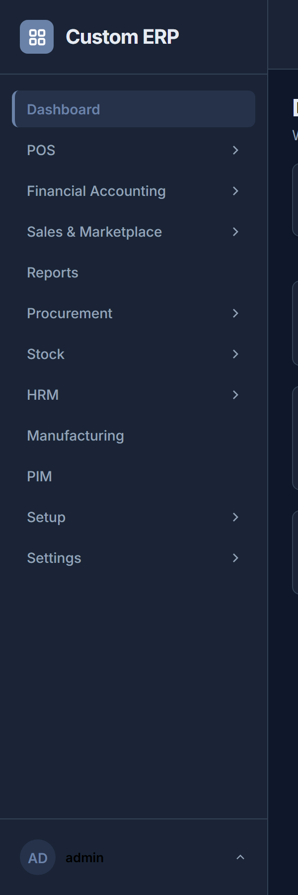

# User Guide: Getting started

Part 1 of 9 of the [User Guide](user-guide.md). Next: [Selling and checking stock](user-guide-selling-and-stock.md).

## 1. What is this system?

Think of this system as one big digital notebook that your whole business shares. Instead of writing sales in one notebook, stock in another, and money in a third — everything goes into the same place. That way, everyone (the cashier, the warehouse person, the accountant, the owner) is always looking at the same, up-to-date information.

## 2. Logging In

1. Open the app in your web browser. You'll see a **login screen**.
2. Type in your **username** and **password** (your manager or admin gives these to you).
3. Click **Login**.
4. **The first time you sign in** — and the first time after an administrator has reset your password — you are asked to **Set your own password**: type the password you were given, then your new one twice. Nothing else in the system opens until you have done this, so the password your administrator knows never stays in use. If you forget your password later, ask your administrator to reset it; you will be asked to choose a new one again.
5. Only administrator accounts (Admin and Super Admin) are asked for a **6-digit code** from an authenticator app on their phone. This is called **MFA** (Multi-Factor Authentication) — an extra lock on the door, on top of the password. Everyone else signs in with username and password only. On your own computer you can tick **Remember this device** to skip the code there for a while (see below).
6. If you type your password wrong too many times in a row, the system will temporarily lock your account to keep it safe. Wait a bit and try again, or ask an admin for help.

### If your role uses MFA: your recovery codes

The very first time you set up MFA, the app shows you **ten recovery codes** and asks you to tick a box confirming you have saved them. Take that seriously — **this is the only time they are ever shown.** The system stores only a scrambled fingerprint of each one, so nobody, including your administrator, can look them up for you later.

- **Save them somewhere that is not your phone.** A printed copy in a locked drawer, or your password manager. Saving them on the phone that holds your authenticator app defeats the point: if you lose the phone, you lose both.
- Use **Copy** or **Download** on that screen if it helps — Download saves a small text file.
- **Each code works once.** On the login screen, if you don't have your phone, click **"Lost your phone? Use a recovery code"** and type one in instead of the 6-digit code. Dashes, spaces and capitals don't matter.
- After you sign in with a recovery code, you'll see a message telling you how many you have left. **That message is a prompt to act, not just information** — see below.

### Remember this device (fewer codes on your own computer)

On the code screen, tick **Remember this device for 30 days** before you click **Verify**. For the next 30 days, signing in **on that browser** asks only for your username and password — no code. Your administrator sets the number of days (Configuration → Security → **Remember a device for**; 0 hides the tick box).

- **Tick it only on your own computer or phone.** Never on a shared counter PC, a cyber café or someone else's laptop: anyone who then knows your password could sign in as you there.
- **The password is always asked.** Remembering only skips the 6-digit code.
- **It stops by itself** when the days run out, when you change your password, when you set up a new authenticator, or when an administrator resets your two-factor setup.
- **To stop it yourself** — a lost laptop, a computer you no longer use: **My Profile → Two-Factor Recovery → Forget remembered devices**. Every browser you ticked asks for the code again at its next sign-in, this one included.

### Moving your authenticator to a new phone

Do this *before* you get rid of an old phone if you can, but it also works afterwards as long as you can still sign in (with a recovery code, if need be).

1. Sign in and open **My Profile** from the account menu.
2. In the **Two-Factor Recovery** panel, click **Set up a new authenticator device**.
3. Confirm your **password** (not a code — the whole point is that your old device may be gone).
4. Add the code shown to the authenticator app on your **new** phone, then enter the 6-digit code it displays.
5. Your old device stops working at that moment, and you are given a **fresh set of recovery codes** — save these too; the old set no longer works. Any browser you had ticked **Remember this device** on asks for the new code at its next sign-in.

Your old authenticator keeps working the whole time until step 4 succeeds, so it is safe to start this and change your mind.

The same panel shows **how many recovery codes you have left** and lets you generate a new set at any time (which immediately cancels the old set). If it says you have none, generate some now — with no codes and no phone, only an administrator can get you back in.

**If you have lost both your phone and your codes**, ask an administrator to reset your two-factor setup for you (ADMIN_GUIDE §Users & Roles). You'll be asked to set it up again from scratch at your next login.

Once you're in, you'll see a **sidebar** on the left. **It only shows what your role can actually use** — if a colleague has menu entries you don't, that's your role, not a fault. A whole module disappears if you have no access to anything inside it, and your business only sees the modules it has licensed. Within a screen, buttons you can't use aren't shown either: if you can view a list but not add to it, you'll see a small **"Read-only for your role"** label where the **New** button would be. Ask your administrator if you need more access. A **Read-only · changes paused** strip at the foot of the window means an administrator has paused changes for the whole business: you can open and look up everything, but saves are refused until the strip goes. A till keeps any offline bills and sends them then.

## 3. Finding Your Way Around

The sidebar has **fifteen top-level entries**. Most are module groups: hover one and its screens slide out to the right (click it instead if you are on a touchscreen or using a keyboard). Some groups inside a module (WMS's **Inbound**, each **Setup** module, each **Reports** area, each **Settings** group) open a second menu beside them the same way. Two entries — **Home** and **Knowledge Center** — have no flyout and open straight away.

**Where you land, and the labels (Stage 47.14.5).** After you sign in the ERP opens on the screen your administrator chose for your role (a cashier on POS, say), and on Home if you cannot open it. A sidebar entry marked **Preview** or **Experimental** is not finished yet; your administrator may hide those. In every list, an empty list is a dashed box, a screen you may not open is amber, and a failure is red with **Retry**. A very long table shows the first rows and adds more as you scroll; **Ctrl+F**, printing or a column sort shows them all.

**Hide the menu for more room.** The **☰** button at the top left, beside the search box, hides the whole sidebar — like Gmail — so the screen you are working in gets the full width. Click it again to bring the menu back. Your browser remembers the choice, so the menu stays hidden (or shown) the next time you sign in. On a phone the same button opens the menu as a slide-out drawer instead. The Wholeops logo heads the sidebar; while the menu is hidden it moves beside **☰** (on a phone just the globe symbol shows there), so it is always on screen. The browser tab names the screen you are on, e.g. *Cost Center | Wholeops*. Your company's name, when your administrator has set it, shows beside the logo and in the tab (*Cost Center - Minn Jewels | Wholeops*). On a test or development copy of the system the sign-in card says so (*Development environment - not the live system*) and every tab title starts with **[Dev]**, so you never mistake it for the live one.

**Every transaction screen looks the same.** POS, Purchase Order, Goods Receipt, Purchase Return, Stock Transfer, Returns, Vendor and Sales Invoices, Debit Notes, Credit Notes and Journal Vouchers are each **one fixed screen that does not scroll** — like a shop's billing screen. Top to bottom:

- **The bar** — the screen's name, a small chip with **who you are signed in as and your store**, the **totals and tax** of what you are entering, and the main button (**Create Draft**, **Save receipt**, **Complete Sale**…).
- **The header boxes** — vendor, addresses, invoice details and so on, packed close together.
- **The add-item row** — scan or search an item and add it.
- **The items** — the only part that scrolls. Its column headings stay in place while you scroll through a long list.

**Lists stand still too.** On a list screen (Stock on Hand, any master list, the list a screen opens on) the list fills the window and scrolls inside its own panel; its headings, filters and pager, and everything above it, stay where they are. On a phone, or a window too short to hold it, the page scrolls as one instead. Setup forms and reading pages (Home, Configuration, Help) scroll as a page, as they need to.

**Any window size, any zoom.** Make the browser window small, or zoom in or out (**Ctrl +** / **Ctrl −**, **Ctrl 0** to reset), and every screen rearranges itself rather than breaking:
- **The top bar** moves its buttons onto a second row when they no longer fit. On a phone, **Refresh** and **Reset** show only their icons.
- **A table wider than the window** scrolls sideways, usually inside its own panel and otherwise with the whole page. Nothing is cut off.
- **A transaction screen in a short window** keeps its bar, header and at least a few item rows. The page scrolls to reach the rest, so the items are never squeezed out of sight.

**Creating something and looking at what you've already made are two different pages** — the way Odoo, ERPNext and Zoho work. Every screen where you record something (Purchase Order, Goods Receipt, Purchase Return, Stock Transfer, Location Movement, Journal Vouchers, ASN, RFQ and its quotes, Expenses, Fixed Assets, Payment Proposals, Yard Board, Sticker Printing's Print tab, the manual order in OMS → Orders, Marketplace's settlements / bookings / manifests, Manufacturing's orders, and HR's Attendance, Leave, Payroll, Loans/Advances and My Requests):

- **opens on the list** — what has been saved, newest work and its status, with the count beside the screen's name;
- **+ New …** at the top right (for example **+ New Purchase Order**, **+ Mark Attendance**) opens the form as a page of its own, titled with a breadcrumb such as **Purchase Orders › New purchase order**;
- the breadcrumb's first word, or your browser's **Back** button, returns to the list. Anything you half-typed is kept: **+ New** (or **Forward**) brings it back, until you save it or leave the screen;
- **saving returns you to the list**, where the new record is now shown with its next steps (Submit, Approve, Post, Print…).

The POS till is the exception: it opens ready to sell, and its **Sale** / **Return** tabs switch in place.

| Sidebar entry | What lives inside |
|---|---|
| **Home** | Opens directly. This is where you land when you first sign in — see "Home, your landing screen" below. |
| **POS** | POS / Billing (§4) · POS Profiles · Offline Sync Review · Offline Queue Gaps · Offline Sales (§4.12) |
| **Financial Accounting** | Approvals (§10), then **General ledger** (Work to review · Trial Balance · Chart of Accounts · Accounting Periods · Journal Vouchers) · **Payables** (Vendor Invoice · Payment Proposals · Debit Notes · Vendor Credit Notes) · **Receivables** (Sales Invoice · Customer Credit Notes · E-Invoice (IRN) · E-Invoice Settings) · **Bank** (Bank Reconciliation) |
| **OMS** | Orders (§9A) · Pending Orders (§9A.8) · Pick (§9A.9) · Pack (§9A.10) · Ship (§9A.11) · Returns · Settlements (§9A.12) · Freight (§9A.12a). OMS's own configuration — channel connectors, SKU mapping, bundles and its lists — is **Setup → OMS → OMS settings** (§9A.13). |
| **CRM** | CRM overview · Customers · Segments · Templates · Campaigns · Journeys · Messages · Inbox · Tickets · Feedback · Worklist · Pipeline · Settings · Vouchers · Service Tickets, then **Loyalty** (Customer Points · Tiers · Points Movement · Vouchers & Campaigns) |
| **Reports** | **Dashboard** of live figures, then one entry per area — Sales, Procurement, Inventory, WMS, OMS, CRM, Finance, Manufacturing, PIM, HR and the rest. Point at an area and its reports open beside it (§9). **Schedules** is last. |
| **Procurement** | Purchase Requisitions · Purchase Order (§6) · ASN · **Goods Receipt** · Gate Entry · **Purchase Return** (§6.5) · Vendors · RFQ / Quotes |
| **Inventory** | Dashboard (§5.3) · Stock on Hand (§5) · Inventory Ledger (§5.4) · Stock Movement (§7) · Allocation · Stock Adjustment (§5.5) · MRP Change (§5.6) · Material Issue · Delivery Challans · Move Stock · Stock Locations · Locations by Store · Locations by Transaction · Sticker Printing (§7A) |
| **WMS** | Warehouse Cockpit · Labour · Warehouse Billing, then three groups that each open beside it: **Inbound** (Appointment Calendar · Dock Doors · Yard Board · Trailers · RF Receiving · Putaway · Cross-Dock Plans) · **Storage & Control** (Bin · Bin Conditions · Bin Generator · LPN / Cartons / Pallets · Bin Replenishment · Location Movement · Cycle Count · RF Lot & Serial · Holds · Place Hold · Hold Release Requests) · **Outbound** (Waves · Wave / Batch Picking · Mobile Picking · Sortation / Put-Wall · Loading) |
| **HRM** | My Requests · Attendance · Leave · Shift Roster · Payroll · Payroll Export · Loans/Advances · Onboarding/Offboarding · Appraisals · Training · Grievances · Fixed Assets (§6.7) · Expenses |
| **Manufacturing** | Production: Production Orders · Production Schedule · Job Work — Planning: MRP Suggestions · Supply Proposals — Quality: Quality Inspections · Certificates · Non-conformance — Maintenance: Maintenance Orders |
| **PIM** | Dashboard · Workbench · My Work · Media Library · Supplier Submissions · Catalogs · Templates · Feeds · Design Values · Stewardship · Checklists · PIM Reports. PIM's setup lists (families, attributes, workflows, channel maps, import and export templates) are under **Setup → PIM**. |
| **Setup** | The module names; point at one and its reference lists open beside it (§8) |
| **Settings** | Admin-only: Configuration · Credentials, then four groups that each open beside it: **Users & Access** (Users · Roles · Approval Rules) · **Customize** (Prefix Configs · Dynamic Labels · Database Schema Design · Extension Hooks) · **Monitoring** (Activity Log · System Errors · Integration Payloads · Async Jobs · Security Events · System Status) · **Platform** (Control Panel · Tenant Entitlements · Tenant Usage · Data Console — platform operator) |

On a phone, a group such as **Inbound** opens under its own row instead of beside it.

**You only see what your role can use.** If a module or a screen isn't in your menu, your role doesn't have access to it — that's the system working, not something missing. Ask your administrator if you need it. **Home**, **Reports** and the **Knowledge Center** are there for everyone; if you approve documents, your queue is on **Home** ("waiting on you") even when you have no Finance menu.

**Back and Forward.** The browser's **Back** and **Forward** buttons move between the screens you opened, as on any website — Back from **Reports** returns to the screen you came from, it does not close the system. Moving to another page of a list, or searching it, does not add a step, so one Back press is one screen.

**Notices at the top.** A coloured strip across the top of the page carries a short notice (on a test copy of the system, for example, "SIMULATED ENVIRONMENT"). Click **×** at its right end to close it. It stays closed in that browser until a different notice appears.

**Names, not codes.** Wherever you pick or see a record — a department, a warehouse, a vendor — the screen shows its **name**. The system's own reference (for example `Department/HQ/2026/000001`) is still what gets stored; hover over the box or cell to see it, and the copy button next to a list value still copies it.

**Dates.** Click any date box to open a calendar: the arrows change month, clicking the month name lets you jump by month or year, **Today** fills in today and **Clear** empties the box. You can still type a date straight into the box. From the keyboard, **Alt+↓** opens the calendar, the arrow keys move a day or a week, **Page Up/Down** a month, **Enter** picks and **Esc** closes.

### Home, your landing screen

Home is where you land right after signing in (and the "Home" link at the top of the sidebar, or a click on the Wholeops logo, always takes you back there). It is built from your own role, not a generic list, so it stays short and relevant:

- **Your quick actions** — a grid of the screens where you record or process work (transactions only — lists such as Vendors or Customers are in their modules and in Setup), each one click away: **Point of Sale** for a cashier, **Purchase Orders** for buying, the **Warehouse Cockpit** for a floor operator, **Work to review** for an accountant, and so on. A screen you have no access to simply is not a tile — never a greyed-out one you can click and get refused.
- **What's waiting on you** — a count of approvals needing your sign-off, when Approvals is something you use.
- **Recent** — the records you most recently created or touched, for the one task type you use most, so you can jump straight back into something you were just working on.
- **Get started** — while your company is still setting things up, this names the first master record (a Vendor, an Item, a Location…) you need before the rest of the screen has anything to show, with a link straight to creating it.

From your second visit onward you land back on whichever screen you were last using instead of Home, so you can pick up where you left off — click **Home** in the sidebar any time you want to return to it on purpose. Refreshing the browser (F5) works the same way: you stay on the same screen, the menu stays scrolled where it was, and the page comes back at the same scroll position — also after you have read a Help article and moved on.

**The store you are working at is at the top right**, beside Refresh. Everything you do — a sale, a purchase order, a transfer — is done at that store, and the lists you see are its records. If you have been given more than one store, click it and pick another (type to find it in a long list); the screen reloads for that store. With a till session open you cannot switch until you close it. Which stores you can pick is set by an administrator (Users → Stores, Roles → Stores).

**All stores (administrators).** If you may see every store's records, the list starts with **All stores**, and that is where you start: the lists show every store's documents, and new documents are made at your own store. Pick a store and every transaction list - purchase orders, goods receipts, transfers (sent and received), returns, bills, stock moves - shows only that store's documents; the button then names the store. Pick **All stores** again to see everything. Picking your own store while on All stores narrows the lists without moving you. Setup lists (vendors, items, employees) always show everything, and finding a bill by mobile number for a return still searches every store (§4.7). Everyone else always sees the lists of the store they are working at.

> **If you are a supplier**, your account is deliberately narrow: you sign in to the same app as everyone else, but the only screen you can reach is **Supplier Submissions**, and within it you see only the submissions filed under your own company — never another supplier's. Fill in the product details you want to propose (the product, the language, a title, and whatever descriptions, tags or image URL you have), save it, then use **Submit for Approval**. A reviewer at the company approves or rejects it; a rejection always carries a written reason, which you can read on the submission itself. Approved text does **not** go live automatically — it becomes a draft that the company still reviews and publishes on its own schedule. If the app tells you your account is not linked to a vendor yet, that's a setup step your contact at the company needs to finish.

**Two search boxes, and they do different things:**

- The **box at the very top of the window** (**Ctrl+K**) opens things. Type "purch" and it offers Purchase Order, Purchase Requisitions and the purchase reports; pick one and it takes you there. It also takes a short code (`PO`), a report number (`R1001`) or a full document number (§3A). It does not filter the list you are on.
- The **box just above a table**, on a screen, filters *that table's records*. This is how you find a particular vendor, item or invoice.

At the top right of most list screens there are **New** and **Bulk Import** buttons, and each row has **Copy**, **Edit** and **Delete** icons and a tick box (§3A.6). Any of these that your role can't use simply won't be shown.

**Updating records with Bulk Import.** A row with an existing ID (or, for a master, its code) changes that record. Fill only the cells you want to change: a **blank cell keeps** what is saved. To empty a field, type `<clear>` in its cell.

In the Bulk Import window, **Download Column Guide** gives a sheet with one row per column: what it means, its format, allowed values, an example and what an update does. Hover a field name on a form to see the same short help.

**When some rows of a Bulk Import fail**, the rows that were right are already saved — fix only the others:

1. On the import result, click **Fix and resume the failed rows** (the same job also opens from **My work**, and from **Setup → Import Job** by typing its job ID into the box above the list).
2. **Download failed rows**. Each row comes with its reason in the last column. Correct the values; keep the **original_row** column as it is.
3. Choose the corrected file and click **Check**. It reports what would happen and saves nothing; **Resume** only becomes clickable after a check.
4. Click **Resume**. Just those rows are imported. The job then shows how many are still to fix and how many were fixed since; repeat for any that still fail.

A row number that is not one of the job's open failed rows is refused, so a row cannot be imported twice.

**Checking an import's totals.** Under the counts, the preview and the import result show **Totals**: for each number column, what was accepted out of what the file held (for example *Qty 5 of 10*). If a total is short, the missing amount is in the failed rows. **Rerun: nothing new** means every accepted row updated a record that was already there, so the file had been imported before. The import job keeps these totals: open it (**Setup → Import Job**, or **Fix and resume** from the result) and its **Totals** line shows rows read, accepted (new and updated) and rejected with each number column's sums, and its **Source** line names the file, its size, its SHA-256 fingerprint, who uploaded it, when, and the import rules version it ran under - so a posted batch can always be traced back to the exact file. After **Import file retention** (an administrator's setting, 30 days by default) a job's stored failed rows and error file are removed; the counts, totals and source stay, and the job says when its rows expired.

**Dates in a file are read day first** unless your admin has set another **Date order** (Admin Guide §B.3.0.2a). `03/02/2026`, `03-02-2026` and `3-Feb-2026` all mean 3 February 2026; `2026-02-03` works too. A date that only makes sense month first, such as `02/13/2026`, is refused with its row number. It is never swapped. Lists show dates as *03 Feb 2026*. With **month first**, `03/02/2026` is 2 March, `13/02/2026` is refused and lists show *Feb 03, 2026*; with **year first**, type `2026/02/03` and lists show *2026 Feb 03*. `2026-02-03` and a month written as a word (`3-Feb-2026`) work in every order.

**Every screen shows dates and amounts the same way.** Dates read *03 Feb 2026* (with the time as *14:05* where one is kept) in your date order, and counts and amounts have thousands grouping (*1,23,456.00*) on lists, dialogs, reports and receipts alike. What you type and what files hold keep their usual form.

**Pressing Save again after "Request Timed Out" (Stage 49.4.7a).** A journal voucher, a stock adjustment, a payroll run, a loan disbursement, a payment proposal's **Execute**, and at the till an advance or a gift card issue are sent with a one-time key. If the screen says the request timed out or the server could not be reached, press the same button again without changing anything: if the first one went through you get its result and nothing is entered twice; if it did not, it is entered now. *This is still being processed* means the first one is still running - wait a moment and look before pressing again. Change any field and it is a new entry.
---

## 3A. Keyboard Shortcuts and Quick Codes

Press **?** on any screen (when you are not typing in a box) to see every key and code, with **Report numbers** (every report's number), **Guide** (this section, in the Knowledge Center) and **Print** (a shortcut card to keep by the keyboard; it shows the card on paper first, then **Print**). On a Mac, use **⌘** wherever this section says **Ctrl**. Hover over a button to see its key.

### 3A.1 The search box: Ctrl+K

**Ctrl+K** (or **/**) puts you in the search box at the top of the window. Type, then press **Enter** to open the first result, or **↑ ↓** to choose another. **Esc** closes it.

| You type | What opens |
|---|---|
| A name, e.g. `purchase` | Matching screens, record lists and reports |
| A code, e.g. `PO` | That screen (§3A.3) |
| A code and `+`, e.g. `PO+` | A new record on that screen |
| A code and a number, e.g. `PO 42` | Document number 42 of that kind; if several stores have a 42, you pick one |
| A report number, e.g. `R1001` | That report (§3A.4) |
| A full document number, e.g. `PO/HO/26-27/00103` | That document, shown in its record list |
| Nothing (just Ctrl+K) | Your **Favourites**, your **My work** counts and your **Recent** screens |

A code, number or document opens only if your role can open it from the menu; one you cannot open says "No document … that you can open".

**Scan to open:** with the cursor outside any box, scan the barcode printed on a document. It opens as if you had typed its number.

### 3A.2 Keys

**Anywhere**

| Key | Does |
|---|---|
| Ctrl+K or / | Search box |
| ? | The list of keys and codes |
| Alt+N | New record on this screen |
| Alt+1 … Alt+9 | Open favourite 1 to 9 (also from the till) |
| Esc | Close a dialog, menu or the search box |

**Lists**

| Key | Does |
|---|---|
| ↑ ↓ | Move between rows (the row you are on is highlighted) |
| Enter | Open the row |
| Space | Tick the row |

**Forms and New pages**

| Key | Does |
|---|---|
| Ctrl+S | Save |
| Ctrl+Enter | Save and submit (Submit, Post or Send for approval, where the screen has one) |
| Ctrl+P | Print the document |
| Enter | Next field. On New transaction pages only; at the last field it moves to Save, and one more Enter saves |
| Ctrl+D | Add a line (presses the screen's **Add line**, with what you typed) |
| Ctrl+Delete | Remove the line the cursor is on (a box or button in that line) |

**Kept for the browser and the till:** F1-F12, Ctrl+N, Ctrl+T, Ctrl+W and Alt+F / E / D do what your browser does with them. **POS / Billing** keeps its own keys (§4). In a picker or a notes box, Enter still picks or starts a new line.

### 3A.3 Codes

The same codes work for every company. A code shows only if your role has the screen.

| Area | Code | Opens |
|---|---|---|
| Go to | `HOME` | Home |
| Go to | `INB` | My work and approvals |
| Go to | `RPT` | Reports |
| Go to | `HELP` | Knowledge Center |
| Sales | `POS` | POS / Billing |
| Sales | `SO` | Sales Order |
| Sales | `SI` | Sales Invoice |
| Sales | `SR` | Sales Return |
| Sales | `CN` | Credit Note |
| Sales | `DN` | Debit Note |
| Sales | `EI` | E-Invoice (IRN) |
| Sales | `CUS` | Customers |
| Sales | `CRM` | CRM |
| Sales | `LOY` | Loyalty |
| Buying | `PRQ` | Purchase Requisition |
| Buying | `RFQ` | Request for Quotation |
| Buying | `PO` | Purchase Order |
| Buying | `ASN` | Advance Shipment Notice |
| Buying | `GRN` | Goods Receipt |
| Buying | `PR` | Purchase Return |
| Buying | `VI` | Vendor Invoice |
| Buying | `VEN` | Vendors |
| Stock | `SOH` | Stock on Hand |
| Stock | `SL` | Inventory Ledger |
| Stock | `TO` | Stock Movement (Transfer Order) |
| Stock | `SA` | Stock Adjustment |
| Stock | `MRP` | MRP Change |
| Stock | `MI` | Material Issue |
| Stock | `DC` | Delivery Challan |
| Stock | `MS` | Move Stock |
| Stock | `CC` | Cycle Count |
| Stock | `STK` | Sticker Printing |
| Stock | `ITM` | Items |
| Warehouse | `PUT` | Putaway |
| Warehouse | `PICK` | Pick |
| Warehouse | `PACK` | Pack |
| Warehouse | `SHIP` | Ship |
| Warehouse | `WAVE` | Wave / Batch Picking |
| Money | `GL` | Work to review |
| Money | `JV` | Journal Voucher |
| Money | `PAY` | Payment Proposal |
| Money | `BR` | Bank Reconciliation |
| Money | `EXP` | Expense Claim |
| Money | `FA` | Fixed Assets |
| Making | `PRO` | Production Order |
| Making | `JW` | Job Work |
| Making | `QI` | Quality Inspection |
| People | `HR` | HR |
| Admin | `USR` | Users |
| Admin | `ROLE` | Roles |
| Admin | `CFG` | Configuration |
| Admin | `NUM` | Number series (Prefix Configs) |

### 3A.4 Report numbers

Every report has a fixed number: **R**, then the area digit, then three digits. Sales Register is **R1001**. A number never changes and is never reused, and it is the same for every company, so you can tell anyone "run R3004".

| Numbers | Area |
|---|---|
| R1xxx | Sales & POS |
| R2xxx | Procurement & GRN |
| R3xxx | Inventory, Stock Transfer, External Movement, Inventory Loss & Audit |
| R4xxx | WMS |
| R5xxx | Accounting, Finance, GST & Compliance, Expenses, Assets |
| R6xxx | CRM, OMS, E-commerce & Integration, Service |
| R7xxx | PIM, Manufacturing |
| R8xxx | HR |
| R9xxx | MIS, Master Data & Audit, Admin |

The number shows beside the report's name in the **Reports** menu and the report picker, on the line above the results, and in the name of an exported file (`R1001-Sales-Register-2026-10-26.csv`). To look one up, press **?** and click **Report numbers**, or see the Knowledge Center's **Report catalog**, where every report's heading starts with its number.

### 3A.5 Favourites, recent and after a save

- **☆ beside a screen's title** adds it to your favourites (★); click again to remove it. Favourites follow you to any computer you sign in to.
- **Favourites in the left menu**, second from the top: point at it to see every screen you have starred, in the order you starred them, and click one to open it. The first nine carry their key: **Alt+1** opens the first, **Alt+2** the second, up to **Alt+9** - from any screen, the till included. They also come first when you press Ctrl+K.
- **Recent** (in the empty Ctrl+K box) is the last 10 screens, reports and documents you opened in this browser.
- **After you save**, a bar at the bottom of the screen offers **Print**, **New**, **Copy** and, once the document can move on (not while it is a draft or waiting for approval), the **next step**:

| After | Next step |
|---|---|
| Purchase Requisition | Request for Quotation |
| Request for Quotation | Purchase Order |
| Purchase Order (approved) | Goods Receipt against that PO |
| ASN | Goods Receipt |
| Goods Receipt | Vendor Invoice |
| Vendor Invoice | Payment Proposal |
| Sales Order | Pick, then Pack, then Ship |

The bar closes by itself after 15 seconds, or with **×**.

### 3A.6 Less typing

- **Copy a record:** the **Copy** icon on a record-list row, **Copy** on a Purchase Order in the PO list, or **Copy** in the after-save bar. You get a New form with the same details; the number, status and dates are not copied. Check it and save.
- **Your last choice comes back:** a drop-down for store, location, warehouse, counter, salesman, cost centre or payment mode starts on what you last picked on that screen, in this browser. It is highlighted so you can see it was filled for you; change it if needed.
- **Unsaved work is kept:** if the tab closes (or the computer restarts) while a New form has details in it, the form offers **Restore** or **Discard** next time. Only the form's own boxes are kept, not the rows of a line table.
- **The columns of a record list:** a list shows up to eight of the record's main columns - its code, name and status first, then the required fields - so it opens quickly. Line tables and long notes stay off the list. Open the record to see every field; the search box above the table still searches every field you may see.
- **Saved views:** on a record list, type a search in the box above the table, then pick **Save this search as a view…** in the views drop-down beside it. Pick the view later to run the same search; **Delete this view** removes it. Views are yours and follow you to any computer.
- **Ticked rows on a record list:** tick rows (or the box in the heading for the whole page; **Space** ticks the row you are on). A bar shows how many are ticked, with **Export** (a CSV of the ticked rows), **Submit for approval** (where the list has that action) and **Delete**. Submit and Delete do up to 40 rows a run; anything that cannot be done is named in the message.
- **Approvals:** on **My work → Approvals**, tick rows and click **Approve ticked** or **Reject ticked** (one reason for all). Each is decided exactly as if you had clicked its own button. A password reset is always decided on its own.
