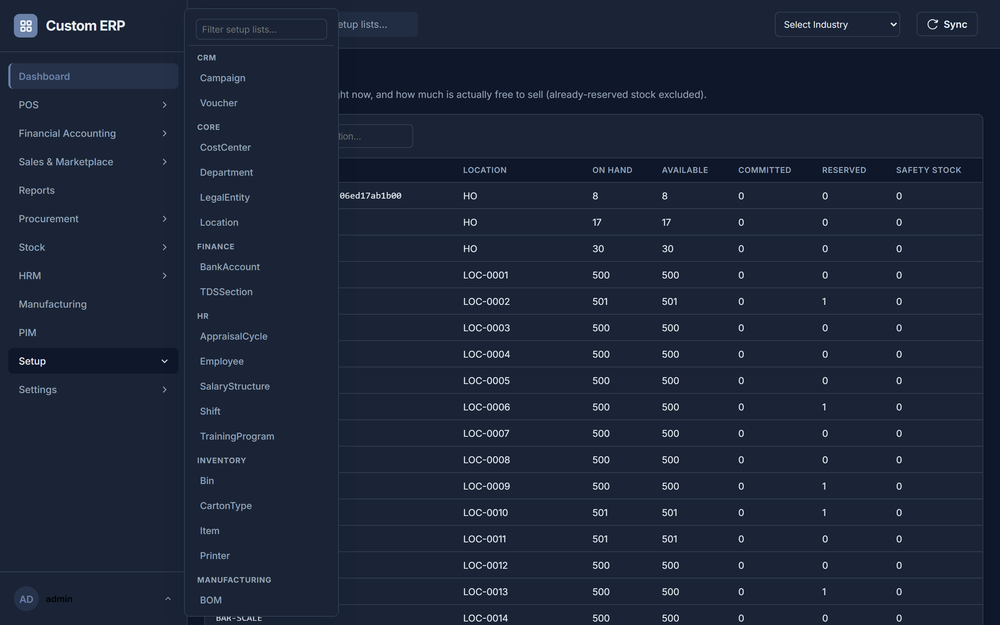

# User Guide: Master data

Part 6 of 9 of the [User Guide](user-guide.md). Previous: [Labels and printing documents](user-guide-labels-and-printing.md). Next: [Reports and customer orders](user-guide-reports-and-orders.md).

## 8. Managing Master Data (Vendors, Locations, Brands, and Similar Lists)

"Master data" just means the reference lists everything else points to — your vendors, your locations, your items, and things like brands, colors or sizes. A few of the most-used ones also appear directly in a module (**Vendors** under Procurement, **Customers**, **Campaigns** and **Vouchers** under CRM, **POS Profiles** under POS, **Bin**, **Dock Doors** and **Trailers** under WMS); those are not repeated in **Setup**, which holds all the others.

The **Setup** menu lists **module names** only (Core, Finance, HR, Inventory, Master Data, OMS, PIM, Printing, Sales, WMS and so on). **Printing** holds the print setup in one place: **Templates** (every print layout and sticker label, module by module — §7B.2), **Printer** and **Printer Assignment**. **OMS** starts with **OMS settings** (§9A.13), then its lists. point at one and its reference lists open beside it — a long one in two columns. The technical lists most businesses never touch come last in each module's list, under **Advanced**. The **filter box** at the top searches every list at once: type a few letters and every match is listed under its module, Advanced ones included, so nothing is ever hidden from a search. On a phone, a module's lists open under its row.

> **Your shop is a Location.** Setup → Core → **Location**, with its **Type** set to Store, Warehouse or HO — this is the record every transaction points at. A Location also holds the shop's **Address, City, Contact Phone** and **Manager**. (Earlier versions had a separate "Stores" list under the Stock menu that nothing else read; it was retired and its fields folded into Location.)

**Records you add are for your store (Stage 49.3.8a).** If you work at one store, a record you add - a bin, a purchase order, a stock move - must be for that store. Naming another store is refused with *This record is for store X - you can add records for your own store (Y) only*; in a CSV import only those rows are refused. If you are allowed several stores, switch store at the top of the screen first. Head-office roles that see every store are not limited.

Adding a new one always works the same way, no matter which list you're in:

1. Click the list in the sidebar (or open it from **Setup**).
2. Click the **New [thing]** button, top right. The dialog title starts with **New** and opens with empty/default fields. A row's **Edit** action instead opens **Edit** with that record's saved values.
3. Fill in the fields — anything marked with a **\*** is required, everything else is optional. A "Code" field usually says *"Auto-generated upon save"* — leave it blank and the system numbers it for you. **Status** starts on **Active** for a new record; change it only if you are deliberately setting up something not yet in use.
4. Some fields are small tables rather than boxes — a recipe’s components, a routing’s operations. Use **+ Add Line** to add a row and **Remove** to take one out. These table editors build the stored format for you; other specialist fields still explicitly labelled JSON are not yet converted to table editors.
5. If what you need is not in a dropdown, choose **+ Create new …** at the bottom of it: a small form opens on top, asking only what that record needs, and the new record is selected for you when you save — your half-filled form stays open underneath. See §8.1.
6. Click **Save**.

**Using the keyboard:** opening a record form moves focus into it. **Tab** and **Shift+Tab**
stay within the open dialog; **Escape** cancels it and returns focus to the button that opened
it. Generated Code/Number fields remain read-only. After editing, **New** starts a separate
record and does not reuse the edited record's identifier.

> **Your shop can have a Short Code.** Optional, and nothing depends on it. It is there so staff can find a location by the two or three letters they actually say out loud ("BKC", "LDH2") while the **Location Name** stays the full name shown on screen and the **Location Code** stays the identifier the system uses. Searching a location box matches all three.

### 8.1 The system tells you what is missing — read the hints

You should almost never have to work out *which* list you are missing. Three things do it for you, and they all say the same thing the same way:

- **Under a search box.** Pick a department on a Purchase Requisition and, if none exist yet, the box says *"No Department has been set up yet. Set up Department"*. If departments *do* exist, the line only appears while you are in the box, and reads *"Can't find the Department you need? Add a Department"* — so it helps when you are stuck and stays out of the way when you are not.
- **In the search results.** Type a name that does not exist yet and the list shows *"No matching Vendor"* with **+ Create "what you typed"** on its own line below it — the whole name, however long, so you can check it before you click.
- **Either way, you create it right there (Stage 57).** A small form opens **on top of** the one you are working in, already holding the name you typed, and asking only for what that record needs. Save it and it is filled into your box; your own form never closed, so nothing you typed is lost. This works everywhere a record is picked — a vendor or item on a purchase order, a department on a requisition, a zone on a new Bin, a location on a transfer. A **Customer** is the exception: its form asks every detail about the customer at once - contact, address, tax (GSTIN, PAN), personal details, preferences and account terms (credit limit, contract price list) - with only the name required. The **Add a Customer** hint under a customer box opens the same form. Inside the small form, a missing record can itself be created the same way (an Item's HSN code, for example). If your role is not allowed to create that kind of record, it says so and tells you who to ask instead.
- **At the top of a screen.** Open a screen that needs something you have not set up and a short panel lists what is missing, each with its own link. Close it with the **×** if you already know; it stays closed for the rest of your visit and comes back next time you sign in — deliberately, so a half-finished setup does not stay half-finished.
- **The ⧉ icon opens it in a new tab.** Every one of these links has one next to it. Use it when you do not want to lose what you are in the middle of — set the missing thing up in the second tab, come back to the first, and carry on. (The links are ordinary links, so **Ctrl+click** and **middle-click** work too.)

**If it says you do not have access**, the message names what needs setting up and asks you to contact your administrator. That is not an error you can fix — send them the name of the list it mentions.

#### 8.1.1 You are brought back to where you came from

The panel at the top of a screen ("This screen needs some setup first") takes you to the full list instead, for setups that need more than a small form. When you follow one of those links, the system remembers where you were and brings you back. If you were in the middle of a new record's form, it is closed first (so the list is all you see), and when you come back it **opens again with what you had typed**, with the record you just created already filled in. The browser's **Back** button does the same thing.

Say you are part-way through a **Goods Receipt** and the item you received does not exist yet. You click the link to the Item list, and:

- **A "← Back to Goods Receipt" link appears** at the top of the Item list, so you can change your mind and return without creating anything.
- **Once you save the new Item, you land back on the Goods Receipt automatically.** You do not have to navigate back through the menu and you do not lose your place.

Three details worth knowing, because they are deliberate:

- **It returns you after creating something new, not after editing.** If you go to the Item list and edit an *existing* item, you stay on the Item list — you clearly came to do list work, not to unblock the receipt.
- **It works from every one of these links, not just on Goods Receipt.** Any "create one first" link, any missing-setup panel link, anywhere in the app, behaves this way.
- **It forgets if you wander off.** Abandon the trip, navigate somewhere unrelated, and the return is dropped. A Vendor you create an hour later on the Vendor screen will not suddenly fling you back to a Goods Receipt you had forgotten about.

If you would rather not leave the screen at all, use the **⧉** icon to do the setup in a second tab instead (see above). Both approaches work; this one is for when you are happy to go and come back.

#### 8.1.2 HSN codes on an Item

The **HSN Code** box suggests the right code for what you are creating, so you pick rather than look it up. It works the same in the full Item form, in the small **New Item** form that opens from a purchase order or any other picker, and on an **Item Name** or a design.

1. **Type the item's name first** (*Zircon Haar*, *Cotton Bedsheet Double*, *Georgette Saree*).
2. **Click the HSN Code box.** A list opens straight away, even when you are editing an item that already has a code (or you have just deleted it), in up to three groups:
   - **Suggested for "your item name"**: codes read from the name. The material decides: *Silver Haar* suggests **711311 Silver jewellery**, *Zircon Haar* or *AD Necklace* suggest **711719 Imitation jewellery**, *Gold Plated Jhumka* is imitation too, *Cotton Fabric* is a fabric code, and *Cotton Shirt* is a garment code. If your own items with similar names already use a code, that code comes first, because it is how your business classifies them. Hover a row to see why it was suggested.
   - **Your HSN list**: the codes already on your HSN Code list.
   - **Common in your industry**: the usual codes for the industry your administrator chose (jewellery, clothing, food and so on).
3. **Pick one.** The **GST Rate** fills itself in from the code: 3% for jewellery, for example. Under the GST box you also see the code's rates as buttons, then the other common rates (0, 3, 5, 18, 40). Click a button to use that rate.
   - **When the rate depends on the price**, nothing is filled for you. Garments, made-ups and footwear are 5% up to Rs 2,500 a piece (or pair) and 18% above that; the two buttons say which is which, so choose the one that fits your selling price.
   - **If your HSN list already carries a rate for that code**, that rate is filled and its button reads *Set on your HSN list*. Change it on the HSN Code list if it is out of date.
   - **If you change the HSN code later**, a rate the picker filled changes with it. A rate you typed or clicked yourself is never overwritten.
4. **Not in the list?** Type to search: digits search by code (*6109*) and words search the full HSN list shipped with the system (*bedsheet*, *imitation*). If you still can't find it, choose **+ Create "…"** to add the code to your list.

**A 0% rate** (fresh milk, vegetables, seeds) needs the item's **Tax Treatment** set to *Exempt*, *Nil-Rated* or *Zero-Rated*. In the small New Item form, that box appears as soon as you choose 0%. In the full Item form it works the other way round: choose *Exempt*, *Nil-Rated* or *Zero-Rated* and **GST Rate** is set to 0 and locked; switch back to *Taxable* and it is cleared for you to pick a rate.

The suggested rates are the GST rates in force from 22 September 2025, so check unusual items with your tax advisor. Your HSN list fills itself as you go: every Item saved with a valid HSN adds that code, with its description. An HSN or SAC code is **4, 6 or 8 digits**; spaces and dots are removed for you. The Item stores the plain number, so GST, e-invoices and reports read it exactly as before.

**Number boxes have no up/down arrows.** Anywhere in the system, a number box (quantity, price, rate) takes exactly what you type. The mouse wheel and the arrow keys do not nudge it, so a scroll can't silently change a price.

**Number boxes take only numbers.** Digits, one decimal point and a leading minus; a letter (even `e`), a comma or a space is simply not typed, and pasting text that is not a plain number does nothing. The server checks the same thing on save, so a price like `2O0` (letter O) can never be stored - including the Qty / Purchase Price / MRP columns of a line table.

**Barcodes on an Item** are optional to type: leave the box blank and one is issued for that SKU (when, depends on your administrator's barcode settings). Scan or type your own if you have one — it is kept. The **Generate** button makes one on the spot.

**The Item form is in sections**, with the fields that belong together side by side: **Basics** (name, code, item type, category, barcode), **Price and tax** (prices, HSN, Tax Treatment, GST rate), **Design and variant**, **Batch, serial and expiry**, then three sections that start closed because most items leave them as they are: **Barcode and label**, **Handling and storage**, and **Selling and accounting** (the item-type overrides). Click a section's name to open or close it. A closed section opens by itself when it holds something you set, and Save opens the section of any box that still needs filling. Fields your industry or administrator added appear under **More details**. **Leave out of cycle counts** (under **Handling and storage**) set to *Yes* keeps a low-value item, such as carry bags or display stands, off the cycle-count plan; a physical inventory and a count you scan yourself still count it.

**Variant options** are picked, not typed in a code: choose an **Option** (Colour, Size and the other attributes set up under **Setup → Item Attribute**, where a *Select* attribute's options become the values to pick) and its **Value**, and **+ Add option** for the next one; **×** removes a row. For an option that is not set up, choose **Other…** and type its name — unless your attributes were set up for your business by your provider (Admin Guide §C.9): then the list is exactly those, and **Other…** is not offered. The item stores the same combination as before, so variant codes, the duplicate-combination check, PO designs and stickers read it unchanged. **Parent Product Code** can be left blank when you pick a **Product Family** (design): the design is used.

**Your item attributes** live under **Setup → Item Attribute** (the *Inventory* part of the Setup menu): the basic attributes your items vary by, such as Colour and Size. **To rename one** — *Color* to *Colour*, say — edit its **Label**: the PO, the GRN, every print and every CSV / Excel export show the new name at once, and nothing already saved changes (values are kept under the attribute's code). The Item's variant options, the PO's design panel and the prints use this list, whether or not your business uses PIM. A new one gets its code by itself — the first time, the form asks once how codes should look. If your business also uses PIM, PIM has its own, richer list under **Setup → PIM → Product Attribute Def**: there **Used for** says whether an attribute is a *Variant* (mapped onto an Item Attribute, shown in **ERP item attribute**) or *Product information* (PIM enrichment only). Open an attribute in either list to change it: *Variant* attributes are the Item's variant options, the PO's design panel and the prints; *Product information* attributes are for PIM enrichment only. Open one to change it:

- **Switch it off:** set **Status** to *Inactive* and save. It disappears from new choices everywhere; items that already use it keep their values.
- **Remove a value:** click **×** on the value. **Add one:** type it under the values and press **Enter**. Items that already carry a removed value keep it.
- **Delete:** an attribute your provider set up for your business (it shows **From the attribute library**) cannot be deleted — switch it off instead. Its code cannot be changed either, because every item stores its values under that code.

#### 8.1.3 Bins and zones

A Bin's **Zone** is picked from your Zone list, showing each zone's name. If the zone does not exist yet ("Cold Room"), choose **Create "Cold Room"** in the picker and save the small form — then save the Bin. You never need to know or type a zone's code.

### 8.1a How pickers search

Every box where you pick a record - a vendor, an item, a store, a document - searches what **identifies** the record: its name, code or number, and for people and items their barcode, phone, email or GSTIN (Stage 127.7). Typing *A* finds names and numbers with an *A* in them, not every record whose status reads *Active* or whose category happens to match. Number boxes take numbers only: a quantity, price or amount typed with letters is refused with *Enter a number*.

### 8.2 Phone numbers

Phone boxes follow the country your administrator set up (**Settings → Configuration → Localization → Home country**). With India selected, a phone box takes exactly **10 digits** and will not accept an eleventh; the line under it tells you so before you start typing.

You never have to format anything. Spaces, dashes, brackets and a leading `+91` are all removed automatically, so pasting `+91 (98765) 43210` out of an email stores the same number as typing `9876543210` — which also means the system can tell it is the same customer instead of creating a second one.

**For a number in another country, start with `+` and the country's dialling code** (`+971 50 123 4567`). The system recognises it, stores it correctly, and records which country it belongs to. Orders that arrive from your online channels are cleaned the same way automatically — and an order is **never** rejected because of its phone number.

To change an existing one later, find it in the list (use the search box above the table if there are a lot) and click its row’s pencil **Edit** icon. You never need to delete and recreate a record to correct it.

### 8.3 Price lists (Price List Version)

A **Price List Version** is one dated set of prices, one row per SKU, for one price list (a code such as `RETAIL`). It prices nothing until it is approved.

1. Open **Setup → Sales → Price List Version** and click **New Price List Version**.
2. Leave **Version Code** blank — it is numbered for you (the very first time, choose its prefix and digits). Fill in **Price List** (the code), **Currency** and **Effective From**. Leave **Effective To** blank unless the prices end on a known date.
3. Under **Prices**, click **+ Add Line** for each item and give its **SKU** and **Price**.
4. Set **Status** to **Draft** and click **Save**.
5. On the row, click the arrow button **Submit for Approval**. The status becomes **Pending Approval**.
6. The approver opens **Approvals**, finds the **Price List Version** row and clicks **Approve** — or **Reject**, with a reason. As shipped an administrator approves; your administrator can change that in **Settings → Approval Rules** (record type **PriceListVersion**).

Once approved:

- **The till prices from it** from **Effective From** on: first the customer's **Contract price list** (on the customer's form), then the **Default price list** (Settings → Configuration → Point of Sale), then the item's own Sale Price, then its MRP. The Store app shows the Default price list's price; Shopify sells at the price list named on its channel's Shopify page.
- **The older version steps aside.** An approved version of the same price list with no **Effective To** becomes **Superseded**, its **Effective To** set to the day before the new one starts. It still prices anything dated inside its own window.
- **To change prices, make a new version.** Editing an approved one sends it back to **Pending Approval**, and it prices nothing until it is approved again.
- **A rejected version** can be fixed: **Edit** it, set **Status** to **Draft**, **Save**, and submit it again.

**Customer prices on orders, invoices and quotes (needs the setting *Fill B2B rates from the price list* in Settings, off until an administrator turns it on).** Put a customer on a list with **Price list code** on their form. A Sales Order, a direct invoice or a CRM quote then takes its rate from that list, and the line says which list gave it (for example *Price list WS, 10+ pcs*): on **New Order**, once the customer and the item are chosen, under the rate; on the order's page, under the unit price; on the deal's quote, under the item after **Save quotation**. A rate you type always wins; a customer with no list keeps today's rate. Someone who may see cost also sees a **Margin** column on the deal's quote. A row may name an **item**, a **design** or a **category**, a **min qty** (a quantity break), a **karat** and **weight from / to** (jewellery priced per design group, not per piece), a **quota qty** (orders count it down; at zero the row stops applying) and a **floor**. Save a draft list first, then **Price tools** (on the Price List Version screen) previews a 99, 49, 9 or whole-rupee ending on every price and applies it to a draft list; an approved list is never rewritten. When a new version is approved, the open order lines and draft quotes it affects are listed in **Price tools** as *price changed*: they are flagged, never repriced. A CRM quote shows its margin over cost to roles that may see cost.

**A rate below the floor (setting *Rate below the floor*, off).** The floor is the row's floor, else the item's **Floor Price**. *Ask for a reason*: an invoice, quote or Sales Order line below it is refused and a **Why this rate** box opens under the line; type the reason and save again. *Hold the order*: an order with such a line goes On Hold, shown as **Below floor rate**, unless the line has a reason; only a Store Manager or an administrator releases it, with a reason: open the order and press **Release hold**, or use **Price tools**. Marketplace orders are never held for this.

### 8a. Tracking What Competitors Charge

If you want to know how your prices compare to what the same product sells for elsewhere, record what you find in **Setup → PIM → Competitor Price**. It behaves like any other list above — **New Competitor Price** for one row at a time, or **Bulk Import** to paste in a whole spreadsheet, which is the usual way. Most marketplace seller panels will export competitor pricing to CSV, and that file can go straight in.

The reliable route for a bulk load is:

1. Open **Setup → PIM → Competitor Price**.
2. Click **Bulk Import**, then **Download Template**. The template already has the right column headers.
3. Fill it in — one row per price you observed. Then upload it with **Bulk Import** again.

What each column means:

| Column | Required | What to put in it |
|---|---|---|
| `our_item` | no | The code of *your* item this competitor product competes with. Leave it blank if you have not matched it to one of your SKUs yet — the row is still saved, it just won't appear in the price-gap report until you fill this in. |
| `platform` | **yes** | Where you saw it. Must be one of the listed marketplaces, or `Other`. |
| `competitor_price` | **yes** | What they are actually charging. |
| `observed_at` | **yes** | The date you saw that price. A competitor price with no date isn't evidence of anything, so this can't be skipped. |
| `competitor_product`, `competitor_sku` | no | Their product title and their SKU/ASIN, so you can find the listing again. |
| `mrp`, `rating`, `review_count` | no | Useful context if the export gives it to you. |
| `source_url` | no | A link back to the listing. Nothing is ever fetched from it — it's there for you to click. |

If a row is rejected, the message names the row number and the exact problem (for example, a `platform` that isn't in the allowed list). Valid rows in the same file still import — you only need to fix and re-upload the failures.

Then run the **Competitor Price Gap** report (Section 9) to see where you stand.

> **"Our Price" comes from what you actually sold at, not from a price list.** The report does not read price lists (§8.3) — it takes the price from your sales. So the report shows the most recent price you actually transacted at for that item, and tells you which it came from (a POS sale or a sales order). **An item you have never sold shows "No price on file"** rather than a made-up figure — that is correct, not a fault. Ring one through, and the comparison appears.

**Prices collected from Myntra (item 34.4).** If your admin has switched this on (Settings → Configuration → Platform), **PIM → Reports** shows a **Market prices · Myntra** panel under the report.

1. Type one or more **Keywords** separated by commas (for example `kurta, saree`), optionally a **Category**, and **Max pages**.
2. Click **Start run**. It runs in the background, slowly: one page at a time, at least 5 seconds apart. Come back in a few minutes.
3. **Runs** lists each run: pages fetched, pages already saved (cached), pages refused by Myntra's robots.txt, and why it stopped. A run that hits a block stops at once; try again later.
4. **Prices** lists what was found: product, brand, price, MRP, discount, rating, keyword and date. Click a product name to open its Myntra page.
5. **Re-parse** reads the saved pages again without asking Myntra for anything.

The same rows are in **Setup → PIM → Competitor Price**. Open one and set **Our item** to match it to your own item; only then does it count in the **Competitor Price Gap** report. **Our item** is kept when a later run or re-parse refreshes the price. Only an admin can start a run.

### 8a. Setting up PIM in order

Open **PIM → Dashboard** and follow **Set up a product for publishing**. The links lead through: create the **Item** (SKU, HSN and GST); define a **Product Family**, reusable **Attribute Definitions** and required **Family Attributes**; assign the Item to that family; enrich content and images in **Workbench**; use **Reports** to correct missing fields; then, only if selling online, configure a channel and its mappings/validation before publishing from the Workbench. **Attribute Groups** are optional presentation grouping. An Item is the sellable SKU/variant; PIM enriches it rather than creating a separate stock item.

**Marketplace feeds (140.12).** **PIM -> Dashboard -> Marketplace feeds** lists your Shopify, Amazon and Myntra channels that have no feed yet: **Apply ... layout** makes the marketplace's columns (in its own column names), their field maps, and any attribute the layout needs that you do not have yet (Brand, Size, Colour, Gender with Myntra's values ...). Every feed then downloads by **Family** and **Category**, as **CSV** or **XLSX**; an item the channel cannot take is left out and listed, and the rest export. One field may feed two columns (Shopify's Handle and Variant SKU). The image column fills only when the item's main picture is stored as a public http(s) address; the category column comes from **Channel Category Maps**. The **Merchandiser** role sets all of this up.

**Transform steps and value maps (146.1.2, 146.5.3).** A transform rule (on a channel's Field Map or an import template) now also runs on a **blank** value, so **Default If Empty** and **Constant** can fill it. New steps: **Constant**, **Join** (with other fields), **First Non Empty**, **Pad**, **Regex Replace**, **Regex Extract**, **Strip HTML**, **Split** (take part N) and **Value Map**. A bad pattern is refused when you save the rule. **Setup -> PIM -> PIM Value Map** holds your words against the marketplace's, one row per **Channel**, **Attribute** and **Our Value** (Navy -> Dark Blue), with **+ New** and **Import CSV**; a value with no row passes through unchanged, an inactive row is ignored. Nothing changes until a rule uses a **Value Map** step.

**Shopify gets the approved content (146.5.1).** When your admin turns on **Shopify gets the approved PIM content**, a publish also sends the Approved title, description, SEO title and description, tags, product type and the attributes (as `custom.<attribute code>`: design values on the product, combination values on the variant), and sends the pictures again when they have changed. Content that is not Approved is never sent. The item's **Related items** (the PIM page list below) go too, as Shopify's own recommendations: Similar, Alternative and Upsell as **related products**, Complete the look, Cross-sell and Add-on as **complementary products**, in the Order you gave. Only related items that are already published to that shop are sent; publish them first, then publish this product again. Off, a publish sends only the name, description, brand and HSN as before.

PIM's menu holds the pages you work in: **Dashboard**, **Workbench**, **My Work**, **Media Library**, **Supplier Submissions**, **Catalogs** and **PIM Reports**; a role with no access to PIM records (a cashier, for one) does not see **PIM Reports**. Its setup lists — Product Family, Product Attribute Def and Group, Product Family Attribute, PIM Task Template, PIM Workflow Definition, Channel with its Category Map, Field Map and Validation Rule (under Advanced), and the PIM Import and Export Templates and Schedules, and PIM Value Map — are under **Setup → PIM**. A completeness score is a local content check, not proof that an external marketplace accepted a publication.

To finish one product, create the family and any required family attributes first. In **Setup → Item**, choose that family; for a variant, enter its combination choices (for example `Metal:Gold`) so the saved Item receives its Design/Combination SKU. In **Products → Workbench**, open the Item row. **What to fix next** points to Item master fields, an attribute-value entry, or content approval. Fill the attribute value there, write content, and select **Submit for Approval**. A different authorized reviewer approves it from **Approvals**; your own submission cannot be self-approved. Return to the Workbench and select a channel. **Not ready for…** lists the remaining channel-specific issues; **Publish** remains disabled until these are fixed. A local **Ready to publish** message allows a queued publish attempt, but it is not a marketplace receipt. If your channel requires category mapping, create it under **Channels & publishing → Category Mapping** before retrying the check.

If **Not ready for…** shows a `declarations (…)` line, a declaration pack is on for the product's category (Setup → PIM → **Declaration Packs**). The line names the fields still missing, such as manufacturer, net quantity or the label-artwork reference. Fill them as attribute values in the Workbench; country of origin and MRP are fields on the Item. **Reports → Declaration gaps** lists every product still short of a pack's fields.

An Item without a **Product Family** stays incomplete even if its other fields are filled: use the **Edit this in Setup → Item** link and assign the family. For a channel's **Min Images** rule, only active product images (Main, Gallery, Variant or Lifestyle) count; a PDF certificate, QC evidence or video does not. Select **Add an image** beside the readiness message to jump to the Workbench upload, choose an image and its role, then select the channel again to recheck. A custom rule message still names its rule so that correction link remains available. If an item really cannot have that many pictures for one channel (a single-shot product, say), open **Setup → PIM → Media Rule Exception**, select **New**, pick the item and the channel, enter how many images to accept, why, and optionally a last day, save it and send it for approval with the arrow beside it. A Super Admin approves it in **My work** (Approvals menu, the **Approvals waiting for a decision** table). Once it is approved, the channel accepts that many images for that item until the last day; any other channel, and every other rule, stays as it was.

For a mapped CSV, go to **Setup → PIM → PIM Import Template**, save a template with its target record type and source-column-to-field lines, then use that template row's **Preview and import CSV** action. The dialog shows the resolved field names. Choose a CSV and select **Preview (no changes)**; invalid rows identify their CSV row number and block Import. Correct the same file and preview again, then select **Import validated file**. Keep the resulting job number and download its error rows if any. A partially processed job cannot be resumed in place: correct the CSV and run a new preview/import; existing records are treated as updates where their identity matches. A supplier submission is a separate review path under **PIM → Supplier Submissions**: save a Draft, use its **Submit for Approval** row action, and have a different authorized reviewer decide it in **Approvals**. Approval creates Draft product content, not a publication. Open that product in the Workbench; its saved content is loaded for further editing and its own separate approval.

**One product sheet (146.5.4).** On the **Item** list, **Product sheet** takes one CSV for item fields, attributes and content: an `id` column (the item code), plain columns for item fields, `attr:<attribute code>` for attribute values and `content:<language>:<field>` (title, short_desc, long_desc, seo_title, tags) for content. **Preview** writes nothing and lists unknown columns and every bad row; **Import** checks the whole sheet first and writes nothing if any row is bad. Items, attributes and content then save together: if any part fails, none of it is saved (Stage 148.53). A blank cell keeps what is stored; `<clear>` erases it. An attribute whose stewardship entry holds it to another source fails that row. Content always lands as Draft and goes through approval; content already Pending or Approved is not touched. If content moves to approval during the import, that row fails with "changed while importing" and nothing is saved: run the sheet again.

### 8b. Grouping Products for PIM Work

Once the Stage 36 migration has been applied, open **Setup → PIM → PIM Product Group** to save a set of products you want to review together.

- Choose **Static** when you know the exact products. Add each Item under **Static Products**. The group keeps that hand-picked list until you edit it.
- Choose **Dynamic** when membership should follow the data. You can limit by Product Family, show products below a completeness percentage, require a particular missing attribute, and/or choose Active or Inactive items. Filled filters are combined, and the group is recalculated whenever it is used—there is no stale saved result to refresh.
- Do not fill both kinds of input. A static group cannot have dynamic filters, and a dynamic group cannot have static rows; the save message points out the conflict.

To preview a group, open **Reports → PIM → PIM Product Group Readiness**, enter either its Group Code or record ID, and run the report. It shows the current members, completeness percentage, and missing fields.

A group is also the unit you act on: the **Group Actions** button on the Item table exports it or bulk-edits it, and §8c below uses one to hand out work.

### 8b-1. Marketplace templates, feeds and design values

The three pages open from the buttons at the top of **PIM -> Dashboard -> Marketplace feeds** (the panel shows once a channel layout or a feed template exists): **Templates**, **Feeds** and **Design values**.

- **Templates - load the marketplace's own file.** Download the category sheet from Amazon, Myntra or any other marketplace (.xlsx). **Templates -> Load File**: choose the **Channel**, type the marketplace's **Category** name, pick the file, **Load**. There is one template per channel and category; loading a newer sheet for the same pair refreshes it and keeps your column mappings and the columns you switched off. The result lists the columns **Added**, **Removed**, those **Not mapped yet** (map them in the channel's field maps) and anything to **Check**. Choose **Parent rows: Yes** for a marketplace that wants a parent line above each group of variants; the parent line is made only when the variants share one variation theme. **Coverage** on a template row shows, over your items in that category, how many fill each column; a required column nobody fills is shaded. An item missing a required value, or holding a value the marketplace does not accept or one too long, is **left out of the file** and listed with the column and the reason.
- **Feeds.** **Feeds -> New Feed**: a **Template**, optionally a **Group** (only those products), **Ready only** (leave out products not ready for the template's channel; the reason names what is missing), the **Format**, and **Goes to**: **Download**, or **Email** with an address. **Run** makes the file now. Every run is kept under **Runs**: when, rows, how many were left out (hover for the items and reasons) and what happened to the delivery. An email shows **Sent** only when the mail server took it; otherwise it says **Not sent** or **Simulated** with the reason. The file itself is not kept: run the feed again to get it again.
- **Design values.** A design is the parent product its variants point to. **Design values**: choose a group and an attribute, **Show**, type values into the grid and **Save changes**; or **Set For Group** to give every design behind a group the same value (blank clears it). When your administrator has turned on *Variants use the design's attribute values*, a variant with no value of its own uses its design's, and completeness counts it.

- **Tags (146.5.5).** At the bottom of **Design values**: choose a group, **Add** or **Remove**, type the tags and press **Apply tags**. The English content of every product in the group gets (or loses) those tags; a product without content is skipped and counted. One change is capped by the same limit as bulk set.
- **Stewardship (47.13.4).** **PIM -> Stewardship** lists every attribute with its system of record (ERP, Import, a channel or a person), owner, steward, confidence, survivorship rule and how complete it is across the products that need it. **Impact** shows what reads the attribute (channel feeds, export templates, families, stickers, the attribute quality report), how many products it reaches, and its latest values with their source, confidence, who and when. **New Entry** (or **Set** / **Change** on a row) asks for a stewardship entry: choose the attribute, system of record, owner and steward (people), confidence, the date it starts, the survivorship rule, and optionally markets, channels and languages. An entry with markets (or channels, or languages) covers only those; a value for any other market is not held to it. A market value goes in its own row, with the market in the id (`ITEM::ATTRIBUTE::MARKET`), through import or the API. **Send for approval**: one request per attribute waits at a time, so a second one is refused until the first is decided; a second person approves it from **Approvals**; nothing is stewarded until then. With the rule **System of record wins**, a value written from any other source is refused with the system of record named, so write it from there. With **Latest write wins** (the default) every write goes through and is stamped with its source and the entry's confidence. **Remove** also goes for approval. The one-sheet product import is not held to these rules yet. If an approved request could not be applied, its row shows **Not applied** and the reason.
- **Image order per channel (146.5.9).** **PIM -> Media Library**, at the bottom: type the item code, choose a channel, **Show**, move images with **Up** and **Down**, **Save order**. That channel's publish and its feed columns *Image url*, *Image url 2* to *5* then use this order; **Reset** returns the channel to the usual order, and a channel you never ordered is unchanged.
- **Image links in feeds (146.5.9).** When your administrator has turned on *Public image addresses for marketplace feeds*, the *Image url* columns of a feed hold a ready link for each picture kept in the ERP, so the pictures need no hosting elsewhere. A picture that already has a public web link keeps it. If *Image url* is empty, ask your administrator to check that setting.
- **Groups by attribute value (146.5.7).** In **Setup → PIM → PIM Product Group**, a Dynamic group can hold *Filter conditions* (attribute, operator, value). Operators follow the attribute's type; a wrong one is refused on save. Members are worked out each time the group is read, up to 2000, so feeds and bulk set follow the values.
- **Checklists (146.5.10).** **PIM -> Checklists** lists tasks that name attributes to fill. **New Checklist**: a title, a group or a product, the attributes, a due date. Open one to see what is left per product; it turns Done by itself when every product is filled.
- **Media Library.** Thumbnails load as you scroll to them.

A real marketplace sheet should be tried once before relying on a template: columns and accepted values differ from sheet to sheet.

### 8b-2. Attribute types, related items and the small PIM helpers

- **Attribute types.** An attribute definition's **Value Type** can be Text, Number, Date, **Yes / No**, **Select**, **Multi-select**, **Long text** or **URL**. The Item's PIM page shows the matching box: a Yes / No choice, a list that takes several picks (Multi-select), a larger text box (Long text). A value that does not fit its type is refused when you save it, from the screen, a CSV import and the design bulk set alike, and the message names the attribute. Values saved before this stay as they are and load as before; they are checked only when you change them. Your administrator can turn on *Check Number, Select and Date attribute values* to hold those older types to the same rule.
- **Related items.** On an item's PIM page, **Related items** lists the other items linked to it as Similar, Complete the look, Alternative, Upsell, Cross-sell or Add-on. **New Relation**: choose the relation and the item, **Save**; **Remove** takes it off. An item cannot be related to itself, and the same item cannot be listed twice under the same relation. To load many at once, open the **ProductRelation** setup list and use **Import** with the columns *item*, *related_item* and *relation_type*; rows that break the rules are listed and not loaded.
- **Category rules.** **PIM → Category Rules** says which attributes a category needs. Pick a category to see its rules; **+ New rule** opens a page: choose the **Category**, the **Attribute**, the **Rule** (*Required*, *Optional* or *Hidden*) and, if you like, a **Default value** (not for Hidden), then **Save**. A sub-category (set **Parent category** on the Category) inherits its parent's rules, shown as *from <parent>*; a rule on the sub-category itself wins. *Required* adds the attribute to the item's completeness score, even if its family does not ask for it. *Hidden* removes it from the item's attribute list and from the score, but any value already stored is kept. **Remove** deletes a rule of this category; an inherited rule is removed on the category that owns it. Categories with no rules behave as before. If your administrator has turned on the check, you also cannot blank a Required value or save an item that still lacks one.
- **Several choices in one attribute.** A **Multi-select** attribute takes more than one value: tick several in the item's list. In a CSV or product sheet put them in one cell separated by commas, in quotes, e.g. `"Red,Green"`; an export writes them the same way.
- **Units.** A Number attribute can carry a unit (g, mm, ml). The unit shows beside the box and in the export column header, for example *Weight (g)*. Type the number only; when the check is on, `12 g` is refused with a message.
- **Regulated attributes.** An attribute marked **Regulated** (Yes) is controlled: when the approval rule is on, changing a value already stored does not save at once. You see *Sent for approval. The old value stays until it is approved.* A manager approves it under Approvals, and then the value changes; if it is rejected the old value stays. A first value is saved straight away. The CSV import and a delete refuse such a change and say to make it on the item's page.
- **Attribute fill rate** (Reports -> PIM): for each attribute, how many active items carry a value, how many are missing and the percentage.
- **Brand vocabulary check** (Reports -> PIM): the brand names written on items that are not spelt exactly like a Brand in your master, with how many items use each and the master spelling it probably means.
- **Item codes** on **PIM -> Workbench**: paste a list of codes (separated by spaces, commas or lines) and the Workbench shows only those items.
- **Live on.** Once an item is published to a channel, its PIM page shows a **Live on** list with the channel and the time. Give the Channel an **Item Page Address** such as `https://shop.example.com/products/{item_code}` (`{external_id}` is also replaced) and each row gets an **Open** link.
- **Amazon product type.** Each category map line on a channel has an optional **Amazon Product Type**. A feed or export template column set to *product_type* writes it for each item's category.

### 8b-3. Store range (PIM -> Range)

A store or a channel can have a **range**: the items or categories it carries. A store with no range rows is never checked. Once it has any, an item outside its range is warned about or refused on a new purchase order for that store, a transfer into it, and a sale there; a channel order is checked the same way against the channel's rows. Your administrator chooses Off, Warn or Block in *Settings -> Inventory -> Store range* (Off until chosen).

1. Open **PIM -> Range**. The list shows every current row.
2. **Add to Range**: pick one or more stores and/or channels, then either a **Category** or a list of **Items** (SKUs separated by commas). Optionally set **From** and **To**; outside those dates the row admits nothing.
3. **Add**. Rows that already exist are skipped, and the screen says how many were added. If anything is wrong, nothing is added.
4. **Remove** takes a row off the range. A store whose rows are all out of date still counts as ranged, so its items are checked until you remove the rows.

Warn mode lets the document through, shows the message after saving, and records an *Outside assortment* entry under Item Exceptions. At the till, Warn only records the entry; Block refuses the line with "… is not sold at this store". **Reports -> PIM -> Range by store** lists what each store carries today.

### 8b-4. Markdown calendar (PIM -> Markdowns)

A markdown lowers the selling price of some items, or a category, between two dates. The item's own price is never changed: the price simply goes back the day after the plan ends.

1. Open **PIM -> Markdowns**. Plans are listed by month, running ones first, with their state: Draft, Scheduled, Running, Ended or Cancelled.
2. **New Plan**: give it a name, items (SKUs separated by commas) or a category, either a **Percent off** or a **Fixed price**, the **Start** and **End** dates and, if it is for some stores only, the **Stores** (leave blank for all stores).
3. **Schedule** makes it live from its start date; **Save draft** keeps it aside. In the list, **Schedule** moves a draft forward and **Cancel** stops a plan at once.

The till, the store app, online orders and the channel price all use the marked-down price. Dates are your own local day. If two plans cover the same item on the same day, the lower price wins. A plan that would not lower the price changes nothing.

### 8b-5. Listing drift (PIM -> Listing Drift)

Shows where a channel listing no longer matches the item master, using what the ERP last stored - nothing is fetched while you look.

1. Open **PIM -> Listing Drift** and choose a channel.
2. Each row says what differs: **Title**, **Price**, **MRP**, **Status** (the listing is gone while the item is active, or still listed while the item is not active) or **Images** (the item now has a different number of images than the last publish sent). Only listings linked to an item are compared; the expected price includes a running markdown.
3. **Republish** on a Title, Status or Images row queues the item for publishing again. Price and MRP rows have no button: correct the price in the item or price list, as a publish does not carry prices.
4. **Refresh** (shown when the channel can list its products) pulls the listings again first. Stock is not compared: the channel's listing read does not return it.

### 8b-6. Item lifecycle, scheduled changes and merging two items

- **Lifecycle.** On the Item form, **Lifecycle** is Launch, Active, Phase-out or End of life (blank means Active). **Launch date** and **Substitute item** are optional. A purchase order refuses a new line for a Phase-out or End of life item and names the substitute. At the till, an End of life item or a Launch item before its launch date shows a warning; an admin can turn the warning into a refusal (admin guide D.6.1b). To set the stage on many items, use **PIM -> Workbench** bulk edit and pick **Lifecycle**.
- **Changes scheduled.** On an item's PIM page, **Changes scheduled** lists the item's future changes, soonest first. **New Change**: pick the field (Selling price, MRP, Purchase price, GST rate, HSN code, Tax treatment or an Attribute), the new value and the day, then **Save**. On that day the change is made like a normal edit and the row shows **Applied**. If the item screen would refuse it, the row shows **Failed** (hover for the reason) and the other changes still apply. **Cancel** removes a change that has not happened yet. Two changes to the same field on the same day are refused.
- **Merge into...** On the duplicate item's PIM page, **Merge** -> **Merge into...**: type the code of the item to keep and press **Preview**. The preview lists what moves (stock, average cost, Draft documents) or why it cannot be done: different unit or tax, variants, an open document, stock that is reserved, held or in a bin. **Merge** then moves the stock, joins the cost, re-points Draft documents, and keeps the old code and barcode working on the item you kept. The duplicate stays as an Inactive record marked "Merged into". Only an admin or a role allowed to delete items can merge. A merge cannot be undone; adjust stock by hand if it was a mistake.

### 8c. Handing out PIM work: tasks and workflows

A **task** is a piece of catalogue work with somebody's name on it — "add a main image to this product", due Friday. It is not an approval. An approval asks *"may this saved record proceed?"* and is answered once; a task exists precisely **because** the product is not ready yet, and it stays open, assigned and commented on until someone finishes it.

Everything below lives in three places: **PIM → My Work**, and **Setup → PIM → PIM Task Template** and **PIM Workflow Definition**.

#### Your inbox: PIM → My Work

Opens on *your* tasks. The four tiles count Open, In Progress and Blocked, plus how many rows on this page are overdue. The list puts anything overdue first, then whatever is due soonest, then High priority — so the row that needs you most is at the top rather than buried under whatever was created last.

- **Assignee → Everyone** shows the whole queue instead of just yours. You can also pick one person.
- **Start** and **Done** are on each row. **Details** opens the task: the full comment thread, who it is for, when it is due, and the actions that do not fit on a row — Reassign, Block, Cancel task, Mark done.
- **Comments are permanent.** There is no edit or delete. The thread is the record of why something took three weeks, so it is kept honest.
- **Tick several rows** and a bar appears at the bottom right of the window (the list itself stays where it is): reassign, set a status, set a due date or add the same comment to all of them at once. If some of them refuse — a finished task cannot be reassigned — you are told exactly which ones and why, rather than being left guessing which half worked.

> **A task you have marked Done cannot be re-opened.** That is deliberate: finishing a task can advance a workflow onto its next stage, and there is no honest way to un-advance work that has already been handed to someone else. If it turns out not to be finished, open it and press **Create follow-up** — you get a fresh task carrying the same product and assignee, and the history still says truthfully what was completed and when.

#### Handing the same job to many products: Task Templates

Rather than typing the same task fifty times, save it once. Go to **Setup → PIM → PIM Task Template → New**:

| Field | What to put |
|---|---|
| **Template Code / Name** | Your reference, e.g. `ENRICH-2026` / "Autumn enrichment sweep" |
| **Task Type** | Enrichment, Imagery, Attributes, Translation, Review or Other |
| **Title Pattern** | The title each generated task gets. Use `{item_code}`, `{item_name}`, `{family}` or `{status}` — e.g. `Enrich {item_name}`. Anything else is refused when you save, so a typo cannot end up printed across a hundred tasks |
| **Default Assignee / Role** | Who normally does this work (optional) |
| **Due In (days)** | Counted from the day the tasks are created, so the template stays usable months later |
| **Priority / Instructions** | Optional |

Then on **My Work**, in **Run a task template**, choose the template and a product group and press **Create tasks**. You get one task per product in the group.

Running the same template again is safe and is meant to be routine — a dynamic group picks up new products as the catalogue changes. Any product that **already has an open task from that template** is skipped, and you are told how many. Once a product's task is closed, it becomes eligible again.

#### Multi-step work: Workflows

A workflow walks one product through several stages in order — say *Enrich → Imagery → Review* — creating each stage's tasks as it gets there. Build one under **Setup → PIM → PIM Workflow Definition → New**, filling the **Stages** table:

| Column | What it does |
|---|---|
| **Stage Code / Stage Name** | The stage's reference and its label. Codes must be unique |
| **Sequence** | The order stages run in |
| **Parallel Group** | Leave blank for ordinary one-after-another. Give two stages the *same* value to run them together — the workflow waits for both before moving on |
| **Task Template** | The work this stage hands out |
| **Assignee / Role** | Who does it at this point (overrides the template's default) |
| **Entry Condition** | What must be true before the stage may **start** |
| **Exit Condition** | What must be true before the workflow may **leave** it. Blank means "when this stage's tasks are all closed", which is what you usually want |

The conditions are a fixed list, not a formula language — you pick from: *always*, *tasks complete*, *completeness at least (a percentage)*, *attribute present (an attribute code)*, *has main image*, *content approved*, and *item status*. Anything else is refused when you save the workflow, because a condition the system cannot evaluate would produce a workflow that silently never moves.

To run one, go to **My Work → Workflow runs**, pick the workflow, choose **One product** or **A product group**, name it, and press **Start run**.

The runs table then shows each product, which stage it is on ("2 of 4"), and — the useful column — **Waiting on**. A run that has stopped tells you why in plain words: *"cannot enter stage imagery: no active Main Image"*. Fix that, press **Advance**, and it carries on.

- The workflow advances **by itself** the moment a stage's last task is closed. You do not need to press anything.
- **Pause** stops a run without losing its place; **Resume** picks it up and immediately re-checks whether it can move.
- **Cancel** ends it and cancels its still-open tasks with it, so nobody is left working on a product that has been abandoned.
- **Activity** shows the run's own history — every stage entered, every block, who paused it and when.

A product can only be on one live run of the same workflow at a time; starting a second is refused until the first is finished or cancelled.

#### Turning a report into work: the Assign task button

Any PIM report listing products has an **Assign task** button on each row — including **PIM Product Group Readiness**, **PIM Overdue Tasks** and **PIM Stalled Workflow Runs**. Run the report, find the product that is short of something, press the button, and fill in the small form. The product code is already filled in, so you never retype it. The new task appears on **My Work**.

Three reports come with this, under **Reports → PIM**:

- **PIM Task Workload by Assignee** — who is carrying how much, and how much of it is late.
- **PIM Overdue Tasks** — everything past its due date, oldest first, optionally for one person.
- **PIM Stalled Workflow Runs** — runs that have stopped moving, either blocked or paused-and-forgotten. Worth checking weekly: a blocked run has *no* open tasks, so it will never appear in anybody's inbox on its own.

### 8d. Jewellery items: Designs, Combinations (SKUs) and the extra attribute fields

This section only applies if your system is set to the **Jewellery** industry profile (an admin sets this once — Admin Guide §B.3.2.1). On that profile the **Item** record grows a set of jewellery-specific boxes, and you get an automatic way to number a design and its variations.

#### 8d.1 The extra boxes on an Item

Under the usual Item fields you get these. **Every one of them is optional** — fill in the ones your business actually records and leave the rest blank. Nothing is refused for being empty.

| Field | What to put in it |
|---|---|
| **Sub Category** | The level below Category — "Jhumka" under "Earrings". |
| **Type** | Your own further breakdown, if you use one. |
| **Brand** | Picked from your Brand list (on this profile the Brand screen is labelled **Partner Brand**). |
| **Gold Color (Color)** | The colour as the customer sees it — "Rose", "Oxidised Silver". |
| **Polish / Plating** | The finish — "Gold Polish", "Rhodium", "Antique". |
| **Metal Type** | Gold, Silver, Platinum or Brass. |
| **Purity (Karat)** | 14k, 18k, 22k or 24k. |
| **Gross Weight (g)** / **Net Weight (g)** | Weight with and without stones. |
| **Stone Type** / **Stone Weight (ct)** | The stone and its carat weight. |
| **Making Charge Type** / **Making Charge Value** | Percentage, PerGram or Fixed, and the number that goes with it. |
| **Size** | Ring size, bangle size, chain length — whatever your sizing is. |

Your administrator decides where each of these is asked (Admin Guide §B.3.5c): for example **Gross Weight**, **Net Weight** and **Purity** at the goods receipt instead of on the item, and **Color**, **Polish** and **Size** as dropdowns of their own lists instead of free text.

The list deliberately covers **two different businesses**. If you sell fine/gold jewellery you will live in Metal Type, Purity, the weights and Making Charge. If you sell fashion or imitation jewellery you will live in Sub Category, Type, Brand, Color, Polish and Size, and never touch karat or weight at all. Both are normal — that is why none of them are compulsory.

#### 8d.2 Designs and Combinations — what the two words mean here

Two levels, and the difference matters:

- A **Design** is the thing your designer drew. One design, one record. In this system a Design is a **Product Family** record, and it gets its own number automatically — a **Design ID** like `Design/HQ/2026/000014`.
- A **Combination** (your **SKU**) is one orderable version of that design: this design *in rose gold, 18k, size 6*. Each combination is its own **Item** record, and it is what stock, pricing and barcodes attach to.

So one design with three colours and two sizes is **one** Product Family record and **six** Item records.

#### 8d.3 Creating a Design, then its Combinations

**Step 1 — create the Design.**

1. Go to the **Product Family** screen (**Setup → Product Family**).
2. Leave **Family Code** alone. It is read-only and blank until save; the system issues the Design ID for you.
3. Enter the required **Family Name**, leave **Description** blank if you do not need it, and choose the required **Status** (normally **Active**). Save and note the Design ID.

**Step 2 — create each Combination as an Item.**

1. Go to **Item** and start a new one.
2. Set **Family** to the Design you just made. This is the important box — it is what tells the system this Item is a version of that design.
3. Leave the read-only **Code** field alone. It is issued when you save — the Combination ID, the next number in the series (e.g. `I00042`).
4. Enter the required core fields — **Name**, **Barcode**, **HSN Code** and **GST Rate**. For Barcode, type the supplier's value or use **Generate**. Then fill in the optional attributes that make this version different — Metal Type, Purity, Stone Type, Gold Color, Polish, Size, and any weights or making charges you track.
5. Save. The Item gets the next Combination ID (`I00042`) and remembers its attributes (Rose color, Gold metal, 18k, size 6, Diamond) as its variant values. Combinations made before Stage 117 keep their older codes, the Design ID plus the attributes (`Design/HQ/2026/000002-Rose-Gold-18k-6-Diamond`) until your administrator renumbers them from the list (Admin Guide, Old long codes): each then gets its next number (`I00043`), and searching or scanning the old code still finds it.
6. Repeat for each version. Same Family, different attributes, and each one gets its own distinct SKU. The same attributes twice under one design are refused, naming the combination that already has them.

#### 8d.4 Things worth knowing before you rely on it

- **Six fields shape the SKU, and only six**: Metal Type, Purity (Karat), Stone Type, Color, Polish/Plating and Size. They are the ones that define a genuinely different sellable version.
- **Weights and making charges deliberately do not.** Two rings of the same design, metal, purity and size are the *same* SKU even if one weighs 4.2g and the other 4.3g. If weight affected the SKU you would mint a new product code for every individual piece, which is not what a SKU is for. Record the weight on the piece; don't expect it in the code.
- **The normal on-screen Code field is read-only.** It is generated on save. When an Item is imported or created through an API with an explicit Code, that supplied value is retained rather than rebuilt.
- **Only on create.** Editing an existing Item never rewrites its code — a SKU that is already printed on labels and sitting in stock records does not change under you.
- **The code is stable.** The same design and the same attributes always produce the same SKU, no matter when or on which machine it is saved.
- **Bulk import works the same way.** Uploading Items by spreadsheet generates Design-based SKUs exactly as the on-screen form does: fill in the **family** column with the Design, and let the system build the code. (This was *not* true before — a bulk-imported variation used to get a plain sequence number instead of a real SKU, so if you imported items previously, check whether their codes look like SKUs or like `Item/HQ/2026/000123`.)

#### 8d.5 Importing many Combinations at once

1. Go to **Setup → Item** and click **Bulk Import**.
2. Click **Download Template (SKU from Design)**. This template has no **id** or **code** column, and **family** is the first column. (The plain **Download Template CSV** button still gives the full template, with **code**, for when you already have your own SKUs.)
3. Fill in one row per Combination: the Design ID in **family**, plus the required **name**, **barcode**, **hsn_code** and **gst_rate**. Add the attributes that make this version different. If your Items carry the jewellery boxes from 8d.1 (Metal Type, Size and so on), their columns are in the template. Otherwise, put them in **variant_option_values** as `Key:Value;Key:Value`, for example `size:S`. Leave every other column blank if you don't need it.
4. Click **Preview (no changes written)** to check the file, then **Process Import**.
   **Large files:** one file can hold up to **20,000 rows** (your administrator can change this limit) and be up to 16 MB. A full 20,000-row Item file takes a few seconds to **Preview** and about the same to **Import**. A larger file is refused straight away, before any row is checked, and asks you to split it. If a Preview or Import ever stops with *"This took longer than the time a single request is allowed"*, split the file into smaller parts and run them one after another. A stopped Preview wrote nothing. A stopped Import keeps the rows it had already saved (it saves 500 at a time); running the same file again updates those rows rather than adding them twice.
5. The result lists the SKUs it created. For example, Design `LIVE51RING` with `size:S` and `size:M` produced `LIVE51RING-S` and `LIVE51RING-M`. The same Design with the same attributes always gives the same SKU, so uploading a row for a SKU that already exists **updates** that Item (the result counts it as updated, not created) instead of creating a duplicate. Check a re-used file before uploading it again, because its values overwrite what is on the Item now.

### 8e. Fields that check what you typed (GSTIN, email, phone, PAN, IFSC, PIN code)

Some boxes know what kind of value belongs in them, and help you get it right.

**None of them become compulsory because of this.** If a field was optional before, leaving it blank is still perfectly fine and nothing will complain. The checks only apply once you've typed something — the rule is *"if you fill it in, fill it in properly"*.

What you'll notice:

- **A worked example in the empty box.** A GSTIN field shows `27AAPFU0939F1ZV`, an email field shows `name@company.com`, a PIN code shows `400051`. That's the shape it wants.
- **Keys that don't belong simply don't type.** A **phone** field takes digits and `+ - ( )` and spaces — letters won't go in at all. A **PIN code** takes digits only.
- **Automatic capitals** where the format uses them. Type a GSTIN, PAN or IFSC in lower case and it becomes upper case as you go, so it can't be rejected over something as trivial as capitals.
- **A message under the box when you click away**, if what's there isn't right. It tells you the rule *and* shows a valid example, rather than just saying "invalid".

The rules, in plain terms:

| Field | What it needs |
|---|---|
| **GSTIN** | 15 characters — 2-digit state code, 10-character PAN, then 3 more — and the last character must be the check digit GSTN issued it with, so a GSTIN with one character mistyped is refused even though it looks right. `27AAPFU0939F1ZV`. **Outside India** the box follows your **Home country** (Settings → Localization) and is named after it: a **TRN** in the UAE, a **VAT number** in the UK and EU, an **ABN** in Australia (with its own check), an **EIN** in the US; a country with no rule still takes only 5–20 letters and digits |
| **Email** | An `@` and a dot in the domain. `buyer@company.com` — `asdf` and `missing@dot` are both refused |
| **Phone / mobile** | Digits, optionally with `+ - ( )` and spaces. No letters |
| **PAN** | 10 characters — 5 letters, 4 digits, 1 letter. `AAPFU0939F` |
| **IFSC** | 11 characters — 4 bank letters, a `0`, then 6 more. `HDFC0001234` |
| **PIN code** | 6 digits, not starting with 0. `400051` |
| **Website / URL** | Must start with `http://` or `https://` |

If you save anyway with something malformed, the server refuses it and tells you the same thing — so a wrong GSTIN can't quietly reach an invoice months later.

> **Worth doing on your vendors:** a vendor's **GSTIN** is what lets a purchase order work out its own tax treatment (§6.2), and a vendor's **email** is what **Send to Vendor** uses (§6, step 7). Both are optional — but filling them in is what makes those two features work without anyone having to think about them.

### 8f. States, addresses and record codes

**State is a list, not a box.** Every **State** field — on a vendor, a store, a legal entity, an order — is a dropdown of your Home country's states (India: the 28 states, 8 union territories and Other Territory). You pick the name; nobody types "KA" on one record and "Karnataka " on the next any more.

- **The GSTIN picks the state for you.** Type a vendor's GSTIN and, as soon as it is complete and real, **State** switches to the state that GSTIN is registered in (its first two digits). If you then choose a different state, saving is refused with both names shown — the GSTIN is what the tax department registered, so fix whichever is wrong.
- **A vendor's State is required.** With a GSTIN you never have to pick it; without one, choose it — it decides CGST + SGST or IGST on every purchase order (§6.2). This holds for every way a vendor is saved - the form, an import, the bulk purchase upload - and an administrator cannot make the field optional. A vendor saved before this without a state stays as it is, but cannot be saved again, or bought from on a purchase order, until its State is chosen.
- **One GSTIN, one vendor.** Saving a second vendor with a GSTIN another vendor already has (in any letter case) is refused with *"Another vendor already has this GSTIN"* — use the existing vendor, so its purchases and payables stay in one place.
- **A store takes its legal entity's state** when you leave it blank, and stores and legal entities show a read-only **State Code** (KA, MH, TN …) that the system fills in from the state.
- A state saved before it was a list shows as *"… (not on the list - choose one)"* the next time you edit the record; pick the real one and save.

**Addresses have two lines.** Vendors, stores, legal entities and orders take **Address Line 1**, **Address Line 2**, **City**, **State** and **PIN Code**. What was "Address" before is now Address Line 1 — nothing you saved moved.

**Record codes are short.** A new vendor is `V00001`, the next `V00002`, and so on — no store, no year, no slashes. The **first time** anyone creates a record of a kind (a vendor, a customer, a design …), its **New** form shows a **code format (asked once)** row at the top: the suggested **Prefix** (`V` for vendors, `C` for customers …) and number of **Digits** (5), with the first code shown as you type. Change either if you like, then save the record as normal — every later record of that kind just takes the next number and the question never appears again. A save that is refused hands its number back, so the codes have no holes. Currency, unit and HSN codes are still typed by you, because they are real codes (`INR`, `PCS`, `7113`).

### 8g. Creating an item: what kind it is, its item name, and the rest is filled in

A new item is asked once, at creation, and most of it is already answered by your organisation's settings. You should not have to come back to it.

1. Go to **Setup → Item** and click **New Item** (or choose **+ Create** in any item picker, for example in a purchase order — the small form asks the same first two questions).
2. **What kind of item is this?** It starts on **Normal product - bought and sold**, which is right for almost everything you sell. Choose another kind only for packaging, free gifts, services, gift cards, consumables and the like. The kind decides how the item is stocked, sold and accounted, so you do not fill in the accounting boxes yourself.
3. **Item name (category + type).** Pick the item name — *Antique Necklace* is category **Antique** + type **Necklace**. Picking it fills **Category**, **Product Type**, **HSN Code**, **GST Rate**, the item's **Name** and its **Item Alias** — the short name stickers print, 14 characters at most (*Necklace Antique* prints *Necklace Antq*); type over it to print something else, clear it to have it made again — and offers that type's attributes. Not in the list? Type it and choose **+ Create**: a small form asks the category and the type (each can be created there too); the item name is built from them in your organisation's order (*Antique Necklace* or *Necklace Antique*).
4. **Code** is numbered for you when you save. Leave it.
5. **Attributes** are dropdowns, one per attribute (*Colour*, *Polish*, *Size*…). On a design's combination they show the design's values filled in; change one only where this combination differs. A value that is missing? Choose **+ Add a new Colour…** at the end of the list, type it, and it is added to the Colour list for every item.
6. **Already filled for you** from your organisation's defaults: **Tax Treatment** (Taxable), **Traceability**, **Shelf life**, the barcode and GRN batch rules, and the whole **Selling and accounting** section. Each of those boxes says what it takes and where from — *Merchandise (from Normal product)*, *SKU creation (from Normal product)*. Change one only if this item really differs; the others keep following the kind.
7. Fields your administrator asks **at the goods receipt** (weights, purity) are not on the item at all — they are filled in on the GRN (§6, step 9). Fields your administrator hid are not shown; what an item already held in them is kept.
8. Save.

**Changing it later.** Anything on the item can be changed while it has no stock. Once it has stock, how it is stocked, valued and accounted is locked: changing the kind of item to one that is stocked or accounted differently (a normal product to a consumable, say) is done by an admin with **Correct treatment** (Admin Guide §B.3.5c), because the stock already in the books has to move with it. If you are not an admin, the item tells you so — tell your admin what needs to change. Changing to a kind that is stocked and accounted the same way (a normal product to an accessory) is an ordinary edit.

### 8h. Data quality queue and import order (Stage 170.41, 170.42)

**Data quality.** Open **Data quality** in the Settings menu. It lists records with duplicates (customer phone or email, vendor GSTIN or name, item name), items without an HSN, and an invalid GSTIN or PAN.

1. Click **Scan** to refresh the list. A scan never adds the same problem twice, and closes a problem you have fixed.
2. Fix the record, then click **Fixed**, or click **Ignore** and write a reason. Ignored stays ignored; **Reopen** brings it back.
3. Open problems also show in **My work** (Approvals).

**Import order.** On **Staged imports -> New**, the line under the record type says what to load first (for example vendors and items before purchase orders). An import whose prerequisites have no rows shows a warning and carries on. Your admin can switch on *Refuse an import until what it points at is loaded* to stop it instead (DATAIM-1700).

### 8i. Data Healer: one-time fixes after an update (ask 207)

An update can bring a value that new records get as they are saved, such as the **Item Alias** (the short name stickers print). Records saved before the update catch up through a **heal**: a fix that runs once for your company and is then locked **Done**.

While a heal waits:

- A strip above every screen names it and how many records it will fix (*Item aliases · 120 to heal*). It cannot be closed. If you can run the heal, **Fix now** opens it; otherwise it says *Ask your admin*.
- The list of the records it covers (Items and Item Names, for Item aliases) shows it at the top with **Run heal** and **Review**.
- Those records do not save. If you can run the heal, Save offers to run it first: say yes and the save goes on. Otherwise you are told to ask your admin.
- Bills, GRNs, POS and every other screen work as usual.

**Heals so far.** *Item aliases* gives items saved before 0.25.0 their short sticker name. *Printer names* moves the exact Windows name of each printer saved before the printing rename to the **OS Printer Name** field; printing keeps working until it runs, and only the Printer form waits.

**Running a heal.** Open **Data Healer** in the Settings menu (shortcut `DH`) and click **Open** on the heal. Each record shows the value it will get; type over any you want different (an alias takes 14 characters at most). Click **Run heal** and confirm. The strip goes away and the heal shows **Done**, with who ran it, when, and how many records it fixed. It never runs again; a record saved later gets its value as it is saved.

**Past names.** Renaming an item changes every screen and every new print. To change the old name on documents already made, including their first print, a Super Admin opens **Data Healer → Past names**, types the old and new name, clicks **Preview**, then **Apply** and types **YES**. Documents filed with GST keep the old name. The admin guide, C.2.3, has the details.
