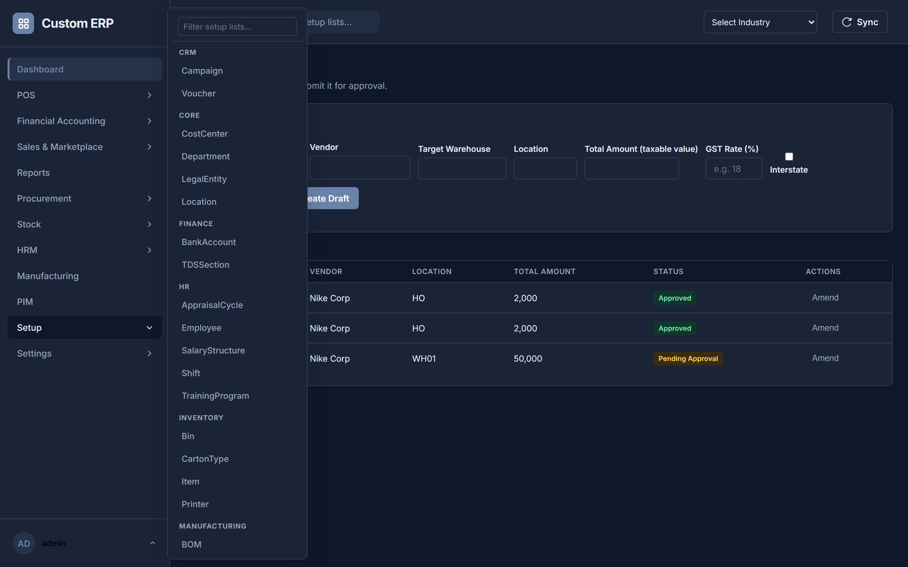

# User Guide: Purchase orders

Part 3 of 9 of the [User Guide](user-guide.md). Previous: [Selling and checking stock](user-guide-selling-and-stock.md). Next: [Receiving goods and moving stock](user-guide-receiving-and-transfers.md).

## 6. Ordering More Stock (Purchase Order)

**Buying in packs (Stage 148.35, only when your administrator has turned it on).** For an item with a **Purchase unit** and **Units per purchase unit** on its Item form (say Carton, 12), the PO line shows two boxes under the item: the packs and the price per pack. Type 5 packs at 120 and the line reads 60 pieces at 10 a piece; stock, cost, the journal and the vendor bill all work in pieces. On the goods receipt the same item shows a packs box under the received quantity and a box for the price per pack, filled from the PO. A pack price that does not divide evenly still adds up: the line, the invoice check and the vendor bill use the full pack value. A part-piece is refused unless the item allows fractions. Changing the pack size later never changes a document already saved, and an item's stock unit can no longer be changed once it has stock movements.

1. Click **Purchase Order**. The screen opens on the list of your purchase orders (the count is beside the title). Click **+ New Purchase Order** at the top right — the order form opens as its own page, **Purchase Orders › New purchase order**. **Purchase Orders** in that breadcrumb (or your browser's Back) returns to the list; whatever you had typed is still there when you click **+ New Purchase Order** again.
2. Fill in the header boxes:
   - **Vendor** — start typing and pick the supplier from the list. Lists show names only (a code appears only when two records share a name). Once picked, the vendor is **fixed for this PO**: the box greys out and no longer opens the list. To start over with another vendor, click **Reset** in the top bar (it clears the unsaved PO) or **Cancel**.
   - **Billing address** — which of your stores or warehouses is buying. This decides who the vendor invoices, and it's half of how the system works out your GST (see §6.2). The store's address, state and GSTIN show in grey under the box.
   - **Shipping address** — where the goods should physically arrive. It fills in with the billing store as soon as you pick one (shown as *"Same as billing"*); pick a different store or warehouse if the goods go elsewhere.
   - **GST treatment of purchase price** — a new PO starts on your business's default (**Inclusive** unless your administrator chose otherwise); change it only when this particular vendor quotes the other way. See §6.2.

   **An address is wrong?** Click **Edit store** under it. That store's own form opens with its address; correct it and **Save**, and you come straight back to your purchase order with the new address shown. The address belongs to the store, so the correction applies everywhere that store is used — later orders, receipts and prints. (You only see **Edit store** if your role may edit stores.)
3. **Add your items.** The add row sits under the header boxes. For each line:
   - **Item name or SKU** — type to search. The list shows **Item names** first (from **Setup → Item Name**), then **Items (SKU)** (every item in **Inventory → Items**). Only the name, Design ID, Combination ID or barcode is matched: typing *a* lists the names containing "a", such as *Antique Kundan Kada*. (The purchase order and the RFQ are the item boxes that search by name. Every other item box in Inventory, WMS, OMS and Accounts finds an item by its Design ID, Combination ID or barcode only.) Pick an item (or scan / type its exact SKU or barcode) to add that one item. Text that is neither picked from the list nor an exact SKU / barcode is not added — the row says it *is not an item*: pick it from the list, or choose **Create "…"** to make it. Pick an **item name** to choose its colour, size and other attributes right there — see *Buying a new design?* below. Picking a plain item (not a design's colour / size version) whose item name has attributes opens that item name's choices too, so the variants are never skipped; an item with no item name goes on as it is, with a note on how to give it one (**Setup → Item Name**).
   - **Qty** (starts at 1) and **Purchase price** — what you're ordering and what you're paying per unit.
   - **MRP** — optional. Record it if you're tracking it; leave it blank if not. **It never appears on the vendor's printed copy** — it's for you, not for them.

   Press **Enter** or click **Add**. The line goes into the item list below, the row clears for the next item, and the cursor is back in the item box — so you can keep adding without moving. Only the item list scrolls; the bar, the header boxes and the add row stay where they are. Change a quantity or price right in the list; click **×** at the end of a line to remove it.

   **Many lines from a file:** click **Upload lines** at the end of the add row. **Download template** gives three columns: **Design Number**, **Combination** (the Combination ID, item code or barcode) and **Qty**. Pick the filled file and every row is checked: the dialog says how many lines are ready and lists the rows it cannot use — a combination that is not an item, one that is not in the design number on its row, a row with no combination and a row with no quantity. Those are not added. Click **Add lines**. A line a vendor agreement covers takes the agreement's price; any other line comes in with the price blank — fill it in the list before you save.

   The grey columns in the list — **HSN**, **GST %**, **Taxable**, **Tax**, **Line Total** — fill themselves in as you type. You can't edit them, on purpose: HSN and GST rate come from the Item master, so there's only ever one answer to "what tax does this item carry". When the lines have attributes, each one gets its own grey column after **Item** (*Colour*, *Size*, *Fabric*…) showing that line's value, or **—** for an item without it. The printed PO shows the same columns (§6.9).

   If a line turns red, that item is missing its HSN code or GST rate on the Item master. Fix it under **Setup → Items** and the line clears.

   **Buying a new design?** You don't have to create the items first. Type the item name in the same box and pick it (its HSN and GST come with it). Its attributes open right under the row: type the design number, click the colours, sizes and other values you're buying, remove any combination you aren't buying, and **Add** makes the design and every combination and puts them on the order — see §6.9.
4. Check the **totals** in the bar at the top — number of items and quantity, taxable value, the tax split (CGST + SGST, or IGST), a **Round off** when the total has paise, and the grand total to the whole rupee, always in view — and the **supply-type banner** under the header boxes (§6.2).
5. **You don't type a PO number.** The box shows "Auto (PO series)" and is greyed out on purpose. The number is issued when you save; see §6.1.
6. Click **Create Draft**. You're back on the list, with the new order on it. Depending on the amount it may need an **approval** before it's official — that's a safety check, not a bug. Whether you may approve your own order is a setting your administrator chooses (as shipped: yes, if your role can approve it). You'll see it move to "Pending Approval", and once approved it's ready to send.
7. **Send it to the vendor.** On the order's row in the list, **Send to Vendor** opens **Send**: the vendor's email from the vendor record is filled in (change it, or add more addresses separated by commas), with a subject and a short message you can edit. **Send email** emails the **Vendor PO as a PDF**, in its best-match template; **Download PDF** saves the same PDF for you to attach to your own email or WhatsApp. Either way the PO is recorded as sent (the row shows "Sent to vendor"), and a notification channel, if your administrator set one up, gets it too. A vendor with no email on file is fine — use **Download PDF**. If the server has no mail account set up yet, **Send email** downloads the PDF instead and says so. **Print** on the row opens the print window (§7B): **Purchase Order** or **Vendor PO** (the vendor's copy, with item pictures and no MRP), the template, the store it is generated from, the preview, and **Print**, **PDF**, **CSV**, **Excel**, **Excel with pictures** and **Send**. The standard layout has your brand, both parties' names, addresses, states and GSTINs, the item table with HSN and tax, the CGST/SGST (or IGST) split, the grand total, and the amount in words. Sending does not approve the order — **Receive goods** appears once it is **Approved**, and by default you may approve your own order in **Approvals** if your role is the one the approval rule names (ADMIN_SOP §B.10).
8. **Edit** on the order's row opens it on the order page exactly like a new purchase order — vendor, billing and shipping address, GST treatment and every item line can all be changed — but it **keeps the same PO number** (shown, greyed, in the PO Number box; the breadcrumb reads *"Purchase Orders › Edit PO/…"*). Click **Save changes** to keep them or **Cancel** to go back to the list untouched. (Leaving an edit unsaved and clicking **+ New Purchase Order** starts a blank order; the unsaved edit is dropped.) Editing an already-approved PO sends it back for re-approval: the screen warns you first and asks for the reason for the change.

   **Delete** on the order's row removes a purchase order at any stage — draft, pending approval, approved or already sent — **as long as no goods have been received against it**. It asks you to confirm first. Once a goods receipt exists (including one that received several POs together), Delete is refused and names the receipt; cancel that receipt first. You only see **Delete** if your role is allowed to delete purchase orders — your administrator sets that under **Settings → Roles** (Purchase Order → Delete).
9. When the stock physically arrives, find the approved PO and click **Receive goods**. The Goods Receipt opens on its **New goods receipt** page with that PO, its vendor and its lines loaded - you do not pick the vendor again; it is fixed for this receipt until you click **Reset** in the top bar. If you opened Goods Receipt directly, click **+ New Goods Receipt**, choose the PO and click **Add PO & Load Items** — and repeat for any other PO of the **same vendor** that came in the same delivery (§6.10). Only what is still **open** on each PO loads. Type the vendor's **invoice number, date and amount**, and on each line change the **Invoice Rate** if the bill's price differs from the PO; any difference becomes a debit or credit note automatically (§6.10). For a partial delivery, remove the full-quantity line and add the actual received quantity; record any rejected or damaged quantity and its reason. The line you add back keeps its PO, PO rate and invoice rate. **Columns your administrator asks at receipt** — for jewellery usually **Gross Weight**, **Net Weight** and **Purity** — appear on every line: fill them in for what is in front of you. A column marked ***** must be filled before the receipt posts. These values are kept on that line's batch and print on its stickers, so each piece shows its own weight (for pieces that each weigh differently, ask your administrator to set GRN batch numbers to **One per GRN line**). The posting confirmation separates accepted from rejected/damaged units. **Only accepted units enter available stock**; an order by itself never adds stock. Check **Inventory** afterwards.
    Once it is posted, the configured barcode policy can issue a missing barcode — for example, on an older or imported Item. A new Item no longer requires you to type a barcode. The GRN is also where you start printing its labels — see §7A.1.
10. **Rejected goods stay on order (Stage 73.2.4).** Only **accepted** units count against the PO. If 10 shirts arrive and 2 are rejected, the PO still shows 2 **open** - the next **Receive goods** loads those 2 for the vendor's replacement, and a delivery whose extra units are rejected is not an over-receipt. To see where a PO stands, click **Balance** on its row: per item it shows ordered, received, accepted, rejected, damaged, returned, short-closed, **open**, invoiced and paid, the money totals, each receipt with its invoice, and any claims.
11. **Short-close.** If the vendor will not replace or send the rest, open **Balance**, choose a **Reason** (reason codes of type *Cancellation*), optionally a note, and click **Short-close**. The PO becomes **Closed**: it takes no more receipts and can no longer be edited. Any rejected or damaged goods still held are put on a **Draft purchase return** for that receipt - the claim on the vendor (its number is shown). Post it on **Procurement → Purchase Return** when the goods go back (§6.5).
12. **Line control (Stage 148.11).** In **Balance** an Approved PO's lines have **Control**, **Stop** and **Close rest**. **Control** holds the vendor's confirmation no. and date, **Under %** and **Over %** (blank = the item's own, read each time goods arrive), **Full delivery only** (a part delivery is refused) and **instalments** (one *qty date* per row, adding up to the line; the PO stays open until all are in). **Stop** (with a Cancellation reason) closes the rest of the line and refuses further receipts on it; **Close rest** closes what is still open without stopping it. Receiving at least 100 - Under % of a line closes the rest by itself. **Overdue lines** on the PO list shows instalments past their date (the PO's expected date when a line has none) with **Close rest**. A goods receipt shows a warning when the vendor's challan no. was already used this year. A transfer's lines can be cancelled before dispatch (reason needed); when all are cancelled the transfer shows **Cancelled**.
13. **Auto-cancel.** If your administrator set **Configuration → Procurement → Purchase Order auto-cancel** (for example 30 days), an Approved PO is closed automatically that many days after it was approved: with nothing received it becomes **Cancelled** and shows **Auto-cancelled** under its status (hover for the reason) — it can no longer be edited or sent to the vendor; partly received, the rest is short-closed exactly as in step 11 with the reason `AUTO-EXPIRY`. A PO that is fully received, still a Draft or waiting for approval is never touched. Raise a new PO for anything still needed.
14. **Expected arrivals (Stage 148.34).** **Reports → Procurement → Expected arrivals** lists what is due to come in: every Approved PO line (each instalment, or the PO's expected delivery date when a line has none) and every transfer in transit, one list per store and day, **late first**. **State** reads *Late N days*, *Due today*, *Upcoming* or *No date*; **Vendor confirmation** reads *Confirmed* or *Re-opened*. Click the **No.** to open the PO or transfer and receive part of it there with **Receive goods** or the transfer's receive action. If a PO's expected date, or a line's instalment date, is changed, the vendor's confirmation on that line goes back to *Re-opened* (the line stays on the list); enter the new confirmation on **Control** to clear it. A transfer has a due day only when **Transfer in transit too long after** (Configuration) is above 0: that many days after dispatch; otherwise it shows *In transit* and is never late. A store user sees only their own store's arrivals.

**Creating a PO from inside a Goods Receipt.** When the PO you want to receive against does not exist yet, the GRN's purchase-order picker offers to create one. That opens the plain **New Purchase Order** record form (not the order page above). On it, **Target Warehouse** and **Location** are pickers - start typing a store or warehouse name and choose it; the **Inter-state Supply** and **Supply Type Overridden** tick boxes are ignored on save - the supply type is worked out from the vendor's and the store's states (§6.2). **Status** offers only Draft, Pending Approval and Closed: **Approved** and **Rejected** come only from the approval flow, so save it as **Draft** and send it for approval. Saving takes you back to the Goods Receipt; once the PO is approved, pick it there.

#### 6.4 Completing missing barcodes at receipt

When you create an Item on screen, **Barcode is optional**: enter an existing barcode, use **Generate**, or leave it to the configured barcode-issuance policy. Goods Receipt can issue a missing barcode at receipt when that policy is selected. Ask your administrator to check **Configuration → Inventory** before relying on receipt-time issuance.

What that means in practice:

- **A new Item can be saved without typing a barcode.** The configured policy decides whether it is generated at Item creation, at receipt, or not automatically.
- **A missing barcode on a received Item is completed after the receipt posts.** You can then print its labels from that GRN (§7A.1).
- **An item that already has a barcode keeps it.** Receiving the same SKU again does not issue it a second barcode or change the one on your existing labels. This is safe to rely on: the same stock can be received any number of times and the barcode stays put.
- **The barcodes are real EAN-13 numbers**, with a valid check digit, so an ordinary retail scanner reads them.
- **It never blocks a receipt.** The missing-barcode safety net runs *after* the receipt has posted and the stock has moved. If generation fails, the receipt still stands and the Item remains unbarcoded; the failure is recorded in the system log for an administrator. You can use **Generate** on the Item form to retry.
- **Where to see it**: open the **Item** record and look at its **Barcode** field.

If you want to *print* at the moment of receipt, that is still a deliberate second step — post the receipt, then print its labels from the Sticker Printing screen (§7A.1). Posting a receipt does not send anything to a printer on its own.

**An RFQ is optional.** If you want to compare suppliers, raise a Purchase Requisition and convert it to an **RFQ** (or start one on Procurement → RFQ / Quotes), collect quotes, and **Award** the best one: that creates the Draft PO for you (§6.4). If you already know the supplier, go straight to a Purchase Order as above.

### 6.1 Where document numbers come from

You never type the number on a Purchase Order, Goods Receipt, Stock Transfer, Expense Claim, Leave request, or any other transaction. The field is greyed out and reads something like **"Auto (PO series)"**, and the real number appears once you save — for example `PO/BDR/26-27/00042`.

That number is issued by the system, in order, from a numbering series your administrator controls (see the Admin Guide, §B.3.2). Reading the example above left to right: the **PO** part is the document type, **BDR** is the Short Code of the store it was raised at, **26-27** is the financial year, and **00042** is the running count. Your administrator can change any of that per transaction — the prefix, the number of digits, a suffix after the number, a store's own prefix, or removing the store or the year entirely — so yours may look different, and that's fine.

Two things worth knowing:

- **Numbers can have gaps, and that's normal.** If a save fails validation after a number was drawn, that number isn't reused. A gap means "something was started and not completed", never "a document went missing".
- **You can't reuse or choose a number.** This is deliberate. When people typed their own numbers, two colleagues creating a PO at the same time could pick the same one — and the second save would quietly overwrite the first, with no warning to either of them. Now that can't happen.

**Master records are numbered too, with short codes.** Vendors, Items, Customers, Employees and the other lists in §8 get their Code on save — a prefix and a number (`V00007`), its format asked once on the first record of each list. Records made before short codes may still show a long one (`Vendor/HQ/2026/000007`); on Legal Entity, Location, Cost Center and Department an administrator cleans those once from the list (Admin Guide B.3.0.3b). In the on-screen form the Code field is read-only; for Items, a linked Product Family instead makes the save build a Combination ID (§8d). Your administrator can change the shape of a master series too, including for Vendor and Item (Admin Guide §B.3.2).

### 6.2 GST on a purchase order: inclusive vs exclusive, and inter-state

Two things decide the tax on a PO, and the screen works both out for you.

**Does the price you typed already include GST?**

- **Inclusive** (the default) — the price already has GST in it. Type 450 at 5% and the line stays 450, of which 21.43 is tax.
- **Exclusive** — the Purchase Price is the base price and GST is added on top. Type 450 at 5% and the line comes to 472.50.

Your administrator sets which one is normal for your business (Admin Guide → Configuration → Procurement → "Purchase Order price GST treatment"). A new PO starts on it, and you can change it on any single PO where a particular vendor quotes the other way. A PO saved before the default became Inclusive (October 2026) on "Tenant default" keeps the treatment it was priced with.

The goods receipt follows the PO: lines from an **Inclusive** PO show the **PO Rate**, **Invoice Rate** and **Value** incl. GST (the column headings say so, or the row does when a receipt mixes POs), so you key the vendor's price exactly as the bill and the PO show it.

**Is it inter-state or intra-state?**

You don't tick this any more. The system compares the state of the **legal entity behind your chosen Location** with the state of the **vendor**, and applies:

- **same state** → intra-state → **CGST + SGST**
- **different states** → inter-state → **IGST**

The banner above the items tells you which it chose and why — for example *"Inter-state (IGST) — vendor in Karnataka (29), billing address in Maharashtra (27)"*.

Each side's state comes from its GSTIN (the first two digits are the state code), falling back to the **State** field on the record if there's no GSTIN. For the billing address that is the Legal Entity behind the store, then the store's own **State**.

Until both a vendor and a billing address are picked, the banner just asks you to pick them. If either one has **no state**, the banner turns amber and asks for it: *"Bandra Store has no state — choose it, so the PO knows IGST or CGST + SGST"*, with the state list and **Save to store** (or **Save to vendor**). Choose the state and click Save: it is saved on that store or vendor, the banner works the supply type out at once, and every later PO for it gets it right. There is no guessing tick. If you are not allowed to change stores or vendors, the banner says to ask an administrator. If the store has no Legal Entity either, the banner also shows a **Legal Entity** list; pick one and **Save to store** saves both together. The list appears only when the store lacks one. If the save is still refused, the message says what to fill in; use **Edit store** under the billing address.

**Vendor with no GSTIN.** If the vendor you pick has no GSTIN on its record, a line under the header asks for it: *"Sharma Traders has no GSTIN — add it and it is saved on the vendor (optional)"*, with a box, **Save to vendor** and **Not now**. Type the 15-character GSTIN (small letters become capitals) and press Enter or click Save to vendor: it is saved on the vendor and the line goes away. A vendor with a GSTIN is never asked again, on any PO. It is optional: **Not now** hides the line for this PO only, and the next PO for that vendor asks again until it is filled. A GSTIN with a wrong check digit is pointed out under the box before anything is saved; a GSTIN from a different state than the vendor's **State** is refused with both states named, so correct whichever is wrong. If you are not allowed to change vendors, the line is not shown.

**No override.** The supply type is always the one worked out from the two states — there is no tick to change it, on this page, the record form, an import or the API. If it is wrong, a state is wrong: correct the vendor's or the store's **State** (or GSTIN) and save the PO again. A PO whose **vendor has no state** (no State and no GSTIN) is not saved, not sent for approval, not made from an RFQ award or a supply proposal, and not imported: the message names the vendor — add its State on the vendor (or with **Save to vendor** on the banner), then save again. A PO whose **billing store has no state** (no State of its own and no GSTIN or State on its Legal Entity) is refused the same way, naming the store - choose its state with **Save to store** on the banner, or on the store, then save again. The record form no longer shows the *Inter-state Supply* and *Supply Type Overridden* ticks. POs saved before this keep their tax split until they are saved again.

### 6.2a Vendor price agreements, discounts and free quantity (Stages 148.6, 148.7)

**Agreed prices.** A vendor's agreed prices are a price list with a **Vendor** on it (Sales → Price List Version; leave Vendor empty for a sales list). Each row names an item, a design or a category, and can carry a valid-from and valid-to, quantity breaks (**Min qty** and **Max qty**, both inclusive), a **Disc %**, the vendor's own item code, a pack multiple, "Count across PO", buy N get M, and a commitment (quantity or value). Rows that overlap in quantity, or leave a gap between breaks, are refused when you save. A row with a price needs an item, design or category.

**On the PO.** Pick the vendor and add an item. If the Purchase Price is blank, the agreed price fills in. A price you type is always kept. The most specific row wins: item, then design, then category, then the vendor-wide row, then the item's own cost. On a tie the later valid-from wins. Under the line, the PO says which rule it used, for example *₹1,240 · VA-12, 50+ break*, or why none matched, for example *no agreement: expired 12 Oct*. A date outside the order date's agreement is never used. A line from an RFQ keeps its quoted price.

**Vendor code.** The vendor's item code prints on the PO (print template column "Vendor item code") and finds the item in a PO upload, when the file has a `vendor_code` column and no SKU.

**Commitment.** A row with a commitment shows a bar under the line: how much of it the vendor's open POs already use.

**Discounts.** A line can have **Disc %** or **Disc** (rupees). The agreement's own discount and yours compound: 20% after 30% is 44% off, and the line says so. **Order discount %** and **Order discount** (above the items) are spread over the lines in proportion to their value. Taxes are worked out on what remains.

**Free quantity.** A buy N get M row gives M free units for every N bought. It is worked out by the server whenever the quantity changes. Free units are received at zero price, so stock cost is the real price per unit, and the PO line value is what the goods receipt and the vendor bill match.

**Supply proposals.** Approving purchase proposals makes one Draft PO per vendor: the one you pick, or each item's **Default vendor** (Item master). An item with neither is refused. The quantity rounds up to the agreement's pack multiple.

### 6.2b Charge codes: freight that goes into item cost (Stage 148.8)

Nothing here shows until your company has a charge code. With none, POs, receipts and transfers work as they always did.

**Make a code.** Setup → Procurement → **Trade Charge Code** → New. For example, a freight code a carrier bills you for:

1. **Name**, such as Freight. The **Code** is given when you save.
2. **Used for**: Buying. **Kind**: Freight. Kind matters only for freight terms, below.
3. **Paid to**: Third party, and pick the **Carrier**. Choose Vendor if the supplier's own bill carries the charge.
4. **Into item cost**: Yes. Choose No to send it to the **GL account** you name instead (a GL account is required then).
5. **GST rate %**, **Split by** (Value unless you choose Qty or Weight; use Weight for jewellery), **Lines** (All lines or Stocked lines only) and **Repeat** (Once, or Every receipt).
6. Save. An account that is not in the chart, is blocked, or is the wrong type is refused on save.

**Put a charge on a document.** Open **Charges** on the PO or the GRN, then add a row: the **Charge**, the **Amount**, and if needed **Only SKUs** or **Leave out SKUs**. A row on a GRN replaces the PO's row for the same code, and is always charged on that receipt.

**Or let a rule add it.** Setup → Procurement → **Trade Charge Rule**: a **Vendor group** (on the vendor), an **Item group** (the item's category), the **Charge code**, a **Method** (Percent, Per unit or Fixed) and a **Rate**. Blank means any. For each line the most specific rule wins. A rule never adds a code you already typed on that document.

**Who bears freight.** Set **Freight terms** on the vendor, FOB or CIF. Under CIF the vendor bears it, so rules with a Freight or Insurance code do not apply. For a Freight code, **Freight paid by** on the PO comes first: Vendor means the vendor bears it, Buyer means you do. A row you type is always charged.

**At the receipt.** When the GRN posts, each charge is shared across its lines and added to item cost, and the shares add up to the amount exactly. Each posted charge is one row in Setup → Procurement → **Trade Charge Entry**, and **Lines** on that row (or **Charges** on the GRN list) shows each SKU's share, or why it has none.

- **Once** charges the first receipt of the PO, and a later receipt says which GRN already carried it. The parts of a step GRN share it. **Every receipt** charges each receipt in full. Percent and Per unit rules follow the lines received.
- **Paid to Vendor**: the amount goes on the vendor's balance now, and the vendor bill is matched with it included.
- **Paid to Third party**: the amount waits in a clearing account, and the entry says **Estimated**.

**The carrier's bill arrives.** On the Estimated entry choose **Book bill**, then fill in the **Vendor**, **Bill no**, **Bill date**, **Bill total** and **GST in it**. You can book it once per entry. Clearing goes to zero and the carrier's bill is booked. If the bill differs from the estimate, the difference goes into the cost of units still in stock; the share for units already sold goes to COGS variance, so they are not re-costed.

**A return.** A Purchase Return raised from a receipt takes back that receipt's charges in proportion to what goes back. A vendor-paid charge goes on the debit note with its GST. A third-party charge comes off clearing while it is still unbilled. Beyond that, freight already paid stays a cost: into-cost charges go to COGS variance, the others stay in their GL account.

**Between stores.** On a transfer, open **Freight** and add a row. The charge must go to a third party. It adds to item cost and is recorded against the receiving store. Item cost is company-wide, so all stores share the new rate.

Entries are written by the system. Nobody can type, change or delete one.

### 6.3 Batches and expiry dates (for items that need them)

**Every GRN line gets a batch number.** On **Procurement → Goods Receipt**, leave **Batch / Lot No** blank and posting the receipt gives the line a batch number carrying the day it arrived: `B`, the date as YYMMDD, then that day's running number. **B-261016-0001** is the first batch received on 16 October 2026, **B-261016-0002** the second, and so on. Type a number yourself if you want your own — it is always kept. The SKU's barcode stays the same on every receipt; the batch is what tells one delivery from the next. It prints on the item's stickers as a second, scannable barcode (§7A) and you can scan it to see when it came in and how old it is — **Batch Lookup & Ageing**, below.

How often a new number is given is set by your administrator — for the whole business, for an item type, or for one Item (the Item form's **GRN batch number** field):

| Setting | What you see on a GRN |
|---|---|
| **One per SKU on each GRN** (usual) | Every line of the same SKU on one GRN shares a number; the next GRN gets a new one. A number you type on one line also covers that SKU's blank lines. |
| **One per GRN line** | Each line gets its own number, even for the same SKU. |
| **One per SKU per day** | Every GRN that brings the SKU into the same store on the same day shares one number. |
| **Off** | Nothing is filled in; only numbers you type are used. |

The letters and layout of the number (e.g. `LOT-261016-0001`, or no date at all) are also your administrator's choice.

The rest of this section applies only to items your administrator has marked as **batch-tracked** — typically food, medicines, cosmetics, chemicals or anything else where "which production lot did this come from" and "when does it expire" are real questions. For those, the clerk types the lot printed on the carton; no number is made up for them. If none of your items are marked that way, nothing below ever appears.

**Receiving batch-tracked stock.** On **Procurement → Goods Receipt**, once you pick an item in the SKU box a **batch row** appears underneath the quantity boxes, with a note telling you whether that item needs a lot number:

- **Batch / Lot No** — the number printed on the carton. **Required** for a batch-tracked item; you can't add the line without it.
- **Manufacture Date** and **Expiry Date** — type whichever the carton actually prints. If the item has a shelf life set up and you fill in only the manufacture date, the expiry is worked out for you (manufacture + shelf life) and the note on screen tells you so.
- **Supplier Batch No** — the supplier's own reference, if it differs from yours. Optional.

You don't need to create the batch anywhere first. Posting the receipt registers it for you, along with the supplier it came from.

**Two things the system will refuse, and why.**

- **A batch-tracked item with no lot number.** You'll be told the item is batch-tracked and needs one. There is no way round it, deliberately — stock nobody can trace back to a lot is exactly what batch tracking exists to prevent.
- **Goods that are too close to expiry.** If your administrator has set a minimum shelf life on receipt, a delivery arriving inside it is refused at the door, and the message tells you how many days it has left versus how many the item accepts. Take it up with the supplier rather than trying to force it through — accepting it means stock you'll never be able to pick.

You'll also be stopped if the expiry date you typed is before the manufacture date. That's always a typo, and it matters more than it looks: the system picks earliest-expiry stock first, so a lot dated wrongly would jump to the front of every pick list from then on.

**Correcting a batch or serial's purity, karat or weight.** A hallmark re-test or a re-weigh changes the piece, not the stock. In **Setup → Master Data**, open **Batches** or **Serial Numbers**, click **Correct** on the row, change the values, type the **Reason** and click **Save**. The same box lists every earlier correction (when, who, old and new value, reason). Only people who can post a stock adjustment see the button. The purchase receipt, the sale and the cost stay as they were; only the attribute values change, and stickers printed afterwards show the new values. A piece that is already sold can be corrected too.

**Picking batch-tracked stock.** You don't choose the lot — the pick list does, and it always chooses the one expiring soonest (this is called **FEFO**, first-expiry-first-out). Pick lists and the mobile picking screen show a **Batch / Expiry** column with the lot number, its expiry date, and a coloured flag when it's close: amber within 30 days, red within 7 days or already past. Pick **the batch shown**, not whatever is nearest to hand.

Two lots you will never be offered:

- Anything already past its expiry, or inside the minimum shelf life the item requires to be picked.
- Any lot someone has put on hold (see below).

If that means there isn't enough to fulfil the order, the pick list says **short** rather than quietly giving you stock it shouldn't. The stock is physically there; it's just not fit to send.

**Putting a lot on hold, and taking it off.** If a pallet is damaged, or QC wants a lot stopped, an administrator or store manager can mark the batch **Quarantined** or **Blocked**. It disappears from every pick list immediately. Releasing it back to **Active** requires a written reason — that reason is the first thing anyone asks for if the lot is ever part of a recall, so it isn't optional.

**Finding stock and tracing a lot.** Three reports under **Reports** (all exportable):

- **Batch Near-Expiry Watchlist** — everything expiring within the number of days you give it (30 by default), worst first, with how much is left and where. This is the one to open every morning if you sell anything dated.
- **Batch Stock Inquiry** — "where is lot X right now": every bin holding it, in what condition, with days left. Filter by item, location or lot.
- **Batch Movement History (Recall)** — "everywhere lot X has been": every movement from the receipt that brought it in through to the documents it went out on. Give it a lot number; add the item code if the same lot number is used across items.
- **Lot Trace (Both Ways) (170.14)** — the recall in both directions. Give it a lot number (and the item code if needed) and pick **Both**, **Forward** or **Backward**. **Forward** from a raw-material lot lists every lot made from it and what happened to each (sales and transfers). **Backward** from a finished lot lists the input lots it was made from and, for each, the vendor, receipt and date. A row marked *Inferred* means the work order had no input lots written down, so the lots are the ones the system would draw first-expiry-first-out; *Recorded* means they were written on the order.

To make the trace exact, fill **Input lots** (item, lot, quantity) on the production order before you complete it. Completing into a named output lot is what records the link; an order that finishes without a lot number records none.

Together Batch Stock Inquiry and Batch Movement History are what a recall needs — the first tells you what to stop shipping, the second tells you who already received it.

**Batch Lookup & Ageing — scan a sticker, see when it came in.** **Reports → Inventory → Batch Lookup & Ageing**. Click into **Scan batch, barcode or SKU**, scan or type, and press **Enter**:

- **A batch number** (scan the second barcode on the sticker, e.g. B-261016-0003) shows that batch: the item, **Received On**, **Age (days)**, its **Age Band** (0-30, 31-60, 61-90, 91-180, 180+), the **GRN** that brought it in (several, if a per-day batch was shared), the **Supplier**, **Received Qty** and **Est. Left (FIFO)**.
- **The SKU's barcode or the SKU code** shows every batch of that item, oldest first — the order to sell it in.
- **Blank** lists every batch, oldest first. Put a number in **Older than (days)** to see only batches that have waited at least that long, e.g. 90, and set **Show** to **Only with stock left** to hide batches that have sold through.

**Est. Left (FIFO)** is an estimate: a sale that scans the SKU's barcode does not record which batch the piece came from. The item's stock on hand (all stores together) is laid against its newest batches first, so the oldest batches are the ones counted as sold — first in, first out. Batches received before batch numbers existed show the date their batch record was made.

**Stock Ageing (by GRN batch)** — **Reports → Inventory** — is the summary: one row per item in stock, with its on-hand quantity split into **0-30 / 31-60 / 61-90 / 91-180 / Over 180 days**, plus **Before batch numbers** (stock older than any batch, i.e. received before batch numbers were switched on), and the oldest batch still held. Items with the oldest stock come first. Scan a barcode or SKU to see one item.

### 6.4 Asking vendors for quotes (RFQ)

**Procurement → RFQ / Quotes.** Use it when you want prices from several suppliers before you raise a Purchase Order.

**Requisition or RFQ?** A **Purchase Requisition** stays inside your business: a department asks for something (what, how many, an estimated amount) and it is approved. It names no vendor and no price. An **RFQ** goes out to vendors: it asks one or more of them to quote for those goods, and the quote you **Award** becomes the Purchase Order. The usual order is Requisition → RFQ → Purchase Order. When you already know the vendor and price, convert the requisition straight to a Purchase Order and skip the RFQ.

**Requisition with item lines (Stage 148.14).** A Purchase Requisition can carry **Item lines** instead of a single description: each line has an **Item**, a whole **Qty**, a **Store**, and optionally a **Vendor** and an **Est. rate**; the header quantity and amount fill in from the lines. A request with no lines works as before (description, quantity and amount are then required). Once a request with lines is **Approved**, press **Combine** on its row, choose the **Vendor**, and one **Draft Purchase Order per store** is made from every open line of that vendor across all Approved requests. Each PO line names its request and line, each request line names its PO and line, and the PO list's **Source requisition** shows the requests. A line goes onto one PO only (two people pressing at once get one PO; the other sees *No open request lines*); a PO that is cancelled frees its lines again. A line already on a PO cannot be edited. A request is **Converted** when every line is on a PO. The combined PO goes through the normal PO checks and approval. A request with lines cannot be converted to a PO from the old **PO** button; use Combine.

1. **Create the RFQ**: click **+ New RFQ**, choose where the goods go (**Deliver to**), when quotes are due and when you need the goods. Add the **items asked for**, one line each: pick an **Item** (its name fills in) or just describe the thing, its **Unit** (Nos, Roll, kg…) and **Qty**, then **Add line**. **Create RFQ** saves it as **Draft** and opens it under the list. While it is a Draft, **Edit lines** changes the lines.
2. **Invite vendors**: under **Vendors**, pick each supplier, a **Reply by** date, and **Invite**. Each vendor shows **Invited**, **Responded** (with their quote number) or **Declined** - click **Declined** (with an optional reason) when one says no.
3. **Mark as Sent** once you have actually sent the request to them (by email, phone or in person — the system records who it went to; it does not send the request itself). Recording the first quote also marks it Sent.
4. **Record each quote** as it comes in: **+ Record Quote**, choose the vendor, how long the quote is **valid**, its **freight**, **payment terms** and lead time, and for every line the vendor's **unit**, **unit price**, **tax %** and lead days - or tick **Not quoted**. If the vendor prices in another unit (a box of 10), fill **RFQ units in one** (10) unless the item already has that unit conversion. A vendor who sends a revised quote is recorded again; the newer one replaces the older. A quote from a supplier you had not invited still records and adds them to the vendors as Responded.
5. **Compare**: the quotes sit side by side. Each line shows every vendor's price and its **landed** cost per unit (price + tax + its share of freight), with **best** on the cheapest; below are lines total, tax, freight, **landed total**, lead time, terms, validity (an expired quote is flagged and cannot be awarded) and how many lines each vendor quoted. **Recommended** is the lowest landed total among quotes that cover every line and are still valid.
6. **Award**: click **Award** under the chosen quote. Confirm the **Deliver to**, and for any free-text line choose the item it is (or **Leave out**). **Create Purchase Order** makes a **Draft PO** for that vendor with the quote's prices, freight and terms; the other quotes are marked Rejected and the RFQ closes, showing the PO's number. An RFQ can be awarded once - a second award is refused. Submit the PO for approval as usual (§6). If you decide to buy from nobody, use **Close without award**.

The status only moves forward — Draft → Sent → Closed.

**Who may convert (Stage 148.14c).** **Convert** on a requisition needs the right to create the document it makes: an RFQ, or a Purchase Order. A role without it is refused (`GLOBAL-0011`) and nothing is created.

**Following the saved documents.** A converted Purchase Requisition now shows its
next RFQ or PO in the **Next document** column; select that link to find the
saved record. An RFQ created from a requisition links back to it. The PO list
also shows its source requisition, and a Goods Receipt links back to its PO.
From a posted receipt, **Record vendor invoice** opens the bill list; on the
invoice list, the PO and GRN references open those exact saved records. These
links are for checking lineage, not approval or posting shortcuts. Selecting a
winning vendor quote **does not create a PO**: the current quote form does not
capture an item, unit or tax line to carry into a safe PO draft. A buyer must
review and create the PO separately until that conversion rule is designed.

**How good is this vendor?** Open the vendor and expand **Scorecard**: on time, fill rate, QC reject, price variance and bill mismatches over the last 3, 6, 12 or 24 months (12 by default). The RFQ comparison shows the same under **Track record**, and the report **Vendor scorecard** lists every vendor. **No data** means nothing to measure yet, not 0%. It also shows **defects per million** (rejected over received, times a million) and the vendor's open corrective action requests (SCARs).

**Give the vendor a link to one order (Stage 148.18).** Needs the setting `procurement.vendor_link` on (Admin). In **Procurement → Purchase Orders**, press **Vendor link** on an Approved order, then **Make link** and **Copy**; send it to the vendor. The vendor needs no login and sees only that order's lines. For each line the vendor can propose a new qty or date (and say their own unit, for example "pieces") and can send an invoice file (PDF, PNG or JPG, up to 2 MB). The link works for 14 days; **Revoke** stops it at once. Their changes wait in the same window: **Apply** changes the order line and puts its confirmation back to waiting; **Reject** leaves it. Tick **Remember** to keep the vendor's unit name for next time. An invoice file waits for you: open it, then mark it **Reviewed** or **Rejected** - it never posts a bill by itself. For a vendor marked **Link changes apply at once** (a Vendor field, off by default) the changes apply without waiting. A line that is overdue sends the vendor a reminder with the link, once a week. If a vendor replies by phone or on paper, open the RFQ and press **Key reply** next to their name.

### 6.5 Sending goods back to a supplier

Use **Procurement → Purchase Return** when goods go back to the supplier. A return is always raised against the **goods receipt (GRN)** they arrived on, so the system knows the supplier, the PO, the location, the lot and the price.

1. Go to **Procurement → Purchase Return**.
2. The screen opens on the list of returns. Click **+ New Purchase Return**, then in **Goods Receipt (GRN)** choose the receipt the goods came in on. A table shows what that GRN can still send back, one row per item, lot and kind of stock:
   - **Accepted** is stock that went on your shelves. It shows its **Unit cost** (the PO rate before GST), because the supplier owes you for it.
   - **Rejected** and **Damaged** are what QC set aside when the goods were received on **Procurement → Goods Receipt**. The supplier was never owed for these, so they have no cost and no money changes hands for them.
   - **Can return** is what the GRN received, less what earlier returns already sent back (**Returned**) and what other returns still waiting to be posted have claimed (**On open returns**).
3. Choose the **Reason for Return** from the list (add a note underneath if it helps), and a **Return qty** on each line that is going back. You cannot enter more than **Can return**. The bar at the top counts the lines and units going back and their value at cost.
4. Click **Save Return** (top right). It is saved as a **Draft**, gets a number such as `PRT/HO/26-27/000004`, and you're back on the list. Nothing moves yet.
5. On the list, click **Post** on its row and confirm. In one step:
   - the stock leaves: accepted units come off your available stock at the GRN's location, rejected or damaged units come off QC hold or damaged;
   - a **Debit Note** is raised to the supplier for the accepted units' value and posted, so what you owe the supplier drops by that amount. It appears in the **Debit Note** column (for example `DN/HO/26-27/000002`) and under **Financial Accounting → Debit Notes**, already **Posted**.

   - if the supplier's bill for these goods was already entered (and its GST credit claimed), that GST is **taken back** in the same step. The confirmation says how much, for example *"Input GST of 54.00 already claimed on these goods was reversed."* The Debit Note's **Reason** then ends with the GST reversed and the total including GST that the supplier owes you back, for example *"GST 54.00 reversed; total with GST 354.00"*. If the goods went back before any bill, nothing is reversed, because no credit was claimed.

   If only rejected or damaged stock went back, no Debit Note is needed and none is raised.

If your administrator requires approval for returns, the row shows **Submit for approval** instead of **Post**. A manager (not you) approves it in **Approvals**, and then **Post** appears. Use **Cancel** on a Draft you no longer need; its quantities become returnable again. A posted return cannot be changed or posted twice.

Things the screen refuses, with the reason shown:
- returning more than **Can return** ("RTV quantity cannot exceed rejected/returnable quantity");
- a GRN that was cancelled because its stock never posted ("RTV must be created against a valid GRN");
- a line already fully on another return ("RTV is already created ...");
- **accepted** goods once the receipt is older than the **Purchase return window** your administrator set ("The return window for this goods receipt has passed", counted from the receipt date) — rejected and damaged goods can still go back.

**A reason code marked High (74.1.1).** A return whose reason code has Severity **High** is not posted when you post it: it goes to **Pending Approval**, and no stock, debit note or ledger entry is made until an approver approves it. Rejected, nothing is posted.

When the supplier's bill comes in after a return, bill only for what you kept. The Vendor Invoice match (§6.6) counts accepted units **less what you returned**, so a bill for the kept units matches. A bill that still charges for the returned units goes on hold. If you had already paid for the returned goods, the supplier now owes you their value including GST, which is the total shown at the end of the Debit Note's Reason.

A supplier **overcharged you** and nothing physical went back? Then there is no return. Raise a **Debit Note** by hand in **Financial Accounting → Payables → Debit Notes**, click **+ New Debit Note** — then pick the supplier and the **Reference PO**, the amount and the reason. (**Vendor Credit Notes** is next to it, and **Customer Credit Notes** is under Receivables, each with its own **+ New** button.)

### 6.6 Paying the supplier's bill (Vendor Invoice and the three-way match)

When the supplier's bill arrives, record it and let the system check it before anyone pays it.

1. From the posted Goods Receipt row, click **Record vendor invoice** and then **+ New Vendor Invoice**. Its GRN, PO and vendor are carried into the form. Or open **Financial Accounting → Vendor Invoice** and enter those references yourself. Confirm the supplier's invoice number, amount and financial year; a new transaction starts in **Draft**.
2. Enter the supplier's **Invoice Number**, pick the **Vendor**, the **PO Reference** and the **GRN Reference** (the goods receipt this bill is for), and the **Invoice Amount** exactly as printed on the bill — **including GST**. Save. It starts as **Draft**.
3. Click **Match** on its row. You are not asked for the PO or GRN again — the invoice already names them. Matching needs the **finance.post** capability or the right to edit Vendor Invoices; otherwise it is refused (`GLOBAL-0011`). The tolerance is always the one your administrator set - the screen no longer takes one, and a figure sent by hand is ignored (Stage 148.12c).
   - **Matched** — the bill agrees with what you actually accepted: accepted quantity × the PO rate, plus the PO's GST, within the tolerance your administrator set (2% by default). For a receipt where you entered the vendor's **Invoice Rate** (§6.10), the bill is compared with accepted quantity × **that** rate instead — so a bill priced above or below the PO still matches, because the GRN's debit / credit note has already settled the difference. A receipt covering **several POs** is matched as one bill. A **partial delivery billed for what arrived matches** — you do not have to wait for the whole PO. Goods you **rejected** at receipt are not owed, so they are not counted.
   - **On hold (MismatchHold)** — a message tells you exactly what disagreed: the bill differs from the accepted goods' value, or that GRN or PO has **already been billed** (a duplicate bill for the same goods is caught). Correct the amount with the supplier, or use **Override & Pay** with a written reason — that goes to a manager for approval rather than paying straight away.
   - **Bill Lines** (optional). List the bill's items with their quantity, rate and weight, and each line is checked on its own: a line priced over the receipt's rate by more than the tolerance holds the bill, even if the total agrees. A line under the rate is never held, and neither is a part bill: what it leaves out is still to bill. A line for more units than you accepted holds it. A supplier with a **Bill weight tolerance** is held if a bill lists more grams than you received, by more than that.
   - A bill that differs from the receipt also moves your stock cost, when it is **Matched** or when **Override & Pay** pays it (§6.15).
   - **A Matched bill sets the item's purchase rate** (Standard Cost) to the rate on the bill, and the item's edit form keeps the history under **Purchase rate history**. A bill on hold sets nothing until it is released. If your administrator set a jump limit, a bill that moves a rate by more than that asks for a **Reason for the rate change** first. The MRP is never touched.
   - **Deleting** a bill cancels it, and takes back what it booked. A bill with a payment or an approval on it can't be deleted (`FIN-0910`).
4. A **Matched** invoice shows **Pay** (and **Pay w/ TDS** where TDS sections are set up). Paying it posts the entry to the accounts: the GST in the bill goes to **GST Input Credit**, so you can claim it back, and the rest clears the goods. With TDS, the deduction is worked out on the value before GST. **Pay w/ TDS** is for rupee bills: a bill in another currency is refused (`FIN-0841`) — pay it with **Pay**, which converts at the payment rate, and record any withholding on a foreign payment separately. A bill is matched once, before it is paid: **Match** on a bill that is paid, part-paid or waiting on an approval is refused (`FIN-0842`).

#### 6.6.1 A bill with no PO (rent, repairs, services)

Needs **Bills without a PO** switched on by an admin. Then **Financial Accounting → Vendor Invoice** shows a **Bills without a PO** button beside **+ New Vendor Invoice**.

1. Open **Bills without a PO** and click **New bill**.
2. Pick the **Vendor**, enter the vendor's **Bill no.** and **Bill date**. The same vendor and bill number is one bill; entering it again changes nothing.
3. Add one line per expense: the **Account** (an expense account; leave it blank only if your admin has set the vendor group's *Bill without a PO* posting rule), the **Amount before GST**, the **GST %**, **GST credit** and a **Cost centre** if the cost is split. **Default** takes the HSN or vendor setting, else Eligible.
4. **Save bill**. It books at once: each line to its expense account, **Eligible** GST to **1500 GST Input Credit**, **Blocked** GST into the line's cost, and the whole bill to the payable (2100), one entry per cost centre. A bill over the Vendor Invoice approval amount waits as **Pending Approval** and books when the approver approves it.
5. Pay it like any bill from **Vendor Invoice**: plain, part payment, with TDS (worked out on the amount without GST), or in a payment proposal. It shows in ageing and honours vendor holds.
6. **Link PO** ties a bill to its PO later. The books do not change.
7. To undo an unpaid bill, set it to **Cancelled**; its entries are reversed. A bill with a payment cannot be cancelled.

A bill with no PO is never typed in on the ordinary Vendor Invoice form; that form refuses it.

### 6.7 Buying equipment for the business (Fixed Assets)

Laptops, furniture, machines and other things the business **uses** rather than sells are fixed assets. They are bought like stock but kept in **HRM → Fixed Assets**, where they carry a custodian and are depreciated. They never appear in POS, sales orders, invoices or sellable stock.

1. **Set the Item up as a fixed asset once.** In **Setup → Item**, open (or create) the Item and set **Item Type** to **Fixed Asset**. It still needs its **HSN Code** and **GST Rate**, because the purchase is taxed. Leave **Item Type** blank or **Stock** for everything you sell.
2. **Buy it the normal way.** Raise a Purchase Order (§6), get it approved, and receive it on **Procurement → Goods Receipt**.
3. **What the receipt does.** The accepted units do **not** go into stock. Instead, each unit becomes its own asset in **HRM → Fixed Assets**, with status **Draft** and a number such as `AST/FAC-ROOT-TEST/26-27/000001`. The Asset # column shows what it was bought as and the GRN it came from, for example "LIVE578-LAPTOP from GRN GRN/HO/26-27/000025". The cost is the PO price before GST, and the vendor, location and date are filled in. If you typed serial numbers on the receipt, each asset carries one.
4. **Capitalise it.** Click **Capitalise** on the asset. An asset that came from a receipt has no useful life yet, so you are asked for one, in years (for example `3` for a laptop). Before anything is posted you see what will happen — "Posts: Dr 1400 Fixed Assets 60,000 / Cr 2100 GRN Suspense 60,000. Depreciation: straight line, 1,000.00 a month for 60 months, posted monthly, Dr 5310 Depreciation Expense / Cr 1410 Accumulated Depreciation" — and confirm. This books the asset to the accounts.
   - **Depreciation is posted every month.** The month the asset is capitalised is its first month. Once a month has ended, its share (cost ÷ months of life; the last month takes the rounding, so the months add up to the cost exactly) is posted as Dr 5310 / Cr 1410, dated at the month-end. This runs by itself once a month. An Accountant, Admin or Super Admin can also click **Run depreciation** on the register to post everything due now; it lists what it posted and any month it could not post. Running it again never posts a month twice. A month inside a closed accounting period is not posted; it posts on the first run after the period is reopened.
   - The register's **Accum. Depreciation** is what has been posted; ended months not yet posted show underneath as "… due, not posted". **Net Block** is cost less what is posted.
   - **Details** shows where the asset came from (the goods receipt, or entered by hand), its schedule by year of life (Posted with how many of the year's months, To come, the current year in bold), **Depreciation posted** (one row per month, the month-end it is dated and who posted it), the capitalisation and disposal GL lines with who posted them, and transfers. A warning names any ended month that is not posted, and why. The **Category** box suggests the categories already in use.
5. **Look after it.** A capitalised asset shows **Transfer**, to move it to another location or custodian, and **Dispose**, to sell, scrap or write it off. (Only these buttons capitalise or dispose an asset — they post the entry to the accounts. Changing the **Status** on the asset's record form to Capitalised or Disposed is refused, `ASSET-0843`.) The register shows its accumulated depreciation and net book value as time passes.
   - **Transfer** opens a small panel above the register. Pick the **New Location** by name, and the **New Custodian** (optional) by name, then **Confirm**.
   - **Dispose** opens the same panel with **How is it leaving?** (Sold, Scrapped, Written off), **Proceeds** (what you received, 0 if nothing) and **Received into** (1100 Cash/Bank or one of your bank accounts). It shows the book value and, as you type, the gain or loss. **Confirm** shows the exact entry — for example "Dr 1410 Accumulated Depreciation 21,000.00, Dr 1100 Cash/Bank 16,000.00, Cr 1400 Fixed Assets 36,000.00, Cr 4300 Gain on Asset Disposal 1,000.00" — and posts it. Depreciation due is posted first. Proceeds below book value post the difference as a loss to 5300; above it, as a gain to 4300. The asset becomes **Disposed**; this cannot be undone. Assets disposed before monthly posting began keep their original entry, and Details says so.

An asset you already own, or one bought without a PO, can still be added by hand: **HRM → Fixed Assets** opens on the asset register; click **+ New Asset**, fill in the form and **Create** — you're back on the register with it listed as **Draft**, ready to **Capitalise**.

If someone tries to sell a Fixed Asset item, the POS, a sales order or an invoice refuses it with "This item is a fixed asset, not stock for sale, so it cannot be sold, ordered or invoiced." Units QC rejected on the receipt stay in QC hold and can go back to the supplier on a Purchase Return (§6.5).

### 6.8 Item types: gifts, free items, accessories and backflush materials

Every Item has an **Item Type** (Setup → Item). Most items are **Product**, the default. An item type is a ready-made **profile**: it answers, separately, *what the item is*, *whether stock is kept*, *whether that stock carries value*, *whether and how the till sells it*, *how it leaves stock* and *where its cost goes* (your administrator sets these — Admin Guide §B.3.8). The ones you will meet:

| Item type | At the till | Stock | Example |
|---|---|---|---|
| **Product** (default), **Accessory** | Scanned and sold | Kept, valued | Jewellery, a belt |
| **Gift** | Free, **only when an offer earns it** (§4.6) | Kept | Gift Plant |
| **Free With Item** | Free, only with its main product | Kept | Charger with a phone |
| **Packaging** | Never sold — used up automatically with sales | Kept | Red Box |
| **Consumable - Periodic** | Never sold — counted and posted (§5) | Kept, not valued | Butter paper |
| **Service** | Sold, nothing to scan off a shelf | **Not kept** | Repair, fitting |
| **Non-Stock Expense** | Never sold | Not kept | Office supplies |
| **Gift Card** | Issued, never sold (§4.6) | Not kept — it is money | Gift card |
| **Virtual Kit** | Sold as one item; its parts leave stock | Parts kept | Gift set |
| **Backflush** | — | Kept | A production material |
| **Fixed Asset** | Never sold (§6.7) | Asset register | Laptop |

- **Free With Item** — on the Item, set **Free with item** to the main product (for example, a charger free with a phone). If the main product is not on the bill in at least the same quantity, the till says so and will not complete the sale until you add it or remove the free item.
- **Gift** — rings up at **zero**, but only up to what a *Gift With Purchase* offer has earned on this bill; otherwise the till refuses it. The cost of a gift goes to Promotional / GWP expense, not cost of goods sold.
- **Backflush** — a material used in production that is **not** issued up front. When finished goods are reported on a production order, the system takes the right quantity of each backflush material from stock automatically (BOM quantity × units finished). If there is not enough, the completion is refused and tells you which material is short.
- **An item can differ from its type.** The Item form has the same fields (*Commercial class*, *Stock tracking*, *Sellability at POS*…) defaulting to "Item type default"; set one only when that item really is the exception.
- **Once an item has stock history, its stock tracking, valuation and accounting can't change** — create a new item for the new treatment instead. The system says so if you try.

**Barcodes.** Your administrator decides when a barcode is created — when the Item is saved, or when it is first received on a GRN — and whether a SKU gets a fresh barcode each day it is received. That can be set for the whole business, for an item type, or for one Item: on the Item form, **Generate barcode at** and **Barcode per receipt date** override the item type when they are not left at "Item type default".

### 6.9 Choosing an item name's attributes in the PO (designs and combinations)

In fashion you often order a design that doesn't exist in the system yet, in several colours and sizes. You create it right in the PO's add row, in two parts: the **item name** (the parent — what it is, with its HSN and GST) and the **variants** (the children — colour, size and so on).

1. On **Purchase Order**, pick the **Vendor** (a new design is recorded as bought from this PO's vendor; **Add** asks for it if you haven't picked one).
2. **Item name.** In the **Item name or SKU** box, type the item name (*Necklaces Antique*, *Kurta Cotton*) and pick it from **Item names** in the list. The box then holds it as a value, not as text you can type over: press **Backspace** or **Delete** in it, or click **Clear item name**, to choose a different one. The cursor moves on to **Purchase price**. Its attributes open right under the row, with its **Category**, **HSN** and **GST** on the first line — you never type them again for that item name. **Not in the list?** When nothing matches, choose **Create "…"**: a small form asks the **Category** (*Necklaces*), the **Product Type** (*Antique*), the **HSN** (pick it and the GST rate fills in) and the **GST %** — once. A missing category or product type can be created from inside that form the same way.
3. **Design number.** A **Design number** box appears in the row. The cursor skips it: click into it only when you want to type or paste a number. Type the design's number — often the vendor's own (*D-1024*). As you type, the item name's existing designs that **start with** what you typed are listed; pick one to add to that design. If nothing matches, the list stays empty and the line under the row says **New design**: it is created when you add it, with its own design id. The box reads **auto - or type one**: leave it blank and the design is numbered automatically. **Enter** moves on to **Purchase price**.
4. Set **Purchase price** and **MRP** (optional) in the row. An MRP is always a whole rupee: one typed with paise is saved rounded to the nearest rupee. As you type, they fill every variant row below. There is no Qty in this row - each variant has its own **Qty** (starting at 1). **A blank Purchase price takes the vendor's agreed price** (§6.2a), by the design or the category. With none, **Add** (or **Ctrl+D**) refuses the row, says which and why, and creates nothing. **Enter moves you on:** Purchase price → MRP → the first variant cell, then cell by cell across each row (*Colour*, *Size*… **Qty**, **Purchase price**, **MRP**), row after row, ending on **Add**; Enter on Add adds. Picking a value from a cell's list also moves on to the next cell. Arrow keys on a closed list change its value in place; press Enter to move on.
5. **Variants.** Under the row is a small table: a column for each product attribute your administrator set to be asked in the PO (*Colour*, *Size*, *Fabric*…), then **Qty**, **Purchase price** and **MRP**. When **attributes follow the item's type** is on, only the attributes mapped to this item name's type (or its category) appear, with only their mapped values — order a necklace and you see necklace colours (§8g). Each row is one variant you are buying: choose its value in each column.
   - **+ Row** adds another variant, starting as a copy of the last row — change just the value that differs (say Colour *Red* → *Marron*). **×** removes a row.
   - A column with the **same value on every row** (say Size = *4-6*) describes the **design**; a column whose value differs between rows (Colour = *Red* on one, *Marron* on another) makes each row a **combination**. Leave a column empty on every row if it does not apply — but not on some rows only, and no two rows may be the same variant; **Add** says which row to fix.
   - **A value that isn't there yet?** In that cell choose **+ New value...**, type it and click OK — it is saved to the attribute (**Setup → Item Attribute**) and set on that row. **A new attribute?** Type its name and first value in the boxes under the table and click **+ Attribute**; it becomes a column, set on every row. With either box empty, **+ Attribute** tells you which to fill. (These need the right to change item attributes; your administrator grants it.) When your attributes were set up for your business by your provider, only those attributes are shown and there is no **+ Attribute** — a new value is still added the same way. Only your item attributes appear here; PIM's product-information attributes are a separate list.
6. Each row's **Purchase price** and **MRP** come from the row above; change any one row's. Typing a new price in the row above sets it on every row again; a row emptied by hand takes the row above's. When you picked an existing design number, its combinations are already listed as rows, each with its **Combination ID** — add rows for the new ones.
7. Click **Add** (it reads **Add 6** when it will add six combinations), press **Ctrl+D**, or press **Enter** when the cursor reaches **Add**. The system creates the design (or uses the one you picked) and one item per combination — its **Combination ID** is the next number in the series, e.g. `I00042` (your administrator sets its prefix under Prefix Configurations → **Combination ID / item**) — each with the item name's HSN and GST, and adds them as lines on the PO, with a column per attribute. Barcodes follow your barcode policy (§6.8). On the PO the lines are **grouped by design**: a heading per design (*Design D00012 · 3 combinations · Qty 6 · ₹1,800.00*) with its combinations under it, each showing **#**, the item, **Design**, **Combination ID** and the attribute values. Under the lines a strip shows **Designs**, **Items**, **Total qty**, **Purchase cost** (before GST), the GST and the **Grand total**, and the keys: **Tab** next box, **Enter** confirm or add, **Esc** close a list, **Ctrl+D** add the item or design, **Alt+R** the top bar's **Reset**. A PO line with no purchase price shows in red, *enter the purchase price*, and the PO will not save until it has one.
8. The row is then cleared — item name, attributes, qty, price and MRP — ready for the next item. To stop part-way instead, click **Clear item name** (or press Backspace in the item name box) — the row goes back to its own qty, price and MRP.

**Changing a design already on the PO.** Each design heading in the lines has an **Edit** button. It opens that design in the add row again: the item name, the design number, and one variant row per combination on this PO with its qty, purchase price and MRP. Change what you need: a qty or price, or **+ Row** for another colour or size. Then click **Update** (or press Enter on it). The design's lines are replaced where they were. A row whose values match an existing combination keeps its Combination ID, a new value becomes a new combination, and a row set to qty 0 comes off the PO. **Cancel edit** leaves the lines as they were.

**The printed PO.** With the **Standard layout**, a PO whose lines have attributes prints **Description** and then one column per attribute (*Colour*, *Size*…) instead of one *Description / Variant* column. A designed print template can add the same columns: they are listed under **Attributes** in the template's line fields.

**Adding to an existing design.** Type the start of its number and pick it from the list. The PO always takes that same design: its existing combinations show with their Combination ID, and any new value you pick becomes a new combination next to them. Existing combinations are reused, never created twice — the system refuses to create a combination that already exists.

**Leaving the design number blank: new every time, or reuse.** Your administrator chooses (Admin Guide §B.3.6):

- **New every time** (the default, suited to fast fashion): each design added gets a new design id.
- **Reuse when it matches**: if a design of the same item name with **exactly the same design attributes** already exists, it is used instead of creating a new one, and only the combinations it doesn't have yet are created.

### 6.10 Contracts, service POs and service entries

**Contract with a vendor (blanket or rate).** **Procurement → Contracts → New contract**: pick the **Vendor**, the **Kind**, **Valid from / to**, an optional **Store** and **Cap value**, then add each item with its **Rate** (and an optional **Cap qty**). **Save** makes a Draft. A purchase-order approver opens it and clicks **Activate**; the terms are then locked.

1. Open an Active contract and click **Release PO**. The New PO page opens with the vendor, store and contract filled in.
2. Add lines. Leave **Rate** blank to take the contract rate; a rate above it is refused, as is an item not on the contract, a PO dated outside the contract, or another vendor's PO.
3. The contract screen shows **Released ... of ... cap** and each release PO. A release counts once it is submitted for approval; a cancelled release gives its value back. A release that would pass the cap is refused.
4. **Close** ends a contract early. A PO that names no contract is unchanged.

**Service PO.** On **New purchase order** set **Type** to **Service**. A service PO is never received on a goods receipt (it is refused), and no stock moves. On the PO list its **Receive goods** button is **Service entry**.

**Service entry.** Open **Procurement → Service Entry** and click **New service entry**, pick the service PO, enter the quantity of work done on each line (never more than ordered less already accepted) and **Save**. An approver clicks **Accept**: the cost is accrued (expense against 2100 goods-received-not-billed) once. Replaying Accept changes nothing.

**Paying the service bill.** On the Vendor Invoice set the **PO** and the **Service entry**. The three-way match checks the bill against the accepted sheet's value (plus the PO's tax), not a goods receipt. A bill for more than the accepted work is held; a draft sheet counts as no work done.

### 6.11 Onboarding a supplier and buying only from approved ones

Only if your administrator turned it on (Admin Guide, *Supplier onboarding*). Old suppliers are not affected: a supplier with no onboarding status counts as approved.

1. **Procurement → Vendors → New Vendor.** The new supplier starts as **Applied** and cannot be put on a new PO.
2. Open the supplier, tick **GSTIN checked**, **PAN checked** and **Bank proof checked** once you have seen each document, and save.
3. On the vendor list click **Onboarding → Request approval**. Without the three ticks the request is refused and says what is missing.
4. A Store Manager (or whoever the approvals rule names) opens **Onboarding** on the same row and clicks **Approve** or **Reject** (a reason is needed to reject). The request also shows in the approvals inbox. Whether you may decide your own request follows **approvals.self_approval**.
5. An **Approved** supplier can be ordered from. To stop buying, click **Onboarding → Request block**; once that is approved the supplier is **Blocked** and new POs are refused.

**Approved vendor list.** Open **Setup → Approved Vendor → New Approved Vendor**: give either an **Item** or a **Category**, and the **Vendor**. When your administrator has turned on *Buy only from approved vendors*, a PO line whose item (or its category) has entries on the list is refused unless the PO's vendor is listed; the message names the approved vendors. Items with no entries are not restricted.

### 6.12 The supplier portal

A supplier signs in with its own login (**Setup → Users**, role **Supplier**, linked to the vendor). It opens on the supplier's name with four tabs, **Orders**, **ASNs**, **Bills**, **Payments**, and sees only its own records, read-only.

- **Orders**: approved and closed POs with the items still open. **Send notice** on an open order opens a form: change the quantity (never above what is open, counting earlier notices), add the expected date, carrier and tracking, and click **Send notice**. The notice is an ordinary ASN (status Expected) for the warehouse.
- **ASNs**, **Bills** (match and payment status, amount paid and owed) and **Payments** (date, amount, reference).
- A supplier never sees rates, MRP, discounts, totals, charges, internal notes or approvals. Another supplier's record answers "Not found".
