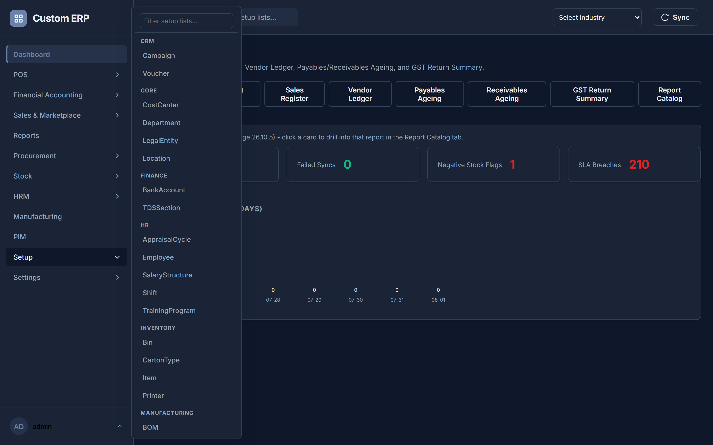

# User Guide: Reports and customer orders

Part 7 of 9 of the [User Guide](user-guide.md). Previous: [Master data](user-guide-master-data.md). Next: [Finance, service, CRM, people and approvals](user-guide-finance-crm-and-approvals.md).

## 9. Running a Report

1. Point at **Reports** in the sidebar, then at the area the report belongs to — **Sales**, **Procurement**, **Inventory**, **WMS**, **OMS**, **CRM**, **Finance**, **Manufacturing**, **PIM**, **HR** and the rest. Its reports open beside it (two columns when there are many); click one and it opens on its own page, which you can bookmark or refresh.
2. To look for one instead, open any report and type the question in **Find a report** — *who owes us*, *stock value*, *who posted* — and the list narrows to the reports that answer it; each report shows its question beside its name. **[report-catalog.md](report-catalog.md)** lists every one, what it answers, and what it needs from you.
3. Set any filters the report offers (date range, store, vendor…). A required date starts on this month to date (or today for an "as of" date). The filters you last ran a report with come back when you return to it.
   - **Your stores only.** If you work at some stores rather than all (your store access on the User or Role screen), every report, export and **View Details** shows only those stores' rows, and a store filter naming another store is refused (*You can only see reports for your own stores*). Accountants, auditors and admins see every store.
   - A report with an **image** column shows each item's main picture; one marked with a total sums that column on a **Total** line under the table.
4. **Run.** A line above the results says exactly what was run: the filters, the number of rows, when, and your time zone; amounts are in rupees.
   - **Large results.** A report opens 500 rows at a time, with **Previous** and **Next** under the table. The row count above it, the **Total** line and the control totals cover every page. A report too big to run answers *This report is too large to show* (REPORT-0161): narrow the filters and run it again, because an export stops at the same size.
   - **Busy.** If many reports are still running for your business (yours or colleagues', including ones someone left), a new one answers *Too many reports are still running…* (GLOBAL-0310) and does not start. Wait a minute and run it again, or use **Export in Background** (step 7) for a big one.
   - **Dashboard.** The Reports screen opens at once and the Dashboard figures fill in a moment later (*Loading dashboard…*). If they cannot load it says so; refresh to try again. Leaving a screen while a page or search is still loading just drops that load; nothing from it appears on the next screen.
5. **Control totals.** Inventory Valuation, Receivables Ageing, Payables Ageing, Sales Register, GST Return Summary and Loyalty Points Liability show a strip above the rows: the **detail** (the rows added up), the **summary** (the same documents totalled separately) and the **ledger** (the GL account balance), with the cut-off they were read at. "Control totals tie" means all three agree; otherwise the differences and what usually explains them are listed. Payables Ageing shows goods received and not yet paid and ties to 2100 GRN Suspense; open purchase orders are in **Open Purchase Commitments**, which has no ledger figure and says so. Loyalty Points Liability ties to 2630 only when loyalty is booked as a liability when earned (Loyalty settings); otherwise it says there is no ledger account. If your role cannot see amounts, you see only whether the totals tie.
6. Where a report supports it, **View Details** on a row lists the transactions behind that figure, with the same filters, and says so above the lines.
7. **Export in Background** for a large export, up to 20,000 rows. You can **Cancel** it while it waits. **My exports** (below the results) lists your own exports with their status, any error and **Download CSV**. An export is private to the person who requested it: anyone else opening its link gets *not found*. The link is short-lived - it stops working at the export retention (7 days by default; the list shows **until** when) - and **Revoke** ends it earlier, removing the stored file at once.
8. **Recent runs** (below the results) lists the latest runs of the selected report: who ran it, when, how long it took and how many rows it returned. You see your own runs; an Admin or Super Admin sees everyone's, including those sent by a schedule (shown as *Schedule*).
9. **Schedules.** Reports → **Schedules** lists the scheduled reports and dashboard digests you set up (an Admin or Super Admin sees everyone's, with the owner). Each row shows how often it runs and its **Next run** exactly as the scheduler will act on it — a date, **Due now** (it goes out at the next hourly check), or **Paused** — when it last ran, the **Result** (*Delivered* with the number of rows, or *Failed* with the reason) and who receives it, as a count and masked addresses such as a***@example.com. **Pause** stops a schedule until you **Resume** it. **Run now** sends it straight away to the same recipients; pressing it again within a minute is refused. To create one, press **Set up a scheduled report** or **Set up a dashboard digest**, then **New**: pick the report or saved dashboard layout, frequency, run-as role, first run date and the recipient email.
10. The numbers always come from real recorded transactions — never from someone’s manual guess — so you can trust them.

### 9.1 Your report catalog

Your company's own report catalog — the two report spreadsheets the ERP was set up against — is built in: **252 reports** under **Reports → Sales & POS, Inventory, Procurement & GRN, Stock Transfer, GST & Compliance, E-commerce & Integration, Master Data & Audit, MIS & Management, OMS, PIM / PIMS, Accounting, Expense Management, CRM, HRMS, Manufacturing** and **WMS** (each next to the older group it extends, so *Sales & POS* sits above *Sales*). Every report has exactly the catalog's columns, in the catalog's order and with its names, so a report exported to Excel lines up with the spreadsheet you know.

**Finance reports need a finance role (140.12):** the trial balance, ledgers, statements and every other Finance report - run, exported, scheduled or on a dashboard tile - carry the same right as the Finance screens, so a Cashier no longer sees them. **Day Book** (R5084) lists every voucher of a day, line by line, and balances. **Customer 360** picks its customer by name or number and **Segment Members** picks its segment from a list.

- **Filters.** Most take **From / To** (the document's business date: the bill, PO, GRN or posting date), **Store** (one or more store codes, comma-separated) and, where the document has one, **Status**. A point-in-time report — current stock, stock ageing, AR / AP ageing, the user access matrix — takes no dates. A stock report that shows sales (fast / slow moving, stock cover, turnover) counts the sales in the From / To period, or the last 90 days when you leave the dates blank.
- **Money.** Till bills are GST-inclusive: item-wise figures split each line back into taxable value and GST at the item's rate, exactly as the GST invoice prints them, with the item discount (MRP to selling price) and the bill discount (offers) shown separately. Purchase figures are the GRN's vendor-invoice rates.
- **Blank columns.** A column the ERP does not record stays in the report, blank — for example *Packing Charges*, *Silver Rate / Gram*, *E-Way Bill No* (the ERP does not issue e-way bills), *Target Amount* (no sales targets are kept), clock-in times, or the *IP Address* of an action. Everything else is filled from your records.
- **Codes and names.** A column called *… Code* or *… ID* shows the code; the name column beside it shows the name.
- **Control totals** also run on **Sales Register**, **Stock Valuation Summary**, **GST Document Tax Detail**, **GSTR-1 HSN Summary**, **GSTR-1 B2B / B2C Summary**, **HSN Tax Summary**, **AP Aging** (ties to 2100 GRN Suspense) and **AR Aging** (ties to 1300 Receivables), for the dates and stores you ran them for; with a store chosen, the ledger figure is not compared (the GL holds the whole company).
- **Not built yet (38 catalog rows).** Delivery challans, job work, material issue / receipt, wastage, damage, stock adjustment and receipt notes are documents the ERP does not have yet, so their reports come with those modules; so do the bulk stock upload, e-way bill, lead, opportunity, customer feedback and recruitment reports.

**[report-catalog.md](report-catalog.md)** lists every report with its columns and filters.

**The Trial Balance asks for an "As Of Date"** and starts on today. It shows every posting up to and including that date, so setting it to a month-end gives you that month’s closing position. Every account is listed either way; a date before you started trading correctly shows all zeros.

**Stock Ledger** (Reports → Inventory) lists every stock movement — receipts, transfers, sales, putaways, bin moves, production (material issued, goods made: voucher type *ProductionOrder*, the order's number) — oldest first. **Running Balance** is that item's balance *at that location* after the movement, so it is correct even when you filter by voucher type or date. Report dates show as your local date and time; the CSV export keeps the full timestamp. **UOM**, **Unit Cost**, **Unit Price** and **Tax %** are what the line was posted with, so a later change to the item, its price or its tax does not change them. Every movement posted from 14 Nov 2026 has the UOM and Unit Cost. Unit Cost is the cost the movement was booked at, such as a receipt's purchase rate, a return's original cost, or a finished good's material cost. A movement that books no cost of its own, such as a transfer, a count or a bin move, shows the item's average cost at that moment. **Unit Price** is filled for till sales and sales invoices. **Tax %** is filled for sales invoices, goods receipts, purchase returns and customer returns of an invoiced sale. Lines posted before this change show none of these.

### 9.1a Merge duplicates, order-to-cash mismatches, setup history (Stages 47.13.5, 49.5.5, 47.12.4)

**Merge a duplicate supplier or item (admin only).** Run **Reports → Master Data & Audit → Duplicate Suppliers** (or **Duplicate Items**). Each group has one row marked **Keep**; every other row has a **Merge** button. Click it and type the reason. The merge goes to **Approvals** (*Sent for approval - MMR-...*) and waits for an administrator to approve it (a second one, unless your company lets people approve their own requests); nothing moves until it is approved, and a rejected merge moves nothing. If it can no longer be done when approved (the item took stock meanwhile), the request stays **Approved** and its **Merge error** says why. Once approved, every purchase order, goods receipt, vendor invoice, product picture and other record that pointed at the duplicate now points at the one you kept. Nothing is deleted: the duplicate stays, marked **Merged** and no longer offered for new documents. Posted documents keep the name they were posted with; only their link moves. An item that still holds stock cannot be merged - move the stock first. The merge is written to the audit trail, and an administrator can undo it from **Admin → master merges** (`POST /api/v1/admin/master-merges/{id}/undo`): references go back, except any changed again since. Customers are merged in CRM (Possible duplicates), not here. Rows held in a table of their own (such as stock balances) and lines inside a document's item list are not moved.

**Order to cash mismatches.** **Reports → Finance → Order to cash mismatches** lists where an order, its shipments, invoices and payments disagree: *Shipped not invoiced*, *Invoiced more than shipped*, *Paid more than invoiced* and *Invoice without order*, each with the quantities, amounts, an owner and a suggested fix. **Dismiss** on a row asks for a note (required) and takes it off the list; set **Include dismissed** to Yes to see dismissed rows with their note and who dismissed them. If the figures change later, the mismatch comes back on its own. When an order's totals agree but its SKUs do not (5 of A shipped, 5 of B invoiced), each SKU gets its own row (*SKU shipped not invoiced*, *SKU invoiced more than shipped*), and an order row names the SKUs that differ. Stock ownership is checked too: *Stock of more than one owner* and *Stock not from the owner* list a location whose stock does not come only from its owner (the one-owner-per-warehouse rule), with the location in the Order column and the owners in the SKU column. Store sales are checked against their events: *Sale without event* is a checkout that completed but whose sale event was never queued; *Event without sale* is a sale event with no completed checkout and no paid cart behind it. Both show the cart in the Order column and look at the last 5 days only. A dismissed row shows **Reopen** (note required) to put it back on the list.

**Setup step history.** On the guided setup (Admin overview), **History** on a step shows each time its state changed - who looked, when, from what to what, and which check failed - and notes added by people. **Add note** takes a note and an optional file name or link. History cannot be edited or deleted.

**Cutover migration line and finance checks (Stages 47.12.7 and 47.12.4).** On the Cutover pack, the line *Migration control totals tie to what was loaded* lists each staged import with its stated total, the loaded total, pass or fail and the difference. In the guided setup, a step now also shows the Finance start checks that belong to it (open period, INR, accounts, bank, opening balances, ties); a failing one reads **Fix** with the reason and the step is not Ready until it is cleared.

### 9.2 Custom dashboards — your own charts and numbers

**Reports → Custom dashboards** lists the dashboards you made (**Yours**), the ones others shared with you (**Shared with you**) and five **Ready-made** ones: **Sales** (sales, bills, average bill, items per bill, by day, store, category, salesman and hour, top items, brand by store), **Stock** (stock value, units, items low or out, by store and category, slowest stock, units sold by category), **Buying** (purchase orders, ordered and received value, open orders by vendor, orders by status), **Customers** (new customers, new and repeat bills, points earned and used, customers by tier) and **Money** (cash and bank, owed by customers, owed to vendors, postings by account type, expenses by category). Click one to open it.

**Reading a dashboard.**
1. The figures are for the stores you may see, and money only if your role may see it — a store manager opening the same dashboard as the owner sees their own store. A hidden amount reads *hidden*.
2. Pick the **Dates** (Today, This week, Month to date, Last 30 days, Last month, All dates, or Choose dates), a **Store**, and where the widgets have them a **Brand**, **Category** or **Channel**; every widget follows, except one set to keep its own.
3. A **number** shows the change on the period before (▲ / ▼). Point at a bar, a slice or a dot to see its value.
4. **Click a bar, slice, dot or table row** to see the records behind it — the bills, orders or receipts, each a link to the record. Where a figure has no single record behind it (stock on hand), the click opens that list.
5. The page reloads its figures every few minutes while it is open (an administrator sets how often); **Refresh** reloads now.
6. **CSV** and **XLSX** on a widget download its rows; **PDF** saves the whole dashboard as a landscape A4 PDF; **Email me this** (on your own dashboard) emails it Daily, Weekly or Monthly — each widget as numbers and bars in the email, every row in an attached CSV — and the schedule appears under **Reports → Schedules**, where you can pause or run it.
7. **ⓘ** on a widget shows what its figure counts: the period, the store scope, when it was read, the basis (posted ledger, stock ledger or operational records) and who answers for it. The same lines sit in the title's tooltip. When open order-to-cash or stock-ownership mismatches touch a widget's area (and its store, if it has one), the Basis line reads "N open mismatches" instead of the basis; nothing else changes. A widget fed by a report and each executive tile show the same lines, taken from that run: its dates and store, the time it ran, and the report's basis.

**Building one** (if your role may build dashboards — an administrator sets it):
1. **+ New dashboard**, or open a ready-made or shared one and **Copy** it (the copy is yours to change).
2. **+ Add widget**: give it a **Title**, choose **Data from** a dataset (sales lines, POS bills, stock on hand, stock movements, purchase orders, goods receipts, transfers, customers, loyalty points, online orders, expenses, ledger postings) or a **report**, then the **Chart** — Number, Bar, Stacked bar, Line, Donut, Table or Pivot — and **By** what (a store, category, salesman, date...; a stacked bar or pivot asks for two). For a date, choose **Per** day, week or month.
3. **Show**: what to add up — *Total of* a value, an *Average*, *Lowest* / *Highest*, a *Count of* rows, or *How many different* customers, items... Up to three figures side by side.
4. **Only where** narrows it (store *is* Jayanagar, value *at least* 1000...); **Order** and **Show** set the order and how many rows. A number can show the change on the period before. Tick **Keep its own dates and store** to fix this widget's own dates and store instead of following the dashboard's.
5. The **Preview** on the right draws it as you choose. **Add** puts it on the dashboard.
6. On the dashboard, each widget has ◀ ▶ (move earlier / later), − + (narrower / wider), ↕ (height), ✎ (edit) and ✕ (remove). The dates and store you leave set are where the dashboard starts.
7. **Share and home**: share it with **users** (their sign-in names), **roles** or **stores** (everyone working at them), and make it the **Home screen** for roles — those users then see it on Home under the title. Everyone still sees only their own stores.
8. **Save.** Only you (or an administrator) can change it later; others use **Copy**. **Delete** removes it for everyone it was shared with.

## 9A. Orders (OMS) — taking and processing customer orders

**OMS → Orders** is the one screen that follows a customer order all the way through: order → accepted → picked → packed and billed → shipped → invoiced. Each step has a page of its own in the **OMS** menu — **Pending Orders**, **Pick**, **Pack**, **Ship**, **Returns** and **Settlements** (§9A.8–9A.12) — and the Orders page is where you find and change any one order. Orders arrive here from three places, and they all behave identically once they're in:

- a **sales channel** (a marketplace or webstore your administrator has connected),
- **Unicommerce** or another OMS middleware, if that's how your orders are routed,
- or **by hand**, using the panel described below.

### 9A.1 Placing a manual order

Use this for a phone order, a walk-in wholesale order, a replacement, or anything a channel didn't send you.

1. Go to **OMS → Orders** and click **+ New Order** at the top right. The manual order form opens as its own page (**Orders › New manual order**).
2. Fill in:
   - **Customer name** and **Customer phone** — both optional, but they're what makes an order findable later. The phone box only accepts digits, `+`, `-`, `(`, `)` and spaces; it won't let you type letters.
   - **Source** — defaults to "Manual". Change it if you want the order tagged as coming from somewhere specific (a phone line, a trade counter, a particular salesperson).
   - **Reference** — optional, but useful. It's your own order number for this order. If you send the **same reference twice, you get the same order back rather than a duplicate** — so a double-click or a retried entry can't create two orders. The screen then says **Existing Order** and names it, instead of "created".
   - **Customer PO / reference** — optional. For a business customer, their own purchase order number (e.g. *PO-4500123*). It is shown on the order, copied onto the invoice raised from it and printed on that invoice, and **Reports → Sales → Sales by Customer Reference** finds every order and invoice for it. Change it later with the order's **Edit**. A sales invoice made directly (Financial Accounting → Sales Invoice → **+ New Sales Invoice**) has the same **Customer PO / Reference** box.
   - **Payment** — Confirmed (paid), Pending, or Cash on delivery. **Confirmed** and **Cash on delivery** go straight through; **Pending** puts the order On Hold (*PAYMENT_PENDING*) until you edit it to Confirmed once the money arrives.
   - **Address line 1** and **PIN code** — **required.** The order engine has to know where it's going, and stock sourcing and couriers go by the 6-digit PIN code. **Address line 2**, **City** and **State** (picked from the list) complete it; the order shows them together as *Ship to*.
3. Add items with **+ Add item**: find the item by its **Design ID**, **Combination ID** or **barcode** (letters are fine, e.g. *D100000* or *100000D*; the item name is not searched here). Picking it fills **Available** and **Unit price**:
   - **Available** is the quantity you can sell across every store and warehouse, because the order is sourced from whichever one can fill it. Hover over the number to see it by store. A red **0** means nothing is sellable anywhere, and the order will be refused for stock.
   - **Unit price** comes from the item's sale price, or its MRP if it has no sale price. Change it if you agreed a different price.

   Then set the quantity.
4. Click **Create Order**. The confirmation names the order by its number — `SO/<store>/2627/00001`, from the store that fulfils it — and you're back on the Orders console, with the order in its **Orders** table. That number is what the Orders table shows, and searching for it finds the order.

**A manual order skips Pending Orders.** You keyed it in, so you have already accepted it: once its stock is reserved it goes straight to **Pick**. (A channel order waits on **Pending Orders** for someone to accept it — §9A.8.)

**What happens the moment you click it:** the order goes through exactly the same engine a marketplace order does — stock is checked and **reserved**, the order is allocated, and any hold rules your business has configured are evaluated. This is deliberate. A manual order is a real order, so it can't be allowed to skip the checks a channel order goes through.

That also means a manual order **can be refused**, and the most common reason is *"insufficient stock for reservation"*. That isn't a bug — it's the system declining to promise stock you don't have. Check **Inventory** for that item, receive the stock in (§6), and try again.

### 9A.2 Finding an order, and seeing that it reached the ERP

**If you know any identifier at all, use Search.** It is the first box in the filter row above the Orders table. It searches, in one go: the ERP's own order id, the channel's order id, an **AWB / tracking number**, the **customer's phone number**, the customer's name, and any **SKU** on the order. Each result tells you *which* of those matched, which matters when a SKU search returns forty orders. Type the number the customer read out over the phone and you will find their order.

**If you're working a queue rather than looking for one order, use the filters.** Beside **Search**, in the same row, are the filters: **Channel**, **Status**, **Hold reason**, **Location**, a **From/To** date range, and **SLA breach over** (1 hour / 4 hours / 24 hours). Each dropdown shows a count next to every option, so you can see how much work is behind a filter before you pick it. **Clear filters** resets them.

For a daily starting point, use the buttons beside the tiles at the top: **Allocation or payment holds** and **Overdue open orders** filter the Orders table; **Pending Orders** opens that page (§9A.8); **Unmapped channel items** opens **OMS settings** (§9A.13), where the mapping exceptions are. Open an order to see its linked fulfillment tasks, bookings and invoices; those links search the saved record directly. An order without a linked record has not yet produced that downstream step.

Filters you use repeatedly can be kept: set them up, then **Save this view** and give it a name. It reappears in the **Saved views…** dropdown. Views are private to you.

**Did my marketplace order actually sync in?** Every order — however it arrived — has a **Source** column showing the system it came from and, underneath, **that system's own order id**. Find the channel's order number there and you have your answer; if it isn't there, it hasn't arrived. You don't need anyone to check a database for you.

**The four tiles at the top** are live counts, each of which you can click to open the report behind it: integration exceptions, SLA breached, allocation pending, and reconciliation variance.

### 9A.3 Processing an order through to invoice

The Orders table is a working queue. Read a row left to right: order id (with an **Expedite** badge if it's been prioritised — expedited orders sort to the top), source, customer, status with its hold reason, line count, allocated location, age, and value.

**Own-channel orders and returns (140.12).** Website, phone and WhatsApp orders (a channel of your own with no marketplace connector) need no answer pushed back - like Manual they no longer wait in **Push problems**; an older one there clears with **Retry**. On a shipped order, **Return / RTO** raises the return on the order itself: the units coming back, and for a parcel that came back undelivered, **RTO** with its booking. Leave **Back to store** blank and the return is routed to the nearest store by the delivery pincode. A cancelled prepaid order has **Credit note**. The Returns screen's check finds a shipped online order through its invoice.

**To act on one order, click Open.** That gives you the whole order on one page: every line with its own status and allocated location, the reservations behind it, fulfillment tasks, shipments, invoices, returns, refunds, the notification log, and the full audit trail.

Across the top of that page is the action bar:

| Action | What it does |
| --- | --- |
| **Accept - send to Pick** | The next step for a **Reserved** order — the same as **Accept** on Pending Orders (§9A.8): one pick task per location holding its stock, the order becomes **Released**, the tasks appear on **Pick**, and a channel order's channel is told. Clicking it twice does not create a second set. Only shown while the order is Reserved. |
| **Book shipment** | After a task is packed with no courier yet, opens **OMS → Ship** at that parcel with its PIN filled and the cursor in its **Courier** box (§9A.11, 57.26(h)). It is hidden when a live booking already exists or the order has shipped. |
| **Release hold** | Clears a hold and re-allocates. Only shown while the order is On Hold. |
| **Hold** | Stops the order. Asks for an active Hold reason code, which is recorded. |
| **Edit** | Change the customer, phone, shipping/billing address or payment status (leave billing blank when it is the shipping address). **Saving re-runs the same checks a new order goes through** — so if your edit leaves the order unfulfillable (an address with no PIN code, say) the order is placed On Hold with the reason, rather than saved silently broken. |
| **Reallocate** | Re-runs allocation for lines that haven't been picked yet, letting the engine pick the best location again. |
| **Switch facility** | Same, but you name the location. Lines already dispatched, cancelled or returned are left alone — the goods have physically moved. |
| **Expedite / Set Normal** | Flags the order as urgent. Expedited orders sort to the top of this queue **and** to the top of the warehouse's picking worklist. |
| **Split selected lines** | Tick **split** next to the lines you want fulfilled separately, then click this. They become an independent fulfilment group, picked and shipped on their own. It stays **one order** — one order id for the customer, one invoice chain. You can't split every line out; at least one has to stay. |
| **Cancel order** | Asks for a cancellation reason code. Not offered once an order is Shipped, Delivered, Closed or Cancelled. |

**Holding a single line** rather than the whole order: in the Lines table, click **Hold line**. The order keeps moving; only that line stops, and the stock it was holding is released back into the pool so another order can use it. **Release line** puts it back — re-reserving the stock if it's still available, or leaving the line Pending if it isn't (which is honest: it won't claim stock that no longer exists).

If an action is greyed out, the order has reached a status that closes it (Shipped, Delivered, Closed, Cancelled). An administrator can reopen any of these by configuring a Status Transition Rule.

**Once an order is Released**, the warehouse is already picking it, so **Hold**, **Hold line**, **Switch facility** and **Split** are refused with a message saying so. **Edit** (address, contact) and **Expedite** still work. **Cancel order** still works until anything is packed: the open pick tasks are stopped (they leave **Pick** — put back anything already picked) and the reserved stock is released. Once a task is **Packed**, cancel is refused — let it ship and raise a return, or mark the shipment RTO. **Edit lines** is described in §9A.7. If the location cannot fulfil it, **Reject** the task on **Pick**; the system re-routes it to the next best location with stock.

**Acting on many orders at once:** tick the checkboxes in the Orders table — the header checkbox selects the whole page — and a bar appears with **Release Hold**, **Hold** and **Cancel**. Each order is still checked individually, so a mixed selection does what it can and tells you exactly which orders refused and why (an order that has already shipped can't be cancelled, and says so).

### 9A.4 The full order-to-cash walkthrough

1. **Order arrives** (channel, middleware, or the manual panel above). Stock is reserved automatically.
2. **Clear any hold.** An order sitting On Hold does not progress. Open it, read the reason, fix it, click **Release hold**. Working a backlog? Filter the queue by **Status = On Hold**, or by the specific **Hold reason**, tick the ones you've resolved and release them together.
3. **Accept it.** A channel order waits on **OMS → Pending Orders**: **Accept** sends it to Pick and tells the channel (§9A.8). A manual order skips this step.
4. **Pick.** On **OMS → Pick** the order's task is waiting at the location holding the stock, expedited ones first. **Pick**, scan each unit, short-pick what cannot be found (§9A.9). Warehouses using wave or mobile picking do the same from those screens.
5. **Pack, bill and label.** On **OMS → Pack**, scan each unit into the box, then **Pack, bill and label**: the package, the **OMS bill** (the customer's GST invoice) and the courier booking with its AWB are made in one go (§9A.10). Print the bill for the box and the label for the outside.
6. **Ship.** On **OMS → Ship**, make the manifest for that courier and store, raise the **gate pass** for the vehicle, then **Hand over**. The booking becomes **Handed Over** and, when every task has dispatched, the order becomes **Shipped**. **In-Transit** and **Delivered** are later tracking steps on the same page. Handover takes the shipped quantity out of stock (§9A.11). If the location no longer holds what a task ships, the handover is refused (*mark the rest short first*): short-pick the missing units, then hand over.
7. **The ERP bill.** Handing over makes the **ERP bill** — a posted Sales Invoice — from each parcel's OMS bill, carrying the OMS bill's number (§9A.10). You do not raise or post an invoice for these orders yourself. Settle it when the customer has paid. Notifications show what actually happened: **Queued** (waiting to be sent), **Retrying** (the provider could not be reached; it tries again), **Accepted** (the provider took it, delivery not yet confirmed), **Delivered** or **Failed** (the provider's own answer, or Failed after every retry), and **Skipped-…** when nothing was sent (no template, no channel set up, a sandbox client, or sending switched off). **Sent** appears only on notifications from before this change — it meant "tried", never "delivered". Tell a customer a message reached them only when it says **Delivered**.
8. **Delivered.** Click **Delivered** on the booking (OMS → Ship, *On the way*) when the courier confirms delivery; that event moves the order to Delivered.

On **OMS → Settlements**, a manual settlement lets you add real saved channel orders one by one (§9A.12). Changing the channel clears the selection. Do not enter a payout until you have the provider's settlement evidence; this picker alone is not a reconciliation.

If you're comparing this to how Unicommerce or a similar OMS describes the same flow: their "sale order → accept → picklist → invoice → manifest/dispatch" maps onto steps 1–7 above, and their invoice at packing is the OMS bill. The vocabulary differs; the sequence doesn't.

### 9A.5 Invoicing a customer in a foreign currency

Nothing here changes unless you actually set a currency other than your own on a document — if you only ever invoice in your own currency, skip this section entirely.

**Purchase order currency after receipt.** Once goods are received against a PO, its Currency and Exchange Rate are locked; raise a new PO if they were wrong.

**Raising the invoice.** Set **Currency** on the invoice. Leave **Exchange Rate** blank and the rate is looked up automatically, using **the invoice's own date** rather than today's — so back-dating an invoice does not quietly apply this morning's rate. Enter a rate yourself when a contract fixes one; what you type wins.

The invoice keeps the amount you agreed in the customer's currency. Behind it, the accounts record what that is worth in your own currency at that rate. Both numbers matter: one is what the customer owes, the other is what it is worth to you.

**When the customer pays.** Settle the invoice as normal. Two optional details are worth supplying, because between the invoice date and the payment date the rate has almost certainly moved:

- **Settlement date** — the day the money actually reached you. Fill this in whenever you are entering a receipt a few days after the fact, so the rate used is the one that applied on the day rather than today's.
- **Exchange rate** — the rate your bank actually gave you, from the remittance advice. This beats any stored rate; without it the difference simply hides somewhere else in your accounts.

The difference between what you booked and what you actually received is recorded automatically as a foreign-exchange **gain** or **loss**. You do not calculate anything, and you cannot get it wrong by settling late — you just tell it the date and, if you have it, the rate.

**Why the amount you receive may differ from the invoice.** A $1,000 invoice raised when the dollar was 83 and collected when it was 85 brings in ₹85,000 against ₹83,000 booked. That extra ₹2,000 is a genuine gain and appears as one; it is not an error in the invoice. The reverse happens just as often.

**Seeing where you stand.** Under **Reports**, in the Finance category:

- **Open FX Exposure** — every unpaid foreign-currency invoice and what it is worth at today's rate. Worth a look before a large receipt.
- **FX Gain/Loss Register** — every exchange gain and loss that has been recorded, and which document caused it.

If your finance team runs a month-end revaluation, open balances get restated then too; that is described in the Admin Guide and is not something you need to do yourself.

### 9A.6 Stuck work, and an order's whole story

After those buttons, five more each show how many orders are waiting:

| Queue | What lands in it | What to do |
|---|---|---|
| **Stuck payments** | Open orders whose payment is still Pending after 30 minutes | Confirm the payment (Edit → Payment status) then release the hold — or cancel the order |
| **Carrier exceptions** | Packed tasks with no carrier booking for 4 hours; bookings with no carrier movement for 48 hours; RTO parcels not yet received back | Book the courier on **Ship**; chase the carrier and record tracking or RTO on **Ship**; receive the RTO and run its return QC |
| **Returns and refunds** | Return requests open more than 2 days; refunds waiting more than 1 day | Approve or reject, schedule the pickup, run QC, approve or process the refund |
| **Settlement** | Payout lines in Variance or Disputed; shipped channel orders with no settled payout after the aging period | Raise a dispute, write the variance off with a reason, record the corrected amount, or import and reconcile the payout file |
| **Channel changes** | Edits, cancellations and refunds made in the web shop after picking started (§9A.14) | Change the order by hand, then mark the row done. |

Click a button to list its rows, oldest first: the order, why it is there, since when, for how many hours, the next step, and the document to open. Click the order to open it. The same queues appear in **My work** (§10) for anyone allowed to read orders.

**The order screen** now opens with a **Next step** line — the step the system will actually accept next (for example *Confirm payment*, *Accept - send to Pick*, *Book shipment*, *Record delivery or RTO*, *Work the return*) with its button. Below the lines, the **Timeline** lists everything that happened to the order in date order: received, notifications, pick tasks, status changes, bookings, invoices, returns, refunds, replacements and each recorded change with who did it. The section-by-section tables are still there under **Related documents by type**.

**Returns and refunds on the order.** A return or refund raised against the order's invoice is listed on the order itself and counts in the **Returns and refunds** queue — you do not need to look it up separately.

**Channel connectors** (on **Setup → OMS → OMS settings**, §9A.13) shows each marketplace channel's state: **Credentials not set** — no credentials have been added for it yet; **Never synced** — connected but no sync has run; otherwise the last sync's result and time, with the error of a failed sync (passwords and tokens are masked). **24h failures** counts failed syncs in the last day.

**Bundles** are on **OMS settings** too (§9A.13). **Manage definitions** lists your bundles. To make one, click **New Product Bundle**, pick the **Bundle SKU** (the item customers order), a name, the fulfilment and pricing modes, then under **Components** click **+ Add Line** for each item in the bundle with its **Quantity**. The list shows the components as *SKU × quantity*. A bundle cannot contain its own SKU.

### 9A.7 Changing an order: lines, cancelling after release, reship and replacement

**Edit lines** (order Draft, On Hold, Reserved, or Released with nothing picked yet): change a quantity or price, tick **Remove**, or add a line (item code, quantity and unit price). Give a **reason** — it is kept on the order's history. On **Save line changes**:

- extra stock is reserved for any increase, and released for any decrease or removed line, in one step — if there is not enough free stock, nothing changes and you are told how much is available;
- the order total is recalculated; if the payment was **Confirmed** and the new total is higher, the order goes **On Hold** for payment (confirm the extra amount, then release); if it is lower, the order shows **Refund the difference** with the amount;
- a **Released** order goes back to **Reserved** and its untouched pick tasks are cancelled — **Accept** it again (Pending Orders, or **Accept - send to Pick** on the order) so the warehouse picks the edited lines. The channel is not told twice.

Lines cannot change once the warehouse starts picking, once the order is invoiced, for a line that is part of a bundle, or if the change would remove every line (cancel instead).

**Substitute (73.4.2.5).** When an item has a **Substitute item** set (on the item), each unshipped line of it shows **Substitute** on the order. Press it and confirm: the line is swapped for the substitute at the same quantity and price, stock is reserved for the new item and freed for the old one, and the swap is kept on the order's history as a line change. The same limits as **Edit lines** apply.

**Payments (73.4.2.3).** The order's **Payment** shows its state, with any amount refunded and any chargeback under it. Buttons on the order record what happens to the money:

- **Capture payment** (payment not yet Confirmed): the customer has paid. Give the payment reference if you have one. The payment becomes **Confirmed**; an order on hold for **Payment not confirmed** is retried at once.
- **Refund** (payment Confirmed): enter the amount paid back and a reference. Part refunds add up; you cannot refund more than was paid. When all of it is refunded the payment shows **Refunded**. This records the refund - the money itself goes back through your payment provider or a credit note.
- **Chargeback**: the customer's bank took the payment back. Enter the amount and the bank's reason. Then press **Chargeback won** (the payment stands) or **Chargeback lost** (the payment shows **Charged back**) when the bank decides.

Each step is on the order's **Timeline** with who did it.

**Promise date (Stage 148.27).** When your administrator has switched it on, each order line shows a **Promise** date with a short reason, for example "2 in Mumbai, 3 on PO-123 due 3 Nov". It is read from stock, confirmed purchase orders and transfers on the way, plus courier days, and skips closed days. Nothing is reserved by it. **Reports → Sales → Late promise lines** lists lines past their date. The order itself shows **Promised**: the latest line date, or which items have no date yet. On **New Order** a **Promised** column shows each line's date as you type the quantity.

**Backorders and preorders (73.4.2.2).** You can take an order for stock you do not have yet: it is held as **No stock to reserve** (waiting for stock), and its **Promised** date tells the customer when. When stock lands, **OMS → Pending Orders**, **On hold** list, **Retry all waiting for stock** retries every waiting order, oldest first, so the earliest customer gets the stock; the message says how many were reserved and how many still wait. If your administrator switched on **Release backorders when stock lands**, this runs on its own every 15 minutes.

**Hold a piece for a customer (Stage 148.41).** When it is switched on, open **Serial numbers** and press **Hold piece**. Enter the item, the piece, the customer, a **Hold until** day if you want one, and an **Advance** if the customer pays one. Everyone else is stopped at the till, in picking and on dispatch; the named customer's sale uses the piece. Press **Release** on a held row to free it. When the day passes the piece is freed on its own; any advance stays on the customer's account.

**Reship / replace** (order Shipped, Delivered, Closed or Dispatched): choose **Reship** to send the same goods again (lost or undelivered) or **Replacement** for the same or an exchanged item (damaged or wrong). Enter how many of each shipped line to send again — never more than shipped, less anything already sent again — and a reason. The new order is **free of charge**, ships from available stock like any order, shows **Reship of** / **Replacement of** the original, and the original lists it under **Replacements and reships**. Clicking **Create order** twice returns the same new order. Collect the damaged or wrong goods with a return request.

### 9A.8 Pending Orders — accept or reject a channel order

**OMS → Pending Orders** lists the orders waiting for your answer: marketplace and website orders whose stock is reserved, oldest first. Nothing is picked until you answer. (Orders keyed in on the Orders page skip this — §9A.1.)

- **Accept** sends the order to **Pick** and tells the channel it is accepted.
- **Reject** asks for a reason (from your **Cancellation** reasons), cancels the order, releases its stock and tells the channel.
- **Owner** (only where WMS is in use) sets the 3PL client whose stock the order is picked from (§7.2).
- **Open** opens the order itself.

To answer many at once, tick them — the header box ticks the page — and use **Accept** or **Reject** in the bar that appears. Each order is checked on its own, and the message names any that were refused and why. An order marked **Changed after acceptance** was accepted before and then edited; accepting it again re-releases it without telling the channel a second time.

**Answers the channel did not get** appears under the list when an answer could not be sent: **Not connected** (the channel is not set up — add it under **Setup → PIM → Channel** with its credentials) or **Failed** (the channel refused it after every retry; the reason is shown). Fix the cause and click **Retry**. Amazon and Flipkart take accept / reject in their own seller portals, so their orders show **Not supported** and you answer them there. On a test or training server nothing is sent and the answer shows **Simulated**.

**Accept orders automatically.** A business that does not want this step turns on **Accept channel orders automatically** (**Settings → Configuration → OMS**): channel orders are then accepted as they arrive and go straight to Pick.

**On hold** (below the list, shown only when there is one) is every order that arrived but could not be reserved yet: **No stock to reserve**, **Payment not confirmed**, **Address incomplete** or **An item is not mapped**. So a marketplace or website order is always on this page from the moment it comes in - waiting for your answer above, or on hold below. An order held for **Over credit limit** shows its owner and since when; it has no Retry, because the Store Manager approves its release in the approval inbox. An order held for **Risk check** (73.4.2.4, when your administrator switched it on) shows why under the badge, for example "COD above 5000" or "blocked PIN code"; call the customer, then press **Release** and confirm, or cancel the order. Releasing records your name on the order. An order held for something else first (payment, say) that also tripped the risk check stops at **Risk check** when that hold is released. Fix the cause (receive the stock, confirm the payment on the order's Edit, complete the address, map the channel SKU in OMS settings) and click **Retry**: the stock is reserved again and the order moves up to the waiting list; if it cannot be, the message says why it is still on hold. **Open** shows the order.

### 9A.9 Pick

**OMS → Pick** is the picking worklist: every task with something left to pick, **Expedite** first, then oldest first. Each row is the order (who it is for, the channel and its number, the task's own id in small type), the store, how many units are left to pick, and how long it has waited. Pick, Pack and Ship show the tasks of the store picked at the top of the screen; pick **All stores** there to see every store, and **Location** then filters to one.

**Bins on the pick screen (140.12).** The scan panel shows each line's **Bin** with its zone / aisle / rack, from the task's bin reservation. Scan the **bin label** first, then the items: an item that is not in that bin is refused ("TEE is not in bin B2 - it is in B1"). The printed **Pick List** has the same **Bin (zone/aisle/rack)** column. A **wave** pick confirmed on Mobile Picking counts as picked on each order of the wave, so they go on to Pack and the bill. Units picked for an order but not yet shipped are no longer listed as waiting for put-away.

1. **Pick list** prints the task's pick list (its layout is on **Setup → Printing → Templates → OMS**).
2. **Pick** opens the scan panel above the list. Scan each unit's barcode (or type its code and press Enter). Each scan counts one unit; a code that is not on the task says which item it is and is refused. A tracked item's **piece code** counts its unit and names the piece, so dispatch books that piece's cost (§6.15). A piece not in stock, at another store or on another open task is refused. **With a scanner in hand you need not touch the list**: the **Load order** box at the top takes the pick list number (the task), the order number or the channel's own order number - scan it or type it and press Enter, and that task's scan panel opens; then scan the items. A number that is not on the worklist says so (the order is not accepted yet, or is already picked); if its task is at another store, it names that store ("... is at GUIDE-TS2. Switch the store at the top to pick it."). Pack has the same box.
   **No barcode on the goods?** OMS never needs one. Click **Without barcode** beside the scan box, type the **SKU** (the item code, the Combination ID the order was saved with) and the **Qty**, then **Pick**. Leave Qty blank to pick all that is left of that line. It counts like that many scans: more than the line has left is refused, and an SKU that is not on the task is refused. A piece code is still scanned one piece at a time. **Cancel** puts you back in the scan box.
3. If the rest of a line cannot be found, **Short-pick** it with a reason. Its reserved stock is released. If your business holds short picks (Admin Guide, Settings → Warehouse), the missing pieces also go under a *NOT-FOUND* hold, out of sale, and a **Count** task for that bin appears in the Warehouse Cockpit; the count result (Cycle Count, no difference or the approved difference) releases the hold and closes the task.
4. When every line is picked or short-picked, **Go to Pack** takes you to the same task on Pack.

**Reject** sends the task to another store that has the stock (or the order waits for stock). A task in a WMS wave shows its wave instead; pick it on **Mobile Picking** (the button at the top, shown where WMS is in use). **Close** shuts the scan panel; it comes back on its own if you refresh while it is open.

### 9A.10 Pack — and the two bills

**OMS → Pack** lists the tasks that are fully picked. **Pack** opens the scan panel: scan each picked unit into the box. A piece code not scanned at Pick can be scanned here. **Without barcode** works as on Pick: type the SKU and the Qty (blank = all picked and not yet packed). When everything is in, enter the box's **weight** (if you weigh it), tick **Bill and documents are in the box** if your business checks that, and click **Pack, bill and label**. In one go it:

1. marks the task packed,
2. makes the **package**,
3. makes the **OMS bill** for what is in the box, and
4. books the courier — the first courier that serves the order's PIN code — with its **AWB**.

Then **Print bill** prints the OMS bill and **Print label** the courier label; each shows what it will print first, with **Print** and **Close**. If the label printer cannot be reached, the label stays on screen so the AWB can be read off it. If no courier serves the PIN (or the order has none), the parcel is still packed and billed, and waits on **Ship → Book the courier**. A run that stopped part-way shows **Packed - not booked** on Pack; **Finish** runs the rest.

**Two bills, one sale.** The **OMS bill** goes to the customer in the box. It is numbered from its own series, **OB/<store>/2627/00001**, and **its number is the GST invoice number**. When the parcel is handed over (§9A.11), the **ERP bill** — an ordinary Sales Invoice — is made from it with the same lines, the same tax and **the OMS bill's number**, and posted. Only the ERP bill posts to the accounts, so GST counts the sale once, under the OMS number. Find either on the order (**Related documents**) or in their lists (Setup → OMS → OMS settings → OMS Bill; Financial Accounting → Sales Invoice). A package billed before this change keeps the Sales Invoice it was billed with. The shipping charge of the order is on the first OMS bill only, as its own line with its own GST, and the ERP bill and the printed bill carry the same line, so the printed total is what posts (Stage 148.46).

### 9A.11 Ship

**OMS → Ship** has four parts, top to bottom:

- **Book the courier** — packed parcels with no courier. Check the **Pincode**, leave **Courier** blank for the first one that serves it (or type one), **Book**. A parcel that already has a live booking is refused (`INTEGR-4719`): use that booking, or cancel it first.
- **Booked - make the manifest** — booked parcels, grouped by courier and store. **Print label** for each (it shows the label first); a parcel whose label was not printed is held out of the manifest. **Make manifest** groups the rest.
- **Unconfirmed** next to an AWB means the courier did not answer after the booking was sent, so it may have the shipment. Nothing is ever booked twice: trying again first asks the courier by the booking's reference and keeps the AWB it already gave. A courier that cannot be asked refuses the retry until you click **Resolve**: find the reference on the courier's portal, then type the **AWB found** there, or tick **Not booked there** (the next try books it). Resolving needs permission to edit courier bookings and is recorded in the audit log. A pickup request or a cancellation sent to the courier keeps the same guard: one that got no answer is held as unconfirmed (`INTEGR-4720`) until it is resolved as done or not done from the courier's portal, and one already done is never sent twice. On each booked parcel, **Pickup** (a pickup name and the date and time) asks the courier to collect it, and **Cancel** cancels the shipment at the courier after you confirm. A parcel with a pickup shows **Pickup** and its reference; one cancelled at the courier shows **Cancelled at courier**. If the courier did not answer, the row shows **Unconfirmed pickup** or **Unconfirmed cancel** with a **Resolve** button: look the parcel up on the courier's portal, then type the pickup reference (or tick **Not scheduled there** / **Not cancelled there**) and save. Until then the same button is not sent again.
- **Manifests** — the open ones. **Gate pass** asks for the collecting vehicle's number and the driver, and issues the pass. **Hand over** dispatches every parcel on the manifest, closes the gate pass, makes each parcel's ERP bill and moves the order to **Shipped** once all its parcels have gone. Handed-over manifests are under **Handed over**.
- **On the way** — parcels with the courier: **In transit**, **Delivered**, or **RTO** with the courier's reason. Delivered and returned ones are under **Delivered and returned**.

### 9A.12 Settlements

**OMS → Settlements** is where marketplace payouts are reconciled: the payout list with **+ Reconcile Payout** (a payout you already have the figures for), and **Settlement Reconciliation** — **Import / View Settlement Lines** to bring in a marketplace's settlement file, **Run Auto-Reconcile** to match each line against what was billed, and the queue of lines outside tolerance with **Dispute**, **Resolve** and **Write Off**. A payout is reconciled once: **+ Reconcile Payout** with a Settlement ID already reconciled is refused, and each line is cleared once, however many times it is clicked. An order is settled once too: a payout naming an order already settled under another Settlement ID is refused, and the message names that settlement - record a part payout or an adjustment for that order as a settlement line instead.

### 9A.12a Freight — carrier claims and the carrier's invoice

**OMS → Freight** has two lists.

**Carrier claims (73.4.2.6).** A shipment the courier lost, damaged or delivered short is claimed back from the courier.

1. **Raise claim** — type the **Booking or AWB**, choose **Lost**, **Damaged** or **Short**, enter the **Amount claimed** and a note. On an order with a shipment, **Carrier claim** on the order does the same with its latest shipment filled in. A booking has one open claim at a time.
2. **File** — once you have sent it to the courier, enter the courier's claim reference. The claim is **Filed**.
3. **Settle** — when the courier pays, enter what it paid (at most what was claimed) and the date. The claim is **Settled**.
4. **Reject** — if the courier refuses, give its reason. An **Open** or **Filed** claim can be rejected.

Each step is in the audit log with your name.

**Freight invoices (73.4.2.7).** Check the courier's bill AWB by AWB against what each booking was quoted.

1. **Import lines** opens the invoice-line list: its **Import** takes a CSV with **Invoice**, **Carrier**, **AWB** and **Charged** (and the invoice date if you have it).
2. Back on **Freight**, press **Reconcile**. Each new line is matched to its booking by AWB and gets the **Expected** charge (the courier's quote, else the booking's shipping charge) and the **Difference**:
   - **Matched** — within the tolerance your administrator set (₹1 unless changed);
   - **Overcharged** / **Undercharged** — outside it; take these up with the courier;
   - **Duplicate** — that AWB is already billed on another line;
   - **No booking** — no booking has that AWB yet. It is checked again on the next **Reconcile**.

Lines that need a look are listed first; the chips above the list count each status and total the overcharge. A line already decided is not changed by a later **Reconcile**.

### 9A.13 OMS settings

**Setup → OMS → OMS settings** holds OMS's configuration on one page: **Channel connectors** (each channel's last sync, **Pull orders**, **Push ATS**, and **Check setup** - administrators - which says whether the channel's saved credentials would connect, which ones are missing, where on the platform to find each one and what to set up there, with the last sync's result; it never shows a saved value), **Unmapped channel SKUs** (map a channel's SKU to your item here), **Bundles and kits** (with assemble / disassemble for stocked kits) and **OMS lists** — every OMS list your role may open (courier service areas, status rules, return requests, the OMS bills and so on).

**Channel listings (146.4.5).** For a channel the ERP can read (Shopify today; the others cannot list their products, and say so) the connector row has a **Listings** button. **Pull** brings the channel's products in and links nothing. **Link by SKU / barcode** shows each listing as a match, a conflict (two items fit, or the item is already linked) or not found; **Link matches** links only the matches. A listing's **Stock sync** tick, when off, keeps that item out of the stock the ERP sends the channel. Until someone pulls, nothing changes.

### 9A.14 Orders from your Shopify shop (Stage 99)

Once an administrator has connected the shop (Admin Guide B.3.20), web-shop orders arrive by themselves, within moments, and are worked like any channel order — Pending Orders, Pick, Pack, Ship.

- **What you see on the order:** the Shopify order number (#1001), the channel, each line at its price after discount, the shipping charge (billed as a *Shipping charge* line at the order's GST rate, on the first package invoice only), the order discount, CGST / SGST / IGST as Shopify charged them, how it was paid (and whether it is **COD**), the customer — found by mobile number, or added if new — and the shipping state for GST. An order not yet paid (and not COD) waits on its payment.
- **Changed or cancelled in Shopify:** before picking starts the order here changes with it (lines, quantities, a cancellation). After picking starts nothing is changed for you: the order appears in **OMS → Channel changes** with what changed. Do it by hand — edit the lines, cancel, or return it once shipped — then click **Done** on that row.
- **When you ship:** handing a task to the courier (or dispatching it) sends Shopify the fulfilment with its lines, the carrier and the tracking number, so the customer gets Shopify's shipping email; a part shipment sends only its lines. Cancelling the order here cancels it in Shopify; marking the shipment **RTO** tags the order in Shopify.
- **Refunded in Shopify:** after the order was invoiced, a **Customer Return** is raised against the invoice for the refunded items — work it in Returns as usual. Before shipping, the refund waits in **Channel changes**.
- **Prices and stock** on the shop follow the ERP: what you sell, receive or move shows on the shop after the next sync (15 minutes by default). Do not change prices or stock in Shopify admin — the next send overwrites them.
