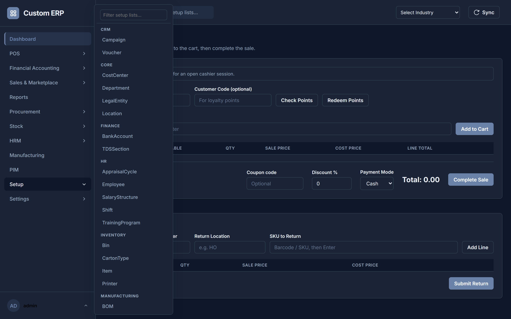

# User Guide: Selling and checking stock

Part 2 of 9 of the [User Guide](user-guide.md). Previous: [Getting started](user-guide-getting-started.md). Next: [Purchase orders](user-guide-purchase-orders.md).

## 4. Making a Sale (POS / Billing)

This is the screen a cashier uses most.

> **Before your first sale — three things must already exist.** Skip any of them and the sale will be refused, with an error that only makes sense once you know this list.
>
> 1. **A store you are allowed to sell from.** Setup → Core → **Location**, with **Sellable = Yes**, and given to you (an administrator does that in **Users → Stores**, or on your role in **Roles → Stores**). The till always sells from the store shown at the **top of the screen** (§4.0). A location with **Sellable = No** — a back warehouse, a head office — cannot open a session or complete a sale.
> 2. **At least one Item, with its HSN Code and GST Rate filled in.** Setup → Inventory → **Item**. Both tax fields are required and the system will not let you save without them, because it cannot price a sale it can't tax. (If the item genuinely isn't taxed — produce, unbranded grain, exports — set its **Tax Treatment** instead of entering a 0 rate; see §9 Step 3.) Stock also has to exist: an Item on its own has a quantity of zero until a **Goods Receipt** brings some in (§6).
> 3. **An open cashier session at that store.** This is the one people miss. Checkout refuses with *"Cash opening is required before billing"* until a session is open. Opening one is step 3 below.

### 4.0 Open the till for the shift

1. Click **POS / Billing** (under the **POS** module).
2. **Check the store at the top right of the screen** (beside Refresh). It is the store you are working at, and the till sells from it. If you work at more than one store, click it and pick the shop from the list (type to find it). If you have only one, it is simply shown. The session line under the till's title bar names the store and says whether a session is open there.
   - **The shop you expect is not in the list?** Either you have not been given it (ask an administrator to add it in **Users → Stores**), or it is not a selling store (**Sellable = No** on its Location) — the session line then says *"… is not a selling store"*.
   - **Only sellable locations appear here.** If the shop you expect is missing, it is almost certainly set to **Sellable = No** on its Location record — ask an administrator to change it. This is deliberate: it is what stops a sale being rung up against a warehouse or head office by accident.
   - **Switching keeps your screen (Stage 150).** On any screen, the page stays where it is — same page, same scroll, and what you typed (dates, quantities, notes) — and only its data changes to the new store. Item, customer and location boxes start empty, and the till's cart is cleared once you confirm, because prices belong to a store. The store button keeps one width: a long name ends in "…" (point at it for the full name). In the Store App, a switch takes you back to the screen you came from.
3. If the session line says *"No open session … open one before selling"*, click **Open Session**, type the **cash physically in the till right now**, and confirm. The bar changes to *"Session open at …"*.
4. **While your session is open you stay at that store.** Switching store at the top is refused with *"Your till session is still open at this store"* — close the session first. This stops a till drifting onto another shop's stock mid-shift.
5. At the end of the shift, click **Close Session** and enter the cash you counted. The system shows what it expected, what you counted, and the difference.
   - **If the count is off by more than the allowed amount** (₹50 unless your administrator changed it), the till says by how much and asks **why**. Type the reason. The session then waits for a **Store Manager** to accept it under **Approvals** — nothing more can be sold on it meanwhile. If the manager rejects it, the session opens again so you can recount and close once more.

**During the shift — cash in and out of the drawer.** Click **More… → Cash in / out**. The dialog shows what the drawer should hold right now (*Float + cash sales − cash refunds + paid in − paid out − safe drops = expected*). Choose:

- **Paid In** — cash brought into the till from the store's safe (more change, say).
- **Paid Out** — a small expense paid from the till (tea, a courier). It is booked as a till petty-cash expense.
- **Safe Drop** — cash taken out of the till to the safe, so the drawer does not build up.

Type the amount, pick a **reason**, and add a reference (the voucher or bag number). You cannot take out more than the drawer should hold. Every movement counts in the expected cash at close, so a drawer that had a ₹1,000 safe drop still balances. Cash refunds paid at this store are allowed for too.

**Switching staff with a PIN on a shared till (Stage 130.11).** A store manager registers the till once: **More… → Register this till for staff PINs**. Each person sets their PIN once (**More… → Set my PIN for this till** - their password, then a 4-8 digit PIN). From then on whoever steps up chooses **More… → Switch staff**, types their name and PIN, and the till is theirs - the bill on screen stays. A supervisor's price override works the same way: the supervisor switches in, makes the override under their own name, and the cashier switches back and takes the payment. No one shares a password. After a few idle minutes the till locks (*Till locked*) until someone enters their name and PIN; reloading the page does not get past the lock. An administrator signs in with their password, not a PIN.

**Handing the till to the next cashier.** The next cashier signs in on the same till, picks the store, and chooses **More… → Take over this till**. They count the cash and type it: that closes the outgoing cashier's session against their count (with the same reason-and-approval step if it is off) and opens theirs with that cash as the float. The two sessions name each other, so who handed over to whom is on record.

You open a session once per shift, not once per sale.

### 4.1 Ring it up

1. **Scan it, or search for it — same box.** Point the scanner at the barcode and it rings straight up — **no Enter key needed**: the till sees a scan as one fast burst and adds the line when it ends (this works in every scan box in the system: transfers, returns, receiving). Typing by hand is slower and is never submitted on its own. If you have no barcode, type any part of the **barcode, Design No, Design ID, Combination ID or product name** instead:
   - Only an exact **barcode** is added immediately with no list.
   - Anything else shows a list of the products that contain what you typed, underneath the box — it appears when you pause typing, or when you press Enter, even if only one product matches. The list shows **only what can be sold at this store**, one row per combination: **Design No · Combination ID · Barcode · Item · Available**; an item with no stock here is left off.
   - **Billing by design (272).** Type the **Design No** from the tag (or the Design ID) and the list shows every combination of that design in stock here — each colour, size and so on on its own row, with its barcode. Find the row whose barcode matches the tag on the piece, then click it, or walk the list with the **↑ ↓** arrow keys (the chosen row is marked) and press **Enter**. It goes on the bill as one line. **Esc** closes the list.
   - If nothing matches you are told so plainly — *"No product matches …"*, or *"None in stock here matches …"* when the only matches have no stock here — rather than a blank line being added to the cart.
   - **No stock, no line (262.2).** Scanning or picking an item this store cannot sell shows *"… not in stock here. Not added."* (or *"only 2 in stock here"* when the line already holds them all) and adds nothing. A service, or any item that keeps no stock, still rings up.
2. Repeat for every item the customer is buying. Scanning the same item twice adds 2, it does not create a second line.
   - **"Which MRP is on it?"** When an item is on your shelf at two MRPs - an older lot and a newer one at a new MRP - the line asks under the item's name, with one button per MRP. Tap the MRP printed on the piece in your hand; the line sells at it (and never above it). Until you tap, the line is priced at the lowest MRP. **change** beside the MRP asks again. A scan of a receipt-date barcode (stickers printed from a goods receipt) already knows its MRP and does not ask. One line takes one MRP - if the customer buys pieces from both lots, ring the second lot as a separate bill.
3. **Adjust quantities with the − and + buttons** on the line, or type straight into the quantity box for a larger number. Pressing **−** on a quantity of 1 removes the line.
4. **Read the Available column before you promise anything.** It shows the quantity you can actually sell at this store. Stock held in a location that does not sell is listed under it by the store's own names — *"Not sellable here: Damage 2 · Inward 3"* (the locations are set up under **Inventory → Stock Locations**, §5.1). That stock is physically in the shop but must not be sold. If you ask for more than can be sold, the row turns red and says *"Only N can be sold here"*. Clicking **Complete Sale** anyway names the item and how many are available (e.g. *"LAMP … available 0, requested 1"*). Click **Remove** on that line, or lower the quantity, and click **Complete Sale** again. Nothing was charged.
5. **Ask the customer's mobile number — on every bill.** The till has three boxes side by side: **Mobile**, **Name** and **GSTIN**. Type the number into **Mobile** and press **Enter**. One number is one customer:
   - **A number already on file** puts that customer on the bill: **Name** shows their name, and **GSTIN** fills when they have one (a GST bill, §4.10a). You can also type a name in **Name** and pick from the list; the mobile then fills itself.
   - **A new number** opens the customer form with the number filled in, and the name too if you typed one in **Name** first. Type the **name**; the same form asks everything else about the customer, in sections: **Contact** (mobile, name, email), **Address** (Line 1, Line 2, City, State, PIN), **Tax** (**GSTIN**, **PAN**), **Personal** (date of birth, anniversary, gender) and **Preferences** (preferred store, preferred salesman, tags). Once **State** is chosen, **City** lists that state's cities and **PIN** the chosen city's PIN codes (India); pick one or type your own. Sizes and the other account settings are not on the till's form: a new customer takes the standard ones, and a manager changes them on **Setup → Customer**. Only the mobile number and the name are required. A GSTIN fills the State itself and makes this a **GST (B2B) bill** (§4.1a). Click **Add to bill**. Tick the offer consents (SMS / WhatsApp) only if the customer agreed; both start unticked.
   - **The customer will not give a number?** Click **Walk-in**. The bill goes to the store's walk-in customer; nothing about them is printed and no points are earned.
   - **Forgot to ask?** **Complete Sale** asks for the number first (with **Walk-in** to skip), so no bill goes out without the question.
   - **With a customer on the bill, + New Customer becomes Edit Customer** — open it to add their address, PAN or GSTIN later.
   - **Saving a new customer needs the right to add customers (55.5a).** A new client's Cashier and Store Manager have it. If saving says you are not allowed, ask your admin to tick **Create** and **Update** on *Customer* for your role (**Settings → Roles**).
   - You can still type a **name** instead of a number and pick from the list. If they are not on it, **+ Create "what you typed"** opens the same customer form with the name filled in, and the mobile number too if you typed one in **Mobile** — you never type the number twice. **+ New Customer** does the same with whatever **Mobile** and **Name** hold.
   - **Customer details** shows what the customer agreed to receive, alongside their points (below).
   - **Customer details** shows who you are serving: their points and what they are worth, their tier and what it gives (*Bronze — Birthday voucher*), how much more they need to spend for the next tier, their last few bills and returns, and any **vouchers issued to them that they can use today** (type the code into **Coupon code**). The phone number shows only its last four digits. **Redeem Points** spends points on this sale. Add the items first: the till then tells you the customer's balance, what one point is worth (set by your administrator — it is not always ₹1) and the most this bill can take, and you type how many to use. The amount comes off the **Total** at once (the bar shows *Loyalty: −270.00 (270 pt)*), and the points are only actually deducted once the sale completes.
   - **The customer may need to confirm.** If your shop asks customers to confirm redemptions, a one-time code is sent to the customer; type the code they read back into the box that appears. A wrong code redeems nothing — choose **Redeem Points** again to send a new one.
   - **A large redemption needs a manager.** Above the value your administrator set (₹500 as shipped), the till asks you to **choose a reason** and raises a request for a Store Manager. The info line names the request and says it is waiting under **Approvals**. Once the manager approves it there, complete the sale as normal; until then, **Complete Sale** refuses with *"needs a manager's approval"*. Each approval is for this one bill and this number of points — it cannot be reused on another bill.
   - **Points the customer has already spent elsewhere can make the balance negative** after a return (see §4.7). Such a customer cannot redeem until new purchases bring the balance back above zero.
6. **Any offers that apply appear on their own, in a panel under the items** — see §4.2. If the customer has a coupon, type it into the **Coupon code** box.
7. Check the **Total** at the top right of the screen. The bar beside it shows the discount and the tax split — **CGST · SGST**, or **IGST** — so you can read them out to the customer. The bill is paid to the **whole rupee**: when the lines come to paise, the bar shows a **Round off** (for example *Round off -0.40* on 970.40, so the Total is 970) and the receipt prints the same line. A later return pays back what the customer paid for those pieces.
8. **Choose how they're paying.** **Payment Mode** lists the tenders your store takes, by their own names (*Cash*, *HDFC Card*, *Paytm*...). If it is **Cash**, type what the customer handed you into **Cash tendered** and **Change due** appears beside the Total at the top before you commit to anything (or *"Short by …"* if it isn't enough). A tender that needs a reference (a card slip, a UPI reference / UTR) asks for it once at **Complete Sale**.
   - **UPI QR (185.1).** Where your store has a UPI ID, choosing a UPI tender shows a QR for the exact amount (what is left after any split parts). The customer scans it with any UPI app (BharatPe, PhonePe, Paytm, Google Pay, their bank's) and pays. Check the payment on the store's phone or soundbox, then type its UPI reference (UTR) at **Complete Sale**. No QR shows if the store has no UPI ID: ask your administrator.
   - **Salesman.** If your store records who made the sale, a **Salesman** box sits beside the payment boxes with the store's default salesman chosen. Change it if someone else served the customer. Where the store makes it compulsory, the sale cannot complete without one.
   - **Discount.** Type a bill discount into **Discount** and choose **%** or **Rs**. It comes off the price straight away — the bar shows *Bill −99.90* and the Total drops; the tax is worked out on the discounted price. Above 5% (your administrator can change this) the till asks **why**; above your approval rules a manager must approve the sale, as before (§4.1a). To discount one line only, use **Override** on that line. In **Line discount** choose **% off**, **₹ off each** or **New price** and type the figure. It is always worked from the list price, and the dialog shows the price it comes to (*List 1000.00 → 900.00 each · −100.00*) before you press **Apply**. Then choose why from the list (*Price match*, *Shop-soiled piece*, *Manager discretion*...) with an optional note.
   - **Three kinds of discount.** The bar shows each kind on its own: *Item* (line discounts below the list price), *Offer* (offers and vouchers) and *Bill* (the bill discount). The *Sales Register*, *Sales Itemwise Detail* and *Sales Discount Analysis* reports show them in their own columns: **Item Discount**, **Offer Discount** and **Bill Discount**. The bill discount is not counted as a promotion in *Campaign Performance* or *Coupon / Voucher Usage Report*.
   - **Paying from an advance.** If the customer has paid an advance (§4.9), **Use advance** appears beside the customer buttons with the amount. Click it and the bar shows *Advance: −300.00*; the Total is what is left to pay.
   - **Paying more than one way?** Choose **Split payment…** at the bottom of the **Payment Mode** box (or click **More… → Split payment**). Type the fixed parts — say **Card 1,000** and **UPI 200** — and leave the rest blank. Whatever is left is paid by the **Payment Mode** you have selected; the bar shows *Split: Card 1000.00 + UPI 200.00; the rest by Payment Mode*. If the rest is cash, **Cash tendered** and **Change due** work on the cash part only. Parts that add up to more than the bill are refused. To go back to one payment mode, open **Split payment** again and clear the boxes. A split sale cannot be queued offline with a gift card, and a payment-terminal sale is never split.
   - **A tender the box does not list.** If you may add tenders (an administrator), choose **Add tender…** at the bottom of the **Payment Mode** box. Give its **Name** (*Paytm*, *HDFC Card*), its **Kind** (Cash, Card or UPI) and **Active**, then **Create**. The box lists it straight away and selects it. Other users do not see **Add tender…**: ask your administrator. To set its stores, reference or cash drawer, open it under **Setup → Masters → POS Tender**.
   - **Remarks.** Type a short note for this bill into **Remarks** (*Gift wrap*, *Deliver Sunday*), up to 200 characters. It stays with the bill, shows on the finished sale and prints at the bottom of the receipt. The box clears for the next customer.
   - **The same card slip or UTR twice.** A card / UPI / cheque tender with the same reference as one taken at this store in the last 10 minutes (the same amount too, for a split part) is refused as a duplicate (`POSOFF-1363`). If the customer really paid twice with the same reference, answer **Yes** to *Is this a second payment?* and the bill goes through; the window is the *Duplicate tender window* setting (0 switches it off).
9. Click **Complete Sale** (top right, next to the Total).

**An item sold below cost.** When your administrator has set **A sale below cost** (Settings > Point of Sale), **Complete Sale** checks each line. A line is below cost when one unit, after your price change and bill discount and without GST, is under what the item cost. Offers, vouchers and free gifts never count, and the till never shows the cost.

- *Asks the cashier to confirm*: the till names the item (*Sold below cost: TEE-RED-M*) and asks *Bill it at this price?* **OK** completes the sale. **Cancel** takes you back to the bill to change the price or the discount.
- *Waits for a manager's approval*: the sale waits for a manager, as a large discount does (§4.1a).

Managers see these sales in **Reports → Sales → Sold below cost**: the bill, cashier, item, price sold at, cost, loss and who cleared it (*Cashier*, *Manager* or *Offline check*).

**Holding a bill.** A customer goes to fetch another size and the queue is waiting: click **More… → Hold this bill**, add a short note (their name, say) and confirm. The till clears for the next customer. When they come back, click **More… → Resume a held bill** on any till at the same store, pick the bill (shown with its note, items, total, who held it and when) and it comes back with its items, customer and coupon. Prices are checked again. Points, a split payment and gift cards are not kept on a held bill — add them again before **Complete Sale**. A bill keeps its number while it is held, so it can only ever be paid once; if two tills try to resume the same bill, the second is told it is no longer held. To drop a bill the customer will not come back for, choose it in the same list, pick **Discard it** and give a reason. Holding a bill does not set stock aside.

### 4.1a The sale is complete — the till freezes

This is deliberate and is the biggest change from how this screen used to work.

When the sale goes through, **the till stops and shows the finished bill**: the **bill number** (given by the server, per store, at most 16 characters — e.g. *BJAY2627000123*), the store, each line, any advance used, the total collected, the cash tendered and the change due. Everything below it is hidden, and **nothing can be scanned onto it**.
- **A GST (B2B) bill** — a bill with the buyer's GSTIN (§4.10a) — also has **Print GST Invoice**: the tax invoice with your company and the buyer's GSTIN, legal name and address, the buyer's PO number and date, the ship-to address when shipped, the place of supply, *Reverse charge: No*, each line's HSN, and the tax summary HSN by HSN. A customer without a GSTIN gets the receipt as usual.

- The bill stays there as long as you need it — read the change back to the customer, answer a question about a line, print the receipt.
- When you are ready for the next customer, click **New Sale (Reset)**. The cart, customer, coupon, discount and tendered amount are all cleared for a clean start.
- **The store stays as it is.** You do not re-pick your shop between customers.

Why it works this way: before, the cart silently emptied behind a dialog and the screen looked exactly as it had a moment earlier — so the next customer's items could be scanned onto what you still believed was the previous sale. Now there is an unmistakable boundary between one bill and the next.

**Two other outcomes freeze the till the same way**, so you always know where you stand:

- **Waiting for manager approval.** A large discount, or a sale below cost when the store is set to wait for a manager, does not complete the sale. The panel says so in orange and offers no receipt — the money has not been collected and **the goods must not be handed over**. The sale sits as **Pending Approval** until a manager decides it from the **Approvals** screen.
- **Queued offline.** If the connection is down, the sale is saved on the till and is sent automatically when the connection returns. The panel tells you so and warns you **not to ring it up again**. Once the till has been opened online it numbers the sale itself, and the panel shows **Bill T01JAY2627000001** (its own series) - the sale keeps that number when it posts; write it on the customer's receipt if you hand one over. When it is sent, the till says *N offline sales sent for validation*: the sale is **not posted yet** — stock is not deducted and the bill is not made until a manager validates it on **POS → Offline Sales** (§4.12). **Scan every item** while offline: a line you picked from the search list or uploaded counts as *not scanned*, and a sale with such a line cannot be validated. An item with no barcode is scanned by its SKU (what its sticker prints). Offline the till cannot look a customer up: choose **Walk-in** at the mobile prompt, and the sale is billed to the store's walk-in customer when it is sent (76.10).

### 4.2 Offers and coupons at the till

You do not apply offers by hand. Whatever your head office has set up in the ERP is worked out automatically as you build the cart, and shown in a panel just under the items — each offer by name, what it did ("10% off the bill", "buy 2 get 1 free — 1 free unit"), and how much it took off.

- **Automatic offers just appear.** Add the qualifying items and the offer shows up. Remove an item and it disappears again if the cart no longer qualifies. If an offer needs a minimum spend, it appears once the cart crosses it.
- **Coupon offers need the code.** Type it into the **Coupon code** box. Case doesn't matter, and you can enter more than one separated by a space or comma. If a code doesn't apply to this cart, the panel says so in plain words rather than silently ignoring it — check the spelling, and whether the cart actually meets the offer's conditions.
- **Issued vouchers go in the same box.** A voucher your company issued (a printed or emailed code — *WELCOME100*, a customer's birthday voucher) is typed into **Coupon code** like any coupon. It is applied after the offers, on what they left, and shows in the panel as *Voucher WELCOME100 — issued voucher −100.00*. One voucher per bill. If it cannot be used the panel says why — *used up*, *expired*, *restricted to a different customer*, *for Online use only*, *can be used from …*. A voucher restricted to a customer needs that customer on the sale first. It is used up only when the sale completes; if someone else used its last use in the meantime, **Complete Sale** says so — remove the code and the bill is priced again without it.
- **Some offers only apply to certain customers** (a loyalty tier, for instance). Look the customer up *before* expecting those to show — with no customer on the sale, a tier-restricted offer will not appear. The same goes for an offer limited to so many uses per customer.
- **Some offers only run at certain stores, days or hours** (a weekend offer, a happy hour) and some stop after so many uses. Outside them the offer simply does not appear. Some items are left out of an offer on purpose: they never take it, even when it is for the whole bill.
- **Offers that need two kinds of item** appear once both are in the cart: *Buy A Get B* (buy a shirt, get a tie free: the cheapest qualifying tie is the free one) and *Combo* (one item from each list together at the combo price, e.g. kurta + dupatta for ₹1,499). Slab offers grow with the cart: *Spend ₹2,000 get ₹200 off, ₹5,000 get 10% off* moves up a step as the bill crosses it.
- **The final say is the server's, not this screen's.** The panel is a preview; the discount is recalculated for real when you take payment. In normal use the two agree. If they ever don't, the amount charged is the correct one.
- **The discount box is separate.** **Discount** (% or Rs) is the cashier's own bill discount — it comes off the price, needs a reason above the limit and a manager's approval above your approval rules. Your line discounts and the bill discount count together against those rules: 9% off a line plus 9% off the bill is judged as about 17%. Offers are not manual discounts and don't need approval — they're the rules head office already signed off.

### 4.3 Printing the receipt

Click **Print Receipt** on the finished bill. It opens the print window (§7B.1) with the bill exactly as it will print (a bill already printed shows as the reprint it would be), on the paper and template your administrator's print profile sets for this till, this kind of customer and you - a B2B bill (the customer has a GSTIN) can start on A4 while a walk-in bill starts on the roll. Change the **Paper**, **Template** or **Printer** there for this bill if you need to; **Print** prints it, **Close** prints nothing (Stage 213.3). You can click it more than once — a customer who said no and then changed their mind does not need the sale re-rung.

The receipt is the sale's **tax invoice on 3-inch (80 mm) roll paper** (or the 58 mm roll, or A4, if you or your print profile pick it): your brand and store header (address, phone, email), **Tax Invoice**, bill number with date and time, the customer, one row per item with its **barcode** and **HSN / design** under the name, quantity, rate (with the item discount under it), amount, then total quantity, item discount, taxable value, CGST / SGST (or IGST), round off and **NET AMOUNT**, how it was paid, the cashier, the **HSN-wise GST table**, your GSTIN, the amount in words and a thank-you line. The bill is as long as its lines need. To change anything on it — add your **logo**, website, CIN, terms and conditions, a social-media line, move or remove a piece — open any till sale's **Print**, pick **Roll bill (built-in)**, click **Design templates**, change it and **Save** (§7B.2); the till then prints your version. A roll template of your own always wins over the built-in one.

If your till has a receipt printer set up for silent printing it goes straight there with no dialog (see below); otherwise your browser's normal print dialog opens. Nothing extra is needed to print — the button always works.

**Extra copy on a second printer** (Stage 213.5): if your print profile has *Extra prints*, one **Print** sends the main bill and each extra to its own printer (for example A4 to the office printer, a roll copy to the receipt printer). If one fails, a message names it and the others still print. Setting it up: Admin Guide, Print profiles.

To get the one-click version, **PrintBridge** is installed once on the till PC ([Silent Printing Setup](silent-printing-setup.md)). The first bill printed there goes to the till's receipt printer — chosen by itself when the PC has one, or asked once — and every bill after that prints there without asking (§7B.3). If PrintBridge isn't installed, the browser print dialog appears as before; nothing breaks and nothing is lost.

A few things worth knowing:

- **The receipt says which shop sold it.** The header carries your company's name and GSTIN, the shop's name and its address (address lines, city and PIN code from Setup → Location), the **bill number**, the date and time, and who was on the till. The customer is printed by **name and mobile number** — never a customer code, and nothing at all for a walk-in. A customer holding the receipt can tell which branch of a chain they bought from — and it stands up as a tax document.
- **The receipt shows what was actually collected.** Offers and loyalty points spent both appear as their own lines, so the printed total matches the cash in the drawer.
- **A sale waiting on manager approval will not print a receipt.** The money hasn't been collected yet. Once the manager approves it from the **Approvals** screen the sale completes and can be printed.
- **Reprinting later is safe.** The receipt is rebuilt from the recorded sale, not from whatever is on screen, so it always shows what was originally rung up.
- **What the receipt shows** (Stage 130.16): every way the bill was paid (*Paid: Cash 500.00 · UPI 700.00 · Points 10*), and - for cash - the cash given and the change handed back, the tax breakup and HSN per line, and your return policy at the foot (an administrator sets it: **Return policy on the till receipt**). A store whose print profile says *58 mm roll* gets the same receipt on narrow paper; long numbers wrap instead of being cut off.
- **If a 58mm till roll prints text too wide**, tell your administrator to set **Label Width (mm)** to `58` on that Printer record.

**If something goes wrong mid-sale** (a barcode doesn't scan, the system shows an error), read the message on screen — it tells you exactly what's wrong (e.g. "this item is already sold" or "not enough stock") rather than just "error."

**Units reserved for online orders are not sold at the till.** If an online order has reserved units at your store, the till sells only the rest, and the message says how many more are *reserved for orders*. The stock shown at the till already leaves them out. To sell one anyway, the order has to be moved to another location first (OMS).

### 4.4 If prices changed while you were ringing up

Occasionally the back office changes a price between the moment the cart was priced and the moment you press **Complete Sale**. The system never quietly charges either figure. It stops, shows you what changed and the new total, and asks you to confirm. Nothing is charged until you do.

### 4.5 Reset Terminal — starting the till again

**Reset Terminal** is in the session bar, next to the session buttons. It clears the cart, customer, coupon, discount and tender. Use it when a bill has gone wrong and you want to start it again.

1. Click **Reset Terminal**. It tells you how many cart lines will be thrown away and asks you to confirm. **The cart is not saved.**
2. The store does not change: it is the store at the top of the screen. To sell from another shop, close your session and switch store there (§4.0).
3. Your session stays open — a session is a cash-accountability record, and only **Close Session** ends it.

Day to day you will not need this button. Between customers, use **New Sale (Reset)** on the finished bill instead.

### 4.6 Packaging, free gifts, gift cards — and items the till won't sell

**The one rule:** if the exact thing you hand over matters, scan it. If it is ordinary packaging, the system takes care of it. If it is money (a gift card), it is issued and activated, never sold as a line.

**Boxes, bags and butter paper — don't scan them.** Your store's usual packaging is set up once (Admin Guide §B.3.8, *Backflush Rules*): earrings go in a Small Red Box, a necklace in a Large Red Box, every packed item gets one butter paper. As you ring up, the panel under the items shows **Uses (not on the bill): 2 × Small Red Box, 3 × Butter Paper…**. When the sale completes, those leave the store's stock automatically, recorded against the bill number. They never print on the customer's bill.

- **The customer gets a different box?** Click **Packaging** (next to **Add to Cart** — it only shows when something can be changed). Each line shows its usual packaging; pick the one actually used, or **None** where that is allowed. Some changes need a **Reason** — type it in the box beside the choice. Changed choices are marked with **\*** in the panel. Anything you leave alone keeps its usual packaging.
- **The store is out of a box or of butter paper?** The panel says *"Short of …: store has 2, this sale uses 3"*. Normally **the sale still goes ahead** — the shortfall is recorded for your manager under **Item Exceptions**, to be put right by counting or receiving stock. Only if your administrator set that packaging to *Block* will the till ask you to pick another option first.
- **Scanned a box by mistake?** The line comes straight off with *"… is not sold at the till … use Packaging to change it"*. Nothing else on the bill is affected.

**Free gifts (Gift With Purchase).** When the bill qualifies for a gift — say a Gift Plant with every necklace — the panel shows **Gift eligible: 1 × Gift Plant — scan it to hand it over**. Scan the gift you actually hand over: it rings up at **0.00** as *Free gift (offer)* and the prompt changes to *scanned*. A gift the bill has **not** earned — or more of it than earned — is refused and comes off, with the reason. A "free with item" accessory (a charger free with a phone) still works as before: it is free only alongside its main product.

**Gift cards.** Click **Gift Card** (with Customer details / Redeem Points) and choose what you are doing:

- **Pay this bill with a gift card.** Scan or type the card number; leave the amount blank to use as much as the card covers (or type a smaller amount). The bar shows **Gift card: −600.00 (**** 1701)** and the **Total** drops to what is still to collect — take the rest by Cash / Card / UPI as usual. The card is charged only when the sale completes; if the sale fails, the card keeps its balance. A gift card **needs a connection** — it cannot be used on a sale rung up offline. To take a card back off the bill before completing, use **Gift Card → Remove the gift cards from this bill**.
- **Issue / add value.** For a customer **buying** a gift card. Take their payment first, then scan the card, type the amount and choose how they paid. The card is funded at that moment and a separate **Gift Card Issue** receipt opens as it will print (card shown as **** 1701, amount, balance, valid until): **Print** prints it, **Close** skips it. It is not a line on any sale bill. A card that has already been issued cannot be issued again; whether value can be **added** to an issued card depends on its type.
- **Check balance.** Scan the card to see its status, balance and expiry.
- **Store managers also see:** **Block a card** (lost or misused — a reason is required), **Release a blocked card**, **Cancel an unused issue** (refund — allowed only while none of the balance has been used; refund the amount shown by the original payment mode), and **Register new cards** (load pre-printed card numbers, or have the system generate numbers to print — shown **once**, so print them straight away).

The finished bill and the receipt show each gift card as its own line (*Gift card **** 1701 −600.00*), so the amount collected matches the drawer.

**Items the till won't sell.** Some items are kept off the bill on purpose — packaging, internal supplies, fixed assets (laptops, the till itself). Scanning one removes the line and tells you why. A **service** (repair, installation) sells normally but shows **Not stocked** in the Available column, because there is no shelf stock to count.

**Items outside the store's range, and markdowns.** If your store has a range (Master Data Guide §8b-3) and your administrator has set *Store range* to Block, scanning an item outside it removes the line with "… is not sold at this store"; on Warn the line stays and your manager sees an *Outside assortment* entry under Item Exceptions. A running markdown plan (§8b-4) shows as the item's price at the till, with no action from you.

### 4.7 Returns — what the customer gets back

A return pays back **what the customer actually paid for those items**, the way they paid it. It is never the price on the tag when the bill had an offer, and never cash for something paid with points or a gift card.

1. **Raise it at the till.** Open the **Return** tab on the POS screen and find the bill: scan or type the **bill number** or the **AWB** on an online parcel, or type the online **order number** (the website's or marketplace's, e.g. *#1001*, or ours), the **OMS bill number**, the customer's **mobile number** in any form (*+91 98765 43210*, *098765-43210*), their name or a B2B buyer's **GSTIN**, and/or pick the **Bill date**, then click **Find Bill**. One match opens at once; several are listed to pick from (an online bill says *Online*, its order and AWB). Or open the bill on **POS → Sales History** (§4.13) and click **Return**: this tab opens with the bill already found. It looks at this store's bills - and at every online bill once you have typed something, so a website or marketplace order brought back to a store is returned here even when the channel never sends a return. Tick **All my stores** for a bill bought at another of your stores — the return is then taken here (the goods come back into this store's stock) and keeps the store that sold it, unless your business books returns at the selling store (*A return booked at the store that sold it*, below). Each line shows what can still be returned and its price — the price after the bill's offer, e.g. a ₹1,000 shirt on a bill with 10% off shows **900.00**. **Return Location** is already filled with the till's store. Type the quantities coming back (or **Upload** a CSV of *Barcode, Qty* for a long bill) and click **Raise Return**.
2. **A manager takes it from there** on **OMS → Returns**: **Approve** (if your business has turned on second-person approval, someone other than the person who raised the return must approve it, and its refund), then **Book Pickup** if a courier collects the goods (PIN code, contact name and pickup address; leave **Courier** blank and it is picked by PIN code from your courier service areas; the courier's account must be set up first, and if it was not, click Book Pickup again once it is; if the courier did not answer, click Book Pickup again - it asks the courier first, so the pickup is never booked twice, and a courier that cannot be asked opens **Unconfirmed booking** to resolve it, as on **OMS → Ship**, §9A.11), then **Receive Goods** when the items are physically back (a return whose pickup is booked offers it too), then **Inspect**. Inspect opens one form with each item by name. Choose its condition from the list: Sellable, Damaged and Repairable are refunded; Missing, Wrong Item and Rejected are not. To give the customer another item instead of a refund, find it in **Exchange for** by name, code or barcode, or scan it and press Enter; its code shows under the box. Exchange is offered only for Sellable, Damaged and Repairable, and the new item must be free to sell at the return location and sell at the price the customer paid for the item coming back (a size or colour swap). No money changes hands here, so a dearer or cheaper item is refused: give that one at the till with **More… → Exchange**, which settles the difference. A line with the box left blank is refunded. If an item cannot be found or given, the form says why and opens again with your entries kept. Until the inspection, **Refund Eligible** shows the expected amount, marked *expected*.
3. **Refund.** Click **Refund** on the return. For a till bill you are shown exactly where the money goes, for example *Card 333.33, Cash 410.00, UPI 66.66, 90 points back to the customer* — confirm to approve, and confirm again to pay. Reverse any card or UPI part on the terminal or payment app; cash comes out of the drawer. You are only asked *"How is the refund being paid?"* for a return with no till bill behind it (an online order).

**Finding a return on OMS → Returns.** The list opens on **Open returns** (every return with a step left), 50 to a page with **Previous** and **Next**; the bar shows how many match, and the amount beside it is the refund of the returns on this page. **Show** picks one step (*Awaiting goods* includes a return whose pickup is booked) and **Search** finds a return by its number, bill or store on any page. Both stay as you left them when you come back. A store's staff see their own store's returns. If the list cannot be loaded it says why in red, never an empty list.

What happens to the customer's points, automatically:

- **Points they spent on the returned items come back as points**, valid for at least 30 days (or longer, if their points had a later expiry when they bought).
- **Points the returned items earned are taken back**, in proportion to the money refunded. If the customer has already spent them, their balance goes negative and their next purchases pay it back; the cash refund is never reduced to cover them.
- **A gift-card share goes back onto the same card.** If that card has since been blocked, the refund stops with *"goes back to a gift card that is blocked"* — a manager releases the card (**Gift Card → Release a blocked card**) and processes the refund again.

**Exchanging at the till — swap, and pay only the difference.** The customer is at the counter with something to swap:

1. On an empty till (store picked, session open), click **More… → Exchange**, type the **original bill number** and choose how many of each item are coming back and their condition (**Sellable**, **Damaged** or **Repairable**). The items are received and inspected there and then — no trip to the Returns screen.
2. The till shows **Exchange credit: −900.00** in the bar: what the customer paid for those items (after the bill's offer; any points they used come back as points, and the points those items earned are taken back, as for any return).
3. Ring up what they take instead. The **Total** is what is left to pay after the credit — take it as usual (cash, card, UPI, a split). If the new items cost less, the bar says *(450.00 back to the customer)*, the Total reads **0.00**, and after **Complete Sale** the finished bill says **Exchange: give the customer 450.00 back from the till** — hand that over in cash. It is counted in the drawer's expected cash.
4. The new bill earns points on everything it was paid with, the credit included, so a straight swap leaves the customer's points where they were. An exchange needs a connection (it cannot be queued offline), and its credit can be used on one bill only. A free gift alone has no value to exchange: take it back as a return (`POSOFF-0611`, Stage 148.55). The till also refuses when nothing coming back would refund (every item Missing, Wrong Item or Rejected, or a condition your admin set to credit by note); it says so before any stock or money moves, so no return is left behind (Stage 148.59).

Returning a line in pieces works out to the paisa: two identical shirts returned one at a time may refund 809.99 and then 810.01, and together they always give back exactly what was paid.

**What a return can draft (Stage 148.28).** Every return carries its RMA no. (its return number) from the moment it is raised, and may carry a reason: the return form asks for a reason (pick one) when the business requires it. When QC marks a line, the business's disposition rules can add a **restocking fee** (a percent of that line, kept out of the refund and shown on the refund; GST is included in it at the fee's own rate) and draft the next document: a **credit note** instead of a refund (less the fee), a **replacement order** (online orders only; a till bill has no delivery address, so the return says *no delivery address* and a person raises it), a **purchase return** on the goods receipt the item came in on, or a **scrap** note. Posting the scrap note writes the unit off from quarantine (QC hold), not from the stock you can sell. These are drafts: open them and post them yourself. A return is never drafted twice. With no rule on file, nothing changes.

**Returning a kit or bundle (Stage 148.1d).** A bill that sold a kit or bundle remembers the cost it took for each component. Return the kit line as usual: at QC, each component goes back into stock - into the bucket you chose - at that recorded cost, in the share of the kit you returned (return 1 of 4 kits and you get back a quarter of every component), and the sale's cost of goods is reversed by the same amount. The kit's own code holds no stock. A kit sold before this was recorded comes back as it did before: nothing is added and no cost is reversed.

**A return booked at the store that sold it (Stage 77.8).** When your administrator turns on *Book a return at the store that sold it*, a bill from another of your stores is returned as usual at your till, and the till's notice reads *Sold at S1. Booked there; goods come here by transfer.* What changes:

- The return gets the selling store's return number, and its credit note and reports belong to the selling store. **Returns** lists it at both stores; the **Location** column reads *S1 · taken at S2* plus the transfer numbers.
- Approve, Receive Goods, Inspect and Refund at your store as for any return. A cash refund comes out of your drawer.
- At inspection the goods are booked back into the selling store's stock. The system then makes one transfer per stock bucket from the selling store to yours, dispatches it and receives it here. *Sellable* lands in your **Inward** stock (put it away from there), *Damaged* in your Damage stock, and *Repairable* or *Wrong item* in your QC hold. Nothing is left in transit.
- If a transfer cannot finish, for example because a serial number is not in stock, the Location cell says *transfer open*; hover over it for the reason. Open the transfer on **Transfers** and finish it by hand.
- An exchange is not allowed on such a return: refund it, and sell the new item on a new bill here.

**Cancelling today's bill (store managers, Stage 130.9).** A bill rung up wrongly today can be cancelled outright: on the till's **Returns**, look up the bill and press **Cancel the whole bill** (shown to a Store Manager or administrator, for today's bills with nothing returned yet), and give the reason. Every item comes back into stock as sellable, the money goes back the way it was paid (cash, card, UPI, gift card), points earned on the bill are reversed and its tax is reversed - all through an ordinary return, which you can open on **Returns**. Pressing it again only shows the first cancellation. An older bill, or one already partly returned, is returned instead.

**Store credit instead of money back (Stage 130.12).** A refund goes back the way the bill was paid. If the customer *asks* for store credit instead, choose it when processing the refund on **Returns** (Cancel the "back the way it was paid" question, then confirm store credit; or type *Store Credit* where the refund method is asked). The amount goes onto the customer's store credit - no card, nothing to carry: it stays on their account, does not expire, cannot be given to someone else and is never paid out as cash. A walk-in bill (no customer) cannot be refunded to store credit (`SALESR-1310`). On their next bill, attach the customer and the **Use** button offers their store credit (with any advance): *Use store credit 1,000.00*. Above the limit your business sets, a store manager switches in to allow it (`POSOFF-1309`). The return also gets its own GST credit note number (CN...), naming the original bill.

**Free gifts on a return (Stage 130.9).** When everything paid for on a bill comes back, its free gift (a Gift With Purchase item) has to come back too - the return is refused until the gift is added (`SALESR-1307`). Keep part of the purchase and the customer keeps the gift. Your administrator can let customers keep gifts altogether. A free gift that comes back is put back at its cost and the gift expense is reversed the same way it was booked, so a gift returned for a gift item credits the same account the sale charged, not the stock cost of goods sold (Stage 148.45).

**Items the till refuses (Stage 130.9).** *This item can't be sold yet* (`POSOFF-1303`) - a new item still waiting for its release approval. *This store does not sell this item* (`POSOFF-1304`) - the store's record lists it under *Items not sold here*. A made-to-order item whose Product Type allows negative stock sells even with none in stock; the shortfall is recorded for the store manager.

**A return with the store left blank.** The return goes to the nearest active store by the PIN code the order was shipped to, whether or not that store has the item in stock (the last unit sold has none). With no PIN it goes back to the store that shipped the order. If neither is known, the screen says which is missing and you choose the store yourself.

### 4.8 A customer's points — the Loyalty screen (store managers)

**CRM → Loyalty.** Four tabs:

- **Customer** — search the customer by name or phone. You see their balance, their tier and what it gives (*Silver · Free alterations*), and every entry in their points history in plain words — *Earned on a sale*, *Redeemed*, *Given back on a return*, *Taken back on a return*, *Credited / Debited by adjustment*, *Expired* — with the bill or document it came from and when earned points lapse. A negative balance is explained: a return took back points they had already spent, and new purchases pay it back.
  - **Adjust points** puts points on or takes them off by hand — a goodwill credit, a correction. Type the points (+ to credit, − to debit), pick a **reason** and add a note. It is a new entry in the history; nothing is ever edited. Up to the approval value (₹500 worth as shipped) it happens at once; above it the adjustment waits under **Approvals** for another manager. A debit can never take the balance below zero.
  - **Items not payable by points.** An item marked **Pay with points = Not allowed** (or in a product group marked **Not payable with points**) is left out when the till works out how many points can be spent; the till shows the reduced limit. A point may also be worth less than ₹1 if the admin sets it so.
  - **Transfer points** (when the admin turns it on) moves usable points to another customer: pick the customer and points, then type the code sent to the sender. Big transfers wait for approval, there is a daily limit, and the points keep their expiry dates.
  - Under the balance you also see what the points are worth, the spend counted for tiers and how much more reaches the next tier, the customer's **last bills**, their **returns** (status and refund), and the **vouchers they can use** right now. These are the same figures the cashier sees under **Customer details** at the till.
- **Tiers** — each tier's **Spend from** threshold, **Earn multiplier**, **Benefits** (shown to the cashier at the till) and **Grace days**. A customer's tier follows what they actually spent, net of offers and refunds. When their spend drops below their tier, they keep it for its grace days before moving down. Edit a row and click **Save**; **Add a tier** for a new one.
- **Earning at the till.** The till shows **Earns N pts** under the bill once a customer is on it, and **No points: reason** for a blocked customer. Points are earned under the store's **Loyalty Scheme** on the bill date (**Setup → CRM → Loyalty Scheme**, a list and a **New** page) or, with no scheme, the spend per point in Configuration. A **Bonus Points** offer adds its own line to the customer's points, named *Bonus: offer*. A tier that lapsed since the last bill is dropped before the bill earns.
- **Blocking a customer.** On the customer, set **Loyalty blocked** to *Yes* and give the **reason**. They earn and redeem nothing; their points are kept. Who blocked them and when is kept on the customer. Set it back to *No* to lift it. Tier changes show on the customer timeline.
- **Expiring and pending.** Under the balance you also see the points that lapse in the next 30 days and the points still pending (earned, waiting for the return window). The history shows the store and the cashier of each entry. Messages can use `points.earned` (what the last bill earned) and `points.balance`.
- **Online orders.** When the last parcel of an online order is delivered, its customer earns points under the scheme of the store the order started in. They stay pending until the return window after delivery ends; a return inside it takes them back in proportion. History reads *Earned on an online order*.
- **Points movement** — for a period (blank = all time): opening balance, points earned, given back on returns, credited, redeemed, taken back on returns, debited, expired, and the closing balance, each with its value. If your company accounts for points as a liability, the last two lines compare the liability in the books with the points outstanding — they should agree.
- **Voucher use** — every voucher in plain words: what it gives (*100 off the bill*, *10% off the bill*), who it is for, where it works (till, online or both), its dates, how often it has been used (*0 of 1*), whether it can be used **now** or why not (*expired on …*, *can be used from …*, *has reached its maximum uses*, *not active*), and the discount it has given on paid bills.
- **Campaign results** — every campaign: its trigger, what it is **Sent by**, the message as it will be sent, how many customers it **would pick today** (only those who agreed to that channel), how many matched but were **skipped for no consent**, how many it has been sent to, sales from them since, its cost and return. A campaign hands each message to CleverTap; whether the message reached the customer is tracked there, not here. **Add or edit vouchers** (on Voucher use) and **Add or edit campaigns** (on Campaign results) open their records.

### 4.9 Customer advances — the Advance tab

A customer pays now for something they take later — a custom order, an alteration, an item kept for them or not yet in stock. Take it on the **Advance** tab of the POS screen (an open session is needed, as for a sale):

1. Type the customer's **mobile number** and press **Enter** (a new number opens the customer form). An advance always belongs to a customer — not Walk-in.
2. Type the **Amount**, how it was **Paid by** (Cash / Card / UPI), what it is **For**, and when it is **Expected on**.
3. **Supply**: **Goods** for an advance against goods (no GST is charged on the advance itself), or **Services** for an advance against a service (GST is taken now, at the rate you enter, and given back when the advance is used on the bill). Your accountant decides which applies.
4. Click **Take Advance**. The advance gets its receipt voucher number (*CA…*) and its **advance receipt voucher** opens as it will print: **Print** prints it for the customer, **Close** skips it.

The list under it shows the customer's advances (or the store's open ones): taken, used, refunded, balance and status (**Open**, **Partially used**, **Fully used**, **Refunded**).

- **Using it.** When the customer comes back, put them on the bill (their mobile number) and click **Use advance** (§4.1 step 8). Only the customer who paid it can use it. It can pay part of the bill; what is left stays for next time.
- **Refunding it.** Click **Refund** on the advance, type how much (all that is left, unless you change it) and **why**. It goes back the way it was paid — cash from the drawer, a card or UPI reversed on the terminal or app — under its own refund voucher (*AVR…*), which you can print.
- **The drawer.** Cash advances taken and refunded count in the session's expected cash at close.

### 4.10 Large bills — address, PAN and the cash limit

The law asks for more on a large bill. The till asks first; the server refuses a bill that is still missing something. Under the Total, a short warning says what **Complete Sale** will ask for (*Address needed*, *PAN or Form 97*, *Cash over limit*), so you can ask the customer while you ring up.

- **₹50,000 or more to a buyer with no GSTIN** needs the buyer's **address** (Line 1, State, and City or PIN). The till opens the customer's form at the address.
- **Above ₹2,00,000** needs the buyer's **PAN**. If they have none, choose the **Form 97** option once they have signed the declaration. The PAN is asked for only then; on any other bill it is optional, and so are birthday, anniversary and gender. A B2B bill (§4.10a) needs no PAN: the GSTIN carries it.
- **₹2,00,000 or more in cash from one customer in a day is refused.** The cash on their earlier bills that day, at any of your stores, counts too: a customer who paid ₹1,50,000 in cash this morning can pay at most ₹49,999 more in cash today. Take the rest by card or UPI (**More… → Split payment**).
- A **Walk-in** bill cannot carry these — take the customer's mobile number.

These are India's rules. In another country your administrator sets that country's limits (§ Admin Guide, *POS settings*).

### 4.10a B2B bill — the buyer's GSTIN, PO and ship-to

A business buyer needs a tax invoice with their GSTIN on it, so they can claim the GST back.

1. Type the buyer's **GSTIN** into the **GSTIN** box (beside Mobile and Name) and press **Enter**. A GSTIN with a wrong check digit is refused (*Not a valid GSTIN.*). A customer whose GSTIN is on file fills the box when they are put on the bill.
2. The **B2B bill** panel opens. Fill in:
   - **Buyer:** **Legal name**, **Address**, **City**, **PIN** (required); trade name, email and contact (optional). The state comes from the GSTIN.
   - **Order:** the buyer's **PO number** and **PO date** (required unless your administrator made them optional; the date cannot be after today), and **Delivery**: *Collected here* or *Shipped*.
   - **Ship to** (only when *Shipped*): address, city, PIN and **state** of where the goods go.
   - **Save to customer** (ticked): saves the GSTIN on the customer, so the panel fills itself next time. Untick it for a one-off buyer.
3. Click **Save**. Beside the box the till shows *B2B · <PO number>* (with *· shipped* when shipped); click it to change the details. **Not B2B** in the panel clears the GSTIN and makes it an ordinary bill.
4. **The tax.** Collected at the counter, the bill is taxed in your store's state (CGST + SGST). Shipped to a buyer in another state, it is IGST, and the tax line reads *IGST … · to <state>*.
5. Ring up and **Complete Sale** as usual, then **Print GST Invoice** (§4.1a).
6. **E-invoice.** When your company e-invoices (§9B.5), the bill is sent to the IRP within a minute. The first print says **IRN PENDING**; once the IRN is back, **Reprint** it from **POS → Sales History** (§4.13) to give the buyer the copy with the IRN and QR.

If something required is still missing, **Complete Sale** opens the panel with what is missing, and the server refuses the bill (`POSOFF-0879`, `POSOFF-0880`, `POSOFF-0881`).

### 4.11 Many lines at once — Upload lines

For a long bill, click **More… → Upload lines (CSV)**. **Download template** gives a file with two columns, **Barcode** and **Qty**. Fill it in, pick it, and the till checks every code: it says how many lines are ready and lists any code that is not an item — those are not added. Click **Add lines** and they are rung up as if scanned. A line with no stock here is left off and one asking for more than the store has is cut to what it has; the till then lists them under *Not in stock here*. The same **Upload lines** is on the **Stock Transfer** form, on the **Return** tab (it sets the quantities coming back for the bill you found) and on a transfer's **Receive** form (**Upload received quantities**). A purchase order's **Upload lines** takes **Design Number, Combination, Qty** instead.

### 4.12 Offline Sales — validating sales rung up offline (store managers)

A sale rung up while the till was offline is **held**, not posted, when it reaches the server. Nothing happens to stock, the books or the bill until a manager checks it here. Open **POS → Offline Sales** (store managers and administrators; a cashier does not see it).

1. The list opens on **Pending** sales — when each was received, when the till sold it, the cart number, store, cashier, total, **Lines matched** (*2/3* = two of three lines check out) and status. Change the box at the top right to see **Validated**, **Rejected** or **All**. You see the stores you work at.
2. Click a sale to open it. Each line shows the item, its **ERP barcode** (the item's barcode, its GTIN, its receipt-date barcodes — or its SKU when it has no barcode, since that is what its sticker prints), the code the till **Scanned**, and **Match**.
   - **Yes** — the line was scanned with one of that item's own barcodes.
   - **No** — the line was searched, typed or uploaded (*Not scanned*), or the scanned code is not that item's.
3. **Validate** — only when every line says **Yes** (otherwise the button is greyed out, and the server refuses it anyway). The sale posts exactly as a normal sale: stock is deducted (it may go below zero — the goods already left the shop), the GL, payment and bill are made, as the cashier's sale at its store and in the till session it was rung up in. The sale shows **Validated** with its **Bill** number - the one the till gave it offline, when it gave one (76.10). It is priced at today's price — the till could not check prices offline. It is **dated the day the till sold it**: its GL entries, stock movements and bill fall on that day in every report. If that day is in a **closed accounting period**, it is dated today instead (the audit log says so). A sale the till did not number takes the next number of today's series.
4. **Reject** — asks why; the reason is required. The sale is never posted and shows **Rejected** with the reason. Use it when the goods and the scans cannot be reconciled with the cashier.

- **You cannot validate or reject a sale you rang up yourself** — another manager does it.
- Each decision can be made once: a second click, or a second manager at the same moment, is told the sale is already decided. Both are written to the audit log.
- A sale whose discount needs approval is sent on to **Approvals** when validated, as at the till; it is dated the day it is approved.
- Until it is validated, the cash for an offline sale is in the drawer as its own line: the X-report and the till close show *+ held offline sales* in the expected cash. Once validated it moves to cash sales; a rejected sale leaves the expected cash, so the drawer shows it over by that amount.
- **Items with no barcode:** their sticker prints the SKU, so scanning the SKU (or typing it exactly) at the till adds the item and counts as scanned.

### 4.13 Sales History — every sale and return

Open **POS → Sales History** (shortcut **SLH**). It lists bills and returns, newest first: the store's own bills, online orders' bills and the returns against either. It opens on the last 7 days at **My stores**.

1. **Find.** Type a bill number, an online order number, an AWB, a mobile number (any form), a name or a GSTIN in the search box and press **Enter** or **Search**. Narrow it with the **From** and **To** dates, **Sales and returns / Sales / Returns**, **Store and online / Store / Online**, and **My stores / This store**. Clear both dates to search all time. An online bill is listed at the store that shipped it; once you type something it is found from any store.
   - **Over 1 lakh bills:** a store bill is found by its full bill number, cart id or GSTIN, or the customer's full mobile. A name or part of a number finds online bills and returns only.
   - A search that covers too much stops with **This search is too wide to finish**: pick fewer days or one store, or type the full bill number or mobile.
2. **Read.** Each row shows the date, **Sale** or **Return** (*Online* and the channel under it), the bill or return number, store, customer (and GSTIN for a B2B bill), mobile, the online order and AWB (or, for a return, the bill it is **Against**), the three discounts in their own columns - **Item disc.** (a price changed on a line), **Offer disc.** (an offer the till applied) and **Bill disc.** (a discount on the whole bill) - the total and the status. A sale with a return against it says **Returned**. The line above the table totals what the filters cover: sales, returns, net and each kind of discount. The rows come first; the totals follow a moment later (**Adding up…**), and you can page or open a bill meanwhile. When a range holds too many bills to add up quickly it says **Too many bills to total · pick fewer days**.
3. **Open.** Click a row. The page shows the bill's details and its lines - for a sale, how many of each item were sold, returned and are left to return.
   - **Return** — opens the till's **Return** tab with this bill found (§4.7). It is greyed out when nothing is left to return or the return window has passed; hover over it to see why.
   - **Reprint** — prints the bill (or the sales return) again; the reprint rules of §4.3 apply.
   - **Open in Returns** and **Original bill** — on a return: go to **OMS → Returns** to take it forward, or open the bill it was raised against.

Go back to the list by clicking **Sales History** in the title. **Previous** and **Next** page through 50 rows at a time.

## 5. Checking Stock

1. Click **Inventory → Stock on Hand**. It shows the store picked in the top bar; with **All stores** picked there it shows every store, with a **Store** column.
2. Each row is one combination: **Design No**, **Combination ID**, **Barcode**, the short **Item** name (the Item Name, for example *Antique Necklace*; point at it to see the full name), **Store** (with All stores picked), then **On hand** and **Available to sell**, so the numbers are in view on a laptop screen. One column per attribute (*Colour*, *Polish*, *Size*...) follows, then **Reserved**, **Held** and **Why unavailable**. A table wider than the screen scrolls sideways inside its panel; the first column stays in place while it does.
3. Use the search box to find stock by design, combination, barcode, item name or store - part of any is enough. The list shows 100 rows at a time, searched on the server; **Previous** / **Next** under the table move through a longer list (*1-100 of 1,240*). Reports → Current Stock shows the first 200 rows and points here for the rest.
4. **Columns** (top right of the table): tick a column to add it, untick it to remove it - **Full name** and **Category** start off, **Store** starts off when one store is picked. Your choice is kept for you, on any computer; **Reset** brings back the standard columns.
5. Read **On hand** for physical book stock and **Available to sell** for the
   quantity the system will let an order reserve. The latter subtracts
   reservations, safety stock, active holds, blocked/QC/damaged stock and
   channel buffer from base availability. Open **Breakdown** on a row to see
   the component amounts. A hold does not remove physical stock.
6. **Butter paper, tape, ribbon — Consumption Entry** (store managers). Things used up without a sale to hang them on are posted here. Click **Consumption Entry** at the top of the Inventory screen, choose the **Store** and the **Type**:
   - **Periodic count** — count what is left and type the **Counted closing qty**; the system posts *book stock − counted* as consumed (book 1,000, counted 250 → 750 consumed).
   - **Manual issue** — type the **Qty used**.
   Add each item (its book stock appears), type the quantities, add a **Count reference** (e.g. *Week 42 count*), and click **Post Consumption**, then confirm. The stock leaves the store and the cost goes to the item's expense account. A count higher than the book, or a quantity used larger than the stock, is refused — receive the difference on a GRN first. Services and other items that keep no stock can't be added.
7. Use that row's **Transfer**, **Count** or **Hold** link for the next task. **Movements** opens **Reports → Stock Ledger** on that item and location, already run: every movement in and out with its document and the running balance.
   **Hold** carries the item and location into Place Hold; choose a Hold Code,
   quantity and reason, then save. Before you save, the screen shows the item's
   on-hand, already-held and available-to-sell quantities there and what the
   hold leaves to sell (a hold never changes on-hand stock). The result links to the saved Hold record.
   Release is a separate Hold Release Request requiring approval. After placing
   the hold, choose **Request release of this hold**, enter the reason, save
   the Draft, then use its row's **Submit for Approval** action. A different
   Store Manager approves from **Approvals**; only then does available stock
   return. The request button itself never releases stock.

For a simple untracked item transfer, choose **Transfer** on the Inventory
row, select the From and To locations, add the item and quantity, and create
the Draft. Approval, **Dispatch** and **Receive** are separate steps (§7):
approval is by a second person unless the transfer is worth less than your
business's direct-approval limit; dispatch takes lots and serial numbers with
the goods; a receipt can be split over several deliveries and records damaged,
lost or extra units with a reason. The source on-hand decreases at dispatch,
the quantity is in transit until receipt, and only confirmed units enter
destination stock.

**Which items are due.** **ABC count plan → Get Plan** with a **Location** lists
the items on hand there, their tier and whether each is due a count. Items
marked **Leave out of cycle counts** on the Item form are not listed; when
nothing is left the plan says *Nothing to count*.

For an ad hoc blind count, choose **Count** on the Inventory row, then **Start
blind count for this item**. The item, location and new count-session reference
are filled for you. Enter only the quantity you physically counted and Save;
expected quantity and variance are not shown during entry. Return to **Cycle
Count**: the last session reference is already in **Reconcile Session**. A
zero-variance line posts there. **3. Session lines** then lists every line of
the session - item by name, status, what was counted, and (only after
reconcile) the book quantity and the difference. For a difference: choose its
**Reason** from the list (reason codes of type *Cycle Count Variance*), and
either leave it for approval (**Approvals** link) or click **Recount** to send it
for a blind recount. A recount line has a quantity box and **Save recount**
for the second counter. An approved line whose posting failed shows **Post**.
The server rejects a new count line that claims Posted or supplies an expected
quantity or variance by hand.

**Big differences are recounted first.** If your administrator has set a
recount trigger (a number of units, a percentage, or a value), a first count
that is off by at least that much is not sent for approval. **Reconcile
Session** lists it under *sent for recount*, with the reason ("off by 18 units
(trigger 5)") and a new recount line. Give that line to a different person:
in **3. Session lines** they enter their count on the recount row, without
seeing the first count or the books. Reconcile the session again: the recount's
difference goes for approval, with the first count shown beside it. A recount
line nobody has counted yet is reported as *not counted yet* - it is never
taken as a count of zero. Once a difference is approved it is posted to stock
exactly once, together with the line's Posted status; a second click or a
retry changes nothing. If so much stock has gone out since the count that the
approved difference would take it below zero, posting is refused: count it again.

**Finding old drift between the books and the movements.** **Reports → Inventory → Stock
Book vs Ledger (drift finder)** compares each item's on-hand at each location
with the total of its stock-ledger movements and lists where they differ, with
a hint (for example a transfer dispatched before 9 October 2026 that never left
the sending store's books). The same row checks that a store's own locations
(Alteration, Display, ...) add up to what is set aside for them: **In own
locations** must equal **Set aside (book)**. It changes nothing: settle each one with a count.
To see the movements themselves, run **Reports → Inventory → Stock Ledger** for the item
and location (each line names its voucher - GRN, transfer, sale, count).

The **Available to sell** figure is the same calculation the reservation
engine uses. The Current Stock report now shows that figure and its breakdown
too; the raw `available` database bucket alone is not free-to-sell stock.

### 5.1 Choosing a wave on Mobile Picking

Open **WMS → Outbound → Mobile Picking**, choose the **Location**, then pick the **Wave** from the list — it shows every released wave there with how many orders are still to pick. Nothing to type. The whole pick-to-load flow is in §7.4.

### 5.2 How a pick list holds stock in the bins

This only applies to locations that keep stock in **bins**. A store with no bins picks exactly as before.

- **Opening a pick list reserves the stock it shows.** The bins and quantities on a task's pick list are set aside for that task. Another task's pick list will not send a second picker to the same units. If there isn't enough free stock in the bins, the list shows the rest as **short**.
- **Opening the list again shows the same bins.** It shows what is still left to pick. Units you have already scanned drop off the list.
- **Each pick scan takes that unit out of its bin.** Dispatching a task takes out any units that were shipped without being scanned. Bin quantities therefore go down as goods leave, and on-hand stock at the location goes down at dispatch.
- **Short-picking or rejecting a task frees what it was holding**, so the next task can be sent to that stock.
- **Reserved stock stays put.** You can't move it to another bin (§7.1), or mark it Damaged or QC-Hold, while a task holds it. Short-pick or reject that task first, then move or mark the stock.

**Checking the bins against the books.** Open **Reports → WMS → Bin Stock Reconciliation**. For each item and location it shows on-hand stock, how much the bins hold, how much has been picked but not yet dispatched, and the **Difference**. "Bins over-state stock" means the bins claim more than the location holds. Before October 2026, shipped units were never taken out of bins, so older bins will show this. Settle it with a cycle count of those bins. The report only shows the gap; it changes nothing.

### 5.1 Stock locations inside a store — what sells and what doesn't

Inside every store the stock sits in **locations**: **Main** (the selling floor), **Inward** (received, not yet on sale), **In-Transit** (sent on a transfer), **QC Hold**, **Damage**, **On Hold** (held by a hold code), **Purchase Return** (set aside for the vendor), and any of your own — *Alteration*, *Display only*. This is part of the ERP, not the warehouse module: every client has it.

- **Inventory → Stock Locations** (administrators) — **Locations**: each one's name, whether it **sells**, which kind of store it applies to, and whether new stores get it. **Main** always sells; **QC Hold** and **Damage** sell only if you mark them **Sellable** (for example, to sell damaged stock as it is); Inward, In-Transit, On Hold and Purchase Return never sell. Your own locations hold stock away from sale. A location still holding stock cannot be switched off. **Stores**: which locations each store uses (a store you never saved uses every location marked for new stores). **Transactions**: where each transaction takes stock from and puts it — for example, **Goods Receipt → Inward** if goods are checked before they go on sale (the default is Main). Pick a location in a row's drop-down and click **Save**: **POS Sale From** (a location that sells — a sale takes it first, then Main and the other sellable ones), **Purchase Return From** (accepted goods going back to a vendor come out of it first, then Main; rejected / damaged lines leave their own location), **Transfer Out From** (dispatch takes it first, then Main), **Sales Return To** (where a return checked **Good** lands; Damaged and QC Hold results still go to Damage and QC Hold), **Transfer In To**, **Damage** and **Stock Move**. Two boxes are fixed and say so: Transfer Out **To** is always **In-Transit** (the goods are on the road until the other store receives them), and Goods Receipt / Sales Return have no From. A location that holds none of the item, or one the store does not use, never stops a transaction — the stock simply comes from Main.

  **From / To on each transaction (Stage 106.5).** The New page of a goods receipt, a transfer, a purchase return, the POS till and a return's Inspect step show the transaction's **From** and **To** beside the store at the top, as set here. A side is a drop-down when its row above may be changed and the store uses more than one location that fits (a POS sale's From lists only locations that sell); otherwise it is plain text (hover it to see why - In-Transit, say). Picking another location changes **that document only**: the next one starts at the setting again. A goods receipt follows its **Receiving Location**, a transfer its **From Warehouse**, a purchase return the GRN's store and a transfer's receipt the receiving store. Stock Move and Damage already ask for From and To on their own form.
- **Inventory → Move Stock** — move an item between two locations of your store: **+ New Move**, pick the item (its stock by location is shown), the quantity, **From** and **To**, and a reason; **Move Stock**. Stock promised to an order cannot be moved. Every move is listed with its number (*SM/…*).
- The till and the online channels sell only what is in a selling location. **Reports → Inventory → Stock by Location** shows every store's stock location by location, and what can be sold.
- The warehouse module uses the same locations: a bin's condition **Good / Damaged / QC-Hold / RTV** is the store's Main / Damage / QC Hold / Purchase Return.

### 5.3 Inventory home

**Inventory → Home** is how much stock there is, on one page that fits the screen, for the store picked in the top bar (**All stores**: every store). Tiles: **Designs** and **Combinations** in stock, **Qty** (units on hand), **Stock value** (at the moving-average cost; shown only to roles that may see cost) and, when any wait, **Awaiting approval** (click it for **Approvals**). Below, **By item** - designs, qty and value per item name (*Antique Necklace*), most first - and beside it **By store** when all stores are shown, or **By category** for one store. When there are more rows than fit, the rest are added up in one **Others** row. Every movement is in the **Inventory Ledger** (§5.4).

### 5.4 Inventory Ledger

**Inventory → Inventory Ledger** lists every stock movement: when, the item, the store, what came **In** or went **Out**, the item's **Balance** at that store after it, the document that moved it (goods receipt, sale, transfer, move, adjustment, dispatch…), from and to where, and who. It opens on the last 30 days; filter by **Item**, **Document type** and dates, then **Show**. The **Store** is the one picked in the top bar; with **All stores** picked there, type any store or leave it empty for all. The latest 500 movements are listed, newest first; **Older** and **Newer** below the list page through the rest, however many there are. Only a CSV or Excel export of a book over the report row limit is refused — narrow it first.

### 5.5 Stock Adjustment

Use a stock adjustment when the stock on the system is wrong and no other document explains it: damaged or expired goods, shrinkage, stock found.

1. **Inventory → Stock Adjustment → + New Stock Adjustment**.
2. **Store** — whose stock changes (your own store is filled in). **Loss class** — for stock taken off, what kind of loss it is: **Shrinkage**, **Damage**, **Expiry** or **Theft** (leave it at *None* for stock found or added). Damage and expiry can be booked to their own accounts (your administrator sets them). **Note** is optional.
3. Add each item (search by Design ID, Combination ID or barcode). For each, enter the **Change**: **-3** takes three off, **4** adds four. Pick the **Reason** — every line needs one (Damaged - written off, Expired, Shrinkage, Stock found…). A line **Note** is optional.
4. **Save adjustment.**

If your business has an **approval rule** for stock adjustments (Settings → Users & Access → Approval Rules, document *InventoryAdjustment*), it waits as **Pending Approval** and posts when someone else approves it (**Approvals**). Otherwise it posts at once. Posting changes the stock, writes each line to the Inventory Ledger and books its value at the item's cost: stock taken off is charged to **5190 Stock Adjustment**, stock added is credited to it. You cannot take off more than is free to sell at that store — the message says how many are. If stock went between raising and approving, the adjustment stays **Approved** with the reason; **Post** on its row tries again.

The list is the history: each adjustment's number (**ADJ/<store>/2627/0001**), store, lines with their reasons, the value added and taken off, and its status. **Show** picks *To post* (approved, not posted yet) or *Waiting approval*.

**More on a line (Stage 130.14).** A line can name its **Bin** (the bin is changed too) and its **Lot**, and **To Damaged** marks a damaged unit you still own: it leaves sellable stock and moves to *Damaged* without being written off (a **+** change with To Damaged moves it back). **Preview** shows each line's stock before and after and what will be booked (Dr / Cr) - before anything is saved.

**When the stock changed while it waited.** Each adjustment keeps the stock it was worked out from. If that stock moved before it posted (say a sale while it waited for approval), it does not post: the list shows why, and a store manager can **Post with current stock** after checking the count (`INVENT-1312`).

**Undoing an adjustment.** An adjustment is never deleted. **Reverse** on a posted one asks why and raises a new adjustment with every line the other way, through the same approval; both show the link (*Reverses* / *Reversed by*). An adjustment is reversed once.

**Reports → Inventory**: **Stock adjustment register** (every line, its before / after, value, status, and *Repeated gain* when the same item was found three or more times in 90 days) and **Stock losses by reason and store**. Units lost on a transfer are written off the same way as an adjustment's loss.

### 5.6 MRP Change

**Inventory → MRP Change** changes items' MRP from a date, and its list is every MRP change — old and new MRP — so it is also each item's MRP history (type an item code or name in the search box above the list and press Enter).

1. **+ New MRP Change**.
2. **Effective from** — today applies the new MRP at once; a later date waits as **Scheduled** and applies that morning.
3. Add each item (search by Design ID, Combination ID or barcode): its **Current MRP** and **Sale price** are shown. Enter the **New MRP**. *Sale price is above this MRP* warns you when you would be selling above the new MRP — change the sale price too.
4. **Reason** (optional), then **Save MRP change**.

When the change applies at once and any of the items is in stock, you are asked whether to print new stickers: **OK** opens Sticker Printing with those items added and the reprint reason filled in (the reason **Price (MRP) changed** picked, and the change's number as the note). **Reprint stickers** on an applied change's row does the same later. A **Scheduled** change can be **Cancel**led before its date; to undo an applied one, make another change. MRP is the item's, not a batch's.

### 5.7 Material Issue (store items for a department's own use)

**Inventory → Material Issue** is how a department takes store items it uses itself - cleaning stock, packing material, display props - so the stock and its cost are accounted for, not quietly adjusted away. It is not for production (that issues against a production order) or for items consumed by **auto backflush** (they leave stock with what uses them).

1. **+ New Material Request**: choose the **Store** the items come from, the **Department** (from the Department list), and optionally the **Cost centre**, **Employee** and **Project**; say what it is for (**Purpose**). Add the items and how many are needed, then **Save request**. Only stock items can be asked for; a department or cost centre that is not on its list is refused when you save.
2. **Approval.** When an approval rule covers *MaterialIssue* (Admin → Approvals), the request waits for approval, and the person who asked cannot approve it. With no rule it is ready to issue at once.
3. **Issue.** The store presses **Issue** on an approved request. **Issue** and **Return unused** show only for the store: a role that may edit material issues or take material back (Store Manager, HR/Admin and full-access roles); a Cashier can ask for material but not issue it. On issue the stock leaves the store and its cost is booked to the department - Dr the item's consumables expense (5180 unless its item type says otherwise) / Cr Inventory 1200, on the request's cost centre and department. Pressing Issue again does nothing.
4. **Return unused.** On an issued request, **Return unused** lists what can still come back. Enter how many of each and their **Condition**: *Good* goes back into sellable stock; *Damaged* comes back on hand but waits in **QC hold**. Each return is its own Material Return (MR number) and reverses the cost at the issue's price. No more can come back than was issued; once everything is back the request shows *Returned*.

The list's **Show** picks *My requests*, *Ready to issue* (approved, waiting for the store) or *Return remaining* (issued, with something still out). A **Consumption Entry** does not take an item consumed by auto backflush either - each use is recorded once.

**Reports → Inventory**: **Consumption by cost centre** (issued, returned and net, by cost centre and department) and **Material issue and return register** (every line of every issue and return).

### 5.8 Delivery Challans (goods out without a sale)

**Inventory → Delivery Challans** sends goods out of a store when nothing is being sold: to a **job worker**, for **repair**, to an **exhibition**, as a **sample**, or given away (**non-returnable**).

1. **+ New Delivery Challan**: the **From store**, the **Purpose** (job work and repair always come back; *Non-returnable* and *Other* default to not coming back - change **Comes back** if needed), the **Expected back** date (required when the goods come back), and the consignee: **Party type**, **Consignee** name, **GSTIN** if registered, **State**, **Address**. Add the items with their **Qty**, and where it matters the **Lot**, the **Serial numbers** (one per piece, comma separated) and a declared **Value** (blank uses the cost). **Save challan**. Only stock items can go on a challan.
2. **Approval.** With an approval rule on *DeliveryChallan* it waits for approval; otherwise it is ready to dispatch at once. A challan whose goods are worth the e-way bill threshold or more (₹50,000 unless your administrator changed it) - or job work going to another state - is marked **EWB** ("E-way bill needed"), with the reason kept on the challan.
3. **Dispatch**: enter the transport (mode, vehicle, LR / AWB, transporter, transporter ID, packages, date) and **Dispatch**. Goods that come back stay yours: they leave the store's *available* stock and are shown as *still out* - they are not sold and do not leave your stock value. Non-returnable goods leave stock now and their cost is booked as an expense.
4. **Print** prints the challan in three copies as one set - *Original for Consignee*, *Duplicate for Transporter*, *Triplicate for Consignor* - with the consignee, purpose, transport and e-way bill decision.
5. **Receive return**: enter how many came back **Good** (back to sellable stock), **Damaged** (to the damaged stock) or **Rejected** (to QC hold), with a reason for damaged or rejected. Goods can come back over several receipts; never more than is still out. For an item that went out with serial numbers, list the serials that came back - only serials that went out on this challan are taken.
6. **Write off** what will not come back: choose the item, how many, **Lost** or **Kept by party**, and the reason, then **Send for approval**. Nothing changes until someone else approves it (an approval rule on *ChallanWriteOff* says who); then a lost item is booked as a loss and an item the party kept as an expense. A challan is never closed on its own while anything is still out.
7. **Cancel** is only possible before dispatch, with a reason. After dispatch the challan is locked: trying to edit it says it can no longer be edited and tells you to receive a return or cancel it.

The list's **Show** picks *Open returns*, *Due back in 7 days*, *Exceptions* (overdue, or something came back damaged, rejected or was lost) and *E-way bill needed*. **Reports → Inventory**: **Delivery challan register** (every line: issued, back good / damaged / rejected, written off, still out, expected back, status, e-way bill) and **Goods out on challan, by party** (still out by party, with how overdue).
