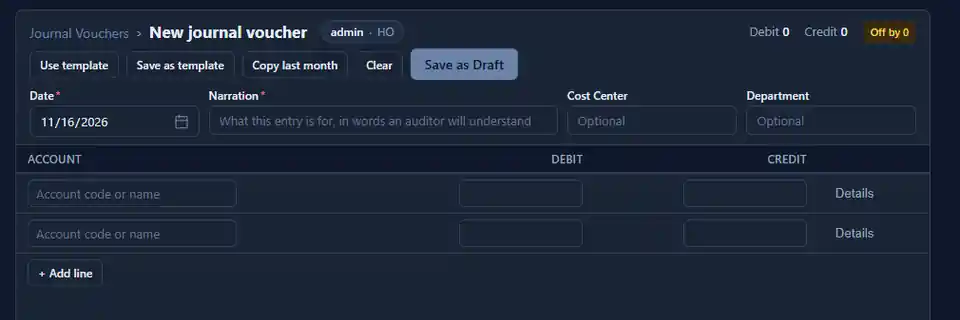

# Finance & Tax

Use [fixed assets](assets.md) for asset records and lifecycle actions, and
[expense claims](expenses.md) for submission, approval, verification and settlement.

Everything in this handbook sits on one mechanism: `PostDoubleEntry`, the
single function every posted document in this system goes through to reach
the general ledger. It takes a balanced set of debits and credits keyed by
account code, refuses to post into a closed accounting period, and is
idempotent by construction — a repeat call carrying the exact same posting
key (shaped `<DocType>:<DocID>:<PURPOSE>`) replays as a silent no-op instead
of posting twice, which is what makes a dropped network response safe to
retry. Everything else in this module — invoices, payments, revaluation,
manual journal entries — is a caller of that one function.

## The Finance screen

One sidebar entry each: **Home**, **Trial Balance**, **Chart of
Accounts**, **Accounting Periods**. This is deliberately a small screen —
most of what a controller actually reads regularly lives in **Reports →
Finance** instead (25 registered reports as of this writing; see
[Reports](#reports) below). Manual entries have their own screen,
**Financial Accounting → Journal Vouchers** (see
[Manual journal entries](#manual-journal-entries-journal-vouchers)). A few
real, working finance actions still have **no screen at all yet** — see
[What is not here yet](#what-is-not-here-yet) before assuming something
doesn't exist just because it isn't here.

## Approvals inbox

> [!WHAT]
> One list of every document waiting for your sign-off, from every module:
> purchase orders, payments over a limit, write-offs, price changes and more.

> [!WHY]
> A rule decides which documents need a second person. Nothing waiting for you
> is buried in its own screen, and every decision is recorded with who made it.

> [!USECASE]
> A buyer raises a ₹2,40,000 purchase order, above the limit that needs a
> manager. It appears in the manager's **Approvals**. The manager checks the
> amount and location, clicks **Approve**, and the buyer can send the order.

> [!HOW]

1. Open **Financial Accounting → Approvals**.
2. Check each row's record type, reference, amount and location.
3. Click **Approve** or **Reject** on its row. A reject asks for an optional
   reason.
4. To decide many at once, tick them and click **Approve ticked** or **Reject
   ticked**.

Password resets and client data removal are decided one at a time. Which
documents need approval, and who may approve, is set under **Security and
approvals** ([handbook](security-approvals.md)).

## Chart of Accounts

Every GL account has a **code**, a **name**, and a fixed **type** (Asset,
Liability, Equity, Revenue, Expense) that decides its normal balance side.
New accounts a feature needs (e.g. a new statutory-liability account) are
seeded by that feature's own migration — there's no "never touch this"
account, but adding one outside a migration means understanding which side
of the ledger it normally sits on before anything posts to it.

## Posting dimensions

A posting can optionally be tagged with up to four whole-posting dimensions
— **Cost Center**, **Department**, **Entity**, and **Project** — each
applying to every line one `PostDoubleEntry` call inserts, not per line
within it (the debit/credit maps already aggregate by account code before
they reach this function, so a per-line dimension isn't representable
without restructuring that). These dimensions are what the dimensioned P&L
reports (Cost Center P&L, Department P&L, Project P&L) and the entity/
consolidated trial balance reports filter and group by.

**Cost center, entity and department come from the document (Stage 93).**
Every Location has its own cost center — made with it, named after it — and
belongs to one legal entity (both required; Admin Guide B.3.0.3b). A posting
with none of its own takes:

- **cost center and entity** from its document's location: POS sales, sales
  invoices, GRNs, purchase returns, consumption, expense claims and assets
  directly; credit notes, vendor invoices, debit / vendor credit notes,
  refunds and payslips through the invoice, cart, GRN, return or employee
  they come from;
- **department** from the document (an expense claim's), else its parent (a
  payslip's employee), else the user who raised it — every user has a
  department from the day they are created. A journal voucher carries only
  the department picked on it.

Anything picked on the document is kept, and an Inactive record is skipped
rather than refusing the posting. So the Cost Center P&L reads store by
store, the Department P&L team by team, and the trial balance company by
company, without anyone tagging a sale by hand.

## Accounting periods and closing

> [!WHAT]
> An accounting period is a named date range. **Close** locks it so nothing
> more can post inside it.

> [!WHY]
> A closed period cannot be changed by a late posting. Five signed close tasks
> stand behind each close, and reopening needs a reason and a second person.

> [!USECASE]
> You create a period for April. Each close task's owner signs it off with
> evidence, then you close it. A correction found in May is a reopen request,
> another accountant's approval and a reversing entry.

> [!HOW]

1. On **Financial Accounting → Accounting Periods**, click **+ New Period**:
   name, start and end date.
2. Click **Close tasks**, assign an owner to each of the five tasks, and each
   owner clicks **Sign off** with the evidence.
3. Click **Close period**. If a pre-close check still fails, give the reason.
4. To correct a closed period, click **Request reopen** with a reason. Another
   Accountant, Admin or Super Admin approves it in **Approvals**.

**Create** a period (**Financial Accounting → Accounting Periods**,
**+ New Period**) with a name and a date range — a range overlapping any
existing period (Open or Closed) is refused outright, since an ambiguous
"which period is today in" question is worse than refusing the second period.

**Close** needs all five close tasks signed off by their owners (Bank
reconciliation, Stock valuation, Payables, Receivables, Marketplace / POS
settlement), and is refused while a till is still open or offline sales are
waiting to sync. Once a period is Closed, any posting dated inside it is
refused (`FIN-0260`), checked from the database's own clock, not the app
server's. **Reopening** needs a written reason and a second person: **Request
reopen** waits in **Approvals**, the period then starts a new close round, and
corrections are posted as new reversing entries, never by editing history.

**Before closing**, four read-only pre-close checks show which ones pass. A
failing one does not block the close, but the close then asks why and keeps
the reason in the period's close log:

| Check | What it means if it fails |
|---|---|
| Trial balance is balanced | Something's debits and credits don't match as of the period's end date. |
| No documents awaiting approval | At least one document is still sitting Pending Approval. |
| No vendor invoices in mismatch hold | A 3-way-match discrepancy (GRN vs. PO vs. invoice) hasn't been resolved. |
| No unmatched bank statement lines dated in this period | A reconciliation is incomplete for this period. |

**A backdated posting into an already-closed period** is possible, but only
through an explicit, named exception: a `BackdatedPostingRequest` naming the
exact document/date it authorizes, itself an approval-gated document. There
is no blanket override — each one is scoped to one specific posting.

## Trial Balance

The Trial Balance page (Financial Accounting → General ledger) is **as-of-a-date**, not "since the beginning of
time" — pick a date and it shows every account's balance as it stood then,
optionally filtered by Cost Center/Department/Entity. A balanced ledger
shows total debits equal to total credits; if they don't, that's exactly
what the pre-close checklist above is designed to catch before you try to
close the period it happened in.

## Accounts Receivable: Sales Invoices

> [!WHAT]
> Sales Invoices lists invoices with **Post** and **Settle** as two separate
> actions. Posting books the receivable. Settling records that it was
> collected.

> [!WHY]
> Once an invoice is Approved or Paid its money is fixed. You correct it with
> a credit or debit note, not by editing the amounts.

> [!USECASE]
> A ₹1,01,500 invoice is raised for a customer in Pune. You **Post** it to
> book the receivable, and **Settle** it when the payment actually comes in.

> [!HOW]

1. On **Financial Accounting → Sales Invoice**, open the invoice or click **+
   New Sales Invoice**.
2. Click **Post** to book the receivable.
3. Click **Settle** once the money is collected. To change a posted amount,
   raise a credit or debit note.

**Sidebar → Sales Invoices**: list, then **Post** and **Settle** as two
separate, explicit actions on an invoice — posting books the receivable
(Dr Accounts Receivable / Cr Revenue); settling records that it was
actually collected. A **deferred-revenue** invoice posts to a deferred
liability account instead of straight to revenue, and a background worker
recognizes it into revenue on schedule — see the **Deferred Revenue
Roll-Forward** report to track one in progress.

**A posted document's money is fixed** (`FIN-0844`, 47.16.4). Once a sales
invoice is Approved or Paid, a credit, debit or vendor credit note is
Posted, a journal voucher is Posted, or a vendor invoice has any payment,
a save may not change the amounts, tax, currency or exchange rate it
posted with. Nor may a save mark it Cancelled, Draft, Rejected, Void or
Reversed — that would leave its receivable and GST in the ledger while the
document said it was gone. Correct it with a credit or debit note (CGST
s.34) or the document's own reversal, each posting its own entry. An
Approved goods receipt is held the same way: a save cannot cancel it; it
is reversed with a purchase return (49.5.3).

## E-invoice (IRN)

For a GSTIN that must e-invoice (turnover above ₹5 crore), every posted
B2B **sales invoice** and customer **credit note** gets its IRN from the
government's IRP. An admin sets each GSTIN up once under **Financial
Accounting → E-Invoice Settings** (on/off, send automatically or not,
turnover band, document types, credentials); only the test provider exists
until the IRIS sandbox is connected. Accountants work the queue in
**Financial Accounting → E-Invoice (IRN)**: what needs fixing (HSN, unit,
PIN code, GSTIN, a number over 16 characters) is listed with the fix,
**Validate** rebuilds it, **Submit** sends it, **Unknown** means the IRP did
not answer and the document is looked up before anything is sent again.
Once it has an IRN, its tax details are locked; **Cancel IRN** within 24
hours needs a second Accountant's approval, after that issue a credit note.
B2C sales are never sent. The invoice print shows the IRN, Ack and the
signed QR, or *IRN PENDING*. Outage path: generate it on the portal, then
**Enter portal IRN** (verified by a second person). Reports: E-Invoice /
IRN Status Register, Error / Retry Report, IRN Portal Manual Upload Report.

## Accounts Payable: Vendor Invoices

> [!WHAT]
> The vendor's bill, checked against the purchase order and the goods
> actually received before anything is paid.

> [!WHY]
> You pay only for what you ordered and accepted. A bill that does not agree
> is held, so an overcharge is caught before the money leaves.

> [!USECASE]
> A vendor bills ₹59,000 but the goods receipt accepted ₹53,100 worth after a
> damaged carton was rejected. **Match** puts the bill on hold and shows both
> figures. The accountant asks the vendor for a corrected bill instead of
> paying the difference.

> [!HOW]

1. Open **Financial Accounting → Vendor Invoice**, click **+ New Vendor
   Invoice** and enter the bill against its purchase order and goods receipt.
2. Click **Match**. It compares the bill with the accepted goods and the
   purchase order.
3. If it is **Matched**, click **Pay** and enter the amount; less than the
   balance is a part-payment.
4. If it is on hold, correct the bill, or click **Override & Pay** and give a
   reason; the payment then waits for approval.

**Advance** sets an advance already paid to this vendor against the bill.
**Pay w/ TDS** picks the TDS section and withholds it; it is offered only
before any part of the bill is paid, because TDS is withheld on the whole
bill.

## Payment Proposals: paying many bills at once

> [!WHAT]
> A payment run: a batch of matched vendor bills paid together in one step.

> [!WHY]
> Paying on a fixed day keeps the cash plan simple. Each bill in the run is
> paid exactly as if it were paid on its own, so the books are the same either
> way.

> [!USECASE]
> Every Friday the accountant ticks the bills due that week, creates one
> proposal and executes it. One bill fails because it was already part-paid
> by hand; the result names that bill and the rest are paid.

> [!HOW]

1. Open **Financial Accounting → Payment Proposals**.
2. Click **+ New Proposal** and tick the matched bills to pay.
3. Click **Create Proposal from Selected**.
4. Click **Execute** on the proposal and confirm.

Any bill that could not be paid is listed with its reason; the others are
paid.

> [!WARNING]
> **The bank payment file has no button yet.** `GET
> /api/v1/finance/payment-proposal/{id}/payment-file` works but nothing in
> the app calls it, so producing the file your bank needs takes a direct API
> call today. The UTRs that come back are recorded from the screen: load the
> bank's response file in [Bank files](#bank-files-statements-and-bank-responses).

## Debit and credit notes

> [!WHAT]
> Notes that correct a posted bill or invoice: a **debit note** claims money
> back from a vendor, a **vendor credit note** records the vendor's own
> credit, and a **customer credit note** gives money back to a customer.

> [!WHY]
> A posted document's money cannot be edited. A note books the correction as
> its own entry, which is what GST law expects and what an auditor can follow.

> [!USECASE]
> A customer returns a ₹4,720 kurta after the invoice was posted. The
> accountant raises a customer credit note against that invoice for ₹4,720
> and posts it. The output GST and the receivable go down by the right
> amounts.

> [!HOW]

1. Open **Financial Accounting → Debit Notes**, **Vendor Credit Notes** or
   **Customer Credit Notes**.
2. Click **+ New Debit Note**, **+ New Vendor Credit Note** or **+ New Credit
   Note** and fill in the note against its bill or invoice.
3. Click **Post** and confirm. Posting books the entry at once and cannot be
   undone.
4. Click **Print** for the copy you send.

A goods receipt billed above the purchase order price raises its debit note
by itself.

## Bank Reconciliation

> [!WHAT]
> Each line of the bank statement matched to the entry in your books that it
> pays or receives.

> [!WHY]
> It proves the books agree with the bank. Anything left over is a missing
> entry, a bank charge or a mistake, and it is found while it is still fresh.

> [!USECASE]
> At month end 212 of 215 lines match on **Exact match**. One is a ₹590 bank
> charge, so the accountant posts the charge and matches it. One customer
> payment covers two invoices: **Find match**, tick both, **Match selected**.
> The last is unknown: **Raise exception** with an owner and a reason.

> [!HOW]

1. Open **Financial Accounting → Bank Reconciliation** and pick the bank
   account and dates.
2. Load the statement with **Statement Lines / Import CSV**, or under **Bank
   files**.
3. Click **Exact match**: same amount, within 3 days.
4. For what is left, click **Rule match**, set the amount tolerance and date
   window, and click **Run rule match**.
5. On each open line, click **Find match**, tick the book entries and click
   **Match selected** (or **Part match** when they cover only part of the
   line). Otherwise use **Explain** or **Raise exception**.

**Show** narrows the list to open lines, the exception queue, matched or
explained lines. **Unmatch** undoes a match and asks why. **Settlement file**
and **Match card / UPI** match the card and UPI payouts to their bank
credits.

## Bank files: statements and bank responses

**Bank Reconciliation → Bank files** has two loaders.

- **Statement.** Pick the bank account, the format (CSV or MT940) and the
  file. Every line gets a stable id, so loading the same file twice adds
  nothing; the result lists what was loaded and what was skipped.
- **Bank response.** Enter an Executed payment proposal, pick the bank
  account and the bank's CSV (payment_reference, utr, status, reason). A
  paid row records its UTR; a rejected row raises a bank exception with the
  bank's reason and reverses nothing. A reference the proposal does not hold
  is listed, not fatal.

Both need `finance.post`.

## Multi-currency and FX

A document in a foreign currency posts in both that currency and the base
currency, booked at the rate in effect when it posted. Two further pieces
close the loop:

- **Realised gain/loss on settlement** — when a foreign-currency invoice is
  actually paid/settled at a different rate than it was booked at, the
  difference posts automatically to a Realised FX Gain or Loss account.
- **Period-end revaluation** (`GET`/`POST /api/v1/finance/fx-revaluation`,
  the GET previews and the POST commits — deliberately two different verbs
  on the same URL, not a `dry_run` flag on one POST, so a retry or
  prefetch can never accidentally book a second adjustment) restates every
  still-open foreign-currency balance at the period-end closing rate and
  books the movement to an Unrealised FX Gain/Loss account.
  **`Open`/committed *balances* are revalued — commitments like a Purchase
  Order, Sales Order or RFQ are not**, since revaluing a commitment would
  post a gain against a control account holding no matching real balance.
  Revaluing the same document twice for the same as-of date is refused with
  a named reason, not silently skipped, since "nothing to do" and "already
  done" mean different things to whoever is closing the books.

> [!WARNING]
> **FX revaluation has no screen either.** The preview/commit split above
> is a real, deliberate safety design, but there is nowhere in the app to
> reach it — confirmed by grep, zero matches for `fx-revaluation` in
> `public/app.js`. A period-end revaluation needs a direct API call today.

Three registered reports read multi-currency data without needing their own
screen: **Open FX Exposure**, **FX Gain/Loss Register**, and **Trial
Balance in Presentation Currency** — all reachable from Reports → Finance
like any other report.

## Error codes reference

| Code | Meaning |
|---|---|
| `GLOBAL-0012` | An accounting period's Start Date is later than its End Date. |
| `FIN-0260` | Posting refused — the transaction date falls inside a Closed accounting period with no approved backdated-posting exception. |
| `FIN-0261` | (Warning) A bank statement line doesn't match anything in the ledger. |
| `FIN-0844` | A save tried to change a posted document's amounts, or to un-post it. Use a credit or debit note, or its reversal. |

## Reports

25 reports live under **Reports → Finance** as of this writing — Balance
Sheet, Cash Book/Bank Book, Cash Flow Statement/Forecast, Budget vs Actual,
Consolidated/Entity/Presentation-Currency Trial Balance, Cost Center/
Department/Project P&L, Deferred Revenue Roll-Forward, the two FX reports
above, and more. Every one of them exports, schedules and drills down (where
marked) exactly like any other registered report — see the full
[Report Catalog](report-catalog.md) for the complete list with parameters
and columns rather than a partial one duplicated here.

## Troubleshooting

**A posting is refused: "transaction date falls within closed accounting
period."** This is `FIN-0260` — either post with today's (open-period) date
instead, or have an admin create an approved `BackdatedPostingRequest`
naming this exact document and date first.

**The pre-close checklist shows the trial balance as unbalanced.** Something
posted an unequal debit/credit somewhere — this should not happen through
any normal document action (`PostDoubleEntry` refuses an unbalanced call
outright), so treat it as worth investigating rather than working around.

**A vendor invoice won't pay — it's stuck in mismatch hold.** A 3-way-match
discrepancy between the GRN, PO and invoice needs resolving first; this is
also one of the four pre-close checklist items, so it will block a clean
close if left unresolved.

**Need to generate a bank payment file, but there's no button.** See the
warning under Payment Proposals above: it is a real endpoint reachable only
via a direct API call today. UTRs are recorded by loading the bank's response
in **Bank files**.

## Manual journal entries (Journal Vouchers)

> [!WHAT]
> A Journal Voucher is a manual accounting entry for something no other screen
> makes, such as an accrual, a correction or an opening balance.

> [!WHY]
> You can only save it when the bar shows **Balanced**. Approval by another
> user is what posts it, and a posted voucher is never edited: you **Reverse**
> it instead.

> [!USECASE]
> At month end you accrue ₹45,000 of electricity charges. You enter the
> **Date** and **Narration**, add one debit and one credit line, **Save as
> Draft**, and **Submit for Approval** so another user can approve it.

For an entry no other screen makes — an accrual, a correction, an opening
balance — use **Financial Accounting → Journal Vouchers**:

> [!HOW]

1. Click **+ New Journal Voucher**. Enter the **Date** (the voucher books on
   that date, even if it is approved later) and a **Narration**; **Cost
   Center** and **Department** are optional.
2. Add one row per account with **+ Add line** — an **Account** and either a
   **Debit** or a **Credit**. The bar shows **Balanced** when the totals match;
   only then can you **Save as Draft**.
3. On the list, click **Submit for Approval** on its row. Another user
   approves it on **Approvals**; approval is what posts it.
4. A posted voucher is never edited: **Reverse** makes a new voucher with every
   line swapped, which goes through approval the same way. An approved voucher
   whose posting failed shows **Retry Post**.

The full steps are in the User Guide (§9B, Journal Vouchers).

## What is not here yet

**These real, tested, GL-posting actions still have no screen**, confirmed by
a search of `public/` (2026-10-24):

- **Recurring journal templates** — the journal-voucher API can save a
  voucher as a recurring template; the Journal Vouchers screen lists only
  ordinary vouchers and has no button to make or run a template.
- **Intercompany Transactions** — cross-entity mirrored postings
  (`POST /api/v1/finance/intercompany-transaction`), used by the entity/
  consolidated trial balance reports, are API-only.
- **Landed Cost Vouchers** — allocating freight/duty/other charges onto
  landed cost (`POST /api/v1/finance/landed-cost-voucher`) is API-only.
- **FX revaluation** and **bank-payment-file generation** — see the warnings
  above.

In every one of these cases the underlying feature is real, tested, and
already how the reports listed above get their data — this is a coverage
gap in the frontend, not a stub in the backend.
