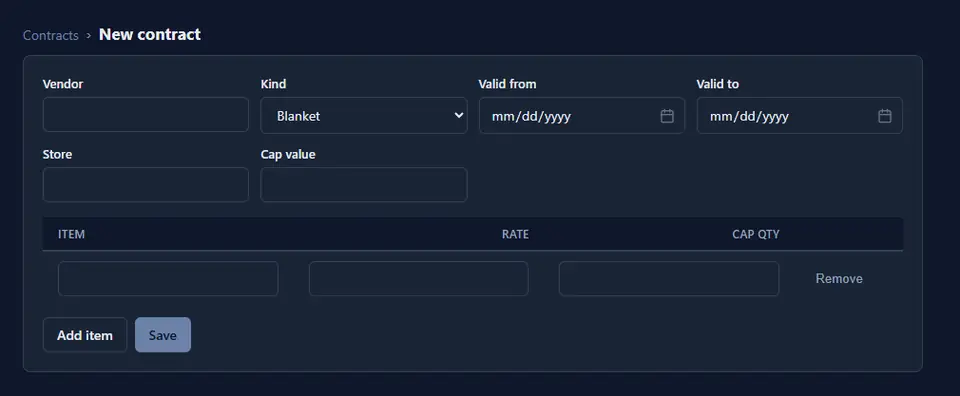
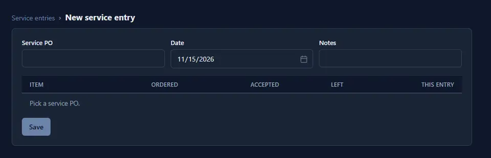

# Purchase contracts and service entries

## A contract with a vendor

> [!WHAT]
> A purchase contract fixes one vendor's rates for a period, with an optional
> cap on what you may buy under it.

> [!WHY]
> Every PO released under it is held to the deal: no rate above the
> contract's, no item off it, no date outside it and no release past the cap.
> The negotiated terms are enforced on each order instead of remembered.

> [!USECASE]
> You agree a year's rate for packing tape with one supplier: ₹38 a roll, up
> to ₹5,00,000. Each month's order is released from the contract, the rate
> fills itself in, and the contract shows how much of the cap is used.

> [!HOW]

1. Open **Procurement » Contracts** and click **New contract**.
2. Pick the **Vendor** and the **Kind**, set **Valid from** and **Valid to**, and
   optionally a **Store** and a **Cap value**.
3. Click **Add item** for each item and give its rate (and an optional cap
   quantity).
4. Click **Save**. The contract is a **Draft**.
5. A purchase-order approver opens it and clicks **Activate**. The terms are now
   locked.

## Buying under it

1. Open an **Active** contract and click **Release PO**. The new PO opens with the
   vendor, store and contract filled in.
2. Add lines. Leave the rate blank to take the contract rate.
3. Submit the PO for approval as usual.

The contract refuses a rate above its own, an item not on it, a PO dated outside
its validity, another vendor's PO, and a release that would pass the cap.

The contract shows **Released ... of ...** against its cap, and lists each
release PO. A release counts once it is submitted; a cancelled one gives its
value back. **Close** ends a contract early.

## Paying for a service

> [!WHAT]
> A service entry records work a vendor has done against a service PO: a
> repair, a maintenance visit, a consultant's days.

> [!WHY]
> A service has no goods to receive, so the service entry stands in for the
> goods receipt. The cost is accrued once, when an approver accepts the work,
> and the vendor's bill is matched against accepted work, not against the PO.

> [!USECASE]
> You order 12 monthly AC services. After the March visit the store enters 1
> service done and the manager accepts it. The vendor's March bill matches the
> one accepted visit; a bill for two would be held.

> [!HOW]

1. On **New purchase order**, set **Type** to **Service**. A service PO is never
   received on a goods receipt, and no stock moves.
2. When work is done, open **Procurement » Service Entry**, click **New service
   entry**, pick the service PO and enter the quantity done on each line. You
   cannot enter more than was ordered, less what is already accepted.
3. Click **Save**. An approver opens the entry and clicks **Accept**. The cost is
   accrued once; clicking **Accept** again changes nothing.
4. On the vendor's bill, set the **PO** and the **Service entry**. The bill is
   matched against the accepted work. A bill for more than that is held.

> [!TIP]
> On the PO list, a service PO's **Receive goods** button reads **Service
> entry** and opens this screen.
