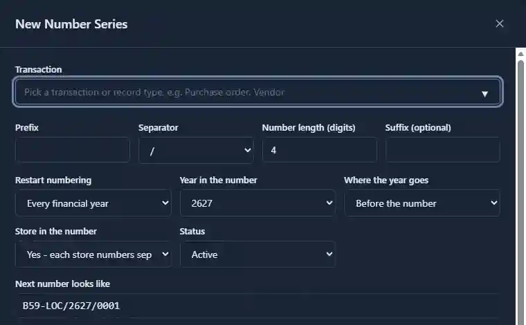

# Settings and configuration

These are the screens under **Settings** that change how the whole business
works. Most need an Admin; Extension Hooks needs a Super Admin. Users, roles
and approval rules have their own handbook:
[Security and approvals](security-approvals.md).

## Configuration

> [!WHAT]
> One screen for every operational setting, one module at a time: return
> windows, match tolerances, cycle-count intervals, session length and more.

> [!WHY]
> A change takes effect at once, everywhere, with no restart and no code
> change. Numbers outside their allowed range are refused, so a typing slip
> cannot stop the system.

> [!USECASE]
> The owner allows returns for 45 days instead of 30. The admin opens **Sales
> & Returns**, sets the sales return window to 45 and saves. The next return
> at any store uses 45 days.

> [!HOW]

1. Open **Settings → Configuration**.
2. Pick the module on the left.
3. Change the values you need.
4. Click **Save Changes**.

A setting you never changed shows its default. **Credentials** and **Data
governance** in the same menu open their own parts of this screen.

## Data quality

> [!WHAT]
> A queue of master-data problems: customers sharing a phone or email,
> vendors sharing a GSTIN or a name, items with the same name, and records
> with missing or wrong tax details.

> [!WHY]
> Duplicates split a customer's history and loyalty, and wrong tax details
> end up on invoices and GST returns. The queue finds them before they cost
> money.

> [!USECASE]
> Two cashiers created the same customer with the phone 98200 12345. The
> scan lists both records. The admin merges them in CRM; the next scan marks
> the problem Fixed.

> [!HOW]

1. Open **Settings → Data quality**.
2. Click **Scan now**.
3. Open each record and correct it.
4. Click **Scan now** again: corrected problems become **Fixed**.
5. To accept a problem as it is, click **Ignore** and give a reason.

A scan never adds a problem twice. A Fixed problem that comes back is opened
again; an Ignored one stays ignored until you click **Reopen**.

## Data Healer

> [!WHAT]
> A heal is a one-time fix that brings records made before a release up to
> what the new release expects. **Data Healer** lists every heal and whether
> it is waiting or done.

> [!WHY]
> A release never changes your data by itself. A heal shows you every change
> before it runs, and it runs only once.

> [!USECASE]
> After a release, items need a short alias for labels. A strip above every
> screen says a heal is waiting. The admin opens it, types over two of the
> suggested aliases, and clicks **Run heal**. The strip goes away.

> [!HOW]

1. Click **Fix now** on the strip, or open **Settings → Data Healer**.
2. Open the waiting heal.
3. Check the value each record will get; type over any you want different.
4. Click **Run heal**.

While a heal waits, the records it covers cannot be saved from their screen.
Users who cannot run it see **Ask your admin**. Done is final. Full detail:
[Data Healer](../admin-operations/data-healer.md).

## Prefix Configs: document numbers

> [!WHAT]
> The number series behind every document: purchase orders, bills, transfers,
> items and the rest.

> [!WHY]
> Each store and each financial year gets the numbers your accounts and
> auditors expect, without anyone typing them.

> [!USECASE]
> The Pune store (Short Code PUN) wants its own run of bill numbers. The
> admin edits the sales bill series, sets **Store in the number** to Yes and
> **Restart numbering** to every financial year, checks the preview and
> saves. Pune's next bill carries PUN and starts again at 1 each April.

> [!HOW]

1. Open **Settings → Customize → Prefix Configs**.
2. Pick a group beside **New Series** to narrow the list.
3. Click **Edit** on the series.
4. Set the prefix, separator, number length, suffix, **Restart numbering**,
   the year and **Store in the number**; the preview shows the next number.
5. Click **Save**.

Full detail: Admin Guide §B.3.2.

## Dynamic Labels

> [!WHAT]
> Your own words for the system's labels, for example "Design Number" where
> the app says "SKU".

> [!WHY]
> Staff see the words of their own trade, so screens need less training.

> [!USECASE]
> A jewellery business calls a brand a "Collection". The admin adds a rule
> from `Brand` to `Collection`; every screen shows Collection from then on.

> [!HOW]

1. Open **Settings → Customize → Dynamic Labels**.
2. Click **Add Translation Rule**.
3. Enter the label exactly as it shows now, then your word.
4. To undo, click **Remove** on the rule.

The change shows the next time a screen opens.

## Extension Hooks

> [!WHAT]
> Lets a developer you hire be told when something happens in the ERP, such
> as a document being saved, without access to the database.

> [!WHY]
> Your own systems stay in step with the ERP while it stays closed to them.
> The call log shows every call, so a missing update is easy to trace.

> [!USECASE]
> A developer's app needs every new vendor. The Super Admin registers a hook
> on Vendor with the developer's `https://` address. Next day the developer
> says one vendor never arrived; **View Log** shows that call and the error
> their server sent back.

> [!HOW]

1. Open **Settings → Customize → Extension Hooks**.
2. Choose the hook point and record type, enter the `https://` address and a
   timeout, and click **Register Hook**.
3. Click **View Log** to see a hook's last 100 calls.
4. To give a developer a short-lived token, click **Issue Token**, pick the
   record type and minutes (at most 1440), and copy it: it is shown once.
5. To stop a hook, click **Delete**.

## API access

> [!WHAT]
> The keys an outside system uses to call the ERP's API: an API key or an
> OAuth client, each limited to the scopes it needs.

> [!WHY]
> Each system gets its own key with only the access it needs. You can see its
> calls, change its secret, or cut it off without affecting anyone else.

> [!USECASE]
> A courier partner needs to read orders. The admin issues a key with only
> the order scope and sends the secret once. Months later the partner
> changes staff, and the admin clicks **Rotate** to issue a new secret.

> [!HOW]

1. Open **Settings → Customize → API access**.
2. Click **+ New API access**, name it and tick only the scopes it needs.
3. Click **Issue** and copy the secret: it is shown once.
4. Use **Rotate** for a new secret, **Revoke** to stop it, and **Recent
   calls** to see its traffic.

Full detail: [API authentication](../reference/public-api-authentication.md).

## Subscription

> [!WHAT]
> Your plan, when the paid period ends, this month's use against what the plan
> includes, and the GST invoice for each payment.

> [!WHY]
> You can see whether the account is paid up and how much of the plan you use
> before anything stops working.

> [!USECASE]
> The accountant needs last month's invoice for input tax. The admin opens
> **Subscription** and reads the GST invoice for that payment under
> **Invoices**: taxable amount, CGST and SGST or IGST, and the total.

> [!HOW]

1. Open **Settings → Customize → Subscription**.
2. Read the status, plan and period end at the top.
3. Check this month's use against the plan.
4. Find each payment's GST invoice under **Invoices**.

Only an Admin sees this screen, and nothing on it changes the plan; plans are
chosen and paid with the platform owner. Full detail:
[Your Subscription](../admin-operations/subscription.md).

## System Status

> [!WHAT]
> What is running where: the latest deployment in each environment, the
> deployment history, and the backup and restore-drill history.

> [!WHY]
> Answers "what version is live?" without logging in to the server, and shows
> when nobody has tested a restore for too long.

> [!USECASE]
> Before a store opening the admin checks that the last restore drill is
> recent. It shows a warning badge, so they ask the operator to run one
> before the weekend.

> [!HOW]

1. Open **Settings → Monitoring → System Status**.
2. Read **Latest Deployment by Environment**.
3. Check **Backup & Restore Drill History** for a warning badge.

The screen is read-only. Rows appear only when the deploy and backup scripts
record them, so an empty table means the scripts have not run against this
database.
