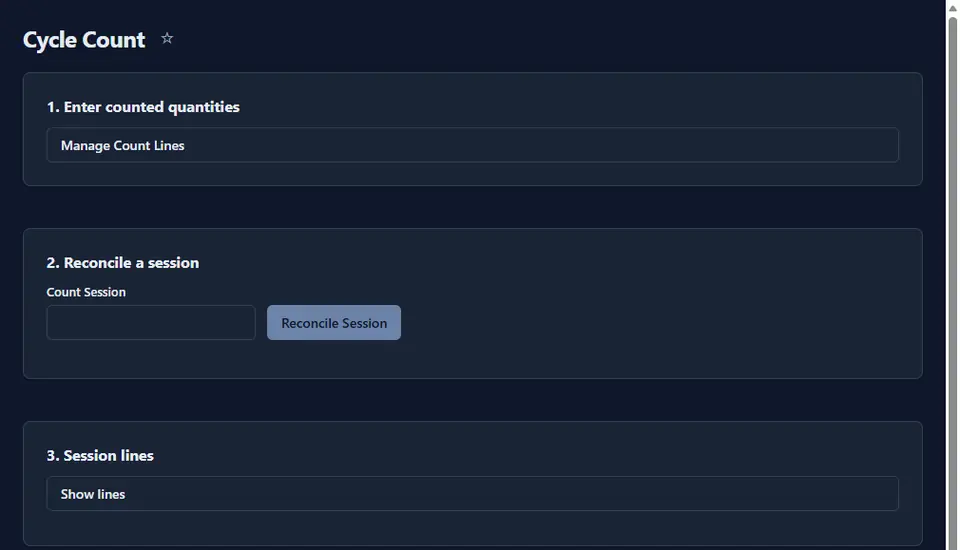

# Warehouse (WMS) - what each screen is for

Every WMS screen is under **WMS**. Goods come in through a Goods Receipt, which puts them *at a location*. The WMS screens then say *which bin* they sit in, whether they can be sold, and how they are picked and shipped.

## Two kinds of stock count

- **Location stock** is what a store or warehouse holds. A Goods Receipt, a Stock Transfer, a sale or dispatch, and an approved cycle count change it.
- **Bin stock** is where that stock sits inside the location. Putaway, Location Movement and Bin Replenishment change it. Moving stock between bins never changes location stock.
- **Available to sell** is location stock minus what is reserved for orders, what is on hold, and what is not in Good condition. **Inventory → Stock on Hand** shows all of these for each item and location.

## Set up once, in this order

| # | Where | What to fill |
|---|---|---|
| 1 | **Setup → Location** | The warehouse or store itself. |
| 2 | **Setup → Zone** | Only if you group bins into zones. |
| 3 | **WMS → Storage & Control → Bin** | **Bin Code**, **Location** and **Status** are required. A **Zone** must be an Active zone. **Capacity**, **Max Weight** and **Max Volume** are enforced at putaway. **Bin Type**: Reserve bins are used first to refill PickFace bins. **Bin Status** Blocked, Full or Counting stops putaway, moves and picking from that bin. |
| 4 | **Item** (the item form's **Batch, serial and expiry** section) | **Traceability**, shelf life and the **GRN batch number** rule. |
| 5 | **WMS → Inbound → Dock Doors** | **Door Code**, **Door Type** (Inbound, Outbound or Both) and **Status**. Add **Max Concurrent Appointments** to stop over-booking. |
| 6 | **Setup → WMS → Hold Code** | **Hold Code**, **Category** and **Status**. A hold can only use an Active code. |
| 7 | Optional, in **Setup** | **Putaway Strategy** (needed for **Suggest Bin**), **Bin Replenishment Rule** (under **Advanced**), **Wave Template**, **Pre-Ship Validation Rule**, **Sort Station**, **Trailers**, and Reason Codes in the category *Cycle Count Variance*. |

## Receiving goods

> [!WHAT]
> Receiving goods is the path from the vendor's ASN to stock in a bin:
> appointment, yard check-in, receipt and putaway.

> [!WHY]
> Accepted stock becomes available at the location. Rejected stock goes to QC
> hold and damaged stock to Damaged. Batch-tracked stock cannot be picked
> until you also use **Put a lot away**.

> [!USECASE]
> A truck arrives at the Bhiwandi warehouse. You check it in on the Yard
> Board, assign it to a door, receive each carton's SKU and **Post Receipt**,
> then **Put away** each row to a bin.

> [!HOW]

1. **Procurement → ASN**: record what the vendor is sending against the PO. This is a record; it moves no stock.
2. **WMS → Inbound → Appointment Calendar**: book a dock door and a time slot (**+ New Appointment**). The door must allow that appointment type and must not be over its limit.
3. **WMS → Inbound → Yard Board**: **+ Check In Trailer** when the truck arrives, then **Assign to Door** → **Spot here**.
4. Receive the goods, in one of two ways:
   - **Receive** on the Yard Board row (or **WMS → Inbound → RF Receiving**): scan each carton's SKU and confirm the quantity, then **Post Receipt**. Use this for items without batches.
   - **Procurement → Goods Receipt**: **Load Items from ASN** or **Add PO & Load Items**, then enter received, rejected and damaged quantities and any batch, manufacture and expiry dates. Use this for batch-tracked items.
   
   Accepted stock becomes available at the location. Rejected stock goes to QC hold and damaged stock to Damaged. When the ASN is fully received, its appointment is marked Completed.
5. **WMS → Inbound → Putaway**: the list shows stock at the location that is not in a bin yet. It appears only at locations that have Active bins. Press **Put away** on a row, choose the bin (or **Suggest Bin**), then **Put Away**.
6. For batch-tracked items, also open **WMS → Storage & Control → RF Lot & Serial** → **Put a lot away**. Until you do this, that stock cannot be picked.

## Keeping stock right

> [!WHAT]
> These screens keep bin stock and its condition correct after receiving:
> **Location Movement**, **Bin Replenishment**, **Bin Conditions**, **Place
> Hold**, **LPN / Cartons / Pallets** and **Cycle Count**.

> [!WHY]
> Moving stock between bins never changes location stock. Anything other than
> Good condition stops being available to sell and is never picked.

> [!USECASE]
> A pick bin in Pune is below its minimum. You click **Get Suggestions** on
> **Bin Replenishment**, then **Replenish** to move stock from a Reserve bin.

> [!HOW]

1. To move stock between bins, open **Location Movement**, choose the
   location, click **Show Bin Stock**, then **Move** on a row.
2. To refill pick bins, click **Get Suggestions** on **Bin Replenishment**,
   then **Replenish**.
3. To mark stock Damaged, QC-Hold or RTV, use **Bin Conditions**.
4. To check quantities, enter count lines on **Cycle Count** and click
   **Reconcile Session**.

- **Location Movement** (under Stock): move stock from one bin to another at the same location. Choose the location, then **Show Bin Stock**, then **Move** on a row. Only Good stock moves, and quantity reserved for open picks is refused. To move between locations, use **Stock Transfer**.
- **Bin Replenishment**: **Get Suggestions** lists bins below their minimum, from your Bin Replenishment Rules, and proposes a refill to the maximum, taking from Reserve bins first. **Replenish** moves the stock bin to bin.
- **Bin Conditions**: change the condition of stock in a bin between Good, Damaged, QC-Hold and RTV. Anything other than Good stops being available to sell and is never picked. Moving it back to Good restores it.
- **Bin Generator**: make many bins from aisle, rack, shelf and bin ranges, preview first, and print Code 128 bin labels. Running it again only adds the new bins.
- **Place Hold**: hold a quantity of an item at a location (for example for a quality check). It stops that quantity being sold or reserved for new orders. **Holds** lists every hold and is read-only. To release one, raise a **Hold Release Request** and **Submit for Approval**. When a Store Manager approves it, the hold is released.
- **LPN / Cartons / Pallets**: **Assign** records that stock in a bin sits in a carton or pallet (an LPN). **Look up an LPN** (its own page) shows what is in one. This is a record only and moves no stock.
- **Cycle Count**: count what is physically there (**Count lines**), then **Reconcile Session**. A line with no difference posts straight away. A large difference is sent for a blind recount, and other differences go to Approvals. Each variance needs a reason before it posts.
- **RF Lot & Serial**: besides **Put a lot away**, use **Issue a lot**, **Change a serial** and **Sweep expired lots** (which quarantines lots past their expiry date).

## Cycle Count

> [!WHAT]
> Counting what is really on the shelf, a few items and bins at a time, and
> correcting the books to match.

> [!WHY]
> Stock on screen drifts from stock on the shelf through breakage, mis-picks
> and theft. A small count every day finds it without closing for a full
> stocktake. No difference posts unchecked: each needs a reason, and large
> ones are counted again by someone else.

> [!USECASE]
> The planner shows 40 fast-moving items due at the Pune store. A counter
> counts them in one session. 38 agree and post at once. One is 3 short: the
> manager picks the reason, approves it in **Approvals** and posts it. One is
> 25 short, so it goes to a second counter for a blind recount.

> [!HOW]

1. Open **WMS → ABC count plan**, enter the location and click **Get Plan**
   to see what is due.
2. Open **Count lines** and enter the counted quantity for each item
   and bin in one count session.
3. Open **Cycle Count** and enter that session in **Count Session** and click **Reconcile Session**.
4. Click **Show lines** and choose a **Reason** for each difference.
5. Once a difference is approved, click **Post** on its line. For a recount
   line, enter the quantity and click **Save recount**.

Reasons come from Reason Codes in the category *Cycle Count Variance*; if
there are none, **Add one** opens that list.

## Shipping orders

1. Releasing a sales order creates its fulfilment tasks.
2. **Wave / Batch Picking**: tick orders under **Orders ready to wave**, then **Put N selected into the wave**. Then **Release** the wave and open its **Pick list**, which reserves bins oldest order first and shows the walking route and any shortfall. A wave covers one location only.
3. Pick on paper from the pick list, or press **Pick on a phone** (**Mobile Picking**): confirm each line, then **Mark N order(s) packed**. Orders that are short stay as they are.
4. **Sortation / Put-Wall** (optional): record which order goes into which slot of a sort station.
5. **Loading**: **Open New Load** for a dock door and trailer, scan the invoiced packages, then **Complete Load** (which runs your pre-ship checks), **Record Exchange & Depart**, and **Print Bill of Lading** if you need one.
6. **Hand over** on **OMS → Manifests** is the step that dispatches the tasks and takes the stock out of the location and its bins. Loading does not do this.

## Wave / Batch Picking

> [!WHAT]
> Picking many orders in one walk: orders are grouped into a wave, and the
> picker gets one list in bin order instead of one trip per order.

> [!WHY]
> One walk through the aisles instead of twenty saves most of the picking
> time. Stock is reserved when the wave is released, so two pickers never
> go for the same units, and any shortfall shows before anyone walks.

> [!USECASE]
> At 11 am the Bhiwandi warehouse has 18 online orders ready. The supervisor
> ticks all 18, puts them into a new wave and releases it. The pick list
> shows one short item. The picker walks the route with **Pick on a phone**,
> confirms each line, and marks 17 orders packed; the short one waits.

> [!HOW]

1. Open **WMS → Outbound → Wave / Batch Picking** and choose the location.
2. Under **Orders ready to wave**, tick the orders, choose **A new wave** in
   **Into**, and click **Put N selected into the wave**.
3. Under **Open waves**, click **Release**.
4. Click **Pick list** to pick on paper in bin order, or **Pick on a phone**
   to confirm each line with **Confirm & Next**.
5. When nothing is left to pick, click **Complete**, then load the packed
   orders.

A wave covers one location. Batch-tracked items are allocated oldest expiry
first (FEFO): pick the exact batch shown.

## Watching the floor

- **Home**: one location's open tasks, exceptions, waves, inbound deliveries due, throughput and bin use, with **Labour plan**, **Labour standards** and **Warehouse Billing** as their own entries beside it. It changes no stock.
- **Waves**: the list of every wave and its status. A status moves only one step forward at a time.
- **Cross-Dock Plans**: say that a quantity of an item should go straight out to a destination. Putaway's **Stage Against Plan** uses the oldest open plan for that item and moves the stock into a cross-dock bin.

## Every WMS menu entry at a glance

| Menu entry | Use it to | Changes stock? |
|---|---|---|
| Bin | Set up bins and their limits | No |
| Putaway | Put received stock into bins | Bin stock |
| Home | Watch one location's work | No |
| Bin Conditions | Mark stock Good, Damaged, QC-Hold or RTV | Available to sell |
| LPN / Cartons / Pallets | Record which carton or pallet holds stock | No |
| Bin Replenishment | Refill pick bins from reserve bins | Bin stock |
| Wave / Batch Picking | Group orders, release, print pick lists | Reserves bins |
| Mobile Picking | Pick a wave on a phone and mark orders packed | Order status |
| RF Lot & Serial | Put lots into bins, issue lots, fix serials, quarantine expired lots | Lot detail |
| Cycle Count | Count and correct stock | Location stock, after approval |
| Dock Doors | Set up dock doors | No |
| Appointment Calendar | Book a door and time slot | No |
| Yard Board | Check trucks in, send them to a door, check them out | No |
| Trailers | Keep a list of trailers to pick from | No |
| Hold Codes | Set up reasons for holds | No |
| Holds | See every hold (read-only) | No |
| Place Hold | Hold a quantity at a location | Available to sell |
| Hold Release Requests | Ask for a hold to be released | Releases it, after approval |
| Cross-Dock Plans | Plan stock that goes straight out | Through Putaway |
| RF Receiving | Receive an ASN by scanning | Location stock |
| Waves | List waves and their status | No |
| Sortation / Put-Wall | Record which order goes in which slot | No |
| Loading | Load a trailer and record departure | No |

## What the system does for you (Stage 130.13)

- A posted Goods Receipt has a **Put away** button beside **Print stickers**: Putaway opens on its store with its items listed first. RF Receiving still offers **Put it away now** when it finishes.
- A hold stops held stock being picked as well as sold: a pick list takes at most the bins' free stock less what is held at the location, and reports the rest as short.
- **Mobile Picking** saves each line you confirm on the server, with your name. Reload the screen, or open the wave on another phone, and it carries on from the first line still to pick.
- **Loading** scans the shipping packages the OMS **Pack** step makes and invoices (since Stage 88).
- **Sortation**: type a station and its number of slots and press **Set up slots**; **Assign the whole wave** gives each open order of a wave its own slot; a filled slot offers **Pack**.
- An approved cycle count of a bin sets that bin to the counted quantity, as well as correcting the location's stock.
- A Goods Receipt meets the **Cross-Dock Plans** of its PO or ASN: each plan for an item that came in is marked with the receipt, the receipt lists them, and a *Cross-Dock Goods Arrived* notification goes out.
- Opening a load for a trailer puts its **Outbound** appointment *In Progress*; when the load **departs**, the trailer is checked out of the yard (Departed) and the appointment completed - no hand check-out.

For the detailed receiving, picking and counting rules, see [Inventory & Warehouse Operations](inventory-wms-operations.md). For batches and expiry, see [Batch, Serial & Expiry Traceability](traceability-batch-serial.md).
